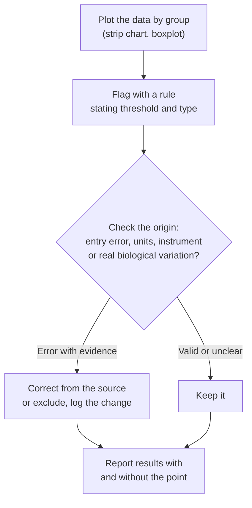

Whether a value counts as an outlier depends on the rule you choose and even on how your software computes quartiles. This fifth article in the *Introduction to Data Analysis with R* series compares three families of outlier rules (Tukey's 1.5 × IQR fences, |z| > 3, and a robust z based on the median and MAD), explains the nine quantile definitions that make R, Excel, NumPy and SPSS return different numbers, and then uses the Palmer Penguins data to illustrate Simpson's paradox. Every main table and figure can be reproduced with the accompanying R code, tested on R 4.4.3.

## 1. Introduction: is 950 an outlier?

Consider the monthly sales of eight branches of a company, in millions of Vietnamese dong (VND): 200, 350, 420, 480, 510, 560, 620 and 950. These are hypothetical figures, used as a teaching example for boxplots and the IQR (Hoàng et al., 2026). The question is simple: is the 950 branch an outlier?

If you compute quartiles the way most introductory textbooks do, taking the median of the lower half and of the upper half, you get $Q_1 = 385$, $Q_3 = 590$, $IQR = 205$ and an upper fence of $590 + 1.5 \times 205 = 897.5$. Since 950 > 897.5, the answer is **yes**. R's default `quantile()` gives $Q_1 = 402.5$ and $Q_3 = 575$, an upper fence of 833.75, so the answer is still **yes**. But if you use the quantile definition that R's help page attributes to Minitab and SPSS (R Core Team, 2025), the upper fence becomes 961.25 and the answer is **no**. The |z| > 3 rule gives z(950) = 1.99, also **no**. In fact, with eight observations this rule cannot flag any point at all, even if the sales figure were 9,000 instead of 950 (Shiffler, 1988).

| Method | Upper threshold | Is 950 an outlier? |
|---|---|---|
| Tukey, hand-computed quartiles (median of each half) | 897.5 | Yes |
| Tukey, R's default `quantile()` (type 7) | 833.75 | Yes |
| Tukey, quantile type 6 (Minitab, SPSS) | 961.25 | No |
| \|z\| > 3, using the sample mean and SD | z(950) = 1.99 | No |

*Table 1. The same data, four methods, two opposite conclusions.*

Table 1 captures the central point of this article: **an outlier is a label assigned by a rule, not an inherent property of the data**. Any report that uses the word "outlier" should therefore state the rule, the threshold, the function and the software used. After the groundwork on **robust** statistics in section 2, the article follows three threads: outlier detection rules (section 3), quantile definitions (section 4), and pooled versus within-group correlation (section 5).

## 2. Groundwork: location and spread, classical and robust

### 2.1. Mean, median and trimmed mean

The mean uses every value, so a single extreme value is enough to drag it a long way. The median depends only on the ordering, so it does not get dragged along. Bruce and Bruce (2017) call this property *robust* or *resistant*: an estimate that is little affected by extreme values. For the eight branches, the mean is 511.25 and the median is 495. Drop the 950 branch and the mean falls to 448.57 (= 3140/7), while the median only moves from 495 to 480.

Between the two extremes sits the trimmed mean: drop a fixed fraction at both ends and average the rest (Bruce & Bruce, 2017). Dropping one value at each end of the eight branches (`mean(x, trim = 0.125)` in R) gives 490, closer to the median than to the mean.

The mode, the most frequent value, is the only measure of center that works for a nominal variable such as blood group or species. For an ordinal variable, such as pain rated from 1 to 5 or disease stage, the levels are ordered, so the median is still meaningful and is usually more informative than the mode.

### 2.2. SD, IQR and MAD

The standard deviation (SD) squares each deviation from the mean, so the farther a value lies, the larger its influence: the SD of the eight branches is 220.0, and 140.8 once 950 is dropped. The interquartile range (IQR) uses only the middle 50% of the data. The median absolute deviation (MAD) is the median of the distances $|x_i - \tilde{x}|$, where $\tilde{x}$ is the median:

$$\mathrm{MAD} = 1.4826 \times \operatorname{median}\left(|x_i - \tilde{x}|\right)$$

The constant 1.4826 puts the MAD on the same scale as the SD when the data are normally distributed (Bruce & Bruce, 2017). R's `mad()` function applies this constant by default (R Core Team, 2025). For the eight branches, the MAD is 148.26; without 950 it is 118.6. The MAD is not the only robust estimator of spread: Rousseeuw and Croux (1993) proposed two estimators, $S_n$ and $Q_n$, that tolerate as high a fraction of contaminated data as the MAD but are more efficient when the data are normal.


*Figure 1. The eight branches with mean ± SD (red) and median ± MAD (blue), before and after dropping the 950 branch. One value shifts the mean and SD much farther than the median and MAD.*

### 2.3. Breakdown point

Robustness is measured by the **breakdown point**: the largest fraction of observations that can be replaced by arbitrary values without the estimate being driven to infinity (Rousseeuw & Croux, 1993; Rousseeuw & Hubert, 2011). The mean and SD have a breakdown point of 0, because a single sufficiently large value can make them arbitrarily large. The IQR withstands up to 25% contamination, since more than a quarter of the data must be corrupted before a quartile can be dragged away. The median and MAD withstand up to 50%, the highest possible value. Any rule built on the mean and SD inherits that weakness, as section 3 will show.

A small note on the sample variance: dividing by $n - 1$ makes $s^2$ an unbiased estimator of $\sigma^2$, but $s = \sqrt{s^2}$ is still a slightly biased estimator of $\sigma$, because the square root does not preserve expectations. Estimation and confidence intervals are covered in more depth in the article on [sample statistics and parameter estimation](/en/blog/3-dac-trung-thong-ke-cua-mot-mau-va-uoc-luong-tham-so-cua-tong-the/).

## 3. Thread 1: three families of outlier rules

### 3.1. Tukey's fences

The boxplot was introduced by Tukey (Tukey, 1977; Bruce & Bruce, 2017), and with it came the fence rule:

$$\left[\,Q_1 - 1.5 \times IQR,\ Q_3 + 1.5 \times IQR\,\right]$$

Points outside this interval are drawn individually as suspect points. McGill et al. (1978) describe variations of the boxplot, and Hoaglin et al. (1986) studied the performance of such "resistant" rules when used to label outliers. It is worth distinguishing the **fence**, which is a computed threshold, from the **whisker**, which is the line extending to the most extreme actual data point still inside the fence. For the eight branches, the hand-computed upper fence is 897.5, but the upper whisker stops at 620, because 620 is the largest value that does not exceed the fence.

If the data are normally distributed, the probability that a point falls outside Tukey's fences computed from the population quartiles is about 0.70%. For samples of n = 200, the average flagging rate over 2000 simulations is 0.85%, slightly higher because sample quartiles fluctuate around the true quartiles.

### 3.2. The |z| > 3 rule and Shiffler's bound

The standardized score $z_i = (x_i - \bar{x})/s$ measures the distance to the mean in units of SD. A popular rule flags a point when |z| > 3. This rule has two weaknesses.

The first weakness is a **sample-size bound**. When $\bar{x}$ and $s$ are computed from the same sample, the largest attainable z-score is bounded from above (Shiffler, 1988):

$$|z_i| \le \frac{n-1}{\sqrt{n}}$$

For n = 8 the bound is 2.47; for n = 10 it is 2.85; only from n = 11 (bound 3.02) can |z| > 3 occur at all. The farther a point lies, the more it pulls the mean toward itself and inflates the SD, so its z-score does not keep growing. Change 950 to 9,000 and that branch's z-score is only 2.47, exactly the bound. With small samples, which are common in biology experiments with 3 to 10 replicates, the |z| > 3 rule is mathematically incapable of flagging anything.


*Figure 2. Largest attainable |z| by sample size. The curve crosses the threshold of 3 only from n = 11.*

The second weakness is **masking**: when several outliers are present at once, they themselves distort the mean and SD, so one outlier "masks" another (Rousseeuw & Hubert, 2011). A small simulation makes this clear. Draw 30 values from a normal distribution N(0, 1) and add k values equal to 8, roughly 8 SD from the center. With k = 1, all three rules flag the point (z = 4.33). With k = 3, the SD rises to 2.58 and the z-score of each value of 8 drops to 2.85, so |z| > 3 flags nothing, while Tukey's fences and robust z > 3 flag all three. With k = 5, z falls to 2.28; |z| > 3 still flags nothing, while the other two rules flag all five points.

### 3.3. Robust z based on the median and MAD

The natural fix is to replace the mean with the median and the SD with the MAD:

$$z_i^{\text{robust}} = \frac{x_i - \tilde{x}}{\mathrm{MAD}}$$

Leys et al. (2013) argue that outlier detection should use the absolute deviation around the median rather than the standard deviation around the mean, and they consider a threshold of 2.5 a reasonable default, provided the analyst justifies the choice of threshold. An older variant is the **modified z-score** of Iglewicz and Hoaglin (1993): $M_i = 0.6745\,(x_i - \tilde{x})/\mathrm{MAD}_{\text{raw}}$, which labels a potential outlier when $|M_i| > 3.5$ (NIST/SEMATECH, n.d.). Since $0.6745 \approx 1/1.4826$, the modified z-score is exactly the robust z above when computed with R's `mad()`; the difference lies in the threshold.

For the eight branches, the median is 495 and the MAD is 148.26, so robust z(950) = 3.07: flagged at both 2.5 and 3, but not at 3.5. At the other end, robust z(200) = −1.99. Unlike |z|, the robust z is not bounded by n.

### 3.4. One real variable, many answers

The variable `wt` (vehicle weight, in thousands of pounds) in R's built-in `mtcars` dataset covers 32 cars and is exactly the kind of variable often used to practice boxplots (see [article 01 on presenting data with R](/en/blog/trinh-bay-va-mo-ta-du-lieu-thuc-hanh-r/)). Figure 3 applies six rules to this one variable:

- Tukey's fences with the default `quantile()` (type 7): upper fence 5.153, flags 3 cars (Cadillac Fleetwood 5.250; Chrysler Imperial 5.345; Lincoln Continental 5.424).
- `boxplot.stats()`, the function `boxplot()` uses to draw individual points: it uses the "hinges" from `fivenum()` (2.5425 and 3.65) instead of quartiles, so it flags only 2 cars (5.345 and 5.424).
- Tukey's fences with quantile type 6: upper fence 5.469, no cars.
- |z| > 3: the largest z is 2.26, no cars.
- Robust z > 2.5: 3 cars (2.74; 2.63; 2.51); robust z > 3: no cars.


*Figure 3. The variable `mtcars$wt` (n = 32) under six rules. Red points are flagged cars.*

So the two common ways of "removing outliers" in R, filtering by `quantile()` and filtering by `boxplot.stats()$out`, leave 29 and 30 cars, respectively. The code block below reproduces Figure 3.

```r
flag_rules <- function(v) {
  tukey <- function(type) {
    q <- quantile(v, c(0.25, 0.75), type = type, names = FALSE)
    i <- q[2] - q[1]
    v < q[1] - 1.5 * i | v > q[2] + 1.5 * i
  }
  z  <- (v - mean(v)) / sd(v)
  rz <- (v - median(v)) / mad(v)          # mad() already multiplies by 1.4826
  data.frame(tukey_t7      = tukey(7),
             boxplot_stats = v %in% boxplot.stats(v)$out,
             tukey_t6      = tukey(6),
             z3            = abs(z)  > 3,
             rz25          = abs(rz) > 2.5,
             rz3           = abs(rz) > 3)
}
f <- flag_rules(mtcars$wt)
colSums(f)
rownames(mtcars)[f$tukey_t7]
```

```text
     tukey_t7 boxplot_stats      tukey_t6            z3          rz25           rz3 
            3             2             0             0             3             0 
[1] "Cadillac Fleetwood"  "Lincoln Continental" "Chrysler Imperial"
```

### 3.5. Skewed data: more flags does not mean a better fit

All three rules above are **symmetric**: they set thresholds at equal distances on both sides of the center. Biological data, however, are often right-skewed (hormone concentrations, cell counts, survival times). Let us simulate 2000 samples of 200 values each, from a normal distribution and from a lognormal(0, 1) distribution, and compute the proportion of points flagged (Figure 4).


*Figure 4. Average share of points flagged across 2000 simulated samples (n = 200). With lognormal data, every point comes from the same distribution, so every flag is a false flag.*

On normal data, the rules flag between 0.26% (|z| > 3) and 1.41% (robust z > 2.5). On lognormal data, the numbers jump: Tukey 7.77%, |z| > 3 2.12%, robust z > 3 9.71% and robust z > 2.5 12.07%. Tukey's fences do flag more than |z| on skewed data, but nearly all of those points are a legitimate tail of the distribution, not errors. So the claim that "the IQR rule suits skewed data" needs to be read carefully: the IQR is more robust than the SD, but symmetric fences were never designed for skewed distributions.

```r
# Reuses flag_rules() from section 3.4
set.seed(2026)                                  # masking (section 3.2)
base <- rnorm(30)
for (k in c(1, 3, 5))
  print(colSums(flag_rules(c(base, rep(8, k))))[c("tukey_t7", "z3", "rz3")])

set.seed(2026)                                  # flag rates (Figure 4)
rules <- c("tukey_t7", "z3", "rz3", "rz25")
rate <- function(gen) rowMeans(replicate(2000, colMeans(flag_rules(gen(200))[, rules])))
round(100 * rate(rnorm), 2)    # 0.85 0.26 0.36  1.41
round(100 * rate(rlnorm), 2)   # 7.77 2.12 9.71 12.07
```

There are two ways to handle this. The first is to transform the data first, typically by taking logs of positive right-skewed data, and only then apply the rule; for lognormal data, the log brings them back to an exact normal distribution. The second is the **adjusted boxplot** of Hubert and Vandervieren (2008), which extends the fence on the long-tailed side according to the medcouple, a robust measure of skewness. In R, this method is available in the `robustbase` package (function `adjbox`).

<div class="callout callout-warning">
<p class="callout-title">Flagging does not mean deleting</p>

A rule only tells you which points are **worth checking**. Bruce and Bruce (2017) point out that outliers may come from unit errors or faulty sensors, but they may also be valid observations. In a table of serum calcium values of about 80–130 mg/L, a value of 6.0 mg/L suggests a typing error, but you should still check it against the lab report or the file exported from the analyzer before correcting or excluding it (see [sample statistics](/en/blog/3-dac-trung-thong-ke-cua-mot-mau-va-uoc-luong-tham-so-cua-tong-the/)). A workflow for logging every change is covered in the article on [data cleaning](/en/blog/process-data-from-dirty-to-clean/).

</div>

| | Tukey 1.5 × IQR | \|z\| > 3 | Robust z (median/MAD) |
|---|---|---|---|
| Based on | $Q_1$, $Q_3$ | mean, SD | median, MAD |
| Breakdown point | 25% | 0 | 50% |
| Implicit assumption | roughly symmetric | roughly normal, n large enough | roughly symmetric |
| Main weakness | depends on the quantile definition; false flags in long tails | bounded for n ≤ 10; masking | false flags in long tails; threshold needs justification |
| In R | `quantile(x, type = )`, `boxplot.stats()` | `scale()` | `median()`, `mad()` |

*Table 2. Comparison of three families of univariate outlier rules.*

## 4. Thread 2: "What is Q1?" Nine quantile definitions

### 4.1. Why there are so many definitions

With eight values, the 25% position falls between the second and third observations. Most software computes a sample quantile as a weighted average of two adjacent order statistics, $\hat{Q}(p) = (1-\gamma)\,x_{(j)} + \gamma\,x_{(j+1)}$, and they differ in how they choose the position $j$ and the weight $\gamma$ (Hyndman & Fan, 1996). Bruce and Bruce (2017) note that unless the dataset is small, you usually do not need to worry about the exact method.

Hyndman and Fan (1996) organized the methods in use into nine types (type 1 to 9), evaluated them against a set of desirable properties and recommended type 8. R supports all nine through the `type` argument of `quantile()`, with type 7 as the default; the help page lists type 6 as the method used by Minitab and SPSS (R Core Team, 2025). NumPy uses a `method` argument whose default, `"linear"`, corresponds to type 7, and it lists its methods in the same order as Hyndman and Fan (NumPy Developers, n.d.). In a test run with pandas 3.0.3, the default `Series.quantile()` also matched type 7. The "median of the lower and upper halves" method found in many introductory textbooks is yet another branch; Langford (2006) surveys the different ways of computing quartiles in introductory statistics textbooks. On the eight branches, this method matches `fivenum()` (Tukey's hinges) as well as types 2 and 5.

### 4.2. Eight branches under nine definitions

| Type | Notes | $Q_1$ | $Q_3$ | IQR | Upper fence | Is 950 an outlier? |
|---|---|---|---|---|---|---|
| 1, 3, 4 | step function or simple interpolation | 350 | 560 | 210 | 875 | Yes |
| 2, 5 | match the hand method and `fivenum()` in this example | 385 | 590 | 205 | 897.5 | Yes |
| 6 | Minitab, SPSS | 367.5 | 605 | 237.5 | **961.25** | **No** |
| 7 | default in R, NumPy, pandas | 402.5 | 575 | 172.5 | 833.75 | Yes |
| 8 | recommended by Hyndman and Fan | 379.17 | 595 | 215.83 | 918.75 | Yes |
| 9 | | 380.63 | 593.75 | 213.13 | 913.44 | Yes |

*Table 3. Quartiles and upper fence for the eight branches under the nine quantile definitions (computed in R 4.4.3).*

The eight branches are exactly the "small data" case that Bruce and Bruce (2017) warn about, and here the choice of definition changes the conclusion. The upper fences differ by as much as 127.5 million VND (from 833.75 to 961.25), and the value 950 falls right between the type 8 fence (918.75) and the type 6 fence (961.25).


*Figure 5. Upper fence under each of the nine types compared with the 950 branch (red line). Only the type 6 fence lies above 950.*

```r
x <- c(200, 350, 420, 480, 510, 560, 620, 950)
tab <- t(sapply(1:9, function(t) {
  q <- quantile(x, c(0.25, 0.75), type = t, names = FALSE)
  c(type = t, Q1 = q[1], Q3 = q[2], upper = q[2] + 1.5 * (q[2] - q[1]))
}))
round(tab, 2)
fivenum(x)   # Tukey hinges: 200 385 495 590 950
```

```python
import numpy as np, pandas as pd
x = [200, 350, 420, 480, 510, 560, 620, 950]
print(np.percentile(x, [25, 75]))                     # default method="linear" (type 7)
print(np.percentile(x, [25, 75], method="weibull"))   # type 6
print(pd.Series(x).quantile([0.25, 0.75]).tolist())    # pandas: also type 7
```

```text
[402.5 575. ]
[367.5 605. ]
[402.5, 575.0]
```

### 4.3. What about Excel?

Excel has two families of functions, `.INC` and `.EXC` (`QUARTILE`, `PERCENTILE`). Microsoft's documentation does not give a type number, but its worked examples allow a comparison. `QUARTILE.INC` returns 3.5 as the first quartile of {1, 2, 4, 7, 8, 9, 10, 12} (Microsoft, n.d.-b); R's type 7 gives exactly 3.5, while type 6 gives 2.5. `QUARTILE.EXC` returns 15 and 43 for the 11-value set {6, 7, 15, 36, 39, 40, 41, 42, 43, 47, 49} (Microsoft, n.d.-a); type 6 gives exactly 15 and 43, while type 7 gives 25.5 and 42.5. These two examples are consistent with the common claim that `.INC` corresponds to type 7 and `.EXC` to type 6, although two examples do not amount to proof. If that holds, `QUARTILE.EXC` on the eight branches would give a fence of 961.25 and the verdict "not an outlier."

<div class="callout callout-note">
<p class="callout-title">Good practice</p>

Always state `type =` when calling `quantile()`, even when you use the default. When comparing quartiles across R, Excel, SPSS or a worked solution, check first which function and definition were used.

</div>

## 5. Thread 3: Simpson's paradox in Palmer Penguins

### 5.1. The data

The Palmer Penguins dataset contains measurements of three *Pygoscelis* penguin species (Adelie, Chinstrap, Gentoo) on three islands in the Palmer Archipelago, Antarctica, collected in 2007–2009 for a study of ecological sexual dimorphism by Gorman et al. (2014). Horst et al. (2022) packaged the data as the R package `palmerpenguins`, as an alternative to the familiar iris dataset. The data table has 344 rows, but only 342 have both bill length and bill depth, so every analysis below uses n = 342.

### 5.2. Pooled correlation versus within-species correlation

Pooling all three species, the Pearson correlation between bill length and bill depth is r = −0.235 (p ≈ 1.1 × 10⁻⁵), Spearman ρ = −0.222. Split by species, the picture reverses:

| Group | n | Pearson r | p |
|---|---|---|---|
| All three species pooled | 342 | −0.235 | 1.1 × 10⁻⁵ |
| Adelie | 151 | 0.391 | 6.7 × 10⁻⁷ |
| Gentoo | 123 | 0.643 | 1 × 10⁻¹⁵ |
| Chinstrap | 68 | 0.654 | 1.5 × 10⁻⁹ |

*Table 4. Correlation between bill length and bill depth, pooled and within each species.*

In all three species, longer bills are deeper. The same goes for regression: the slope of `lm(bill_depth_mm ~ bill_length_mm)` is −0.085 mm of depth per mm of length, but once `species` is added to the model, the slope becomes +0.200.


*Figure 6. Bill length and bill depth of 342 individuals. The dashed line is the pooled regression; the solid lines are the within-species regressions.*

### 5.3. The mechanism

Species here is a **confounder**: it is related to both variables under study. Gentoo bills are long (mean 47.5 mm) but shallow (15.0 mm); Adelie bills are short (38.8 mm) and deep (18.3 mm); Chinstrap bills are long (48.8 mm) and deep (18.4 mm). When the species are pooled, the Gentoo cloud sitting in the "long but shallow" corner tilts the overall regression line downward, against the positive slope inside each cloud. This is the continuous-variable version of the phenomenon Simpson (1951) analyzed in contingency tables: an association at the pooled level can reverse direction when stratified by a third variable. The classic tabular example is the graduate admissions data from Berkeley (Bickel et al., 1975). Which variables to adjust for is a causal question, not just a statistical one, as the article on causal inference explains.

The lesson for reporting is concrete. Before interpreting a correlation coefficient, draw a scatter plot colored by group. If the groups are biologically meaningful (species, sex, experimental batch, measurement day), report r within each group or use a model that includes the group variable. The article on [correlation and regression](/en/blog/tuong-quan-va-hoi-quy/) discusses other cases where a lone r value misleads.

### 5.4. Outliers must be judged by group too

The paradox loops back to thread 1. Across all 342 individuals, no body mass value falls outside the Tukey fences of `boxplot.stats()`. But within Chinstrap alone, two points cross the fences: 2700 g and 4800 g. A 4800 g penguin is normal for a Gentoo but unusual for a Chinstrap. Flagging on pooled data can miss genuinely unusual points, or flag an entire small group just because it differs from the others.

```r
url <- "https://raw.githubusercontent.com/allisonhorst/palmerpenguins/main/inst/extdata/penguins.csv"
p <- read.csv(url)
d <- p[complete.cases(p[, c("bill_length_mm", "bill_depth_mm")]), ]
nrow(d)                                               # 342
cor.test(d$bill_length_mm, d$bill_depth_mm)$estimate  # -0.235
sapply(split(d, d$species),
       function(g) cor(g$bill_length_mm, g$bill_depth_mm))
coef(lm(bill_depth_mm ~ bill_length_mm, data = d))[2]            # -0.085
coef(lm(bill_depth_mm ~ bill_length_mm + species, data = d))[2]  # +0.200
m <- p[!is.na(p$body_mass_g), ]
boxplot.stats(m$body_mass_g)$out                                   # none
boxplot.stats(m$body_mass_g[m$species == "Chinstrap"])$out         # 4800 2700
```

## 6. Sidebar: SMA, EMA and trend filtering

With time-ordered data, the question shifts from "which point is odd" to "what is the trend." A simple moving average (SMA) averages k consecutive points; an exponential moving average (EMA) gives exponentially decreasing weights to older points. The order of the moving average determines the smoothness: the larger the order, the smoother the trend line (Hyndman & Athanasopoulos, 2021), at the cost of reacting more slowly to real changes.

A trend filter estimates the trend by balancing closeness to the data against simplicity of the trend. If you penalize **first-order differences**,

$$\min_{\mu}\ \tfrac{1}{2}\sum_t (y_t - \mu_t)^2 + \lambda \sum_t |\mu_t - \mu_{t-1}|,$$

the solution is a **piecewise constant** trend: flat segments joined by jumps. The ℓ1 trend filtering method of Kim et al. (2009) instead penalizes **second-order differences**, $\lambda \sum_t |x_{t-1} - 2x_t + x_{t+1}|$, and yields a **piecewise linear** trend. Tibshirani (2014) generalized this to penalties on k-th order differences, which yield piecewise polynomial trends. A report should state the order of the penalty term.

Is a trend filter "robust to outliers"? The data-fit term is a sum of squared errors, so trend filtering is a penalized least squares problem (Tibshirani, 2014); the L1 norm appears only in the penalty term. A small simulation shows the consequence: a 40-point series with a real step of 2 units and a spike of 6 units at a single time point. With a first-order penalty and λ = 1, the estimate at the spike is still raised by 4.2 units; with λ = 2, by 2.15. A third-order SMA spreads the spike over three points, raising each by 2 units; an EMA (weight 0.3) raises that point by 1.8 and carries the influence into later points. Among the methods tried, only a third-order running median removed the spike entirely. Trend filtering smooths well, but robustness to spikes requires replacing the squared-error term with a robust loss function or cleaning the spikes first.

## 7. Recommended workflow and reporting checklist

The three threads above lead to the following workflow.



<div class="callout callout-note">
<p class="callout-title">Checklist for describing a continuous variable</p>

1. Plot first (strip chart or boxplot by group), compute second.
2. Skewed data: report median [$Q_1$; $Q_3$] alongside or instead of mean ± SD, and state the quantile `type`.
3. With n ≤ 10, do not use |z| > 3; prefer robust z or plain description.
4. Right-skewed data: log-transform or use the adjusted boxplot before flagging.
5. Flag → check the origin → decide with a stated reason → report results with and without the point.
6. Check correlations and outliers both at the pooled level and within each group.

</div>

Item 5 is a sensitivity analysis in its simplest form. If the conclusion changes when the suspect point is dropped, readers need to know; quietly deleting the point hides that fact. Similar steps for regression data, where a single point can strongly influence the whole regression line, are discussed in the article on [the Boston housing data](/en/blog/tieu-luan-van-dung-r-phan-tich-du-lieu-nha-o-boston/).

## 8. Conclusion

The "outlier" label depends on the rule: the same variable `mtcars$wt` can have 0, 2 or 3 unusual points, and |z| > 3 cannot flag anything when n ≤ 10. Quartiles depend on the definition: R's nine types give six different sets of quartiles on eight observations, and only type 6 treats 950 as normal. Correlation depends on the level of pooling: penguin bill length and bill depth are negatively correlated when the three species are pooled but positively correlated within each species. None of these choices is wrong. What is wrong is failing to record which choice was made, and treating the result as a fact independent of that choice.

## References

- Bickel, P. J., Hammel, E. A., & O'Connell, J. W. (1975). Sex bias in graduate admissions: Data from Berkeley. *Science, 187*(4175), 398–404. https://doi.org/10.1126/science.187.4175.398
- Bruce, P., & Bruce, A. (2017). *Practical statistics for data scientists: 50 essential concepts*. O'Reilly Media.
- Gorman, K. B., Williams, T. D., & Fraser, W. R. (2014). Ecological sexual dimorphism and environmental variability within a community of Antarctic penguins (genus *Pygoscelis*). *PLoS ONE, 9*(3), e90081. https://doi.org/10.1371/journal.pone.0090081
- Hoaglin, D. C., Iglewicz, B., & Tukey, J. W. (1986). Performance of some resistant rules for outlier labeling. *Journal of the American Statistical Association, 81*(396), 991–999. https://doi.org/10.1080/01621459.1986.10478363
- Hoàng, Đ. K., et al. (2026). *Data exploration using descriptive statistics* [Learning materials]. AI Việt Nam.
- Horst, A. M., Hill, A. P., & Gorman, K. B. (2022). Palmer Archipelago penguins data in the palmerpenguins R package – An alternative to Anderson's irises. *The R Journal, 14*(1), 244–254. https://doi.org/10.32614/RJ-2022-020
- Hubert, M., & Vandervieren, E. (2008). An adjusted boxplot for skewed distributions. *Computational Statistics & Data Analysis, 52*(12), 5186–5201. https://doi.org/10.1016/j.csda.2007.11.008
- Hyndman, R. J., & Athanasopoulos, G. (2021). *Forecasting: Principles and practice* (3rd ed.). OTexts. https://otexts.com/fpp3/
- Hyndman, R. J., & Fan, Y. (1996). Sample quantiles in statistical packages. *The American Statistician, 50*(4), 361–365. https://doi.org/10.1080/00031305.1996.10473566
- Iglewicz, B., & Hoaglin, D. C. (1993). *How to detect and handle outliers* (ASQC Basic References in Quality Control, Vol. 16). ASQC Quality Press.
- Kim, S.-J., Koh, K., Boyd, S., & Gorinevsky, D. (2009). ℓ1 trend filtering. *SIAM Review, 51*(2), 339–360. https://doi.org/10.1137/070690274
- Langford, E. (2006). Quartiles in elementary statistics. *Journal of Statistics Education, 14*(3). https://doi.org/10.1080/10691898.2006.11910589
- Leys, C., Ley, C., Klein, O., Bernard, P., & Licata, L. (2013). Detecting outliers: Do not use standard deviation around the mean, use absolute deviation around the median. *Journal of Experimental Social Psychology, 49*(4), 764–766. https://doi.org/10.1016/j.jesp.2013.03.013
- McGill, R., Tukey, J. W., & Larsen, W. A. (1978). Variations of box plots. *The American Statistician, 32*(1), 12–16. https://doi.org/10.1080/00031305.1978.10479236
- Microsoft. (n.d.-a). *QUARTILE.EXC function*. Microsoft Support. https://support.microsoft.com/en-us/office/quartile-exc-function-5a355b7a-840b-4a01-b0f1-f538c2864cad
- Microsoft. (n.d.-b). *QUARTILE.INC function*. Microsoft Support. https://support.microsoft.com/en-us/office/quartile-inc-function-1bbacc80-5075-42f1-aed6-47d735c4819d
- NIST/SEMATECH. (n.d.). Detection of outliers. In *e-Handbook of statistical methods* (Section 1.3.5.17). https://www.itl.nist.gov/div898/handbook/eda/section3/eda35h.htm
- NumPy Developers. (n.d.). *numpy.percentile*. NumPy documentation. https://numpy.org/doc/stable/reference/generated/numpy.percentile.html
- R Core Team. (2025). *R: A language and environment for statistical computing* (Version 4.4.3). R Foundation for Statistical Computing. https://www.R-project.org/
- Rousseeuw, P. J., & Croux, C. (1993). Alternatives to the median absolute deviation. *Journal of the American Statistical Association, 88*(424), 1273–1283. https://doi.org/10.1080/01621459.1993.10476408
- Rousseeuw, P. J., & Hubert, M. (2011). Robust statistics for outlier detection. *WIREs Data Mining and Knowledge Discovery, 1*(1), 73–79. https://doi.org/10.1002/widm.2
- Shiffler, R. E. (1988). Maximum Z scores and outliers. *The American Statistician, 42*(1), 79–80. https://doi.org/10.1080/00031305.1988.10475530
- Simpson, E. H. (1951). The interpretation of interaction in contingency tables. *Journal of the Royal Statistical Society: Series B (Methodological), 13*(2), 238–241. https://doi.org/10.1111/j.2517-6161.1951.tb00088.x
- Tibshirani, R. J. (2014). Adaptive piecewise polynomial estimation via trend filtering. *The Annals of Statistics, 42*(1), 285–323. https://doi.org/10.1214/13-AOS1189
- Tukey, J. W. (1977). *Exploratory data analysis*. Addison-Wesley.
