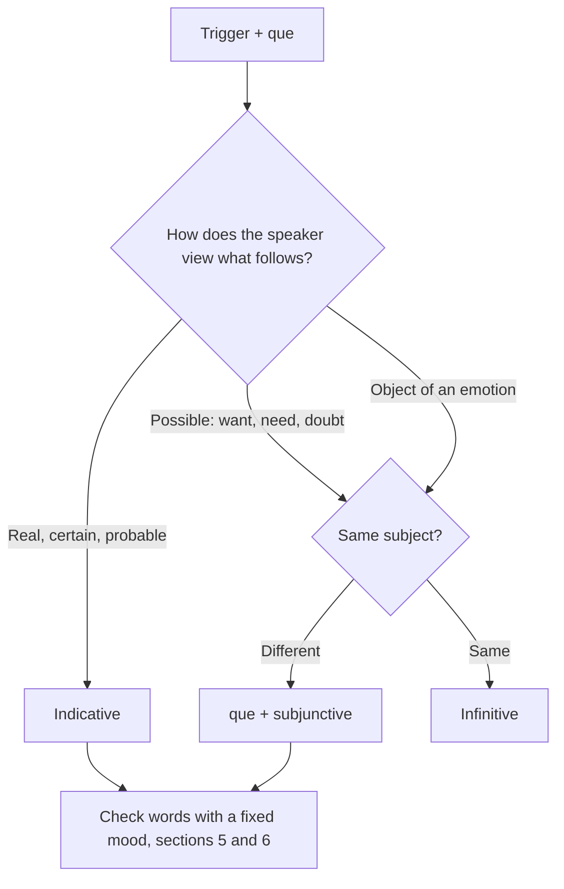
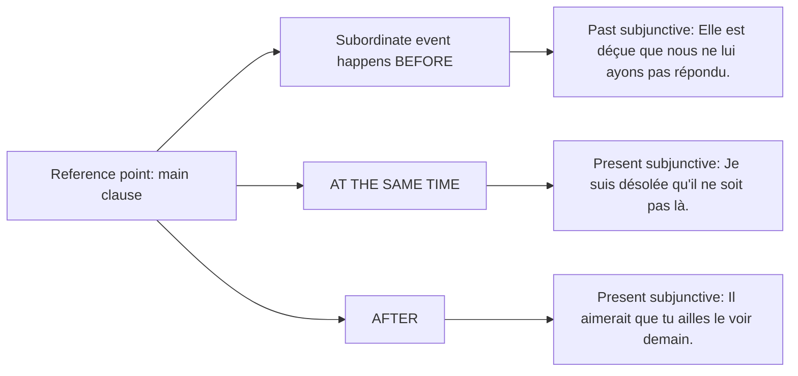

The subjunctive (*subjonctif*) is the part of French grammar that many learners still choose by feel. Written from the point of view of Vietnamese speakers learning French, this article offers one question for choosing the mood (does the speaker treat the event as real, or only as possible?), then covers conjugation as one rule plus three layers of exceptions, the groups of trigger words, ten easily confused pairs, and how to avoid the subjunctive when you need to. It draws on the dictionaries of the Académie française and Larousse, the OQLF's Banque de dépannage linguistique, grammar textbooks, and research on learners; a 12-item self-check closes the article.

## 1. A systematic error after *il faut que*

The sentence *il faut que j'écris* ("I have to write") sounds natural enough to a beginner: the speaker already knows that *il faut* needs *que*; only the verb after it is still in the indicative. The correct sentence is *il faut que j'écrive*. This is not a random slip. Bartning and Schlyter (2004) describe six developmental stages in the spoken French of adult Swedish speakers, and they note that *il faut que* is the first obligatory subjunctive context learners meet, yet at first they follow it with an unconjugated verb or an indicative one, exactly like *il faut que j'écris* (pp. 287–288).

The error is hard to catch on your own for a morphological reason. For most -er verbs, the present subjunctive is identical to the indicative in four persons: *il faut qu'il parle* uses the very form *parle* the learner already knows, so the sentence is correct even if the writer never actually chose a mood. The choice only shows with verbs that have distinct forms: *il écrit / qu'il écrive*, *il agit / qu'il agisse*, *il fait / qu'il fasse* (section 3).

So why must *il faut que* be followed by *écrive*, and how do you know when the subjunctive is needed? This article takes one principle as its backbone (section 4), then checks each group of triggers against the dictionary of the Académie française, the Banque de dépannage linguistique of the Office québécois de la langue française (OQLF), the Larousse dictionary, the grammar by Boularès and Frérot (1997), *Tex's French Grammar* from the University of Texas at Austin (Blyth et al., n.d.), and studies of learners.

## 2. What the subjunctive is and is not

The Académie française defines the subjunctive as a personal mood (*mode personnel*), usually found in subordinate clauses and always preceded by *que*, apart from a few fixed uses such as *Ainsi soit-il* (Académie française, n.d.-a). The OQLF calls it "le mode de la possibilité, de l'hypothèse," whereas the indicative presents an event as certain or likely to happen (Office québécois de la langue française [OQLF], n.d.-a).

It helps to separate **mood** from **tense**. Tense tells you when something happens; mood tells you how the speaker presents it: as fact, command, condition, or possibility (see also tense, aspect, and mood). The OQLF's terminology entry makes the same point: mood places the action or state expressed by the verb in relation to the communicative intent of the sentence, and it can express doubt, wish, possibility, reality, or command (OQLF, 2025a). How many moods French has depends on how you count:

| Source                                        | Number of moods     | How they are counted                                                                                     |
| --------------------------------------------- | ------------------- | -------------------------------------------------------------------------------------------------------- |
| *Tex's French Grammar* (Blyth et al., n.d.)   | 4                   | indicative, subjunctive, conditional, imperative                                                         |
| OQLF (2025a)                                  | 5                   | 3 personal moods (indicative, subjunctive, imperative), 2 impersonal moods (infinitive, participle); the conditional is a tense of the indicative |
| Académie française (2015)                     | depends on the view | the conditional is a mood in traditional grammar, but a tense of the indicative or subjunctive for many current grammarians |

Table 1. Three ways of counting moods (see also the map of moods and the conditional). Whichever count you use, the subjunctive is a personal mood.

In everyday French, the subjunctive has only two tenses left in use: present and past. The system has four, but the imperfect and pluperfect subjunctive are "pratiquement sortis de l'usage" (OQLF, n.d.-a); you only need to recognize them when reading, as in Corneille's *Qu'il mourût* (Académie française, n.d.-a). The subjunctive does not mark time by itself: *J'insiste pour qu'il vienne* and *J'insistais pour qu'il vienne* use the same form *vienne* (OQLF, n.d.-a). It can also stand alone to give an order or express a wish: *Qu'il parte !* (Académie française, n.d.-a), *Pourvu qu'il fasse beau pendant mes vacances* (OQLF, n.d.-d), *Vive la France !* (-er verbs).

A note on Vietnamese terminology: in Vietnamese, this article calls the subjunctive *thức giả định* ("hypothetical mood") rather than *thức cầu khẩn* ("supplicative mood"), which is easily confused with the imperative, or *thể giả định*, since *thể* is best kept for *aspect*. One more observation from the author: Vietnamese does not inflect verbs for mood. Meanings like "wish," "must," "fear," and "although" are carried by words, so Vietnamese learners have to train themselves to spot those meanings in the trigger and then change the form of the verb that follows.

## 3. Conjugation: one rule, three layers of exceptions

The basic rule: take the *ils* form of the present indicative, drop *-ent*, and add *-e, -es, -e, -ions, -iez, -ent*: *ils partent → que je parte* (Boularès & Frérot, 1997, p. 56; Blyth et al., n.d.). For -er verbs, the result almost entirely matches forms you already know:

| Person | Present indicative | Present subjunctive | Imperfect |
| ------ | ------------------ | ------------------- | --------- |
| je     | parle              | que je parle        | parlais   |
| nous   | parlons            | que nous parlions   | parlions  |
| vous   | parlez             | que vous parliez    | parliez   |
| ils    | parlent            | qu'ils parlent      | parlaient |

The four persons *je, tu, il, ils* (the "boot" forms) are identical to the indicative, and *nous, vous* match the imperfect (Wiktionnaire, n.d.); *acheter* works the same way (*que j'achète, que nous achetions*). The consequence: with -er verbs, a reader **cannot tell** whether the writer chose the subjunctive (*il faut qu'il parle* looks the same as *il parle*). Only verbs with distinct forms make it visible: *il agit* but *qu'il agisse* (Wiktionnaire, n.d.). That is also why mood errors usually surface only with verbs like *agir, écrire, faire, être*.

| Layer | Verbs | Subjunctive forms |
| --- | --- | --- |
| 0. Regular, including many verbs irregular in the indicative | dormir, partir, lire, dire, écrire, mettre, connaître, agir | *que je dise, qu'il agisse*; *ils* form same as indicative |
| 1. Two stems: *ils* gives the "boot" forms, *nous* gives *nous, vous* | venir, prendre, boire, croire, devoir, recevoir, voir, acheter | *que je vienne, que nous venions*; *ils* form same as indicative |
| 2. Separate "boot" stem | aller, vouloir, valoir | *que j'aille, que je veuille, que je vaille*; **different**: *qu'ils aillent, veuillent, vaillent* |
| 3. Entirely separate stem | être, avoir, faire, pouvoir, savoir | **different**: *qu'ils soient, aient, fassent, puissent, sachent* |

Table 2. One rule and three layers of exceptions (Blyth et al., n.d.; Larousse, n.d.-b; Wiktionnaire, n.d.).

Two points in the table deserve attention. First, *aller* and *vouloir* also have two stems, but the "boot" stems *aill-, veuill-* do not come from *ils vont, ils veulent*, so they have to be memorized separately (Larousse, n.d.-b); the same goes for *valoir*, which is worth remembering because *il vaut mieux que* is a subjunctive trigger. Second, the statement "the *ils* form of the subjunctive matches the indicative" holds only for **verbs that take their subjunctive stem from the *ils* form** (layers 0 and 1). In layers 2 and 3, the two forms differ: *ils ont / qu'ils aient, ils vont / qu'ils aillent, ils font / qu'ils fassent*.

*Avoir* and *être* spell *nous, vous* with a *y* (*ayons, soyez*), and the imperatives of *avoir, être, savoir* are built on the subjunctive stem (*aie, sois, sache*; Blyth et al., n.d.; see the imperative). Impersonal verbs have their own subjunctive forms too: *falloir → qu'il faille*, *valoir → qu'il vaille* (Larousse, n.d.-b), *pleuvoir → qu'il pleuve* (*il se peut qu'il pleuve demain*; Boularès & Frérot, 1997, p. 66). Because the subjunctive stem comes from the present indicative, a solid grip on regular and irregular present-tense verbs gets you halfway there.

## 4. The principle for choosing a mood: reality or possibility

According to Boularès and Frérot (1997, p. 62), the mood of the subordinate clause is decided by the **governing verb**, depending on how the speaker views what follows *que*: "Lorsque le locuteur envisage une réalisation possible, le subjonctif est utilisé" (when the speaker envisions something that **may** happen, the subjunctive is used). The book illustrates this with a scale (pp. 56, 62): *il est certain qu'il viendra* (certain) and *il est probable qu'il viendra* (probable) take the indicative; *il est possible qu'il vienne* (possible) takes the subjunctive.

The boundary lies between "probable" and "possible," not between "sure" and "unsure"; this is where guesses tend to go wrong. The OQLF says the same: the indicative presents an event as happening "de façon certaine ou probable" (OQLF, n.d.-a).

Negation or question inversion pushes verbs of opinion to the "possible" side: *Je crois qu'il est prêt*, but *Croyez-vous qu'il soit prêt ?* and *Je ne crois pas qu'il le sache* (Boularès & Frérot, 1997, p. 56; see negation and questions). The OQLF sorts subjunctive-triggering verbs into three groups: opinion or judgment, will, and emotion; for will, the OQLF explains that what we want "demeure de l'ordre du possible" (OQLF, n.d.-c). The second condition is **two different subjects**: *J'aimerais qu'il vienne*, but *J'aimerais venir* when the one who wants and the one who comes are the same person (Boularès & Frérot, 1997, p. 56).

Figure 1. The mood-choice question, redrawn from the idea in Boularès and Frérot (1997, pp. 56, 62).

This principle does not explain every case. *Je regrette qu'elle soit fâchée* ("I'm sorry she is upset") is about something real, yet it takes the subjunctive (Boularès & Frérot, 1997), and so does *bien que*. In these places, the mood is a **convention attached to the individual word** (Poplack et al., 2013; section 10). Learners need both: the principle to understand, and a short, verified list to use.

## 5. Groups of subjunctive triggers

Grammar books usually group triggers by meaning: obligation, will, emotion, doubt, relative clauses, superlatives (Blyth et al., n.d.); the OQLF folds them into three groups: opinion or judgment, will, and emotion (OQLF, n.d.-c). Each group below comes with the exceptions that are easy to get wrong.

**Obligation.** *Il faut que, il est nécessaire / important que, il vaut mieux que* (Boularès & Frérot, 1997, p. 58). *Il faut que* is more emphatic than *devoir* + infinitive (Blyth et al., n.d.; see modal verbs). Learners tend to recognize this group better than conjunctions and negative sentences (McManus & Mitchell, 2015; section 10).

**Will.** *Vouloir, désirer, souhaiter, exiger, préférer que* (OQLF, n.d.-c). *Souhaiter que* means "to wish that": *Je souhaite que tu guérisses rapidement* (OQLF, n.d.-c); "to hope," on the other hand, is *espérer*, and that verb takes a different mood (see the next paragraph). *Attendre que* mainly means "to wait until" (*J'attends qu'il ait fini pour partir*), and Larousse also lists the sense "to count on"; for "to expect, to anticipate something," French uses *s'attendre à ce que*: *je m'attends à ce qu'il m'écrive* (Larousse, n.d.-a).

**Hope: *espérer* takes the indicative.** The subjunctive is often introduced as the mood of wishes and hopes, but according to Larousse, affirmative *espérer que* takes the indicative or the conditional (*nous espérons qu'il viendra*); only in negative or interrogative sentences can it take the subjunctive (*je n'espère plus qu'elle vienne*) (Larousse, n.d.-d). "Hope" is the meaning, but the mood is decided by the **word**.

**Emotion.** *Regretter, craindre, avoir peur, être content / désolé que, il est dommage que* (OQLF, n.d.-c); the same group includes *redouter que, avoir peur que* ("to fear that"), *être heureux que* ("to be glad that"), *être malheureux que* ("to be sad that") (Blyth et al., n.d.). *Craindre que* is often followed by an expletive *ne*, which carries no negative meaning: *Je crains qu'il ne veuille partir malgré tout* (OQLF, n.d.-c).

**Doubt.** *Douter que, il est possible / douteux que, il se peut que* (Boularès & Frérot, 1997, p. 62). In the negative, *ne pas douter que* normally still takes the subjunctive (*je ne doute pas qu'il vienne*); the indicative is used only to stress that something is a fact (*je ne doute pas qu'il sera présent à l'heure dite*) (Larousse, n.d.-c). By contrast, *se douter que* ("to suspect that") takes the indicative (Larousse, n.d.-c).

**Certainty → indicative.** Triggers that present what follows as certain or probable take the indicative: affirmative *croire, penser que*, and *il est certain / probable que* (Boularès & Frérot, 1997, pp. 56, 62). Two expressions in this group switch mood with meaning:

- *Il me semble que* + indicative, because it expresses an opinion (*il me semble que tu as grandi*), but *il semble que* + subjunctive when uncertain (*il semble qu'il se soit perdu*) and + indicative when it is evident (*il semble qu'il s'est perdu*) (Larousse, n.d.-e).
- *Supposer que* ("to assume that") + indicative: *Nous supposons qu'il sera là*; but *supposons que* ("suppose that") + subjunctive: *Supposons qu'il ne vienne pas* (Boularès & Frérot, 1997, p. 64). The OQLF also lists *à supposer que* among expressions always followed by the subjunctive (OQLF, 2025b).

**Relative clauses.** When the antecedent may not exist, use the subjunctive: *Je cherche un traducteur qui connaisse l'anglais, le français et le japonais* (Boularès & Frérot, 1997, p. 58). Compare *Connaissez-vous quelqu'un qui puisse m'aider ?* with *Je connais quelqu'un qui peut vous aider* (Académie française, n.d.-b; see relative pronouns).

**Superlatives, *le seul, le premier*.** After a superlative and after *le seul, le premier, le dernier*, use the subjunctive for a subjective judgment and the indicative for a statement of fact (Blyth et al., n.d.); the subjunctive here is common but not required (OQLF, 2016): *Voici le meilleur vin que l'on puisse trouver dans la région*, but *Ce soir, c'est le meilleur qui a gagné* (Académie française, n.d.-b). Impersonal expressions of judgment such as *il est bon / juste / urgent que* also trigger the subjunctive (Blyth et al., n.d.).

| Trigger                                | Mood                                   | Note                                                    | Source                                 |
| -------------------------------------- | -------------------------------------- | ------------------------------------------------------- | -------------------------------------- |
| *souhaiter que*                        | subjunctive                            | "to wish," unlike *espérer*                             | OQLF (n.d.-c)                          |
| *espérer que* (affirmative)            | indicative or conditional              | subjunctive possible only in negatives and questions    | Larousse (n.d.-d)                      |
| *ne pas douter que*                    | subjunctive; indicative for emphasis   | *se douter que* ("to suspect that") + indicative        | Larousse (n.d.-c)                      |
| *il semble que*                        | subjunctive or indicative              | *il me semble que* + indicative                         | Larousse (n.d.-e)                      |
| *supposons que, à supposer que*        | subjunctive                            | *supposer que* ("to assume that") + indicative          | Boularès & Frérot (1997); OQLF (2025b) |
| *le meilleur… que*                     | subjunctive is common                  | not required; indicative for a statement of fact        | OQLF (2016)                            |

Table 3. Six triggers whose mood is easy to get wrong.

## 6. Ten easily confused pairs

When studying for an exam, the most useful items are pairs that differ by a single word yet switch mood:

| #   | Indicative                                                 | Subjunctive                                         | Switches because             | Source                           |
| --- | ---------------------------------------------------------- | --------------------------------------------------- | ---------------------------- | -------------------------------- |
| 1   | *Je pense qu'il viendra.*                                  | *Je ne pense pas qu'il vienne.*                     | Negated opinion              | Boularès & Frérot (1997)         |
| 2   | *Il est probable qu'il viendra.*                           | *Il est possible qu'il vienne.*                     | Probable / possible          | Boularès & Frérot (1997)         |
| 3   | *Il me semble que tu as grandi.*                           | *Il semble qu'il se soit perdu.*                    | Opinion / uncertain          | Larousse (n.d.-e)                |
| 4   | *Nous espérons qu'il viendra.*                             | *Je souhaite que tu guérisses rapidement.*          | Word-specific convention     | Larousse (n.d.-d); OQLF (n.d.-c) |
| 5   | *Nous supposons qu'il sera là.*                            | *Supposons qu'il ne vienne pas.*                    | Assume / suppose             | Boularès & Frérot (1997)         |
| 6   | *Il dit qu'il viendra demain.*                             | *Dites-lui qu'il vienne tout de suite.*             | Reporting / commanding       | Boularès & Frérot (1997)         |
| 7   | *Je comprends qu'il est fatigué.*                          | *Je comprends qu'il soit fatigué.*                  | Realizing / sympathizing     | Boularès & Frérot (1997)         |
| 8   | *Il a parlé fort, de sorte que tout le monde l'a entendu.* | *Parle fort, de sorte que tout le monde t'entende.* | Result / purpose             | OQLF (2025b)                     |
| 9   | *Après qu'ils seront arrivés, ils iront saluer ma tante.*  | *Avant qu'il ait commencé, j'aurai fini.*           | *Après que / avant que*      | OQLF (n.d.-b)                    |
| 10  | *Même s'il pleut, je sortirai.*                            | *Bien qu'il pleuve, je sortirai.*                   | *Même si / bien que*         | Boularès & Frérot (1997)         |

Table 4. Ten indicative/subjunctive pairs. The examples in rows 6, 7, 8, and 10 were written by the author following the rules in the sources (Boularès & Frérot, 1997, pp. 56–64, 152).

In pair 6, a command in reported speech is usually turned into *dire de* + infinitive (*Dites-lui de venir*; see reported speech). *Admettre* switches mood just like *comprendre* in pair 7: *J'admets que j'ai eu tort* (acknowledging a fact), *J'admets qu'on puisse ne pas être d'accord* (finding something acceptable). Pair 9 is an analogy trap: *avant que* + subjunctive because the event has not happened yet, *après que* + indicative because the event has happened or certainly will (Académie française, n.d.-a). Pair 10 is a convention, not a matter of meaning: the same real rain, yet the two conjunctions demand two different moods.

## 7. Conjunctions: a summary

Conjunctions have their own article; here we cover only the part that concerns the subjunctive. The OQLF lists conjunctions that always take the subjunctive, including *à condition que, afin que, à moins que, avant que, de peur que, en attendant que, jusqu'à ce que, pour que, pourvu que, sans que*; *bien que* usually takes the subjunctive, while with *quoique* and *le fait que* the subjunctive is "fréquent mais non obligatoire" (OQLF, 2025b). Four points are easy to miss:

- ***Sans que*** has a negative meaning; Boularès and Frérot (1997, p. 152) place it in the section on concession: *Elles sont venues sans que je les aie invitées*.
- **Expletive *ne*** can appear after *de crainte que, de peur que*, and also after *avant que, à moins que* (Boularès & Frérot, 1997, pp. 58–60): *à moins que tu (ne) viennes me chercher*. This *ne* does not negate the verb.
- ***Après que* + indicative.** *Après que* takes the passé antérieur or another indicative tense (*Après qu'ils furent arrivés, ils allèrent saluer ma tante*); using the subjunctive after *après que* is criticized because the clause refers to something certain (OQLF, n.d.-b; see the passé antérieur).
- ***De sorte que*** takes the subjunctive only when it expresses purpose; when it expresses a result that has already occurred, it takes the indicative (OQLF, 2025b; pair 8).

Four conjunctions keep *que* + subjunctive even when both clauses share a subject: *bien que, quoique, pourvu que, jusqu'à ce que* (*Tex veut attendre jusqu'à ce qu'il se sente prêt*; Blyth et al., n.d.). None of the four is on the list of conjunctions that must switch to the infinitive in section 9 (Boularès & Frérot, 1997, p. 76).

## 8. The past subjunctive and time relations

The past subjunctive is formed like the passé composé: *avoir* or *être* in the present subjunctive plus the past participle (Boularès & Frérot, 1997, p. 60; Blyth et al., n.d.), with the same rules for choosing the auxiliary and for agreement as in the article on the passé composé: *que j'aie fini, qu'elle soit partie*. The two tenses are distinguished by the time relation between the two events:

Figure 2. Choosing the present or past subjunctive (examples from Boularès & Frérot, 1997, p. 60).

The past subjunctive is also used for something that will be completed before a future point: *Il faut que vous soyez rentrés avant minuit* (Boularès & Frérot, 1997, p. 60). In short: the present subjunctive marks an event simultaneous with or later than the main clause's reference point, including in the future; the past subjunctive marks an event that happened earlier, or that will be finished before a given point.

The tense of the main clause does **not** determine the tense of the subjunctive (OQLF, n.d.-a): *J'insiste / J'insistais pour qu'il vienne* in section 2 use the same form. So when you shift a sentence into the past, the present subjunctive stays as it is (see the sequence-of-tenses table in the article on reported speech).

Two literary tenses

The *imparfait* and *plus-que-parfait du subjonctif* are almost no longer used (OQLF, n.d.-a); you only need to recognize them when reading. Don't confuse *qu'il fût* (with a circumflex, subjunctive) with *il fut* (passé simple); *après qu'ils furent arrivés* is the passé antérieur of the indicative.

## 9. When to avoid the subjunctive

Avoiding the subjunctive is not just a matter of style: in some places the infinitive is **required**. According to Boularès and Frérot (1997, p. 76), when both clauses share a subject, *pour que, afin que, avant que, sans que, de peur que, de crainte que, en attendant que* must become *pour, afin de, avant de, sans, de peur de, de crainte de, en attendant de* + infinitive. An example written by the author following this rule: *Je t'appelle avant que tu partes* (two different people), but *Je t'appelle avant de partir* (the caller is also the one leaving). Verbs of will work the same way: *Je voudrais sortir*, not *je voudrais que je sorte*; with *espérer*, the infinitive gives a formal tone: *J'espère recevoir bientôt de vos nouvelles* (Boularès & Frérot, 1997, pp. 56, 76).

When speaking in general terms, without any particular subject in mind, impersonal expressions take *de* + infinitive instead of *que* + subjunctive: *Il est essentiel que tu lises les journaux → Il est essentiel de lire les journaux* (Blyth et al., n.d.; see impersonal verbs and the infinitive). You can also replace a conjunction with a preposition plus a noun: *bien qu'il ait des soucis → malgré ses soucis* (Blyth et al., n.d.), *jusqu'à ce que* + clause → *jusqu'à* + noun (prepositions). Avoiding the subjunctive is a useful skill, but if you always avoid it, you will never practice the forms (section 10).

## 10. How native speakers and learners actually use the subjunctive

Grammar books tell you where the subjunctive **should** be used; research tells you where people **actually** use it, and where learners stumble.

**Natural speech.** Poplack, Lealess, and Dion (2013) compared everyday spoken Quebec French with five centuries of grammarians' prescriptions. From the 16th century on, grammars tied the subjunctive to hundreds of triggers and shades of meaning, but in spontaneous speech the subjunctive appears almost only around a small set of verbs. The strongest predictor is not meaning but **the trigger itself**; the subjunctive is also favored when the verb has a distinct, easily recognized form, when *que* is present, and when the two clauses are adjacent. This article relies only on the study's abstract, so it does not list the specific verbs, but the finding explains why *agisse, fasse, soit* "stand out" more than *parle* (section 3).

**Nine months in France.** McManus and Mitchell (2015) followed 29 students of French at a UK university before and after nine months living in France. All of them already used the subjunctive to some extent before leaving, but the time abroad brought only limited progress. The subjunctive appeared more in writing than in speech, in line with earlier corpus research (O'Connor Di Vito, 1997, as cited in McManus & Mitchell, 2015). Learners recognized affirmative triggers like *il faut que* better than conjunctions and negative sentences.

**Knowing the rule is not the same as using it.** Dudley and Slabakova (2021) gave English-speaking learners of French a sentence-judgment task and tracked their eye movements while reading. The learners recognized the subjunctive when judging sentences, but could not use that knowledge during reading comprehension; their knowledge was mainly explicit and had not yet become automatic.

**The subjunctive comes late.** In Bartning and Schlyter's (2004) six stages, the subjunctive appears from stage 4 but is still unstable, and only at stage 5 is it used more often. As section 1 noted, the first obligatory context is *il faut que*; the last to arrive is a negated verb of opinion such as *je ne crois pas que* (pp. 287–288). This result points the same way as McManus and Mitchell (2015): learners handle affirmative triggers better than negatives and conjunctions.

**Implications for Vietnamese learners.** This article could not verify any study of Vietnamese learners of the subjunctive, so the following suggestions are the author's own assessment:

1. Learn the common triggers first (*il faut que*, will, emotion) together with the most frequent irregular forms: *être, avoir, faire, pouvoir, aller, savoir, vouloir*.
2. Practice negative sentences and conjunctions separately, the weak spots documented in other learners (McManus & Mitchell, 2015; Bartning & Schlyter, 2004).
3. When practicing writing, deliberately use structures with distinct subjunctive forms, such as *il faut que* + *faire, pouvoir, être*, rather than only -er verbs whose forms coincide with the indicative; a mood error can only be noticed and corrected when it shows on the page (section 3).
4. Use the subjunctive when actually speaking and reading, not only in fill-in-the-blank exercises (Dudley & Slabakova, 2021).

## 11. Self-check and conclusion

Put the verb in parentheses in the correct mood:

1. *Je pense qu'il … (venir).*
2. *Je ne pense pas qu'il … (venir).*
3. *Il est probable qu'il … (venir).*
4. *Il est possible qu'il … (venir).*
5. *Nous espérons qu'il … (venir).*
6. *Il me semble que tu … (grandir).*
7. *Je cherche un traducteur qui … (connaître) le japonais.*
8. *On attendra jusqu'à ce que tu … (revenir).*
9. *Après qu'ils … (arriver), ils iront saluer ma tante.*
10. *Elle est déçue que nous ne lui … pas … (répondre).*
11. *Supposons qu'il ne … pas (venir).*
12. *Il faut qu'ils … (faire) attention.*

Answers

**1–4.** *viendra* (or *vient*), *vienne*, *viendra*, *vienne* (Boularès & Frérot, 1997).

**5–6.** *viendra* (Larousse, n.d.-d); *as grandi* (Larousse, n.d.-e).

**7.** *connaisse*: the antecedent may not exist (Boularès & Frérot, 1997).

**8–9.** *reviennes* (OQLF, 2025b); *seront arrivés*: *après que* + indicative (OQLF, n.d.-b).

**10–11.** *ayons … répondu*: the event happened earlier; *vienne*: a supposition (Boularès & Frérot, 1997).

**12.** *fassent*: the *ils* form of *faire* in the subjunctive differs from the indicative (*ils font*) (Blyth et al., n.d.).

The subjunctive is not "the tense of emotion," nor is it just a list to memorize. Most cases can be settled with one question: does the speaker treat what follows *que* as real (including "probable"), or only as possible? The rest is word-specific convention (*espérer, après que* + indicative; *regretter, bien que* + subjunctive even for facts), and natural speech also shows that the trigger itself is the strongest factor (Poplack et al., 2013). The most error-prone spots are the exceptions and the words that switch mood with meaning: the *ils* forms of *être, avoir, aller, faire*; *souhaiter* versus *espérer*; *il semble que*; *supposer que*; *ne pas douter que*; *sans que, de sorte que, après que*. As for how to learn it: practice negative sentences, conjunctions, and common irregular forms, and use the subjunctive when you really speak and read.

Attribution

The presentation of conjugation and part of the list of triggers in this article are based on *Tex's French Grammar* (Blyth et al., n.d.), Français interactif, COERLL, The University of Texas at Austin, licensed under CC BY 3.0. This article paraphrases and adapts that material; it is not a literal translation.

## References

Académie française. (n.d.-a). Subjonctif. In *Dictionnaire de l'Académie française* (9e éd.). https://www.dictionnaire-academie.fr/article/A9S3147

Académie française. (n.d.-b). Subordonnée relative : indicatif ou subjonctif ? In *Questions de langue*. https://www.dictionnaire-academie.fr/article/QDL083

Académie française. (2015, novembre). Le conditionnel est-il un mode ou un temps qui fait partie de l'indicatif ? In *Courrier des internautes*. https://www.dictionnaire-academie.fr/article/QR_0169

Bartning, I., & Schlyter, S. (2004). Itinéraires acquisitionnels et stades de développement en français L2. *Journal of French Language Studies, 14*(3), 281–299. https://doi.org/10.1017/S0959269504001802

Blyth, C., Kelton, K., Myers, L., Delyfer, C., Munn, Y., & Lippmann, J. (n.d.). *Tex's French grammar* [Pages on the subjunctive]. Français interactif, COERLL, The University of Texas at Austin. https://www.laits.utexas.edu/tex/gr/index.html

Boularès, M., & Frérot, J.-L. (1997). *Grammaire progressive du français avec 400 exercices: Niveau avancé*. CLE International.

Dudley, A., & Slabakova, R. (2021). L2 knowledge of the obligatory French subjunctive: Offline measures and eye tracking compared. *Languages, 6*(1), Article 31. https://doi.org/10.3390/languages6010031

Larousse. (n.d.-a). Attendre. In *Dictionnaire de français Larousse*. https://www.larousse.fr/dictionnaires/francais/attendre

Larousse. (n.d.-b). *Conjugaison* [Conjugation tables for aller, falloir, valoir, vouloir]. https://www.larousse.fr/conjugaison/francais

Larousse. (n.d.-c). Douter. In *Dictionnaire de français Larousse*. https://www.larousse.fr/dictionnaires/francais/douter

Larousse. (n.d.-d). Espérer. In *Dictionnaire de français Larousse*. https://www.larousse.fr/dictionnaires/francais/espérer

Larousse. (n.d.-e). Sembler. In *Dictionnaire de français Larousse*. https://www.larousse.fr/dictionnaires/francais/sembler

McManus, K., & Mitchell, R. (2015). Subjunctive use and development in L2 French: A longitudinal study. *Language, Interaction and Acquisition, 6*(1), 42–73. https://doi.org/10.1075/lia.6.1.02mcm

Office québécois de la langue française. (n.d.-a). Généralités sur le subjonctif. In *Banque de dépannage linguistique*. https://vitrinelinguistique.oqlf.gouv.qc.ca/24236/la-grammaire/le-verbe/modes/subjonctif/generalites-sur-le-subjonctif

Office québécois de la langue française. (n.d.-b). Mode verbal avec après que et avant que. In *Banque de dépannage linguistique*. https://vitrinelinguistique.oqlf.gouv.qc.ca/21132/la-grammaire/le-verbe/modes/concordance-des-temps/mode-verbal-avec-apres-que-et-avant-que

Office québécois de la langue française. (n.d.-c). Subjonctif après certains verbes. In *Banque de dépannage linguistique*. https://vitrinelinguistique.oqlf.gouv.qc.ca/24253/la-grammaire/le-verbe/modes/subjonctif/subjonctif-apres-certains-verbes

Office québécois de la langue française. (n.d.-d). Valeurs particulières du subjonctif. In *Banque de dépannage linguistique*. https://vitrinelinguistique.oqlf.gouv.qc.ca/24248/la-grammaire/le-verbe/modes/subjonctif/valeurs-particulieres-du-subjonctif

Office québécois de la langue française. (2016). Subjonctif et subordonnée relative. In *Banque de dépannage linguistique*. https://vitrinelinguistique.oqlf.gouv.qc.ca/25168/la-grammaire/le-verbe/modes/subjonctif/subjonctif-et-subordonnee-relative

Office québécois de la langue française. (2025a). Mode. In *Grand dictionnaire terminologique*. https://vitrinelinguistique.oqlf.gouv.qc.ca/fiche-gdt/fiche/26559707/mode

Office québécois de la langue française. (2025b). Subjonctif ou indicatif après les subordonnants composés. In *Banque de dépannage linguistique*. https://vitrinelinguistique.oqlf.gouv.qc.ca/24238/la-grammaire/le-verbe/modes/subjonctif/subjonctif-ou-indicatif-apres-les-subordonnants-composes

Poplack, S., Lealess, A., & Dion, N. (2013). The evolving grammar of the French subjunctive. *Probus, 25*(1), 139–195. https://doi.org/10.1515/probus-2013-0005

Wiktionnaire. (n.d.). *Conjugaison:français* [Conjugation tables for acheter, agir, parler, pouvoir, savoir]. https://fr.wiktionary.org/wiki/Conjugaison:français
