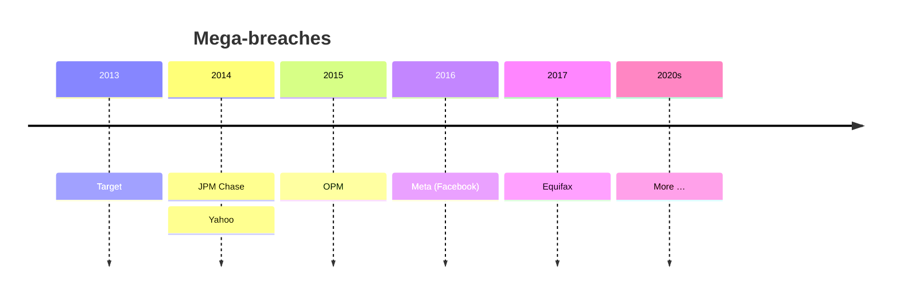

## Mục tiêu liên quan
- Objective 1: chẩn đoán nguyên nhân gốc (quản lý và kỹ thuật) lặp lại sau các **mega-breach** trong lịch sử, dùng làm khung dự đoán lỗ hổng AI.

## 1.1. Mega-Breach Patterns Overview
### The Supply Chain and MFA Era – Brief History of Cybersecurity
- Nghiên cứu cybersecurity bắt đầu từ những năm 1970 (trước khi có thuật ngữ "cybersecurity"), nhưng **mega data breach** chỉ xuất hiện sau khi Internet được thương mại hoá vào những năm 1990.
- **2003**: Đạo luật thông báo vi phạm dữ liệu (**Data Breach Notification Act**) cấp bang đầu tiên có hiệu lực ở California.
- **2004**: **CardSystems** bị breach 40 triệu số thẻ tín dụng.
- **2013**: Bắt đầu thời kỳ mega-breach: Target, JPM Chase, OPM, Yahoo! và nhiều vụ khác.
- *Hơn 10.000 vụ breach trong 15 năm.*

## 1.2. Root Causes of Breaches
- **Managerial** (quản lý):
	- **Prioritization** of Cybersecurity: mức độ ưu tiên cho an ninh mạng
	- **Investment** in Cybersecurity: đầu tư cho an ninh mạng
	- **Execution** of Cybersecurity Initiatives: thực thi các sáng kiến an ninh mạng
- **Technical** (kỹ thuật):
	- **Account Takeover**: chiếm đoạt tài khoản
	- **Malware** (Malicious Software)
	- **Software and Supply Chain Vulnerabilities**: lỗ hổng phần mềm và chuỗi cung ứng

## 1.3. Early Mega-Breaches
- Các mega-breach đầu tiên xảy ra do bị tấn công qua **chuỗi cung ứng** và **thiếu xác thực đa yếu tố**.
	- **Supply Chain Compromise**: bản thân tổ chức không bị tấn công trực tiếp mà bị xâm nhập thông qua một **nhà cung cấp**.
	- **Multi-Factor Authentication (MFA)**: kiểm tra danh tính không chỉ dựa vào thứ người dùng **biết** (password) mà còn thứ người dùng **có** (thiết bị) hoặc **là** (sinh trắc học).

### Representative Mega-Breaches
- **Target (2013)**
	- Hơn 40 triệu dữ liệu thẻ tín dụng
	- CEO và CISO bị sa thải; Hội đồng quản trị bị kiện
	- Chi phí breach $250M; thiệt hại danh tiếng
- **JPM Chase (2014)**
	- Hơn 70 triệu tên và email khách hàng
	- Nguy cơ bị **phishing** có chủ đích trên diện rộng
- **Office of Personnel Management – OPM (2015)**
	- 21,5 triệu hồ sơ kiểm tra lý lịch của các cơ quan chính phủ Mỹ, gồm form **SF-86** và 5,6 triệu dấu vân tay
	- *"(impact) cannot be overstated, nor will it ever be fully known."*

## 1.4. Tech Mega-Breaches
- **Yahoo (2016)**
	- Truy cập được **tất cả** (> 3 tỷ) tài khoản email Yahoo
	- Breach lớn nhất lịch sử Internet; Verizon trả giá mua Yahoo thấp hơn $350 triệu
- **Equifax (2017)**
	- 145 triệu tên, SSN, ngày sinh (DOB), bằng lái (DL)
	- Breach danh tính tài chính lớn nhất lịch sử; dàn xếp $575M
- **Capital One (2019)**
	- 100 triệu SSN của Mỹ, 1 triệu SIN của Canada
	- Hacker: phạt $250K, 5 năm tù; ước tính chi phí breach $100M – $150M

## 1.5. Nation-State Breaches
### SolarWinds Data Breach (2020)
- **Incident**: đối thủ cấp quốc gia (Nga) cài **backdoor** vào phần mềm SolarWinds mà các cơ quan chính phủ Mỹ (và 18.000 tổ chức khác) đang dùng.
- **Impact**:
	- Điều trần trước Quốc hội
	- Tổng thống ban hành **executive order** yêu cầu các cơ quan liên bang phải có **SBOM** (software bill of materials) cho mọi phần mềm mua về (→ [AI-BOM ở Module 6](/blog/ai-va-dev/ai-cybersecurity-and-governance-columbia-university/06-ai-governance-and-regulation/))
- **Key Takeaways**: tấn công qua bên thứ ba / **supply chain attack** chỉ cần xâm nhập một bên nhỏ để tấn công một lượng rất lớn khách hàng (khác với Target, chỉ một nạn nhân).

### Colonial Pipeline Data Breach (2021)
- **Incident**: kẻ tấn công lấy được **mật khẩu VPN** từ dark web và cài **ransomware**.
- **Impact**: đường ống dẫn dầu ngừng hoạt động một tuần; ransomware được xem là **mối đe doạ an ninh quốc gia**.
- **Root Causes**: không có **2FA**.
- **Preventative Countermeasures**:
	- Theo dõi dark web để phát hiện thông tin đăng nhập bị đánh cắp
	- 2FA mạnh

## 1.6. Ransomware – A National Security Threat
- Đặc điểm của ransomware hiện đại:
	- **Double extortion** đã phổ biến: ransomware vừa mã hoá dữ liệu vừa **exfiltrate** (đánh cắp) dữ liệu, để kẻ tấn công tống tiền nạn nhân liên tục.
	- **Nhắm vào và mã hoá cả bản backup online**: cần **backup offline** để chống chịu ransomware.
	- **Xâm nhập qua nhiều kênh**: ngoài các cách lây lan virus, worm truyền thống, còn qua MFA yếu hoặc không có, phishing, v.v.

## Key Points on Breach Pattern
- Các vụ breach lớn nhất đều đến từ một tập nguyên nhân gốc quản lý và kỹ thuật **khá ổn định**; phần lớn là vấn đề **"cybersecurity hygiene"**.
- **Managerial root causes**: không ưu tiên, không đầu tư và không thực thi các sáng kiến an ninh mạng.
- **Technical root causes**: account takeover, malware, lỗ hổng phần mềm và chuỗi cung ứng, dữ liệu không được mã hoá, lỗi vô ý của nhân viên, tấn công nội bộ (insider attacks).
- Các pattern này được dùng để đánh giá breach trên và bằng AI (→ [Module 5](/blog/ai-va-dev/ai-cybersecurity-and-governance-columbia-university/05-breaches-on-and-with-ai/)).

Đã sửa so với slide gốc

- *Colonial Oil Pipeline* → **Colonial Pipeline** (tên công ty).
- *”ex-filtrates”* → **exfiltrate** (sửa dấu ngoặc và chính tả).
- Key Points: slide ghi *encrypted data* trong danh sách nguyên nhân kỹ thuật; nguyên nhân thực tế là **dữ liệu không được mã hoá** (unencrypted data), nên đã sửa.

Cần kiểm tra

- Yahoo: timeline ghi **2014**, mục 1.4 ghi **2016**. Breach xảy ra 2013–2014, công bố năm 2016.
- Capital One: *$250K fine, 5 years in jail* có lẽ là **mức phạt tối đa** theo tội danh. Thực tế hacker được tuyên án tính bằng thời gian đã giam và quản chế; Capital One bị OCC phạt $80M `(?)`.

## Quiz
- [ ] Hoàn thành quiz Module 1 (≥ 60%)

## Discussion forum
- [ ] Đóng góp bài thảo luận Module 1
