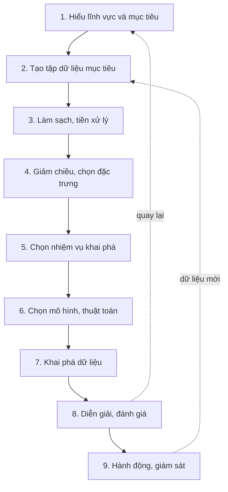

Quy trình khám phá tri thức từ dữ liệu (knowledge discovery in databases, KDD) gồm chín bước, và khai phá dữ liệu (data mining) chỉ là bước thứ bảy (Fayyad et al., 1996a). Google Flu Trends (GFT) cho thấy khác biệt này rõ hơn bất kỳ ví dụ nào. Thuật toán của nó chỉ là một hồi quy tuyến tính, vậy mà hệ thống ước tính thấp dịch cúm năm 2009 và đến tháng 2/2013 lại đưa ra con số gấp hơn hai lần số liệu của CDC (Cook et al., 2011; Lazer et al., 2014). Mô hình ARGO cũng tuyến tính, nhưng sửa các bước bao quanh bước khai phá, và đạt RMSE bằng 0,608 lần mô hình naive trong giai đoạn 2009–2015; GFT là 2,216 lần (Yang et al., 2015). Bài này viết cho sinh viên, data analyst và người tự học: bạn sẽ có một bảng gắn từng lỗi của GFT với một bước KDD, checklist 9 câu hỏi và code Python tái lập bằng dữ liệu CDC công khai.

<div class="callout callout-note">
<p class="callout-title">Tóm tắt nhanh</p>

- KDD là toàn bộ quá trình từ đặt mục tiêu đến hành động; data mining là bước áp thuật toán để trích mẫu.
- GFT: 50 triệu truy vấn ứng viên, 45 truy vấn được chọn, khớp 1.152 điểm dữ liệu; sai lớn năm 2009 và mùa 2012/13.
- Lỗi của GFT rải ở mọi nhóm bước trừ bước 7: ARGO vẫn dùng hồi quy tuyến tính.
- ARGO thêm dữ liệu CDC có độ trễ và tính mùa vụ, chọn lại từ khoá mỗi tuần trên cửa sổ trượt 104 tuần.
- Đánh giá công bằng phải dùng số liệu "như đã biết tại thời điểm đó"; mục 5 cho thấy sai số tăng bao nhiêu khi làm đúng.

</div>

## 1. KDD là gì: chín bước, và data mining chỉ là bước thứ bảy

### 1.1. Định nghĩa

Fayyad, Piatetsky-Shapiro và Smyth (1996a) tách hai khái niệm hay bị dùng lẫn. KDD là *toàn bộ quá trình* tìm tri thức hữu ích từ dữ liệu. Data mining là *một bước* trong quá trình đó: áp dụng một thuật toán cụ thể để trích mẫu (pattern) từ dữ liệu. Cùng năm, nhóm tác giả giới thiệu khung này với cộng đồng máy tính trên *Communications of the ACM* (Fayyad et al., 1996b).

Theo định nghĩa của họ, một mẫu phải đạt bốn yêu cầu: **hợp lệ** (valid) trên dữ liệu mới với một mức chắc chắn nào đó, **mới** (novel), **có tiềm năng hữu ích** (potentially useful) và **cuối cùng hiểu được** (ultimately understandable) (Fayyad et al., 1996a, tr. 40). Hãy để ý chữ "potentially". Một mẫu chỉ mới *có thể* hữu ích, cho tới khi được kiểm tra và đem dùng vào việc thật. Phần đó thuộc về các bước cuối.

IDC dự báo lượng dữ liệu số toàn cầu (Global Datasphere) tăng từ 33 ZB năm 2018 lên 175 ZB năm 2025 (Reinsel et al., 2018). Dữ liệu càng nhiều, người ta càng dễ tin rằng "dữ liệu tự nói". Khung KDD nói ngược lại: mẫu khai phá được chưa phải là tri thức.

### 1.2. Chín bước của quy trình KDD

Fayyad et al. (1996a, tr. 41–42) mô tả các bước cơ bản như sau:

1. Hiểu lĩnh vực ứng dụng, tri thức sẵn có và mục tiêu của người dùng.
2. Tạo tập dữ liệu mục tiêu: chọn dữ liệu, biến và mẫu.
3. Làm sạch và tiền xử lý: xử lý nhiễu, giá trị thiếu, yếu tố thời gian.
4. Giảm chiều và chiếu dữ liệu: chọn đặc trưng, biến đổi biến.
5. Chọn nhiệm vụ khai phá phù hợp mục tiêu: phân lớp, hồi quy, gom cụm…
6. Phân tích khám phá, chọn mô hình hoặc giả thuyết, chọn thuật toán.
7. Khai phá dữ liệu.
8. Diễn giải mẫu tìm được, có thể quay lại bất kỳ bước nào từ 1 đến 7.
9. Hành động dựa trên tri thức: đưa vào hệ thống, báo cáo, kiểm tra mâu thuẫn với tri thức cũ.



*Hình 1. Chín bước của quy trình KDD, vẽ lại theo mô tả của Fayyad et al. (1996a). Mũi tên đứt là vòng lặp.*

Phần lớn công việc thực tế nằm ở bước 3; cách làm sạch có ghi chép có trong bài [Process data from Dirty to Clean](/blog/process-data-from-dirty-to-clean/).

### 1.3. Lời cảnh báo ngay từ đầu: data dredging

Fayyad et al. (1996a, tr. 39) ghi nhận rằng giới thống kê từng chê data mining là "data dredging" (nạo vét dữ liệu): chạy thuật toán mù quáng trên dữ liệu thì dễ ra mẫu vô nghĩa. Các tác giả đưa ví dụ về kiểm định nhiều mô hình (tr. 49). Nếu kiểm định N mô hình ở mức ý nghĩa 0,001, trung bình khoảng N/1000 mô hình sẽ "có ý nghĩa thống kê" chỉ do ngẫu nhiên. Giữ phép tính này trong đầu khi đọc mục 2, vì GFT tìm trong 50 triệu truy vấn ứng viên.

### 1.4. KDD và CRISP-DM

CRISP-DM, ra đời cuối thập niên 1990, là mô hình quy trình phổ biến khác. Martínez-Plumed et al. (2021) cho rằng mô hình quy trình hợp với dự án có mục tiêu rõ, còn dự án thăm dò cần các "quỹ đạo" khoa học dữ liệu (data science trajectories) linh hoạt hơn. Bài này dùng KDD vì nó tách riêng bước khai phá.

## 2. Google Flu Trends: dựng lại chuỗi bằng chứng

### 2.1. Thiết kế ban đầu

Ginsberg et al. (2009) đăng trực tuyến trên *Nature* ngày 19/11/2008 (bản in 19/2/2009) một phương pháp ước tính mức hội chứng giống cúm (influenza-like illness, ILI) từ truy vấn tìm kiếm. Kiểu ước tính "hiện tại" này về sau thường được gọi là nowcasting. Dữ liệu là chuỗi đếm hằng tuần của 50 triệu truy vấn phổ biến nhất ở Hoa Kỳ giai đoạn 2003–2008. Mô hình là hồi quy tuyến tính giữa logit tỷ lệ lượt khám ILI và logit tỷ lệ truy vấn liên quan ILI:

$$\text{logit}(P) = \beta_0 + \beta_1 \cdot \text{logit}(Q) + \varepsilon$$

trong đó $P$ là tỷ lệ lượt khám ILI và $Q$ là tỷ lệ truy vấn liên quan. Các tác giả cộng gộp 45 truy vấn điểm cao nhất thành một biến $Q$. Con số 45 được chọn vì nó cho kết quả tốt nhất khi ước tính các điểm ngoài mẫu trong cross-validation. Mô hình được huấn luyện trên giai đoạn 28/9/2003–11/3/2007, tức 128 điểm mỗi vùng, trên 9 vùng của Hoa Kỳ; 42 tuần đến 11/5/2008 được giữ lại để kiểm định. Tương quan trung bình giữa các vùng là 0,90 khi khớp và 0,97 trên 42 điểm kiểm định. Hệ thống trễ khoảng 1 ngày, nhanh hơn báo cáo CDC 1–2 tuần (Ginsberg et al., 2009).

Chính nhóm tác giả đã cảnh báo: hệ thống không thay thế giám sát truyền thống; trong đại dịch, người khoẻ hoảng sợ cũng tìm kiếm nên ước tính có thể bị thổi phồng; và sự kiện bất thường dễ gây báo động giả (Ginsberg et al., 2009).

### 2.2. Đại dịch H1N1 năm 2009: GFT ước tính thấp

Đại dịch H1N1 là bài kiểm tra thật đầu tiên, và GFT hụt theo hướng **thấp**. Cook et al. (2011) cho thấy mô hình gốc ước tính thấp mức ILI trong đại dịch; Google ra mô hình cập nhật vào tháng 9/2009. Trong đợt 1 (mùa hè 2009), tương quan với số liệu ILINet của CDC là 0,95 với mô hình cập nhật, so với 0,29 với mô hình gốc. Cook et al. giải thích rằng hành vi tìm kiếm đã thay đổi trong đại dịch, và mô hình cập nhật dùng nhiều truy vấn hơn.

Olson et al. (2013) phân tích lại ở ba cấp địa lý (quốc gia, vùng, thành phố). Mô hình gốc bỏ lỡ hoàn toàn đợt mùa xuân 2009, với ước tính thấp hơn 30–40 lần so với giám sát ILI; cả mô hình gốc lẫn mô hình cập nhật đều có lúc sai lớn.

Ginsberg et al. (2009) lo rằng trong đại dịch ước tính sẽ bị *thổi phồng*; năm 2009 lại xảy ra điều ngược lại. Đợt dịch đến vào mùa xuân và mùa hè, và người dân tìm kiếm khác với những mùa đông mà mô hình đã học. Một mô hình chọn để khớp các mùa đông 2003–2007 không có lý do gì để đúng với một đợt dịch ngoài mùa.

### 2.3. Mùa 2012/13: GFT thổi phồng hơn gấp đôi

Bốn năm sau, sai số đổi chiều. Theo Lazer et al. (2014), dẫn lại tin của *Nature* (Butler, 2013), tháng 2/2013 GFT dự đoán tỷ lệ lượt khám ILI gấp hơn hai lần số liệu CDC. Không phải sự cố một tuần: từ tháng 8/2011, GFT ước tính cao hơn thực tế trong 100 trên 108 tuần (Lazer et al., 2014). Olson et al. (2013) cũng ghi nhận GFT thổi phồng mạnh cường độ dịch H3N2 mùa 2012/13.

Bảng 1 tóm tắt các mốc chính.

**Bảng 1.** Dòng thời gian từ GFT đến ARGO

| Thời điểm | Sự kiện | Nguồn |
| --- | --- | --- |
| 19/11/2008 | GFT đăng trực tuyến trên *Nature* (bản in 19/2/2009) | Ginsberg et al. (2009) |
| Mùa xuân–hè 2009 | Đại dịch H1N1: mô hình gốc ước tính thấp | Cook et al. (2011); Olson et al. (2013) |
| 9/2009 | Google ra mô hình cập nhật | Cook et al. (2011) |
| 8/2011–2013 | Ước tính cao hơn thực tế 100/108 tuần | Lazer et al. (2014) |
| 2/2013 | Ước tính gấp hơn hai lần số liệu CDC | Butler (2013); Lazer et al. (2014) |
| 3/2014 | Lazer et al. phân tích "bẫy dữ liệu lớn" trên *Science* | Lazer et al. (2014) |
| 8/2015 | Google ngừng công bố ước tính GFT công khai | O'Connor (2015) |
| 11/2015 | ARGO công bố trên *PNAS* | Yang et al. (2015) |

### 2.4. Lazer et al. (2014): ba chẩn đoán

Bài *The parable of Google Flu* đưa ra ba chẩn đoán.

Thứ nhất là **big data hubris** (sự ngạo mạn của dữ liệu lớn): giả định ngầm rằng dữ liệu lớn *thay thế* chứ không *bổ sung* cho việc thu thập và phân tích dữ liệu truyền thống.

Thứ hai là **overfitting**. GFT tìm, trong 50 triệu từ khoá, những từ khớp nhất với 1.152 điểm dữ liệu. Con số 1.152 đúng bằng thiết kế của Ginsberg et al.: 128 tuần × 9 vùng. Khi số ứng viên lớn hơn số quan sát hàng chục nghìn lần, rất nhiều truy vấn sẽ khớp tốt chỉ vì trùng mùa: chúng tăng vào mùa đông như cúm nhưng không đo cúm. Dữ liệu omics cũng gặp đúng vấn đề này, khi số đặc trưng lớn hơn rất nhiều so với số quan sát (p ≫ n) (→ [ML trong sinh học](/blog/machine-learning-va-ai-trong-sinh-hoc/)).

Thứ ba là **algorithm dynamics** (động lực thuật toán): kết quả tìm kiếm không phải dữ liệu tĩnh. "Blue team" là chính Google thay đổi thuật toán và dịch vụ tìm kiếm, làm hành vi người dùng đổi theo; "red team" là các nỗ lực thao túng hệ thống từ bên ngoài.

Lazer et al. (2014) còn chỉ ra hai điều nữa. Một mô hình chỉ dùng dữ liệu CDC có độ trễ đã ước tính tốt hơn GFT, và ghép GFT với CDC có độ trễ thì tốt hơn từng nguồn riêng. Ngoài ra, tài liệu công bố của GFT không đủ để người ngoài tái lập.

## 3. Gắn từng lỗi của GFT với một bước KDD

Các bài gốc không dùng khung KDD. Cách gán lỗi vào từng bước dưới đây là diễn giải dựa trên lập luận của chính các bài đó.

**Bảng 2.** Lỗi của GFT theo bước KDD và cách ARGO sửa

| Bước KDD | Lỗi của GFT | Bằng chứng | Cách ARGO sửa |
| --- | --- | --- | --- |
| 1. Mục tiêu | Mục tiêu ngầm trượt từ "bổ sung" sang "thay thế" giám sát CDC | Ginsberg et al. (2009) nói rõ không thay thế; Lazer et al. (2014) gọi là big data hubris | Đưa dữ liệu CDC có độ trễ vào làm đầu vào chính (Yang et al., 2015) |
| 2. Tập dữ liệu mục tiêu | Tín hiệu tìm kiếm không sinh ra để đo bệnh; đổi theo hành vi người dùng và theo chính công cụ tìm kiếm | Cook et al. (2011); Olson et al. (2013); Lazer et al. (2014) | Dữ liệu tìm kiếm chỉ là phần bổ sung cho dữ liệu CDC |
| 3–4. Tiền xử lý, chọn đặc trưng | Chọn 45 trong 50 triệu ứng viên; gộp thành một biến nên không theo được từng truy vấn mất tác dụng | Ginsberg et al. (2009); Lazer et al. (2014); Yang et al. (2015) | Giữ 100 từ khoá là 100 biến riêng; L1 tự chọn lại mỗi tuần |
| 5–6. Nhiệm vụ, mô hình | Mô hình tĩnh, không dùng báo cáo CDC mới nên bị trôi; bỏ qua tính mùa vụ của chuỗi ILI | Yang et al. (2015) | Thêm 52 lag ILI để bắt mùa vụ; huấn luyện lại mỗi tuần trên cửa sổ 104 tuần |
| 7. Khai phá | Hồi quy tuyến tính | Ginsberg et al. (2009) | Vẫn là hồi quy tuyến tính, thêm điều chuẩn L1 |
| 8. Diễn giải, đánh giá | Kiểm định 42 tuần trong một giai đoạn không thử được khả năng chịu thay đổi hành vi | Ginsberg et al. (2009); Cook et al. (2011) | Đánh giá ngoài mẫu 6 năm, từng mùa riêng |
| 9. Hành động, giám sát | Hệ thống công khai nhưng không đủ minh bạch để người ngoài kiểm tra | Lazer et al. (2014) | Mô tả mô hình đầy đủ, dùng dữ liệu công khai |

Ở **bước 1**, nhóm Ginsberg đã viết rõ GFT không thay thế giám sát truyền thống, nhưng một hệ thống công khai, nhanh hơn CDC 1–2 tuần, rất dễ bị dùng như nguồn thay thế.

Ở **bước 2**, cần phân biệt dữ liệu được *thiết kế* để đo một hiện tượng (ILINet) với dữ liệu *sinh ra như sản phẩm phụ* của một dịch vụ (truy vấn tìm kiếm). Còn một tầng nữa: chính dữ liệu CDC dùng làm "sự thật" cũng bị sửa ngược (backfill) trong nhiều tuần sau khi công bố. Delphi Epidata cho phép lấy từng phiên bản lịch sử qua tham số `issues` hoặc `lag` (Delphi Research Group, n.d.). Khi đánh giá lại GFT, Kandula và Shaman (2019) tách riêng ILI có sẵn theo thời gian thực với ILI bản cuối.

Ở **bước 3–4**, chọn 45 truy vấn từ 50 triệu ứng viên chính là kiểu tìm kiếm cực rộng mà Fayyad et al. (1996a) cảnh báo. Áp phép tính ở mục 1.3: nếu cả 50 triệu truy vấn đều được kiểm định ở mức 0,001, trung bình khoảng 50.000 truy vấn sẽ "có ý nghĩa" do ngẫu nhiên. GFT không kiểm định theo cách đó, nên con số này chỉ minh hoạ quy mô của rủi ro. Gộp nhiều truy vấn thành một biến còn khiến mô hình không theo được từng truy vấn thay đổi theo thời gian (Yang et al., 2015).

Ở **bước 5–6**, GFT là mô hình tĩnh: báo cáo CDC mới về hằng tuần nhưng không được đưa vào, nên mô hình trôi dần khỏi thực tế (model drift). Chuỗi ILI có mùa vụ rõ, vậy mà mô hình không dùng cấu trúc đó (Yang et al., 2015).

Ở **bước 8**, tương quan 0,97 trên 42 tuần không cho biết mô hình có chịu được thay đổi hành vi tìm kiếm hay không. Tương quan cao cũng không bảo đảm sai số về mức thấp: hai chuỗi có thể cùng nhịp mà chuỗi này cao gấp đôi chuỗi kia. Rủi ro thứ hai ở bước này là rò rỉ dữ liệu (leakage). Kaufman et al. (2012) định nghĩa leakage là việc đưa vào mô hình thông tin về biến mục tiêu mà lẽ ra không được có tại thời điểm khai phá, và đề xuất tách bạch dữ liệu dùng để học với dữ liệu dùng để dự đoán (learn-predict separation). Dùng số liệu CDC bản cuối để đánh giá một mô hình chạy theo thời gian thực là một dạng leakage về thời gian.

Ở **bước 9**, hệ thống chạy công khai nhiều năm nhưng thiếu cơ chế để người ngoài kiểm tra và tái lập (Lazer et al., 2014). Fayyad et al. (1996a) xếp vào bước này cả việc kiểm tra tri thức mới có mâu thuẫn với tri thức cũ không. Với GFT, "tri thức cũ" có sẵn hằng tuần: số liệu ILINet của CDC, dù trễ 1–2 tuần. Ước tính cao hơn thực tế 100 trên 108 tuần là tín hiệu mà chỉ cần so ước tính với số liệu CDC khi số liệu về là bắt được từ sớm.

Nhìn cả bảng, bước 7 là dòng duy nhất mà ARGO gần như giữ nguyên: vẫn hồi quy tuyến tính, chỉ thêm L1 để chọn biến. Mọi sửa đổi khác nằm ở các bước trước và sau nó.

<div class="callout callout-warning">
<p class="callout-title">Đừng kết luận "dữ liệu tìm kiếm vô dụng"</p>

Kandula và Shaman (2019) dùng ILI có sẵn theo thời gian thực và hiệu chỉnh GFT bằng random forest trên ILI và GFT của 3 tuần trước. Sai số tổng thể giảm 44%, riêng mùa 2012/13 giảm 80%. Thất bại của GFT là thất bại của quy trình, không phải của nguồn dữ liệu.

</div>

## 4. ARGO: sửa đúng các bước bị hỏng

### 4.1. Mô hình

ARGO (AutoRegression with GOogle search data) của Yang, Santillana và Kou (2015) mở đầu bằng việc gọi tên ba hạn chế của GFT. Mô hình tĩnh không dùng báo cáo CDC mới nên bị trôi (model drift). Các truy vấn bị gộp thành một biến nên không theo được thay đổi hành vi tìm kiếm. Và mô hình bỏ qua tính chất chuỗi thời gian như mùa vụ.

Gọi $y_t = \text{logit}(p_t)$, với $p_t$ là mức ILI có trọng số của CDC tại tuần $t$, và $X_{i,t}$ là log tần suất tìm kiếm của từ khoá $i$. Mô hình ARGO là:

$$y_t = \mu_y + \sum_{j=1}^{52} \alpha_j \, y_{t-j} + \sum_{i=1}^{100} \beta_i \, X_{i,t} + \varepsilon_t$$

Phần đầu là tự hồi quy với 52 lag, đủ một năm, để bắt mùa vụ. Phần sau là 100 từ khoá lấy từ Google Trends và Google Correlate công khai. Số tham số (153) nhiều hơn số quan sát huấn luyện, nên các tác giả dùng điều chuẩn L1 (LASSO) với cùng một hệ số phạt cho cả hai nhóm biến. Mọi tham số được huấn luyện lại mỗi tuần trên cửa sổ trượt 2 năm (104 tuần), và tại mỗi tuần mô hình chỉ dùng báo cáo CDC đến tuần trước (Yang et al., 2015).

### 4.2. Kết quả theo các tác giả

Yang et al. (2015) ước tính hồi cứu cho giai đoạn 29/3/2009–11/7/2015 và so với ILI bản cuối của CDC bằng RMSE, MAE, MAPE và tương quan. Các mô hình đối chứng gồm GFT (phiên bản 10/2014), phương pháp của Santillana et al. (2014), GFT kết hợp AR(3) như Lazer et al. (2014) gợi ý, AR(3), và mô hình naive lấy giá trị tuần trước.

**Bảng 3.** RMSE tương đối so với mô hình naive (naive = 1), trích Bảng 1 của Yang et al. (2015)

| Mô hình | Cả giai đoạn 2009–2015 | H1N1 ngoài mùa 2009 | 2012/13 |
| --- | --- | --- | --- |
| ARGO | 0,608 | 0,640 | 0,687 |
| GFT (10/2014) | 2,216 | 0,773 | 4,451 |
| Santillana et al. (2014) | 0,915 | 0,833 | 1,090 |
| GFT + AR(3) | 0,912 | 0,580 | 1,279 |
| AR(3) | 0,957 | 0,813 | 1,191 |
| Naive (RMSE tuyệt đối) | 1 (0,348) | 1 (0,600) | 1 (0,499) |


*Hình 2. RMSE tương đối của bốn mô hình theo từng giai đoạn; số liệu chép từ Bảng 1 của Yang et al. (2015). Cột dưới đường đứt là tốt hơn mô hình naive.*

Trên cả giai đoạn, ARGO tốt nhất ở mọi chỉ số. Từng giai đoạn thì khác một chút: trong đợt H1N1 ngoài mùa, ARGO đứng thứ hai về RMSE (0,640), sau GFT + AR(3) (0,580). Các tác giả còn tính hiệu quả tương đối (relative efficiency): ARGO hiệu quả hơn GFT 12,85 lần (khoảng tin cậy 95%: 5,18–91,82), hơn phương pháp Santillana et al. 2,02 lần, hơn GFT + AR(3) 2,17 lần và hơn AR(3) 2,40 lần.

### 4.3. ARGO sửa những bước nào

Đối chiếu với Bảng 2: ARGO sửa bước 1–2 bằng cách đặt dữ liệu CDC vào trung tâm và coi tìm kiếm là phần bổ sung. Bước 3–4 được sửa bằng cách giữ mỗi từ khoá là một biến để L1 chọn lại. Bước 5–6 có cấu trúc chuỗi thời gian 52 lag và huấn luyện lại hằng tuần. Bước 8 có đánh giá ngoài mẫu trên sáu năm, tách từng mùa; bước 9 có mô tả mô hình đầy đủ trên dữ liệu công khai. Bước 7 gần như giữ nguyên.

### 4.4. Giới hạn

ARGO không hoàn hảo. Thành phần mùa vụ kéo ước tính về mức lịch sử, nên khi đợt H1N1 ngoài mùa khởi phát (tuần kết thúc 2/5/2009), ARGO ước tính thấp, rồi tự điều chỉnh ở tuần sau (Yang et al., 2015). Mô hình vẫn phụ thuộc vào dữ liệu của Google. Lúc các tác giả gửi bài, dữ liệu Google Correlate không phủ hết giai đoạn đánh giá, và họ phải kiểm tra độ ổn định của ARGO với 25 bản Google Trends tải vào 25 ngày khác nhau trong tháng 4/2015. Cùng một từ khoá và giai đoạn, dữ liệu tải ở hai thời điểm có thể khác nhau, nên khi dùng Google Trends hãy lưu lại bản dữ liệu và ngày tải.

Kết quả của ARGO cũng là hồi cứu: mô hình được chạy lại trên quá khứ, không phải một hệ thống đã vận hành suốt sáu năm đó. Bảng 3 so với ILI bản cuối. Các tác giả có kiểm tra thêm trường hợp huấn luyện ARGO bằng các bản ILI mà CDC công bố tại từng thời điểm, trước khi sửa ngược: độ chính xác gần như không đổi và ARGO vẫn tốt nhất (Yang et al., 2015, tài liệu bổ sung). Hiệu quả tương đối 12,85 so với GFT có khoảng tin cậy rất rộng (5,18–91,82). ARGO tốt hơn rõ rệt, nhưng khoảng cách chính xác lớn đến đâu thì chưa chắc.

Bước 4 được tự động hoá ra sao? Trong 100 từ khoá lấy từ Google Correlate, mỗi tuần ARGO trung bình chỉ giữ lại 14 (Yang et al., 2015). Tập từ khoá được chọn thay đổi theo thời gian, điều mà một biến gộp cố định như của GFT không làm được.

## 5. Tái lập nhỏ bằng dữ liệu CDC công khai

Phần này minh hoạ bước 2 và bước 8 bằng dữ liệu thật. Không có dữ liệu tìm kiếm, nên đây không phải tái tạo GFT hay ARGO.

### 5.1. Dữ liệu và ý tưởng as-of

Dữ liệu là wILI quốc gia của Hoa Kỳ từ CDC ILINet qua endpoint `fluview` của Delphi Epidata, tải ngày 28/11/2026. Mỗi tuần dịch tễ (epiweek) có nhiều bản công bố; tham số `lag` lấy bản công bố sau đúng `lag` tuần (Delphi Research Group, n.d.). Đoạn code dưới đây minh hoạ trên dữ liệu nhỏ tự tạo.

```python
import pandas as pd

# Ví dụ nhỏ: cùng một tuần, số liệu ILI được công bố nhiều lần (sửa ngược)
reports = pd.DataFrame({
    "epiweek": [201301, 201301, 201301, 201302, 201302, 201303],
    "issue":   [201302, 201303, 201310, 201303, 201310, 201304],
    "wili":    [4.30,   4.45,   4.52,   4.10,   4.21,   3.90],
})

def as_of(df, issue):
    """Giá trị mới nhất của mỗi tuần mà người dùng thấy được vào tuần `issue`."""
    seen = df[df.issue <= issue]
    return seen.sort_values("issue").groupby("epiweek").wili.last()

final = reports.sort_values("issue").groupby("epiweek").wili.last()
print(as_of(reports, 201303))   # những gì thật sự biết vào tuần 201303
print(final)                    # bản cuối: chỉ có sau này
```

Vào tuần 201303, người dùng thấy tuần 201301 là 4,45 và tuần 201302 là 4,10. Bản cuối là 4,52 và 4,21. Một mô hình đánh giá trên bản cuối đã được "nhìn trước" những con số chưa ai có vào lúc đó.

### 5.2. Mô hình và cách đánh giá

Ba mô hình ước tính wILI bản cuối của tuần $t$ chỉ từ dữ liệu đến tuần $t-1$: naive (giá trị tuần trước), AR(3) và LASSO trên 52 lag (một "ARGO không có dữ liệu tìm kiếm"). Hai mô hình sau được huấn luyện lại mỗi tuần trên cửa sổ trượt 104 tuần, theo cách đánh giá gốc trượt (time series cross-validation) mà Hyndman và Athanasopoulos (n.d., mục 5.10) mô tả. Mỗi mô hình chạy hai lần: một lần dùng bản cuối cho mọi đầu vào (cách đánh giá dễ bị rò rỉ), một lần dùng bản as-of cho ba lag gần nhất.

```python
import numpy as np, pandas as pd, requests
from sklearn.linear_model import LassoCV

API = "https://api.delphi.cmu.edu/epidata/fluview/"
def get(lag=None):
    p = {"regions": "nat", "epiweeks": "200840-201530"}
    if lag: p["lag"] = lag                       # bản công bố sau `lag` tuần
    r = requests.get(API, params=p, timeout=60).json()["epidata"]
    return pd.Series({d["epiweek"]: d["wili"] for d in r})

final = get()                                    # bản cuối, đã sửa ngược
first = {k: get(k) for k in (1, 2, 3)}           # bản as-of cho 3 lag gần nhất
weeks = list(final.index)

def x_row(i, asof=True, p=52):
    # p giá trị trước tuần i; 3 lag gần nhất lấy đúng phiên bản đã công bố
    return [first[j].get(weeks[i-j], final[weeks[i-j]]) if asof and j <= 3
            else final[weeks[i-j]] for j in range(1, p + 1)]

err = {"naive": [], "lasso52": []}
for i, t in enumerate(weeks):
    if not (201240 <= t <= 201320):              # chỉ mùa 2012/13 cho nhanh
        continue
    tr = range(i - 104, i)                       # cửa sổ trượt 104 tuần
    X = np.array([x_row(k) for k in tr]); y = final[[weeks[k] for k in tr]].values
    m = LassoCV(cv=5, max_iter=50000, random_state=0).fit(X, y)
    err["lasso52"].append(m.predict([x_row(i)])[0] - final[t])
    err["naive"].append(x_row(i, p=1)[0] - final[t])
for k, e in err.items():
    print(k, "RMSE =", round(float(np.sqrt(np.mean(np.square(e)))), 3))
```

Chạy đoạn trên cho mùa 2012/13 được RMSE 0,545 (naive) và 0,505 (LASSO 52 lag).

### 5.3. Kết quả

Bảng 4 là kết quả cho bốn mùa 2011/12–2014/15 (tuần 40 đến tuần 20 năm sau, 133 tuần).

**Bảng 4.** RMSE (điểm phần trăm wILI) của ba mô hình, đánh giá bằng bản cuối và bằng bản as-of

| Mô hình | Cả 4 mùa, bản cuối | Cả 4 mùa, as-of | 2012/13, bản cuối | 2012/13, as-of |
| --- | --- | --- | --- | --- |
| Naive | 0,390 | 0,417 | 0,499 | 0,545 |
| AR(3) | 0,410 | 0,423 | 0,594 | 0,618 |
| LASSO 52 lag | 0,358 | 0,372 | 0,475 | 0,505 |


*Hình 3. Mùa cúm 2012/13 ở Hoa Kỳ: wILI bản cuối, wILI công bố lần đầu và ước tính của LASSO 52 lag dùng dữ liệu as-of. Dữ liệu CDC ILINet qua Delphi Epidata, tải 28/11/2026.*

Mô hình nào cũng có sai số thấp hơn khi đánh giá bằng bản cuối so với as-of, tức là bản cuối cho một bức tranh lạc quan hơn thực tế. LASSO 52 lag tốt hơn naive khoảng 11% về RMSE (as-of), nhưng vẫn chậm một nhịp ở đỉnh dịch (Hình 3). Đỉnh dịch chính là chỗ dữ liệu tìm kiếm của ARGO bổ sung thông tin. Để kiểm tra chéo: RMSE naive bản cuối của mùa 2012/13 (0,499) trùng với RMSE tuyệt đối của naive trong Bảng 1 của Yang et al. (2015), và hai mùa 2011/12 (0,163) và 2013/14 (0,350) cũng trùng. Dữ liệu và cách tính ở đây khớp với bài gốc.

Mức sửa ngược của wILI quốc gia nhỏ nhưng không bằng không. Trên 272 tuần từ 2009/10 đến 2014/15, chênh lệch tuyệt đối giữa bản công bố sau 1 tuần và bản cuối trung bình là 0,074 điểm phần trăm, lớn nhất 0,428 điểm. Chừng đó đã đủ đẩy RMSE của mọi mô hình lên; ở cấp vùng hoặc bang nên kiểm tra riêng.

Tái lập này có hai giản lược. Lag thứ 4 đến 52 vẫn lấy từ bản cuối, vì phần lớn sửa ngược xảy ra trong vài tuần đầu; một đánh giá đầy đủ sẽ dựng lại toàn bộ bản as-of bằng tham số `issues`. Giản lược này làm cột as-of lạc quan hơn chút ít. Ngoài ra mô hình được huấn luyện trên thang gốc của wILI, không qua logit như ARGO, nên các RMSE ở Bảng 4 không so trực tiếp được với Bảng 3.

<div class="callout callout-warning">
<p class="callout-title">Ba lỗi hay gặp khi đánh giá mô hình chuỗi thời gian</p>

1. Chia ngẫu nhiên train/test hoặc k-fold như dữ liệu độc lập, để mô hình học từ các tuần nằm sau tuần cần dự đoán.
2. Dùng số liệu bản cuối làm đầu vào, trong khi lúc dự đoán chỉ có bản công bố đầu tiên.
3. Chọn đặc trưng trên toàn bộ dữ liệu rồi mới chia train/test, để thông tin của tập kiểm tra lọt vào bước chọn.

</div>

## 6. Thuật toán nào quyết định? Nhìn lại danh sách top 10 ICDM

Tháng 12/2006, hội nghị IEEE ICDM chọn mười thuật toán khai phá dữ liệu có ảnh hưởng nhất: C4.5, k-Means, SVM, Apriori, EM, PageRank, AdaBoost, kNN, Naive Bayes và CART (Wu et al., 2008).

**Bảng 5.** Thuật toán trong case GFT–ARGO so với danh sách ICDM 2006

| Hệ thống | Thuật toán chính | Có trong top 10 ICDM 2006? |
| --- | --- | --- |
| GFT (Ginsberg et al., 2009) | Hồi quy tuyến tính trên logit | Không |
| ARGO (Yang et al., 2015) | Hồi quy tuyến tính với điều chuẩn L1 (LASSO) | Không |
| Hiệu chỉnh GFT (Kandula & Shaman, 2019) | Random forest | Không (CART là thành phần gốc) |

Không thuật toán nào trong case này có mặt trong danh sách. Chọn thuật toán (bước 6) chỉ là một quyết định trong chín. GFT và ARGO dùng cùng một họ mô hình tuyến tính mà kết quả cách nhau rất xa (Bảng 3). Trong phần tái lập ở mục 5 (bốn mùa 2011/12–2014/15), LASSO trên 52 lag trung bình chỉ giữ lại khoảng 9 lag mỗi tuần. Phần "thông minh" của mô hình nằm ở cách nó chọn đầu vào, không ở độ phức tạp của thuật toán.

Gặp một danh sách "top 10", hãy hỏi ai chọn, năm nào, theo tiêu chí gì.

## 7. Thảo luận: bài học cho người làm dữ liệu

Dự báo không phải nhân quả. Tương quan giữa truy vấn và ILI không cho biết vì sao hai chuỗi đi cùng nhau. Một truy vấn có thể tăng vì người ốm tìm thuốc, vì báo chí đưa tin, hay chỉ vì mùa đông. Mô hình dự báo không phân biệt được các trường hợp này cho đến khi chúng tách ra, như năm 2009 và mùa 2012/13 (→ Causal Inference).

Dữ liệu sinh ra từ một nền tảng sẽ đổi khi nền tảng đổi. Trên nền tảng học trực tuyến, số lần xem video có thể mang ý nghĩa khác sau khi giao diện thay đổi; đây là câu hỏi mở cho bài về AI in Education, chưa phải kết luận. Chất lượng dữ liệu trước khi chạy hồi quy được bàn trong Statistic and Regression.

Minh bạch là một phần của độ tin cậy. Lazer et al. (2014) chỉ ra rằng tài liệu công bố của GFT không đủ để người ngoài tái lập. ARGO mô tả đủ công thức, cấu hình và nguồn dữ liệu để người khác chạy lại. Theo nghĩa của Fayyad et al. (1996a), một mẫu chỉ "hợp lệ trên dữ liệu mới" khi người khác có thể đưa dữ liệu mới vào để kiểm tra.

Dữ liệu tìm kiếm vẫn có giá trị khi được dùng đúng vai. Santillana et al. (2015) kết hợp dữ liệu tìm kiếm, mạng xã hội và nguồn truyền thống bằng ensemble học máy, và ước tính ILI chính xác tới 4 tuần trước báo cáo CDC.

## 8. Kết luận và checklist 9 câu hỏi

Trong case GFT–ARGO, thuật toán là thứ thay đổi ít nhất. Kết quả do mục tiêu, dữ liệu, cách chọn đặc trưng, cách đánh giá và người giám sát quyết định. Trước khi tin một mô hình khai phá dữ liệu, bạn có thể đi qua chín câu hỏi sau, mỗi câu ứng với một bước:

1. Mục tiêu là thay thế hay bổ sung nguồn dữ liệu chuẩn?
2. Dữ liệu đầu vào có thể đổi cách sinh ra không?
3. Số liệu "sự thật" có bị sửa ngược không, và bạn có bản as-of không?
4. Đã tìm trong bao nhiêu đặc trưng ứng viên so với số quan sát?
5. Nhiệm vụ khai phá có khớp mục tiêu không?
6. Mô hình có dùng cấu trúc đã biết của dữ liệu (mùa vụ, độ trễ) không?
7. Thuật toán có thể giải thích và tái lập không?
8. Đánh giá có chỉ dùng thông tin có tại thời điểm dự báo không?
9. Ai giám sát mô hình sau khi triển khai?

## Câu hỏi thường gặp

**Khai phá dữ liệu là gì?** Khai phá dữ liệu (data mining) là bước áp dụng thuật toán để tìm mẫu trong dữ liệu, như quy luật kết hợp, cụm hay mô hình dự báo. Theo Fayyad et al. (1996a), nó là bước thứ bảy trong quy trình KDD chín bước.

**KDD và data mining có phải là một?** Không. KDD là cả quá trình từ mục tiêu đến hành động; data mining là một bước trong đó.

**Nowcasting là gì?** Là ước tính giá trị của *hiện tại* hoặc quá khứ rất gần khi số liệu chính thức chưa có. GFT và ARGO nowcast mức ILI tuần này trong khi báo cáo CDC trễ 1–2 tuần.

**Vì sao Google Flu Trends thất bại?** Lazer et al. (2014) nêu ba lý do: big data hubris, overfitting và thay đổi của chính công cụ tìm kiếm (mục 2.4). Theo khung KDD, lỗi nằm ở mọi nhóm bước trừ bước 7.

**Google Flu Trends còn hoạt động không?** Không. Tháng 8/2015, Google ngừng công bố ước tính công khai và chuyển sang cung cấp dữ liệu cho các nhóm nghiên cứu, trong đó có CDC (O'Connor, 2015).

## Tài liệu tham khảo

Butler, D. (2013). When Google got flu wrong. *Nature, 494*(7436), 155–156. https://doi.org/10.1038/494155a

Cook, S., Conrad, C., Fowlkes, A. L., & Mohebbi, M. H. (2011). Assessing Google Flu Trends performance in the United States during the 2009 influenza virus A (H1N1) pandemic. *PLoS ONE, 6*(8), e23610. https://doi.org/10.1371/journal.pone.0023610

Delphi Research Group, Carnegie Mellon University. (n.d.). *FluView (ILINet)* [API documentation]. Delphi Epidata API. Truy cập ngày 28/11/2026, từ https://cmu-delphi.github.io/delphi-epidata/api/fluview.html

Fayyad, U., Piatetsky-Shapiro, G., & Smyth, P. (1996a). From data mining to knowledge discovery in databases. *AI Magazine, 17*(3), 37–54. https://doi.org/10.1609/aimag.v17i3.1230

Fayyad, U., Piatetsky-Shapiro, G., & Smyth, P. (1996b). The KDD process for extracting useful knowledge from volumes of data. *Communications of the ACM, 39*(11), 27–34. https://doi.org/10.1145/240455.240464

Ginsberg, J., Mohebbi, M. H., Patel, R. S., Brammer, L., Smolinski, M. S., & Brilliant, L. (2009). Detecting influenza epidemics using search engine query data. *Nature, 457*(7232), 1012–1014. https://doi.org/10.1038/nature07634

Hyndman, R. J., & Athanasopoulos, G. (n.d.). *Forecasting: Principles and practice* (3rd ed.). OTexts. Truy cập ngày 28/11/2026, từ https://otexts.com/fpp3/

Kandula, S., & Shaman, J. (2019). Reappraising the utility of Google Flu Trends. *PLoS Computational Biology, 15*(8), e1007258. https://doi.org/10.1371/journal.pcbi.1007258

Kaufman, S., Rosset, S., Perlich, C., & Stitelman, O. (2012). Leakage in data mining: Formulation, detection, and avoidance. *ACM Transactions on Knowledge Discovery from Data, 6*(4), 1–21. https://doi.org/10.1145/2382577.2382579

Lazer, D., Kennedy, R., King, G., & Vespignani, A. (2014). The parable of Google Flu: Traps in big data analysis. *Science, 343*(6176), 1203–1205. https://doi.org/10.1126/science.1248506

Martínez-Plumed, F., Contreras-Ochando, L., Ferri, C., Hernández-Orallo, J., Kull, M., Lachiche, N., Ramírez-Quintana, M. J., & Flach, P. (2021). CRISP-DM twenty years later: From data mining processes to data science trajectories. *IEEE Transactions on Knowledge and Data Engineering, 33*(8), 3048–3061. https://doi.org/10.1109/TKDE.2019.2962680

O'Connor, F. (2015, August 20). Google Flu Trends calls out sick, indefinitely. *PCWorld*. https://www.pcworld.com/article/423173/google-flu-trends-calls-out-sick-indefinitely.html

Olson, D. R., Konty, K. J., Paladini, M., Viboud, C., & Simonsen, L. (2013). Reassessing Google Flu Trends data for detection of seasonal and pandemic influenza: A comparative epidemiological study at three geographic scales. *PLoS Computational Biology, 9*(10), e1003256. https://doi.org/10.1371/journal.pcbi.1003256

Reinsel, D., Gantz, J., & Rydning, J. (2018). *The digitization of the world: From edge to core* (IDC White Paper #US44413318). IDC. https://www.seagate.com/files/www-content/our-story/trends/files/idc-seagate-dataage-whitepaper.pdf

Santillana, M., Nguyen, A. T., Dredze, M., Paul, M. J., Nsoesie, E. O., & Brownstein, J. S. (2015). Combining search, social media, and traditional data sources to improve influenza surveillance. *PLoS Computational Biology, 11*(10), e1004513. https://doi.org/10.1371/journal.pcbi.1004513

Santillana, M., Zhang, D. W., Althouse, B. M., & Ayers, J. W. (2014). What can digital disease detection learn from (an external revision to) Google Flu Trends? *American Journal of Preventive Medicine, 47*(3), 341–347. https://doi.org/10.1016/j.amepre.2014.05.020

Wu, X., Kumar, V., Quinlan, J. R., Ghosh, J., Yang, Q., Motoda, H., McLachlan, G. J., Ng, A., Liu, B., Yu, P. S., Zhou, Z.-H., Steinbach, M., Hand, D. J., & Steinberg, D. (2008). Top 10 algorithms in data mining. *Knowledge and Information Systems, 14*(1), 1–37. https://doi.org/10.1007/s10115-007-0114-2

Yang, S., Santillana, M., & Kou, S. C. (2015). Accurate estimation of influenza epidemics using Google search data via ARGO. *Proceedings of the National Academy of Sciences, 112*(47), 14473–14478. https://doi.org/10.1073/pnas.1515373112
