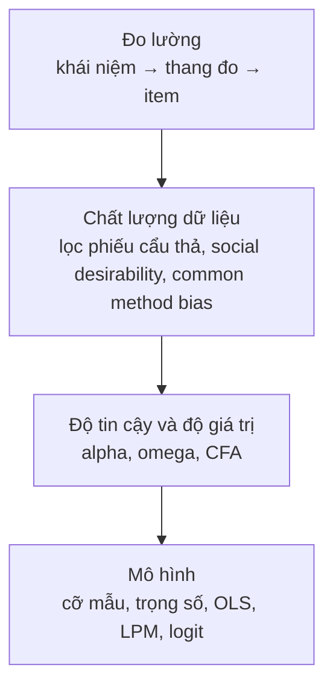

Trước khi chạy hồi quy trên dữ liệu khảo sát Likert, bạn cần kiểm tra bốn khâu: thang đo, phiếu trả lời cẩu thả, sai lệch hệ thống (social desirability và common method bias) và cách đưa trọng số mẫu vào mô hình. Các ngưỡng quen thuộc như Cronbach's alpha ≥ 0,70, nhân tố đầu của Harman dưới 50% hay CFI trên 0,90 chỉ là điều kiện cần: với 145 item, tương quan trung bình giữa các item chỉ 0,25 đã cho alpha 0,98, và Harman vẫn "đạt" khi mọi item cùng chịu một nguồn sai lệch. Bài lấy khảo sát sinh viên đại học làm bối cảnh, đặt từng quy tắc bên cạnh tài liệu phương pháp gốc. Bài dành cho học viên cao học, người làm khảo sát giáo dục và data analyst; cuối bài có checklist 12 câu hỏi và script R mô phỏng chạy được.

<div class="callout callout-note">
<p class="callout-title">Tóm tắt nhanh</p>

- Alpha tăng theo số item; alpha rất cao trên bộ công cụ dài không chứng minh thang đo tốt.
- Harman test không phát hiện một nhân tố chiếm đa số không có nghĩa là không có common method bias.
- Lọc phiếu cẩu thả nên dùng ít nhất hai loại chỉ số, định ngưỡng trước và báo cáo kết quả có và không lọc.
- Trọng số mẫu làm đổi hệ số hồi quy khi hiệu ứng khác nhau giữa các tầng; nên báo cáo cả hai.
- Hệ số LPM gần với hiệu ứng biên trung bình (AME) của logit, không phải hiệu ứng biên tại giá trị trung bình.

</div>

## 1. Kiểm tra dữ liệu khảo sát trước hồi quy là gì

Độ tin cậy của một kết quả định lượng dựa trên ba trụ: chiến lược nhận diện (identification strategy, thiết kế cho phép tách hiệu ứng cần đo khỏi các yếu tố khác), quy trình thu thập dữ liệu và quy trình phân tích. Bài này nói về trụ thứ hai và phần nối sang trụ thứ ba. Trụ thứ nhất, câu hỏi "biến này có gây ra biến kia không", để cho bài suy luận nhân quả.

Kiểm tra dữ liệu khảo sát trước hồi quy là chuỗi bước đi từ cách đo, qua chất lượng từng phiếu, tới cách đưa dữ liệu vào mô hình. Mỗi khâu có phép kiểm tra riêng, và mỗi phép kiểm tra có điểm mù riêng.



Luận điểm của bài: kết quả hồi quy trên dữ liệu khảo sát chỉ đáng tin bằng khâu yếu nhất trong chuỗi này. Một kiểm định "một con số" (alpha, Harman, một chỉ số fit) là điều kiện tối thiểu, không phải bằng chứng đủ.

Thứ tự các mục đi theo đúng chuỗi trên: mục 2 nói về đo lường, mục 3–5 về chất lượng dữ liệu và sai lệch, mục 6 về độ tin cậy, mục 7 về mô hình, mục 8 là mô phỏng gom tất cả lại. Nếu bạn đã có sẵn dữ liệu và chỉ cần quyết định có lọc phiếu hay dùng trọng số, có thể đọc thẳng mục 3 và mục 7; nếu bạn đang thiết kế bảng hỏi, mục 2 tiết kiệm nhiều công nhất.

Bối cảnh xuyên suốt là khảo sát sinh viên đại học. National Survey of Student Engagement (NSSE) ở Mỹ đo mức độ sinh viên tham gia vào các hoạt động học tập có ích, thay vì chỉ đo nguồn lực hay danh tiếng của trường (Kuh, 2001). China College Student Survey (CCSS) do Viện Giáo dục, Đại học Tsinghua phát triển từ NSSE, bản địa hoá cho Trung Quốc và có dữ liệu toàn quốc từ năm 2012 (Shi et al., 2014); nhóm tác giả đã tổng kết 15 năm của dự án trong một bài năm 2024 (Shi et al., 2024). Các khảo sát loại này dài, tự báo cáo và dùng nhiều thang Likert, nên gặp đủ các vấn đề trong bài.

Để minh hoạ cách đọc con số, bài dùng một **báo cáo giả định** của một khảo sát sinh viên quy mô lớn, với các con số dạng thường thấy trong báo cáo kỹ thuật: loại 8,87% phiếu theo ba tiêu chí, nhân tố đầu của Harman giải thích 32,57% phương sai, alpha toàn bộ công cụ 0,98, CFI và TLI 0,91, RMSEA và SRMR 0,05. Đây không phải số liệu đã công bố của một khảo sát cụ thể nào.

## 2. Từ khái niệm đến thang đo

### 2.1. Concept, construct và item

Một khái niệm trừu tượng như "gắn kết học tập" không đo được bằng một câu hỏi. Người thiết kế phải định nghĩa khái niệm thành một construct có các chiều cụ thể, rồi viết nhiều item cho mỗi chiều. Một cách kiểm tra đơn giản là ma trận câu hỏi nghiên cứu × item: đọc theo hàng để thấy câu hỏi nghiên cứu nào chưa đủ item, đọc theo cột để thấy item nào không phục vụ câu hỏi nào.

**Bảng 1.** Ví dụ ma trận câu hỏi nghiên cứu (RQ) × item

| Item | RQ1: Tương tác thầy trò | RQ2: Thử thách học thuật | RQ3: Kết quả học tập |
| :--- | :---: | :---: | :---: |
| Q1. Giảng viên phản hồi bài tập kịp thời | ✓ | | |
| Q2. Bạn thảo luận ý tưởng với giảng viên ngoài giờ | ✓ | | |
| Q3. Môn học đòi hỏi bạn làm việc hết khả năng | | ✓ | |
| Q4. Bạn tiến bộ trong viết lách | | | ✓ |
| Q5. Bạn thích căng-tin của trường | | | |

Hàng Q5 trống: item này không phục vụ câu hỏi nào và nên bỏ. Nếu RQ3 chỉ có một item thì thang đo kết quả học tập chưa đủ để tính độ tin cậy.

### 2.2. Viết item

Ba lỗi phổ biến nhất khi viết item là câu hỏi kép ("Giảng viên nhiệt tình và chấm điểm công bằng"), câu hỏi dẫn dắt ("Bạn có đồng ý rằng lớp đông làm giảm chất lượng học không?") và thuật ngữ người trả lời không hiểu. Lỗi khó thấy hơn là bắt người trả lời tự ước lượng một hiệu ứng nhân quả, ví dụ "Lớp học nhỏ giúp thành tích của bạn tăng bao nhiêu?". Người trả lời không có thông tin để trả lời câu đó. Cách đúng là đo riêng sĩ số lớp và thành tích, rồi để mô hình ước lượng quan hệ.

Item đảo (reverse-keyed) giúp phát hiện người trả lời đồng ý với mọi câu, nhưng có cái giá. Weijters et al. (2013) cho thấy item đảo tạo ra sai lệch có hệ thống và trong phân tích nhân tố khẳng định có thể xuất hiện nhân tố phương pháp riêng cho nhóm item đảo. Trước khi tính tổng điểm hay alpha, mọi item đảo phải được đảo điểm (trên thang 1–5: điểm mới = 6 − điểm cũ); quên bước này làm tương quan giữa các item âm và kéo alpha xuống.

### 2.3. Social desirability trong thiết kế thang đo

Social desirability (xu hướng trả lời theo hướng được xã hội đánh giá cao) là lý do nhiều khảo sát đưa thêm một thang đo riêng. Thang Marlowe–Crowne là một trong những thang đầu tiên, được thiết kế để đo xu hướng này độc lập với bệnh lý tâm thần (Crowne & Marlowe, 1960). Paulhus (1984) tách socially desirable responding thành hai thành phần: tự lừa dối (self-deceptive enhancement, người trả lời tin thật vào hình ảnh tốt về bản thân) và quản lý ấn tượng (impression management, cố ý trình bày cho đẹp). Đây là cơ sở của thang Balanced Inventory of Desirable Responding (BIDR) hai chiều.

Paulhus (2002) sau đó mở rộng thành mô hình hai tầng: mỗi loại thiên lệch về nội dung đều có một phần tự lừa dối và một phần quản lý ấn tượng.

**Bảng 2.** Mô hình hai tầng của socially desirable responding (theo Paulhus, 2002)

| Loại thiên lệch | Tự lừa dối (vô thức) | Quản lý ấn tượng (có chủ đích) |
| :--- | :--- | :--- |
| Egoistic bias: phóng đại năng lực, địa vị | Self-deceptive enhancement | Agency management |
| Moralistic bias: phóng đại đức tính, sự tử tế | Self-deceptive denial | Communion management |

Với người phân tích, mô hình này có một hệ quả cụ thể: hai loại thiên lệch làm phồng những item khác nhau. Một sinh viên có egoistic bias cao sẽ tự chấm cao ở "năng lực tư duy phê phán"; một sinh viên có moralistic bias cao sẽ tự chấm cao ở "tôn trọng bạn học". Kiến thức nền về tự trình bày bản thân có trong tâm lý học xã hội.

### 2.4. Pilot và phỏng vấn nhận thức

Pilot (khảo sát thử) và phỏng vấn nhận thức (cognitive interviewing) là bước kiểm tra cuối trước khi phát phiếu. Phỏng vấn nhận thức yêu cầu một nhóm nhỏ người trả lời nói to suy nghĩ hoặc trả lời câu hỏi thăm dò để người thiết kế biết họ hiểu item ra sao; Beatty và Willis (2007) tổng quan thực hành này và cho thấy nó đã thành bước thử nghiệm bảng hỏi phổ biến. Một item bị hiểu sai mà lọt qua khâu này thì không kỹ thuật thống kê nào về sau sửa được.

## 3. Lọc phiếu trả lời cẩu thả

### 3.1. Ba tiêu chí và loại chỉ số tương ứng

Careless responding (trả lời cẩu thả, còn gọi insufficient effort responding) là khi người trả lời không đọc kỹ câu hỏi. Meade và Craig (2012) phân các cách phát hiện thành nhóm: chỉ số nhất quán (so các item cùng nghĩa), chỉ số chuỗi trả lời giống nhau (long-string), chỉ số ngoại lai đa biến (Mahalanobis distance), thời gian trả lời, và các item cài sẵn để kiểm tra sự chú ý. Curran (2016) và Huang et al. (2012) bổ sung cách kết hợp các chỉ số và cách phòng ngừa từ khâu thiết kế; Zhong et al. (2021) tổng quan cùng chủ đề bằng tiếng Trung.

Báo cáo giả định ở mục 1 dùng ba tiêu chí. Bảng 3 đặt chúng vào khung trên.

**Bảng 3.** Ba tiêu chí lọc phiếu, loại chỉ số và điểm mù

| Tiêu chí | Tỷ lệ (giả định) | Loại chỉ số | Điểm mù |
| :--- | ---: | :--- | :--- |
| Hai item cùng nghĩa ("giảng viên phản hồi bài tập kịp thời", hỏi hai lần ở hai chỗ) lệch nhau ≥ 2 điểm | 3,16% | Nhất quán (consistency) | Một cặp item duy nhất dễ bắt nhầm người trả lời thật nhưng hiểu hai câu khác nhau |
| Bỏ trống hơn 2/3 phần chính | 0,12% | Dữ liệu thiếu | Tỷ lệ thấp vì bảng hỏi điện tử bắt buộc trả lời; chính việc bắt buộc có thể đẩy người trả lời sang trả lời cho xong |
| Cùng một đáp án ở ≥ 30 câu liên tiếp | 5,8% | Long-string | Trả lời giống nhau có thể hợp lệ khi các item đo cùng một thuộc tính |
| Tổng số phiếu bị loại | 8,87% | | |

Hàng thứ hai cần thêm một khái niệm. Krosnick (1991) gọi chiến lược đưa ra câu trả lời "đủ dùng" thay vì câu trả lời tốt nhất là satisficing, xảy ra khi việc trả lời tối ưu đòi hỏi nhiều nỗ lực nhận thức. Bắt buộc trả lời mọi câu giảm dữ liệu thiếu nhưng không làm người trả lời chăm chú hơn.

Hàng thứ ba là điểm mù đáng kể nhất. Reuning và Plutzer (2020) cho thấy straight-lining (chọn cùng một đáp án cho cả chuỗi câu) không phải lúc nào cũng là dữ liệu kém: khi các item đo cùng một thuộc tính và người trả lời có quan điểm nhất quán, trả lời giống nhau là hợp lệ. Xoá máy móc mọi phiếu straight-lining có thể loại đúng những người có thái độ rõ ràng nhất.

### 3.2. Các tiêu chí chồng lấn

Cộng ba tỷ lệ: 3,16 + 0,12 + 5,8 = 9,08%, lớn hơn tổng 8,87%. Vì một phiếu chỉ bị loại một lần, ít nhất 0,21 điểm phần trăm số phiếu bị bắt bởi hơn một tiêu chí. Phần chồng lấn đáng ghi vào báo cáo. Các chỉ số khác loại thường bắt những nhóm phiếu khác nhau, và chồng lấn ít nghĩa là chúng bổ sung cho nhau.

Mô phỏng ở mục 8 cho thấy cùng hiện tượng (Hình 1). Code đặt xác suất 5% cho straight-liner và 3% cho phiếu trả lời ngẫu nhiên; trong 5.000 phiếu mô phỏng, thực tế ra 285 straight-liner (5,7%) và 160 phiếu ngẫu nhiên (3,2%), tổng cộng 8,90% phiếu cẩu thả. Ba chỉ số gắn cờ lần lượt 6,14%, 1,82% và 3,08% số phiếu; tổng là 11,04% nhưng chỉ 10,36% phiếu bị gắn cờ bởi ít nhất một chỉ số.


*Hình 1. Tỷ lệ phiếu bị gắn cờ theo từng chỉ số trên dữ liệu mô phỏng (n = 5.000, seed 2026). Nguồn: mô phỏng của bài, code ở mục 8.*

Bộ ba chỉ số bắt được toàn bộ 285 straight-liner và 151 trên 160 phiếu ngẫu nhiên, nhưng cũng gắn cờ nhầm 82 trên 4.555 phiếu bình thường (1,8%). Long-string bắt straight-liner, Mahalanobis bắt phần lớn phiếu ngẫu nhiên; mỗi chỉ số một mình đều bỏ sót.

Một lỗi hay gặp là chọn ngưỡng sau khi đã thấy kết quả. Nếu ngưỡng long-string 15 câu cho hệ số "đẹp" hơn ngưỡng 10 câu, rất dễ chọn 15 mà không nhận ra đang tối ưu theo kết quả. Lỗi thứ hai là xoá phiếu nhưng không giữ cờ: sau này không ai kiểm tra lại được phiếu nào bị loại vì lý do gì. Cách an toàn là không xoá, chỉ thêm cột cờ cho từng chỉ số, giống nguyên tắc giữ dữ liệu gốc trong bài [làm sạch dữ liệu](/blog/process-data-from-dirty-to-clean/).

### 3.3. Khuyến nghị

Tổng hợp từ Meade và Craig (2012), Huang et al. (2012) và Curran (2016):

1. Dùng ít nhất hai loại chỉ số khác nhau (ví dụ long-string và một chỉ số nhất quán hoặc ngoại lai).
2. Định trước ngưỡng loại phiếu trong kế hoạch phân tích, trước khi nhìn kết quả hồi quy.
3. Báo cáo tỷ lệ bị loại theo từng tiêu chí và phần chồng lấn.
4. Báo cáo kết quả chính trên cả dữ liệu có và không lọc.
5. Ưu tiên phòng ngừa: hướng dẫn rõ, bảng hỏi không quá dài, item kiểm tra sự chú ý.

## 4. Social desirability: đo, kiểm soát hay để yên

Người có điểm social desirability (SD) cao thường tự chấm cao ở nhiều thang đo cùng lúc: tương tác với giảng viên, mức thử thách, sự hỗ trợ của trường. Nếu cả biến độc lập lẫn biến phụ thuộc đều phình theo cùng một xu hướng, tương quan giữa chúng phình theo. Một cách xử lý phổ biến là đo SD bằng một thang riêng rồi đưa điểm SD vào hồi quy làm biến kiểm soát.

Cách này có lợi khi SD đúng là sai lệch thuần. Trong mô phỏng ở mục 8, SD được thiết kế đúng như vậy: một nhân tố không có nội dung thật, cộng vào mọi item tự đánh giá. Hệ số của thang "tương tác thầy trò" lên thang "kết quả học tập" sau khi lọc phiếu là 0,499; thêm điểm SD làm biến kiểm soát, hệ số còn 0,414.

Ngoài mô phỏng, cần thận trọng hơn. Mô hình của Paulhus (1984, 2002) tách tự lừa dối với quản lý ấn tượng, và hai thành phần này có ý nghĩa khác nhau. Một sinh viên tự tin thật vào năng lực của bản thân (tự lừa dối ở mức vừa phải) có thể thật sự học chủ động hơn. Nếu điểm SD chứa một phần tính cách thật liên quan tới kết quả, kiểm soát SD có thể lấy đi cả phương sai thật. Đây là lập luận có điều kiện; mức độ phụ thuộc vào thang SD cụ thể. Hệ quả thực hành thì rõ: báo cáo mô hình có và không có biến SD, và ghi rõ thang SD đo thành phần nào.

Podsakoff et al. (2003, 2012) xếp social desirability vào nhóm nguồn của method bias (sai lệch do phương pháp đo), cùng với xu hướng đồng ý và việc đo mọi biến từ cùng một người trả lời. Cách nhìn này nối trực tiếp sang mục 5.

## 5. Common method bias và giới hạn của Harman test

### 5.1. Common method bias là gì

Common method bias (CMB, sai lệch do phương pháp chung) là phần phương sai sinh ra từ cách đo chứ không từ construct được đo. Khi cùng một người trả lời mọi câu, cùng một lúc, trên cùng một định dạng thang Likert, tương quan giữa các construct có thể bị thổi phồng hoặc làm méo (Podsakoff et al., 2003). Podsakoff et al. (2012) tổng hợp các nguồn: đặc điểm người trả lời (như social desirability), đặc điểm item (cách viết, định dạng thang), bối cảnh item (thứ tự, vị trí) và bối cảnh đo (thời điểm, phương tiện).

### 5.2. Harman single-factor test

Harman single-factor test đưa toàn bộ item vào một phân tích nhân tố không xoay. Nếu một nhân tố giải thích hơn 50% phương sai, có dấu hiệu CMB. Báo cáo giả định có nhân tố đầu với eigenvalue 47,23, giải thích 32,57% phương sai, dưới ngưỡng 50%.

Podsakoff et al. (2003) phân tích kỹ kiểm định này và kết luận nó kém nhạy: vượt qua Harman không có nghĩa là không có CMB. Tang và Wen (2020) đưa phê bình tương tự vào bối cảnh nghiên cứu tâm lý ở Trung Quốc và đề xuất phương án thay thế.

Con số giả định còn cho thêm một thông tin. Khi phân tích dùng ma trận tương quan, tổng eigenvalue bằng số biến, nên số biến ≈ 47,23 / 0,3257 ≈ 145. Với 145 item đo năm chiều khác nhau, nhân tố đầu rất khó vượt 50% ngay cả khi có phương sai phương pháp, nên con số 32,57% nói được rất ít về CMB.

Mô phỏng ở mục 8 cho thấy điều đó trực tiếp. Mọi item trong mô phỏng đều chứa cùng một thành phần SD, tức có CMB theo thiết kế; nhân tố đầu vẫn chỉ giải thích 48,3% phương sai, dưới ngưỡng 50%. Ở dữ liệu thô con số là 49,8%, sát ngưỡng, nên kết luận của Harman còn phụ thuộc cả vào việc đã lọc phiếu hay chưa.

### 5.3. Làm gì thay Harman

Podsakoff et al. (2003, 2012) chia biện pháp thành hai nhóm. Biện pháp thủ tục: lấy biến độc lập và biến phụ thuộc từ nguồn khác nhau (ví dụ điểm học tập từ hệ thống của trường), tách thời điểm đo, bảo đảm ẩn danh, đổi định dạng thang giữa các phần. Biện pháp thống kê: biến đánh dấu (marker variable, một biến về lý thuyết không liên quan nhưng chịu cùng phương pháp đo), nhân tố phương pháp tiềm ẩn trong CFA, mô hình bifactor. Đề xuất của Tang và Wen (2020) cũng đi theo hướng không dựa vào một phép thử duy nhất.

Trong thực hành, biện pháp thủ tục rẻ nhất là tách nguồn. Với khảo sát sinh viên, điểm trung bình học tập, tỷ lệ tốt nghiệp đúng hạn hay việc làm sau tốt nghiệp có thể lấy từ dữ liệu hành chính của trường thay vì hỏi sinh viên tự báo cáo. Khi biến phụ thuộc không đến từ cùng một phiếu, phần lớn CMB giữa hai vế của hồi quy biến mất, vì sai lệch phương pháp không còn chung.

Câu kết luận đúng mức cho kết quả Harman là: "Phân tích nhân tố không phát hiện một nhân tố chung chiếm đa số phương sai; kết quả này không loại trừ common method bias."

## 6. Độ tin cậy và độ giá trị: đọc alpha và CFA

### 6.1. Alpha nói gì

Cronbach (1951) định nghĩa hệ số alpha cho một thang gồm k item:

$$\alpha = \frac{k}{k-1}\left(1 - \frac{\sum_{i=1}^{k}\sigma_i^2}{\sigma_X^2}\right)$$

trong đó $\sigma_i^2$ là phương sai của item i và $\sigma_X^2$ là phương sai của tổng điểm. Alpha đo mức nhất quán nội tại (internal consistency): các item có cùng biến thiên hay không.

### 6.2. Alpha tăng theo số item

Phiên bản chuẩn hoá của alpha chỉ phụ thuộc hai đại lượng: số item k và tương quan trung bình giữa các item $\bar r$:

$$\alpha_{std} = \frac{k\bar r}{1 + (k-1)\bar r}$$

**Bảng 4.** Alpha chuẩn hoá theo số item và tương quan trung bình

| Số item k | $\bar r$ = 0,10 | $\bar r$ = 0,25 |
| ---: | ---: | ---: |
| 10 | 0,53 | 0,77 |
| 30 | 0,77 | 0,91 |
| 145 | 0,94 | 0,98 |


*Hình 2. Alpha chuẩn hoá theo số item với bốn mức tương quan trung bình; đường đứng tại k = 145, đường ngang tại 0,70. Nguồn: tính từ công thức.*

Với khoảng 145 item, tương quan trung bình chỉ 0,25, mức tương quan yếu, đã đủ cho alpha 0,98. Cortina (1993) minh hoạ chính hiện tượng này: alpha cao có thể đến từ số item lớn chứ không từ các item gắn kết chặt.

### 6.3. Alpha không đo những gì

Alpha không đo tính đơn chiều. Một bộ item đo năm chiều khác nhau vẫn có thể cho alpha rất cao nếu đủ dài (Cortina, 1993; Sijtsma, 2009). Vì vậy một alpha "tổng" cho cả bộ công cụ năm chiều ít ý nghĩa; nên báo cáo alpha theo từng thang con.

Alpha quá cao cũng không luôn là tin tốt. Streiner (2003) bác bỏ quan niệm "alpha càng cao càng tốt": trên một thang ngắn, alpha trên 0,90 thường là dấu hiệu nhiều item gần như lặp ý, tức thang có item thừa.

Alpha giả định các item có tải nhân tố bằng nhau (tau-equivalence). McNeish (2018) cho thấy giả định này hiếm khi đúng và đề xuất dùng hệ số omega, tính từ mô hình nhân tố, làm chỉ số độ tin cậy mặc định.

Còn ngưỡng 0,70? Lance et al. (2006) truy lại nguồn của bốn ngưỡng hay được trích, trong đó có alpha 0,70 thường gán cho Nunnally, và cho thấy các ngưỡng này thường bị trích ra khỏi ngữ cảnh gốc. Các bảng phân mức alpha (excellent, good, acceptable…) xuất hiện nhiều trong sách hướng dẫn phần mềm là quy tắc kinh nghiệm, không phải tiêu chuẩn có cơ sở lý thuyết.

### 6.4. Đọc kết quả CFA

Phân tích nhân tố khẳng định (confirmatory factor analysis, CFA) kiểm tra xem dữ liệu có khớp cấu trúc nhân tố giả định không. Hu và Bentler (1999) đề xuất ngưỡng kết hợp: CFI và TLI khoảng 0,95 trở lên, RMSEA khoảng 0,06 trở xuống, SRMR khoảng 0,08 trở xuống. Marsh et al. (2004) cảnh báo không biến các ngưỡng này thành "luật vàng": chúng được rút ra từ một số điều kiện mô phỏng cụ thể và không áp dụng máy móc cho mọi mô hình.

Đọc báo cáo giả định (CFI, TLI 0,91; RMSEA, SRMR 0,05) theo khung này: RMSEA và SRMR tốt, CFI và TLI thấp hơn ngưỡng 0,95 của Hu và Bentler. Kết luận đúng mức là mô hình khớp ở mức chấp nhận được, chưa xuất sắc; bước tiếp theo là xem tải nhân tố và modification indices. Phần CFA và SEM chi tiết có trong ứng dụng SEM.

Một ví dụ cụ thể giúp thấy vì sao không nên chỉ nhìn CFI. Một mô hình năm nhân tố trên 145 item có rất nhiều tham số và rất nhiều tương quan cần khớp; CFI 0,91 có thể đến từ vài nhóm item có sai số tương quan với nhau, chẳng hạn các item cùng đầu câu hoặc cùng nằm trên một màn hình. Modification indices chỉ ra những cặp đó, và lúc ấy câu hỏi là có lý do nội dung để cho chúng tương quan hay không, chứ không phải thêm tham số cho tới khi CFI vượt 0,95.

### 6.5. Các loại độ giá trị

**Bảng 7.** Ba loại độ giá trị và cách kiểm tra

| Loại độ giá trị | Câu hỏi | Cách kiểm tra thường dùng |
| :--- | :--- | :--- |
| Content validity | Item có phủ đủ nội dung của khái niệm? | Chuyên gia đánh giá, ma trận RQ × item |
| Construct validity | Thang có đo đúng construct? | CFA, hội tụ và phân biệt giữa các thang |
| Criterion validity | Điểm thang có liên hệ với một tiêu chí bên ngoài? | Tương quan với điểm học tập, kết quả việc làm |

## 7. Nối vào mô hình: cỡ mẫu, trọng số, OLS, LPM và logit

### 7.1. Cỡ mẫu

Công thức cỡ mẫu để ước lượng một tỷ lệ trong mẫu ngẫu nhiên đơn (Cochran, 1977):

$$n_0 = \frac{z^2 p(1-p)}{e^2}, \qquad n = \frac{n_0}{1 + \frac{n_0 - 1}{N}}$$

Với z = 1,96 (độ tin cậy 95%), p = 0,5 và sai số e = 0,05, $n_0$ ≈ 384. Hiệu chỉnh tổng thể hữu hạn cho N = 1.000 ra n ≈ 278, N = 10.000 ra 370; dạng bảng này giống bảng của Krejcie và Morgan (1970).


*Hình 3. Cỡ mẫu tối thiểu theo quy mô tổng thể. Nguồn: tính từ công thức của Cochran (1977).*

Con số "khoảng 400 là đủ" chỉ đúng cho đúng một việc: ước lượng một tỷ lệ với sai số ±5% trong mẫu ngẫu nhiên đơn. So sánh nhóm con, hồi quy nhiều biến hay mẫu cụm đều cần cỡ mẫu lớn hơn.

### 7.2. Trọng số mẫu

Trọng số gốc (base weight) bằng nghịch đảo xác suất được chọn. Điều chỉnh không phản hồi (non-response adjustment) nhân trọng số với tỷ lệ số được chọn / số trả lời trong từng nhóm. Post-stratification là bước khác: hiệu chỉnh trọng số để tổng theo các nhóm (giới, vùng, ngành) khớp với tổng thể đã biết; raking làm việc này lặp trên nhiều biến.

Ví dụ: bốn trường, chọn ngẫu nhiên học sinh trong mỗi trường, đo chiều cao.

**Bảng 5.** Ví dụ bốn trường: ba cách tính trung bình

| Trường | Trung bình $\bar y_j$ (cm) | Cỡ mẫu $n_j$ | Trọng số $w_j$ | $n_j \times w_j$ |
| :--- | ---: | ---: | ---: | ---: |
| 1 | 155 | 82 | 5 | 410 |
| 2 | 143 | 92 | 3 | 276 |
| 3 | 157 | 66 | 4 | 264 |
| 4 | 160 | 80 | 5 | 400 |

- Không trọng số: 49.028 / 320 = **153,21 cm**.
- Chỉ nhân trọng số vào trung bình trường: 2.632 / 17 = 154,82 cm. Cách này sai vì bỏ qua số học sinh mỗi trường.
- Đúng: (155 × 410 + 143 × 276 + 157 × 264 + 160 × 400) / 1.350 = 208.466 / 1.350 = **154,42 cm**.

```python
y, n, w = [155, 143, 157, 160], [82, 92, 66, 80], [5, 3, 4, 5]
num = sum(a * b * c for a, b, c in zip(y, n, w))
print(num, round(num / sum(b * c for b, c in zip(n, w)), 2))   # 208466 154.42
```

### 7.3. Trọng số trong hồi quy

Trọng số đổi trung bình mô tả, nhưng có nên dùng trong hồi quy? Solon et al. (2015) trả lời: tuỳ mục đích. Nếu muốn ước lượng thống kê mô tả cho tổng thể, dùng trọng số. Nếu muốn ước lượng một hiệu ứng nhân quả và mô hình đúng, trọng số không cần cho tính nhất quán và có thể làm sai số chuẩn lớn hơn. Khi ước lượng có và không trọng số khác nhau đáng kể, đó là dấu hiệu hiệu ứng khác nhau giữa các nhóm, cần mô hình hoá sự khác biệt đó. Khuyến nghị thực hành: báo cáo cả hai.

Mô phỏng ở mục 8 dựng đúng tình huống đó. Hiệu ứng của tương tác thầy trò lên kết quả học tập là 0,6 ở tầng được chọn dư và 0,3 ở tầng còn lại. Hồi quy không trọng số trên biến tiềm ẩn cho 0,454, gần trung bình của mẫu (hai tầng gần bằng nhau); có trọng số cho 0,360, gần trung bình của tổng thể (tầng thứ hai chiếm 80%). Không con số nào "sai": chúng trả lời hai câu hỏi khác nhau, và khoảng cách giữa chúng là thông tin. Về sai số chuẩn, trọng số càng chênh lệch thì sai số chuẩn càng có xu hướng lớn; muốn có sai số chuẩn đúng theo thiết kế mẫu (phân tầng, cụm) cần công cụ chuyên cho khảo sát như gói `survey` của R hoặc `svyset` của Stata, không chỉ sai số chuẩn robust.

### 7.4. Một ví dụ thực chứng: EMI và MMI

Luo et al. (2018) dùng dữ liệu CCSS năm 2012 để kiểm định giả thuyết effectively maintained inequality (EMI) trong bối cảnh Trung Quốc. Theo EMI (Lucas, 2001), khi khác biệt về số lượng giáo dục giữa các nhóm thu hẹp, nhóm có lợi thế chuyển sang cạnh tranh về chất lượng: loại trường, ngành, vị trí. Maximally maintained inequality (MMI) của Raftery và Hout (1993) thì cho rằng bất bình đẳng về tiếp cận giữ nguyên tới khi nhóm trên bão hoà. Luo et al. (2018) kết luận mở rộng giáo dục đại học không làm giảm bất bình đẳng, nhất là về cơ hội vào trường tinh hoa và có việc làm tốt của sinh viên có địa vị kinh tế xã hội (SES) thấp.

Một nghiên cứu loại này thường có ba kiểu biến phụ thuộc: nhị phân (vào trường tinh hoa hay không) dùng LPM hoặc logit; điểm trải nghiệm học tập từ thang Likert dùng OLS trên chỉ số tổng hợp; kết quả việc làm tuỳ dạng biến. SES và trải nghiệm học tập đều là biến tự báo cáo, nên mọi vấn đề ở mục 2–6 đi thẳng vào hệ số ước lượng.

### 7.5. LPM và logit

Với biến phụ thuộc nhị phân, mô hình xác suất tuyến tính (linear probability model, LPM) chạy OLS trực tiếp; hệ số là thay đổi xác suất. LPM luôn có phương sai thay đổi nên cần sai số chuẩn robust, và có thể dự báo xác suất ngoài [0, 1]. Logit dùng hàm liên kết log-odds; $e^{\beta}$ là odds ratio. Pseudo R² của logit không đọc như R² của OLS; nó chỉ có nghĩa khi so sánh các mô hình dự báo cùng một biến trên cùng dữ liệu (UCLA Statistical Consulting Group, n.d.).

Trên dữ liệu mô phỏng ở mục 8 (5.000 sinh viên, xác suất vào trường tinh hoa tăng theo điểm thi chuẩn hoá z): hệ số LPM là 0,198; hệ số logit 2,055, odds ratio 7,81. Hiệu ứng biên của logit tại giá trị trung bình (MEM) là 0,148, còn hiệu ứng biên trung bình trên toàn mẫu (AME) là 0,197.


*Hình 4. Xác suất dự báo của LPM và logit trên dữ liệu mô phỏng. Nguồn: mô phỏng của bài.*

0,198 và 0,148 không mâu thuẫn: chúng là hai estimand khác nhau. Hệ số LPM xấp xỉ thay đổi xác suất trung bình trên toàn mẫu, nên so với AME (0,197), không so với MEM. Trong mô phỏng, 17,7% xác suất dự báo của LPM nằm ngoài [0, 1], đúng ở hai đuôi của Hình 4.

## 8. Demo mô phỏng bằng R

Mô phỏng dùng base R, không cần cài gói. Thiết kế: 5.000 sinh viên trong hai tầng chọn mẫu không tỷ lệ (trọng số 1 và 4); hai construct, mỗi construct 10 item Likert 5 mức; một nhân tố SD cộng vào mọi item; chèn 5% straight-liner và 3% trả lời ngẫu nhiên. Hiệu ứng của tương tác thầy trò lên kết quả học tập lớn hơn ở tầng chọn dư.

```r
# Mô phỏng: careless responding, social desirability và hồi quy (chỉ dùng base R)
set.seed(2026)
n <- 5000
likert <- function(x) pmin(5, pmax(1, round(3 + x)))          # cắt về thang 1–5

# 1. Thiết kế mẫu phân tầng không tỷ lệ: tầng A bị chọn dư 4 lần
stratum <- rbinom(n, 1, 0.5)                                   # 1 = tầng A
w <- ifelse(stratum == 1, 1, 4)                                # trọng số = 1/xác suất chọn (tương đối)

# 2. Biến tiềm ẩn
ses <- rnorm(n) + 0.5 * stratum
T   <- 0.3 * ses + rnorm(n)                                    # tương tác thầy trò
Y   <- 0.3 * T + 0.2 * ses + 0.3 * stratum * T + rnorm(n)      # hiệu ứng khác nhau giữa hai tầng
sd_ <- rnorm(n)                                                # xu hướng tự tô đẹp (social desirability)

# 3. Item quan sát: 10 item / construct, cộng thêm thành phần SD
make_items <- function(f, k = 10, load = 0.8, sdl = 0.4)
  sapply(1:k, function(j) likert(load * f + sdl * sd_ + rnorm(n, 0, 0.7)))
X <- cbind(make_items(T), make_items(Y))
SDscale <- rowMeans(sapply(1:6, function(j) likert(0.8 * sd_ + rnorm(n, 0, 0.7))))
X_true <- X

# 4. Chèn 5% straight-liner và 3% trả lời ngẫu nhiên
type <- sample(c("ok", "straight", "random"), n, TRUE, c(0.92, 0.05, 0.03))
X[type == "straight", ] <- sample(3:5, sum(type == "straight"), TRUE)
X[type == "random", ]   <- sample(1:5, sum(type == "random") * 20, TRUE)

# 5. Ba chỉ số careless responding
longstring <- apply(X, 1, function(r) max(rle(r)$lengths))
pair_gap   <- abs(X[, 1] - X[, 2])                             # cặp item gần nghĩa
D2 <- mahalanobis(X, colMeans(X), cov(X))
flag <- data.frame(longstring = longstring >= 15,
                   pair = pair_gap >= 3,
                   mahal = D2 > qchisq(0.999, ncol(X)))
flag$any <- rowSums(flag) > 0
print(round(100 * colMeans(flag), 2))
print(table(flagged = flag$any, type))

# 6. Alpha, Harman và hồi quy trong 4 kịch bản
alpha <- function(M) { k <- ncol(M); k / (k - 1) * (1 - sum(apply(M, 2, var)) / var(rowSums(M))) }
harman <- function(M) { e <- eigen(cor(M))$values; 100 * e[1] / sum(e) }
hc1 <- function(fit) {                                         # sai số chuẩn robust HC1
  wt <- if (is.null(weights(fit))) 1 else weights(fit)
  Xm <- model.matrix(fit) * sqrt(wt); u <- residuals(fit) * sqrt(wt); k <- ncol(Xm); N <- nrow(Xm)
  B <- solve(crossprod(Xm)); V <- B %*% crossprod(Xm * u) %*% B * N / (N - k)
  sqrt(diag(V)) }
run <- function(M, keep, sd_ctrl = FALSE, wt = NULL) {
  d <- data.frame(t = rowMeans(M[keep, 1:10]), y = rowMeans(M[keep, 11:20]),
                  ses = ses[keep], sdv = SDscale[keep])
  f <- if (sd_ctrl) y ~ t + ses + sdv else y ~ t + ses
  fit <- if (is.null(wt)) lm(f, d) else lm(f, d, weights = wt[keep])
  c(n = sum(keep), alpha_T = alpha(M[keep, 1:10]), harman = harman(M[keep, ]),
    b_t = unname(coef(fit)["t"]), se_hc1 = unname(hc1(fit)["t"])) }
all <- rep(TRUE, n)
lat <- function(wt = NULL) { d <- data.frame(Y, T, ses)
  fit <- if (is.null(wt)) lm(Y ~ T + ses, d) else lm(Y ~ T + ses, d, weights = wt)
  c(n = n, alpha_T = NA, harman = NA, b_t = unname(coef(fit)["T"]), se_hc1 = unname(hc1(fit)["T"])) }
res <- rbind(
  "Bien tiem an, khong trong so"  = lat(),
  "Bien tiem an, co trong so"     = lat(w),
  "Du lieu sach (khong careless)" = run(X_true, type == "ok"),
  "Du lieu tho"                   = run(X, all),
  "Sau khi loc"                   = run(X, !flag$any),
  "Loc + kiem soat SD"            = run(X, !flag$any, sd_ctrl = TRUE),
  "Loc + trong so"                = run(X, !flag$any, wt = w))
print(round(res, 3))

# 7. LPM và logit cho một biến nhị phân (vào trường tinh hoa)
z <- rnorm(n)                                                  # điểm thi chuẩn hoá
elite <- rbinom(n, 1, plogis(-2.5 + 2 * z))
lpm <- lm(elite ~ z); lg <- glm(elite ~ z, family = binomial)
b <- coef(lg)
cat("LPM:", round(coef(lpm)["z"], 3), " SE HC1:", round(hc1(lpm)["z"], 4), "\n")
cat("Logit b:", round(b["z"], 3), " OR:", round(exp(b["z"]), 2), "\n")
cat("MEM:", round(dlogis(b[1] + b[2] * mean(z)) * b[2], 3),
    " AME:", round(mean(dlogis(b[1] + b[2] * z)) * b[2], 3), "\n")
cat("LPM du bao ngoai [0,1]:", round(100 * mean(fitted(lpm) < 0 | fitted(lpm) > 1), 1), "%\n")
cat("McFadden R2:", round(1 - logLik(lg) / logLik(glm(elite ~ 1, family = binomial)), 3), "\n")
grid <- data.frame(z = seq(-3, 3, 0.05))
write.csv(data.frame(grid, lpm = predict(lpm, grid), logit = predict(lg, grid, type = "response")),
          "pred.csv", row.names = FALSE)
write.csv(data.frame(round(100 * colMeans(flag[, 1:3]), 2)), "flags.csv")
```

Chạy bằng `Rscript demo.R` (đã chạy với R 4.4.3). Hàm `hc1()` tính sai số chuẩn robust HC1 bằng đại số ma trận để không phụ thuộc gói ngoài; với trọng số, hàm nhân cả ma trận thiết kế và phần dư với căn bậc hai trọng số. Kết quả với seed 2026:

**Bảng 6.** Kết quả mô phỏng

| Kịch bản | n | Alpha (thang T) | Harman (%) | Hệ số t | SE (HC1) |
| :--- | ---: | ---: | ---: | ---: | ---: |
| Biến tiềm ẩn, không trọng số | 5.000 | | | 0,454 | 0,015 |
| Biến tiềm ẩn, có trọng số | 5.000 | | | 0,360 | 0,016 |
| Dữ liệu không có phiếu cẩu thả | 4.555 | 0,935 | 48,9 | 0,510 | 0,014 |
| Dữ liệu thô | 5.000 | 0,934 | 49,8 | 0,556 | 0,013 |
| Sau khi lọc | 4.482 | 0,934 | 48,3 | 0,499 | 0,014 |
| Lọc + kiểm soát SD | 4.482 | 0,934 | 48,3 | 0,414 | 0,015 |
| Lọc + trọng số | 4.482 | 0,934 | 48,3 | 0,431 | 0,016 |

Bảng 6 cho bốn điều.

Thứ nhất, alpha gần như không đổi (0,934–0,935) giữa dữ liệu thô, dữ liệu đã lọc và dữ liệu không có phiếu cẩu thả. Alpha không phát hiện phiếu cẩu thả: straight-liner thậm chí làm các item tương quan với nhau hơn, còn phiếu ngẫu nhiên chỉ chiếm 3%.

Thứ hai, phiếu cẩu thả làm lệch hệ số. Dữ liệu thô cho 0,556, cao hơn 0,510 của dữ liệu không có phiếu cẩu thả khoảng 9%. Straight-liner trả lời giống nhau ở cả hai thang, nên tạo ra tương quan giả giữa "tương tác" và "kết quả". Sau khi lọc, hệ số về 0,499, gần mức 0,510.

Thứ ba, Harman dưới 50% ở mọi kịch bản, dù mọi item chứa cùng thành phần SD. Kiểm soát SD kéo hệ số từ 0,499 xuống 0,414, cho thấy SD đã thổi phồng hệ số đáng kể mà Harman không báo hiệu.

Thứ tư, trọng số đổi hệ số từ 0,499 xuống 0,431, cùng hướng với chênh lệch giữa hai dòng biến tiềm ẩn (0,454 và 0,360). Hệ số trên thang đo không trùng với hệ số trên biến tiềm ẩn vì thang đo có sai số đo lường và chứa SD; điều đáng so là hướng và độ lớn của thay đổi giữa các kịch bản.

Mô phỏng này có chủ đích đơn giản: SD được dựng là sai lệch thuần, nên kiểm soát SD chắc chắn có lợi; dữ liệu thật không cho biết trước điều đó. Muốn mở rộng, bạn có thể thay các hàm tự viết bằng gói chuyên dụng: `careless` cho chỉ số careless responding, `psych` cho alpha và omega, `lavaan` cho CFA có nhân tố phương pháp, `survey` cho hồi quy theo thiết kế mẫu. Bản Stata tương ứng dùng `alpha ..., item`, `regress ..., robust`, `logit` kèm `margins, dydx(*)` và `svyset`.

## 9. Checklist 12 câu hỏi trước khi chạy hồi quy

1. Mỗi câu hỏi nghiên cứu có đủ item; item nào không phục vụ câu hỏi nào? (mục 2)
2. Đã pilot và phỏng vấn nhận thức chưa? (mục 2)
3. Đã định trước tiêu chí loại phiếu, dùng ít nhất hai loại chỉ số? (mục 3)
4. Các tiêu chí chồng lấn bao nhiêu, kết quả đổi thế nào nếu không loại? (mục 3)
5. Có đo social desirability, đã báo cáo mô hình có và không có biến này? (mục 4)
6. Có biện pháp thủ tục chống CMB, ngoài Harman test? (mục 5)
7. Alpha hoặc omega báo cáo theo từng thang con, đã xem item thừa? (mục 6)
8. Chỉ số fit CFA báo cáo đủ và diễn giải không theo "luật vàng"? (mục 6)
9. Cỡ mẫu đủ cho phân tích nhóm con và hồi quy, không chỉ cho một tỷ lệ? (mục 7)
10. Dùng đúng loại trọng số, đã so sánh có và không trọng số? (mục 7)
11. LPM có sai số chuẩn robust, logit báo cáo AME hoặc odds ratio đúng cách? (mục 7)
12. Kết luận có vượt quá thiết kế nhận diện không? (xem suy luận nhân quả)

## Câu hỏi thường gặp

**Cronbach's alpha bao nhiêu là đủ?** Không có một con số đúng cho mọi trường hợp. Ngưỡng 0,70 phổ biến nhưng thường bị trích ra khỏi ngữ cảnh (Lance et al., 2006). Hãy báo cáo alpha hoặc omega theo từng thang con, kèm số item; với thang ngắn, alpha trên 0,90 nên xem lại item thừa (Streiner, 2003).

**Harman test dưới 50% có đủ để nói không có common method bias?** Không. Kiểm định này kém nhạy (Podsakoff et al., 2003), và trong mô phỏng ở mục 8 nhân tố đầu chỉ 48,3% dù mọi item có cùng nguồn sai lệch. Hãy kết hợp biện pháp thủ tục với mô hình có nhân tố phương pháp.

**Có nên xoá mọi phiếu straight-lining?** Không nên xoá máy móc. Straight-lining có thể hợp lệ khi các item đo cùng một thuộc tính (Reuning & Plutzer, 2020). Gắn cờ, kết hợp với chỉ số khác, rồi báo cáo kết quả có và không loại.

**Có cần dùng trọng số mẫu khi chạy hồi quy?** Tuỳ mục đích. Để mô tả tổng thể thì cần; để ước lượng hiệu ứng thì báo cáo cả có và không trọng số, và coi khác biệt lớn là dấu hiệu hiệu ứng không đồng nhất (Solon et al., 2015).

## 10. Kết luận

Alpha 0,98, Harman 32,57% và CFI 0,91 cho biết dữ liệu đã qua những phép thử phổ biến. Chúng không cho biết dữ liệu không có sai lệch. Kết quả hồi quy trên dữ liệu khảo sát đáng tin bằng khâu yếu nhất trong chuỗi đo lường → làm sạch → mô hình. Điều này không làm giảm giá trị của các khảo sát lớn như CCSS. Thiết kế thang đo cẩn thận, lọc phiếu theo tiêu chí, kiểm tra sai lệch và cấu trúc nhân tố là một nền tốt. Phần việc còn lại thuộc về người phân tích. Với bộ dữ liệu của bạn, hãy đi qua 12 câu ở mục 9, rồi báo cáo thêm những gì một con số không trả lời được: ít nhất hai loại chỉ số careless, mô hình có và không có biến SD, alpha hoặc omega theo từng thang con, kết quả có và không trọng số.

Ngay cả khi mọi bước trên đều tốt, hồi quy vẫn chỉ cho một liên hệ có điều kiện. Luo et al. (2018) có thể nói về bất bình đẳng giữa các nhóm SES, nhưng câu hỏi "nếu một sinh viên có SES cao hơn thì cơ hội của chính người đó thay đổi bao nhiêu" đòi hỏi một chiến lược nhận diện. Đó là chủ đề của bài suy luận nhân quả: biến công cụ, thí nghiệm ngẫu nhiên, khác biệt kép và hồi quy gián đoạn.

## Tài liệu tham khảo

Beatty, P. C., & Willis, G. B. (2007). Research synthesis: The practice of cognitive interviewing. *Public Opinion Quarterly, 71*(2), 287–311. https://doi.org/10.1093/poq/nfm006

Cochran, W. G. (1977). *Sampling techniques* (3rd ed.). Wiley. https://openlibrary.org/works/OL1351802W

Cortina, J. M. (1993). What is coefficient alpha? An examination of theory and applications. *Journal of Applied Psychology, 78*(1), 98–104. https://doi.org/10.1037/0021-9010.78.1.98

Cronbach, L. J. (1951). Coefficient alpha and the internal structure of tests. *Psychometrika, 16*(3), 297–334. https://doi.org/10.1007/BF02310555

Crowne, D. P., & Marlowe, D. (1960). A new scale of social desirability independent of psychopathology. *Journal of Consulting Psychology, 24*(4), 349–354. https://doi.org/10.1037/h0047358

Curran, P. G. (2016). Methods for the detection of carelessly invalid responses in survey data. *Journal of Experimental Social Psychology, 66*, 4–19. https://doi.org/10.1016/j.jesp.2015.07.006

Hu, L., & Bentler, P. M. (1999). Cutoff criteria for fit indexes in covariance structure analysis: Conventional criteria versus new alternatives. *Structural Equation Modeling, 6*(1), 1–55. https://doi.org/10.1080/10705519909540118

Huang, J. L., Curran, P. G., Keeney, J., Poposki, E. M., & DeShon, R. P. (2012). Detecting and deterring insufficient effort responding to surveys. *Journal of Business and Psychology, 27*(1), 99–114. https://doi.org/10.1007/s10869-011-9231-8

Krejcie, R. V., & Morgan, D. W. (1970). Determining sample size for research activities. *Educational and Psychological Measurement, 30*(3), 607–610. https://doi.org/10.1177/001316447003000308

Krosnick, J. A. (1991). Response strategies for coping with the cognitive demands of attitude measures in surveys. *Applied Cognitive Psychology, 5*(3), 213–236. https://doi.org/10.1002/acp.2350050305

Kuh, G. D. (2001). Assessing what really matters to student learning: Inside the National Survey of Student Engagement. *Change: The Magazine of Higher Learning, 33*(3), 10–17. https://doi.org/10.1080/00091380109601795

Lance, C. E., Butts, M. M., & Michels, L. C. (2006). The sources of four commonly reported cutoff criteria: What did they really say? *Organizational Research Methods, 9*(2), 202–220. https://doi.org/10.1177/1094428105284919

Lucas, S. R. (2001). Effectively maintained inequality: Education transitions, track mobility, and social background effects. *American Journal of Sociology, 106*(6), 1642–1690. https://doi.org/10.1086/321300

Luo, Y., Guo, F., & Shi, J. (2018). Expansion and inequality of higher education in China: How likely would Chinese poor students get to success? *Higher Education Research & Development, 37*(5), 1015–1034. https://doi.org/10.1080/07294360.2018.1474856

Marsh, H. W., Hau, K.-T., & Wen, Z. (2004). In search of golden rules: Comment on hypothesis-testing approaches to setting cutoff values for fit indexes and dangers in overgeneralizing Hu and Bentler's (1999) findings. *Structural Equation Modeling, 11*(3), 320–341. https://doi.org/10.1207/s15328007sem1103_2

McNeish, D. (2018). Thanks coefficient alpha, we'll take it from here. *Psychological Methods, 23*(3), 412–433. https://doi.org/10.1037/met0000144

Meade, A. W., & Craig, S. B. (2012). Identifying careless responses in survey data. *Psychological Methods, 17*(3), 437–455. https://doi.org/10.1037/a0028085

Paulhus, D. L. (1984). Two-component models of socially desirable responding. *Journal of Personality and Social Psychology, 46*(3), 598–609. https://doi.org/10.1037/0022-3514.46.3.598

Paulhus, D. L. (2002). Socially desirable responding: The evolution of a construct. In H. I. Braun, D. N. Jackson, & D. E. Wiley (Eds.), *The role of constructs in psychological and educational measurement* (pp. 61–84). Erlbaum. https://doi.org/10.4324/9781410607454-10

Podsakoff, P. M., MacKenzie, S. B., Lee, J.-Y., & Podsakoff, N. P. (2003). Common method biases in behavioral research: A critical review of the literature and recommended remedies. *Journal of Applied Psychology, 88*(5), 879–903. https://doi.org/10.1037/0021-9010.88.5.879

Podsakoff, P. M., MacKenzie, S. B., & Podsakoff, N. P. (2012). Sources of method bias in social science research and recommendations on how to control it. *Annual Review of Psychology, 63*, 539–569. https://doi.org/10.1146/annurev-psych-120710-100452

Raftery, A. E., & Hout, M. (1993). Maximally maintained inequality: Expansion, reform, and opportunity in Irish education, 1921–75. *Sociology of Education, 66*(1), 41–62. https://doi.org/10.2307/2112784

Reuning, K., & Plutzer, E. (2020). Valid vs. invalid straightlining: The complex relationship between straightlining and data quality. *Survey Research Methods, 14*(5), 439–459. https://doi.org/10.18148/srm/2020.v14i5.7641

Shi, J., Wen, W., Li, Y., & Chu, J. (2014). China College Student Survey (CCSS): Breaking open the black box of the process of learning. *International Journal of Chinese Education, 3*(1), 132–159. https://doi.org/10.1163/22125868-12340033

Shi, J. [史静寰], Zhang, H. [张华峰], & Guo, F. [郭菲]. (2024). 探讨中国学习者现象与建构教育学自主知识的努力——以中国大学生学习与发展追踪研究（CCSS）项目十五年探索为案例 [Exploring the phenomenon of the Chinese learner and efforts in constructing original China educational knowledge: A fifteen-year case study of the China College Student Survey (CCSS) project]. *华东师范大学学报（教育科学版） [Journal of East China Normal University (Educational Sciences)], 42*(11), 12–29. https://doi.org/10.16382/j.cnki.1000-5560.2024.11.002

Sijtsma, K. (2009). On the use, the misuse, and the very limited usefulness of Cronbach's alpha. *Psychometrika, 74*(1), 107–120. https://doi.org/10.1007/s11336-008-9101-0

Solon, G., Haider, S. J., & Wooldridge, J. M. (2015). What are we weighting for? *Journal of Human Resources, 50*(2), 301–316. https://doi.org/10.3368/jhr.50.2.301

Streiner, D. L. (2003). Starting at the beginning: An introduction to coefficient alpha and internal consistency. *Journal of Personality Assessment, 80*(1), 99–103. https://doi.org/10.1207/S15327752JPA8001_18

UCLA Statistical Consulting Group. (n.d.). *FAQ: What are pseudo R-squareds?* UCLA Office of Advanced Research Computing. https://stats.oarc.ucla.edu/other/mult-pkg/faq/general/faq-what-are-pseudo-r-squareds/

Tang, D. [汤丹丹], & Wen, Z. [温忠麟]. (2020). 共同方法偏差检验：问题与建议 [Common method bias testing: Problems and suggestions]. *心理科学 [Journal of Psychological Science], 43*(1), 215–223. https://doi.org/10.16719/j.cnki.1671-6981.20200130

Weijters, B., Baumgartner, H., & Schillewaert, N. (2013). Reversed item bias: An integrative model. *Psychological Methods, 18*(3), 320–334. https://doi.org/10.1037/a0032121

Zhong, X. [钟晓钰], Li, M. [李铭尧], & Li, L. [李凌艳]. (2021). 问卷调查中被试不认真作答的控制与识别 [Preventing and detecting insufficient effort survey responding]. *心理科学进展 [Advances in Psychological Science], 29*(2), 225–237. https://doi.org/10.3724/SP.J.1042.2021.00225
