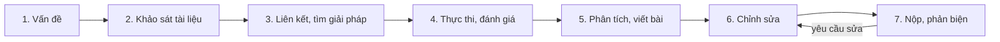

> Chép từ 3 ảnh chụp slide trong folder Drive "NCKH" (buổi học 11/12/2021). Phần bổ sung tách riêng trong callout.

## Quy trình nghiên cứu – 7 bước
1. **Xác định vấn đề nghiên cứu**
2. **Khảo sát các kết quả nghiên cứu liên quan**
3. **Liên kết các nghiên cứu để tìm các giải pháp**
4. **Thực thi các giải pháp và kiểm thử, đánh giá**
5. **Phân tích và viết bài báo khoa học, công bố đóng góp**
6. **Chỉnh sửa và hoàn thiện bài báo**
7. **Nộp và chỉnh sửa theo yêu cầu phản biện**

## Chỉnh sửa và hoàn thiện bài báo – 5 mục
- **Draft nhanh** và **ghép nối** các mục của bài báo:
	- Tên bài báo
	- **Abstract**
	- 1. **Introduction**
	- 2. **Background and related works**
	- 3. **Proposed methods**
	- 4. **Performance assessment**
	- 5. **Conclusions**
	- References

## Abstract gồm những gì
- Tầm quan trọng của vấn đề nghiên cứu
- Thách thức của vấn đề
- Đề xuất giải quyết thách thức đó
- Mô tả các đóng góp chính
- Kết quả của giải pháp đề xuất

Bổ sung

- Cấu trúc 5 mục ở trên là kiểu bài báo **kỹ thuật/tin học** (đề xuất phương pháp → đánh giá hiệu năng). Bài báo **sinh học thực nghiệm** thường theo **IMRaD**: Introduction – Materials and Methods – Results – Discussion (vd [báo cáo PG trên phôi cá ngựa vằn](/blog/danh-gia-tac-dong-cua-propylene-glycol-pg-len-su-phat-trien-phoi-ca-ngua-van/)).
- Ví dụ bài báo thật cùng folder NCKH: Salcedo et al. (2023), *Transient use of hemolymph for hydraulic wing expansion in cicadas*, Scientific Reports 13:6298 – [Drive](https://drive.google.com/file/d/1yhWzvurkQS_RF3vDbAcurUx_Wtch7BZt/view). Abstract của bài đi đúng trình tự: vai trò của cánh → câu hỏi (bao nhiêu hemolymph được bơm vào cánh) → phương pháp (200 nhộng ve sầu *Magicicada septendecim*) → kết quả.
- Khi khảo sát tài liệu (bước 2), có thể dùng [Thư viện tài liệu Sinh học](/blog/thu-vien-tai-lieu-sinh-hoc-google-drive/) làm điểm xuất phát.

## Tài liệu gốc

