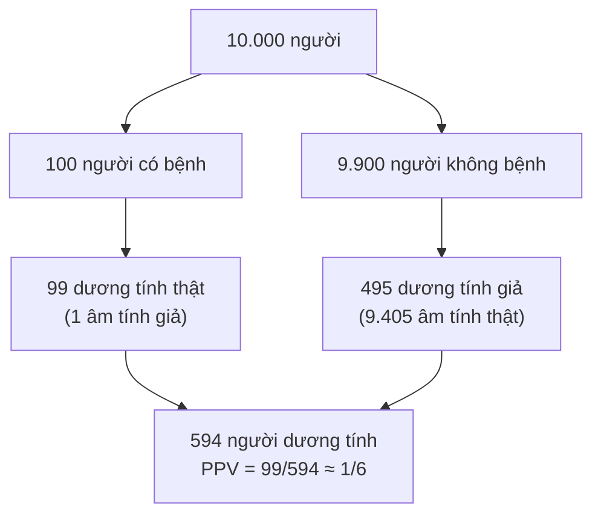

Một xét nghiệm có độ nhạy 99% và độ đặc hiệu 95% cho kết quả dương tính. Nếu bệnh chỉ gặp ở 1% dân số, xác suất người đó thật sự mắc bệnh chỉ khoảng 1/6, và phép tính dẫn đến con số này dùng đúng các quy tắc nhân, cộng xác suất quen thuộc trong bài tập lai Mendel. Bài mở đầu series *Nền tảng xác suất cho Bioinformatics* đi từ ba tiên đề của Kolmogorov đến định lý Bayes, gắn mỗi khái niệm với một ví dụ di truyền hoặc chẩn đoán, và kết thúc bằng hai mô phỏng Python và R để bạn tự chạy lại mọi con số.

Tỉ lệ 3 : 1, 9 : 3 : 3 : 1 hay công thức $p^2 + 2pq + q^2$ đều là xác suất, nhưng ít khi được học kèm điều kiện áp dụng. Luận điểm của bài: phần lớn lỗi tính xác suất trong sinh học không nằm ở số học mà ở chỗ dùng một quy tắc khi điều kiện của nó không thoả. Ba lỗi điển hình là nhân khi các biến cố không độc lập, cộng khi các biến cố không xung khắc, và đảo chiều điều kiện, tức đọc $P(\text{dương tính} \mid \text{bệnh})$ như thể đó là $P(\text{bệnh} \mid \text{dương tính})$.

## 1. Mở đầu: xác suất là ngôn ngữ của bất định

Xác suất (probability) là ngôn ngữ toán học để định lượng sự không chắc chắn. Nó đi từ mô hình đến dữ liệu: biết bố mẹ đều dị hợp $Aa$, xác suất con mang kiểu hình lặn là bao nhiêu. Suy luận thống kê (statistical inference) đi chiều ngược lại: thấy 105 hạt lặn trong 400 hạt, mô hình nào về bố mẹ là hợp lý (Wasserman, 2004).

Hai mốc lịch sử: năm 1763, tiểu luận của Thomas Bayes được Richard Price gửi đăng trên *Philosophical Transactions* sau khi Bayes đã mất (Bayes, 1763). Năm 1933, Andrey Kolmogorov công bố hệ tiên đề của lý thuyết xác suất bằng tiếng Đức; bản dịch tiếng Anh ra năm 1950 (Kolmogorov, 1933/1950).

Con số $P(A)$ có hai cách hiểu phổ biến. Theo **diễn giải tần số** (frequentist interpretation), $P(A)$ là tỉ lệ dài hạn mà biến cố $A$ xảy ra khi phép thử được lặp lại rất nhiều lần: gieo thật nhiều hạt F2 của phép lai $Aa \times Aa$, tỉ lệ hạt mang kiểu hình lặn tiến về 1/4. Theo **diễn giải Bayes** (degree of belief), $P(A)$ đo mức độ tin tưởng của người quan sát rằng $A$ đúng. Câu "xác suất người chị không mắc bệnh của một bệnh nhân là người mang gen bệnh bằng 2/3" không nói về một phép thử lặp lại; con số 2/3 mô tả hiểu biết hiện có và sẽ thay đổi khi có thêm thông tin, chẳng hạn một kết quả xét nghiệm (Ogino & Wilson, 2004). Cả hai cách hiểu tuân theo cùng ba tiên đề, và theo Wasserman (2004), khác biệt giữa chúng chỉ trở nên quan trọng khi bước sang suy luận thống kê (mục 9).

Bài chỉ xét xác suất rời rạc trên không gian mẫu hữu hạn hoặc đếm được, và không đi vào lý thuyết độ đo (σ-algebra), phần mà Kolmogorov (1933/1950) và Wasserman (2004) có xử lý.

## 2. Không gian mẫu, biến cố và đại số tập hợp

**Không gian mẫu** (sample space) $\Omega$ là tập hợp tất cả kết quả có thể xảy ra của một phép thử. Mỗi phần tử $\omega \in \Omega$ là một **kết quả** (outcome), mỗi tập con $A \subseteq \Omega$ là một **biến cố** (event).

Việc đầu tiên là viết $\Omega$ ra giấy. Trong phép lai $Aa \times Aa$, nếu ghi allele nhận từ mẹ trước, allele nhận từ bố sau, thì $\Omega = \{AA, Aa, aA, aa\}$, bốn kết quả có xác suất bằng nhau. Nếu gộp $Aa$ với $aA$ để viết $\Omega = \{AA, Aa, aa\}$ thì ba kết quả **không còn đồng khả năng**: chúng có xác suất 1/4, 1/2, 1/4. Lấy "số kết quả thuận lợi chia tổng số kết quả" trên không gian đã gộp sẽ cho $P(aa) = 1/3$, một đáp số sai dù không có phép tính nào sai.

Biến cố là tập hợp, nên phép toán trên biến cố là phép toán tập hợp (Bảng 1; Wasserman, 2004).

**Bảng 1.** Ký hiệu tập hợp đọc theo ngôn ngữ biến cố

| Ký hiệu | Ý nghĩa |
| --- | --- |
| $\Omega$ | biến cố chắc chắn |
| $\emptyset$ | biến cố không thể |
| $A^c$ (phần bù) | $A$ không xảy ra |
| $A \cup B$ (hợp) | $A$ hoặc $B$, hoặc cả hai |
| $A \cap B$ hay $AB$ (giao) | cả $A$ và $B$ |
| $A - B$ (hiệu) | $A$ xảy ra, $B$ thì không |
| $A \subset B$ | $A$ xảy ra thì $B$ xảy ra |

Các biến cố $A_1, A_2, \dots$ là **xung khắc** (disjoint, mutually exclusive) nếu $A_i \cap A_j = \emptyset$ với mọi $i \neq j$. Một **phân hoạch** (partition) của $\Omega$, còn gọi là hệ biến cố đầy đủ, là một dãy biến cố xung khắc từng đôi và phủ kín không gian mẫu: $\bigcup_{i=1}^{\infty} A_i = \Omega$. Ba kiểu gen $AA$, $Aa$, $aa$ là một phân hoạch của không gian kiểu gen tại một locus hai allele.


**Hình 1.** Hai biến cố xung khắc (trái) và hai biến cố có giao khác rỗng (phải).

**Hàm chỉ thị** (indicator function) của $A$ biến câu hỏi "có hay không" thành số:

$$I_A(\omega) = I(\omega \in A) = \begin{cases} 1 & \text{nếu } \omega \in A \\ 0 & \text{nếu } \omega \notin A. \end{cases}$$

Số cá thể mang allele $a$ trong một mẫu là tổng các hàm chỉ thị, mỗi cá thể một hàm; đây là cầu nối sang biến ngẫu nhiên.

Cuối cùng là giới hạn của dãy biến cố. Dãy **tăng đơn điệu** ($A_1 \subset A_2 \subset \cdots$) có giới hạn là hợp của cả dãy; dãy **giảm đơn điệu** ($A_1 \supset A_2 \supset \cdots$) có giới hạn là giao của cả dãy:

$$\lim_{n\to\infty} A_n = \bigcup_{i=1}^{\infty} A_i \ \ (\text{dãy tăng}), \qquad \lim_{n\to\infty} A_n = \bigcap_{i=1}^{\infty} A_i \ \ (\text{dãy giảm}).$$

Trong cả hai trường hợp ta viết $A_n \to A$. Ví dụ: các biến cố $A_n$ = "một dòng tế bào chưa có đột biến nào sau $n$ thế hệ" tạo thành một dãy giảm, với giới hạn là "không bao giờ có đột biến".

## 3. Ba tiên đề và các hệ quả

Một hàm $P$ gán cho mỗi biến cố $A$ một số thực $P(A)$ là một **phân phối xác suất** (probability distribution) nếu thoả ba tiên đề (Kolmogorov, 1933/1950; Wasserman, 2004):

1. $P(A) \ge 0$ với mọi biến cố $A$.
2. $P(\Omega) = 1$.
3. Nếu $A_1, A_2, \dots$ xung khắc từng đôi thì

$$P\left(\bigcup_{i=1}^{\infty} A_i\right) = \sum_{i=1}^{\infty} P(A_i).$$

Tiên đề 3 là tiên đề duy nhất nói về cách **kết hợp** biến cố, và nó chỉ nói về biến cố xung khắc. "Quy tắc cộng" trong di truyền học chính là tiên đề này áp dụng cho hai biến cố xung khắc. Các hệ quả dùng hằng ngày đều chứng minh được trong một hai dòng:

- $P(A^c) = 1 - P(A)$, vì $A$ và $A^c$ xung khắc và hợp lại thành $\Omega$.
- $P(\emptyset) = 0$: lấy $A = \Omega$ ở hệ quả trên.
- Nếu $A \subset B$ thì $P(A) \le P(B)$, vì $B = A \cup (B - A)$ và $P(B - A) \ge 0$.
- $0 \le P(A) \le 1$, vì $\emptyset \subset A \subset \Omega$.

Khi hai biến cố **không** xung khắc, cộng thẳng sẽ đếm phần giao hai lần. **Quy tắc cộng tổng quát** trừ phần đó đi:

$$P(A \cup B) = P(A) + P(B) - P(AB).$$

Ví dụ: trong phép lai $AaBb \times AaBb$ với hai gen phân li độc lập, xác suất con có **ít nhất một** tính trạng lặn là $1/4 + 1/4 - 1/16 = 7/16$. Cộng thẳng thành $1/2$ là sai, vì kiểu gen $aabb$ thuộc cả hai biến cố. Phần bù là cách kiểm tra nhanh: "ít nhất một tính trạng lặn" là phần bù của "trội cả hai", nên xác suất bằng $1 - (3/4)^2 = 7/16$.

Hệ quả cuối là **tính liên tục của xác suất**: nếu $A_n \to A$ thì $P(A_n) \to P(A)$ khi $n \to \infty$ (Wasserman, 2004). Với dòng tế bào ở mục 2, nếu mỗi thế hệ có xác suất đột biến $\mu > 0$ và các thế hệ độc lập thì $P(A_n) = (1 - \mu)^n \to 0$: "không bao giờ có đột biến" có xác suất 0.

## 4. Không gian mẫu hữu hạn và phép đếm trong di truyền

Khi $\Omega$ hữu hạn và mọi kết quả **đồng khả năng**, ta có **phân phối đều** (uniform distribution): $P(A) = |A| / |\Omega|$, với $|A|$ là số phần tử của $A$. Tính xác suất trở thành bài toán đếm: có $n! = n(n-1)\cdots 2 \cdot 1$ cách xếp thứ tự $n$ đối tượng, với quy ước $0! = 1$. Số cách chọn $k$ đối tượng từ $n$ đối tượng, không kể thứ tự, là

$$\binom{n}{k} = \frac{n!}{k!\,(n-k)!}, \qquad \binom{n}{0} = \binom{n}{n} = 1, \qquad \binom{n}{k} = \binom{n}{n-k}.$$

**Đếm giao tử và kiểu gen.** Một cá thể dị hợp $n$ cặp gen phân li độc lập tạo $2^n$ loại giao tử. Khi hai cá thể như vậy lai với nhau, có $4^n$ tổ hợp giao tử đồng khả năng, rơi vào $3^n$ kiểu gen và, nếu trội hoàn toàn, $2^n$ kiểu hình (Bảng 2; IGNOU, n.d.-a). Xem thêm bài tập giao tử.

**Bảng 2.** Phép lai giữa hai cá thể dị hợp $n$ cặp gen phân li độc lập, trội hoàn toàn

| $n$ | Giao tử $2^n$ | Tổ hợp $4^n$ | Kiểu gen $3^n$ | Kiểu hình $2^n$ | Tỉ lệ kiểu hình |
| --- | --- | --- | --- | --- | --- |
| 1 | 2 | 4 | 3 | 2 | 3 : 1 |
| 2 | 4 | 16 | 9 | 4 | 9 : 3 : 3 : 1 |
| 3 | 8 | 64 | 27 | 8 | (3 : 1)³ |

Hình 2 là không gian mẫu khi $n = 2$: tỉ lệ 9 : 3 : 3 : 1 chỉ là kết quả đếm 16 ô đồng khả năng theo màu. Tương tác gen đổi cách gộp ô thành kiểu hình, cho các tỉ lệ như 9 : 7, nhưng không gian mẫu 16 ô giữ nguyên.


**Hình 2.** Bảng Punnett của phép lai $AaBb \times AaBb$: 16 tổ hợp giao tử đồng khả năng, tô màu theo kiểu hình.

**Nhị thức.** Một cặp bố mẹ $Aa \times Aa$ có $n$ con; mỗi con mang kiểu hình lặn với xác suất 1/4, độc lập với các con khác. Xác suất có đúng $k$ con lặn là

$$P(k) = \binom{n}{k} \left(\frac14\right)^k \left(\frac34\right)^{n-k}.$$

Hệ số $\binom{n}{k}$ đếm số thứ tự sinh cho cùng kết quả; các thứ tự xung khắc nên cộng, còn trong mỗi thứ tự các lần sinh độc lập nên nhân. Với $n = 4$, $k = 1$: $P = 4 \times (1/4) \times (3/4)^3 = 27/64 \approx 0{,}42$. Kết quả "đúng 3 : 1" xảy ra ở chưa đến một nửa số gia đình bốn con: 3 : 1 là xác suất, không phải lời hứa cho từng gia đình.

**Dữ liệu của Mendel.** Tỉ lệ Mendel chỉ lộ ra khi đếm đủ nhiều. Trong thí nghiệm về hình dạng hạt, Mendel đếm 7.324 hạt F2, gồm 5.474 hạt trơn và 1.850 hạt nhăn, tỉ lệ 2,96 : 1 (theo bản dịch có chú giải của Abbott & Fairbanks, 2016). Số liệu ấy cũng là nguồn của một tranh luận kéo dài: Fisher (1936) đặt câu hỏi liệu chúng có khớp với kỳ vọng sát hơn mức mà dao động ngẫu nhiên cho phép. Mô phỏng ở mục 8 cho thấy một thí nghiệm trung thực dao động quanh 3 : 1 nhiều hay ít.

## 5. Biến cố độc lập: Mendel, Hardy–Weinberg và khi độc lập bị phá vỡ

### 5.1. Định nghĩa

Tung một đồng xu cân đối hai lần, xác suất được hai mặt ngửa là $0{,}5 \times 0{,}5$. Phép nhân này là một định nghĩa: hai biến cố $A$ và $B$ **độc lập** (independent) nếu

$$P(AB) = P(A)\,P(B).$$

Một họ biến cố $\{A_i : i \in I\}$ độc lập nếu đẳng thức nhân đúng cho **mọi** tập con hữu hạn $J \subseteq I$ (Wasserman, 2004):

$$P\left(\bigcap_{i \in J} A_i\right) = \prod_{i \in J} P(A_i).$$

Độc lập từng đôi chưa đủ. Xét một gia đình hai con, mỗi lần sinh cho trai hoặc gái với xác suất 1/2, độc lập với nhau. Gọi $A$ là "con đầu là gái", $B$ là "con thứ hai là gái", $C$ là "hai con cùng giới". Mỗi biến cố có xác suất 1/2 và mỗi cặp có xác suất giao 1/4, nên chúng độc lập từng đôi; nhưng $P(ABC) = 1/4$, khác $1/8$.

Độc lập đến từ hai nguồn (Wasserman, 2004). Nguồn thứ nhất là **giả định**: đồng xu không nhớ lần tung trước; giao tử của bố và của mẹ gặp nhau ngẫu nhiên. Nguồn thứ hai là **tính ra**: tung một con xúc xắc với $A = \{2, 4, 6\}$ và $B = \{1, 2, 3, 4\}$ thì $P(AB) = 2/6$, bằng $P(A)P(B) = (1/2)(2/3)$, nên $A$ và $B$ hoá ra độc lập. Trong sinh học, hầu hết phép nhân xác suất thuộc loại thứ nhất: chúng chỉ đúng khi giả định sinh học phía sau còn đúng.

### 5.2. Độc lập không phải là xung khắc

<div class="callout callout-warning">
<p class="callout-title">Hai khái niệm dễ lẫn nhất</p>

Nếu $P(A) > 0$, $P(B) > 0$ và $A \cap B = \emptyset$ thì $P(AB) = 0$, trong khi $P(A)P(B) > 0$. Hai biến cố xung khắc có xác suất dương **không bao giờ** độc lập: biết $A$ xảy ra là biết chắc $B$ không xảy ra.

</div>

Quy tắc nhân cần độc lập và trả lời câu hỏi "và"; quy tắc cộng cần xung khắc và trả lời câu hỏi "hoặc" (Bảng 3). Cụm "các biến cố độc lập và loại trừ lẫn nhau" vì thế tự mâu thuẫn với các biến cố có xác suất dương; quy tắc cộng chỉ cần điều kiện xung khắc.

**Bảng 3.** Độc lập và xung khắc

|  | Độc lập | Xung khắc |
| --- | --- | --- |
| Định nghĩa | $P(AB) = P(A)P(B)$ | $A \cap B = \emptyset$ |
| Quy tắc đi kèm | nhân, cho "và" | cộng, cho "hoặc" |
| Biết $A$ xảy ra thì | $P(B)$ không đổi | $B$ chắc chắn không xảy ra |
| Ví dụ | giới tính của con thứ nhất và con thứ hai | kiểu gen $AA$ và $aa$ của cùng một cá thể |

### 5.3. Hardy–Weinberg là một phát biểu về độc lập

Xét một locus hai allele $A$ và $a$ với tần số $p$ và $q = 1 - p$. Nếu giao phối ngẫu nhiên, allele một cá thể nhận từ bố độc lập với allele nhận từ mẹ, nên quy tắc nhân cho $P(AA) = p^2$ và $P(aa) = q^2$. Kiểu gen dị hợp xuất hiện theo hai cách, "$A$ từ bố, $a$ từ mẹ" hoặc "$a$ từ bố, $A$ từ mẹ"; mỗi cách có xác suất $pq$, và hai cách xung khắc nên cộng lại: $P(Aa) = 2pq$. Công thức $p^2 + 2pq + q^2 = 1$ chứa cả hai quy tắc: nhân vì độc lập, cộng vì xung khắc. Hardy (1908) trình bày kết quả này trong một ghi chú trên *Science*; Wilhelm Weinberg đi đến cùng kết luận một cách độc lập trong cùng năm (IGNOU, n.d.-c); Crow (1999) viết về lịch sử của định luật và rào cản ngôn ngữ giữa hai tác giả. Xem thêm Di truyền học quần thể.

Một bài tập quen thuộc: một bệnh lặn trên nhiễm sắc thể thường như phenylketonuria (PKU) gặp ở 1/2.000 trẻ sinh ra (IGNOU, n.d.-c). Nếu quần thể cân bằng thì $q = \sqrt{1/2000} \approx 0{,}0224$ và tần số người mang gen $2pq \approx 0{,}044$, khoảng 1 trong 23 người. Con số này được dùng lại ở mục 7.

### 5.4. Khi độc lập bị phá vỡ

Phân li độc lập của Mendel là một giả định độc lập giữa hai locus: cá thể $AaBb$ tạo bốn loại giao tử với tỉ lệ $1/4$ mỗi loại (Quy luật Mendel). Giả định ấy sai khi hai gen nằm gần nhau trên cùng một nhiễm sắc thể. Năm 1905, Bateson, Saunders và Punnett lai đậu ngọt (*Lathyrus odoratus*) và thấy ở F2 khoảng 89% cây mang tổ hợp tính trạng của bố mẹ (IGNOU, n.d.-b), trong khi phân li độc lập chỉ cho $9/16 + 1/16 = 62{,}5\%$.

Mô hình sửa lại rất gọn. Một cá thể mang $AB$ trên một nhiễm sắc thể và $ab$ trên nhiễm sắc thể tương đồng tạo mỗi loại giao tử kiểu bố mẹ với tần số $(1 - r)/2$ và mỗi loại giao tử tái tổ hợp ($Ab$, $aB$) với tần số $r/2$, trong đó $r$ là tần số tái tổ hợp. Phân li độc lập là trường hợp riêng $r = 1/2$ (Liên kết gen và hoán vị gen).

Ở cấp quần thể, **linkage disequilibrium** (LD) là sự kết hợp không ngẫu nhiên của các allele ở các locus khác nhau (Slatkin, 2008). Hệ số thường dùng là định nghĩa độc lập viết dưới dạng một hiệu, $D = p_{AB} - p_A\,p_B$, với $p_{AB}$ là tần số giao tử mang cả $A$ và $B$; $D = 0$ khi và chỉ khi hai allele độc lập (Bảng 4).

**Bảng 4.** Tần số giao tử khi $p_A = p_B = 0{,}5$ (giá trị minh hoạ, ứng với $r = 0{,}5$ và $r = 0{,}12$)

| Giao tử | Độc lập | Có LD |
| --- | --- | --- |
| $AB$ | 0,25 | 0,44 |
| $Ab$ | 0,25 | 0,06 |
| $aB$ | 0,25 | 0,06 |
| $ab$ | 0,25 | 0,44 |
| $D$ | 0 | 0,19 |

Sự phá vỡ độc lập này là một nguồn thông tin: LD được dùng để lập bản đồ các gen liên quan đến tính trạng số lượng và bệnh di truyền (Slatkin, 2008). Giả định độc lập trong Hardy–Weinberg cũng được dùng theo chiều ngược: một SNP lệch khỏi tỉ lệ $p^2 : 2pq : q^2$ có thể do lỗi genotyping, nên exact test cho cân bằng Hardy–Weinberg giúp đánh giá chất lượng dữ liệu genotype (Wigginton et al., 2005).

## 6. Xác suất có điều kiện và công thức xác suất đầy đủ

Thông tin mới làm không gian mẫu co lại. Với $P(B) > 0$, **xác suất có điều kiện** (conditional probability) của $A$ khi biết $B$ là

$$P(A \mid B) = \frac{P(AB)}{P(B)}.$$

Với $B$ cố định, $P(\cdot \mid B)$ thoả cả ba tiên đề, nên mọi hệ quả ở mục 3 vẫn dùng được bên trong điều kiện. Ba điều cần nhớ:

- $P(AB) = P(A \mid B)\,P(B)$ là quy tắc nhân **tổng quát**, đúng cho mọi cặp biến cố.
- Khi $P(B) > 0$, $A$ và $B$ độc lập khi và chỉ khi $P(A \mid B) = P(A)$: biết $B$ không làm thay đổi xác suất của $A$.
- Nhìn chung $P(A \mid B) \neq P(B \mid A)$ (Wasserman, 2004).

Ví dụ: trong phép lai $Aa \times Aa$, biết một người con có kiểu hình trội, xác suất người đó dị hợp là bao nhiêu? Trên $\{AA, Aa, aA, aa\}$, điều kiện "trội" loại $aa$ và để lại ba kết quả đồng khả năng, hai trong số đó dị hợp:

$$P(\text{dị hợp} \mid \text{trội}) = \frac{1/2}{3/4} = \frac23.$$

Đây là con số 2/3 ở mục 1. Bố mẹ của một bệnh nhân mắc bệnh lặn trên nhiễm sắc thể thường đều mang gen, nên anh chị em không mắc bệnh của bệnh nhân có xác suất mang gen 2/3, không phải 1/2 (Ogino & Wilson, 2004); con số 1/2 trả lời một câu hỏi khác, đặt ra trước khi biết người đó không bệnh (Di truyền học người).

**Công thức xác suất đầy đủ** (law of total probability): nếu $A_1, \dots, A_k$ là một phân hoạch của $\Omega$ thì với mọi biến cố $B$ (Wasserman, 2004),

$$P(B) = \sum_{i=1}^{k} P(B \mid A_i)\,P(A_i).$$

Công thức suy ra từ tiên đề 3, vì các mảnh $BA_1, \dots, BA_k$ xung khắc và hợp lại thành $B$. Ví dụ, tỉ lệ dương tính trong một quần thể bằng tỉ lệ dương tính ở người bệnh nhân với tỉ lệ người bệnh, cộng tỉ lệ dương tính ở người không bệnh nhân với tỉ lệ người không bệnh. Đó chính là mẫu số của định lý Bayes.

## 7. Định lý Bayes: tư vấn di truyền và xét nghiệm chẩn đoán

Định lý Bayes đảo chiều điều kiện: biết $P(B \mid A_i)$, tìm $P(A_i \mid B)$. Với một phân hoạch $A_1, \dots, A_k$ có mọi $P(A_i) > 0$, và $P(B) > 0$:

$$P(A_i \mid B) = \frac{P(B \mid A_i)\,P(A_i)}{\sum_{j} P(B \mid A_j)\,P(A_j)}.$$

Chứng minh gồm hai dòng: tử số là $P(A_iB)$ theo quy tắc nhân tổng quát, mẫu số là $P(B)$ theo công thức xác suất đầy đủ. Ý tưởng bắt nguồn từ Bayes (1763). $P(A_i)$ là **prior** (xác suất tiên nghiệm), niềm tin trước khi có dữ liệu; $P(B \mid A_i)$ là **likelihood**, mức độ dữ liệu phù hợp với từng giả thuyết; $P(A_i \mid B)$ là **posterior** (xác suất hậu nghiệm), niềm tin sau khi cập nhật (López Puga et al., 2015).

### 7.1. Tư vấn di truyền

Phân tích Bayes giữ vai trò trung tâm trong đánh giá nguy cơ di truyền: nó tính xác suất một người mắc bệnh hay mang gen từ thông tin phả hệ và kết quả xét nghiệm (Ogino & Wilson, 2004), thường trình bày thành bảng bốn dòng: prior, xác suất có điều kiện, xác suất đồng thời (joint) và posterior.

Xét một ví dụ với **số liệu minh hoạ**. Một phụ nữ khoẻ mạnh có em trai mắc một bệnh lặn trên nhiễm sắc thể thường, nên prior là 2/3. Chị làm xét nghiệm tìm đột biến; giả sử xét nghiệm phát hiện 80% người mang gen và không cho dương tính giả. Kết quả âm tính (Bảng 5).

**Bảng 5.** Bảng Bayes cho ví dụ tư vấn di truyền (số liệu minh hoạ)

|  | Mang gen | Không mang gen |
| --- | --- | --- |
| Prior | 2/3 | 1/3 |
| $P(\text{âm tính} \mid \text{giả thuyết})$ | 0,2 | 1 |
| Joint = prior × điều kiện | 2/15 | 5/15 |
| Posterior = joint / tổng joint | 2/7 ≈ 0,29 | 5/7 ≈ 0,71 |

Kết quả âm tính hạ xác suất mang gen từ 2/3 xuống 2/7 chứ không xuống 0, vì xét nghiệm bỏ sót 20% người mang gen. Phép tính có thể nối tiếp: nếu chồng của chị không có tiền sử gia đình và tần số người mang gen trong quần thể là 0,044 (mục 5.3), xác suất một người con mắc bệnh là

$$\frac27 \times 0{,}044 \times \frac14 \approx 0{,}0031 \approx \frac1{320},$$

so với $\frac23 \times 0{,}044 \times \frac14 \approx 1/137$ trước khi xét nghiệm.

### 7.2. Xét nghiệm chẩn đoán

Gọi $D$ là biến cố "có bệnh", $T^+$ và $T^-$ là kết quả dương tính và âm tính. Năm đại lượng mô tả một xét nghiệm đều là xác suất (Altman & Bland, 1994a, 1994b):

- **Sensitivity** (độ nhạy): $\text{Se} = P(T^+ \mid D)$.
- **Specificity** (độ đặc hiệu): $\text{Sp} = P(T^- \mid D^c)$.
- **Prevalence** (tỉ lệ hiện mắc): $\pi = P(D)$.
- **Positive predictive value** (PPV, giá trị tiên đoán dương): $P(D \mid T^+)$.
- **Negative predictive value** (NPV, giá trị tiên đoán âm): $P(D^c \mid T^-)$.

Sensitivity và specificity điều kiện theo tình trạng bệnh; PPV và NPV điều kiện theo kết quả, và là điều người cầm tờ kết quả cần biết. Định lý Bayes với phân hoạch $\{D, D^c\}$ nối hai nhóm:

$$\text{PPV} = \frac{\text{Se}\cdot\pi}{\text{Se}\cdot\pi + (1 - \text{Sp})(1 - \pi)}, \qquad \text{NPV} = \frac{\text{Sp}\,(1 - \pi)}{\text{Sp}\,(1 - \pi) + (1 - \text{Se})\,\pi}.$$

Prevalence có mặt trong cả hai công thức: giá trị tiên đoán phụ thuộc vào quần thể được xét nghiệm, không chỉ vào xét nghiệm (Altman & Bland, 1994b).

Một ví dụ **giả định** trong giáo trình biostatistics (IGNOU, n.d.-d): một xét nghiệm ung thư phổi được thử trên 2.000 nam giới trên 45 tuổi. Trong 140 người có bệnh, 120 người dương tính; trong 1.860 người không bệnh, 1.680 người âm tính. Vậy $\text{Se} \approx 0{,}857$ và $\text{Sp} \approx 0{,}903$ (Bảng 6).

**Bảng 6.** Cùng một xét nghiệm (Se ≈ 0,857; Sp ≈ 0,903), hai quần thể

| Prevalence | PPV | NPV | Ghi chú |
| --- | --- | --- | --- |
| 0,07 | 0,400 | 0,988 | prevalence của mẫu (140/2.000); bằng cách đếm trực tiếp 120/300 và 1.680/1.700 |
| 0,05 | 0,318 | 0,992 | quần thể đích, tính bằng công thức Bayes |

Đếm thẳng từ bảng 2 × 2 chỉ đúng cho quần thể có cùng prevalence với mẫu nghiên cứu. Khi đem xét nghiệm sang quần thể khác, prevalence phải thay, và phép thay ấy cần công thức Bayes.

**Base-rate fallacy.** Lỗi đảo chiều điều kiện trong chẩn đoán có tên riêng: bỏ qua tỉ lệ nền (base rate), đọc sensitivity như thể đó là PPV. Với các con số minh hoạ ở đầu bài, $\text{Se} = 0{,}99$, $\text{Sp} = 0{,}95$, $\pi = 0{,}01$:

$$\text{PPV} = \frac{0{,}99 \times 0{,}01}{0{,}99 \times 0{,}01 + 0{,}05 \times 0{,}99} = \frac{0{,}0099}{0{,}0594} \approx 0{,}167.$$

Phần lớn kết quả dương tính là dương tính giả: 5% của nhóm không bệnh, vốn đông gấp 99 lần, vẫn nhiều hơn 99% của nhóm bệnh.

**Natural frequencies.** Phép tính ấy dễ hiểu hơn hẳn khi viết bằng số người (Hình 3). Trong 10.000 người có 100 người bệnh, 99 người trong số đó dương tính. Trong 9.900 người không bệnh, 495 người cũng dương tính. Vậy trong 594 người dương tính chỉ có 99 người bệnh: $99/594 = 1/6$.



**Hình 3.** Cây natural frequencies cho bộ số minh hoạ Se = 0,99; Sp = 0,95; prevalence = 1%.

Gigerenzer và Hoffrage (1995) cho thấy khi thông tin ở định dạng tần số, người chưa học thống kê đi đến lời giải kiểu Bayes ở khoảng một nửa số bài, nhiều hơn hẳn so với định dạng xác suất. Hoffrage et al. (2000) đề xuất dùng natural frequencies trong truyền thông y khoa, vì cách trình bày này giảm đáng kể khó khăn khi suy luận, kể cả với người có chuyên môn; Gigerenzer (2002) có thêm ví dụ cho độc giả phổ thông.

### 7.3. Bayes trong bioinformatics

Cùng công thức ấy chạy bên dưới nhiều công cụ tính toán sinh học (Eddy, 2004). Bộ phân loại Naive Bayes nhân các likelihood với giả định các đặc trưng độc lập có điều kiện, một giả định cần được soi như ở mục 5 (Bayes classifier). Gọi biến thể và dựng cây phát sinh loài kiểu Bayes cũng tính posterior theo cấu trúc của Bảng 5: prior, likelihood, chuẩn hoá. Dạng odds của định lý, với likelihood ratio, là cách viết khác của cùng phép tính (IGNOU, n.d.-d).

## 8. Mô phỏng tái lập được bằng Python và R

Mô phỏng Monte Carlo kiểm tra một phép tính xác suất theo đúng diễn giải tần số: lặp lại phép thử thật nhiều lần trên máy rồi đếm. Code dưới đây chạy với Python 3.13, NumPy 2.4 và R 4.4; seed cố định nên với cùng phiên bản, bạn sẽ nhận đúng các con số trong bài.

### 8.1. Mô phỏng 1: phép lai Mendel, có và không có liên kết gen

Hàm `gametes` sinh giao tử của một cá thể $AB/ab$ theo mô hình ở mục 5.4; `r` là tần số tái tổ hợp.

```python
import numpy as np

rng = np.random.default_rng(2026)

def gametes(n, r=0.5):
    """n giao tử của cá thể AB/ab; r = tần số tái tổ hợp (0,5: phân li độc lập)."""
    a = rng.integers(0, 2, n)               # 1 = allele A, 0 = allele a
    recomb = rng.random(n) < r
    b = np.where(recomb, 1 - a, a)          # không tái tổ hợp: B đi cùng A
    return a, b

def cross(n, r=0.5):
    """n con của phép lai AB/ab x AB/ab; trả về kiểu hình trội (True) ở từng gen."""
    a1, b1 = gametes(n, r)
    a2, b2 = gametes(n, r)
    return (a1 + a2) > 0, (b1 + b2) > 0

# 1. Aa x Aa: tỉ lệ kiểu hình lặn theo số con N
for n in [100, 1_000, 10_000, 100_000]:
    dom_a, _ = cross(n)
    print(f"N = {n:>6}: tỉ lệ lặn = {1 - dom_a.mean():.4f}")

# 2. AaBb x AaBb, hai gen phân li độc lập (r = 0,5) và liên kết (r = 0,12)
for r in [0.5, 0.12]:
    dom_a, dom_b = cross(100_000, r)
    freq = [np.mean(dom_a & dom_b), np.mean(dom_a & ~dom_b),
            np.mean(~dom_a & dom_b), np.mean(~dom_a & ~dom_b)]
    a, b = gametes(100_000, r)
    d = np.mean((a == 1) & (b == 1)) - np.mean(a == 1) * np.mean(b == 1)
    print(f"r = {r}: A_B_, A_bb, aaB_, aabb =", np.round(freq, 4),
          f"| kiểu cha mẹ = {freq[0] + freq[3]:.4f} | D = {d:.4f}")

# 3. Chi-square của 10.000 thí nghiệm, mỗi thí nghiệm 400 hạt, kỳ vọng 300 : 100
rec = rng.binomial(400, 0.25, 10_000)
chi2 = (rec - 100) ** 2 / 100 + ((400 - rec) - 300) ** 2 / 300
obs = (105 - 100) ** 2 / 100 + (295 - 300) ** 2 / 300
print(f"chi2 của 295 : 105 = {obs:.2f}")
print(f"Tỉ lệ thí nghiệm có chi2 không lớn hơn mức đó: {np.mean(chi2 <= obs + 1e-9):.3f}")
print(f"Tỉ lệ thí nghiệm có chi2 > 3,84: {np.mean(chi2 > 3.84):.3f}")
```

```text
N =    100: tỉ lệ lặn = 0.2800
N =   1000: tỉ lệ lặn = 0.2430
N =  10000: tỉ lệ lặn = 0.2543
N = 100000: tỉ lệ lặn = 0.2518
r = 0.5: A_B_, A_bb, aaB_, aabb = [0.5611 0.1879 0.1886 0.0624] | kiểu cha mẹ = 0.6235 | D = -0.0003
r = 0.12: A_B_, A_bb, aaB_, aabb = [0.6949 0.0556 0.0567 0.1928] | kiểu cha mẹ = 0.8877 | D = 0.1904
chi2 của 295 : 105 = 0.33
Tỉ lệ thí nghiệm có chi2 không lớn hơn mức đó: 0.472
Tỉ lệ thí nghiệm có chi2 > 3,84: 0.055
```

Thứ nhất, tỉ lệ lặn dao động mạnh khi $N$ nhỏ (0,28 với 100 con) và tiến về 0,25 khi $N$ lớn (Hình 4): đó là diễn giải tần số, và là nội dung của luật số lớn ở bài hội tụ của biến ngẫu nhiên. Thứ hai, với $r = 0{,}5$ bốn lớp kiểu hình sát với 9/16, 3/16, 3/16, 1/16 và $D \approx 0$. Với $r = 0{,}12$, tỉ lệ kiểu cha mẹ lên 0,89 và $D \approx 0{,}19$, đúng giá trị ở Bảng 4. Chỉ thêm một tham số $r$, mô hình đã tái hiện mức lệch cỡ quan sát được ở đậu ngọt; dùng tỉ lệ 1/4 cho mỗi loại giao tử ở đây là lỗi "nhân khi không độc lập".


**Hình 4.** Tỉ lệ kiểu hình lặn tích luỹ trong năm lần mô phỏng phép lai $Aa \times Aa$, mỗi lần 100.000 con (dữ liệu mô phỏng, seed 2026).

Thứ ba, phần chi-square. Một ví dụ sách giáo khoa cho 295 hạt trội và 105 hạt lặn trên 400 hạt, kỳ vọng 300 : 100, được $\chi^2 = 0{,}33$ (IGNOU, n.d.-a). Trong 10.000 thí nghiệm mô phỏng trung thực cùng cỡ, 47% cho $\chi^2$ không lớn hơn mức đó, và khoảng 5,5% vượt ngưỡng 3,84 của mức ý nghĩa 5%. Một lần khớp đẹp như vậy là bình thường; câu hỏi của Fisher (1936) liên quan đến cả bộ số liệu chứ không phải một thí nghiệm riêng lẻ (xem kiểm định giả thuyết).

Phiên bản R của phần đầu (con số khác Python vì bộ sinh số ngẫu nhiên khác nhau):

```r
set.seed(2026)

# Aa x Aa: mỗi bố mẹ truyền allele A (1) hoặc a (0) với xác suất 1/2
for (n in c(1e2, 1e3, 1e4, 1e5)) {
  mat <- rbinom(n, 1, 0.5)
  pat <- rbinom(n, 1, 0.5)
  cat(sprintf("N = %6d: tỉ lệ lặn = %.4f\n", n, mean(mat + pat == 0)))
}

# PPV theo định lý Bayes
ppv <- function(se, sp, prev) se * prev / (se * prev + (1 - sp) * (1 - prev))
cat(sprintf("PPV = %.4f\n", ppv(0.99, 0.95, 0.01)))
cat(sprintf("PPV = %.4f\n", ppv(120 / 140, 1680 / 1860, 0.05)))
```

```text
N =    100: tỉ lệ lặn = 0.3700
N =   1000: tỉ lệ lặn = 0.2320
N =  10000: tỉ lệ lặn = 0.2537
N = 100000: tỉ lệ lặn = 0.2468
PPV = 0.1667
PPV = 0.3179
```

### 8.2. Mô phỏng 2: PPV theo prevalence

```python
import numpy as np

def ppv(se, sp, prev):
    return se * prev / (se * prev + (1 - sp) * (1 - prev))

def npv(se, sp, prev):
    return sp * (1 - prev) / (sp * (1 - prev) + (1 - se) * prev)

# Ví dụ giả định: 2.000 người, 140 có bệnh (120 dương tính), 1.860 không bệnh (1.680 âm tính)
se, sp = 120 / 140, 1680 / 1860
print(f"Se = {se:.4f}, Sp = {sp:.4f}")
for prev in [0.05, 0.07]:
    print(f"prevalence = {prev}: PPV = {ppv(se, sp, prev):.4f}, NPV = {npv(se, sp, prev):.4f}")

# Bộ số minh hoạ: Se = 0,99; Sp = 0,95; prevalence = 1%
print(f"PPV giải tích = {ppv(0.99, 0.95, 0.01):.4f}")

# Monte Carlo: quần thể giả lập 1.000.000 người
rng = np.random.default_rng(2026)
n = 1_000_000
disease = rng.random(n) < 0.01
positive = np.where(disease, rng.random(n) < 0.99, rng.random(n) < 1 - 0.95)
print(f"Số dương tính = {positive.sum()}, trong đó có bệnh = {(disease & positive).sum()}")
print(f"PPV mô phỏng = {disease[positive].mean():.4f}")
print(f"NPV mô phỏng = {(~disease[~positive]).mean():.5f}, giải tích = {npv(0.99, 0.95, 0.01):.5f}")
```

```text
Se = 0.8571, Sp = 0.9032
prevalence = 0.05: PPV = 0.3179, NPV = 0.9917
prevalence = 0.07: PPV = 0.4000, NPV = 0.9882
PPV giải tích = 0.1667
Số dương tính = 59268, trong đó có bệnh = 9881
PPV mô phỏng = 0.1667
NPV mô phỏng = 0.99990, giải tích = 0.99989
```

Mô phỏng không dùng định lý Bayes: nó gán bệnh cho 1% dân số, cho từng người một kết quả theo sensitivity và specificity, rồi đếm. Trong 59.268 người dương tính có 9.881 người bệnh, tỉ lệ 0,1667, trùng với công thức. Hình 5 vẽ công thức trên toàn dải prevalence. PPV sụt rất nhanh khi bệnh hiếm, và ở vùng đó specificity quan trọng hơn sensitivity: nâng specificity từ 0,95 lên 0,999 đưa PPV tại prevalence 1% từ 0,17 lên khoảng 0,91. NPV đi theo chiều ngược lại.


**Hình 5.** PPV (nét liền) và NPV (nét đứt) theo prevalence với ba cặp sensitivity, specificity; điểm đánh dấu là ví dụ minh hoạ ở mục 7.2 (tính từ công thức Bayes).

Giới hạn: bộ số 0,99; 0,95; 1% là giá trị minh hoạ, không phải thông số của một xét nghiệm thật, và ví dụ ung thư phổi là dữ liệu giả định.

## 9. Frequentist và Bayesian: một tranh luận, hai công cụ

Mọi thứ từ mục 2 đến mục 8 đúng với cả hai cách diễn giải xác suất: định lý Bayes là một định lý của lý thuyết xác suất, và dùng nó để tính PPV không gây tranh cãi. Hai trường phái tách nhau ở câu hỏi khác: có gán xác suất cho một **tham số** chưa biết hay không.

Trong suy luận tần số (frequentist), tham số, ví dụ tần số allele thật của quần thể, là một hằng số; xác suất chỉ gắn với dữ liệu và quy trình lặp lại được, như p-value và khoảng tin cậy. Trong suy luận Bayes, tham số cũng có phân phối xác suất: prior được dữ liệu cập nhật thành posterior theo công thức ở mục 7 (Eddy, 2004; Wasserman, 2004). Bland và Altman (1998) giới thiệu sự khác biệt này cho độc giả y khoa trong loạt *Statistics Notes* của BMJ.

Prior 2/3 ở mục 7.1 đến từ quy luật Mendel, tức từ một tần số kiểm chứng được, nên không gây tranh cãi. Tranh luận bắt đầu khi prior phải chọn theo phán đoán. Theo Efron (2013), định lý Bayes giữ vai trò ngày càng nổi bật trong các ứng dụng thống kê nhưng vẫn gây tranh cãi giữa các nhà thống kê.

Với người làm sinh học, có thể coi đây là hai bộ công cụ dùng chung nền móng của bài này; bộ thứ hai được trình bày ở suy luận Bayes.

## 10. Kết luận và checklist

Ba tiên đề, định nghĩa độc lập và định nghĩa xác suất có điều kiện đủ để dựng lại các "mẹo" xác suất trong di truyền học: quy tắc cộng là tiên đề 3 cho biến cố xung khắc, quy tắc nhân là định nghĩa độc lập, $p^2 + 2pq + q^2$ là cả hai cùng lúc, con số 2/3 trong phả hệ là xác suất có điều kiện, và giá trị tiên đoán là định lý Bayes. Ba lỗi nêu ở đầu bài đều là lỗi bỏ quên điều kiện của quy tắc.

Trước khi tính một xác suất, hãy trả lời năm câu hỏi:

1. Không gian mẫu là gì? Viết nó ra.
2. Các kết quả có đồng khả năng không? Nếu không, đừng đếm.
3. Các biến cố có độc lập không, và vì sao: do giả định sinh học nào, hay do tính ra?
4. Các biến cố có xung khắc không? Nếu không, trừ phần giao hoặc dùng phần bù.
5. Đang điều kiện theo cái gì: $P(A \mid B)$ hay $P(B \mid A)$?

Khi còn nghi ngờ, hãy mô phỏng: tần số mô phỏng sẽ không khớp với đáp số tính từ một quy tắc dùng sai điều kiện. Bài tiếp theo của series, biến ngẫu nhiên, dùng lại hàm chỉ thị ở mục 2 và công thức nhị thức ở mục 4 dưới tên gọi phân phối.

## Tài liệu tham khảo

Abbott, S., & Fairbanks, D. J. (2016). Experiments on plant hybrids by Gregor Mendel. *Genetics, 204*(2), 407–422. https://doi.org/10.1534/genetics.116.195198

Altman, D. G., & Bland, J. M. (1994a). Diagnostic tests. 1: Sensitivity and specificity. *BMJ, 308*(6943), 1552. https://doi.org/10.1136/bmj.308.6943.1552

Altman, D. G., & Bland, J. M. (1994b). Diagnostic tests 2: Predictive values. *BMJ, 309*(6947), 102. https://doi.org/10.1136/bmj.309.6947.102

Bayes, T. (1763). LII. An essay towards solving a problem in the doctrine of chances. By the late Rev. Mr. Bayes, F. R. S. communicated by Mr. Price, in a letter to John Canton, A. M. F. R. S. *Philosophical Transactions of the Royal Society of London, 53*, 370–418. https://doi.org/10.1098/rstl.1763.0053

Bland, J. M., & Altman, D. G. (1998). Bayesians and frequentists. *BMJ, 317*(7166), 1151–1160. https://doi.org/10.1136/bmj.317.7166.1151

Crow, J. F. (1999). Hardy, Weinberg and language impediments. *Genetics, 152*(3), 821–825. https://doi.org/10.1093/genetics/152.3.821

Eddy, S. R. (2004). What is Bayesian statistics? *Nature Biotechnology, 22*(9), 1177–1178. https://doi.org/10.1038/nbt0904-1177

Efron, B. (2013). Bayes' theorem in the 21st century. *Science, 340*(6137), 1177–1178. https://doi.org/10.1126/science.1236536

Fisher, R. A. (1936). Has Mendel's work been rediscovered? *Annals of Science, 1*(2), 115–137. https://doi.org/10.1080/00033793600200111

Gigerenzer, G. (2002). *Calculated risks: How to know when numbers deceive you*. Simon & Schuster.

Gigerenzer, G., & Hoffrage, U. (1995). How to improve Bayesian reasoning without instruction: Frequency formats. *Psychological Review, 102*(4), 684–704. https://doi.org/10.1037/0033-295X.102.4.684

Hardy, G. H. (1908). Mendelian proportions in a mixed population. *Science, 28*(706), 49–50. https://doi.org/10.1126/science.28.706.49

Hoffrage, U., Lindsey, S., Hertwig, R., & Gigerenzer, G. (2000). Communicating statistical information. *Science, 290*(5500), 2261–2262. https://doi.org/10.1126/science.290.5500.2261

Indira Gandhi National Open University. (n.d.-a). *BBCCT-121 Concepts in genetics, Block 1: Mendelism* (Unit 2). IGNOU.

Indira Gandhi National Open University. (n.d.-b). *BBCCT-121 Concepts in genetics, Block 2: Gene mapping* (Unit 6: Linkage, crossing over and mapping techniques). IGNOU.

Indira Gandhi National Open University. (n.d.-c). *BBCCT-121 Concepts in genetics, Block 4: Genetic basis of evolution* (Unit 11: Inheritance of complex traits and population genetics). IGNOU.

Indira Gandhi National Open University. (n.d.-d). *MSTE-004 Biostatistics-II, Block 1: Categorical data analysis* (Unit 3: Statistical measures for diagnostic tests). IGNOU.

Kolmogorov, A. N. (1950). *Foundations of the theory of probability* (N. Morrison, Trans.). Chelsea Publishing Company. (Original work published 1933) https://openlibrary.org/works/OL16820335W

López Puga, J., Krzywinski, M., & Altman, N. (2015). Bayes' theorem. *Nature Methods, 12*(4), 277–278. https://doi.org/10.1038/nmeth.3335

Ogino, S., & Wilson, R. B. (2004). Bayesian analysis and risk assessment in genetic counseling and testing. *The Journal of Molecular Diagnostics, 6*(1), 1–9. https://doi.org/10.1016/S1525-1578(10)60484-9

Slatkin, M. (2008). Linkage disequilibrium — understanding the evolutionary past and mapping the medical future. *Nature Reviews Genetics, 9*(6), 477–485. https://doi.org/10.1038/nrg2361

Wasserman, L. (2004). *All of statistics: A concise course in statistical inference*. Springer. https://doi.org/10.1007/978-0-387-21736-9

Wigginton, J. E., Cutler, D. J., & Abecasis, G. R. (2005). A note on exact tests of Hardy-Weinberg equilibrium. *The American Journal of Human Genetics, 76*(5), 887–893. https://doi.org/10.1086/429864
