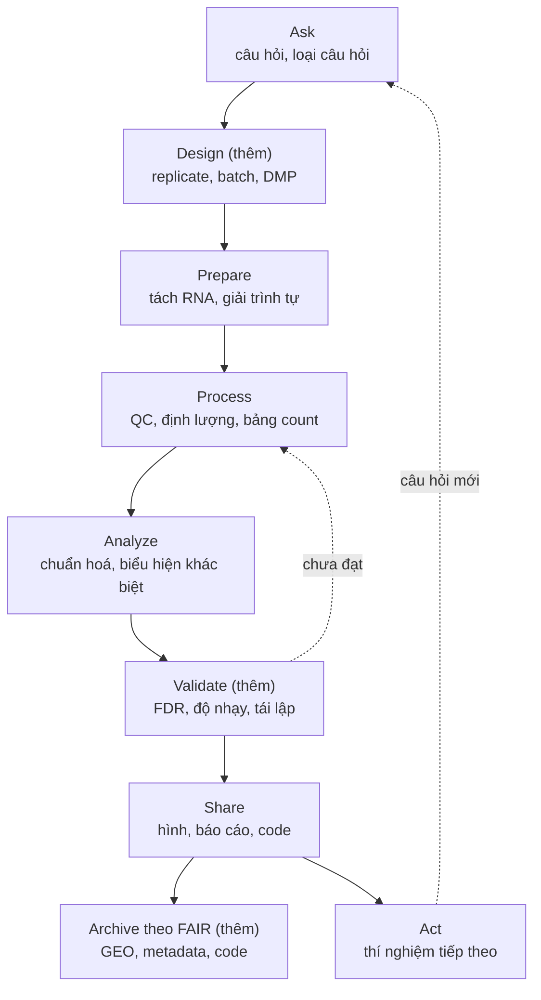

Ask – Prepare – Process – Analyze – Share – Act là quy trình mà nhiều người học phân tích dữ liệu gặp đầu tiên, nhưng nó không phải mô hình duy nhất, cũng không phải mô hình đầu tiên. Bài mở đầu series *Phân tích dữ liệu dựa trên bằng chứng (Evidence-based Data Analytics)* đặt mô hình sáu pha cạnh KDD, CRISP-DM, chu trình thống kê PPDAC và hai vòng đời dữ liệu nghiên cứu của USGS và DCC. So sánh theo chức năng cho thấy hai bước mà dự án khoa học không thể thiếu: thiết kế trước khi có dữ liệu và kiểm chứng trước khi hành động. Cuối bài là một dự án RNA-seq đi trọn vòng, từ câu hỏi đến lưu trữ theo nguyên tắc FAIR.

## 1. Mở đầu: vì sao phân tích dữ liệu cần một quy trình

Chương trình chứng chỉ Google Data Analytics định nghĩa phân tích dữ liệu (data analysis) là việc thu thập, biến đổi và tổ chức dữ liệu để rút ra kết luận, đưa ra dự đoán và hỗ trợ ra quyết định có căn cứ (Google, n.d.). Trọng tâm là **quyết định**: phân tích bắt đầu từ một vấn đề của tổ chức và kết thúc khi tổ chức hành động.

Khoa học có một truyền thống khác. Box (1976) mô tả phương pháp khoa học là một **vòng lặp có động cơ (motivated iteration)** giữa lý thuyết và thực hành: lý thuyết gợi ý cần thu dữ liệu gì, dữ liệu buộc lý thuyết phải sửa. Theo cách nhìn này, một quy trình tốt phải cho phép quay lui.

Fayyad et al. (1996a) tách **data mining**, bước áp thuật toán để tìm mẫu, khỏi toàn bộ **quá trình khám phá tri thức từ cơ sở dữ liệu (knowledge discovery in databases, KDD)**, và nhận xét rằng các bước còn lại như chọn dữ liệu, làm sạch và diễn giải cũng quan trọng, thậm chí có thể quan trọng hơn, với thành công thực tế. Trong sinh học tính toán, Buffalo (2015) đặt hai đòi hỏi **robust** và **reproducible** ngay từ chương đầu, và coi việc không tin tuyệt đối vào công cụ hay dữ liệu là quy tắc vàng của bioinformatics. Quy trình vì vậy còn là nơi cài sẵn các điểm kiểm tra.

Bài lần lượt giới thiệu năm họ mô hình (mục 2), đối chiếu chúng theo chức năng (mục 3), phân tích bốn điểm khác biệt (mục 4), áp vào một dự án RNA-seq (mục 5) và khuyến nghị dùng mô hình nào khi nào (mục 6).

## 2. Năm họ mô hình quy trình

Mỗi mô hình được giới thiệu theo cùng một khung: ai đề xuất, mục đích, các bước, có vòng lặp không. Đây là tổng quan có chọn lọc; bức tranh rộng hơn có trong hai bài khảo sát của Kurgan và Musilek (2006) và Mariscal et al. (2010).

### 2.1. Quy trình sáu pha của Google

Quy trình phân tích dữ liệu của chương trình Google Data Analytics gồm sáu pha (Google, n.d.):

- **Ask**: xác định vấn đề, tức khoảng cách giữa trạng thái hiện tại và trạng thái mong muốn, và hiểu kỳ vọng của các bên liên quan (stakeholder).
- **Prepare**: xác định nguồn, thu thập dữ liệu và kiểm tra dữ liệu có chính xác, hữu ích không; tài liệu của chương trình xếp cả việc tạo, lưu giữ và quản lý dữ liệu vào pha này.
- **Process**: làm sạch, xử lý giá trị thiếu, đổi định dạng, ghép bộ dữ liệu; outlier được phát hiện, chẩn đoán và chỉ loại khi có lý do ghi lại được ([bài 04](/blog/process-data-from-dirty-to-clean/)).
- **Analyze**: tính toán, tìm xu hướng và mẫu hình.
- **Share**: trình bày và diễn giải kết quả cho người ra quyết định.
- **Act**: đưa kết quả vào hành động.

Mô hình bắt đầu từ **stakeholder** và **business task**, tức câu hỏi thường được giao từ bên ngoài, và gộp một số chức năng vào pha khác: thiết kế việc tạo dữ liệu nằm trong Prepare, diễn giải nằm trong Share. Cách sáu pha ăn khớp với giai đoạn thực thi của một dự án nói chung được bàn ở [Project Execution](/blog/project-execution-running-the-project/).

Giới doanh nghiệp còn những cách chia khác. EMC Education Services (2015) mô tả một **vòng đời phân tích dữ liệu (Data Analytics Lifecycle)** sáu pha: discovery, data preparation, model planning, model building, communicate results và operationalize, trong đó việc lập kế hoạch mô hình là một pha riêng.

### 2.2. Quy trình KDD

Fayyad et al. (1996a) mô tả KDD là quá trình **tương tác và lặp (interactive and iterative)** gồm chín bước:

1. hiểu miền ứng dụng, tri thức có sẵn và mục tiêu;
2. tạo tập dữ liệu mục tiêu;
3. làm sạch và tiền xử lý;
4. giảm chiều và chiếu dữ liệu;
5. ghép mục tiêu với một phương pháp data mining;
6. phân tích khám phá, chọn mô hình và giả thuyết;
7. data mining;
8. diễn giải mẫu tìm được, có thể quay lại bất kỳ bước 1–7;
9. hành động dựa trên tri thức, gồm cả kiểm tra và giải quyết mâu thuẫn với tri thức đã có.

Quá trình có thể lặp giữa hai bước bất kỳ. Một bản ngắn hơn được công bố cùng năm trên *Communications of the ACM* (Fayyad et al., 1996b). Phân tích sâu hơn về KDD có ở [bài Data Mining](/blog/data-mining/).

### 2.3. CRISP-DM

CRISP-DM (Cross-Industry Standard Process for Data Mining) do một liên minh (consortium) các công ty xây dựng, ra đời khoảng năm 2000 như tiêu đề "CRISP-DM twenty years later" gợi ý (Martínez-Plumed et al., 2021). Theo hướng dẫn của IBM (n.d.), CRISP-DM có sáu pha: **Business understanding, Data understanding, Data preparation, Modeling, Evaluation** và **Deployment**. Thứ tự các pha không cứng nhắc; phần lớn dự án đi tới đi lui giữa các pha khi cần.

Điểm khác biệt chính so với mô hình sáu pha là **Evaluation** đứng trước Deployment. Modeling đã kiểm tra mô hình đúng về kỹ thuật; Evaluation đánh giá kết quả theo **tiêu chí thành công đặt ra từ đầu dự án** và rà lại toàn bộ quá trình trước khi triển khai. Deployment gồm cả kế hoạch theo dõi, bảo trì và báo cáo cuối (IBM, n.d.).

Martínez-Plumed et al. (2021) cho rằng mô hình quy trình vẫn hợp với dự án có mục tiêu rõ, còn dự án khám phá cần cách nhìn linh hoạt hơn, gọi là **quỹ đạo khoa học dữ liệu (data science trajectories)**. Tổng quan hệ thống của Schröer et al. (2021) ghi nhận phần lớn nghiên cứu áp dụng CRISP-DM không tính đến pha Deployment.

### 2.4. PPDAC: chu trình điều tra thống kê

Wild và Pfannkuch (1999) xây dựng khung bốn chiều về tư duy thống kê trong điều tra thực nghiệm, dựa trên tài liệu và phỏng vấn sinh viên cùng các nhà thống kê. Chiều thứ nhất là **chu trình điều tra (investigative cycle)**, phỏng theo mô hình **PPDAC** của MacKay và Oldford: **Problem, Plan, Data, Analysis, Conclusions**. Các nhà thống kê được phỏng vấn nhấn mạnh **các giai đoạn đầu**: nắm động lực của hệ thống, đặt vấn đề, lập kế hoạch và đo lường. Tri thức và nhu cầu nảy sinh từ một chu trình có thể khởi động **chu trình mới**. MacKay và Oldford (2000) sau đó trình bày các yếu tố chung của điều tra thống kê thành một cấu trúc, qua ví dụ phép đo tốc độ ánh sáng của Michelson.

Điểm then chốt của PPDAC là pha **Plan**: thiết kế cách đo và cách lấy mẫu **trước khi** có dữ liệu. Trong các mô hình phân tích ở đây, chỉ PPDAC đặt thiết kế nghiên cứu thành một pha riêng.

### 2.5. Vòng đời dữ liệu (data life cycle)

Họ mô hình thứ năm theo dấu **một bộ dữ liệu** thay vì một câu hỏi.

Chương trình Google Data Analytics dùng vòng đời **Plan – Capture – Manage – Analyze – Archive – Destroy** (Google, n.d.). Plan quyết định cần dữ liệu gì, quản lý thế nào, ai chịu trách nhiệm; Capture đưa dữ liệu từ nhiều nguồn vào tổ chức; Manage là lưu giữ, bảo mật và bảo trì dữ liệu; Archive lưu dữ liệu ở nơi vẫn truy cập được; Destroy xoá dữ liệu khỏi kho **và xoá mọi bản sao đã chia sẻ**.

**Mô hình vòng đời dữ liệu khoa học của USGS** ra đời sau khi nhóm tác giả rà soát hơn 50 mô hình vòng đời (Faundeen et al., 2014). Mô hình có sáu yếu tố chính **Plan, Acquire, Process, Analyze, Preserve, Publish/Share** và ba yếu tố xuyên suốt **Describe** (metadata, tài liệu), **Manage Quality**, **Backup and Secure**. Sản phẩm khuyến nghị của Plan là **kế hoạch quản lý dữ liệu (data management plan, DMP)**. Mô hình được vẽ tuyến tính có chủ ý để có điểm bắt đầu rõ, Preserve đặt trước Publish/Share để nhắc lo bảo tồn sớm, và không có bước huỷ.

**Mô hình vòng đời quản lý và bảo tồn của DCC (DCC Curation Lifecycle Model)** đến từ cộng đồng lưu trữ số (Higgins, 2008). Hành động được chia ba nhóm: trên toàn vòng đời (mô tả dữ liệu, lập kế hoạch bảo tồn, theo dõi cộng đồng, quản lý và bảo tồn); tuần tự (Conceptualise, Create and Receive, Appraise and Select, Ingest, Preservation Action, Store, Access Use and Reuse, Transform); và thỉnh thoảng (Dispose, Reappraise, Migrate). **Dispose** áp dụng cho dữ liệu không được chọn bảo tồn: thường là chuyển giao cho đơn vị khác, đôi khi là huỷ, có khi phải huỷ an toàn vì lý do pháp lý.

Các mô hình vòng đời cũng có giới hạn. Cox và Tam (2018) phân tích chín mô hình và chỉ ra chúng dễ che lấp độ phức tạp, vẽ nghiên cứu như một quá trình tuần tự, một chiều và khép kín. Wing (2019) trình bày vòng đời từ tạo dữ liệu (data generation) đến diễn giải (data interpretation), và nhấn mạnh quyền riêng tư và đạo đức ở mọi pha.

## 3. Bảng đối chiếu theo chức năng

Tên bước dễ gây nhầm (Manage của Google và Manage Quality của USGS là hai việc khác nhau), nên Bảng 1 xếp các bước theo **chức năng**. Mỗi ô ghi tên bước tương ứng; "—" là không có; tên trong ngoặc là chức năng nằm ngầm trong một bước rộng hơn. Bốn cột đầu là mô hình phân tích, ba cột cuối là vòng đời dữ liệu; số ở cột KDD là thứ tự bước ở mục 2.2.

**Bảng 1.** Đối chiếu bảy mô hình quy trình theo chức năng

| Chức năng | Google 6 pha | KDD | CRISP-DM | PPDAC | Google vòng đời | USGS | DCC |
| --- | --- | --- | --- | --- | --- | --- | --- |
| Đặt vấn đề | Ask | 1 | Business underst. | Problem | — | — | — |
| Thiết kế, lập kế hoạch | (Prepare) | — | (kế hoạch dự án) | Plan | Plan | Plan | (Conceptualise) |
| Thu thập | Prepare | 2 | Data underst. | Data | Capture | Acquire | Create, Receive |
| Làm sạch, biến đổi | Process | 3, 4 | Data prep. | (Data) | — | Process | — |
| Khám phá | (Analyze) | 6 | Data underst. | (Analysis) | (Analyze) | (Analyze) | — |
| Mô hình hoá, phân tích | Analyze | 5, 7 | Modeling | Analysis | Analyze | Analyze | — |
| Đánh giá, kiểm chứng | — | 8, 9 | Evaluation | (Conclusions) | — | (Manage Quality) | — |
| Truyền đạt | Share | (9) | (Deployment) | (Conclusions) | — | Publish/Share | (Access, Use) |
| Hành động, triển khai | Act | 9 | Deployment | (chu trình mới) | — | — | — |
| Mô tả metadata | — | — | — | — | — | Describe | Description |
| Lưu giữ, bảo mật khi dùng | (Prepare) | — | — | — | Manage | Backup, Secure | Store |
| Lưu trữ lâu dài, bảo tồn | — | — | — | — | Archive | Preserve | Preservation Action |
| Huỷ | — | — | — | — | Destroy | — | (Dispose) |


**Hình 1.** Bảng 1 dưới dạng heatmap. Ô đậm: có bước tường minh (bước chính hoặc yếu tố xuyên suốt); ô nhạt: chức năng nằm ngầm trong bước khác hoặc chỉ là hành động thỉnh thoảng; ô xám: không có. Đường đứt nét tách mô hình phân tích (trái) và vòng đời dữ liệu (phải). Nguồn: Fayyad et al. (1996a); Wild và Pfannkuch (1999); Higgins (2008); Faundeen et al. (2014); Google (n.d.); IBM (n.d.).

Bảng cho thấy bốn điều.

**Lõi chung.** Mọi mô hình phân tích đều có hiểu vấn đề, chuẩn bị dữ liệu, phân tích và truyền đạt; chuyển từ mô hình này sang mô hình khác phần lớn chỉ là đổi tên.

**Hai hàng trống của mô hình sáu pha.** Thiết kế chỉ nằm ngầm trong Prepare, còn hàng đánh giá, kiểm chứng thì trống hẳn, trong khi KDD có bước 8 và 9, CRISP-DM có Evaluation, PPDAC có phần diễn giải trong Conclusions.

**Hai nửa bảng gần như không chồng nhau ở hai đầu.** Mô hình phân tích không có metadata, lưu trữ lâu dài và huỷ; mô hình vòng đời không có bước đặt vấn đề theo câu hỏi. Một bên theo dấu một câu hỏi, bên kia theo dấu một bộ dữ liệu có thể sống qua nhiều câu hỏi và nhiều dự án.

**Huỷ là chức năng hiếm.** Chỉ vòng đời của Google có bước huỷ chính thức; Dispose của DCC là hành động thỉnh thoảng và thường là chuyển giao; USGS, mô hình viết riêng cho dữ liệu khoa học, không có bước huỷ.

Hai họ mô hình vì vậy **bổ sung cho nhau**: quy trình phân tích trả lời "làm gì để trả lời câu hỏi này", vòng đời dữ liệu trả lời "ai chịu trách nhiệm cho bộ dữ liệu này từ đầu đến cuối". Gộp hai thứ vào một sơ đồ dễ làm mờ việc mô tả, lưu trữ và chia sẻ dữ liệu, vốn vẫn phải làm sau khi câu hỏi đã được trả lời.

## 4. Bốn điểm khác biệt quan trọng

### 4.1. Vòng lặp hay đường thẳng

KDD cho phép lặp giữa hai bước bất kỳ (Fayyad et al., 1996a); CRISP-DM nói phần lớn dự án đi tới đi lui giữa các pha (IBM, n.d.); PPDAC coi kết quả một chu trình là khởi đầu của chu trình sau (Wild & Pfannkuch, 1999). Cả ba gần với vòng lặp có động cơ của Box (1976). Ngược lại, USGS **chọn** vẽ tuyến tính để có điểm bắt đầu rõ (Faundeen et al., 2014): vẽ tuyến tính là lựa chọn truyền thông, không có nghĩa thực tế không lặp.

Mô hình sáu pha thường được trình bày thành một chuỗi theo thứ tự; khi dùng, nên hiểu mỗi mũi tên là "bước tiếp theo nếu mọi thứ ổn" và sẵn sàng quay lại Ask khi Analyze cho thấy câu hỏi đặt sai.

### 4.2. Bước kiểm chứng

KDD buộc người phân tích diễn giải mẫu tìm được và kiểm tra mâu thuẫn với tri thức đã có trước khi hành động (Fayyad et al., 1996a); CRISP-DM đo kết quả bằng tiêu chí thành công đặt từ đầu (IBM, n.d.). Cả hai cài sẵn một chỗ dừng để hỏi: kết quả có thật không, có trả lời đúng câu hỏi không. Mô hình sáu pha không có chỗ dừng đó. Với nghiên cứu sinh học, kiểm chứng gồm ít nhất ba lớp:

- **Kiểm soát sai số khi kiểm định nhiều giả thuyết.** Phân tích biểu hiện khác biệt kiểm định hàng nghìn gene cùng lúc nên cần kiểm soát false discovery rate (FDR); Conesa et al. (2016) so sánh mức kiểm soát FDR của các phương pháp phân tích biểu hiện khác biệt.
- **Kiểm tra độ nhạy.** Lựa chọn phương pháp, thậm chí phiên bản phần mềm, có thể làm đổi kết quả, nên cần ghi lại đầy đủ thiết lập phân tích (Conesa et al., 2016) và thử lại với một lựa chọn hợp lý khác.
- **Khả năng tái lập.** Quy tắc đầu tiên của Sandve et al. (2013) là ghi lại, với mọi kết quả, nó được tạo ra như thế nào; yếu tố Describe của USGS giúp người khác kiểm chứng kết quả bằng cách tái lập (Faundeen et al., 2014).

Có thể cân nhắc thêm xác nhận bằng một phương pháp đo khác hoặc một bộ dữ liệu độc lập, nhưng các nguồn trích ở đây không đặt quy chuẩn cho việc này, nên đó chỉ là gợi ý.

### 4.3. Dữ liệu được tìm thấy hay được thiết kế

Pha Prepare ngầm định **dữ liệu đã tồn tại đâu đó**, điều hợp với kinh doanh, nơi dữ liệu giao dịch được ghi sẵn mỗi ngày. Trong thí nghiệm sinh học, dữ liệu **được tạo ra theo thiết kế**, và thiết kế quyết định câu hỏi nào trả lời được; đó là lý do PPDAC tách **Plan** khỏi **Data**.

Conesa et al. (2016) liệt kê **thiết kế thí nghiệm (experimental design)** là bước đầu trong các bước chính của phân tích RNA-seq và cho rằng không có pipeline nào dùng được cho mọi trường hợp. Thiết kế tốt gồm chọn loại thư viện (library type), độ sâu giải trình tự (sequencing depth) và số lặp sinh học (biological replicate); khi mẫu chia thành nhiều batch hoặc lane, cần phân bổ ngẫu nhiên để yếu tố kỹ thuật không trùng với yếu tố thí nghiệm. Khi batch trùng hoàn toàn với nhóm xử lý, không bước xử lý nào sau đó tách được hai nguồn biến thiên.

Đoạn code dưới tạo bảng thiết kế mẫu (sample sheet) cho 12 mẫu, 6 xử lý thuốc và 6 đối chứng, chia vào hai batch chuẩn bị thư viện, theo hai cách:

```python
import numpy as np
import pandas as pd

rng = np.random.default_rng(2026)

# 12 mẫu: 6 xử lý thuốc, 6 đối chứng
samples = pd.DataFrame({
    "sample_id": [f"S{i:02d}" for i in range(1, 13)],
    "condition": ["treated"] * 6 + ["control"] * 6,
})

# Thiết kế dễ mắc: chuẩn bị thư viện theo thứ tự lấy mẫu, 6 mẫu đầu vào batch A
naive = samples.assign(batch=["A"] * 6 + ["B"] * 6)

# Thiết kế cân bằng: trong mỗi nhóm, xáo trộn rồi chia đều cho hai batch
def assign_balanced(df, batches=("A", "B")):
    out = []
    for _, grp in df.groupby("condition"):
        grp = grp.sample(frac=1, random_state=rng)          # xáo trộn trong nhóm
        grp = grp.assign(batch=[batches[i % len(batches)] for i in range(len(grp))])
        out.append(grp)
    return pd.concat(out).sort_values("sample_id")

balanced = assign_balanced(samples)

for name, df in [("Theo thứ tự", naive), ("Cân bằng", balanced)]:
    print(name)
    print(pd.crosstab(df["condition"], df["batch"]), "\n")

balanced.to_csv("sample_sheet.csv", index=False)   # lưu cùng metadata của dự án
```

```text
Theo thứ tự
batch      A  B
condition
control    0  6
treated    6  0

Cân bằng
batch      A  B
condition
control    3  3
treated    3  3
```

Bảng chéo (crosstab) thứ nhất có hai ô bằng 0: khác biệt giữa hai batch cũng chính là khác biệt giữa thuốc và đối chứng. Bảng thứ hai cân bằng, nên ảnh hưởng của batch ước lượng được. Phép kiểm tra này phải làm **trước khi** chuẩn bị thư viện, và `sample_sheet.csv` là metadata mẫu đi theo dữ liệu đến lúc nộp vào kho công cộng.

Cũng ở giai đoạn đầu, loại câu hỏi quyết định loại phân tích. Leek và Peng (2015) chia câu hỏi phân tích dữ liệu thành sáu loại: **mô tả (descriptive), khám phá (exploratory), suy luận (inferential), dự đoán (predictive), nhân quả (causal)** và **cơ chế (mechanistic)** (Peng & Matsui, 2015). Câu hỏi suy luận "gene nào biểu hiện khác nhau giữa hai nhóm" không trả lời được câu hỏi nhân quả; hai gene đồng biểu hiện chưa chắc có quan hệ nhân quả. Hỏi "tại sao" năm lần (five whys) hay phân tích khoảng cách (gap analysis) giúp làm rõ vấn đề nhưng không thay việc xác định loại câu hỏi ([bài 02](/blog/ask-questions-to-make-data-driven-decisions/)); sai lệch do lấy mẫu được bàn ở [bài 03](/blog/prepare-data-for-exploration/).

### 4.4. Lưu trữ và huỷ dữ liệu

Vòng đời của Google kết thúc bằng Archive và Destroy (Google, n.d.); USGS có Preserve và Publish/Share nhưng không có huỷ (Faundeen et al., 2014); Dispose của DCC thường là chuyển giao, chỉ đôi khi là huỷ (Higgins, 2008). Trong doanh nghiệp, dữ liệu khách hàng vừa là tài sản vừa là rủi ro, nên huỷ đúng lúc là bước bình thường; trong nghiên cứu, mặc định là **giữ và chia sẻ**: nguyên tắc **FAIR** đề nghị dữ liệu và metadata khoa học phải **Findable**, **Accessible**, **Interoperable** và **Reusable** (tìm thấy, truy cập, dùng chung và tái sử dụng được), cho cả người lẫn máy (Wilkinson et al., 2016). Với dữ liệu biểu hiện gene, Gene Expression Omnibus (GEO) của NCBI là kho công cộng xây dựng riêng cho loại dữ liệu này (Edgar et al., 2002; [Định dạng dữ liệu và cơ sở dữ liệu sinh học](/blog/dinh-dang-du-lieu-va-co-so-du-lieu-sinh-hoc/)).

Huỷ trong nghiên cứu là ngoại lệ, chủ yếu đặt ra với dữ liệu định danh được người tham gia; phạm vi và thời điểm huỷ cần đối chiếu với phiếu đồng thuận và quy định bảo vệ dữ liệu áp dụng, phần pháp lý nằm ngoài phạm vi bài. Dữ liệu đã làm căn cứ cho một kết luận khoa học cần được giữ để người khác kiểm tra.

Buffalo (2015) bổ sung ba thói quen nối pha Process với pha lưu trữ: coi dữ liệu thô là **chỉ đọc (read-only)**, để chương trình đọc dữ liệu và ghi kết quả ra file mới; công bố code và dữ liệu như yêu cầu tối thiểu để tái lập; và ghi tài liệu cho mọi bước.

## 5. Một dự án RNA-seq đi trọn vòng

Ví dụ giả định: so sánh biểu hiện gene giữa mô xử lý thuốc và mô đối chứng bằng RNA-seq ([Transcriptomics](/blog/transcriptomics-rna-seq-va-single-cell/)). Khung dùng ở đây là sáu pha của Google cộng ba pha: **Design** trước Prepare, **Validate** trước Share, **Archive theo FAIR** sau Share. Đây là đề xuất của bài, ghép từ các mô hình ở mục 2, không phải mô hình đã công bố (Hình 2).



**Hình 2.** Khung "6 pha + Design + Validate + Archive theo FAIR" cho một dự án RNA-seq (đề xuất của bài).

**Bảng 2.** Từng pha của dự án RNA-seq: việc cụ thể, sản phẩm và rủi ro nếu bỏ qua

| Pha | Việc cụ thể | Sản phẩm | Rủi ro nếu bỏ qua |
| --- | --- | --- | --- |
| Ask | Viết câu hỏi, xác định loại câu hỏi (Leek & Peng, 2015); định nghĩa thành công, ví dụ danh sách gene khác biệt ở ngưỡng FDR cho trước | Câu hỏi, giả thuyết | Kết luận nhân quả từ câu hỏi suy luận |
| Design (thêm) | Chọn replicate, sequencing depth, library type; phân bổ mẫu cân bằng qua batch và lane (Conesa et al., 2016); viết DMP (Michener, 2015) | Sample sheet, DMP | Batch trùng nhóm xử lý |
| Prepare | Tách RNA, chuẩn bị thư viện, giải trình tự; ghi metadata mẫu ngay từ đầu (Faundeen et al., 2014) | FASTQ, metadata mẫu | Không biết mẫu nào xử lý ở đâu, khi nào |
| Process | QC, căn chỉnh hoặc định lượng, bảng count (Conesa et al., 2016); dữ liệu thô read-only (Buffalo, 2015) | Bảng count, báo cáo QC | Lỗi kỹ thuật lọt vào phân tích |
| Analyze | Chuẩn hoá, biểu hiện khác biệt, phân tích chức năng (Conesa et al., 2016) | Danh sách gene khác biệt | Đọc đồng biểu hiện thành nhân quả |
| Validate (thêm) | Kiểm soát FDR; thử lại với lựa chọn phương pháp khác (Conesa et al., 2016); ghi cách tạo mọi kết quả (Sandve et al., 2013) | Báo cáo độ nhạy | Kết luận phụ thuộc một lựa chọn tuỳ ý |
| Share | Hình, bảng sinh từ script; code có quản lý phiên bản (Sandve et al., 2013) | Báo cáo, kho code | Không tạo lại được hình |
| Archive theo FAIR (thêm) | Nộp dữ liệu và metadata vào kho công cộng như GEO (Edgar et al., 2002; Wilkinson et al., 2016); lưu code và môi trường | Số truy cập kho | Dữ liệu không tìm thấy, không dùng lại được |
| Act | Chọn gene ứng viên cho thí nghiệm tiếp theo | Kế hoạch thí nghiệm mới | Kết quả dừng ở báo cáo |
| Destroy | Chỉ với bản sao chứa thông tin định danh người tham gia, theo phiếu đồng thuận | Biên bản xử lý | Lộ dữ liệu cá nhân |

**Design** là nơi dự án dễ hỏng nhất mà khó nhận ra nhất: thiếu replicate hay batch trùng nhóm xử lý không làm code báo lỗi, pipeline vẫn trả về một danh sách gene. Lỗi chỉ lộ ra khi có người hỏi khác biệt này do thuốc hay do ngày chuẩn bị thư viện. Đây là nhận định của người viết, dựa trên việc Conesa et al. (2016) đặt thiết kế lên đầu các bước phân tích, không phải một con số thống kê. Với một dự án nhỏ, DMP (Michener, 2015) có thể chỉ là một trang ghi dữ liệu nào sẽ tạo ra, lưu ở đâu, mô tả bằng metadata gì và nộp vào kho nào.

**Validate** là chỗ người phân tích tự phản biện, như Evaluation của CRISP-DM hay bước 9 của KDD, nhưng bằng công cụ thống kê và tái lập. **Share** gồm cả việc để người khác kiểm tra được hình: tránh chỉnh dữ liệu bằng tay và lưu dữ liệu thô đằng sau mỗi hình (Sandve et al., 2013). **Archive** đặt sau Share nhưng nên chuẩn bị từ Design, đúng lý do USGS đặt Preserve trước Publish/Share; code và môi trường phần mềm cũng cần lưu ([Quy trình tái lập](/blog/quy-trinh-tai-lap-workflow-container-hpc-va-cloud/)). **Act** trong nghiên cứu thường là thí nghiệm tiếp theo, đúng như PPDAC: kết quả chu trình này khởi động chu trình sau (Wild & Pfannkuch, 1999).

Mỗi hàng của Bảng 2 ứng với một bài sau, nên bảng cũng là mục lục của series: Ask ở bài 02, Prepare ở bài 03, Process ở [bài 04](/blog/process-data-from-dirty-to-clean/), Analyze ở [bài 05](/blog/analyze-data-to-answer-questions/), Share ở [bài 06](/blog/share-data-through-the-art-of-visualization/), và cả vòng trên dữ liệu thật ở [bài 08](/blog/case-study/). Toàn cảnh một dự án bioinformatics có ở [Nhập môn Bioinformatics](/blog/nhap-mon-bioinformatics/).

## 6. Thảo luận: dùng mô hình nào, khi nào

- **Câu hỏi kinh doanh có dữ liệu sẵn**: mô hình sáu pha đủ dùng, thêm một bước đánh giá trước Act, tức đối chiếu kết quả với tiêu chí thành công viết ra ở pha Ask, theo tinh thần Evaluation của CRISP-DM (IBM, n.d.).
- **Khai phá dữ liệu, mô hình dự đoán**: CRISP-DM hoặc KDD, vì có bước đánh giá tường minh và coi quay lui là bình thường (Fayyad et al., 1996a; IBM, n.d.). Với dự án khám phá, xem trình tự các bước là thứ linh hoạt (Martínez-Plumed et al., 2021).
- **Thí nghiệm, điều tra khoa học**: PPDAC làm khung tư duy, vì nó có Plan riêng và coi kết luận là khởi đầu chu trình mới (Wild & Pfannkuch, 1999), đi kèm một vòng đời dữ liệu nghiên cứu như USGS hay DCC để lo metadata, bảo tồn và chia sẻ theo FAIR (Higgins, 2008; Faundeen et al., 2014; Wilkinson et al., 2016). Khung ở mục 5 thực chất là cách ghép PPDAC với một vòng đời dữ liệu mà vẫn giữ tên pha quen thuộc.

Bài có ba giới hạn. Mọi mô hình vòng đời, kể cả khung đề xuất ở đây, đều là bản đơn giản hoá, dễ vẽ nghiên cứu thành quá trình tuần tự và khép kín (Cox & Tam, 2018); chính nhóm USGS ghi nhận các mô hình đã có khác nhau nhiều về độ chi tiết và góc nhìn của từng cộng đồng (Faundeen et al., 2014). Bảng 1 xếp bước vào chức năng theo cách đọc của người viết, nên các ô trong ngoặc có thể được xếp khác. Mô hình của Google và EMC là tài liệu đào tạo, không phải ấn phẩm bình duyệt, nên chỉ được mô tả theo tài liệu gốc.

## 7. Kết luận

Các mô hình quy trình đến từ những truyền thống khác nhau: mô hình sáu pha và EMC phục vụ ra quyết định trong doanh nghiệp, KDD và CRISP-DM phục vụ khai phá dữ liệu, PPDAC phục vụ điều tra thống kê, USGS và DCC phục vụ quản lý và bảo tồn dữ liệu nghiên cứu. Chúng giống nhau ở lõi (hiểu vấn đề, chuẩn bị dữ liệu, phân tích, truyền đạt) và khác nhau ở hai đầu: mô hình sáu pha thiếu một pha thiết kế và một pha kiểm chứng, còn mô hình phân tích nói chung thiếu mô tả, lưu trữ và bảo tồn dữ liệu. Ví dụ RNA-seq cho thấy hai pha bị thiếu chính là nơi dự án sinh học dễ hỏng nhất.

Với người học sinh học, khung "6 pha + Design + Validate + Archive theo FAIR" là đủ dùng: giữ tên pha quen thuộc và thêm đúng ba chỗ mà khoa học đòi hỏi. Bài tiếp theo bắt đầu từ pha đầu tiên: đặt câu hỏi sao cho dữ liệu trả lời được ([bài 02](/blog/ask-questions-to-make-data-driven-decisions/)).

## Tài liệu tham khảo

Box, G. E. P. (1976). Science and statistics. *Journal of the American Statistical Association, 71*(356), 791–799. https://doi.org/10.1080/01621459.1976.10480949

Buffalo, V. (2015). *Bioinformatics data skills: Reproducible and robust research with open source tools*. O'Reilly Media.

Conesa, A., Madrigal, P., Tarazona, S., Gomez-Cabrero, D., Cervera, A., McPherson, A., Szcześniak, M. W., Gaffney, D. J., Elo, L. L., Zhang, X., & Mortazavi, A. (2016). A survey of best practices for RNA-seq data analysis. *Genome Biology, 17*, 13. https://doi.org/10.1186/s13059-016-0881-8

Cox, A. M., & Tam, W. W. T. (2018). A critical analysis of lifecycle models of the research process and research data management. *Aslib Journal of Information Management, 70*(2), 142–157. https://doi.org/10.1108/AJIM-11-2017-0251

Edgar, R., Domrachev, M., & Lash, A. E. (2002). Gene Expression Omnibus: NCBI gene expression and hybridization array data repository. *Nucleic Acids Research, 30*(1), 207–210. https://doi.org/10.1093/nar/30.1.207

EMC Education Services. (2015). Data analytics lifecycle. In EMC Education Services (Ed.), *Data science & big data analytics: Discovering, analyzing, visualizing and presenting data* (pp. 25–62). Wiley. https://doi.org/10.1002/9781119183686.ch2

Faundeen, J. L., Burley, T. E., Carlino, J. A., Govoni, D. L., Henkel, H. S., Holl, S. L., Hutchison, V. B., Martín, E., Montgomery, E. T., Ladino, C. C., Tessler, S., & Zolly, L. S. (2014). *The United States Geological Survey science data lifecycle model* (Open-File Report 2013-1265). U.S. Geological Survey. https://doi.org/10.3133/ofr20131265

Fayyad, U., Piatetsky-Shapiro, G., & Smyth, P. (1996a). From data mining to knowledge discovery in databases. *AI Magazine, 17*(3), 37–54. https://doi.org/10.1609/aimag.v17i3.1230

Fayyad, U., Piatetsky-Shapiro, G., & Smyth, P. (1996b). The KDD process for extracting useful knowledge from volumes of data. *Communications of the ACM, 39*(11), 27–34. https://doi.org/10.1145/240455.240464

Google. (n.d.). *Foundations: Data, data, everywhere* [Online course, Google Data Analytics Professional Certificate]. Coursera. https://www.coursera.org/learn/foundations-data

Higgins, S. (2008). The DCC curation lifecycle model. *International Journal of Digital Curation, 3*(1), 134–140. https://doi.org/10.2218/ijdc.v3i1.48

IBM. (n.d.). *IBM SPSS Modeler CRISP-DM guide* (Version 18.4). https://www.ibm.com/docs/en/SS3RA7_18.6.0/pdf/ModelerCRISPDM.pdf

Kurgan, L. A., & Musilek, P. (2006). A survey of knowledge discovery and data mining process models. *The Knowledge Engineering Review, 21*(1), 1–24. https://doi.org/10.1017/S0269888906000737

Leek, J. T., & Peng, R. D. (2015). What is the question? *Science, 347*(6228), 1314–1315. https://doi.org/10.1126/science.aaa6146

MacKay, R. J., & Oldford, R. W. (2000). Scientific method, statistical method and the speed of light. *Statistical Science, 15*(3), 254–278. https://doi.org/10.1214/ss/1009212817

Mariscal, G., Marbán, Ó., & Fernández, C. (2010). A survey of data mining and knowledge discovery process models and methodologies. *The Knowledge Engineering Review, 25*(2), 137–166. https://doi.org/10.1017/S0269888910000032

Martínez-Plumed, F., Contreras-Ochando, L., Ferri, C., Hernández-Orallo, J., Kull, M., Lachiche, N., Ramírez-Quintana, M. J., & Flach, P. (2021). CRISP-DM twenty years later: From data mining processes to data science trajectories. *IEEE Transactions on Knowledge and Data Engineering, 33*(8), 3048–3061. https://doi.org/10.1109/TKDE.2019.2962680

Michener, W. K. (2015). Ten simple rules for creating a good data management plan. *PLOS Computational Biology, 11*(10), e1004525. https://doi.org/10.1371/journal.pcbi.1004525

Peng, R. D., & Matsui, E. (2015). *The art of data science*. Leanpub. https://bookdown.org/rdpeng/artofdatascience/

Sandve, G. K., Nekrutenko, A., Taylor, J., & Hovig, E. (2013). Ten simple rules for reproducible computational research. *PLoS Computational Biology, 9*(10), e1003285. https://doi.org/10.1371/journal.pcbi.1003285

Schröer, C., Kruse, F., & Gómez, J. M. (2021). A systematic literature review on applying CRISP-DM process model. *Procedia Computer Science, 181*, 526–534. https://doi.org/10.1016/j.procs.2021.01.199

Wild, C. J., & Pfannkuch, M. (1999). Statistical thinking in empirical enquiry. *International Statistical Review, 67*(3), 223–248. https://doi.org/10.1111/j.1751-5823.1999.tb00442.x

Wilkinson, M. D., Dumontier, M., Aalbersberg, I. J., Appleton, G., Axton, M., Baak, A., Blomberg, N., Boiten, J.-W., da Silva Santos, L. B., Bourne, P. E., Bouwman, J., Brookes, A. J., Clark, T., Crosas, M., Dillo, I., Dumon, O., Edmunds, S., Evelo, C. T., Finkers, R., … Mons, B. (2016). The FAIR Guiding Principles for scientific data management and stewardship. *Scientific Data, 3*, 160018. https://doi.org/10.1038/sdata.2016.18

Wing, J. M. (2019). The data life cycle. *Harvard Data Science Review, 1*(1). https://doi.org/10.1162/99608f92.e26845b4
