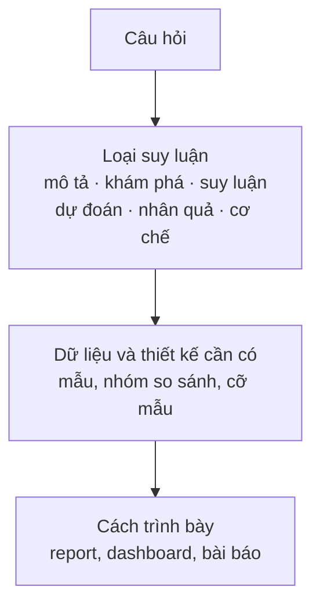

Theo Leek và Peng (2015), lỗi phổ biến nhất trong phân tích dữ liệu là nhầm loại câu hỏi đang được hỏi. Bài thứ hai của series *Phân tích dữ liệu dựa trên bằng chứng (Evidence-based Data Analytics)* truy nguồn gốc các công cụ của pha Ask (khung SMART, khung PICO, phân loại câu hỏi của Leek và Peng, ra quyết định dựa trên dữ liệu, big data và dashboard) và xem bằng chứng ủng hộ chúng mạnh đến đâu. Cuối bài, một câu hỏi mơ hồ về hạn hán và chim sẻ Darwin được viết lại thành câu hỏi đo được và trả lời bằng số đo của 100 con chim, kèm checklist 8 câu cho dự án của bạn.

## 1. Mở đầu: câu hỏi quyết định giá trị của phân tích

Quy trình phân tích dữ liệu thường gồm sáu pha: hỏi (ask), chuẩn bị (prepare), xử lý (process), phân tích (analyze), chia sẻ (share) và hành động (act) (→ [bài 01](/blog/foundations-data-data-everywhere/)). Pha Ask đứng đầu nhưng hay bị làm vội, và hệ quả chỉ lộ ra ở cuối, khi một kết quả đúng về tính toán lại không trả lời điều người ta cần biết.

Leek và Peng (2015) cho rằng lỗi phổ biến nhất trong phân tích dữ liệu không nằm ở code hay phép kiểm định, mà ở việc nhầm **loại** câu hỏi. Một mối tương quan được đọc như quan hệ nhân quả, hay một phân tích khám phá được báo cáo như thể đã kiểm định giả thuyết, đều là cùng một kiểu lỗi: trả lời câu hỏi này nhưng tuyên bố về câu hỏi khác.

Trong khoa học, quy trình nghiên cứu nào cũng bắt đầu bằng xác định vấn đề (→ Phương pháp nghiên cứu khoa học); pha Ask là cùng việc đó với tên khác. Bài lần lượt bàn các khung đặt câu hỏi (phần 2), bằng chứng về ra quyết định dựa trên dữ liệu (phần 3), big data và dashboard (phần 4), rồi áp tất cả vào một ví dụ có dữ liệu thật (phần 5).

## 2. Từ mục tiêu quản trị đến câu hỏi nghiên cứu

### 2.1. SMART đến từ đâu

SMART bắt nguồn từ một bài báo hai trang của George T. Doran trên *Management Review* năm 1981, với tiêu đề nói rõ mục đích: cách viết **mục tiêu quản lý** (management's goals and objectives) cho tốt (Doran, 1981). Theo các tài liệu dẫn lại bài gốc, năm chữ cái của Doran là Specific (nhắm vào một lĩnh vực cụ thể), Measurable (định lượng, hoặc ít nhất có chỉ báo tiến độ), **Assignable** (rõ ai chịu trách nhiệm), **Realistic** (đạt được với nguồn lực hiện có) và Time-related (có mốc thời gian). Các phiên bản sau thay chữ A và R bằng Achievable, Relevant… Trong đào tạo phân tích dữ liệu hiện nay, một biến thể hay gặp là Specific, Measurable, **Action-oriented**, **Relevant**, Time-bound, dùng để đánh giá **câu hỏi** chứ không phải mục tiêu. SMART vì vậy là một từ viết tắt dễ nhớ hơn là một khung có định nghĩa cố định.

Nền lý thuyết gần nhất là lý thuyết đặt mục tiêu (goal-setting theory), được Locke và Latham (2002) tổng kết sau 35 năm nghiên cứu thực nghiệm. Kết quả trung tâm của lý thuyết này là mục tiêu cụ thể và đủ khó thường đi kèm hiệu suất cao hơn lời dặn chung chung "cố gắng hết sức", một phần vì mục tiêu cụ thể làm giảm sự mơ hồ về điều cần đạt. Chữ S và M của SMART khớp với ý này; các chữ còn lại thì không đến từ lý thuyết đó.

Swann et al. (2023) tổng quan việc dùng SMART để đặt mục tiêu vận động thể lực và kết luận rằng từ viết tắt này không dựa trên lý thuyết khoa học, không nhất quán với bằng chứng thực nghiệm, không xét **loại mục tiêu** được đặt, có tiêu chí trùng lặp, không được dùng như dự định ban đầu và có nguy cơ gây hại. Phạm vi tổng quan là vận động thể lực, nên không khái quát thẳng sang phân tích dữ liệu được, nhưng điểm "không xét loại mục tiêu" có một bản sao rõ trong pha Ask (mục 2.3). Trong đánh giá chương trình, Bjerke và Renger (2017) cũng cho rằng không có một cách viết SMART objectives cho mọi bối cảnh.

Khi chuyển SMART từ mục tiêu sang câu hỏi, phần hữu ích nhất là đòi hỏi về **tính đo được** và **thời hạn**. Nhưng câu hỏi khoa học còn cần hai thứ SMART không yêu cầu: **so sánh với cái gì**, và **loại suy luận** nào được phép rút ra.

### 2.2. PICO: khung câu hỏi của y học thực chứng

Y học thực chứng (evidence-based medicine) giải quyết đúng chỗ thiếu thứ nhất bằng khung PICO. Richardson et al. (1995) đề xuất rằng một câu hỏi lâm sàng tốt gồm bốn phần: **P** (patient/population, đối tượng), **I** (intervention, can thiệp hay yếu tố phơi nhiễm), **C** (comparison, nhóm so sánh) và **O** (outcome, kết cục). Đây là một bài xã luận (editorial), tức một đề xuất chứ không phải kết quả nghiên cứu. Chữ C là khác biệt quan trọng nhất so với SMART: "thuốc A có hiệu quả không?" chưa trả lời được khi chưa nói so với giả dược, thuốc B hay không điều trị, và viết C ra buộc người hỏi nghĩ tới nhóm đối chứng.

PICO đã được thử nghiệm như công cụ tìm tài liệu. Schardt et al. (2007) làm một thử nghiệm ngẫu nhiên **thí điểm** với 31 bác sĩ thực tập và nội trú, so sánh giao diện PubMed có mẫu PICO với giao diện chuẩn. Độ chính xác (precision) của nhóm dùng PICO cao hơn ở cả ba câu hỏi, nhưng khoảng tin cậy 95% chồng nhau và khác biệt không có ý nghĩa thống kê. Bài học: một khung nghe hợp lý chưa phải là khung đã được chứng minh hiệu quả. Mục 5 sẽ chuyển PICO sang phân tích dữ liệu, với "kết cục" là một metric.

### 2.3. Loại câu hỏi phân tích dữ liệu

Leek và Peng (2015) phân loại câu hỏi theo **loại suy luận** mà câu trả lời cho phép, gồm sáu loại từ dễ đến khó (Leek & Peng, 2015; Peng & Matsui, 2015):

- **Descriptive** (mô tả): tóm tắt một đặc điểm của bộ dữ liệu, không diễn giải thêm.
- **Exploratory** (khám phá): tìm mẫu hình và mối liên hệ để **sinh ra** giả thuyết.
- **Inferential** (suy luận): kiểm tra mối liên hệ thấy trong mẫu có đúng ở quần thể rộng hơn không.
- **Predictive** (dự đoán): dự đoán kết cục của từng cá thể, không cần giải thích vì sao.
- **Causal** (nhân quả): thay đổi một yếu tố có làm thay đổi yếu tố khác, **tính trung bình**, không.
- **Mechanistic** (cơ chế): một yếu tố dẫn tới yếu tố kia **như thế nào**.

Bài báo kèm một sơ đồ giúp xác định loại câu hỏi từ dữ liệu và thiết kế đang có, và chỉ ra kiểu lỗi xảy ra khi loại câu hỏi được tuyên bố khác loại thật sự được trả lời. Mỗi bậc lên đòi hỏi nhiều hơn ở thiết kế: câu hỏi nhân quả thường cần thí nghiệm ngẫu nhiên hoặc một thiết kế quan sát được lập luận kỹ, còn dữ liệu sẵn có thường chỉ đủ cho câu hỏi mô tả, khám phá hay suy luận.

Trong phân tích kinh doanh, vấn đề thường được xếp theo **nhiệm vụ** (dự đoán, phân loại, phát hiện bất thường, tìm mối liên hệ, tìm mẫu hình…), hoặc theo bốn bậc descriptive, diagnostic, predictive, prescriptive. Các cách xếp này giúp chọn kỹ thuật nhưng không nói mức suy luận: "tìm mối liên hệ" có thể là câu hỏi khám phá hay nhân quả tuỳ thiết kế, còn bậc diagnostic (vì sao?) và prescriptive (làm gì?) thực chất là câu hỏi nhân quả, thường vượt quá những gì dữ liệu sẵn có cho phép.



**Hình 1.** Từ câu hỏi đến cách trình bày: loại suy luận quyết định dữ liệu và thiết kế cần có.

### 2.4. Câu hỏi đi từ giả thuyết hay từ dữ liệu

Sinh học hậu genome gặp câu hỏi này sớm, khi omics tạo ra dữ liệu nhanh hơn khả năng đặt giả thuyết. Kell và Oliver (2004) lập luận rằng nghiên cứu quy nạp đi từ dữ liệu và nghiên cứu dựa trên giả thuyết **bổ sung** cho nhau: dữ liệu lớn gợi ra giả thuyết, giả thuyết định hướng thí nghiệm tiếp theo. Kitchin (2014) phê phán tuyên bố "the end of theory" và cho rằng dữ liệu không tự nói: cách thu thập, chọn biến và diễn giải đều mang giả định. Với người làm bioinformatics, một sàng lọc hàng nghìn gen "để xem gen nào khác" vẫn có câu hỏi, và câu hỏi đó thuộc loại exploratory. Ghi rõ điều này giúp người đọc không coi kết quả như đã kiểm định giả thuyết định trước (→ Nhập môn Bioinformatics).

### 2.5. Những câu hỏi nên tránh

Khi hỏi trực tiếp, như phỏng vấn stakeholder hay khảo sát, nên tránh câu hỏi **dẫn dắt** (leading), câu hỏi **đóng** (closed-ended) khi cần hiểu lý do, câu hỏi **mơ hồ** (vague) và câu hỏi **không công bằng** (unfair), mang sẵn giả định. Chúng làm câu trả lời phản ánh cách hỏi hơn là thực tế.

**Bảng 1.** So sánh các khung đặt câu hỏi

| Khung | Sinh ra để | Thành phần | Nhóm so sánh | Loại suy luận | Bằng chứng hiệu quả |
| --- | --- | --- | --- | --- | --- |
| SMART (Doran, 1981) | viết mục tiêu quản lý | Specific, Measurable, Assignable, Realistic, Time-related | không | không | chưa thử nghiệm; bị phê bình thiếu nền lý thuyết (Swann et al., 2023) |
| SMART trong đào tạo phân tích | đánh giá câu hỏi | Specific, Measurable, Action-oriented, Relevant, Time-bound | không | không | chưa thấy đánh giá thực nghiệm |
| PICO (Richardson et al., 1995) | câu hỏi lâm sàng | Population, Intervention, Comparison, Outcome | **có** | ngầm định | pilot RCT n = 31, không có ý nghĩa thống kê (Schardt et al., 2007) |
| Leek và Peng (2015) | xác định loại câu hỏi | 6 loại, descriptive → mechanistic | tuỳ loại | **có** | khung khái niệm, chưa thử nghiệm |

Ba khung trả lời ba câu hỏi khác nhau: SMART hỏi "đo được và có hạn chót không?", PICO hỏi "so với cái gì, trên ai, kết cục nào?", Leek và Peng hỏi "được kết luận đến mức nào?". Chúng bổ sung cho nhau chứ không thay thế nhau.

## 3. Bằng chứng về ra quyết định dựa trên dữ liệu

### 3.1. Định nghĩa

Ra quyết định dựa trên dữ liệu (data-driven decision-making, DDD) có thể hiểu là dựa quyết định trên kết quả phân tích dữ liệu thay vì chỉ trên trực giác. Provost và Fawcett (2013) cho rằng khó định nghĩa data science một phần vì nó gắn chặt với big data và DDD, và đề nghị xác định các nguyên lý nền tảng để tách nó khỏi hai khái niệm này.

### 3.2. Nghiên cứu 179 công ty

Bằng chứng định lượng hay được dẫn nhất là nghiên cứu của Brynjolfsson et al. (2011), kết hợp dữ liệu khảo sát về thực hành kinh doanh và đầu tư công nghệ thông tin (IT) của **179 công ty niêm yết lớn**. Các công ty áp dụng DDD có output và năng suất cao hơn khoảng **5–6%** so với mức **dự kiến** từ các đầu vào khác và mức dùng IT của họ; mối liên hệ cũng xuất hiện ở mức sử dụng tài sản, lợi nhuận trên vốn chủ sở hữu và giá trị thị trường.

Con số 5–6% **không** phải chênh lệch thô giữa công ty có và không có DDD, mà là phần chênh so với giá trị mô hình dự đoán sau khi tính vốn, lao động và IT. Mối lo là nhân quả ngược: công ty hiệu quả hơn mới đủ sức áp dụng DDD. Nhóm tác giả dùng biến công cụ (instrumental variables) như một phép kiểm tra bổ sung và cho rằng kết quả không do nhân quả ngược; tuy vậy giá trị của biến công cụ dựa trên giả định khó kiểm chứng. DDD cũng được đo bằng khảo sát tự báo cáo, trên mẫu chỉ gồm công ty lớn. Theo thang của Leek và Peng, đây là nghiên cứu **inferential** có cố gắng tiến về phía causal, chưa phải bằng chứng nhân quả trực tiếp.

### 3.3. DDD lan rộng nhanh

Brynjolfsson và McElheran (2016) dùng dữ liệu U.S. Census Bureau trên một mẫu lớn, đại diện các nhà máy sản xuất Hoa Kỳ: tỷ lệ áp dụng DDD tăng gần gấp ba, từ **11% lên 30%**, giai đoạn 2005–2010. Việc áp dụng gắn với quy mô, với các yếu tố bổ trợ như IT và lao động có học vấn, và với học hỏi trong công ty. Nhóm tác giả chỉ viết rằng kết quả phù hợp với bằng chứng tình huống cho thấy DDD có xu hướng tăng năng suất. Thông điệp chính: DDD **đi kèm năng lực bổ trợ**; chỉ có dữ liệu thì chưa đủ.

### 3.4. Data-driven, data-informed và dữ liệu định tính

Một số tài liệu đào tạo phân biệt quyết định data-driven, nơi dữ liệu dẫn tới quyết định, với data-inspired hay data-informed, nơi dữ liệu là một đầu vào cùng hiểu biết chuyên môn và thông tin định tính. Đây là phân biệt thực hành hơn là khái niệm có định nghĩa chuẩn, nên được xem như một **phổ**. Đầu data-driven hợp khi dữ liệu đầy đủ, đo đúng thứ cần đo và quyết định lặp lại nhiều lần; đầu data-informed hợp khi dữ liệu thiếu hay lệch, quyết định hiếm mà hệ quả lớn.

Dữ liệu **định lượng** (quantitative) là số đo và số đếm, trả lời câu hỏi bao nhiêu, thường xuyên thế nào; chúng thường đến từ khảo sát và thăm dò ý kiến có lựa chọn trả lời cố định, phỏng vấn có cấu trúc với câu hỏi đóng, và các phép đo. Dữ liệu **định tính** (qualitative) mô tả đặc điểm, lý do và trải nghiệm; phỏng vấn và thảo luận nhóm tập trung (focus group) là hai phương pháp thu thập phổ biến nhất trong nghiên cứu định tính (Gill et al., 2008), bên cạnh phân tích văn bản như bình luận mạng xã hội. Ranh giới nằm ở **dạng câu trả lời** hơn là tên phương pháp: bảng hỏi có câu hỏi mở cho dữ liệu định tính, còn văn bản mạng xã hội được đếm từ khoá thì thành dữ liệu định lượng.

### 3.5. Khi dữ liệu dẫn dắt sai

Mục 3.2 và 3.3 ngầm giả định dữ liệu đo đúng thứ cần đo. Ba trường hợp sau cho thấy khi giả định đó sai.

**Google Flu Trends** ước tính tỷ lệ cúm từ lượt tìm kiếm trên Google. Tháng 2/2013, hệ thống dự báo tỷ lệ lượt khám vì bệnh giống cúm cao **hơn gấp đôi** số của Centers for Disease Control and Prevention (CDC), và từ tháng 8/2011 đến tháng 9/2013 nó báo quá cao trong **100 trên 108 tuần** (Lazer et al., 2014). Lazer et al. cho rằng phần lớn sai số có thể tránh được, và gọi một nguyên nhân là "big data hubris": giả định ngầm rằng big data **thay thế** được, thay vì **bổ sung** cho, việc thu thập và phân tích dữ liệu truyền thống. Câu hỏi là "bao nhiêu người bị cúm?", còn dữ liệu đo "bao nhiêu người tìm về cúm".

**Biến đại diện sai.** Obermeyer et al. (2019) phân tích một thuật toán thương mại chọn bệnh nhân cho chương trình chăm sóc bổ sung. Thuật toán dự đoán **chi phí** y tế, dùng chi phí làm biến đại diện (proxy) cho **nhu cầu**. Vì bệnh nhân da đen được chi tiêu chăm sóc ít hơn, ở cùng điểm rủi ro họ bệnh nặng hơn bệnh nhân da trắng; xoá chênh lệch này sẽ tăng tỷ lệ bệnh nhân da đen được hỗ trợ thêm từ **17,7% lên 46,5%**. Đây là lỗi của pha Ask: "ai cần chăm sóc nhất?" bị thay ngầm bằng "ai sẽ tốn tiền nhất?".

**Dữ liệu không thấy.** Hand (2020) gọi những dữ liệu ta không có hoặc không thấy là "dark data", từ giá trị thiếu đến những trường hợp không bao giờ được ghi lại, và cho rằng chính phần này có thể làm sai kết luận. Dữ liệu không đầy đủ, không khớp định nghĩa giữa các nhóm và dữ liệu bẩn đều thuộc loại này (→ [bài 03](/blog/prepare-data-for-exploration/), [bài 04](/blog/process-data-from-dirty-to-clean/)).

**Bảng 2.** Bản đồ bằng chứng về DDD

| Nghiên cứu | Thiết kế | Kết quả chính | Mức suy luận |
| --- | --- | --- | --- |
| Brynjolfsson et al. (2011) | khảo sát 179 công ty, hồi quy, biến công cụ | output, năng suất cao hơn 5–6% so với dự kiến | inferential |
| Brynjolfsson và McElheran (2016) | dữ liệu Census, nhà máy Hoa Kỳ | áp dụng DDD 11% → 30% (2005–2010) | descriptive, inferential |
| Lazer et al. (2014) | phân tích một hệ thống dự báo | dự báo quá cao 100/108 tuần | case study |
| Obermeyer et al. (2019) | phân tích một thuật toán | proxy chi phí gây sai lệch chủng tộc | inferential |

Bằng chứng ủng hộ DDD có thật nhưng chủ yếu là **tương quan** ở cấp công ty và nhà máy, còn các thất bại đều xuất phát từ một chỗ: dữ liệu đo một thứ gần giống, nhưng không phải, thứ cần đo.

## 4. Big data và cách trình bày kết quả

### 4.1. 3V theo bản gốc

Định nghĩa big data bằng ba chữ V bắt nguồn từ research note của Doug Laney tại META Group ngày 6/2/2001 về quản lý dữ liệu theo ba chiều Volume, Velocity và Variety (Laney, 2001). Laney đăng lại bản này năm 2012.

**Volume** là lượng dữ liệu, **variety** là sự đa dạng về định dạng, cấu trúc và nguồn. **Velocity** không chỉ là tốc độ máy xử lý: Laney mô tả nó là tốc độ dữ liệu được **tạo ra và sử dụng** tại điểm tương tác, khi thương mại điện tử làm tăng tốc độ tương tác với khách hàng, và nhấn mạnh quản lý velocity không chỉ là chuyện băng thông. **Veracity** (độ tin cậy, chất lượng) thường được thêm vào như V thứ tư; trong bài đăng lại, Laney coi nó là một trong các V được đề xuất về sau, quan trọng nhưng không phải đặc điểm **định nghĩa** big data.

Các định nghĩa học thuật sau đó giữ khung của Laney và thêm hệ quả. De Mauro et al. (2016) đề xuất: big data là tài sản thông tin có volume, velocity và variety cao đến mức cần **công nghệ** và **phương pháp phân tích** riêng để biến thành **giá trị** (value); định nghĩa này không có veracity. Gandomi và Haider (2015) đặt trọng tâm vào phương pháp phân tích, nhất là cho dữ liệu phi cấu trúc.

**Bảng 3.** Các chữ V của big data

| V | Ý nghĩa | Vai trò |
| --- | --- | --- |
| Volume | lượng dữ liệu | định nghĩa gốc (Laney, 2001) |
| Velocity | tốc độ dữ liệu được tạo ra và dùng tại điểm tương tác | định nghĩa gốc (Laney, 2001) |
| Variety | đa dạng định dạng, cấu trúc, nguồn | định nghĩa gốc (Laney, 2001) |
| Veracity | độ tin cậy, chất lượng | V bổ sung, không định nghĩa (Laney, 2001) |
| Value | giá trị tạo ra nhờ công nghệ và phân tích | hệ quả (De Mauro et al., 2016) |

Dữ liệu giải trình tự thế hệ mới minh hoạ cả ba V gốc: mỗi lần chạy tạo ra rất nhiều dữ liệu, máy sinh dữ liệu liên tục trong khi phòng thí nghiệm cần kết quả sớm, và một dự án thường ghép trình tự với dữ liệu biểu hiện, hình ảnh và lâm sàng (→ NGS và genomics).

### 4.2. Small data và big data

Small data thường nằm gọn trong spreadsheet; big data nằm trong cơ sở dữ liệu và được truy vấn (→ Dữ liệu và database). Đây là mô tả thực hành, và ranh giới dịch chuyển theo công nghệ; câu hỏi hữu ích là "câu hỏi này cần dữ liệu cỡ nào và công cụ nào là đủ".

### 4.3. Report hay dashboard

Report là tập dữ liệu tĩnh gửi cho stakeholder theo định kỳ; dashboard theo dõi dữ liệu đang cập nhật. Theo định nghĩa của Few (2004), dashboard là một màn hình trực quan trình bày những thông tin quan trọng nhất cần để đạt một hay nhiều mục tiêu, gom trên **một màn hình** để theo dõi chỉ bằng một cái nhìn. Few coi dashboard là một kiểu trình bày, không phải một loại thông tin hay công nghệ, và rút ra ba hệ quả: dashboard chủ yếu hiện tóm tắt cấp cao và ngoại lệ, cho biết chuyện gì đang xảy ra nhưng **không** cho biết vì sao; nó phải được thiết kế cho một người, nhóm hay chức năng cụ thể; và chỉ cần dữ liệu thời gian thực nếu người dùng thật sự cần, còn không thì ảnh chụp định kỳ là đủ.

Không có mục tiêu rõ thì không biết đâu là "thông tin quan trọng nhất", và dashboard chỉ trả lời tốt câu hỏi mô tả. Nhận định dashboard "ít phải bảo trì" là kinh nghiệm thực hành, chưa thấy bằng chứng thực nghiệm; dashboard nối dữ liệu trực tiếp còn có thể hiện dữ liệu chưa làm sạch cho nhiều người cùng lúc.

**Bảng 4.** Tiêu chí chọn report hay dashboard (đề xuất)

| Tiêu chí | Nghiêng về report | Nghiêng về dashboard |
| --- | --- | --- |
| Tần suất quyết định | hiếm, theo quý hay năm | thường xuyên, theo ngày hay tuần |
| Loại câu hỏi | giải thích, cần bối cảnh và lập luận | theo dõi chỉ số mô tả, phát hiện ngoại lệ |
| Tốc độ thay đổi của dữ liệu | chậm, cần ảnh chụp tại một thời điểm | nhanh, người dùng cần biết ngay |
| Rủi ro dữ liệu | cần làm sạch, kiểm tra trước mỗi lần dùng | đường ống ổn định, có kiểm tra tự động |

Dashboard thường được chia theo người dùng thành **strategic** (mục tiêu dài hạn), **operational** (theo dõi ngắn hạn) và **analytical** (chi tiết dữ liệu, cho nhóm phân tích). Loại nào thì mỗi ô cũng nên ứng với một **metric**: một loại dữ liệu đơn lẻ, định lượng được. Metric gắn với mức cần đạt thành **metric goal**, như một tỷ lệ giữ chân khách hàng mục tiêu, hay ROI tính bằng lợi nhuận ròng trong kỳ chia chi phí đầu tư. Chữ M của SMART chỉ có nghĩa khi câu hỏi chỉ ra được một metric có đơn vị và cách tính; hàm spreadsheet để tính metric ở bài 05, cách chọn biểu đồ ở bài 06.

## 5. Minh hoạ: biến câu hỏi mơ hồ thành câu hỏi đo được

### 5.1. Hạn hán và chim sẻ Darwin

Từ năm 1973, Peter và Rosemary Grant theo dõi chim sẻ đất trung bình *Geospiza fortis* trên đảo Daphne Major (Galápagos), đo hằng năm khối lượng, chiều dài cánh, xương cổ chân và kích thước mỏ. Năm 1977, hạn hán kéo dài 18 tháng làm chết hơn 80% trong khoảng 1.200 con chim trên đảo; hạt nhỏ, mềm khan hiếm, thức ăn còn lại chủ yếu là hạt caltrop (*Tribulus cistoides*) to, cứng (HHMI BioInteractive, 2021).

Câu hỏi mơ hồ "Hạn hán có ảnh hưởng đến chim sẻ không?" qua SMART thành:

- **Specific**: *G. fortis* trên Daphne Major; đặc điểm là **độ sâu mỏ**.
- **Measurable**: độ sâu mỏ (mm), so sánh trung bình hai nhóm.
- **Action-oriented / Relevant**: kiểm tra một dự đoán của chọn lọc tự nhiên: mỏ sâu hơn giúp tách hạt to, cứng còn lại trong hạn hán (→ Bằng chứng và cơ chế tiến hoá).
- **Time-bound**: chim sinh 1973–1976; nhóm không sống sót chết năm 1977, nhóm sống sót còn sống năm 1978.

Áp thêm PICO và Leek và Peng: **P** là 100 con chim trong bộ dữ liệu giáo dục của HHMI BioInteractive, trích từ dữ liệu của nhà Grant, gồm 50 con sống sót và 50 con không sống sót (HHMI BioInteractive, 2021); vai trò **I** do "sống sót qua hạn hán" đảm nhận; **C** là nhóm không sống sót; **O** là độ sâu mỏ trung bình. Đây là câu hỏi **inferential**, không phải **causal**: dữ liệu cho thấy liên hệ giữa đặc điểm và sống sót, còn cơ chế (hạt to, cứng) đến từ quan sát sinh thái độc lập.

<div class="callout callout-example">
<p class="callout-title">Câu hỏi đã viết lại</p>

Trong mẫu 100 con *G. fortis* sinh 1973–1976 trên Daphne Major, độ sâu mỏ trung bình của nhóm sống sót qua hạn hán 1977 có khác nhóm không sống sót ở mức α = 0,05 không, và khác bao nhiêu mm?

</div>

Vế "khác bao nhiêu mm" buộc câu trả lời có **độ lớn hiệu ứng**, không chỉ p-value. Nhóm không sống sót có độ sâu mỏ trung bình 9,111 mm (SD 0,880), nhóm sống sót 9,674 mm (SD 0,842), chênh 0,563 mm. Kiểm định t hai mẫu cho t = 3,27, df = 98, p = 0,0015; kiểm định Welch, không giả định phương sai bằng nhau, cho cùng t và p (df ≈ 97,8). Cohen's d ≈ 0,65, hiệu ứng cỡ trung bình. Có thể tính lại từ thống kê tóm tắt:

```python
from math import sqrt
from scipy import stats

# Thống kê tóm tắt độ sâu mỏ (mm), mỗi nhóm n = 50
m_ns, sd_ns, n_ns = 9.111, 0.880, 50   # không sống sót
m_sv, sd_sv, n_sv = 9.674, 0.842, 50   # sống sót

student = stats.ttest_ind_from_stats(m_sv, sd_sv, n_sv, m_ns, sd_ns, n_ns)
welch = stats.ttest_ind_from_stats(m_sv, sd_sv, n_sv, m_ns, sd_ns, n_ns,
                                   equal_var=False)
sd_pooled = sqrt(((n_ns - 1) * sd_ns**2 + (n_sv - 1) * sd_sv**2)
                 / (n_ns + n_sv - 2))
d = (m_sv - m_ns) / sd_pooled

print(f"Chênh lệch trung bình: {m_sv - m_ns:.3f} mm")
print(f"Student: t = {student.statistic:.2f}, p = {student.pvalue:.4f}")
print(f"Welch:   t = {welch.statistic:.2f}, p = {welch.pvalue:.4f}")
print(f"Cohen's d = {d:.2f}")
```

```text
Chênh lệch trung bình: 0.563 mm
Student: t = 3.27, p = 0.0015
Welch:   t = 3.27, p = 0.0015
Cohen's d = 0.65
```


**Hình 2.** Độ sâu mỏ của 50 con *G. fortis* không sống sót và 50 con sống sót qua hạn hán 1977. Khoảng tin cậy 95% theo phân phối t (df = 49): 8,86–9,36 mm và 9,43–9,91 mm. Dữ liệu: HHMI BioInteractive (2021), trích từ dữ liệu của P. R. Grant và B. R. Grant.

Hình 2 cho thấy điều "p = 0,0015" che mất: hai nhóm chồng nhau nhiều; chọn lọc dịch chuyển trung bình quần thể chứ không phải một ngưỡng sống chết. Vì vậy nên báo cáo chênh lệch, khoảng tin cậy và cỡ hiệu ứng cạnh p-value (→ Kiểm định giả thiết thống kê). Kết quả cùng chiều với nghiên cứu gốc: Boag và Grant (1981) báo cáo rằng chim lớn, đặc biệt chim trống có mỏ lớn, sống sót tốt nhất vì tách được hạt to và cứng chiếm ưu thế trong hạn hán.

**Bảng 5.** Bốn đặc điểm của hai nhóm (n = 50 mỗi nhóm; kiểm định t hai mẫu, df = 98)

| Đặc điểm | Không sống sót, TB (SD) | Sống sót, TB (SD) | t | p | d |
| --- | --- | --- | --- | --- | --- |
| Khối lượng (g) | 15,71 (1,36) | 16,99 (1,76) | 4,08 | < 0,001 | 0,82 |
| Chiều dài cánh (mm) | 67,79 (2,28) | 69,30 (2,33) | 3,27 | 0,0015 | 0,65 |
| Xương cổ chân (mm) | 19,04 (0,84) | 19,35 (0,86) | 1,82 | 0,072 | 0,36 |
| Độ sâu mỏ (mm) | 9,11 (0,88) | 9,67 (0,84) | 3,27 | 0,0015 | 0,65 |

Nhóm sống sót lớn hơn ở cả bốn đặc điểm, khác biệt có ý nghĩa ở khối lượng, cánh và độ sâu mỏ. Vì các đặc điểm đều tương quan với kích thước cơ thể, bảng này **không** cho phép kết luận đặc điểm nào "quan trọng nhất"; đó là một câu hỏi khác, cần mô hình nhiều biến. Câu hỏi nêu rõ chiều so sánh còn giúp bắt lỗi viết ngược chiều khác biệt, nhất là khi phần mềm trả về t âm.

Giới hạn cần nói: đây là 100 con được chọn cho mục đích giáo dục, không phải toàn bộ khoảng 1.200 con trên đảo, và cách chọn không được mô tả, nên không suy rộng ra ngoài mẫu. Cỡ mẫu nên được **lên kế hoạch** từ câu hỏi, theo độ lớn hiệu ứng muốn phát hiện (→ Toán và thống kê cho sinh học).

### 5.2. Ví dụ kinh doanh giả định

Ví dụ thứ hai là giả định. "Làm sao tăng doanh thu?" qua SMART thành "Trong quý tới, tỷ lệ khách mua lần hai của cửa hàng online có tăng lên mức mục tiêu không?". Câu này có metric và thời hạn, nhưng nếu tỷ lệ tăng thì chưa biết nhờ đâu. PICO thêm phần còn thiếu: so sánh **nhóm nhận email nhắc lại** với **nhóm không nhận**, chia ngẫu nhiên, để câu hỏi có cơ hội trở thành câu hỏi causal. Metric tính được bằng một truy vấn ngắn, ở đây trên 10 khách giả định:

```python
import sqlite3

con = sqlite3.connect(":memory:")
con.executescript("""
CREATE TABLE customers (id INTEGER PRIMARY KEY, grp TEXT, orders_next_qtr INTEGER);
INSERT INTO customers VALUES
  (1,'email',2),(2,'email',0),(3,'email',1),(4,'email',3),(5,'email',0),
  (6,'control',0),(7,'control',1),(8,'control',0),(9,'control',0),(10,'control',2);
""")
rows = con.execute("""
SELECT grp,
       COUNT(*)                                        AS n,
       SUM(orders_next_qtr >= 1)                       AS repeat_buyers,
       ROUND(100.0 * SUM(orders_next_qtr >= 1) / COUNT(*), 1) AS repeat_rate_pct
FROM customers
GROUP BY grp
ORDER BY grp DESC;
""").fetchall()
for r in rows:
    print(r)
```

```text
('email', 5, 3, 60.0)
('control', 5, 2, 40.0)
```

Với năm khách mỗi nhóm, 60% so với 40% không nói lên gì: một khách đổi ý là kết quả đảo chiều. Dự án thật cần cỡ mẫu tính trước.

Bước cuối là ghi câu hỏi thành **scope of work** (SOW): **mục đích** (đánh giá email nhắc lại có làm tăng tỷ lệ mua lần hai không); **sản phẩm bàn giao** (bảng tỷ lệ theo nhóm kèm khoảng tin cậy, báo cáo ngắn có khuyến nghị); **mốc** (chia nhóm ở tuần 1, gửi email trong tháng đầu, chốt dữ liệu cuối quý, báo cáo hai tuần sau); và **ngoài phạm vi** (không đánh giá nội dung email, không phân tích khách mua lần đầu, không xây dashboard).

**Bảng 6.** Câu hỏi trước và sau khi viết lại

| Bước | Ví dụ sinh học | Ví dụ kinh doanh (giả định) |
| --- | --- | --- |
| Câu hỏi mơ hồ | Hạn hán có ảnh hưởng đến chim sẻ không? | Làm sao tăng doanh thu? |
| Sau SMART | Độ sâu mỏ của *G. fortis* sinh 1973–1976 có khác giữa nhóm sống sót và không sống sót qua hạn hán 1977? | Tỷ lệ mua lần hai có tăng lên mức mục tiêu trong quý tới? |
| Thêm so sánh, loại suy luận | Sống sót so với không sống sót; inferential | Nhóm nhận email so với nhóm không nhận, ngẫu nhiên; causal |

## 6. Bàn luận và checklist đặt câu hỏi

SMART là danh sách kiểm tra về tính đo được và thời hạn (Swann et al., 2023), PICO thêm **nhóm so sánh** (Richardson et al., 1995), Leek và Peng thêm **loại suy luận** (Leek & Peng, 2015). Bằng chứng về DDD phụ thuộc vào dữ liệu đo đúng thứ cần đo và năng lực bổ trợ (Brynjolfsson & McElheran, 2016; Obermeyer et al., 2019). Checklist dưới gộp các ý đó.

<div class="callout callout-note">
<p class="callout-title">Checklist 8 câu trước khi phân tích</p>

1. Đối tượng là ai, hoặc là gì?
2. Đo cái gì, đơn vị nào, metric tính ra sao?
3. So với cái gì: nhóm đối chứng, mốc trước đó, hay mục tiêu định trước?
4. Trong khoảng thời gian nào?
5. Loại câu hỏi là gì: mô tả, khám phá, suy luận, dự đoán, nhân quả hay cơ chế? Thiết kế hiện có cho phép kết luận đến đâu?
6. Dữ liệu đo đúng thứ cần đo, hay chỉ là biến đại diện? Nếu là proxy, nó có thể lệch theo hướng nào?
7. Ai dùng kết quả, dưới dạng nào: report, dashboard hay một quyết định một lần?
8. Điều gì nằm ngoài phạm vi?

</div>

Câu 3, 5 và 6 là ba câu SMART không hỏi. Câu 6 là bài học của Google Flu Trends và thuật toán dùng chi phí làm proxy: không checklist nào thay được việc hiểu dữ liệu được tạo ra thế nào.

## 7. Kết luận

Câu hỏi tốt quyết định giá trị của phân tích nhiều hơn công cụ. SMART làm câu hỏi đo được và có hạn chót nhưng không buộc người hỏi nói so với cái gì và kết luận đến đâu; PICO và phân loại của Leek và Peng lấp hai chỗ đó. Ra quyết định dựa trên dữ liệu gắn với hiệu quả cao hơn ở công ty lớn, nhưng khi dữ liệu thiếu hoặc là proxy sai, "dựa vào dữ liệu" có thể khuếch đại sai lệch. Đặt câu hỏi xong, câu hỏi tiếp theo là dữ liệu có đáng tin không, chủ đề của [bài 03](/blog/prepare-data-for-exploration/).

## Tài liệu tham khảo

Bjerke, M. B., & Renger, R. (2017). Being smart about writing SMART objectives. *Evaluation and Program Planning, 61*, 125–127. https://doi.org/10.1016/j.evalprogplan.2016.12.009

Boag, P. T., & Grant, P. R. (1981). Intense natural selection in a population of Darwin's finches (Geospizinae) in the Galápagos. *Science, 214*(4516), 82–85. https://doi.org/10.1126/science.214.4516.82

Brynjolfsson, E., Hitt, L. M., & Kim, H. H. (2011). Strength in numbers: How does data-driven decision-making affect firm performance? In *ICIS 2011 Proceedings* (Paper 13). https://aisel.aisnet.org/icis2011/proceedings/economicvalueIS/13 (working paper: https://doi.org/10.2139/ssrn.1819486)

Brynjolfsson, E., & McElheran, K. (2016). The rapid adoption of data-driven decision-making. *American Economic Review, 106*(5), 133–139. https://doi.org/10.1257/aer.p20161016

De Mauro, A., Greco, M., & Grimaldi, M. (2016). A formal definition of Big Data based on its essential features. *Library Review, 65*(3), 122–135. https://doi.org/10.1108/LR-06-2015-0061

Doran, G. T. (1981). There's a S.M.A.R.T. way to write management's goals and objectives. *Management Review, 70*(11), 35–36.

Few, S. (2004, March 20). *Dashboard confusion*. Perceptual Edge (originally published in *Intelligent Enterprise*). https://www.perceptualedge.com/articles/ie/dashboard_confusion.pdf

Gandomi, A., & Haider, M. (2015). Beyond the hype: Big data concepts, methods, and analytics. *International Journal of Information Management, 35*(2), 137–144. https://doi.org/10.1016/j.ijinfomgt.2014.10.007

Gill, P., Stewart, K., Treasure, E., & Chadwick, B. (2008). Methods of data collection in qualitative research: Interviews and focus groups. *British Dental Journal, 204*(6), 291–295. https://doi.org/10.1038/bdj.2008.192

Hand, D. J. (2020). *Dark data: Why what you don't know matters*. Princeton University Press.

HHMI BioInteractive. (2021). *Evolution in action: Data analysis* [Student handout, version 2]. Howard Hughes Medical Institute. https://www.biointeractive.org/classroom-resources/evolution-action-data-analysis

Kell, D. B., & Oliver, S. G. (2004). Here is the evidence, now what is the hypothesis? The complementary roles of inductive and hypothesis-driven science in the post-genomic era. *BioEssays, 26*(1), 99–105. https://doi.org/10.1002/bies.10385

Kitchin, R. (2014). Big Data, new epistemologies and paradigm shifts. *Big Data & Society, 1*(1). https://doi.org/10.1177/2053951714528481

Laney, D. (2001, February 6). *3-D data management: Controlling data volume, velocity and variety* [Research note]. META Group. Reposted 2012: https://community.aiim.org/blogs/doug-laney/2012/08/25/deja-vvvu-gartners-original-volume-velocity-variety-definition-of-big-data

Lazer, D., Kennedy, R., King, G., & Vespignani, A. (2014). The parable of Google Flu: Traps in big data analysis. *Science, 343*(6176), 1203–1205. https://doi.org/10.1126/science.1248506

Leek, J. T., & Peng, R. D. (2015). What is the question? *Science, 347*(6228), 1314–1315. https://doi.org/10.1126/science.aaa6146

Locke, E. A., & Latham, G. P. (2002). Building a practically useful theory of goal setting and task motivation: A 35-year odyssey. *American Psychologist, 57*(9), 705–717. https://doi.org/10.1037/0003-066X.57.9.705

Obermeyer, Z., Powers, B., Vogeli, C., & Mullainathan, S. (2019). Dissecting racial bias in an algorithm used to manage the health of populations. *Science, 366*(6464), 447–453. https://doi.org/10.1126/science.aax2342

Peng, R. D., & Matsui, E. (2015). *The art of data science: A guide for anyone who works with data*. Leanpub. https://bookdown.org/rdpeng/artofdatascience/

Provost, F., & Fawcett, T. (2013). Data science and its relationship to big data and data-driven decision making. *Big Data, 1*(1), 51–59. https://doi.org/10.1089/big.2013.1508

Richardson, W. S., Wilson, M. C., Nishikawa, J., & Hayward, R. S. (1995). The well-built clinical question: A key to evidence-based decisions. *ACP Journal Club, 123*(3), A12–A13. https://doi.org/10.7326/ACPJC-1995-123-3-A12

Schardt, C., Adams, M. B., Owens, T., Keitz, S., & Fontelo, P. (2007). Utilization of the PICO framework to improve searching PubMed for clinical questions. *BMC Medical Informatics and Decision Making, 7*, 16. https://doi.org/10.1186/1472-6947-7-16

Swann, C., Jackman, P. C., Lawrence, A., Hawkins, R. M., Goddard, S. G., Williamson, O., Schweickle, M. J., Vella, S. A., Rosenbaum, S., & Ekkekakis, P. (2023). The (over)use of SMART goals for physical activity promotion: A narrative review and critique. *Health Psychology Review, 17*(2), 211–226. https://doi.org/10.1080/17437199.2021.2023608
