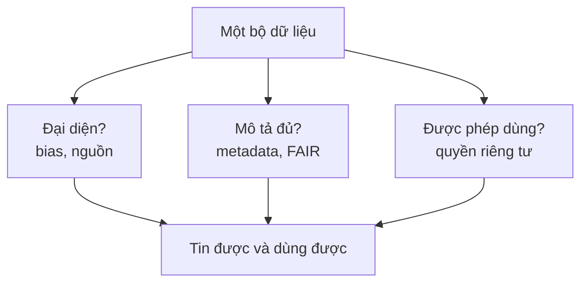
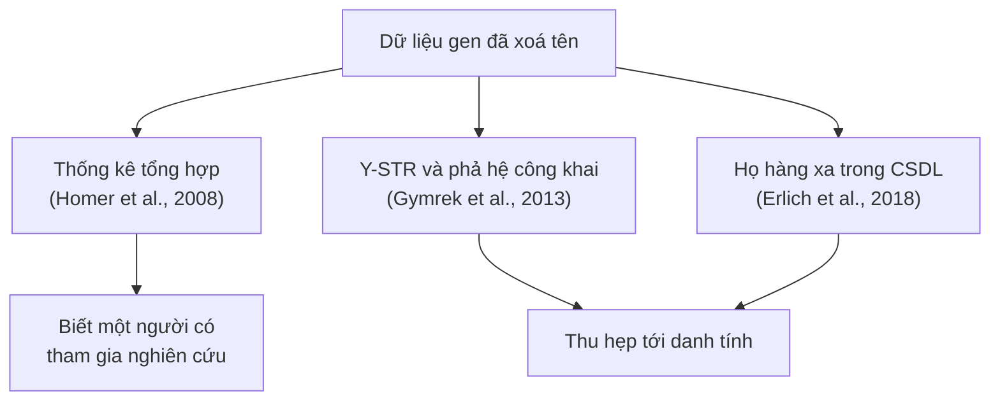

Bạn đã xoá tên bệnh nhân khỏi file dữ liệu, nhưng một mô hình công bố năm 2019 ước tính 99,98% người Mỹ vẫn bị tái định danh đúng chỉ từ 15 thuộc tính nhân khẩu học (Rocher et al., 2019). Bài thứ ba của series *Phân tích dữ liệu dựa trên bằng chứng (Evidence-based Data Analytics)* xem xét pha chuẩn bị dữ liệu qua ba câu hỏi: dữ liệu có thiên lệch không, có được mô tả đủ để dùng lại không, và có còn nhận ra được người trong đó không. Câu trả lời dựa trên tài liệu dịch tễ học, nguyên tắc FAIR, văn bản gốc của GDPR và các nghiên cứu tái định danh, kèm code mô phỏng và một checklist cho dữ liệu sinh học công khai.

## 1. Mở đầu: từ "veracity" đến "tin được"

Khi bàn về dữ liệu lớn, người ta hay nhắc chữ V thứ tư là veracity, tức chất lượng và độ tin cậy của dữ liệu ([bài 02](/blog/ask-questions-to-make-data-driven-decisions/)). Khái niệm này hữu ích nhưng quá rộng để kiểm tra, nên bài tách nó thành ba câu hỏi (Hình 1). **Đại diện**: dữ liệu có phản ánh đúng quần thể và đo đúng hiện tượng bạn quan tâm không (Phần 1)? **Mô tả**: người khác có biết dữ liệu đến từ đâu, đo bằng gì, phiên bản nào, và dùng lại được không (Phần 2)? **Được phép**: việc chia sẻ hay phân tích có đúng với điều người cho dữ liệu đã đồng ý và với luật không (Phần 3)?



**Hình 1.** Ba câu hỏi để đánh giá một bộ dữ liệu trước khi phân tích.

Ba câu hỏi này có cả trong tài liệu cho người tham gia nghiên cứu: một tờ thông tin tiếng Việt về hiến tế bào cho nghiên cứu tế bào gốc gợi ý người hiến hỏi xem thông tin của họ có được liên kết với dòng tế bào không, dòng tế bào có được chia sẻ cho nhà nghiên cứu khác không, và nói rõ dòng tế bào chứa thông tin di truyền có thể liên kết đến danh tính người hiến (*Nghiên cứu tế bào gốc*, n.d.).

Bài chỉ bàn việc đánh giá, mô tả và bảo vệ dữ liệu **trước** khi làm sạch, chủ đề của [bài 04](/blog/process-data-from-dirty-to-clean/). Đây là tổng quan có chọn lọc, không phải tư vấn pháp lý.

## 2. Phần 1: Thiên lệch và độ tin cậy của nguồn

### 2.1. Bias là sai số có hệ thống, và dữ liệu lớn không sửa được nó

Dịch tễ học định nghĩa bias là **sai số có hệ thống** (systematic error) phát sinh trong thiết kế, thực hiện hoặc phân tích nghiên cứu, làm ước lượng lệch lên hoặc lệch xuống so với giá trị thật. Nó khác **sai số ngẫu nhiên** (random error), loại dao động quanh giá trị thật và giảm khi cỡ mẫu tăng (Indira Gandhi National Open University [IGNOU], n.d.). Thu thêm dữ liệu giảm được sai số ngẫu nhiên, nhưng không giảm được sai số có hệ thống.

Meng (2018) chứng minh điều đó bằng một đẳng thức: với bộ dữ liệu cỡ n bất kỳ, chênh lệch giữa trung bình mẫu và trung bình quần thể là tích của ba thành phần: **chất lượng dữ liệu** (tương quan giữa giá trị của một người và việc người đó có được ghi nhận không), **lượng dữ liệu** (phụ thuộc tỉ lệ phần quần thể được ghi nhận) và **độ khó của bài toán** (độ biến thiên của đại lượng cần ước lượng). Lấy mẫu xác suất giữ tương quan ở thành phần thứ nhất rất nhỏ. Khi mất kiểm soát này, sai số (so với mức chuẩn một chia căn n) tăng theo căn bậc hai của cỡ quần thể N, nên "độ lớn" của big data phải đo bằng tỉ lệ n/N chứ không phải n.

Ví dụ của Meng: trong dữ liệu tự khai báo ý định bầu cử Tổng thống Mỹ năm 2016, tương quan giữa việc tự khai báo và lựa chọn ủng hộ Donald Trump chỉ khoảng −0,005. Chừng đó đủ để một mẫu khoảng 2,3 triệu người (1% cử tri đủ điều kiện) có sai số bình phương trung bình ngang một mẫu ngẫu nhiên đơn giản khoảng 400 người, tức cỡ mẫu hiệu dụng giảm 99,98% (Meng, 2018). Đoạn mô phỏng dưới tái hiện ý tưởng này trên một quần thể giả lập 1 triệu người, 30% mang một đặc điểm; người mang đặc điểm có xác suất được ghi nhận 10,5%, người không mang 10%:

```python
import numpy as np

rng = np.random.default_rng(2026)
N = 1_000_000                                   # quần thể mô phỏng
x = rng.binomial(1, 0.30, N)                    # 30% mang một đặc điểm
true_p = x.mean()

# Mẫu tự chọn: người mang đặc điểm có xác suất được ghi nhận cao hơn một chút
p_record = np.where(x == 1, 0.105, 0.100)
recorded = rng.random(N) < p_record
rho = np.corrcoef(recorded, x)[0, 1]
big = x[recorded]
print(f"Mẫu tự chọn: n = {len(big):,}, rho = {rho:.4f}, sai số = {abs(big.mean() - true_p):.4f}")

# So với mẫu ngẫu nhiên đơn giản nhỏ hơn nhiều
for n in (100, 400, 1_000, 2_000):
    errs = [abs(rng.choice(x, n, replace=False).mean() - true_p) for _ in range(500)]
    print(f"SRS n = {n:>5,}: sai số trung bình = {np.mean(errs):.4f}")
```

```text
Mẫu tự chọn: n = 101,218, rho = 0.0062, sai số = 0.0085
SRS n =   100: sai số trung bình = 0.0369
SRS n =   400: sai số trung bình = 0.0174
SRS n = 1,000: sai số trung bình = 0.0115
SRS n = 2,000: sai số trung bình = 0.0085
```

Hơn 100.000 bản ghi tự chọn, với tương quan chỉ 0,006, cho sai số ngang một mẫu ngẫu nhiên 2.000 người. Hình 2 lặp lại phép so sánh ở nhiều cỡ mẫu: sai số của mẫu ngẫu nhiên giảm đều, còn sai số của mẫu tự chọn dừng quanh 1 điểm phần trăm.


**Hình 2.** Sai số ước lượng tỉ lệ theo cỡ mẫu: mẫu ngẫu nhiên đơn giản so với mẫu tự chọn có thiên lệch nhẹ (dữ liệu mô phỏng, cùng mô hình với code trên).

Các công cụ tính cỡ mẫu và sai số biên (margin of error) đều giả định mẫu ngẫu nhiên, nên chỉ đo sai số ngẫu nhiên: con số "±1%" của một khảo sát online đông người trả lời không phản ánh thiên lệch tự chọn (→ [lấy mẫu và suy diễn thống kê](/blog/statistic-and-regression/)).

### 2.2. Bốn loại bias thường gặp, đối chiếu với tài liệu khoa học

Tài liệu nhập môn phân tích dữ liệu thường nêu bốn loại bias. Mỗi loại có một khái niệm tương ứng, chặt chẽ hơn, trong tài liệu khoa học (Bảng 1).

**Bảng 1.** Bốn loại bias, thuật ngữ khoa học tương ứng và ví dụ sinh học

| Tên thường dùng | Trong tài liệu khoa học | Ví dụ sinh học | Cách giảm |
| --- | --- | --- | --- |
| Sampling bias | selection bias | GWAS lệch về người gốc châu Âu | lấy mẫu xác suất, tuyển nhóm thiếu đại diện |
| Observer bias | measurement/detection bias | người chấm biết bệnh nhân thuộc nhóm nào | làm mù (blinding) |
| Interpretation bias | xu hướng diễn giải điều mơ hồ | đọc band mờ trên gel theo kỳ vọng | tiêu chí đọc định trước |
| Confirmation bias | tìm bằng chứng ủng hộ niềm tin có sẵn | chỉ kiểm tra lại mẫu "trái ý" | tìm bằng chứng phản bác |

**Sampling bias.** Trong dịch tễ học, selection bias xảy ra khi người được chọn vào nghiên cứu khác một cách có hệ thống với người không được chọn, do lấy mẫu không ngẫu nhiên, mẫu quá nhỏ để phủ quần thể nghiên cứu, hoặc chia nhóm phơi nhiễm và không phơi nhiễm không tương đồng (IGNOU, n.d.). Mẫu chỉ là một tập con của quần thể; mẫu có đại diện hay không là điều phải đạt được bằng thiết kế.

Genomics là ví dụ rõ nhất. Popejoy và Fullerton (2016) cho rằng genomics đang thất bại về đa dạng. Một phân tích năm 2009 cho thấy 96% người tham gia các nghiên cứu liên kết toàn hệ gen (genome-wide association study, GWAS) là người gốc châu Âu. Đến năm 2016, theo GWAS Catalog (2.511 nghiên cứu, gần 35 triệu mẫu), tỉ lệ người không gốc châu Âu tăng lên gần 20%, nhưng phần lớn nhờ các nghiên cứu ở châu Á; người gốc Phi, Mỹ Latinh, Hispanic và các dân tộc bản địa cộng lại chưa tới 4% số mẫu. Một bộ dữ liệu khổng lồ vẫn có thể đại diện kém cho phần lớn nhân loại.

**Observer bias.** Trong nghiên cứu lâm sàng, khái niệm này gắn với một cơ chế cụ thể: người đánh giá biết bệnh nhân thuộc nhóm nào, và kỳ vọng làm lệch kết quả chấm. Hróbjartsson et al. (2012) gộp 21 thử nghiệm ngẫu nhiên (4.391 bệnh nhân) có cả người đánh giá được làm mù và không được làm mù cho cùng một kết cục nhị phân. Người không được làm mù phóng đại odds ratio trung bình 36% (ratio of odds ratios 0,64; khoảng tin cậy 95% 0,43–0,96), dù hai bên đồng ý ở trung vị 78% số đánh giá.

**Interpretation bias và confirmation bias.** Interpretation bias đến từ tâm lý học lâm sàng: người có rối loạn cảm xúc như lo âu hay trầm cảm có xu hướng diễn giải tình huống mơ hồ theo hướng tiêu cực, trong khi người không có rối loạn thường nghiêng về hướng tích cực (Hirsch et al., 2016). Mượn sang phân tích dữ liệu, ý giữ lại là kết quả mơ hồ dễ bị đọc theo khung có sẵn của người đọc. Confirmation bias là xu hướng tìm và diễn giải bằng chứng theo hướng ủng hộ niềm tin sẵn có, một hiện tượng phổ biến dưới nhiều dạng (Nickerson, 1998).

Bốn loại này chỉ là một lát cắt; dịch tễ học còn có recall bias, reporting bias, loss-to-follow-up bias và nhiều loại khác (IGNOU, n.d.).

### 2.3. ROCCC và các khung chất lượng dữ liệu

Một checklist nhập môn phổ biến để chọn nguồn là **ROCCC**, dùng trong chương trình chứng chỉ Google Data Analytics: nguồn tốt phải Reliable, Original, Comprehensive, Current và Cited. ROCCC dễ nhớ, nhưng là công cụ giảng dạy chứ không phải khung chất lượng dữ liệu đã được công bố và kiểm định.

Khung được trích dẫn nhiều là của Wang và Strong (1996), xây dựng các chiều chất lượng dữ liệu **từ góc nhìn người dùng dữ liệu** và cho thấy chất lượng không chỉ là độ chính xác. Khung gồm bốn nhóm: **intrinsic** (dữ liệu tự nó đúng và đáng tin), **contextual** (phù hợp với nhiệm vụ cụ thể), **representational** (trình bày dễ hiểu, nhất quán) và **accessibility** (truy cập được, có bảo mật phù hợp). Bảng 2 đặt ROCCC cạnh bốn nhóm này; cách xếp là diễn giải của bài.

**Bảng 2.** ROCCC, nhóm chất lượng dữ liệu gần nhất và câu hỏi khi mở một series GEO

| ROCCC | Nhóm gần nhất | Câu hỏi với một series GEO |
| --- | --- | --- |
| Reliable | intrinsic | Ai tạo dữ liệu, có bài báo bình duyệt đi kèm không? |
| Original | intrinsic | Dữ liệu thô hay đã được bên thứ ba xử lý lại? |
| Comprehensive | contextual | Có đủ nhóm chứng, đủ biến lâm sàng cho câu hỏi của bạn không? |
| Current | contextual | Platform và annotation còn được dùng không? |
| Cited | intrinsic | Dataset có được dùng lại trong nghiên cứu khác không? |
| *(thiếu)* thiết kế lấy mẫu | contextual | Bệnh nhân được tuyển thế nào, ai bị loại? |
| *(thiếu)* metadata, giấy phép | representational, accessibility | Có giao thức, đơn vị, phiên bản, điều kiện dùng lại không? |

Hai dòng cuối là hai điểm ROCCC bỏ sót: "Original" không cho biết mẫu được chọn ra sao, và "Cited" chưa cho biết dữ liệu đo bằng gì, phiên bản nào, dùng lại theo điều kiện gì. Đó là việc của metadata. Cũng đừng nhầm "Current" (dữ liệu còn cập nhật) với "currency" trong các bộ nguyên tắc đạo đức dữ liệu, chỉ việc người cho dữ liệu được biết về các giao dịch tài chính phát sinh từ dữ liệu cá nhân của họ (→ [đạo đức dữ liệu trong quản lý dự án](/blog/project-execution-running-the-project/)).

## 3. Phần 2: Metadata và nguyên tắc FAIR

### 3.1. Từ "data about data" đến metadata đủ để dùng lại

Metadata thường được định nghĩa là dữ liệu về dữ liệu, chia làm ba loại: **descriptive** (tiêu đề, tác giả, từ khoá), **structural** (dữ liệu được tổ chức thế nào, phần nào thuộc tập nào) và **administrative** (nguồn kỹ thuật, quyền truy cập, ngày tạo). Định nghĩa này chưa nói metadata phải chi tiết đến đâu.

Trong bioinformatics, metadata còn là **nguồn gốc dữ liệu** (provenance). Buffalo (2015) khuyên ghi lại nguồn gốc mọi dữ liệu trong dự án, kể cả genome tham chiếu và annotation track; ghi ngày tải vì nguồn bên ngoài có thể thay đổi; ghi phiên bản, như TAIR10 hay WormBase WS231; và ghi cách tải. Cùng một tên gen nhưng khác bản annotation thì toạ độ có thể khác, nên kết quả không ghi phiên bản là kết quả không tái lập được (→ [định dạng và cơ sở dữ liệu sinh học](/blog/dinh-dang-du-lieu-va-co-so-du-lieu-sinh-hoc/)).

### 3.2. Nguyên tắc FAIR

Nguyên tắc FAIR được công bố năm 2016 trên *Scientific Data*, do đại diện giới học thuật, công nghiệp, cơ quan tài trợ và nhà xuất bản cùng soạn (Wilkinson et al., 2016). Điểm mới là FAIR nhấn mạnh khả năng để **máy** tự tìm và dùng dữ liệu, ngoài việc hỗ trợ con người. Bài gốc nêu mười lăm nguyên tắc con, diễn giải như sau:

- **Findable.** Dữ liệu và metadata có định danh duy nhất toàn cầu và bền vững (F1), được mô tả bằng metadata phong phú (F2); metadata ghi rõ định danh của dữ liệu nó mô tả (F3); cả hai được đánh chỉ mục trong một nguồn tìm kiếm được (F4).
- **Accessible.** Lấy về được bằng định danh qua một giao thức chuẩn (A1); giao thức mở, miễn phí, ai cũng triển khai được (A1.1) và cho phép xác thực, cấp quyền khi cần (A1.2); metadata vẫn truy cập được khi dữ liệu không còn (A2).
- **Interoperable.** Dùng ngôn ngữ biểu diễn tri thức có cấu trúc, chia sẻ rộng (I1), bộ từ vựng cũng theo FAIR (I2), và tham chiếu có định danh tới dữ liệu khác (I3).
- **Reusable.** Mô tả bằng nhiều thuộc tính chính xác và liên quan (R1), có giấy phép sử dụng rõ ràng (R1.1), nguồn gốc chi tiết (R1.2) và đáp ứng chuẩn của cộng đồng chuyên ngành (R1.3).

Nguyên tắc A1.2 cho thấy "Accessible" không có nghĩa là mở cho mọi người: giao thức phải mở và chuẩn, nhưng dữ liệu có thể nằm sau bước xác thực. Wilkinson et al. (2016) còn nêu ví dụ một kho đạt mức FAIR cao nhờ metadata tốt, ngay cả khi bản thân dữ liệu không được công bố theo kiểu FAIR; về sau, một số tác giả gốc viết bài nhìn lại để làm rõ FAIR là gì và không là gì (Mons et al., 2017). Một bảng đo sinh trưởng cây trồng nên vừa FAIR vừa mở; một bảng genotype bệnh nhân nên FAIR nhưng truy cập có kiểm soát.

### 3.3. Áp vào GEO và SRA

**GEO** (Gene Expression Omnibus) của NCBI tổ chức dữ liệu quanh ba thực thể: **platform** (danh sách probe, xác định phân tử nào đo được), **sample** và **series** (tập mẫu tạo thành một thí nghiệm) (Edgar et al., 2002). Đây là structural metadata cụ thể: mỗi mẫu thuộc thí nghiệm nào, đo trên nền tảng nào. GEO lưu cả dữ liệu thô, dữ liệu đã xử lý và metadata; các bản ghi được đánh chỉ mục, liên kết chéo và tải về tự do (Barrett et al., 2013). **MIAME** là chuẩn thông tin tối thiểu cần báo cáo cho một thí nghiệm microarray để người khác diễn giải và tái lập được (Brazma et al., 2001); ý tưởng "minimum information" là cách cộng đồng biến nguyên tắc R1.3 thành yêu cầu kiểm tra được.

**SRA** (Sequence Read Archive) lưu read trình tự thô và thuộc International Nucleotide Sequence Database Collaboration (Leinonen et al., 2011). GEO thường giữ ma trận biểu hiện đã xử lý, SRA giữ read gốc mà từ đó ma trận được tính ra (Bảng 3).

**Bảng 3.** Nguyên tắc FAIR và thành phần tương ứng trên GEO, SRA

| Nguyên tắc | Trên GEO và SRA | Bạn nên kiểm tra |
| --- | --- | --- |
| F | accession ổn định cho platform, sample, series, run | ghi accession và ngày tải |
| A | tải qua web, FTP hoặc công cụ dòng lệnh | dữ liệu người có nằm ở kho truy cập có kiểm soát không |
| I | định dạng chuẩn như FASTQ, bảng platform | tên mô, bệnh, đơn vị có theo từ vựng chuẩn không |
| R | mô tả mẫu, giao thức, bài báo; MIAME | đủ để tái lập không, giấy phép là gì |

### 3.4. Có kho không có nghĩa là FAIR

Hạ tầng FAIR không bảo đảm từng bản ghi được mô tả tốt. Gonçalves và Musen (2019) kiểm tra 11,4 triệu bản ghi metadata mẫu sinh học ở NCBI BioSample và EBI BioSamples: phần lớn tên trường và giá trị không được chuẩn hoá, trường nhị phân hay trường số thường bị điền sai kiểu, và cùng một thuộc tính được ghi theo nhiều cách. Trước khi dùng dữ liệu công khai, hãy kiểm tra metadata như kiểm tra dữ liệu: đếm nhãn trong cột mô hay bệnh, tìm giá trị sai kiểu, đối chiếu số mẫu với bài báo.

## 4. Phần 3: Giới hạn của ẩn danh hoá

### 4.1. GDPR nói gì: pseudonymisation khác anonymisation

Ẩn danh hoá dữ liệu (data anonymization) hay được hiểu là che, băm hoặc thay các trường định danh bằng mã. Kết quả pháp lý của các kỹ thuật này được xác định trong Quy định chung về bảo vệ dữ liệu của Liên minh châu Âu (General Data Protection Regulation, GDPR) (Regulation (EU) 2016/679, 2016).

Điều 4(1) định nghĩa dữ liệu cá nhân là thông tin liên quan đến người đã xác định hoặc **có thể xác định**, trực tiếp hoặc gián tiếp; các yếu tố xác định có cả yếu tố di truyền. Điều 4(5) định nghĩa **pseudonymisation** (giả danh hoá) là xử lý sao cho dữ liệu không còn gán được cho một người nếu không dùng **thông tin bổ sung**, với điều kiện thông tin đó được lưu riêng và bảo vệ. Recital 26 nói rõ: dữ liệu đã pseudonymise mà còn gán lại được nhờ thông tin bổ sung thì vẫn là thông tin về người có thể xác định. Phải xét mọi phương tiện "reasonably likely to be used", kể cả tách riêng (singling out) một người, với chi phí, thời gian và công nghệ hiện có. Chỉ thông tin **thật sự ẩn danh** mới nằm ngoài GDPR.

Genetic data (Điều 4(13); Recital 34 nêu rõ phân tích chromosome, DNA hoặc RNA) và data concerning health (Điều 4(15)) thuộc nhóm đặc biệt mà Điều 9(1) cấm xử lý, trừ các ngoại lệ ở Điều 9(2). Với nghiên cứu, Điều 89(1) yêu cầu biện pháp bảo vệ theo nguyên tắc tối thiểu hoá dữ liệu (data minimisation), và nếu mục đích đạt được bằng dữ liệu không còn định danh được thì phải làm theo cách đó.

Article 29 Working Party, nhóm gồm đại diện các cơ quan bảo vệ dữ liệu châu Âu, viết thẳng trong Opinion 05/2014 (WP216): pseudonymisation **không phải** một phương pháp ẩn danh hoá; nó chỉ giảm khả năng liên kết dữ liệu với danh tính gốc, và là một biện pháp an ninh hữu ích. WP216 đánh giá mọi kỹ thuật theo ba câu hỏi: còn **tách riêng** được một người không (singling out), còn **liên kết** được các bản ghi về cùng một người không (linkability), còn **suy ra** được thông tin về một người không (inference) (Article 29 Data Protection Working Party, 2014). WP216 ra đời dưới Directive 95/46/EC, trước GDPR, nhưng cùng hướng với Điều 4(5) và Recital 26. Bảng 4 áp các tiêu chí này vào những kỹ thuật thường được gọi chung là "ẩn danh hoá".

**Bảng 4.** Kỹ thuật xử lý và kết quả điển hình theo GDPR và WP216 (cần đánh giá từng trường hợp)

| Kỹ thuật | Kết quả điển hình | Ai còn gán lại được |
| --- | --- | --- |
| Xoá tên, số giấy tờ | vẫn là dữ liệu cá nhân nếu còn quasi-identifier | ai có dữ liệu ngoài để đối chiếu |
| Che một phần (masking) | pseudonymised hoặc vẫn định danh được | ai biết phần còn lại |
| Băm định danh (hashing) | pseudonymised; cùng đầu vào cho cùng mã nên vẫn liên kết được | ai băm thử được mọi giá trị khả dĩ |
| Tokenization có bảng ánh xạ | pseudonymised, khớp Điều 4(5) | người giữ bảng ánh xạ |
| Mã hoá (encryption) | biện pháp an ninh, vẫn là dữ liệu cá nhân | người giữ khoá |
| Gộp giá trị, k-anonymity có đánh giá rủi ro | có thể tiến tới ẩn danh | tuỳ mức gộp và dữ liệu ngoài |

Cần tách **an ninh dữ liệu** khỏi **ẩn danh hoá**: mã hoá bảo vệ dữ liệu khỏi người không có khoá, như khi máy chủ bị xâm nhập (→ [Cybersecurity Primer](/blog/cybersecurity-primer/)), nhưng với người có khoá, đó vẫn là dữ liệu cá nhân.

Ở Mỹ, quy định HIPAA tại 45 C.F.R. § 164.514(b) cũng không coi xoá cột là đủ: hoặc chuyên gia thống kê xác định rủi ro nhận ra cá nhân là rất nhỏ, hoặc xoá 18 nhóm định danh **và** bên công bố không biết rằng thông tin còn lại có thể dùng để nhận ra người đó.

### 4.2. k-anonymity: ý tưởng và giới hạn

Sweeney (2002) đặt bài toán: bệnh viện hay ngân hàng muốn chia sẻ dữ liệu theo cá nhân, với bảo đảm có cơ sở khoa học rằng không ai bị tái định danh, mà dữ liệu vẫn dùng được. Lời giải là **k-anonymity**: một bản công bố đạt k-anonymity nếu thông tin của mỗi người không phân biệt được với ít nhất k − 1 người khác trong bản công bố.

Khái niệm then chốt là **quasi-identifier**: thuộc tính không tự định danh nhưng kết hợp lại thì có thể, như mã bưu chính, ngày sinh, giới tính. Với dữ liệu điều tra dân số Mỹ năm 1990, khoảng 87% dân số (216 trên 248 triệu) có tổ hợp {mã bưu chính 5 số, giới tính, ngày sinh} có khả năng là duy nhất (Sweeney, 2000). Golle (2006) tính lại với điều tra dân số năm 2000 và được con số thấp hơn, khoảng 63%. Dù là con số nào, ba thuộc tính trông vô hại đủ nhận ra phần lớn dân số. Mô phỏng dưới cho thấy cơ chế này trên 100.000 người giả lập ở 30 huyện:

```python
import numpy as np, pandas as pd

rng = np.random.default_rng(2026)
n = 100_000                                      # 100.000 người MÔ PHỎNG trong một tỉnh
pop = pd.DataFrame({
    "gioi": rng.choice(["F", "M"], n),
    "ngay_sinh": pd.Timestamp("1945-01-01")
                 + pd.to_timedelta(rng.integers(0, 60 * 365, n), unit="D"),
    "huyen": rng.integers(1, 31, n),             # 30 huyện
})
pop["nam_sinh"] = pop["ngay_sinh"].dt.year

def ti_le_duy_nhat(cols):
    size = pop.groupby(cols)[cols[0]].transform("size")
    return (size == 1).mean()

for cols in (["gioi", "nam_sinh"],
             ["gioi", "nam_sinh", "huyen"],
             ["gioi", "ngay_sinh"],
             ["gioi", "ngay_sinh", "huyen"]):
    print(f"{' + '.join(cols):<26}{ti_le_duy_nhat(cols):>8.1%}")
```

```text
gioi + nam_sinh               0.0%
gioi + nam_sinh + huyen       0.0%
gioi + ngay_sinh             10.2%
gioi + ngay_sinh + huyen     92.7%
```


**Hình 3.** Tỉ lệ người có tổ hợp thuộc tính duy nhất trong quần thể mô phỏng 100.000 người (kết quả của code trên, không phải dữ liệu thật).

Với năm sinh, không ai là duy nhất; với ngày sinh đầy đủ và huyện, hơn 90% người là duy nhất. Con số phụ thuộc giả định mô phỏng, nhưng xu hướng thì không: mỗi mức chi tiết thêm vào nhân số tổ hợp lên nhiều lần, còn số người thì cố định.

Cách thường dùng để đạt k-anonymity là **gộp giá trị** (generalization), như gộp tuổi thành khoảng 10 năm, và **xoá giá trị hiếm** (suppression). Code dưới áp generalization lên 20 bệnh nhân mô phỏng đã xoá họ tên, rồi tính k và số chẩn đoán khác nhau trong mỗi nhóm:

```python
import pandas as pd

# 20 bệnh nhân MÔ PHỎNG (không phải dữ liệu thật); đã xoá họ tên
df = pd.DataFrame({
    "tuoi":  [23, 27, 25, 34, 38, 31, 36, 45, 41, 47, 44, 52, 58, 55, 51, 63, 67, 61, 69, 66],
    "gioi":  ["F","F","F","M","M","M","M","F","F","F","F","M","M","M","M","F","F","F","F","F"],
    "huyen": ["H01","H02","H03","H11","H12","H11","H13","H01","H04","H02","H03",
              "H14","H12","H11","H13","H02","H05","H01","H04","H03"],
    "chan_doan": ["hen", "đái tháo đường", "hen", "tăng huyết áp", "tăng huyết áp",
                  "tăng huyết áp", "viêm gan B", "hen", "đái tháo đường", "viêm gan B",
                  "tăng huyết áp", "đái tháo đường", "đái tháo đường", "đái tháo đường",
                  "đái tháo đường", "hen", "tăng huyết áp", "viêm gan B", "đái tháo đường", "hen"],
})
QI = ["tuoi", "gioi", "huyen"]          # quasi-identifier

def k_of(d, qi):
    return d.groupby(qi).size().min()

print("k trước khi gộp:", k_of(df, QI))

# Generalization: tuổi thành khoảng 10 năm, mã huyện thành mã tỉnh (H0x -> T0, H1x -> T1)
g = df.assign(tuoi=(df["tuoi"] // 10 * 10).astype(str) + "–" + (df["tuoi"] // 10 * 10 + 9).astype(str),
              huyen=df["huyen"].str[:2].str.replace("H", "T"))
print("k sau khi gộp:", k_of(g, QI))

# l-diversity: mỗi nhóm có bao nhiêu chẩn đoán khác nhau?
summary = g.groupby(QI).agg(n=("chan_doan", "size"), l=("chan_doan", "nunique"),
                            chan_doan=("chan_doan", lambda s: ", ".join(sorted(set(s)))))
print(summary.to_string())
```

```text
k trước khi gộp: 1
k sau khi gộp: 3
                  n  l                                       chan_doan
tuoi  gioi huyen                                                      
20–29 F    T0     3  2                             hen, đái tháo đường
30–39 M    T1     4  2                       tăng huyết áp, viêm gan B
40–49 F    T0     4  4  hen, tăng huyết áp, viêm gan B, đái tháo đường
50–59 M    T1     4  1                                  đái tháo đường
60–69 F    T0     5  4  hen, tăng huyết áp, viêm gan B, đái tháo đường
```

Trước khi gộp, k = 1: biết tuổi, giới và huyện của một người là tìm ra đúng dòng của họ, dù tên đã bị xoá. Sau khi gộp, bảng đạt 3-anonymity. Nhưng ở nhóm "50–59, nam, T1", cả 4 người đều đái tháo đường: biết hàng xóm là nam, 55 tuổi, ở tỉnh T1 và có trong bảng, bạn không biết dòng nào là của ông ấy nhưng vẫn biết chắc chẩn đoán. Đây là tấn công suy luận mà k-anonymity không chặn được. Cùng phép kiểm tra trong SQL (SQLite, bảng `benh_nhan` là bảng đã gộp `g`):

```sql
-- Nhóm có k < 5 hoặc chỉ một chẩn đoán (l < 2)
SELECT tuoi, gioi, huyen,
       COUNT(*)                  AS k_nhom,
       COUNT(DISTINCT chan_doan) AS l_nhom
FROM benh_nhan
GROUP BY tuoi, gioi, huyen
HAVING COUNT(*) < 5 OR COUNT(DISTINCT chan_doan) < 2;
```

```text
('20–29', 'F', 'T0', 3, 2)
('30–39', 'M', 'T1', 4, 2)
('40–49', 'F', 'T0', 4, 4)
('50–59', 'M', 'T1', 4, 1)
```

Chính Sweeney (2002) đã chỉ ra rằng bản công bố k-anonymous vẫn có thể bị tấn công nếu chính sách đi kèm không được tuân thủ. Các nghiên cứu sau thêm hai giới hạn: khi giá trị nhạy cảm trong nhóm thiếu đa dạng, như nhóm đái tháo đường ở trên, cần **l-diversity** (Machanavajjhala et al., 2007); khi phân bố giá trị nhạy cảm trong nhóm lệch xa phân bố chung, cần **t-closeness** (Li et al., 2007). WP216 xếp aggregation, k-anonymity, l-diversity, t-closeness vào họ **generalization**, còn thêm nhiễu, hoán vị và differential privacy vào họ **randomization**. **Differential privacy** (Dwork, 2006) đặt bảo đảm lên **thuật toán công bố** chứ không lên bản dữ liệu: kết quả gần như không đổi dù có hay không có dữ liệu của một người.

### 4.3. Bằng chứng tái định danh trên dữ liệu "ẩn danh"

Trên dữ liệu thật, Narayanan và Shmatikov (2008) khử ẩn danh dữ liệu Netflix Prize, gồm điểm đánh giá phim đã ẩn danh của 500.000 thuê bao: chỉ cần biết một ít về một thuê bao là tìm ra bản ghi, và khi đối chiếu với IMDb, họ nhận ra bản ghi của một số người dùng, lộ cả xu hướng chính trị có thể suy ra. de Montjoye et al. (2013) phân tích dữ liệu di động 15 tháng của 1,5 triệu người, vị trí theo giờ ở độ phân giải ăng-ten: 4 điểm thời gian–địa điểm đủ nhận ra duy nhất 95% số người, và làm thô dữ liệu chỉ giảm tính duy nhất rất chậm.

Lập luận "bộ dữ liệu chỉ là mẫu nhỏ nên bản ghi khớp chưa chắc đúng người" cũng không vững. Rocher et al. (2019) xây dựng mô hình sinh (generative model) dựa trên copula để ước lượng xác suất tái định danh đúng ngay trong tập dữ liệu rất không đầy đủ; trên 210 quần thể, mô hình dự đoán tính duy nhất với AUC 0,84–0,97. Họ ước tính 99,98% người Mỹ sẽ bị tái định danh đúng với 15 thuộc tính nhân khẩu học, và cho rằng cách "khử định danh rồi công bố" khó đáp ứng chuẩn ẩn danh của GDPR.

Đối trọng cũng cần nói rõ. El Emam et al. (2011) tổng quan hệ thống và gộp 14 vụ tấn công: trung bình khoảng 26% bản ghi bị tái định danh (khoảng tin cậy 95% 4,6–47,8%), 34% với dữ liệu y tế (0–74,4%). Nhưng chỉ 2 trong 14 vụ nhắm vào dữ liệu đã khử định danh theo chuẩn, và vụ duy nhất trên dữ liệu y tế khử định danh theo chuẩn có tỉ lệ thành công 0,013%. Hai phía không mâu thuẫn: khử định danh **theo chuẩn, có đánh giá rủi ro** khác xa việc **chỉ xoá tên**.

### 4.4. Dữ liệu gen: genome là một định danh

Với dữ liệu gen, vấn đề khó hơn vì bản thân trình tự DNA là định danh: gần như duy nhất, không đổi suốt đời, và một phần được chia sẻ với họ hàng (Hình 4).



**Hình 4.** Ba con đường tái định danh dữ liệu gen, vẽ theo Homer et al. (2008), Gymrek et al. (2013) và Erlich et al. (2018).

**Thống kê tổng hợp cũng lộ.** Homer et al. (2008) dùng SNP genotyping microarray mật độ cao để xác định một người có góp DNA vào một hỗn hợp phức tạp không, kể cả khi người đó góp dưới 0,1% tổng DNA. Các tác giả lưu ý thống kê tổng hợp như tần số allele hay số đếm genotype trong GWAS không che được danh tính; nếu nhóm nghiên cứu là nhóm bệnh, biết một người "có tham gia" đã là lộ thông tin sức khoẻ.

**Suy ra họ từ nhiễm sắc thể Y.** Gymrek et al. (2013) khôi phục họ từ genome bằng cách đối chiếu short tandem repeat trên nhiễm sắc thể Y với cơ sở dữ liệu phả hệ giải trí công khai, kết hợp tuổi và bang cư trú để thu hẹp danh tính, và truy ra danh tính một số người tham gia các dự án giải trình tự công khai, chỉ bằng tài nguyên miễn phí trên Internet.

**Tìm qua họ hàng xa.** Erlich et al. (2018) phân tích dữ liệu 1,28 triệu người làm xét nghiệm gen thương mại và ước tính khoảng 60% lượt tìm một người gốc châu Âu sẽ ra họ hàng ở mức third cousin (anh chị em họ đời thứ ba) hoặc gần hơn. Bạn có thể bị nhận ra qua DNA của họ hàng, dù bản thân chưa từng xét nghiệm.

Erlich và Narayanan (2014) hệ thống hoá các con đường xâm phạm quyền riêng tư di truyền và biện pháp bảo vệ; Shabani và Marelli (2019) phân tích khả năng tái định danh dữ liệu genomic dưới GDPR. Dữ liệu genome cá nhân, dù đã xoá tên, nên được coi là dữ liệu cá nhân thuộc nhóm đặc biệt, nhưng vẫn chia sẻ được. dbGaP của NCBI lưu dữ liệu kiểu hình, phơi nhiễm, genotype và trình tự **ở mức cá nhân**, gán định danh ổn định và nhóm người tham gia theo loại đồng ý (consent) tương tự nhau (Mailman et al., 2007). European Genome-phenome Archive (EGA) lưu dữ liệu di truyền và kiểu hình đã được đồng ý cho các mục đích nghiên cứu cụ thể; dữ liệu **không** được phát hành mở hoàn toàn, quyền truy cập do tổ chức cung cấp dữ liệu cùng quản lý (Lappalainen et al., 2015). Đây chính là tinh thần của nguyên tắc A1.2: metadata tìm được công khai, dữ liệu chỉ đến tay người được cấp quyền.

## 5. Thảo luận: checklist "dữ liệu này có tin được không"

**Tầng 1: Đại diện**
- Ai được lấy mẫu, ai bị bỏ sót (Popejoy & Fullerton, 2016)? Dữ liệu từ lấy mẫu xác suất hay tự đăng ký? Không có lấy mẫu xác suất thì cỡ mẫu lớn không bù được thiên lệch (Meng, 2018).
- Người đo, người chấm kết cục có được làm mù không (Hróbjartsson et al., 2012)?
- Dữ liệu dùng huấn luyện mô hình thì thiên lệch trong mẫu thành thiên lệch trong dự đoán (→ [machine learning trong sinh học](/blog/machine-learning-va-ai-trong-sinh-hoc/)).

**Tầng 2: Mô tả**
- Có accession ổn định, ngày tải, phiên bản genome, annotation, platform không (Buffalo, 2015)?
- Có giao thức, đơn vị, bài báo đi kèm, đạt MIAME không (Brazma et al., 2001)? Metadata có chuẩn hoá không (Gonçalves & Musen, 2019)? Giấy phép là gì (Wilkinson et al., 2016)?

**Tầng 3: Được phép**
- Dữ liệu ẩn danh thật hay chỉ pseudonymised, ai giữ khoá (Article 29 Data Protection Working Party, 2014)?
- Còn quasi-identifier nào: ngày sinh, mã vùng, ngày nhập viện, bệnh hiếm?
- Có phải genetic data hay data concerning health không, mục đích nào đã được đồng ý (Regulation (EU) 2016/679, 2016; Lappalainen et al., 2015)? Có cần đến mức chi tiết này không?

Áp thử lên series GEO **GSE2034** (công bố năm 2005): 286 mẫu ung thư vú trên platform GPL96, có file thô định dạng CEL, liên kết tới bài báo gốc và kèm một bảng thông số lâm sàng (Wang et al., 2005; National Center for Biotechnology Information [NCBI], 2005). Tầng 2 được đáp ứng tốt. Tầng 1 hỏi: bệnh nhân được tuyển ở đâu, theo tiêu chí nào, có giống quần thể bạn quan tâm không? Tầng 3 hỏi: bảng lâm sàng có biến nào là quasi-identifier, điều kiện dùng lại là gì? Checklist không trả lời thay bạn, nhưng chỉ ra những gì phải đọc trước dòng code phân tích đầu tiên.

Quay lại câu hỏi trọng tâm: chỉ xoá tên có đủ bảo vệ dữ liệu sức khoẻ và dữ liệu gen khi chia sẻ công khai không? Không. Dữ liệu chỉ thay định danh bằng mã vẫn là dữ liệu cá nhân nếu còn gán lại được; vài thuộc tính gián tiếp đủ nhận ra phần lớn dân số (Rocher et al., 2019); và genome tự nó là định danh (Gymrek et al., 2013). Cần đánh giá rủi ro theo ba tiêu chí của WP216, giảm dữ liệu xuống mức cần thiết, và dùng truy cập có kiểm soát khi không thể ẩn danh thật (Erlich & Narayanan, 2014), dù khi khử định danh theo chuẩn, tỉ lệ tái định danh đã ghi nhận rất thấp (El Emam et al., 2011). Phần pháp lý của bài chỉ dựa trên GDPR và HIPAA; quy định của từng quốc gia, kể cả Việt Nam, cần đọc từ văn bản gốc, và các mô phỏng chỉ minh hoạ cơ chế, không thay cho đánh giá rủi ro trên dữ liệu thật.

## 6. Kết luận

Thiên lệch là sai số có hệ thống và không giảm khi dữ liệu lớn lên; khi mất lấy mẫu xác suất, độ lớn của dữ liệu phải đo bằng tỉ lệ so với quần thể (Meng, 2018). Metadata là điều kiện để dữ liệu dùng lại được, và FAIR không đồng nghĩa với mở (Wilkinson et al., 2016). Xoá tên, che, băm hay token hoá thường chỉ tạo ra dữ liệu pseudonymised, chưa phải ẩn danh, nhất là với dữ liệu gen (Article 29 Data Protection Working Party, 2014). Khi một bộ dữ liệu đã qua ba tầng kiểm tra, bước tiếp theo là làm sạch nó, chủ đề của [bài 04](/blog/process-data-from-dirty-to-clean/).

## Tài liệu tham khảo

Article 29 Data Protection Working Party. (2014). *Opinion 05/2014 on anonymisation techniques* (0829/14/EN, WP216). European Commission. https://ec.europa.eu/justice/article-29/documentation/opinion-recommendation/files/2014/wp216_en.pdf

Barrett, T., Wilhite, S. E., Ledoux, P., Evangelista, C., Kim, I. F., Tomashevsky, M., Marshall, K. A., Phillippy, K. H., Sherman, P. M., Holko, M., Yefanov, A., Lee, H., Zhang, N., Robertson, C. L., Serova, N., Davis, S., & Soboleva, A. (2013). NCBI GEO: Archive for functional genomics data sets—update. *Nucleic Acids Research, 41*(D1), D991–D995. https://doi.org/10.1093/nar/gks1193

Brazma, A., Hingamp, P., Quackenbush, J., Sherlock, G., Spellman, P., Stoeckert, C., Aach, J., Ansorge, W., Ball, C. A., Causton, H. C., Gaasterland, T., Glenisson, P., Holstege, F. C. P., Kim, I. F., Markowitz, V., Matese, J. C., Parkinson, H., Robinson, A., Sarkans, U., … Vingron, M. (2001). Minimum information about a microarray experiment (MIAME)—toward standards for microarray data. *Nature Genetics, 29*(4), 365–371. https://doi.org/10.1038/ng1201-365

Buffalo, V. (2015). *Bioinformatics data skills: Reproducible and robust research with open source tools*. O'Reilly Media.

de Montjoye, Y.-A., Hidalgo, C. A., Verleysen, M., & Blondel, V. D. (2013). Unique in the crowd: The privacy bounds of human mobility. *Scientific Reports, 3*, 1376. https://doi.org/10.1038/srep01376

Dwork, C. (2006). Differential privacy. In M. Bugliesi, B. Preneel, V. Sassone, & I. Wegener (Eds.), *Automata, languages and programming: 33rd International Colloquium, ICALP 2006, Proceedings, Part II* (pp. 1–12). Springer. https://doi.org/10.1007/11787006_1

Edgar, R., Domrachev, M., & Lash, A. E. (2002). Gene Expression Omnibus: NCBI gene expression and hybridization array data repository. *Nucleic Acids Research, 30*(1), 207–210. https://doi.org/10.1093/nar/30.1.207

El Emam, K., Jonker, E., Arbuckle, L., & Malin, B. (2011). A systematic review of re-identification attacks on health data. *PLoS ONE, 6*(12), e28071. https://doi.org/10.1371/journal.pone.0028071

Erlich, Y., & Narayanan, A. (2014). Routes for breaching and protecting genetic privacy. *Nature Reviews Genetics, 15*(6), 409–421. https://doi.org/10.1038/nrg3723

Erlich, Y., Shor, T., Pe'er, I., & Carmi, S. (2018). Identity inference of genomic data using long-range familial searches. *Science, 362*(6415), 690–694. https://doi.org/10.1126/science.aau4832

Golle, P. (2006). Revisiting the uniqueness of simple demographics in the US population. In *Proceedings of the 5th ACM Workshop on Privacy in Electronic Society* (pp. 77–80). ACM. https://doi.org/10.1145/1179601.1179615

Gonçalves, R. S., & Musen, M. A. (2019). The variable quality of metadata about biological samples used in biomedical experiments. *Scientific Data, 6*, 190021. https://doi.org/10.1038/sdata.2019.21

Gymrek, M., McGuire, A. L., Golan, D., Halperin, E., & Erlich, Y. (2013). Identifying personal genomes by surname inference. *Science, 339*(6117), 321–324. https://doi.org/10.1126/science.1229566

Hirsch, C. R., Meeten, F., Krahé, C., & Reeder, C. (2016). Resolving ambiguity in emotional disorders: The nature and role of interpretation biases. *Annual Review of Clinical Psychology, 12*, 281–305. https://doi.org/10.1146/annurev-clinpsy-021815-093436

Homer, N., Szelinger, S., Redman, M., Duggan, D., Tembe, W., Muehling, J., Pearson, J. V., Stephan, D. A., Nelson, S. F., & Craig, D. W. (2008). Resolving individuals contributing trace amounts of DNA to highly complex mixtures using high-density SNP genotyping microarrays. *PLoS Genetics, 4*(8), e1000167. https://doi.org/10.1371/journal.pgen.1000167

Hróbjartsson, A., Thomsen, A. S. S., Emanuelsson, F., Tendal, B., Hilden, J., Boutron, I., Ravaud, P., & Brorson, S. (2012). Observer bias in randomised clinical trials with binary outcomes: Systematic review of trials with both blinded and non-blinded outcome assessors. *BMJ, 344*, e1119. https://doi.org/10.1136/bmj.e1119

Indira Gandhi National Open University. (n.d.). *MSTE-003 Bio-statistics-I, Block 3: Epidemiology* (Unit 11: Design, conduct and analysis of epidemiological studies). IGNOU.

Lappalainen, I., Almeida-King, J., Kumanduri, V., Senf, A., Spalding, J. D., ur-Rehman, S., Saunders, G., Kandasamy, J., Caccamo, M., Leinonen, R., Vaughan, B., Laurent, T., Rowland, F., Marin-Garcia, P., Barker, J., Jokinen, P., Torres, A. C., de Argila, J. R., Llobet, O. M., … Flicek, P. (2015). The European Genome-phenome Archive of human data consented for biomedical research. *Nature Genetics, 47*(7), 692–695. https://doi.org/10.1038/ng.3312

Leinonen, R., Sugawara, H., Shumway, M., & International Nucleotide Sequence Database Collaboration. (2011). The Sequence Read Archive. *Nucleic Acids Research, 39*(Database issue), D19–D21. https://doi.org/10.1093/nar/gkq1019

Li, N., Li, T., & Venkatasubramanian, S. (2007). t-Closeness: Privacy beyond k-anonymity and l-diversity. In *2007 IEEE 23rd International Conference on Data Engineering* (pp. 106–115). IEEE. https://doi.org/10.1109/ICDE.2007.367856

Machanavajjhala, A., Kifer, D., Gehrke, J., & Venkitasubramaniam, M. (2007). L-diversity: Privacy beyond k-anonymity. *ACM Transactions on Knowledge Discovery from Data, 1*(1), Article 3. https://doi.org/10.1145/1217299.1217302

Mailman, M. D., Feolo, M., Jin, Y., Kimura, M., Tryka, K., Bagoutdinov, R., Hao, L., Kiang, A., Paschall, J., Phan, L., Popova, N., Pretel, S., Ziyabari, L., Lee, M., Shao, Y., Wang, Z. Y., Sirotkin, K., Ward, M., Kholodov, M., … Sherry, S. T. (2007). The NCBI dbGaP database of genotypes and phenotypes. *Nature Genetics, 39*(10), 1181–1186. https://doi.org/10.1038/ng1007-1181

Meng, X.-L. (2018). Statistical paradises and paradoxes in big data (I): Law of large populations, big data paradox, and the 2016 US presidential election. *The Annals of Applied Statistics, 12*(2), 685–726. https://doi.org/10.1214/18-AOAS1161SF

Mons, B., Neylon, C., Velterop, J., Dumontier, M., da Silva Santos, L. O. B., & Wilkinson, M. D. (2017). Cloudy, increasingly FAIR; revisiting the FAIR Data guiding principles for the European Open Science Cloud. *Information Services & Use, 37*(1), 49–56. https://doi.org/10.3233/ISU-170824

Narayanan, A., & Shmatikov, V. (2008). Robust de-anonymization of large sparse datasets. In *2008 IEEE Symposium on Security and Privacy* (pp. 111–125). IEEE. https://doi.org/10.1109/SP.2008.33

National Center for Biotechnology Information. (2005). *GSE2034: Breast cancer relapse free survival* [Data set]. Gene Expression Omnibus. https://www.ncbi.nlm.nih.gov/geo/query/acc.cgi?acc=GSE2034

*Nghiên cứu tế bào gốc: Tham gia vào nghiên cứu là lựa chọn của bạn* [Tờ thông tin dành cho người tham gia nghiên cứu]. (n.d.).

Nickerson, R. S. (1998). Confirmation bias: A ubiquitous phenomenon in many guises. *Review of General Psychology, 2*(2), 175–220. https://doi.org/10.1037/1089-2680.2.2.175

Other requirements relating to uses and disclosures of protected health information, 45 C.F.R. § 164.514. https://www.law.cornell.edu/cfr/text/45/164.514

Popejoy, A. B., & Fullerton, S. M. (2016). Genomics is failing on diversity. *Nature, 538*(7624), 161–164. https://doi.org/10.1038/538161a

Regulation (EU) 2016/679 of the European Parliament and of the Council of 27 April 2016 on the protection of natural persons with regard to the processing of personal data and on the free movement of such data, and repealing Directive 95/46/EC (General Data Protection Regulation). (2016). *Official Journal of the European Union, L 119*, 1–88. https://eur-lex.europa.eu/legal-content/EN/TXT/?uri=CELEX:32016R0679

Rocher, L., Hendrickx, J. M., & de Montjoye, Y.-A. (2019). Estimating the success of re-identifications in incomplete datasets using generative models. *Nature Communications, 10*, 3069. https://doi.org/10.1038/s41467-019-10933-3

Shabani, M., & Marelli, L. (2019). Re-identifiability of genomic data and the GDPR: Assessing the re-identifiability of genomic data in light of the EU General Data Protection Regulation. *EMBO Reports, 20*(6), e48316. https://doi.org/10.15252/embr.201948316

Sweeney, L. (2000). *Simple demographics often identify people uniquely* (Data Privacy Working Paper 3). Carnegie Mellon University. https://dataprivacylab.org/projects/identifiability/

Sweeney, L. (2002). k-anonymity: A model for protecting privacy. *International Journal of Uncertainty, Fuzziness and Knowledge-Based Systems, 10*(5), 557–570. https://doi.org/10.1142/S0218488502001648

Wang, R. Y., & Strong, D. M. (1996). Beyond accuracy: What data quality means to data consumers. *Journal of Management Information Systems, 12*(4), 5–33. https://doi.org/10.1080/07421222.1996.11518099

Wang, Y., Klijn, J. G. M., Zhang, Y., Sieuwerts, A. M., Look, M. P., Yang, F., Talantov, D., Timmermans, M., Meijer-van Gelder, M. E., Yu, J., Jatkoe, T., Berns, E. M. J. J., Atkins, D., & Foekens, J. A. (2005). Gene-expression profiles to predict distant metastasis of lymph-node-negative primary breast cancer. *The Lancet, 365*(9460), 671–679. https://doi.org/10.1016/S0140-6736(05)17947-1

Wilkinson, M. D., Dumontier, M., Aalbersberg, I. J., Appleton, G., Axton, M., Baak, A., Blomberg, N., Boiten, J.-W., da Silva Santos, L. B., Bourne, P. E., Bouwman, J., Brookes, A. J., Clark, T., Crosas, M., Dillo, I., Dumon, O., Edmunds, S., Evelo, C. T., Finkers, R., … Mons, B. (2016). The FAIR Guiding Principles for scientific data management and stewardship. *Scientific Data, 3*, 160018. https://doi.org/10.1038/sdata.2016.18
