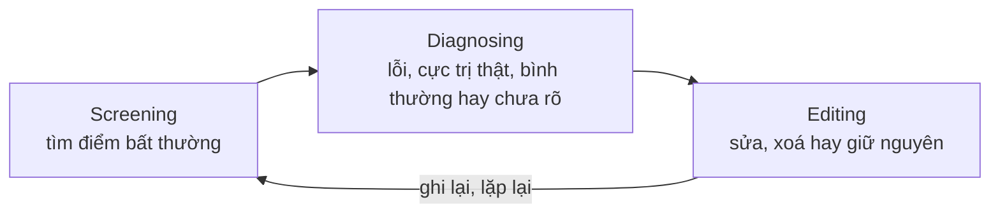
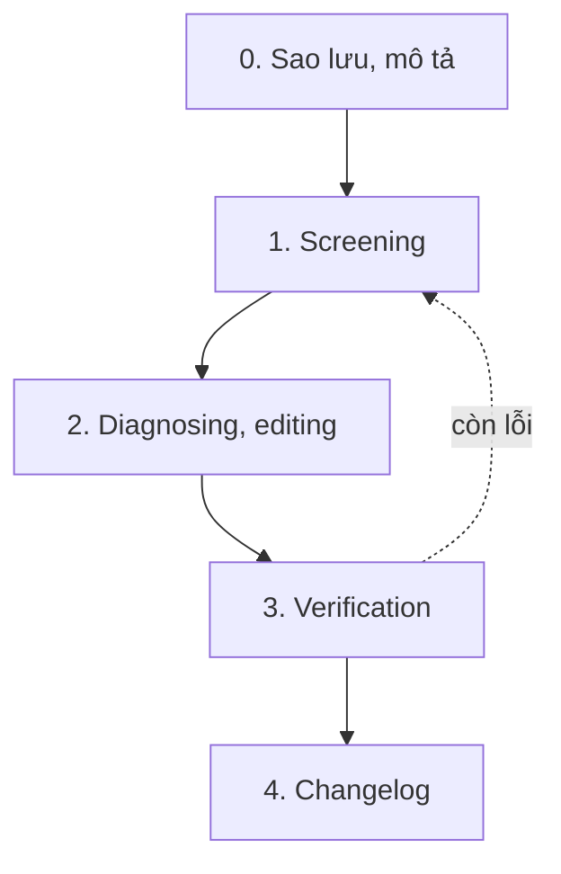
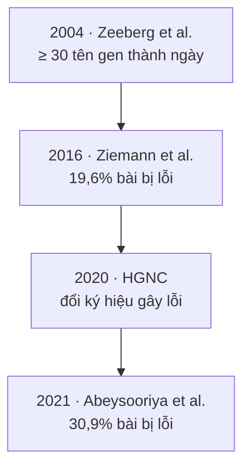

Dữ liệu khoa học có thể bẩn theo những cách khó nhận ra, và chính công cụ quen thuộc cũng gây lỗi: 30,9% số bài báo có danh sách gen dạng Excel trên PubMed Central giai đoạn 2014–2020 chứa tên gen bị đổi thành ngày tháng hoặc con số (Abeysooriya et al., 2021). Bài thứ tư của series *Phân tích dữ liệu dựa trên bằng chứng (Evidence-based Data Analytics)* trình bày quy trình làm sạch dữ liệu có ghi chép theo các nguồn phương pháp học, với ví dụ bằng spreadsheet, SQL và Python; case study lỗi tên gen; và cách hiểu đúng về “n ≥ 30”, khoảng tin cậy 95% và statistical power. Cuối bài có checklist, mẫu changelog và code để bạn tự chạy lại.

## 1. Mở đầu: dữ liệu bẩn là chuyện của khoa học, không chỉ của doanh nghiệp

Dán tên gen DEC1 vào Excel, ô đó hiện “1-DEC” vì Excel hiểu là ngày 1 tháng 12; mã RIKEN “2310009E13” thành số thực 2,31 × 10¹³. Zeeberg et al. (2004) gặp hai kiểu lỗi này khi xử lý dữ liệu microarray: ít nhất 30 tên gen bị đổi sang ngày, ít nhất 2.000 định danh bị đổi sang số thực nếu tính cả RIKEN ID. Cả hai **không đảo ngược được**, và đã lọt vào cả những cơ sở dữ liệu công khai được biên tập cẩn thận.

Tài liệu nhập môn về phân tích dữ liệu thường nhìn dữ liệu bẩn (dirty data) từ góc doanh nghiệp: tốn chi phí, ra quyết định sai. Trong khoa học, cái giá là kết luận sai và kết quả không tái lập được. Luận điểm xuyên suốt bài lấy từ Van den Broeck et al. (2005): làm sạch dữ liệu (data cleaning) là phần thiết yếu của nghiên cứu và nên được đưa vào **thiết kế nghiên cứu**, vì dù thiết kế cẩn thận đến đâu, nghiên cứu nào cũng phải xử lý lỗi. Nhóm tác giả ghi nhận làm sạch dữ liệu từng bị coi là việc đáng ngờ, gần với chỉnh sửa số liệu, và đề nghị bài báo mô tả cách làm sạch, loại và tỷ lệ lỗi, tỷ lệ sửa và xoá.

[Bài 03](/blog/prepare-data-for-exploration/) hỏi nguồn dữ liệu có đáng tin không; bài này hỏi tiếp: dữ liệu đã sạch chưa, và việc làm sạch có để lại dấu vết không. Bài này lập luận rằng ranh giới giữa làm sạch có trách nhiệm và chỉnh sửa số liệu nằm chính ở dấu vết đó: quy tắc định trước, bản gốc còn nguyên, mọi thay đổi có lý do. Mục 2–4 dành cho người làm phân tích, mục 5 cho người làm sinh học, mục 6 cho phần thống kê.

## 2. Khung khái niệm: data integrity, data quality và data constraint

### 2.1. Data integrity và data quality

Tính toàn vẹn dữ liệu (data integrity) thường được hiểu là độ chính xác, đầy đủ, nhất quán và đáng tin của dữ liệu trong suốt vòng đời của nó. Chất lượng dữ liệu (data quality) là khái niệm rộng hơn. Wang và Strong (1996) nhận thấy các nỗ lực cải thiện chất lượng dữ liệu thường chỉ tập trung hẹp vào độ chính xác, trong khi người dùng dữ liệu hiểu chất lượng rộng hơn nhiều. Từ khảo sát người dùng, họ xây dựng khung phân cấp gồm bốn nhóm: **intrinsic** (dữ liệu tự nó có chất lượng), **contextual** (chất lượng xét trong bối cảnh nhiệm vụ), **representational** và **accessibility** (trình bày rõ, truy cập được). Nhóm contextual nhắc rằng dữ liệu phải phù hợp với câu hỏi đang trả lời: bảng biểu hiện gen đo chính xác nhưng trên mô không liên quan vẫn là dữ liệu kém **cho câu hỏi đó**.

### 2.2. Data constraint

Ràng buộc dữ liệu (data constraint) quyết định một giá trị có hợp lệ không. Bảng 1 liệt kê chín loại constraint thường dùng, kèm ví dụ sinh học và cách kiểm tra.

**Bảng 1.** Data constraint, định nghĩa và ví dụ sinh học

| Constraint | Giá trị phải… | Ví dụ sinh học | Kiểm tra nhanh |
| --- | --- | --- | --- |
| Data type | đúng kiểu | nồng độ glucose là số, không phải “5,6 mmol/L” | `ISNUMBER()`; `pd.to_numeric()` |
| Data range | nằm trong khoảng định trước | OD trong khoảng tuyến tính của máy đo | Data validation; `BETWEEN` |
| Mandatory | không trống | sample ID | `COUNTBLANK()`; `isna()` |
| Unique | không lặp | mã ống mẫu trong một lô | `COUNTIF()`; `HAVING COUNT(*) > 1` |
| Regular expression | khớp một mẫu chữ | mã GEO dạng GSE + chữ số | `REGEXMATCH()`; `str.fullmatch()` |
| Cross-field validation | thoả điều kiện giữa nhiều cột | tỷ lệ các loại tế bào cộng lại 100% | so tổng với 100 |
| Set-membership | thuộc một tập rời rạc | kiểu gen AA, Aa, aa | danh sách thả xuống; `isin()` |
| Primary key | duy nhất **cho mỗi dòng** | sample ID trong bảng thông tin mẫu | Unique cộng Mandatory |
| Foreign key | **khớp** khoá ở bảng khác, **không cần** duy nhất | sample ID trong bảng kết quả đo | `LEFT JOIN`, tìm dòng không khớp |

Cần phân biệt rõ hai dòng cuối. Khoá chính (primary key) định danh một bản ghi, nên phải duy nhất cho mỗi dòng và không được trống. Khoá ngoại (foreign key) chỉ cần khớp với một khoá có sẵn ở bảng kia và không cần duy nhất: mẫu đo mười lần thì sample ID lặp mười lần trong bảng kết quả (→ [SQL: Subquery & CASE WHEN](/blog/subquery-and-case-when/), [bài 05](/blog/analyze-data-to-answer-questions/)). Accuracy, completeness và consistency không nằm trong bảng vì đó là các chiều chất lượng (mục 2.1), không phải luật kiểm tra được bằng một công thức.

### 2.3. Các loại dirty data và ba giai đoạn làm sạch

Dữ liệu bẩn thường được phân loại theo hình thức lỗi: **trùng lặp** (duplicate), **lỗi thời** (outdated, như ký hiệu gen cũ đã được HGNC đổi), **thiếu** (incomplete), **sai** (incorrect) và **không nhất quán** (inconsistent, như “Male”, “M” và “nam” trong cùng một cột). Có thể thêm **nhập sai cột** (misfielded) và **lỗi do phần mềm** (system-introduced, mục 5).

Van den Broeck et al. (2005) dùng khái niệm dòng dữ liệu (data flow): sau khi đo, dữ liệu lần lượt được ghi, trích xuất, chuyển chỗ lưu, chỉnh sửa, biến đổi, tóm tắt và trình bày, và lỗi có thể xuất hiện ở bất kỳ khâu nào, kể cả lúc làm sạch. Lỗi giới tính và lỗi ngày cần ưu tiên vì lan sang biến dẫn xuất: trong nghiên cứu dinh dưỡng, sai ngày dẫn tới sai tuổi, rồi sai chỉ số cân nặng theo tuổi và xếp nhầm trẻ vào nhóm thiếu cân hay thừa cân.

Phân loại cho biết lỗi trông thế nào, chưa cho biết phải làm gì. Van den Broeck et al. (2005) mô tả làm sạch là các vòng lặp ba giai đoạn (Hình 1).



**Hình 1.** Ba giai đoạn làm sạch dữ liệu, vẽ lại theo Van den Broeck et al. (2005).

**Screening** tìm bốn loại bất thường: thiếu hoặc thừa dữ liệu; outlier và điểm không nhất quán; mẫu hình lạ trong phân phối; kết quả phân tích bất ngờ. Nhóm tác giả khuyên định trước các kỳ vọng về khoảng giá trị bình thường, hình dạng phân phối và độ mạnh của các mối liên hệ, rồi tự động hoá một phần việc so sánh để gắn cờ. Công cụ có thể rất đơn giản: sắp xếp rồi lướt bảng, kiểm tra khoảng và kiểm tra nhất quán, box plot, histogram, scatter plot, bảng tần số, thống kê tóm tắt. *Erroneous inlier*, giá trị sai nhưng nằm trong khoảng hợp lệ, thường lọt qua và chỉ lộ ra khi đối chiếu với biến khác.

**Diagnosing** xếp mỗi điểm đáng ngờ vào một trong bốn chẩn đoán: lỗi, cực trị có thật, bình thường (kỳ vọng ban đầu sai), hoặc chưa rõ nguyên nhân. Có thể đặt ngưỡng mềm (soft cutoff) để gắn cờ và ngưỡng cứng (hard cutoff) mà vượt qua là kết luận lỗi ngay, như giá trị bất khả thi về sinh học. Điểm nằm giữa hai ngưỡng thì chẩn đoán bằng cách lần ngược các khâu trước của dòng dữ liệu, nên phải lưu bản gốc và lý do mọi thay đổi; tìm thông tin xác nhận, ví dụ trẻ có cân nặng theo tuổi thấp bất thường thì các chỉ số dinh dưỡng khác cũng phải rất thấp; hoặc hỏi người đo và đo lại khi còn kịp. Mã thay thế cho giá trị thiếu, như −99, phải được chuyển thành giá trị thiếu thật trước khi phân tích.

**Editing** chỉ có ba lựa chọn: sửa, xoá hoặc giữ nguyên. Giá trị bất khả thi không bao giờ được giữ nguyên: sửa nếu tìm được giá trị đúng, không thì xoá. Với cực trị có thật hoặc điểm vẫn đáng ngờ, nên xem ảnh hưởng của chúng lên kết quả; nếu loại thì báo cáo là “loại khỏi phân tích”, và có thể trình bày kết quả có và không có chúng.

Ví dụ: một bảng calcium huyết thanh (mg/L) của 100 người khoẻ mạnh có các giá trị khoảng 80–130, riêng một giá trị là 6,0. Điểm này đẩy kurtosis lên 19,1 và skewness xuống −2,9, làm lệch mọi đặc trưng mẫu tính sau đó ([đặc trưng thống kê mẫu](/blog/3-dac-trung-thong-ke-cua-mot-mau-va-uoc-luong-tham-so-cua-tong-the/)). Giá trị nhỏ hơn phần còn lại hơn mười lần gợi ý lỗi gõ, nhưng vẫn phải chẩn đoán: đối chiếu phiếu kết quả hoặc file xuất từ máy đo, sửa nếu tìm được giá trị đúng, không thì loại, và ghi lại.

## 3. Tổ chức dữ liệu để ít phải làm sạch

### 3.1. Tidy data

Theo Wickham (2014), dữ liệu gọn (tidy data) tuân ba quy tắc: mỗi biến là một cột, mỗi quan sát là một dòng, mỗi loại đơn vị quan sát là một bảng. Wickham liệt kê năm kiểu dữ liệu chưa tidy thường gặp (Bảng 2).

**Bảng 2.** Năm kiểu dữ liệu chưa tidy thường gặp theo Wickham (2014), kèm ví dụ sinh học

| Kiểu chưa tidy | Ví dụ sinh học | Cách sửa |
| --- | --- | --- |
| Tiêu đề cột là giá trị, không phải tên biến | ma trận đếm gen × mẫu, mỗi cột là một mẫu | gom các cột thành dòng (`melt`, `pivot_longer`) |
| Nhiều biến trong một cột | tên mẫu “WT_24h” chứa cả kiểu gen và thời điểm | tách chuỗi thành hai cột |
| Biến nằm ở cả dòng và cột | mỗi dòng là một loại phép đo (OD600, huỳnh quang), mỗi cột là một thời điểm | gom thời điểm thành dòng, rồi trải loại phép đo thành cột |
| Nhiều loại đơn vị quan sát trong một bảng | tuổi, giới của bệnh nhân lặp lại ở mọi dòng kết quả xét nghiệm | tách thành bảng bệnh nhân và bảng xét nghiệm, nối bằng khoá |
| Một đơn vị quan sát nằm ở nhiều bảng | mỗi lần chạy máy lưu một file riêng | gộp các file, thêm cột ghi lần chạy |

Dạng rộng (wide) và dạng dài (long) khác nhau ở chỗ biến nằm, không ở việc số dòng nhiều hay ít hơn số cột: ở dạng rộng, giá trị của một biến như “mẫu” trải thành nhiều cột; ở dạng dài, chúng gom về một cột. Chuyển vị (transpose) chỉ đổi chỗ dòng và cột: đủ để sửa một bảng đặt mỗi quan sát thành một cột, nhưng khác với việc gom cột. Ma trận đếm gen × mẫu trong RNA-seq ở dạng rộng; muốn vẽ theo nhóm mẫu, hãy gom về dạng dài bằng `melt()` của pandas rồi nối với bảng thông tin mẫu (→ [Python cho phân tích dữ liệu](/blog/introduction-to-data-analysis-using-python/)):

```python
import pandas as pd

counts = pd.DataFrame({"gene": ["TP53", "MYC"],
                       "WT_1": [120, 45], "WT_2": [98, 51], "KO_1": [15, 60]})
samples = pd.DataFrame({"sample": ["WT_1", "WT_2", "KO_1"],
                        "genotype": ["WT", "WT", "KO"]})

long = counts.melt(id_vars="gene", var_name="sample", value_name="count")
# sample: primary key ở bảng samples, foreign key ở bảng long
long = long.merge(samples, on="sample", how="left", validate="many_to_one")
print(long.to_string(index=False))
```

```text
gene sample  count genotype
TP53   WT_1    120       WT
 MYC   WT_1     45       WT
TP53   WT_2     98       WT
 MYC   WT_2     51       WT
TP53   KO_1     15       KO
 MYC   KO_1     60       KO
```

Tham số `validate="many_to_one"` báo lỗi nếu sample ID bị trùng trong bảng thông tin mẫu, tức kiểm tra luôn constraint primary key ở Bảng 1.

### 3.2. Spreadsheet đúng cách theo Broman và Woo

Broman và Woo (2018) đưa ra các nguyên tắc nhập và lưu dữ liệu trong spreadsheet: nhất quán; ghi ngày YYYY-MM-DD; không để ô trống; mỗi ô một thứ; dữ liệu là một hình chữ nhật (đối tượng theo dòng, biến theo cột) với một dòng tiêu đề; có data dictionary; không đặt phép tính trong file dữ liệu gốc; không dùng màu chữ hay highlight làm dữ liệu; đặt tên tốt; sao lưu; dùng data validation; lưu plain text. Các nguyên tắc này chặn lỗi ngay từ lúc nhập, trước khi phải làm sạch.

Quy tắc YYYY-MM-DD giải quyết một kiểu mơ hồ rất thường gặp: “1/6/19” có thể là 6 tháng 1 hay 1 tháng 6 tuỳ quy ước. Trong Excel và Google Sheets, ô ngày thực ra lưu một **số ngày nội bộ** (serial number), ví dụ 43471 ứng với 2019-01-06; đổi định dạng hiển thị sang yyyy-mm-dd là hết mơ hồ mà giá trị bên dưới không đổi. Con số năm chữ số này sẽ gặp lại ở mục 5.

### 3.3. Coi dữ liệu gốc là read-only

Buffalo (2015) khuyên coi mọi dữ liệu là chỉ đọc (read-only): không sửa ô Excel rồi lưu đè, mà để chương trình đọc bản gốc và ghi kết quả ra file mới. Wilson et al. (2017) xếp quản lý dữ liệu và theo dõi thay đổi vào bộ thực hành “good enough” cho nhà nghiên cứu, với các khuyến nghị cụ thể:

- Lưu dữ liệu thô đúng như khi máy đo hay khảo sát tạo ra, sao lưu ở nhiều nơi, có thể đặt quyền chỉ đọc. Với cơ sở dữ liệu lớn và ổn định, ghi lại cách lấy dữ liệu, phiên bản và ngày tải thay vì chép về.
- Chuyển sang định dạng mở như CSV, đặt tên biến tự giải thích, thay mã thiếu như −99 bằng NA, ghi đơn vị ở cột riêng (“3.4” chứ không phải “3.4kg”).
- Ghi lại mọi bước xử lý, tốt nhất bằng script; thao tác tay thì ghi rõ đã làm gì.
- Cho mỗi bản ghi một định danh duy nhất, cùng định dạng ở mọi bảng: “14025” ở bảng này mà “014025” ở bảng kia thì phép nối sẽ trượt.

Ellis và Leek (2018) khuyên đưa raw data cho người phân tích, kèm thông tin thí nghiệm và mọi bước tiền xử lý. Muốn lần ngược dòng dữ liệu khi diagnosing thì bản gốc phải còn nguyên, như thư mục `data/raw/` chỉ đọc trong [Quy trình tái lập](/blog/quy-trinh-tai-lap-workflow-container-hpc-va-cloud/).

## 4. Quy trình làm sạch có ghi chép: một ví dụ chạy được

Mục này ghép các bước trên thành quy trình năm bước (Hình 2) và chạy thử trên một bộ dữ liệu mẫu: bảng đơn hàng văn phòng phẩm 7 dòng, có sẵn các lỗi thường gặp. Dữ liệu bán hàng được chọn vì lỗi dễ thấy; cách làm áp dụng y hệt cho bảng kết quả thí nghiệm.



**Hình 2.** Quy trình làm sạch có ghi chép.

### 4.1. Bước 0: sao lưu và mô tả dữ liệu

Giữ bản gốc chỉ đọc, làm trên bản sao, rồi mô tả dữ liệu: kích thước, số nhãn ở mỗi cột phân loại, dữ liệu thiếu, định dạng và kiểu dữ liệu. Bảng mẫu có 7 đơn hàng × 8 biến; Region có 5 chuỗi khác nhau cho 3 vùng, Item có 7 chuỗi cho 5 mặt hàng: dấu hiệu đầu tiên của dữ liệu không nhất quán.

### 4.2. Bước 1: screening theo constraint

Đoạn Python dưới đọc mọi cột dưới dạng text để phần mềm không tự đoán kiểu, tránh đúng loại lỗi ở mục 5, rồi kiểm tra từng constraint:

```python
import io
import pandas as pd

raw_csv = """Number,Order Date,Region,Name,Item,Units,Unit Cost,Total
1,1/6/19,East,Jones,Pencil,40,1.99,79.60
2,1/23/19,CENTRAL,KIVELL,BINDER,12,19.99,239.88
3,2/9/19,Central,Gill,Pen,30,4.99,149.70
5,3/15/19,East   ,Parent,Binder,70,19.99,"1,399.30"
6,4/1/19,West,Sorvino,Pen    Set,20,15.99,319.80
8,4/20/19,Central,Smith,Desk,3,125,357
9,1/6/19,West,Howard,Pen Set,20,15.99,319.80
"""
raw = pd.read_csv(io.StringIO(raw_csv), dtype=str)   # mọi cột là text

# 1. Số thứ tự bị khuyết
num = raw["Number"].astype(int)
print("Số thứ tự khuyết:", sorted(set(range(num.min(), num.max() + 1)) - set(num)))

# 2. Khoảng trắng thừa, chữ hoa không thống nhất
def normalize(s):
    return s.str.strip().str.replace(r"\s+", " ", regex=True).str.title()

for col in ["Region", "Name", "Item"]:
    bad = raw[col] != normalize(raw[col])
    print(f"{col}: cần chuẩn hoá ở đơn", raw.loc[bad, "Number"].tolist())

# 3. Cross-field validation: Total = Units × Unit Cost
total = pd.to_numeric(raw["Total"].str.replace(",", "", regex=False))
expected = raw["Units"].astype(int) * raw["Unit Cost"].astype(float)
print("Total sai lệch ở đơn", raw.loc[(expected - total).abs() > 0.01, "Number"].tolist())

# 4. Trùng hoàn toàn và trùng một phần
print("Dòng trùng hoàn toàn:", raw.drop(columns="Number").duplicated().sum())
keyed = raw.assign(Item=normalize(raw["Item"]), Total=total)
suspects = keyed[keyed.duplicated(["Item", "Units", "Unit Cost", "Total"], keep=False)]
print(suspects[["Number", "Order Date", "Region", "Name", "Item", "Total"]].to_string(index=False))
```

```text
Số thứ tự khuyết: [4, 7]
Region: cần chuẩn hoá ở đơn ['2', '5']
Name: cần chuẩn hoá ở đơn ['2']
Item: cần chuẩn hoá ở đơn ['2', '6']
Total sai lệch ở đơn ['8']
Dòng trùng hoàn toàn: 0
Number Order Date Region    Name    Item  Total
     6     4/1/19   West Sorvino Pen Set  319.8
     9     1/6/19   West  Howard Pen Set  319.8
```

Remove duplicates của Google Sheets và `SELECT DISTINCT` chỉ bắt dòng giống nhau ở mọi cột, nên đơn 9 (khác đơn 6 ở Name và ngày) lọt qua: một erroneous inlier điển hình, chỉ tìm được bằng một tổ hợp cột được chọn làm khoá. Hai kiểm tra tương ứng trong SQL (SQLite, bảng `orders`; BigQuery dùng `STRING_AGG` thay `GROUP_CONCAT`):

```sql
-- Khoảng trắng thừa: LENGTH cho thấy ký tự mà mắt không thấy
SELECT number, region, LENGTH(region) AS len_region, item, LENGTH(item) AS len_item
FROM orders
WHERE region <> TRIM(region) OR item <> TRIM(item) OR item LIKE '%  %';

-- Nghi trùng một phần: cùng item đã chuẩn hoá, units, unit_cost, total
SELECT REPLACE(UPPER(item), ' ', '') AS item_key, units, unit_cost, total,
       COUNT(*) AS n, GROUP_CONCAT(number) AS orders
FROM orders
GROUP BY item_key, units, unit_cost, total
HAVING COUNT(*) > 1;
```

```text
number  region   len_region  item        len_item
------  -------  ----------  ----------  --------
5       East     7           Binder      6
6       West     4           Pen    Set  10

item_key  units  unit_cost  total   n  orders
--------  -----  ---------  ------  -  ------
PENSET    20     15.99      319.80  2  6,9
```

Trong Google Sheets (dữ liệu ở A1:H8), bốn cột phụ gõ ở dòng 2 rồi kéo xuống cho cùng kết quả:

```text
I2  =OR(LEN(C2)<>LEN(TRIM(C2)), LEN(E2)<>LEN(TRIM(E2)))        TRUE ở đơn 5, 6
J2  =UPPER(TRIM(E2))                                            khoá Item
K2  =ABS(F2*G2-H2)>0.01                                         TRUE ở đơn 8
L2  =COUNTIFS(J$2:J$8,J2,F$2:F$8,F2,G$2:G$8,G2,H$2:H$8,H2)>1   TRUE ở đơn 6, 9
```

Trong spreadsheet, “1,399.30” là số hiển thị kèm dấu phẩy hàng nghìn, nhưng khi xuất CSV rồi đọc bằng pandas hay SQL, nó có thể thành chuỗi; vì vậy code trên bỏ dấu phẩy trước khi đổi kiểu.

### 4.3. Bước 2: diagnosing và editing

**Bảng 3.** Bất thường trong bộ dữ liệu mẫu và quyết định xử lý

| Bất thường | Đơn hàng | Quyết định | Lý do |
| --- | --- | --- | --- |
| Chữ hoa không thống nhất | 2 (Region, Name, Item) | Sửa | giá trị đúng là rõ ràng |
| Khoảng trắng thừa | 5 (Region), 6 (Item) | Sửa bằng TRIM, gộp khoảng trắng | không đổi nghĩa |
| Số thứ tự khuyết | 4, 7 | Giữ, hỏi chủ dữ liệu | chưa rõ bị xoá hay bị mất |
| Total khác Units × Unit Cost | 8 | Gắn cờ, chưa sửa | chưa biết cột nào sai |
| Nghi trùng một phần | 9 so với 6 | Gắn cờ, chưa xoá | cùng Item, Units, Unit Cost, Total; ngày lệch thứ tự |
| Ngày dễ hiểu nhầm | cột Order Date | Đổi sang kiểu ngày, hiển thị YYYY-MM-DD | ghi giả định M/D/YY vào changelog |
| Số có dấu phẩy hàng nghìn | 5 (Total) | Bỏ dấu phẩy khi đổi kiểu | tránh thành chuỗi khi xuất CSV |

Hai dòng cần chẩn đoán kỹ. Ở đơn 8, 3 × 125 = 375 nhưng Total ghi 357: hai chữ số bị đảo chỗ, một kiểu lỗi gõ quen thuộc, nhưng cũng có thể Units hoặc Unit Cost mới là chỗ sai, nên phải đối chiếu hoá đơn gốc trước khi sửa. Đơn 9 đứng sau đơn 8 (2019-04-20) nhưng mang ngày 2019-01-06, trùng ngày đơn 1, và trùng Item, Units, Unit Cost, Total với đơn 6. Nhiều dấu hiệu chỉ về lỗi sao chép, nhưng khi chưa chẩn đoán được thì gắn cờ và hỏi người tạo dữ liệu thay vì xoá (Van den Broeck et al., 2005). Phần editing, chạy tiếp sau code ở mục 4.2:

```python
clean = raw.copy()                                   # raw giữ nguyên
for col in ["Region", "Name", "Item"]:
    clean[col] = normalize(clean[col])
clean["Total"] = pd.to_numeric(clean["Total"].str.replace(",", "", regex=False))
clean["Units"] = clean["Units"].astype(int)
clean["Unit Cost"] = clean["Unit Cost"].astype(float)
# Giả định M/D/YY, ghi vào changelog
clean["Order Date"] = pd.to_datetime(clean["Order Date"], format="%m/%d/%y")

# Không xoá dòng nghi vấn, chỉ gắn cờ
clean["flag"] = ""
clean.loc[clean["Number"] == "8", "flag"] = "Total khác Units × Unit Cost"
clean.loc[clean["Number"] == "9", "flag"] = "nghi trùng đơn 6"
```

`str.title()`, như PROPER trong Sheets, biến “McDonald” thành “Mcdonald” và ký hiệu gen người “BRCA1” thành “Brca1”, nên tên người hay tên gen phải chuẩn hoá theo danh sách nhãn chuẩn (set-membership ở Bảng 1) chứ không theo quy tắc viết hoa. Thao tác tương tự trong R: [Thao tác dữ liệu trong R](/blog/cac-thao-tac-voi-du-lieu-trong-r/).

### 4.4. Bước 3: verification

Một verification checklist nên rà: giá trị null, lỗi chính tả, số gõ sai, khoảng trắng thừa, trùng lặp, kiểu dữ liệu không khớp, chuỗi và ngày lộn xộn, nhãn gây hiểu nhầm, dữ liệu bị cắt cụt, logic nghiệp vụ hay logic sinh học, và **chuyển đổi tự động do phần mềm** (mục 5). Ngoài checklist, hãy so sánh trước và sau:

```python
for col in ["Region", "Name", "Item"]:
    print(f"{col}: {raw[col].nunique()} -> {clean[col].nunique()} nhãn")
print("Số dòng:", len(raw), "->", len(clean))
print("Tổng Total:", round(clean["Total"].sum(), 2))
```

```text
Region: 5 -> 3 nhãn
Name: 7 -> 7 nhãn
Item: 7 -> 5 nhãn
Số dòng: 7 -> 7
Tổng Total: 2865.08
```

Region giảm từ 5 xuống 3 nhãn, Item từ 7 xuống 5, còn Name giữ 7 nhãn vì chỉ có một tên đổi chữ hoa. Số dòng và tổng Total giữ nguyên vì không dòng nào bị xoá và Total chỉ đổi kiểu. Nếu tổng đổi mà changelog không giải thích được, chính bước làm sạch đã gây lỗi.

### 4.5. Bước 4: changelog

Version history ghi **cái gì** đã đổi, changelog ghi thêm **vì sao**. Keep a Changelog (Lacan, n.d.) đưa ra các nguyên tắc: viết cho người đọc; mỗi phiên bản một mục, mới nhất ở trên, có ngày; nhóm thay đổi thành Added, Changed, Deprecated, Removed, Fixed, Security; giữ mục Unreleased ở đầu. Mẫu cho bộ dữ liệu ở trên:

```markdown
## [Unreleased]
- Chờ chủ dữ liệu xác nhận đơn 8, đơn 9 và các số thứ tự khuyết (4, 7).

## [1.0.0] - 2026-11-13
### Added
- Cột flag: đơn 8 (Total khác Units × Unit Cost), đơn 9 (nghi trùng đơn 6).
### Changed
- Order Date: đổi sang kiểu ngày, hiển thị YYYY-MM-DD (giả định M/D/YY).
### Fixed
- Region, Name, Item: bỏ khoảng trắng thừa (đơn 5, 6), chuẩn hoá chữ hoa (đơn 2).
- Total: bỏ dấu phẩy hàng nghìn (đơn 5), đổi sang kiểu số.
### Removed
- Không có: vẫn 7 dòng, tổng Total 2.865,08.
```

Wilson et al. (2017) gợi ý hai cách theo dõi thay đổi: file CHANGELOG.txt ghi các thay đổi kèm ngày, mới nhất ở trên, đóng vai trò như lab notebook của dự án; hoặc version control như Git. Bài này lập luận thêm, và đây không phải ý của Wilson et al., rằng dùng Git rồi vẫn cần changelog dữ liệu: commit cho biết code nào đổi, changelog cho biết vì sao đơn 9 được giữ lại. Bảng các bước làm sạch trong [case study Cyclistic](/projects/cyclistic-bike-share/phan-tich-chi-tiet-casual-riders-va-annual-members-dung-xe-cyclistic-khac-nhau-t/) là một changelog rút gọn như vậy.

Với nghiên cứu, Van den Broeck et al. (2005) đề nghị chi tiết hơn: đề cương nên có kế hoạch làm sạch (nhân lực, kỳ vọng dùng để screening, cách chẩn đoán, quy tắc quyết định), và mỗi điểm dữ liệu đáng ngờ nên được ghi loại cờ, chẩn đoán, kiểu chỉnh sửa, ngày và người thực hiện. Cột `flag` ở mục 4.3 là phiên bản tối giản của cách ghi này.

## 5. Case study: khi Excel âm thầm đổi tên gen

Lỗi system-introduced có thật, đo được, và tồn tại trong tài liệu khoa học gần hai thập kỷ (Hình 3).



**Hình 3.** Dòng thời gian lỗi tên gen. Nguồn: Zeeberg et al. (2004); Ziemann et al. (2016); Bruford et al. (2020); Abeysooriya et al. (2021).

### 5.1. Từ phát hiện (2004) đến đo lường (2016)

Sau Zeeberg et al. (2004), Ziemann et al. (2016) quét 35.175 file Excel supplementary của 18 tạp chí giai đoạn 2005–2015, tìm thấy 7.467 danh sách gen thuộc 3.597 bài báo. Lỗi được xác nhận ở 987 file của 704 bài, tức **19,6%** số bài có danh sách gen dạng Excel, ví dụ SEPT2 thành “2-Sep”. Trên GEO, 228 trong 574 file Excel có danh sách gen (39,7%) bị lỗi. Tỷ lệ danh sách gen bị lỗi tương quan dương với impact factor năm 2015 của tạp chí (Spearman rho = 0,52; p hai phía = 0,03), có thể vì các tạp chí này đi kèm bộ dữ liệu lớn hơn và nhiều hơn.

### 5.2. “Lessons not learned” (2021)

Abeysooriya et al. (2021) quét file supplementary trên PubMed Central giai đoạn 2014–2020 bằng phần mềm cải tiến: **30,9%** (3.436/11.117) số bài có danh sách gen dạng Excel bị lỗi, và lỗi vẫn tích luỹ sau năm 2016. Tỷ lệ cao hơn trước một phần vì có thêm dạng lỗi tên gen thành **số ngày nội bộ** năm chữ số, đúng loại số đã nói ở mục 3.2.

Nhóm cũng thử Microsoft Excel 365, Google Sheets (bản năm 2021), LibreOffice 6.4.6.2 và Gnumeric 1.12.46. Excel và **Google Sheets** đổi tên gen thành ngày ở cả ba cách nhập (mở file text, dán, gõ trực tiếp); LibreOffice và Gnumeric thì không; định dạng ô đích là plain text trước khi dán hoặc gõ thì tránh được. Điều này đáng chú ý vì nhiều người học làm sạch dữ liệu bắt đầu bằng Google Sheets. Hành vi phần mềm có thể đã đổi sau năm 2021, nên hãy tự thử lại.

### 5.3. Phản ứng của cộng đồng

Theo Abeysooriya et al. (2021), HGNC đã đổi các ký hiệu dễ bị chuyển đổi, ví dụ SEPT1 thành SEPTIN1 và MARCH1 thành MARCHF1. Hướng dẫn đặt tên gen người năm 2020 cho biết HGNC có thể cập nhật ký hiệu dùng rộng rãi nhưng gây vấn đề đáng kể, và khuyên trích HGNC ID (dạng HGNC:số), vốn gần như không đổi khi ký hiệu đổi (Bruford et al., 2020). Với bảng DEG, hãy luôn giữ một cột ID ổn định như HGNC ID hay Ensembl ID cạnh cột ký hiệu gen.

Trang hỗ trợ của Microsoft hướng dẫn định dạng ô là Text trước khi nhập, hoặc gõ dấu nháy đơn (hay dấu cách) ở đầu, và viết thẳng: “there is no way to turn this off” (Microsoft, n.d.). Từ năm 2022, Excel có tuỳ chọn Automatic Data Conversion để tắt việc bỏ số 0 ở đầu, cắt số dài quá 15 chữ số và đổi chuỗi số quanh chữ “E” thành ký hiệu khoa học (đúng lỗi mã RIKEN), nhưng bài giới thiệu ghi rằng kiểm soát chuyển đổi sang **ngày** vẫn đang lên kế hoạch (Fifadra, 2022). Chưa thấy tài liệu chính thức nào xác nhận đã tắt được chuyển đổi ngày, nên an toàn nhất vẫn là định dạng cột tên gen là Text, hoặc giữ dữ liệu genomics ở định dạng text chuẩn ([Định dạng dữ liệu sinh học](/blog/dinh-dang-du-lieu-va-co-so-du-lieu-sinh-hoc/)).

### 5.4. Tự kiểm tra: quét một file DEG

Bảng gen biểu hiện khác biệt (DEG) hay được xuất ra Excel ở cuối pipeline RNA-seq ([Transcriptomics](/blog/transcriptomics-rna-seq-va-single-cell/)). Hãy đọc file ở dạng text rồi tìm trong cột ký hiệu gen các giá trị trông như ngày hoặc số. Với `pd.read_excel(path, dtype=str)`, ô đã thành ngày trả về “2021-09-02 00:00:00”, ô số ngày nội bộ “44075”, ô 2,31 × 10¹³ “23100000000000”; mẫu tìm kiếm phải bắt cả các dạng này:

```python
import pandas as pd

SUSPECT = (r"^\d{1,2}-[a-z]{3}$"                  # "2-Sep", "1-DEC" trong file text/CSV
           r"|^\d{4}-\d{2}-\d{2}( 00:00:00)?$"    # ô đã thành ngày, đọc từ .xlsx
           r"|^\d+(\.\d+)?e\+\d+$"                # "2.31E+13"
           r"|^\d{5,}$")                          # số ngày nội bộ (44075) hoặc số dài

def scan(genes):
    genes = pd.Series(genes).dropna().astype(str).str.strip()
    return genes[genes.str.match(SUSPECT, case=False)].tolist()

cells = ["TP53", "2021-09-02 00:00:00", "MARCHF1", "44075",
         "23100000000000", "2-Sep", "1-DEC", "2.31E+13", "BRCA1"]
print(scan(cells))
```

```text
['2021-09-02 00:00:00', '44075', '23100000000000', '2-Sep', '1-DEC', '2.31E+13']
```

Chỉ dùng mẫu này cho cột ký hiệu gen, vì Entrez Gene ID vốn là số. Nếu quét vài file trên GEO, hãy báo cáo số file đã kiểm tra, số file lỗi và các gen bị ảnh hưởng; mẫu nhỏ không so sánh được với các tỷ lệ trên.

## 6. Cỡ mẫu, khoảng tin cậy và power: hiểu đúng các quy tắc dùng nhanh

Làm sạch xong, câu hỏi tiếp theo là dữ liệu có đủ để kết luận không. Các quy tắc dùng nhanh về cỡ mẫu, khoảng tin cậy và power rất phổ biến nhưng dễ hiểu sai; Greenland et al. (2016) nhận xét việc hiểu sai kiểm định, khoảng tin cậy và power đã bị phê phán hàng chục năm nhưng vẫn tràn lan. Bảng 4 tóm tắt cách hiểu đúng.

**Bảng 4.** Một số cách hiểu sai thường gặp về cỡ mẫu, khoảng tin cậy và power

| Cách hiểu thường gặp | Cách hiểu đúng | Nguồn |
| --- | --- | --- |
| Không dùng cỡ mẫu dưới 30; từ 30 thì CLT đúng | CLT là kết quả tiệm cận; cỡ mẫu tuỳ phân phối và mục tiêu | Hesterberg (2015); Lakens (2022) |
| 95%: chạy lại 100 lần thì 95 lần cho kết quả tương tự | 95% là tần suất các khoảng tạo bởi cùng phương pháp chứa giá trị thật | Greenland et al. (2016) |
| Significant nghĩa là thật, không do ngẫu nhiên | P value không phải xác suất giả thuyết đúng | Greenland et al. (2016) |
| Cần power ≥ 0,8 để kết quả significant | Power là xác suất trước nghiên cứu, dùng khi lên kế hoạch | Greenland et al. (2016); Hoenig và Heisey (2001) |

### 6.1. Quy tắc “n ≥ 30”

Quy tắc này thường được giải thích bằng định lý giới hạn trung tâm (central limit theorem, CLT). Thực ra CLT là kết quả **tiệm cận**: trung bình mẫu tiến dần về phân phối chuẩn khi n tăng, với tốc độ tuỳ hình dạng phân phối gốc, nên không có ngưỡng nào để CLT “bắt đầu đúng”.

Theo bản preprint của Hesterberg (2015), với phân phối exponential (skewness bằng 2), xấp xỉ tiệm cận cần n > 4.578 để t-interval 95% sai không quá 10% ở mỗi phía (tỷ lệ hụt mỗi phía trong 2,25–2,75%); mô phỏng của ông cho 4.815, khoảng 5.000, và ông nhận xét “n ≥ 30” không hề gần con số này. Lakens (2022) liệt kê sáu cách biện minh cỡ mẫu: lấy gần toàn bộ quần thể, theo giới hạn nguồn lực, a-priori power analysis, theo độ chính xác mong muốn, theo heuristic, hoặc nói rõ là không có biện minh; “n ≥ 30” thuộc nhóm heuristic.

Mô phỏng dưới lấy 10.000 mẫu cho mỗi cỡ n từ ba phân phối, rồi đếm tỷ lệ t-interval 95% nằm hẳn dưới hoặc hẳn trên trung bình thật μ:

```python
import numpy as np
from scipy import stats

rng = np.random.default_rng(2026)
reps = 10_000
dists = {   # tên: (hàm sinh mẫu, trung bình thật μ)
    "normal":      (lambda size: rng.normal(0, 1, size),    0.0),
    "exponential": (lambda size: rng.exponential(1, size),  1.0),
    "log-normal":  (lambda size: rng.lognormal(0, 1, size), np.exp(0.5)),
}
print(f"{'phân phối':<12}{'n':>6}{'phủ μ':>8}{'hụt dưới':>10}{'hụt trên':>10}")
for name, (draw, mu) in dists.items():
    for n in (10, 30, 100, 1000):
        x = draw((reps, n))
        mean, se = x.mean(axis=1), x.std(axis=1, ddof=1) / np.sqrt(n)
        half = stats.t.ppf(0.975, df=n - 1) * se
        below = (mean + half < mu).mean()   # cả khoảng nằm dưới μ
        above = (mean - half > mu).mean()   # cả khoảng nằm trên μ
        print(f"{name:<12}{n:>6}{1 - below - above:>8.1%}{below:>10.1%}{above:>10.1%}")
```

```text
phân phối        n   phủ μ  hụt dưới  hụt trên
normal          10   95.0%      2.5%      2.6%
normal          30   94.8%      2.5%      2.7%
normal         100   95.3%      2.4%      2.3%
normal        1000   94.9%      2.5%      2.6%
exponential     10   90.1%      9.6%      0.4%
exponential     30   92.9%      6.4%      0.7%
exponential    100   94.0%      4.6%      1.4%
exponential   1000   94.7%      3.0%      2.3%
log-normal      10   83.8%     16.2%      0.1%
log-normal      30   88.5%     11.3%      0.2%
log-normal     100   91.6%      7.9%      0.4%
log-normal    1000   94.2%      4.3%      1.5%
```


**Hình 4.** Tỷ lệ t-interval 95% nằm hẳn về một phía của μ (kết quả của code trên).

Với normal, mỗi phía hụt khoảng 2,5% ở mọi n. Với exponential ở n = 30, độ phủ tổng 92,9% trông ổn nhưng lỗi lệch hẳn một phía: 6,4% số khoảng nằm dưới μ, chỉ 0,7% nằm trên; log-normal hụt tới 11,3%. Ở n = 1.000, exponential vẫn hụt 3,0% phía dưới, ngoài dải 2,25–2,75%. Nồng độ, số đếm hay thời gian sống thường lệch phải, nên đây không chỉ là lý thuyết.

### 6.2. Confidence level và confidence interval

Theo Greenland et al. (2016), mức tin cậy 95% là tần suất mà **các khoảng tạo bởi cùng một phương pháp** chứa giá trị thật khi mọi giả định đều đúng, tức tính chất của phương pháp chứ không của một khoảng cụ thể. Vì vậy, một khoảng tin cậy (confidence interval, CI) 95% cụ thể không có 95% cơ hội chứa giá trị thật (ngộ nhận số 19), không dự đoán 95% ước lượng của các nghiên cứu sau (số 22), và hai CI chồng nhau không có nghĩa là khác biệt không significant (số 21). Hiểu sai CI rất phổ biến: Hoekstra et al. (2014) đưa sáu phát biểu sai về CI cho 120 nhà nghiên cứu và 442 sinh viên tâm lý học, và trung bình mỗi người vẫn đồng ý với hơn ba.


**Hình 5.** 100 khoảng tin cậy 95%, mỗi khoảng từ một mẫu n = 30 của phân phối normal (một lần chạy; trung bình qua 200 lần chạy là 4,8 khoảng không chứa μ).

Cũng không có mức tin cậy “lý tưởng”: với cùng dữ liệu, khoảng 99% rộng hơn khoảng 95% chừng 31% (2,576 so với 1,960 lần sai số chuẩn), và muốn hẹp như cũ thì cần cỡ mẫu gấp khoảng 1,73 lần. Chọn mức nào là đánh đổi, tuỳ hậu quả của việc sai.

### 6.3. Statistical significance và statistical power

Về ý nghĩa thống kê (statistical significance), Greenland et al. (2016) chỉ ra rằng P value không phải xác suất để giả thuyết kiểm định đúng (ngộ nhận số 1), và significant không có nghĩa là quan trọng về khoa học, vì ở nghiên cứu lớn hiệu ứng rất nhỏ cũng significant được (số 7). Ngược lại, P > 0,05 không có nghĩa là giả thuyết kiểm định đúng (số 4) hay không có hiệu ứng (số 6). Định nghĩa P value: [Toán và thống kê cho sinh học](/blog/toan-va-thong-ke-cho-sinh-hoc/), [Kiểm định giả thiết thống kê](/blog/kiem-dinh-gia-thiet-thong-ke-trong-nghien-cuu-sinh-hoc/).

Power (năng lực của kiểm định) là xác suất **trước nghiên cứu** để test bác bỏ giả thuyết kiểm định khi một giả thuyết thay thế cụ thể là đúng (Greenland et al., 2016). Mức 0,8 là mục tiêu khi **lên kế hoạch** cỡ mẫu, không phải điều kiện để gọi kết quả là significant. Dùng power để diễn giải kết quả không significant cũng sai (ngộ nhận số 24, 25); Hoenig và Heisey (2001) gọi cách làm này là “fundamentally flawed”. Dù vậy power thấp vẫn nguy hiểm: theo Button et al. (2013), nó làm giảm khả năng phát hiện hiệu ứng thật, giảm khả năng một kết quả significant là thật, và phóng đại cỡ hiệu ứng ước lượng.

### 6.4. Một số thuật ngữ nền

Mẫu (sample) là phần của quần thể được chọn để nghiên cứu; cỡ mẫu (sample size) là **số đơn vị** trong mẫu. Sai lệch do cách chọn mẫu gọi là sampling bias ([bài 03](/blog/prepare-data-for-exploration/)). Lấy mẫu ngẫu nhiên đơn giản (simple random sampling) là cách chọn mà mọi tập con cỡ n có cùng xác suất được chọn. Margin of error chỉ phản ánh sai số ngẫu nhiên do lấy mẫu, không phản ánh sampling bias hay lỗi đo. Tăng cỡ mẫu làm tăng power và độ chính xác của ước lượng; “significance” không phải mục tiêu để tối ưu.

### 6.5. Tính cỡ mẫu cho một tỷ lệ

Để ước lượng một tỷ lệ, ví dụ tỷ lệ người mang một allele, với sai số cho trước, cỡ mẫu là $n_0 = z^2 p(1-p)/e^2$, trong đó z ứng với mức tin cậy và e là margin of error. Chưa biết gì về tỷ lệ thì chọn p = 0,5, vì p(1 − p) lớn nhất tại đó. Với quần thể hữu hạn cỡ N, hiệu chỉnh thành $n = n_0 / [1 + (n_0 - 1)/N]$:

```python
import math
from scipy.stats import norm

def sample_size(conf, moe, N=None, p=0.5):
    z = norm.ppf(1 - (1 - conf) / 2)
    n = z**2 * p * (1 - p) / moe**2           # n0, quần thể vô hạn
    if N is not None:
        n = n / (1 + (n - 1) / N)             # hiệu chỉnh quần thể hữu hạn
    return math.ceil(n)

print(f"{'tin cậy':<9}{'e':>5}{'N vô hạn':>10}{'N = 80 triệu':>14}{'N = 1.000':>11}")
for conf in (0.90, 0.95, 0.99):
    for moe in (0.05, 0.03):
        row = [sample_size(conf, moe, N) for N in (None, 80_000_000, 1_000)]
        print(f"{conf:<9.0%}{moe:>5.0%}{row[0]:>10}{row[1]:>14}{row[2]:>11}")
```

```text
tin cậy      e  N vô hạn  N = 80 triệu  N = 1.000
90%         5%       271           271        214
90%         3%       752           752        430
95%         5%       385           385        278
95%         3%      1068          1068        517
99%         5%       664           664        400
99%         3%      1844          1843        649
```

Cỡ mẫu phụ thuộc chủ yếu vào mức tin cậy và sai số chấp nhận: 99% và ±5% cần 664 người, ±3% cần khoảng 1.840. Khi quần thể lớn, kích thước quần thể gần như không quan trọng; chỉ quần thể nhỏ như N = 1.000 mới làm cỡ mẫu giảm rõ. Đây là cách biện minh cỡ mẫu theo độ chính xác mong muốn của Lakens (2022); với kiểm định giả thuyết thì cần power analysis. Công thức chỉ tính sai số ngẫu nhiên do lấy mẫu và coi mỗi dòng là một đơn vị riêng, nên không bù được sampling bias, còn bản ghi trùng (mục 4) làm cỡ mẫu trông lớn hơn thực tế.

## 7. Checklist tổng hợp và bàn luận

**Trước khi nhập dữ liệu**
- Tidy data (Wickham, 2014); một bảng hình chữ nhật, data dictionary, data validation, ngày YYYY-MM-DD, lưu plain text (Broman & Woo, 2018).
- Định danh duy nhất, cùng định dạng ở mọi bảng; đơn vị ở cột riêng; không dùng mã như −99 cho giá trị thiếu (Wilson et al., 2017).
- Cột tên gen định dạng Text trước khi dán hoặc gõ, kèm cột ID ổn định (Abeysooriya et al., 2021; Bruford et al., 2020).
- Kế hoạch làm sạch trong đề cương: kỳ vọng, ngưỡng mềm và ngưỡng cứng, quy tắc quyết định (Van den Broeck et al., 2005).

**Khi làm sạch**
- Bản gốc read-only, mọi thay đổi đi qua script (Buffalo, 2015; Wilson et al., 2017).
- Screening theo constraint, kể cả trùng lặp một phần và chuyển đổi tự động sang ngày hay số.
- Chẩn đoán trước khi sửa; chưa rõ thì gắn cờ, không xoá (Van den Broeck et al., 2005).

**Sau khi làm sạch**
- Verification checklist; so sánh số dòng, số nhãn và các tổng trước và sau.
- Changelog có lý do (Lacan, n.d.); báo cáo loại lỗi và tỷ lệ lỗi, số dòng bị sửa hoặc xoá, và kết quả khi giữ hay bỏ outlier (Van den Broeck et al., 2005).

Bài có ba giới hạn: bộ dữ liệu ở mục 4 là bảng bán hàng nhỏ, chọn để lỗi dễ thấy; phần quét GEO mới là đề xuất; mô phỏng chỉ để minh hoạ, không thay cho power analysis thật.

Hai điểm cần thận trọng khi áp dụng. Thứ nhất, khi dữ liệu không đủ, dùng dữ liệu thay thế (proxy data) là một lựa chọn, nhưng proxy có thể mang bias riêng ([bài 02](/blog/ask-questions-to-make-data-driven-decisions/)). Thứ hai, tự động hoá chỉ thay được một phần việc làm sạch: gắn cờ theo tiêu chí screening hay so sánh các phiên bản dữ liệu có thể tự động, nhưng diagnosing cần hiểu biết chuyên môn về mối liên hệ giữa các biến và về dòng dữ liệu (Van den Broeck et al., 2005).

## 8. Kết luận

Làm sạch dữ liệu là một phần của thiết kế nghiên cứu, không phải bước dọn dẹp cuối cùng. Ít lỗi nhất là khi dữ liệu được tổ chức đúng từ đầu, bản gốc được giữ nguyên, và mọi thay đổi đi qua script kèm changelog. Trường hợp tên gen cho thấy công cụ quen thuộc có thể âm thầm làm hỏng dữ liệu của hàng nghìn bài báo, và một bài cảnh báo chưa đủ để đổi thói quen. Các quy tắc dùng nhanh như “n ≥ 30” cần nhường chỗ cho lập luận theo mục tiêu. Bước tiếp theo là gộp bảng: [bài 05](/blog/analyze-data-to-answer-questions/) bàn về hàm tra cứu và JOIN, nơi một khoá không cùng định dạng hay một chỉ số cột sai có thể tạo lỗi mới.

## Tài liệu tham khảo

Abeysooriya, M., Soria, M., Kasu, M. S., & Ziemann, M. (2021). Gene name errors: Lessons not learned. *PLOS Computational Biology, 17*(7), e1008984. https://doi.org/10.1371/journal.pcbi.1008984

Broman, K. W., & Woo, K. H. (2018). Data organization in spreadsheets. *The American Statistician, 72*(1), 2–10. https://doi.org/10.1080/00031305.2017.1375989

Bruford, E. A., Braschi, B., Denny, P., Jones, T. E. M., Seal, R. L., & Tweedie, S. (2020). Guidelines for human gene nomenclature. *Nature Genetics, 52*(8), 754–758. https://doi.org/10.1038/s41588-020-0669-3

Buffalo, V. (2015). *Bioinformatics data skills: Reproducible and robust research with open source tools*. O'Reilly Media.

Button, K. S., Ioannidis, J. P. A., Mokrysz, C., Nosek, B. A., Flint, J., Robinson, E. S. J., & Munafò, M. R. (2013). Power failure: Why small sample size undermines the reliability of neuroscience. *Nature Reviews Neuroscience, 14*(5), 365–376. https://doi.org/10.1038/nrn3475

Ellis, S. E., & Leek, J. T. (2018). How to share data for collaboration. *The American Statistician, 72*(1), 53–57. https://doi.org/10.1080/00031305.2017.1375987

Fifadra, C. (2022, July 5). *Control data conversions in Excel*. Microsoft 365 Insider Blog. https://techcommunity.microsoft.com/blog/microsoft365insiderblog/control-data-conversions-in-excel/4215348

Greenland, S., Senn, S. J., Rothman, K. J., Carlin, J. B., Poole, C., Goodman, S. N., & Altman, D. G. (2016). Statistical tests, P values, confidence intervals, and power: A guide to misinterpretations. *European Journal of Epidemiology, 31*(4), 337–350. https://doi.org/10.1007/s10654-016-0149-3

Hesterberg, T. C. (2015). What teachers should know about the bootstrap: Resampling in the undergraduate statistics curriculum. *The American Statistician, 69*(4), 371–386. https://doi.org/10.1080/00031305.2015.1089789 (preprint: https://arxiv.org/abs/1411.5279)

Hoekstra, R., Morey, R. D., Rouder, J. N., & Wagenmakers, E.-J. (2014). Robust misinterpretation of confidence intervals. *Psychonomic Bulletin & Review, 21*(5), 1157–1164. https://doi.org/10.3758/s13423-013-0572-3

Hoenig, J. M., & Heisey, D. M. (2001). The abuse of power: The pervasive fallacy of power calculations for data analysis. *The American Statistician, 55*(1), 19–24. https://doi.org/10.1198/000313001300339897

Lacan, O. (n.d.). *Keep a Changelog* (Version 1.1.0). https://keepachangelog.com/en/1.1.0/

Lakens, D. (2022). Sample size justification. *Collabra: Psychology, 8*(1), 33267. https://doi.org/10.1525/collabra.33267

Microsoft. (n.d.). *Stop automatically changing numbers to dates*. Microsoft Support. https://support.microsoft.com/en-us/office/stop-automatically-changing-numbers-to-dates-452bd2db-cc96-47d1-81e4-72cec11c4ed8

Van den Broeck, J., Argeseanu Cunningham, S., Eeckels, R., & Herbst, K. (2005). Data cleaning: Detecting, diagnosing, and editing data abnormalities. *PLoS Medicine, 2*(10), e267. https://doi.org/10.1371/journal.pmed.0020267

Wang, R. Y., & Strong, D. M. (1996). Beyond accuracy: What data quality means to data consumers. *Journal of Management Information Systems, 12*(4), 5–33. https://doi.org/10.1080/07421222.1996.11518099

Wickham, H. (2014). Tidy data. *Journal of Statistical Software, 59*(10). https://doi.org/10.18637/jss.v059.i10

Wilson, G., Bryan, J., Cranston, K., Kitzes, J., Nederbragt, L., & Teal, T. K. (2017). Good enough practices in scientific computing. *PLOS Computational Biology, 13*(6), e1005510. https://doi.org/10.1371/journal.pcbi.1005510

Zeeberg, B. R., Riss, J., Kane, D. W., Bussey, K. J., Uchio, E., Linehan, W. M., Barrett, J. C., & Weinstein, J. N. (2004). Mistaken identifiers: Gene name errors can be introduced inadvertently when using Excel in bioinformatics. *BMC Bioinformatics, 5*, 80. https://doi.org/10.1186/1471-2105-5-80

Ziemann, M., Eren, Y., & El-Osta, A. (2016). Gene name errors are widespread in the scientific literature. *Genome Biology, 17*, 177. https://doi.org/10.1186/s13059-016-1044-7
