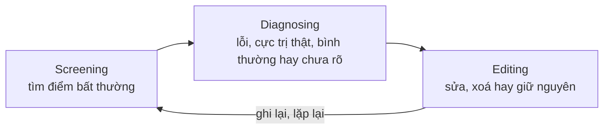
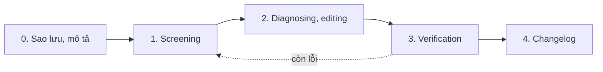
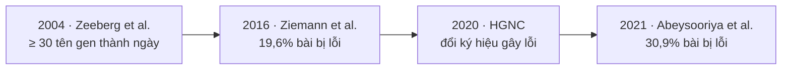

Dữ liệu khoa học có thể bẩn theo những cách khó nhận ra, và chính công cụ quen thuộc cũng gây lỗi: 30,9% số bài báo có danh sách gen dạng Excel trên PubMed Central giai đoạn 2014–2020 chứa tên gen bị đổi thành ngày tháng hoặc con số (Abeysooriya et al., 2021). Bài thứ tư của series *Phân tích dữ liệu dựa trên bằng chứng (Evidence-based Data Analytics)* viết lại Course 4 của khoá Google Data Analytics với nguồn học thuật: quy trình làm sạch có ghi chép bằng spreadsheet, SQL và Python; case study lỗi tên gen; và đính chính các hiểu lầm về “n ≥ 30”, khoảng tin cậy 95% và statistical power, kèm checklist, mẫu changelog và code để bạn tự chạy lại.

## 1. Mở đầu: dữ liệu bẩn là chuyện của khoa học, không chỉ của doanh nghiệp

Dán tên gen DEC1 vào Excel, ô đó hiện “1-DEC” vì Excel hiểu là ngày 1 tháng 12; mã RIKEN “2310009E13” thành số thực 2,31 × 10¹³. Zeeberg et al. (2004) gặp hai kiểu lỗi này khi xử lý dữ liệu microarray: ít nhất 30 tên gen bị đổi sang ngày, ít nhất 2.000 định danh bị đổi sang số thực nếu tính cả RIKEN ID. Cả hai **không đảo ngược được**, và đã lọt vào cả những cơ sở dữ liệu công khai được biên tập cẩn thận.

Course 4 (Google, n.d.) nhìn dữ liệu bẩn (dirty data) từ góc doanh nghiệp; các con số thiệt hại theo ngành trong ghi chú của tôi đã mất nguồn nên không dùng lại. Trong khoa học, cái giá là kết luận sai và kết quả không tái lập được. Luận điểm xuyên suốt bài lấy từ Van den Broeck et al. (2005): làm sạch dữ liệu (data cleaning) là phần thiết yếu của nghiên cứu và nên được đưa vào **thiết kế nghiên cứu**; bài báo nên mô tả cách làm sạch, loại và tỷ lệ lỗi, tỷ lệ sửa và xoá.

[Bài 03](/blog/prepare-data-for-exploration/) hỏi nguồn dữ liệu có đáng tin không; bài này hỏi tiếp: dữ liệu đã sạch chưa, và việc làm sạch có để lại dấu vết không. Mục 2–4 dành cho người làm phân tích, mục 5 cho người làm sinh học, mục 6 cho phần thống kê.

## 2. Khung khái niệm: data integrity, data quality và data constraint

### 2.1. Data integrity và data quality

Khoá học định nghĩa tính toàn vẹn dữ liệu (data integrity) là độ chính xác, đầy đủ, nhất quán và đáng tin của dữ liệu suốt vòng đời. Khảo sát người dùng dữ liệu, Wang và Strong (1996) đề xuất khung chất lượng dữ liệu (data quality) rộng hơn với bốn nhóm: **intrinsic** (dữ liệu tự nó có chất lượng), **contextual** (chất lượng xét trong bối cảnh nhiệm vụ), **representational** và **accessibility** (trình bày rõ, truy cập được). Nhóm contextual khớp với ý “alignment to business objectives” của khoá học: bảng biểu hiện gen đo chính xác nhưng trên mô không liên quan vẫn là dữ liệu kém **cho câu hỏi đó**.

### 2.2. Data constraint: bảng đã sửa

Ràng buộc dữ liệu (data constraint) quyết định một giá trị có hợp lệ không. Bảng 1 giữ chín constraint của khoá học, thêm ví dụ sinh học và cách kiểm tra.

**Bảng 1.** Data constraint, định nghĩa đã sửa và ví dụ sinh học

| Constraint | Giá trị phải… | Ví dụ sinh học | Kiểm tra nhanh |
| --- | --- | --- | --- |
| Data type | đúng kiểu | nồng độ glucose là số, không phải “5,6 mmol/L” | `ISNUMBER()`; `pd.to_numeric()` |
| Data range | nằm trong khoảng định trước | OD trong khoảng tuyến tính của máy đo | Data validation; `BETWEEN` |
| Mandatory | không trống | sample ID | `COUNTBLANK()`; `isna()` |
| Unique | không lặp | mã ống mẫu trong một lô | `COUNTIF()`; `HAVING COUNT(*) > 1` |
| Regular expression | khớp một mẫu chữ | mã GEO dạng GSE + chữ số | `REGEXMATCH()`; `str.fullmatch()` |
| Cross-field validation | thoả điều kiện giữa nhiều cột | tỷ lệ các loại tế bào cộng lại 100% | so tổng với 100 |
| Set-membership | thuộc một tập rời rạc | kiểu gen AA, Aa, aa | danh sách thả xuống; `isin()` |
| Primary key | duy nhất **cho mỗi dòng** | sample ID trong bảng thông tin mẫu | Unique cộng Mandatory |
| Foreign key | **khớp** khoá ở bảng khác, **không cần** duy nhất | sample ID trong bảng kết quả đo | `LEFT JOIN`, tìm dòng không khớp |

Hai dòng cuối sửa định nghĩa sai trong ghi chú của tôi: khoá chính (primary key) duy nhất cho mỗi dòng, không phải “theo cột”; khoá ngoại (foreign key) không cần duy nhất, vì mẫu đo mười lần thì sample ID lặp mười lần trong bảng kết quả (→ [SQL: Subquery & CASE WHEN](/blog/subquery-and-case-when/), [bài 05](/blog/analyze-data-to-answer-questions/)). Accuracy, completeness và consistency được tách khỏi bảng vì là chiều chất lượng, không phải luật kiểm tra bằng công thức.

### 2.3. Các loại dirty data và ba giai đoạn làm sạch

Khoá học chia dirty data thành năm loại: duplicate, outdated, incomplete, incorrect và inconsistent. Tôi thêm **misfielded** (nhập sai cột) và **system-introduced** (do phần mềm tự chuyển đổi, mục 5). Phân loại cho biết lỗi trông thế nào, chưa cho biết phải làm gì. Van den Broeck et al. (2005) mô tả làm sạch là các vòng lặp ba giai đoạn (Hình 1).



**Hình 1.** Ba giai đoạn làm sạch dữ liệu, vẽ lại theo Van den Broeck et al. (2005).

**Screening** tìm bốn loại bất thường: thiếu hoặc thừa dữ liệu; outlier và điểm không nhất quán; mẫu hình lạ trong phân phối; kết quả phân tích bất ngờ. *Erroneous inlier*, giá trị sai nhưng nằm trong khoảng hợp lệ, thường lọt qua và chỉ lộ ra khi đối chiếu với biến khác. **Diagnosing** xếp mỗi điểm đáng ngờ thành lỗi, cực trị có thật, bình thường hoặc chưa rõ, ví dụ bằng cách lần ngược dòng dữ liệu, nên phải lưu bản gốc và lý do mọi thay đổi. **Editing** chỉ có ba lựa chọn: sửa, xoá hoặc giữ nguyên; giá trị bất khả thi thì sửa nếu tìm được giá trị đúng, không thì xoá.

Ví dụ: trong bảng calcium huyết thanh của 100 người bình thường ở bài tập [thống kê sinh học](/blog/3-dac-trung-thong-ke-cua-mot-mau-va-uoc-luong-tham-so-cua-tong-the/) của tôi, một giá trị 6,0 mg/L nằm giữa các giá trị khoảng 80–130 và đẩy kurtosis lên 19,1. Cần chẩn đoán điểm này trước khi tính thống kê: tra sổ gốc, sửa nếu là lỗi gõ, không tra được thì loại, và ghi lại.

## 3. Tổ chức dữ liệu để ít phải làm sạch

### 3.1. Tidy data

Theo Wickham (2014), dữ liệu gọn (tidy data) tuân ba quy tắc: mỗi biến là một cột, mỗi quan sát là một dòng, mỗi loại đơn vị quan sát là một bảng. Ghi chú của tôi mô tả chuyển vị (transpose) là đổi từ long format “nhiều dòng hơn cột” sang wide format “nhiều cột hơn dòng”. Mô tả này chưa đúng: long hay wide là chuyện biến và quan sát nằm ở đâu, không phải tỷ lệ dòng và cột. Trong file thực hành “Cleaning with Spreadsheets” của khoá học, Sheet1 đặt mỗi đơn hàng thành một cột, còn Sheet2 tidy vì mỗi đơn hàng là một dòng. Ma trận đếm gen × mẫu trong RNA-seq là dạng wide; muốn vẽ theo nhóm mẫu thường phải chuyển sang long bằng `melt()` của pandas (→ [Python cho phân tích dữ liệu](/blog/introduction-to-data-analysis-using-python/)).

### 3.2. Spreadsheet đúng cách theo Broman và Woo

Broman và Woo (2018) đưa ra các nguyên tắc nhập liệu: nhất quán; ghi ngày YYYY-MM-DD; không để ô trống; mỗi ô một thứ; một hình chữ nhật với một dòng tiêu đề; có data dictionary; không đặt phép tính trong file gốc; không dùng màu làm dữ liệu; đặt tên tốt; sao lưu; dùng data validation; lưu plain text. Mục “common mistakes” của khoá học nói về quá trình làm sạch, còn danh sách này chặn lỗi ngay từ lúc nhập.

Quy tắc YYYY-MM-DD sửa đúng một lỗi trong file thực hành: cột Order Date hiển thị “1/6/19”, không rõ là 6 tháng 1 hay 1 tháng 6. Thực ra ô lưu **số ngày nội bộ** 43471, tức 2019-01-06; đổi định dạng hiển thị sang yyyy-mm-dd là hết mơ hồ. Con số năm chữ số này sẽ gặp lại ở mục 5.

### 3.3. Coi dữ liệu gốc là read-only

Buffalo (2015) khuyên coi mọi dữ liệu là chỉ đọc (read-only): không sửa ô Excel rồi lưu đè, mà để chương trình đọc bản gốc và ghi kết quả ra file mới. Wilson et al. (2017) xếp quản lý dữ liệu và theo dõi thay đổi vào bộ thực hành “good enough” cho nhà nghiên cứu. Ellis và Leek (2018) khuyên đưa raw data cho người phân tích, kèm thông tin thí nghiệm và mọi bước tiền xử lý. Muốn lần ngược dòng dữ liệu khi diagnosing thì bản gốc phải còn nguyên, như thư mục `data/raw/` chỉ đọc trong [Quy trình tái lập](/blog/quy-trinh-tai-lap-workflow-container-hpc-va-cloud/).

## 4. Quy trình làm sạch có ghi chép: một ví dụ chạy được

Mục này biến checklist và changelog của Module 4 thành năm bước (Hình 2). File thực hành thuộc tài liệu khoá học nên tôi không đăng lại; code dưới chạy trên bảng đồ chơi 7 dòng mô phỏng đúng các loại lỗi của file thật, còn kết quả trên file thật nằm ở Bảng 2.



**Hình 2.** Quy trình làm sạch có ghi chép.

### 4.1. Bước 0: sao lưu và mô tả dữ liệu

Giữ bản gốc chỉ đọc, làm trên bản sao, rồi mô tả theo “cleaning checklist” của khoá học: kích thước, số nhãn, dữ liệu thiếu, định dạng, kiểu dữ liệu. Sheet2 có 44 đơn hàng × 8 biến; Region có 4 chuỗi cho 3 vùng, Item 6 chuỗi cho 5 mặt hàng: dấu hiệu đầu tiên của dữ liệu không nhất quán.

### 4.2. Bước 1: screening theo constraint

Đoạn Python dưới đọc mọi cột dưới dạng text để phần mềm không tự đoán kiểu, rồi kiểm tra từng constraint:

```python
import io
import pandas as pd

raw_csv = """Number,Order Date,Region,Name,Item,Units,Unit Cost,Total
1,1/6/19,East,Jones,Pencil,40,1.99,79.60
2,1/23/19,CENTRAL,KIVELL,BINDER,12,19.99,239.88
3,2/9/19,Central,Gill,Pen,30,4.99,149.70
5,3/15/19,East   ,Parent,Binder,70,19.99,"1,399.30"
6,4/1/19,West,Sorvino,Pen    Set,20,15.99,319.80
8,4/20/19,Central,Smith,Desk,3,125,357
9,1/6/19,West,Howard,Pen Set,20,15.99,319.80
"""
raw = pd.read_csv(io.StringIO(raw_csv), dtype=str)   # mọi cột là text

# 1. Số thứ tự bị khuyết
num = raw["Number"].astype(int)
print("Số thứ tự khuyết:", sorted(set(range(num.min(), num.max() + 1)) - set(num)))

# 2. Khoảng trắng thừa, chữ hoa không thống nhất
def normalize(s):
    return s.str.strip().str.replace(r"\s+", " ", regex=True).str.title()

for col in ["Region", "Name", "Item"]:
    bad = raw[col] != normalize(raw[col])
    print(f"{col}: cần chuẩn hoá ở đơn", raw.loc[bad, "Number"].tolist())

# 3. Cross-field validation: Total = Units × Unit Cost
total = pd.to_numeric(raw["Total"].str.replace(",", "", regex=False))
expected = raw["Units"].astype(int) * raw["Unit Cost"].astype(float)
print("Total sai lệch ở đơn", raw.loc[(expected - total).abs() > 0.01, "Number"].tolist())

# 4. Trùng hoàn toàn và trùng một phần
print("Dòng trùng hoàn toàn:", raw.drop(columns="Number").duplicated().sum())
keyed = raw.assign(Item=normalize(raw["Item"]), Total=total)
suspects = keyed[keyed.duplicated(["Item", "Units", "Unit Cost", "Total"], keep=False)]
print(suspects[["Number", "Order Date", "Region", "Name", "Item", "Total"]].to_string(index=False))
```

```text
Số thứ tự khuyết: [4, 7]
Region: cần chuẩn hoá ở đơn ['2', '5']
Name: cần chuẩn hoá ở đơn ['2']
Item: cần chuẩn hoá ở đơn ['2', '6']
Total sai lệch ở đơn ['8']
Dòng trùng hoàn toàn: 0
Number Order Date Region    Name    Item  Total
     6     4/1/19   West Sorvino Pen Set  319.8
     9     1/6/19   West  Howard Pen Set  319.8
```

Remove duplicates của Google Sheets và `SELECT DISTINCT` chỉ bắt dòng giống nhau ở mọi cột, nên đơn 9 (khác đơn 6 ở Name và ngày) lọt qua: một erroneous inlier điển hình. Hai kiểm tra tương ứng trong SQL (SQLite, bảng `orders`; BigQuery dùng `STRING_AGG` thay `GROUP_CONCAT`):

```sql
-- Khoảng trắng thừa: LENGTH cho thấy ký tự mà mắt không thấy
SELECT number, region, LENGTH(region) AS len_region, item, LENGTH(item) AS len_item
FROM orders
WHERE region <> TRIM(region) OR item <> TRIM(item) OR item LIKE '%  %';

-- Nghi trùng một phần: cùng item đã chuẩn hoá, units, unit_cost, total
SELECT REPLACE(UPPER(item), ' ', '') AS item_key, units, unit_cost, total,
       COUNT(*) AS n, GROUP_CONCAT(number) AS orders
FROM orders
GROUP BY item_key, units, unit_cost, total
HAVING COUNT(*) > 1;
```

```text
number  region   len_region  item        len_item
------  -------  ----------  ----------  --------
5       East     7           Binder      6
6       West     4           Pen    Set  10

item_key  units  unit_cost  total   n  orders
--------  -----  ---------  ------  -  ------
PENSET    20     15.99      319.80  2  6,9
```

Trong Google Sheets (dữ liệu ở A1:H8), bốn cột phụ gõ ở dòng 2 rồi kéo xuống cho cùng kết quả:

```text
I2  =OR(LEN(C2)<>LEN(TRIM(C2)), LEN(E2)<>LEN(TRIM(E2)))        TRUE ở đơn 5, 6
J2  =UPPER(TRIM(E2))                                            khoá Item
K2  =ABS(F2*G2-H2)>0.01                                         TRUE ở đơn 8
L2  =COUNTIFS(J$2:J$8,J2,F$2:F$8,F2,G$2:G$8,G2,H$2:H$8,H2)>1   TRUE ở đơn 6, 9
```

Trên file thật, cả 44 dòng đều thoả Total = Units × Unit Cost, Total trong Sheets là số (nhưng có thể thành text nếu giá trị hiển thị như “1,619.19” theo file CSV sang pandas hay SQL), và có sáu cặp đơn nghi trùng.

### 4.3. Bước 2: diagnosing và editing

**Bảng 2.** Bất thường trong file thực hành và quyết định xử lý

| Bất thường | Đơn hàng | Quyết định | Lý do |
| --- | --- | --- | --- |
| Chữ hoa không thống nhất | Sheet1, đơn 2 | Sửa | giá trị đúng là rõ ràng |
| Khoảng trắng thừa | 13 (Region), 33 (Item) | Sửa bằng TRIM | không đổi nghĩa |
| Số thứ tự khuyết | 6, 8, 14, 17, 21 | Giữ, hỏi chủ dữ liệu | chưa rõ bị xoá hay bị mất |
| Nghi trùng một phần | 44–49 so với 29–34 | Gắn cờ, chưa xoá | cùng Item, Units, Unit Cost, Total; Name khác ở cả sáu cặp |
| Ngày dễ hiểu nhầm | cột Order Date | Hiển thị YYYY-MM-DD | giá trị bên dưới đã xác định |
| Định dạng số không thống nhất | Total của 6 đơn từ 1.000 | Bỏ dấu phẩy khi đổi kiểu | tránh thành text khi xuất CSV |

Nhóm 44–49 đứng sau đơn 43 (cuối 2020) nhưng ngày của đơn 44–48 trùng ngày đơn 1–5 (đầu 2019): nhiều dấu hiệu chỉ về lỗi sao chép, nhưng khi chưa chẩn đoán được thì gắn cờ và hỏi người tạo dữ liệu thay vì xoá (Van den Broeck et al., 2005). Phần editing, chạy tiếp sau code ở mục 4.2:

```python
clean = raw.copy()                                   # raw giữ nguyên
for col in ["Region", "Name", "Item"]:
    clean[col] = normalize(clean[col])
clean["Total"] = pd.to_numeric(clean["Total"].str.replace(",", "", regex=False))
clean["Units"] = clean["Units"].astype(int)
clean["Unit Cost"] = clean["Unit Cost"].astype(float)
# Giả định M/D/YY, ghi vào changelog
clean["Order Date"] = pd.to_datetime(clean["Order Date"], format="%m/%d/%y")

# Không xoá dòng nghi vấn, chỉ gắn cờ
clean["flag"] = ""
clean.loc[clean["Number"] == "8", "flag"] = "Total khác Units × Unit Cost"
clean.loc[clean["Number"] == "9", "flag"] = "nghi trùng đơn 6"
```

`str.title()`, như PROPER trong Sheets, biến “McDonald” thành “Mcdonald”, nên tên người hay tên gen phải chuẩn hoá theo danh sách nhãn chuẩn. Thao tác tương tự trong R: [Thao tác dữ liệu trong R](/blog/cac-thao-tac-voi-du-lieu-trong-r/).

### 4.4. Bước 3: verification

Verification checklist của Module 4 rà null, chính tả, khoảng trắng, trùng lặp, kiểu dữ liệu, ngày, tên cột và logic nghiệp vụ; tôi thêm **chuyển đổi tự động do phần mềm** (mục 5). Ngoài checklist, hãy so sánh trước và sau:

```python
for col in ["Region", "Name", "Item"]:
    print(f"{col}: {raw[col].nunique()} -> {clean[col].nunique()} nhãn")
print("Số dòng:", len(raw), "->", len(clean))
print("Tổng Total:", round(clean["Total"].sum(), 2))
```

```text
Region: 5 -> 3 nhãn
Name: 7 -> 7 nhãn
Item: 7 -> 5 nhãn
Số dòng: 7 -> 7
Tổng Total: 2865.08
```

Trên file thật, Region giảm từ 4 xuống 3 nhãn, Item từ 6 xuống 5, còn số dòng (44) và tổng Total (21.254,52) giữ nguyên vì không dòng nào bị xoá. Nếu tổng đổi mà changelog không giải thích được, chính bước làm sạch đã gây lỗi.

### 4.5. Bước 4: changelog

Version history ghi **cái gì** đã đổi, changelog ghi thêm **vì sao**. Nguyên tắc changelog của khoá học trùng với Keep a Changelog (Lacan, n.d.): viết cho người đọc; mỗi phiên bản một mục, mới nhất ở trên, có ngày; nhóm thay đổi thành Added, Changed, Deprecated, Removed, Fixed, Security; giữ mục Unreleased ở đầu. Mẫu cho file thực hành:

```markdown
## [Unreleased]
- Chờ chủ dữ liệu xác nhận đơn 44–49 và các số thứ tự khuyết.

## [1.0.0] - 2026-11-13
### Added
- Cột flag: đơn 44–49 nghi trùng đơn 29–34.
### Fixed
- Region, Item: bỏ khoảng trắng thừa (đơn 13, 33), chuẩn hoá chữ hoa.
- Total: bỏ dấu phẩy hàng nghìn, đổi sang kiểu số.
### Removed
- Không có: vẫn 44 dòng, tổng Total 21.254,52.
```

Wilson et al. (2017) gợi ý hai cách theo dõi thay đổi: file CHANGELOG.txt ghi chú có ngày, mới nhất ở trên, hoặc version control như Git. Theo tôi (không phải theo Wilson et al.), dùng Git rồi vẫn cần changelog dữ liệu: commit cho biết code nào đổi, changelog cho biết vì sao đơn 44–49 được giữ lại. Bảng các bước làm sạch trong [case study Cyclistic](/projects/cyclistic-bike-share/phan-tich-chi-tiet-casual-riders-va-annual-members-dung-xe-cyclistic-khac-nhau-t/) là một changelog rút gọn như vậy.

## 5. Case study: khi Excel âm thầm đổi tên gen

Lỗi system-introduced có thật, đo được, và tồn tại trong tài liệu khoa học gần hai thập kỷ (Hình 3).



**Hình 3.** Dòng thời gian lỗi tên gen. Nguồn: Zeeberg et al. (2004); Ziemann et al. (2016); Bruford et al. (2020); Abeysooriya et al. (2021).

### 5.1. Từ phát hiện (2004) đến đo lường (2016)

Sau Zeeberg et al. (2004), Ziemann et al. (2016) quét 35.175 file Excel supplementary của 18 tạp chí giai đoạn 2005–2015, tìm thấy 7.467 danh sách gen thuộc 3.597 bài báo. Lỗi được xác nhận ở 987 file của 704 bài, tức **19,6%** số bài có danh sách gen dạng Excel, ví dụ SEPT2 thành “2-Sep”. Trên GEO, 228 trong 574 file Excel có danh sách gen (39,7%) bị lỗi. Tỷ lệ danh sách gen bị lỗi tương quan dương với impact factor năm 2015 của tạp chí (Spearman rho = 0,52; p hai phía = 0,03), có thể vì các tạp chí này đi kèm bộ dữ liệu lớn hơn và nhiều hơn.

### 5.2. “Lessons not learned” (2021)

Abeysooriya et al. (2021) quét file supplementary trên PubMed Central giai đoạn 2014–2020 bằng phần mềm cải tiến: **30,9%** (3.436/11.117) số bài có danh sách gen dạng Excel bị lỗi, và lỗi vẫn tích luỹ sau năm 2016. Tỷ lệ cao hơn trước một phần vì có thêm dạng lỗi tên gen thành **số ngày nội bộ** năm chữ số, đúng loại số ở cột Order Date (mục 3.2).

Nhóm cũng thử Microsoft Excel 365, Google Sheets (bản năm 2021), LibreOffice 6.4.6.2 và Gnumeric 1.12.46. Excel và **Google Sheets** đổi tên gen thành ngày ở cả ba cách nhập (mở file text, dán, gõ trực tiếp); LibreOffice và Gnumeric thì không; định dạng ô đích là plain text trước khi dán hoặc gõ thì tránh được. Điều này quan trọng vì khoá Google Data Analytics dạy làm sạch chủ yếu bằng Google Sheets. Hành vi phần mềm có thể đã đổi sau năm 2021, nên hãy tự thử lại.

### 5.3. Phản ứng của cộng đồng

Theo Abeysooriya et al. (2021), HGNC đã đổi các ký hiệu dễ bị chuyển đổi, ví dụ SEPT1 thành SEPTIN1 và MARCH1 thành MARCHF1. Hướng dẫn đặt tên gen người năm 2020 cho biết HGNC có thể cập nhật ký hiệu dùng rộng rãi nhưng gây vấn đề đáng kể, và khuyên trích HGNC ID (dạng HGNC:số), vốn gần như không đổi khi ký hiệu đổi (Bruford et al., 2020). Với bảng DEG, hãy luôn giữ một cột ID ổn định như HGNC ID hay Ensembl ID cạnh cột ký hiệu gen.

Trang hỗ trợ của Microsoft hướng dẫn định dạng ô là Text trước khi nhập, hoặc gõ dấu nháy đơn (hay dấu cách) ở đầu, và viết thẳng: “there is no way to turn this off” (Microsoft, n.d.). Từ năm 2022, Excel có tuỳ chọn Automatic Data Conversion để tắt việc bỏ số 0 ở đầu, cắt số dài quá 15 chữ số và đổi chuỗi số quanh chữ “E” thành ký hiệu khoa học (đúng lỗi mã RIKEN), nhưng bài giới thiệu ghi rằng kiểm soát chuyển đổi sang **ngày** vẫn đang lên kế hoạch (Fifadra, 2022). Chưa thấy tài liệu chính thức nào xác nhận đã tắt được chuyển đổi ngày, nên an toàn nhất vẫn là định dạng cột tên gen là Text, hoặc giữ dữ liệu genomics ở định dạng text chuẩn ([Định dạng dữ liệu sinh học](/blog/dinh-dang-du-lieu-va-co-so-du-lieu-sinh-hoc/)).

### 5.4. Tự kiểm tra: quét một file DEG

Bảng gen biểu hiện khác biệt (DEG) hay được xuất ra Excel ở cuối pipeline RNA-seq ([Transcriptomics](/blog/transcriptomics-rna-seq-va-single-cell/)). Hãy đọc file ở dạng text rồi tìm trong cột ký hiệu gen các giá trị trông như ngày hoặc số. Với `pd.read_excel(path, dtype=str)`, ô đã thành ngày trả về “2021-09-02 00:00:00”, ô số ngày nội bộ “44075”, ô 2,31 × 10¹³ “23100000000000”; mẫu tìm kiếm phải bắt cả các dạng này:

```python
import pandas as pd

SUSPECT = (r"^\d{1,2}-[a-z]{3}$"                  # "2-Sep", "1-DEC" trong file text/CSV
           r"|^\d{4}-\d{2}-\d{2}( 00:00:00)?$"    # ô đã thành ngày, đọc từ .xlsx
           r"|^\d+(\.\d+)?e\+\d+$"                # "2.31E+13"
           r"|^\d{5,}$")                          # số ngày nội bộ (44075) hoặc số dài

def scan(genes):
    genes = pd.Series(genes).dropna().astype(str).str.strip()
    return genes[genes.str.match(SUSPECT, case=False)].tolist()

cells = ["TP53", "2021-09-02 00:00:00", "MARCHF1", "44075",
         "23100000000000", "2-Sep", "1-DEC", "2.31E+13", "BRCA1"]
print(scan(cells))
```

```text
['2021-09-02 00:00:00', '44075', '23100000000000', '2-Sep', '1-DEC', '2.31E+13']
```

Chỉ dùng mẫu này cho cột ký hiệu gen, vì Entrez Gene ID vốn là số. Nếu quét vài file trên GEO, hãy báo cáo số file đã kiểm tra, số file lỗi và các gen bị ảnh hưởng; mẫu nhỏ không so sánh được với các tỷ lệ trên.

## 6. Đính chính thống kê: cỡ mẫu, khoảng tin cậy và power

Phần cỡ mẫu và kiểm định trong ghi chú Module 1 của tôi có vài định nghĩa sai hoặc giản lược quá mức (Bảng 3).

**Bảng 3.** Các ngộ nhận thống kê trong ghi chú Course 4

| Ghi chú nói | Nói đúng là | Nguồn |
| --- | --- | --- |
| Không dùng cỡ mẫu dưới 30; từ 30 thì CLT đúng | CLT là kết quả tiệm cận; cỡ mẫu tuỳ phân phối và mục tiêu | Hesterberg (2015); Lakens (2022) |
| 95%: chạy lại 100 lần thì 95 lần cho kết quả tương tự | 95% là tần suất các khoảng tạo bởi cùng phương pháp chứa giá trị thật | Greenland et al. (2016) |
| Significant nghĩa là thật, không do ngẫu nhiên | P value không phải xác suất giả thuyết đúng | Greenland et al. (2016) |
| Cần power ≥ 0,8 để kết quả significant | Power là xác suất trước nghiên cứu, dùng khi lên kế hoạch | Greenland et al. (2016); Hoenig và Heisey (2001) |

### 6.1. Ngộ nhận “n ≥ 30”

Ghi chú viết rằng mốc 30 đã được “chứng minh thống kê”. Thực ra định lý giới hạn trung tâm (central limit theorem, CLT) là kết quả **tiệm cận**: trung bình mẫu tiến dần về phân phối chuẩn khi n tăng, với tốc độ tuỳ hình dạng phân phối gốc, nên không có ngưỡng nào để CLT “bắt đầu đúng”.

Theo bản preprint của Hesterberg (2015), với phân phối exponential (skewness bằng 2), xấp xỉ tiệm cận cần n > 4.578 để t-interval 95% sai không quá 10% ở mỗi phía (tỷ lệ hụt mỗi phía trong 2,25–2,75%); mô phỏng của ông cho 4.815, khoảng 5.000, và ông nhận xét “n ≥ 30” không hề gần con số này. Lakens (2022) liệt kê sáu cách biện minh cỡ mẫu, trong đó có a-priori power analysis và độ chính xác mong muốn; “n ≥ 30” thuộc nhóm heuristic. Câu “người làm regression cũng ưa tối thiểu 30” không có nguồn nên tôi bỏ.

Mô phỏng dưới lấy 10.000 mẫu cho mỗi cỡ n từ ba phân phối, rồi đếm tỷ lệ t-interval 95% nằm hẳn dưới hoặc hẳn trên trung bình thật μ:

```python
import numpy as np
from scipy import stats

rng = np.random.default_rng(2026)
reps = 10_000
dists = {   # tên: (hàm sinh mẫu, trung bình thật μ)
    "normal":      (lambda size: rng.normal(0, 1, size),    0.0),
    "exponential": (lambda size: rng.exponential(1, size),  1.0),
    "log-normal":  (lambda size: rng.lognormal(0, 1, size), np.exp(0.5)),
}
print(f"{'phân phối':<12}{'n':>6}{'phủ μ':>8}{'hụt dưới':>10}{'hụt trên':>10}")
for name, (draw, mu) in dists.items():
    for n in (10, 30, 100, 1000):
        x = draw((reps, n))
        mean, se = x.mean(axis=1), x.std(axis=1, ddof=1) / np.sqrt(n)
        half = stats.t.ppf(0.975, df=n - 1) * se
        below = (mean + half < mu).mean()   # cả khoảng nằm dưới μ
        above = (mean - half > mu).mean()   # cả khoảng nằm trên μ
        print(f"{name:<12}{n:>6}{1 - below - above:>8.1%}{below:>10.1%}{above:>10.1%}")
```

```text
phân phối        n   phủ μ  hụt dưới  hụt trên
normal          10   95.0%      2.5%      2.6%
normal          30   94.8%      2.5%      2.7%
normal         100   95.3%      2.4%      2.3%
normal        1000   94.9%      2.5%      2.6%
exponential     10   90.1%      9.6%      0.4%
exponential     30   92.9%      6.4%      0.7%
exponential    100   94.0%      4.6%      1.4%
exponential   1000   94.7%      3.0%      2.3%
log-normal      10   83.8%     16.2%      0.1%
log-normal      30   88.5%     11.3%      0.2%
log-normal     100   91.6%      7.9%      0.4%
log-normal    1000   94.2%      4.3%      1.5%
```


**Hình 5.** Tỷ lệ t-interval 95% nằm hẳn về một phía của μ (kết quả của code trên).

Với normal, mỗi phía hụt khoảng 2,5% ở mọi n. Với exponential ở n = 30, độ phủ tổng 92,9% trông ổn nhưng lỗi lệch hẳn một phía: 6,4% số khoảng nằm dưới μ, chỉ 0,7% nằm trên; log-normal hụt tới 11,3%. Ở n = 1.000, exponential vẫn hụt 3,0% phía dưới, ngoài dải 2,25–2,75%. Nồng độ, số đếm hay thời gian sống thường lệch phải, nên đây không chỉ là lý thuyết.

### 6.2. Confidence level và confidence interval

Theo Greenland et al. (2016), mức tin cậy 95% là tần suất mà **các khoảng tạo bởi cùng một phương pháp** chứa giá trị thật khi mọi giả định đều đúng, tức tính chất của phương pháp chứ không của một khoảng cụ thể. Vì vậy, một khoảng tin cậy (confidence interval, CI) 95% cụ thể không có 95% cơ hội chứa giá trị thật (ngộ nhận số 19), không dự đoán 95% ước lượng của các nghiên cứu sau (số 22), và hai CI chồng nhau không có nghĩa là khác biệt không significant (số 21). Hiểu sai CI rất phổ biến: Hoekstra et al. (2014) đưa sáu phát biểu sai về CI cho 120 nhà nghiên cứu và 442 sinh viên tâm lý học, và trung bình mỗi người vẫn đồng ý với hơn ba.


**Hình 4.** 100 khoảng tin cậy 95%, mỗi khoảng từ một mẫu n = 30 của phân phối normal (một lần chạy; trung bình qua 200 lần chạy là 4,8 khoảng không chứa μ).

Ghi chú còn viết “99% là lý tưởng”, nhưng với cùng dữ liệu, mức tin cậy càng cao thì khoảng càng rộng; đây là lựa chọn đánh đổi tuỳ hậu quả của việc sai.

### 6.3. Statistical significance và statistical power

Về ý nghĩa thống kê (statistical significance), Greenland et al. (2016) chỉ ra rằng P value không phải xác suất để giả thuyết kiểm định đúng (ngộ nhận số 1), và significant không có nghĩa là quan trọng về khoa học, vì ở nghiên cứu lớn hiệu ứng rất nhỏ cũng significant được (số 7). Ngược lại, P > 0,05 không có nghĩa là giả thuyết kiểm định đúng (số 4) hay không có hiệu ứng (số 6). Định nghĩa P value: [Toán và thống kê cho sinh học](/blog/toan-va-thong-ke-cho-sinh-hoc/), [Kiểm định giả thiết thống kê](/blog/kiem-dinh-gia-thiet-thong-ke-trong-nghien-cuu-sinh-hoc/).

Power (năng lực của kiểm định) là xác suất **trước nghiên cứu** để test bác bỏ giả thuyết kiểm định khi một giả thuyết thay thế cụ thể là đúng (Greenland et al., 2016). Mức 0,8 là mục tiêu khi **lên kế hoạch** cỡ mẫu, không phải điều kiện để gọi kết quả là significant. Dùng power để diễn giải kết quả không significant cũng sai (ngộ nhận số 24, 25); Hoenig và Heisey (2001) gọi cách làm này là “fundamentally flawed”. Dù vậy power thấp vẫn nguy hiểm: theo Button et al. (2013), nó làm giảm khả năng phát hiện hiệu ứng thật, giảm khả năng một kết quả significant là thật, và phóng đại cỡ hiệu ứng ước lượng.

### 6.4. Các định nghĩa nhỏ khác

“Sample size: a part of a population that is representative” là định nghĩa của **mẫu** (sample); cỡ mẫu là **số đơn vị** trong mẫu. “Sample bias” nên viết là sampling bias ([bài 03](/blog/prepare-data-for-exploration/)). Random sampling nên đổi thành simple random sampling: mọi tập con cỡ n có cùng xác suất được chọn. Margin of error chỉ phản ánh sai số ngẫu nhiên do lấy mẫu, không phản ánh sampling bias hay lỗi đo. Tăng cỡ mẫu làm tăng power và độ chính xác; “significance” không phải mục tiêu để tối ưu.

### 6.5. Kiểm tra lại máy tính cỡ mẫu của khoá học

Trong bảng tính Margin of Error Calculator tôi lưu khi học, sheet Sample Size Calculator nhập quần thể 80.000.000, mức tin cậy 99%, margin of error 5% và hiển thị cỡ mẫu **100**. Tính lại với p = 0,5, $n_0 = z^2 p(1-p)/e^2$, kèm hiệu chỉnh quần thể hữu hạn như bảng tính:

```python
import math
from scipy.stats import norm

N, conf, moe, p = 80_000_000, 0.99, 0.05, 0.5

def sample_size(z):
    n0 = z**2 * p * (1 - p) / moe**2
    return math.ceil(n0 / (1 + n0 / N))     # cùng dạng hiệu chỉnh với bảng tính

z = norm.ppf(1 - (1 - conf) / 2)
print(f"z = {z:.4f}; n = {sample_size(z)}")
print("Nếu tra nhầm cột xác suất 0,995:", sample_size(0.995))
```

```text
z = 2.5758; n = 664
Nếu tra nhầm cột xác suất 0,995: 100
```

Kết quả đúng là **664**. Công thức ô kết quả cho thấy nguyên nhân: `VLOOKUP(D5,'ZScore Lookup'!A51:C102,2,FALSE)` lấy **cột 2** của bảng tra (xác suất tích luỹ 0,995) thay vì **cột 3** (z = 2,58). Bản trống của cùng công cụ tra đúng cột 3, nên lỗi chỉ có ở bản tôi lưu, chưa rõ có sẵn hay phát sinh khi chỉnh sửa. Bảng ZScore Lookup cũng có vẻ gõ tay: so với z tính lại và làm tròn 2 chữ số, 18 trên 102 dòng lệch, rõ nhất ở mức 20% (0,26 so với 0,253), 29% (0,36 so với 0,372) và 30% (0,37 so với 0,385); các mức 95% và 99% thì đúng.

## 7. Checklist tổng hợp và bàn luận

**Trước khi nhập dữ liệu**
- Tidy data (Wickham, 2014); một bảng hình chữ nhật, data dictionary, data validation, ngày YYYY-MM-DD, lưu plain text (Broman & Woo, 2018).
- Cột tên gen định dạng Text trước khi dán hoặc gõ, kèm cột ID ổn định (Abeysooriya et al., 2021; Bruford et al., 2020).

**Khi làm sạch**
- Bản gốc read-only, mọi thay đổi đi qua script (Buffalo, 2015; Wilson et al., 2017).
- Screening theo constraint, kể cả trùng lặp một phần và chuyển đổi tự động sang ngày hay số.
- Chẩn đoán trước khi sửa; chưa rõ thì gắn cờ, không xoá (Van den Broeck et al., 2005).

**Sau khi làm sạch**
- Verification checklist; so sánh số dòng, số nhãn và các tổng trước và sau.
- Changelog có lý do (Lacan, n.d.); báo cáo loại lỗi và số dòng bị sửa hoặc xoá (Van den Broeck et al., 2005).

Bài có ba giới hạn: file thực hành là dữ liệu bán hàng; phần quét GEO mới là đề xuất; mô phỏng chỉ để minh hoạ, không thay cho power analysis thật.

Hai nội dung khác của khoá học nên đọc thận trọng. Nhánh dùng proxy data trong sơ đồ “Data errors / Not enough data” cần cảnh báo rằng dữ liệu thay thế có thể mang bias riêng ([bài 02](/blog/ask-questions-to-make-data-driven-decisions/)). Bảng “What can be automated” khẳng định mô hình hoá tự động hoá được hoàn toàn mà không dẫn nguồn; khi ngay bước diagnosing đã cần hiểu biết chuyên môn (Van den Broeck et al., 2005), tôi cho rằng khẳng định này quá mạnh.

## 8. Kết luận

Làm sạch dữ liệu là một phần của thiết kế nghiên cứu, không phải bước dọn dẹp cuối cùng. Ít lỗi nhất là khi dữ liệu được tổ chức đúng từ đầu, bản gốc được giữ nguyên, và mọi thay đổi đi qua script kèm changelog. Trường hợp tên gen cho thấy công cụ quen thuộc có thể âm thầm làm hỏng dữ liệu của hàng nghìn bài báo, và một bài cảnh báo chưa đủ để đổi thói quen. Các quy tắc dùng nhanh như “n ≥ 30” cần nhường chỗ cho lập luận theo mục tiêu. Bước tiếp theo là gộp bảng: [bài 05](/blog/analyze-data-to-answer-questions/) bàn về VLOOKUP và JOIN, nơi một chỉ số cột sai như ở mục 6.5 có thể tạo lỗi mới.

## Tài liệu tham khảo

Abeysooriya, M., Soria, M., Kasu, M. S., & Ziemann, M. (2021). Gene name errors: Lessons not learned. *PLOS Computational Biology, 17*(7), e1008984. https://doi.org/10.1371/journal.pcbi.1008984

Broman, K. W., & Woo, K. H. (2018). Data organization in spreadsheets. *The American Statistician, 72*(1), 2–10. https://doi.org/10.1080/00031305.2017.1375989

Bruford, E. A., Braschi, B., Denny, P., Jones, T. E. M., Seal, R. L., & Tweedie, S. (2020). Guidelines for human gene nomenclature. *Nature Genetics, 52*(8), 754–758. https://doi.org/10.1038/s41588-020-0669-3

Buffalo, V. (2015). *Bioinformatics data skills: Reproducible and robust research with open source tools*. O'Reilly Media.

Button, K. S., Ioannidis, J. P. A., Mokrysz, C., Nosek, B. A., Flint, J., Robinson, E. S. J., & Munafò, M. R. (2013). Power failure: Why small sample size undermines the reliability of neuroscience. *Nature Reviews Neuroscience, 14*(5), 365–376. https://doi.org/10.1038/nrn3475

Ellis, S. E., & Leek, J. T. (2018). How to share data for collaboration. *The American Statistician, 72*(1), 53–57. https://doi.org/10.1080/00031305.2017.1375987

Fifadra, C. (2022, July 5). *Control data conversions in Excel*. Microsoft 365 Insider Blog. https://techcommunity.microsoft.com/blog/microsoft365insiderblog/control-data-conversions-in-excel/4215348

Google. (n.d.). *Process data from dirty to clean* [MOOC]. Coursera. https://www.coursera.org/learn/process-data

Greenland, S., Senn, S. J., Rothman, K. J., Carlin, J. B., Poole, C., Goodman, S. N., & Altman, D. G. (2016). Statistical tests, P values, confidence intervals, and power: A guide to misinterpretations. *European Journal of Epidemiology, 31*(4), 337–350. https://doi.org/10.1007/s10654-016-0149-3

Hesterberg, T. C. (2015). What teachers should know about the bootstrap: Resampling in the undergraduate statistics curriculum. *The American Statistician, 69*(4), 371–386. https://doi.org/10.1080/00031305.2015.1089789 (preprint: https://arxiv.org/abs/1411.5279)

Hoekstra, R., Morey, R. D., Rouder, J. N., & Wagenmakers, E.-J. (2014). Robust misinterpretation of confidence intervals. *Psychonomic Bulletin & Review, 21*(5), 1157–1164. https://doi.org/10.3758/s13423-013-0572-3

Hoenig, J. M., & Heisey, D. M. (2001). The abuse of power: The pervasive fallacy of power calculations for data analysis. *The American Statistician, 55*(1), 19–24. https://doi.org/10.1198/000313001300339897

Lacan, O. (n.d.). *Keep a Changelog* (Version 1.1.0). https://keepachangelog.com/en/1.1.0/

Lakens, D. (2022). Sample size justification. *Collabra: Psychology, 8*(1), 33267. https://doi.org/10.1525/collabra.33267

Microsoft. (n.d.). *Stop automatically changing numbers to dates*. Microsoft Support. https://support.microsoft.com/en-us/office/stop-automatically-changing-numbers-to-dates-452bd2db-cc96-47d1-81e4-72cec11c4ed8

Van den Broeck, J., Argeseanu Cunningham, S., Eeckels, R., & Herbst, K. (2005). Data cleaning: Detecting, diagnosing, and editing data abnormalities. *PLoS Medicine, 2*(10), e267. https://doi.org/10.1371/journal.pmed.0020267

Wang, R. Y., & Strong, D. M. (1996). Beyond accuracy: What data quality means to data consumers. *Journal of Management Information Systems, 12*(4), 5–33. https://doi.org/10.1080/07421222.1996.11518099

Wickham, H. (2014). Tidy data. *Journal of Statistical Software, 59*(10). https://doi.org/10.18637/jss.v059.i10

Wilson, G., Bryan, J., Cranston, K., Kitzes, J., Nederbragt, L., & Teal, T. K. (2017). Good enough practices in scientific computing. *PLOS Computational Biology, 13*(6), e1005510. https://doi.org/10.1371/journal.pcbi.1005510

Zeeberg, B. R., Riss, J., Kane, D. W., Bussey, K. J., Uchio, E., Linehan, W. M., Barrett, J. C., & Weinstein, J. N. (2004). Mistaken identifiers: Gene name errors can be introduced inadvertently when using Excel in bioinformatics. *BMC Bioinformatics, 5*, 80. https://doi.org/10.1186/1471-2105-5-80

Ziemann, M., Eren, Y., & El-Osta, A. (2016). Gene name errors are widespread in the scientific literature. *Genome Biology, 17*, 177. https://doi.org/10.1186/s13059-016-1044-7
