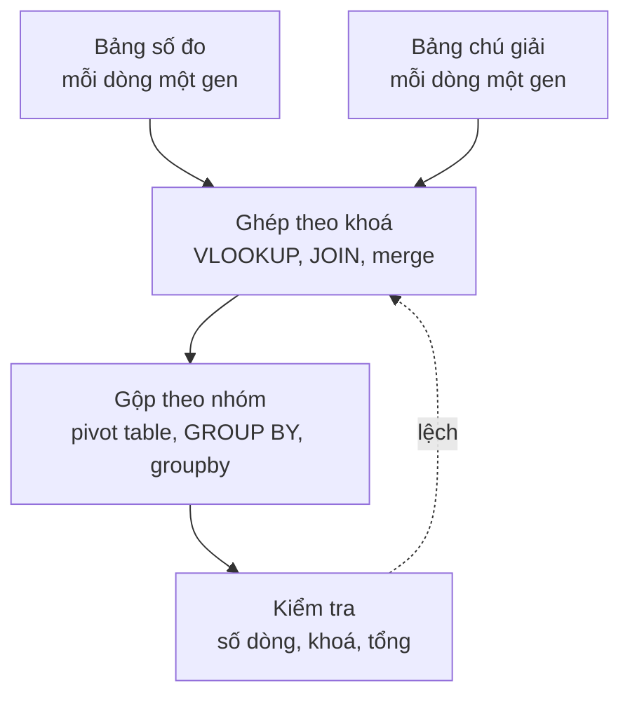

VLOOKUP không báo lỗi khi trả về sai, và một phép JOIN cũng vậy. Bài thứ năm của series *Phân tích dữ liệu dựa trên bằng chứng (Evidence-based Data Analytics)* làm cùng một phép ghép bảng và tổng hợp trên spreadsheet, SQL và pandas, với dữ liệu gen công khai của HGNC và GTEx, để chỉ ra vì sao ba công cụ có thể cho ba đáp số: khoá trùng, khoá không khớp, NULL và tra cứu gần đúng. Rủi ro này có thật trong tài liệu khoa học: 30,9% số bài báo có danh sách gen dạng Excel trên PubMed Central giai đoạn 2014–2020 chứa tên gen đã bị đổi thành ngày tháng hoặc con số (Abeysooriya et al., 2021), tức khoá hỏng từ trước khi ghép. Cuối bài có checklist đối soát và bảng tra nhanh giữa các công cụ.

## 1. Mở đầu: phân tích là ghép và gộp

Tài liệu nhập môn về phân tích dữ liệu thường chia pha phân tích (analyze) thành bốn việc: tổ chức dữ liệu (organize), định dạng và điều chỉnh (format and adjust), lấy ý kiến người khác (get input) và biến đổi dữ liệu (transform). Bài này tập trung vào việc đầu và việc cuối. Trong sinh học, phần lớn phân tích bắt đầu bằng việc ghép bảng: kết quả đo với thông tin mẫu, danh sách gen với bảng chú giải.

Tổng hợp dữ liệu (data aggregation), tức gom dữ liệu từ nhiều nguồn thành một tập tóm tắt, thật ra gồm hai thao tác khác nhau. **Ghép** (VLOOKUP, JOIN, `merge`) thêm cột từ bảng khác dựa trên một khoá chung. **Gộp** (pivot table, SUMIF, GROUP BY) thu nhiều dòng thành một dòng tóm tắt bằng các [hàm tổng hợp](/blog/ham-tong-hop-aggregate/) như SUM, AVERAGE, COUNT. Lỗi ở bước ghép lan sang bước gộp, và bước gộp che mất nó: một con số trung bình không cho biết nó được tính từ bao nhiêu dòng, dòng nào bị lặp, dòng nào đã rơi mất. Một giá trị sai cũng bị che như vậy: nếu năm mẫu DNA có nồng độ 62, 71, 58, 66 và 64 ng/µL mà ô cuối bị gõ thành 640, trung bình thành 179,4 thay vì 64,2 và không công thức nào báo lỗi.

Câu hỏi trọng tâm của bài: vì sao spreadsheet, SQL và pandas có thể cho kết quả khác nhau khi ghép và gộp cùng một dữ liệu, và kiểm tra điều đó bằng cách nào? Luận điểm xuyên suốt: phần lớn lỗi tổng hợp là **lỗi về khoá**, không phải lỗi công thức. Phần 1 trình bày nền tảng quan hệ của phép ghép, Phần 2 làm cùng một phép tổng hợp trên ba công cụ, Phần 3 xem bằng chứng về rủi ro, và mục 5 gom lại thành checklist cho bước kiểm tra ở Hình 1.



**Hình 1.** Ghép, gộp, rồi kiểm tra: lỗi ở bước ghép chỉ lộ ra khi có bước đối soát.

## 2. Phần 1: Nền tảng quan hệ của JOIN

### 2.1. Mô hình quan hệ của Codd

Codd (1970) đề xuất mô hình dữ liệu dựa trên quan hệ n-ngôi (n-ary relation) để người dùng không phải biết dữ liệu được tổ chức thế nào trong máy. Cũng trong bài này, ông bàn về dạng chuẩn và các phép toán trên quan hệ, trong đó có phép chiếu (projection), phép nối (join) và phép giới hạn (restriction), để xử lý dư thừa và nhất quán. Một bảng theo nghĩa này là một **quan hệ** (relation): mỗi dòng là một bản ghi, mỗi cột là một thuộc tính. Với người dùng spreadsheet, mô hình này có ba hệ quả.

Thứ nhất, đây chính là nguyên tắc tidy data của Wickham (2014): mỗi biến một cột, mỗi quan sát một dòng, mỗi loại đơn vị quan sát một bảng ([bài 04](/blog/process-data-from-dirty-to-clean/)). Thứ hai, trong một quan hệ, thứ tự dòng không mang nghĩa và mọi dòng đều phân biệt (Codd, 1970). VLOOKUP thì trả về dòng khớp **đầu tiên** (Google, n.d.), tức kết quả phụ thuộc thứ tự dòng: sắp xếp lại bảng tra có thể làm đổi đáp số. Thứ ba, phép toán trên quan hệ cho ra một quan hệ mới, nên các phép toán lồng vào nhau được. Đây là cơ sở của truy vấn con (subquery) và mệnh đề WITH ở mục 3.3.

SQL ra đời từ mô hình này. Theo Chamberlin (2012), sau khi gặp Codd năm 1972, ông và Raymond Boyce tin rằng có thể thiết kế một ngôn ngữ quan hệ cho người không được đào tạo về toán hay lập trình; ngôn ngữ Sequel của họ tại IBM về sau phát triển thành chuẩn quốc tế SQL.

### 2.2. Khoá: primary key, foreign key và cardinality

Codd (1970) định nghĩa khoá chính (primary key) là thuộc tính, hoặc tổ hợp thuộc tính, có giá trị xác định duy nhất mỗi bản ghi của quan hệ. Khoá ngoại (foreign key) là thuộc tính của quan hệ R, không phải khoá chính của R, nhưng các giá trị của nó là giá trị khoá chính của một quan hệ S nào đó. Nói cách khác, khoá ngoại nằm ở bảng **tham chiếu** và được phép lặp lại: một mẫu đo mười lần thì mã mẫu lặp mười lần trong bảng kết quả, nhưng chỉ có một dòng trong bảng thông tin mẫu.

Hai khái niệm này quyết định **cardinality** của phép ghép: 1–1, nhiều–1 hay nhiều–nhiều. Ghép nhiều–1 (nhiều dòng đo với một dòng chú giải) là trường hợp an toàn: mỗi dòng bên "nhiều" gặp tối đa một dòng bên "một", nên số dòng không đổi. Khi khoá ở phía "một" bị trùng, phép ghép âm thầm thành nhiều–nhiều và mỗi dòng nhân lên theo số dòng khớp ở bảng kia. Hiện tượng này gọi là **fan-out**; nó thổi phồng mọi SUM, COUNT tính sau đó.

Bài dùng hai bảng dữ liệu sinh học công khai. Bảng chú giải của HGNC gán cho mỗi gen người một symbol được phê duyệt và một HGNC ID duy nhất (Bruford et al., 2020); cơ sở dữ liệu này có hơn 43.000 symbol được phê duyệt vào thời điểm bài tổng quan năm 2023 (Seal et al., 2023). Bảng biểu hiện đến từ GTEx v8, bộ dữ liệu gồm 15.201 mẫu RNA-seq từ 49 mô của 838 người hiến (GTEx Consortium, 2020); file tóm tắt công khai ghi median TPM (transcripts per million) của từng gen ở từng mô. Khoá chung của hai bảng là **Ensembl gene ID** (về định danh gen: [Định dạng dữ liệu và cơ sở dữ liệu sinh học](/blog/dinh-dang-du-lieu-va-co-so-du-lieu-sinh-hoc/); về bảng biểu hiện: Transcriptomics).

### 2.3. Bốn loại JOIN và VLOOKUP trên cùng một bảng

Để thấy từng phép ghép làm gì, hãy bắt đầu bằng một bảng trích nhỏ: sáu dòng của file GTEx (cột Liver) và bảy dòng của file HGNC. Mọi giá trị đều có thật trong hai file; các dòng được chọn có chủ ý để lộ ra những bẫy thường gặp. Đoạn SQL dưới chạy trong DuckDB:

```sql
-- Bảng B: sáu dòng trích từ file median TPM của GTEx v8 (cột Liver)
CREATE TABLE expr (name VARCHAR, description VARCHAR, liver DOUBLE);
INSERT INTO expr VALUES
  ('ENSG00000163631.16', 'ALB',           25201.3),
  ('ENSG00000168385.17', 'SEPT2',         29.4708),
  ('ENSG00000002586.18', 'CD99',          55.6289),
  ('ENSG00000250413.1',  'RP11-448G15.1', 0.131268),
  ('ENSG00000112096.16', 'SOD2',          85.3207),
  ('ENSG00000251562.7',  'MALAT1',        41.9456);

-- Bảng A: bảy dòng trích từ bộ chú giải HGNC (bản lưu trữ 2026-10-06)
CREATE TABLE annot (hgnc_id VARCHAR, symbol VARCHAR, locus_group VARCHAR, ensembl_gene_id VARCHAR);
INSERT INTO annot VALUES
  ('HGNC:399',   'ALB',        'protein-coding gene', 'ENSG00000163631'),
  ('HGNC:7729',  'SEPTIN2',    'protein-coding gene', 'ENSG00000168385'),
  ('HGNC:7082',  'CD99',       'protein-coding gene', 'ENSG00000002586'),
  ('HGNC:40636', 'SLC2A9-AS1', 'non-coding RNA',      'ENSG00000250413'),
  ('HGNC:59109', 'SLC2A9-AS3', 'non-coding RNA',      'ENSG00000250413'),
  ('HGNC:11180', 'SOD2',       'protein-coding gene', 'ENSG00000291237'),
  ('HGNC:29665', 'MALAT1',     'non-coding RNA',      'ENSG00000251562');
```

Theo tài liệu GoogleSQL (Google Cloud, n.d.-a), bốn loại JOIN khác nhau ở chỗ giữ lại dòng nào. **INNER JOIN** chỉ giữ các cặp dòng thoả điều kiện ghép. **LEFT JOIN** giữ mọi dòng của bảng trái (bảng viết trước); dòng không khớp nhận NULL ở các cột của bảng phải, còn dòng bảng phải không khớp bị bỏ. **RIGHT JOIN** làm ngược lại. **FULL OUTER JOIN** giữ **mọi dòng của cả hai bảng**: ghép nếu khớp, điền NULL nếu không. Cả LEFT, RIGHT và FULL đều là outer join, và JOIN là một mệnh đề chứ không phải một hàm ([JOIN: kết hợp nhiều bảng](/blog/join-ket-hop-nhieu-bang/)). Truy vấn FULL OUTER JOIN cho thấy mọi trường hợp cùng lúc:

```sql
SELECT e.description, e.liver, a.symbol, a.locus_group
FROM expr AS e
FULL OUTER JOIN annot AS a
  ON split_part(e.name, '.', 1) = a.ensembl_gene_id    -- bỏ version suffix ".16"
ORDER BY e.liver DESC NULLS LAST, a.symbol;
```

```text
description    liver     symbol      locus_group
-------------  --------  ----------  -------------------
ALB            25201.3   ALB         protein-coding gene
SOD2           85.3207   NULL        NULL
CD99           55.6289   CD99        protein-coding gene
MALAT1         41.9456   MALAT1      non-coding RNA
SEPT2          29.4708   SEPTIN2     protein-coding gene
RP11-448G15.1  0.131268  SLC2A9-AS1  non-coding RNA
RP11-448G15.1  0.131268  SLC2A9-AS3  non-coding RNA
NULL           NULL      SOD2        protein-coding gene
```

ALB, CD99 và MALAT1 khớp bình thường. SEPT2 khớp qua Ensembl ID dù symbol hiện hành đã là SEPTIN2. RP11-448G15.1 xuất hiện **hai lần**, vì Ensembl ID của nó ứng với hai mục HGNC. SOD2 có mặt ở cả hai bảng nhưng không khớp: file GTEx v8 ghi ENSG00000112096, còn HGNC hiện ghi ENSG00000291237. Hình 2 đếm số dòng mà mỗi phép ghép trả về.


**Hình 2.** Thành phần kết quả của VLOOKUP và bốn loại JOIN trên bảng trích (giá trị thật từ GTEx v8 và HGNC).

INNER JOIN trả về 6 dòng, đúng bằng số dòng bảng trái, nhưng đó không phải sáu dòng ban đầu: SOD2 đã rơi mất, còn RP11-448G15.1 được đếm hai lần. Số dòng khớp nhau vì thế chưa chứng minh được gì. Sơ đồ Venn hay dùng để minh hoạ JOIN không cho thấy điều này, vì nó vẽ các tập khoá chứ không vẽ số dòng.

Còn VLOOKUP tìm khoá ở **cột đầu tiên** của vùng tra, trả về **một** giá trị, và nếu nhiều dòng cùng khớp thì lấy dòng đầu tiên; tham số `is_sorted` mặc định là TRUE, tức khớp gần đúng (Google, n.d.). Với `FALSE` (khớp chính xác), VLOOKUP tương đương một LEFT JOIN chỉ lấy một cột và chỉ lấy khớp đầu: nó không fan-out, nhưng im lặng bỏ qua các khớp còn lại. Hàm `merge` của pandas thì gần với SQL: tham số `how` nhận inner, left, right, outer, cross, và từ bản 3.0 có thêm left_anti, right_anti (pandas development team, n.d.-b).

## 3. Phần 2: Một phép tổng hợp, ba công cụ

### 3.1. Thiết kế bài thực hành

**Dữ liệu.** Bảng A là bộ chú giải đầy đủ của HGNC, bản lưu trữ ngày 2026-10-06: 45.233 mục, dùng bốn cột `hgnc_id`, `symbol`, `locus_group` và `ensembl_gene_id`. Bảng B là file median TPM theo mô của GTEx v8: 56.200 dòng gen và 54 cột mô (đếm trực tiếp trên file); bài chọn cột Liver (gan). Cả hai được tải ngày 2026-11-15 từ:

```text
https://storage.googleapis.com/public-download-files/hgnc/archive/archive/monthly/tsv/hgnc_complete_set_2026-10-06.txt
https://storage.googleapis.com/adult-gtex/bulk-gex/v8/rna-seq/GTEx_Analysis_2017-06-05_v8_RNASeQCv1.1.9_gene_median_tpm.gct.gz
```

Với cơ sở dữ liệu lớn và ổn định, Wilson et al. (2017) khuyên ghi lại chính xác cách lấy dữ liệu cùng số phiên bản hoặc ngày tải; đây cũng là tinh thần ghi nguồn ở [bài 03](/blog/prepare-data-for-exploration/).

**Câu hỏi.** Median TPM trung bình ở gan theo từng `locus_group` của HGNC (protein-coding gene, non-coding RNA, pseudogene, other), chỉ giữ nhóm đủ lớn. Câu hỏi chỉ nhằm minh hoạ cơ chế ghép và gộp, không nhằm rút ra kết luận sinh học: TPM lệch phải rất mạnh (riêng ALB đã là 25.201 TPM), nên trung bình cộng không phải thống kê phù hợp để mô tả dữ liệu này.

**Tiêu chí đối soát.** Số dòng sau khi ghép, số khoá không khớp ở mỗi bên, tổng TPM trước và sau khi ghép, và kết quả cuối giống nhau đến 6 chữ số thập phân. Phần spreadsheet làm trên bảng trích ở mục 2.3; SQL và pandas chạy trên cả bảng trích lẫn hai file đầy đủ.

### 3.2. Spreadsheet: VLOOKUP và AVERAGEIF

Trong Google Sheets, đặt bảng trích GTEx vào sheet `expr` (A: name, B: description, C: liver) và bảng HGNC vào sheet `annot`. Vì VLOOKUP chỉ tìm ở cột đầu tiên của vùng tra, cột `ensembl_gene_id` phải được chuyển lên cột A của `annot` (B: hgnc_id, C: symbol, D: locus_group). Trước khi dán, định dạng các cột chữ là Plain text để symbol không bị đổi thành ngày (Abeysooriya et al., 2021; mục 4.3). Các công thức ở cột D và E gõ tại dòng 2 rồi kéo xuống:

```text
D2  =LEFT(A2, FIND(".", A2) - 1)                                   khoá: bỏ version suffix
E2  =IFNA(VLOOKUP(D2, annot!$A$2:$D$8, 4, FALSE), "không khớp")    locus_group
G2  =COUNTIF(E2:E7, "không khớp")                                  1 (SOD2)
G3  =AVERAGEIF(E2:E7, "protein-coding gene", C2:C7)                8428.7999 (3 dòng)
G4  =AVERAGEIF(E2:E7, "non-coding RNA", C2:C7)                     21.038434 (2 dòng)
G5  =COUNTIF(annot!A2:A8, annot!A5)                                2: khoá trùng ở bảng tra
```

LEFT và FIND cắt phần ".16" khỏi "ENSG00000163631.16"; dấu `$` khoá vùng tra (absolute reference) để vùng không trượt khi kéo công thức. AVERAGEIF và SUMIF nhận cùng ba đối số (vùng xét điều kiện, điều kiện, vùng lấy giá trị) và tương đương một pivot table nhóm theo cột E.

Có ba chỗ dễ sai. Một, nếu quên cắt version suffix, mọi dòng đều "không khớp". Hai, RP11-448G15.1 nhận chú giải của mục HGNC đứng trước (SLC2A9-AS1) mà không có dấu hiệu nào cho thấy còn một mục nữa; phải chủ động đếm khoá trùng như ở G5. Ba, nếu bỏ trống tham số thứ tư, VLOOKUP chuyển sang khớp gần đúng: khi cột khoá đã sắp xếp tăng dần, khoá không có trong bảng nhận giá trị của khoá gần nhất nhỏ hơn nó, nên SOD2 nhận chú giải của CD99 và không còn "không khớp" nào để đếm; khi cột khoá chưa sắp xếp, tài liệu cảnh báo giá trị trả về có thể sai. Google khuyên luôn ghi FALSE (Google, n.d.).

**Bảng 1.** Lỗi thường gặp khi ghép bảng trong spreadsheet và cách phát hiện

| Lỗi | Biểu hiện | Cách phát hiện |
| --- | --- | --- |
| Khoá khác định dạng (version suffix, khoảng trắng, chữ hoa) | nhiều dòng "không khớp" | đếm "không khớp"; `LEN`, `TRIM` |
| Khoá trùng ở bảng tra | không có | `COUNTIF` trên cột khoá của bảng tra |
| Khoá không có trong bảng tra | #N/A, hoặc giá trị của dòng lân cận nếu khớp gần đúng | luôn ghi `FALSE`; đếm #N/A |
| Symbol bị đổi thành ngày | "2-Sep" ở chỗ của SEPT2 | định dạng Plain text; tìm ô kiểu ngày |
| Giá trị ngoài miền | tổng hoặc trung bình bất thường | `MIN`, `MAX`; data validation |

Một quy tắc data validation kiểu "số trong khoảng" chặn được ô 640 ở mục 1 ngay lúc nhập. Còn lọc dòng bằng Filter hay Advanced Filter thì tương ứng với mệnh đề WHERE ở mục sau ([Phân tích cơ sở dữ liệu trên Excel](/blog/phan-tich-co-so-du-lieu/)).

Mọi bước trên đều làm được trong spreadsheet. Điểm yếu nằm ở chỗ khác: kéo công thức, sắp xếp, dán đè đều không để lại dấu vết đọc lại được. Vì thế Broman và Woo (2018) khuyên không đặt phép tính trong file dữ liệu gốc, còn Wilson et al. (2017) khuyên ghi lại mọi bước xử lý.

### 3.3. SQL: JOIN, GROUP BY, HAVING và WITH

Phần SQL dùng DuckDB, một hệ quản trị cơ sở dữ liệu phân tích chạy nhúng ngay trong tiến trình khác (Raasveldt & Mühleisen, 2019). DuckDB đọc trực tiếp file CSV, tự dò cấu hình và nhận file nén gzip qua đuôi file (DuckDB, n.d.). Để chạy trên hai file đầy đủ, thay hai bảng ở mục 2.3 bằng:

```sql
CREATE OR REPLACE TABLE expr AS
SELECT Name AS name, Description AS description, Liver AS liver
FROM read_csv('GTEx_Analysis_2017-06-05_v8_RNASeQCv1.1.9_gene_median_tpm.gct.gz',
              skip = 2, delim = '\t', header = true);       -- hai dòng đầu là tiêu đề định dạng GCT

CREATE OR REPLACE TABLE annot AS
SELECT hgnc_id, symbol, locus_group, ensembl_gene_id
FROM read_csv('hgnc_complete_set_2026-10-06.txt',
              delim = '\t', header = true, all_varchar = true);   -- mọi cột là chuỗi
```

Các truy vấn dưới đây chạy y nguyên trên bảng trích lẫn file đầy đủ:

```sql
-- Kết quả ghép dùng lại nhiều lần: lưu thành bảng tạm
CREATE OR REPLACE TEMP TABLE joined AS
WITH e AS (                          -- chuẩn hoá khoá: bỏ version suffix
    SELECT split_part(name, '.', 1) AS gene_id, description, liver
    FROM expr
)
SELECT e.gene_id, e.description, e.liver, a.hgnc_id, a.symbol, a.locus_group
FROM e
LEFT JOIN annot AS a ON e.gene_id = a.ensembl_gene_id;

-- Câu hỏi chính: median TPM trung bình theo locus group
SELECT locus_group, COUNT(*) AS n_rows, ROUND(AVG(liver), 6) AS mean_tpm
FROM joined
GROUP BY locus_group
HAVING COUNT(*) >= 1                 -- lọc nhóm sau khi gộp; file đầy đủ: >= 1000
ORDER BY mean_tpm DESC;
```

```text
-- Bảng trích
locus_group          n_rows  mean_tpm
-------------------  ------  ---------
protein-coding gene  3       8428.7999
NULL                 1       85.3207
non-coding RNA       3       14.069379

-- Hai file đầy đủ (HAVING COUNT(*) >= 1000)
locus_group          n_rows  mean_tpm
-------------------  ------  ---------
protein-coding gene  19125   44.895542
non-coding RNA       8037    3.236297
pseudogene           13298   0.698546
NULL                 15221   0.24605
```

**WITH** đặt tên cho bước chuẩn hoá khoá, giúp truy vấn đọc được từ trên xuống ([CTE](/blog/cte-and-set-operations/)). Nó không lưu kết quả: trong BigQuery, CTE không đệ quy không được materialize, mỗi lần tham chiếu là một lần chạy lại, nên WITH hữu ích chủ yếu vì dễ đọc (Google Cloud, n.d.-a). Muốn giữ kết quả trung gian để dùng nhiều lần, như bảng `joined` ở đây, hãy dùng CREATE TEMP TABLE. **WHERE** và **HAVING** khác nhau ở thời điểm lọc: truy vấn thường được đánh giá theo thứ tự FROM, WHERE, GROUP BY, HAVING, nên WHERE lọc **dòng** trước khi gộp, còn HAVING lọc **nhóm** sau khi gộp (Google Cloud, n.d.-a; [GROUP BY và HAVING](/blog/group-by-and-having-tong-hop-du-lieu/)). Trên bảng trích, ngưỡng đặt là 1 để giữ mọi nhóm; trên file đầy đủ, ngưỡng 1.000 loại nhóm `other` (522 dòng), còn 15.221 dòng không có chú giải được GROUP BY gom thành một nhóm NULL và vẫn ở lại.

Cả hai kết quả trông đều hợp lý, nên cần ba truy vấn kiểm tra:

```sql
-- (1) Khoá trùng ở bảng chú giải
SELECT ensembl_gene_id, COUNT(*) AS n
FROM annot
WHERE ensembl_gene_id IS NOT NULL
GROUP BY ensembl_gene_id
HAVING COUNT(*) > 1
ORDER BY ensembl_gene_id;

-- (2) Anti-join: dòng biểu hiện không có chú giải
SELECT COUNT(*) AS n_unmatched, ROUND(SUM(liver), 6) AS tpm_unmatched
FROM joined
WHERE hgnc_id IS NULL;

-- (3) Fan-out: số dòng và tổng TPM trước và sau khi ghép
SELECT (SELECT COUNT(*) FROM expr)               AS rows_before,
       (SELECT COUNT(*) FROM joined)             AS rows_after,
       (SELECT ROUND(SUM(liver), 6) FROM expr)   AS tpm_before,
       (SELECT ROUND(SUM(liver), 6) FROM joined) AS tpm_after;
```

```text
-- Hai file đầy đủ
ensembl_gene_id  n
---------------  -
ENSG00000175658  2
ENSG00000230417  2
ENSG00000250413  2

n_unmatched  tpm_unmatched
-----------  -------------
15221        3745.122216

rows_before  rows_after  tpm_before     tpm_after
-----------  ----------  -------------  -------------
56200        56203       899230.442013  899230.573281
```

Truy vấn (1) tìm khoá trùng ở phía "một": ba Ensembl ID, mỗi ID ứng với hai mục HGNC. Truy vấn (2) là một anti-join: đếm dòng bên trái không tìm thấy dòng bên phải. Truy vấn (3) cho thấy số dòng tăng từ 56.200 lên 56.203 và tổng TPM tăng 0,131268, đúng bằng TPM của RP11-448G15.1 bị đếm hai lần. Trên bảng trích, ba truy vấn trả về một khoá trùng, một dòng không khớp (SOD2) và 6 dòng thành 7.

Bước kiểm tra cũng có thể viết bằng subquery, tức một truy vấn lồng trong truy vấn khác ([Subquery và CASE WHEN](/blog/subquery-and-case-when/)):

```sql
-- Khoá có trong bảng chú giải: lọc bằng subquery, không nhân bản dòng
SELECT COUNT(*) AS n FROM expr
WHERE split_part(name, '.', 1) IN (SELECT ensembl_gene_id FROM annot);

-- Khoá không có trong bảng chú giải: hai cách viết
SELECT COUNT(*) AS n FROM expr
WHERE split_part(name, '.', 1) NOT IN (SELECT ensembl_gene_id FROM annot);

SELECT COUNT(*) AS n FROM expr AS e
WHERE NOT EXISTS (SELECT 1 FROM annot AS a
                  WHERE a.ensembl_gene_id = split_part(e.name, '.', 1));
```

```text
-- Hai file đầy đủ:  IN: 40979     NOT IN: 0     NOT EXISTS: 15221
```

IN chỉ lọc nên không fan-out: 40.979 dòng, không phải 40.982. NOT IN thì trả về 0 thay vì 15.221, vì bảng HGNC có 2.685 mục không có Ensembl ID: khi không tìm thấy giá trị bằng nhau mà danh sách có NULL, kết quả của NOT IN là NULL chứ không phải TRUE (PostgreSQL Global Development Group, n.d.), và WHERE chỉ giữ dòng TRUE. NOT EXISTS, hoặc thêm `WHERE ensembl_gene_id IS NOT NULL` vào subquery, cho đáp số đúng. Hình dung quen thuộc rằng subquery "chạy trước" rồi trao kết quả cho truy vấn ngoài chỉ đúng với hai truy vấn đầu. NOT EXISTS là một subquery tương quan (correlated subquery): nó tham chiếu cột của truy vấn ngoài, nên về mặt logic phải được đánh giá lại cho từng bộ giá trị tham số (Google Cloud, n.d.-b).

### 3.4. pandas: merge với validate, indicator và groupby

pandas cung cấp các cấu trúc dữ liệu cho tính toán thống kê trong Python (McKinney, 2010), trong đó DataFrame đóng vai trò của một bảng ([bài 07](/blog/introduction-to-data-analysis-using-python/)). Hàm `merge` có hai tham số an toàn mà người mới ít dùng (pandas development team, n.d.-b):

```python
import io
import pandas as pd

expr = pd.read_csv(io.StringIO("""name,description,liver
ENSG00000163631.16,ALB,25201.3
ENSG00000168385.17,SEPT2,29.4708
ENSG00000002586.18,CD99,55.6289
ENSG00000250413.1,RP11-448G15.1,0.131268
ENSG00000112096.16,SOD2,85.3207
ENSG00000251562.7,MALAT1,41.9456
"""))
annot = pd.read_csv(io.StringIO("""hgnc_id,symbol,locus_group,ensembl_gene_id
HGNC:399,ALB,protein-coding gene,ENSG00000163631
HGNC:7729,SEPTIN2,protein-coding gene,ENSG00000168385
HGNC:7082,CD99,protein-coding gene,ENSG00000002586
HGNC:40636,SLC2A9-AS1,non-coding RNA,ENSG00000250413
HGNC:59109,SLC2A9-AS3,non-coding RNA,ENSG00000250413
HGNC:11180,SOD2,protein-coding gene,ENSG00000291237
HGNC:29665,MALAT1,non-coding RNA,ENSG00000251562
"""))
min_rows = 1
# Hai file đầy đủ: bỏ dấu # ở sáu dòng dưới
# expr = pd.read_csv("GTEx_Analysis_2017-06-05_v8_RNASeQCv1.1.9_gene_median_tpm.gct.gz", sep="\t",
#                    skiprows=2, usecols=["Name", "Description", "Liver"])
# expr.columns = ["name", "description", "liver"]
# annot = pd.read_csv("hgnc_complete_set_2026-10-06.txt", sep="\t", dtype=str,
#                     usecols=["hgnc_id", "symbol", "locus_group", "ensembl_gene_id"])
# min_rows = 1000

expr["gene_id"] = expr["name"].str.split(".").str[0]        # bỏ version suffix
keys = dict(left_on="gene_id", right_on="ensembl_gene_id")

# 1. validate: khoá bên phải phải duy nhất, nếu không thì dừng lại
try:
    expr.merge(annot, how="left", validate="many_to_one", **keys)
except pd.errors.MergeError as err:
    print("MergeError:", str(err).splitlines()[0])

# 2. indicator: mỗi dòng đến từ bảng nào
outer = expr.merge(annot, how="outer", indicator=True, **keys)
print(outer["_merge"].value_counts().to_string())

# 3. LEFT JOIN rồi GROUP BY; lọc nhóm sau khi gộp tương đương HAVING
joined = expr.merge(annot, how="left", **keys)
print(len(expr), "->", len(joined), "dòng")
for dropna in (True, False):          # mặc định dropna=True: bỏ nhóm có khoá NaN
    summary = joined.groupby("locus_group", dropna=dropna)["liver"].agg(n_rows="size", mean_tpm="mean")
    print(summary[summary["n_rows"] >= min_rows].round(6).to_string())
```

```text
MergeError: Merge keys are not unique in right dataset; not a many-to-one merge
_merge
both          6
left_only     1
right_only    1
6 -> 7 dòng
                     n_rows     mean_tpm
locus_group                             
non-coding RNA            3    14.069379
protein-coding gene       3  8428.799900
                     n_rows     mean_tpm
locus_group                             
non-coding RNA            3    14.069379
protein-coding gene       3  8428.799900
NaN                       1    85.320700
```

`validate="many_to_one"` kiểm tra khoá ở bảng phải có duy nhất không, và dừng lại bằng MergeError thay vì âm thầm fan-out. `indicator=True` thêm cột `_merge` cho biết khoá của mỗi dòng có ở bảng nào (`both`, `left_only`, `right_only`), tức đếm luôn dòng không khớp ở mỗi bên. `groupby(...).agg(...)` tương ứng với GROUP BY, còn lọc trên bảng tóm tắt tương ứng với HAVING. Trên hai file đầy đủ, code này báo 40.982 dòng `both`, 15.221 `left_only` và 4.287 `right_only`.

Có hai khác biệt với SQL dễ gây nhầm. Thứ nhất, `groupby` mặc định `dropna=True`, tức bỏ các dòng có khoá nhóm là NaN (pandas development team, n.d.-a), trong khi GROUP BY của DuckDB gom chúng thành một nhóm NULL. Cùng dữ liệu, bảng tóm tắt của pandas thiếu hẳn dòng "không có chú giải", trừ khi viết `dropna=False`. Thứ hai, khi cả hai bảng đều có dòng mà khoá ghép là null, pandas **ghép các dòng đó với nhau**; tài liệu cảnh báo đây là điểm khác với SQL và có thể cho kết quả bất ngờ (pandas development team, n.d.-b). Trong SQL, NULL không bằng NULL nên các dòng này không khớp:

```python
import duckdb
import pandas as pd

od = pd.DataFrame({"sample_id": ["S1", None], "od600": [0.42, 0.51]})
meta = pd.DataFrame({"sample_id": ["S1", None], "nhom": ["chứng", "xử lý"]})

print(od.merge(meta, on="sample_id", how="inner").to_string(index=False))                      # pandas
print(duckdb.sql("SELECT * FROM od JOIN meta USING (sample_id)").df().to_string(index=False))  # SQL
```

```text
sample_id  od600  nhom
       S1   0.42 chứng
      NaN   0.51 xử lý
sample_id  od600  nhom
       S1   0.42 chứng
```

Trong ví dụ giả định này, mẫu thiếu mã ở bảng đo được pandas xếp vào nhóm "xử lý" chỉ vì bảng thông tin mẫu cũng có một dòng thiếu mã. Bảng HGNC có 2.685 mục thiếu Ensembl ID; file GTEx không có khoá rỗng nên lỗi không xảy ra ở đây, nhưng chỉ cần bảng bên trái có vài dòng thiếu ID là đủ. Cách phòng là xử lý dòng thiếu khoá **trước khi** ghép.

### 3.5. So sánh kết quả

Trên bảng trích, ba công cụ đã cho ba bảng tóm tắt khác nhau. Spreadsheet báo trung bình của non-coding RNA là 21,038434 (2 dòng); SQL và pandas báo 14,069379 (3 dòng), vì RP11-448G15.1 bị nhân đôi. SQL có thêm nhóm NULL chứa SOD2, pandas bỏ nhóm đó theo mặc định, còn spreadsheet để SOD2 ngoài mọi nhóm. Bảng 2 lặp lại phép so sánh trên hai file đầy đủ.

**Bảng 2.** Cùng một phép tổng hợp trên hai file đầy đủ (trung bình và số dòng của từng nhóm). Cột VLOOKUP được tính theo quy tắc của hàm (khớp chính xác, lấy dòng đầu tiên), mô phỏng bằng pandas.

| Chỉ số | VLOOKUP FALSE, AVERAGEIF | SQL: LEFT JOIN, GROUP BY | pandas: merge, groupby |
| --- | --- | --- | --- |
| Số dòng sau khi ghép | 56.200 | 56.203 | 56.203 |
| Tổng TPM sau khi ghép | 899.230,442013 | 899.230,573281 | 899.230,573281 |
| protein-coding gene | 44,895542 (19.125) | 44,895542 (19.125) | 44,895542 (19.125) |
| non-coding RNA | 3,237086 (8.035) | 3,236297 (8.037) | 3,236297 (8.037) |
| pseudogene | 0,698598 (13.297) | 0,698546 (13.298) | 0,698546 (13.298) |
| 15.221 dòng không khớp | "không khớp", ngoài mọi nhóm | nhóm NULL, trung bình 0,246050 | bị bỏ khỏi bảng tóm tắt |

Mỗi chênh lệch quy về một trong năm nguyên nhân:

1. **Khoá trùng (fan-out).** Ba Ensembl ID có hai mục HGNC, nên JOIN và `merge` thêm 3 dòng và 0,131268 TPM. VLOOKUP không thêm dòng, nhưng cũng không báo gì.
2. **Khoá khác định dạng.** Giữ nguyên version suffix thì không dòng nào khớp (Hình 3). Cắt suffix xong, 44 dòng mang đuôi `_PAR_Y` lại trùng khoá với 44 dòng khác: chuẩn hoá rồi vẫn phải kiểm tra tính duy nhất.
3. **NULL.** 2.685 mục HGNC thiếu Ensembl ID làm NOT IN trả về 0, và sẽ ghép với mọi dòng thiếu khoá trong pandas.
4. **Khớp gần đúng.** Mô phỏng quy tắc "khoá gần nhất nhỏ hơn" trên cột Ensembl ID đã sắp xếp, cả 15.221 dòng không khớp đều nhận chú giải của một gen lân cận: không còn lỗi nào để đếm, và trung bình của nhóm protein-coding tụt từ 44,90 xuống 41,62 TPM.
5. **Tên đã đổi.** Ghép bằng symbol chỉ khớp 34.667 dòng và cho đáp số thứ ba là 47,00 TPM (mục 4.3).


**Hình 3.** Trên: số dòng của file GTEx v8 khớp với HGNC theo ba cách chọn khoá. Dưới: median TPM trung bình ở gan của nhóm protein-coding gene theo ba cách ghép; thanh "khớp gần đúng" là mô phỏng quy tắc của VLOOKUP trên cột khoá đã sắp xếp. Dữ liệu: GTEx v8 và HGNC (bản 2026-10-06).

Ba công cụ chỉ cho cùng một con số khi khoá được xử lý tường minh: bỏ mục thiếu khoá, mỗi Ensembl ID giữ một mục HGNC (ở đây giữ HGNC ID nhỏ hơn; quy tắc nào cũng được, miễn là ghi lại), và giữ nhóm không có chú giải thay vì để nó biến mất. Trong SQL:

```sql
CREATE OR REPLACE TEMP TABLE annot_1 AS       -- mỗi Ensembl ID giữ một mục HGNC
SELECT *
FROM annot
WHERE ensembl_gene_id IS NOT NULL
QUALIFY ROW_NUMBER() OVER (
    PARTITION BY ensembl_gene_id
    ORDER BY CAST(replace(hgnc_id, 'HGNC:', '') AS INTEGER)    -- so theo số, không theo chuỗi
) = 1;

WITH e AS (
    SELECT split_part(name, '.', 1) AS gene_id, liver FROM expr
)
SELECT COALESCE(a.locus_group, '(không có chú giải)') AS locus_group,
       COUNT(*) AS n_rows, ROUND(AVG(e.liver), 6) AS mean_tpm
FROM e
LEFT JOIN annot_1 AS a ON e.gene_id = a.ensembl_gene_id
GROUP BY 1
ORDER BY mean_tpm DESC;
```

Và trong pandas, chạy tiếp sau code ở mục 3.4:

```python
annot_1 = (annot.dropna(subset=["ensembl_gene_id"])
                .assign(num=lambda d: d["hgnc_id"].str.replace("HGNC:", "").astype(int))
                .sort_values("num")                      # giữ HGNC ID nhỏ hơn
                .drop_duplicates("ensembl_gene_id"))
fixed = expr.merge(annot_1, how="left", validate="many_to_one", indicator=True, **keys)
print(fixed["_merge"].value_counts().to_string())
print(fixed.groupby("locus_group", dropna=False)["liver"]
           .agg(n_rows="size", mean_tpm="mean").round(6).to_string())
```

```text
-- DuckDB, hai file đầy đủ
locus_group          n_rows  mean_tpm
-------------------  ------  ---------
protein-coding gene  19125   44.895542
non-coding RNA       8035    3.237086
other                522     2.986257
pseudogene           13297   0.698598
(không có chú giải)  15221   0.24605

-- pandas, hai file đầy đủ
_merge
both          40979
left_only     15221
right_only        0
                     n_rows   mean_tpm
locus_group                           
non-coding RNA         8035   3.237086
other                   522   2.986257
protein-coding gene   19125  44.895542
pseudogene            13297   0.698598
NaN                   15221   0.246050
```

Sau bước này, số dòng giữ nguyên 56.200, tổng TPM trước và sau khi ghép bằng nhau, tổng của năm nhóm bằng tổng chung, và trung bình từng nhóm của DuckDB và pandas lệch nhau dưới 10⁻¹². Câu hỏi còn lại thuộc về chuyên môn chứ không phải kỹ thuật: 15.221 dòng không có chú giải chiếm 27,1% số dòng nhưng chỉ 0,42% tổng TPM ở gan; 738 dòng trong số đó có TPM từ 1 trở lên, đứng đầu là CTD-3128G10.7 (166,2 TPM) và SOD2 (85,3 TPM). Bỏ chúng, giữ thành một nhóm riêng hay tìm cách ghép lại là quyết định phải nêu rõ trong phần phương pháp.

## 4. Phần 3: Rủi ro khi tổng hợp trong spreadsheet

### 4.1. Lỗi spreadsheet phổ biến đến đâu

Panko (2000) tổng hợp mười lăm năm nghiên cứu và kết luận rằng lỗi spreadsheet vừa phổ biến vừa không nhỏ. Bảy cuộc kiểm toán thực địa (field audit) tìm thấy lỗi ở 24% trong 367 bảng tính; nhưng phần lớn các cuộc kiểm toán cũ dùng kỹ thuật khó bắt được đa số lỗi, còn các cuộc từ năm 1997 trở đi tìm thấy lỗi ở 91% trong 54 bảng tính được kiểm. Trong các thí nghiệm, khoảng một nghìn người được giao dựng bảng tính từ đề bài có đáp án: 51% số bảng có lỗi, dù đa số chỉ gồm 25–50 ô. Ở ba bảng tính lớn được kiểm kỹ, tỷ lệ ô có lỗi (cell error rate) nằm trong khoảng từ 1% đến 2,5%.

Cần đọc các con số này với hai lưu ý. Một, chúng phụ thuộc vào định nghĩa lỗi và cách kiểm: có cuộc chỉ tính "lỗi nghiêm trọng", có cuộc chỉ tính lỗi đủ lớn để phải nộp thêm thuế, có cuộc chỉ tính bảng lệch ít nhất 5%; khoảng cách giữa 24% và 91% vì thế phản ánh phương pháp nhiều hơn là thực tế thay đổi. Hai, các số liệu đều có từ trước năm 2000, và bài này không phải một tổng quan hệ thống về lỗi spreadsheet. Thông điệp vẫn đứng được mà không cần con số chính xác: lỗi không hiếm, phần lớn không tự lộ ra, và người làm thường quá tự tin. Trong một thí nghiệm, người dựng bảng ước lượng khả năng bảng của họ có lỗi là 10% (trung vị), trong khi 86% số bảng có lỗi (Panko, 2000).

### 4.2. Ca Reinhart–Rogoff: dòng bị bỏ sót và trung bình của trung bình

Reinhart và Rogoff (2010) so sánh tăng trưởng GDP thực của 20 nền kinh tế phát triển sau chiến tranh theo mức nợ công. Herndon et al. (2014) tái lập phân tích và tìm thấy ba loại vấn đề: lỗi mã hoá (coding errors), bỏ sót có chọn lọc dữ liệu sẵn có, và cách đặt trọng số khác thường khi tính thống kê tóm tắt. Theo họ, tính đúng thì tăng trưởng trung bình của nhóm nợ công trên 90% GDP là 2,2%, chứ không phải −0,1% như đã công bố.

Bản working paper của nhóm (Herndon et al., 2013) mô tả chi tiết hơn. Chỉ khi có bảng tính làm việc do chính Reinhart và Rogoff cung cấp, nhóm mới tìm ra nguyên nhân. Lỗi bảng tính là một công thức lấy trung bình các ô ở dòng 30–44 thay vì 30–49, loại hẳn năm nước (Australia, Áo, Bỉ, Canada, Đan Mạch) khỏi phép tính: những dòng rơi khỏi phép tổng hợp, giống SOD2 ở mục 2.3. Tuy vậy, phần lớn chênh lệch đến từ hai lựa chọn khác: loại một số năm của vài nước, và lấy **trung bình của các trung bình theo nước** thay vì trung bình trên mọi quan sát nước–năm. Khi lấy trung bình theo nước, một năm duy nhất của New Zealand (−7,6%) nặng bằng 19 năm của Anh (trung bình 2,4%). Hai lựa chọn này cộng lại làm con số thấp đi gần 2 điểm phần trăm, còn lỗi bảng tính và lỗi chép số góp thêm 0,4 điểm.

Trung bình của trung bình không phải lỗi gõ mà là một lựa chọn phương pháp, và cùng một GROUP BY có thể trả lời hai câu hỏi khác nhau. Trong dữ liệu ở mục 3.5, trung bình của bốn trung bình nhóm là 12,95 TPM, còn trung bình trên toàn bộ 40.979 dòng có chú giải là 21,85 TPM. Ca này minh hoạ giá trị của việc tái lập, không nhằm bàn kết luận kinh tế: lỗi chỉ lộ ra khi người khác chạy lại được phép tổng hợp.

### 4.3. Lỗi tên gen: khi khoá hỏng trước khi ghép

Với dữ liệu sinh học, khoá có thể hỏng ngay từ lúc mở file. Zeeberg et al. (2004) cho thấy Excel với thiết lập mặc định đổi ít nhất 30 tên gen thành ngày tháng và, nếu tính cả RIKEN ID, ít nhất 2.000 định danh thành số thực, và việc đổi không đảo ngược được. Ziemann et al. (2016) tìm thấy lỗi này ở khoảng một phần năm (704/3.597) số bài có danh sách gen dạng Excel trên 18 tạp chí; Abeysooriya et al. (2021) tìm thấy ở 30,9% (3.436/11.117) số bài trên PubMed Central giai đoạn 2014–2020. [Bài 04](/blog/process-data-from-dirty-to-clean/) trình bày chi tiết; ở đây chỉ xét hệ quả với phép ghép: symbol đã thành "2-Sep" không còn khớp với bảng chú giải, nên INNER JOIN làm gen đó biến mất, còn VLOOKUP trả về #N/A.

HGNC đã đổi mọi symbol tự chuyển thành ngày trong Excel, ví dụ SEPT1 thành SEPTIN1 và MARCH1 thành MARCHF1, và khuyên trích HGNC ID kèm symbol để tránh nhập nhằng (Bruford et al., 2020). Việc đổi tên chặn lỗi Excel nhưng tạo ra một bẫy khác cho phép ghép. File GTEx v8 vẫn mang 25 tên kiểu cũ (13 tên SEPT, 11 tên MARCH và DEC1), tất cả nay đã có symbol khác trong HGNC; với SEPTIN2, file HGNC ghi ngày đổi symbol là 2019-04-04. Ghép hai file bằng symbol chỉ khớp 34.667 trong 56.200 dòng, so với 40.979 khi ghép bằng Ensembl ID (Hình 3). Trong số dòng khớp bằng ID, 6.856 dòng (16,7%) mang tên khác với symbol hiện hành; ngược lại, 440 dòng khớp symbol lại ghép với một mục HGNC mang Ensembl ID khác.

ID ổn định hơn symbol, nhưng không bất biến: SOD2 khớp bằng symbol mà không khớp bằng Ensembl ID, vì ID của nó đã khác đi giữa hai bản dữ liệu cách nhau nhiều năm. Quy tắc thực hành vì thế có hai vế: ghép bằng ID ổn định (HGNC ID, Ensembl ID) thay vì symbol, **và** luôn đọc danh sách dòng không khớp, xếp theo giá trị giảm dần, trước khi gộp.

## 5. Checklist đối soát: sáu loại data validation cho JOIN và GROUP BY

Data validation thường được chia thành sáu loại: năm loại đầu kiểm tra dữ liệu (kiểu, miền giá trị, ràng buộc, tính nhất quán, cấu trúc), loại thứ sáu kiểm tra chính đoạn code. Bảng 3 áp từng loại vào phép ghép và phép gộp.

**Bảng 3.** Sáu loại data validation áp vào JOIN và GROUP BY

| Loại kiểm tra | Câu hỏi cần trả lời | Cách kiểm tra trong bài |
| --- | --- | --- |
| Data type | Khoá ở hai bảng có cùng kiểu chuỗi không? ID có bị đọc thành số hay ngày không? | `all_varchar`, `dtype=str`, `CAST`; định dạng Plain text |
| Data range | Giá trị đo có nằm trong miền hợp lý không (TPM không âm)? | `MIN`, `MAX`; data validation |
| Data constraint | Khoá ở phía "một" có duy nhất và không rỗng không? | `HAVING COUNT(*) > 1`; `validate="many_to_one"`; `COUNTIF` |
| Data consistency | Số dòng sau LEFT JOIN có bằng số dòng bảng trái không? Tổng trước và sau khi ghép có bằng nhau không? | `COUNT`, `SUM` trước và sau; `indicator=True` |
| Data structure | Bảng đã ở dạng tidy trước khi gộp chưa? | file GTEx ở dạng rộng (54 cột mô): chọn một cột hoặc chuyển sang dạng dài bằng `melt()` |
| Code validation | Chạy lại từ đầu có ra cùng kết quả không? Code có đúng trên bảng nhỏ đã biết đáp án không? | bảng trích ở mục 2.3; so hai công cụ độc lập |

Mỗi loại chỉ bắt được một kiểu lỗi. Khoá đúng kiểu vẫn có thể trùng; khoá duy nhất vẫn có thể lỗi thời; số dòng và tổng khớp nhau vẫn chưa nói được phép ghép có đúng gen hay không. Dữ liệu qua hết checklist vẫn có thể sai, nên checklist không thay cho việc đọc danh sách dòng không khớp. Về cách tổ chức dự án để chạy lại được từ đầu, xem Quy trình tái lập.

## 6. Kết luận

VLOOKUP, JOIN và `merge` là cùng một ý tưởng có từ mô hình quan hệ của Codd (1970): ghép hai bảng qua khoá. Chúng khác nhau ở chỗ công cụ nào buộc bạn nói rõ về khoá. VLOOKUP lấy dòng khớp đầu tiên, thậm chí một dòng gần đúng. SQL nhân bản dòng khi khoá trùng và giữ nhóm NULL. pandas cũng nhân bản dòng, bỏ nhóm NaN theo mặc định, nhưng có `validate` và `indicator` để bắt lỗi nếu bạn dùng. Trên cùng hai file GTEx và HGNC, ba cách làm cho ba bảng tóm tắt khác nhau, và chỉ thống nhất sau khi khoá được chuẩn hoá, mục trùng được loại và nhóm không khớp được giữ lại.

Ba thói quen đủ để tránh phần lớn lỗi trong bài. Một, ghép bằng ID ổn định, cùng định dạng ở mọi bảng. Hai, đếm dòng và tính tổng trước và sau mỗi phép ghép, rồi đọc danh sách dòng không khớp. Ba, để mọi phép tổng hợp quan trọng ở dạng code chạy lại được, giữ nguyên dữ liệu gốc và ghi phiên bản (Broman & Woo, 2018; Wilson et al., 2017). Spreadsheet không sai về bản chất; nó chỉ khó kiểm tra.

Trình bày kết quả tổng hợp sao cho người đọc thấy cả con số lẫn giới hạn của nó là chủ đề của [bài 06](/blog/share-data-through-the-art-of-visualization/); [bài 07](/blog/introduction-to-data-analysis-using-python/) quay lại với Python cho phân tích khoa học.

## Phụ lục: bảng tra nhanh

**Bảng 4.** Cùng một thao tác trên bốn công cụ (cột R: [Thao tác dữ liệu trong R](/blog/cac-thao-tac-voi-du-lieu-trong-r/))

| Thao tác | Google Sheets | SQL | pandas | R |
| --- | --- | --- | --- | --- |
| Tra cứu, ghép | `VLOOKUP(…, FALSE)` | `LEFT JOIN … ON` | `merge(how="left")` | `match()`, `merge(all.x = TRUE)` |
| Lọc dòng | Filter | `WHERE` | `df[df["x"] > 0]` | `subset()` |
| Gộp theo nhóm | `SUMIF`, `AVERAGEIF`, pivot table | `GROUP BY` với `SUM`, `AVG` | `groupby().agg()` | `aggregate()` |
| Lọc nhóm sau khi gộp | lọc trên pivot table | `HAVING` | lọc trên bảng tóm tắt | lọc trên kết quả `aggregate()` |
| Tìm dòng không khớp | đếm #N/A | `NOT EXISTS`; `LEFT JOIN … IS NULL` | `indicator=True`; `how="left_anti"` | `is.na(match())` |
| Tìm khoá trùng | `COUNTIF` | `GROUP BY … HAVING COUNT(*) > 1` | `duplicated()`; `validate=` | `duplicated()` |

Hàm `match()` của R, giống VLOOKUP, chỉ trả về vị trí của dòng khớp đầu tiên (R Core Team, n.d.); `merge()` thì nhân bản dòng như JOIN.

## Tài liệu tham khảo

Abeysooriya, M., Soria, M., Kasu, M. S., & Ziemann, M. (2021). Gene name errors: Lessons not learned. *PLOS Computational Biology, 17*(7), e1008984. https://doi.org/10.1371/journal.pcbi.1008984

Broman, K. W., & Woo, K. H. (2018). Data organization in spreadsheets. *The American Statistician, 72*(1), 2–10. https://doi.org/10.1080/00031305.2017.1375989

Bruford, E. A., Braschi, B., Denny, P., Jones, T. E. M., Seal, R. L., & Tweedie, S. (2020). Guidelines for human gene nomenclature. *Nature Genetics, 52*(8), 754–758. https://doi.org/10.1038/s41588-020-0669-3

Chamberlin, D. D. (2012). Early history of SQL. *IEEE Annals of the History of Computing, 34*(4), 78–82. https://doi.org/10.1109/MAHC.2012.61

Codd, E. F. (1970). A relational model of data for large shared data banks. *Communications of the ACM, 13*(6), 377–387. https://doi.org/10.1145/362384.362685

DuckDB. (n.d.). *CSV import*. DuckDB documentation. https://duckdb.org/docs/stable/data/csv/overview

Google. (n.d.). *VLOOKUP*. Google Docs Editors Help. https://support.google.com/docs/answer/3093318

Google Cloud. (n.d.-a). *Query syntax*. GoogleSQL for BigQuery. https://docs.cloud.google.com/bigquery/docs/reference/standard-sql/query-syntax

Google Cloud. (n.d.-b). *Subqueries*. GoogleSQL for BigQuery. https://docs.cloud.google.com/bigquery/docs/reference/standard-sql/subqueries

GTEx Consortium. (2020). The GTEx Consortium atlas of genetic regulatory effects across human tissues. *Science, 369*(6509), 1318–1330. https://doi.org/10.1126/science.aaz1776

Herndon, T., Ash, M., & Pollin, R. (2013). *Does high public debt consistently stifle economic growth? A critique of Reinhart and Rogoff* (PERI Working Paper No. 322). Political Economy Research Institute, University of Massachusetts Amherst. https://peri.umass.edu/images/WP322.pdf

Herndon, T., Ash, M., & Pollin, R. (2014). Does high public debt consistently stifle economic growth? A critique of Reinhart and Rogoff. *Cambridge Journal of Economics, 38*(2), 257–279. https://doi.org/10.1093/cje/bet075

McKinney, W. (2010). Data structures for statistical computing in Python. In *Proceedings of the 9th Python in Science Conference* (pp. 56–61). https://doi.org/10.25080/Majora-92bf1922-00a

pandas development team. (n.d.-a). *pandas.DataFrame.groupby*. pandas 3.1.1 documentation. https://pandas.pydata.org/docs/reference/api/pandas.DataFrame.groupby.html

pandas development team. (n.d.-b). *pandas.DataFrame.merge*. pandas 3.1.1 documentation. https://pandas.pydata.org/docs/reference/api/pandas.DataFrame.merge.html

Panko, R. R. (2000). Spreadsheet errors: What we know. What we think we can do. In *Proceedings of the European Spreadsheet Risks Interest Group (EuSpRIG) 2000* (pp. 7–17). https://arxiv.org/abs/0802.3457

PostgreSQL Global Development Group. (n.d.). *Subquery expressions*. PostgreSQL documentation. https://www.postgresql.org/docs/current/functions-subquery.html

R Core Team. (n.d.). *match: Value matching*. R documentation, package base. https://stat.ethz.ch/R-manual/R-devel/library/base/html/match.html

Raasveldt, M., & Mühleisen, H. (2019). DuckDB: An embeddable analytical database. In *Proceedings of the 2019 International Conference on Management of Data (SIGMOD '19)* (pp. 1981–1984). ACM. https://doi.org/10.1145/3299869.3320212

Reinhart, C. M., & Rogoff, K. S. (2010). Growth in a time of debt. *American Economic Review, 100*(2), 573–578. https://doi.org/10.1257/aer.100.2.573

Seal, R. L., Braschi, B., Gray, K., Jones, T. E. M., Tweedie, S., Haim-Vilmovsky, L., & Bruford, E. A. (2023). Genenames.org: The HGNC resources in 2023. *Nucleic Acids Research, 51*(D1), D1003–D1009. https://doi.org/10.1093/nar/gkac888

Wickham, H. (2014). Tidy data. *Journal of Statistical Software, 59*(10), 1–23. https://doi.org/10.18637/jss.v059.i10

Wilson, G., Bryan, J., Cranston, K., Kitzes, J., Nederbragt, L., & Teal, T. K. (2017). Good enough practices in scientific computing. *PLOS Computational Biology, 13*(6), e1005510. https://doi.org/10.1371/journal.pcbi.1005510

Zeeberg, B. R., Riss, J., Kane, D. W., Bussey, K. J., Uchio, E., Linehan, W. M., Barrett, J. C., & Weinstein, J. N. (2004). Mistaken identifiers: Gene name errors can be introduced inadvertently when using Excel in bioinformatics. *BMC Bioinformatics, 5*, 80. https://doi.org/10.1186/1471-2105-5-80

Ziemann, M., Eren, Y., & El-Osta, A. (2016). Gene name errors are widespread in the scientific literature. *Genome Biology, 17*, 177. https://doi.org/10.1186/s13059-016-1044-7
