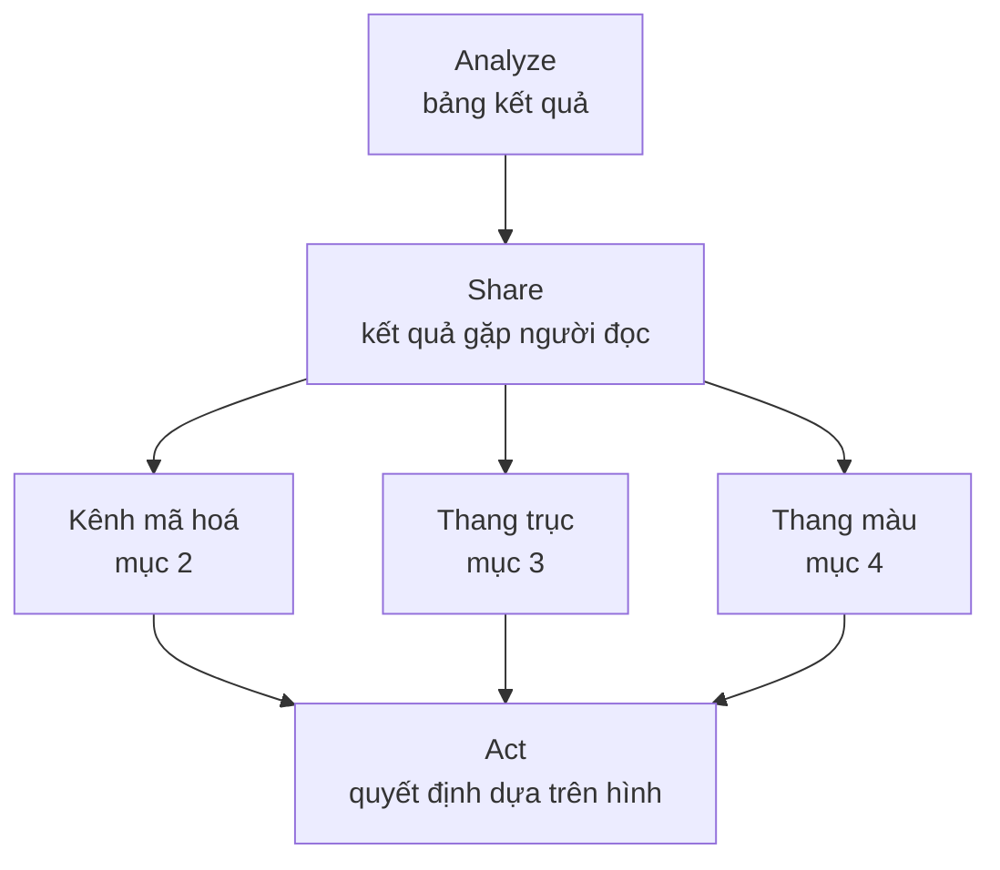

Cắt trục y của một biểu đồ cột khiến người xem thấy khác biệt lớn hơn thực tế: trong năm nghiên cứu của Yang et al. (2021), 83,5% người tham gia mắc hiệu ứng này, và hiệu ứng vẫn còn sau khi họ được giải thích về việc cắt trục. Bài thứ sáu của series *Phân tích dữ liệu dựa trên bằng chứng (Evidence-based Data Analytics)* đối chiếu các quy tắc trực quan hoá quen thuộc với nghiên cứu thực nghiệm về nhận thức đồ hoạ (graphical perception), rồi áp kết quả vào PCA, volcano plot, MA plot, heatmap và hai bộ số liệu sinh học được vẽ lại từ đầu.

## Tóm tắt

Đây là tổng quan bằng chứng có chọn lọc, không phải systematic review. Bốn kết luận chính:

1. Khi cần so sánh chính xác, hãy mã hoá đại lượng quan trọng nhất bằng vị trí trên một thang chung; chiều dài, góc, diện tích và màu kém chính xác dần (Cleveland & McGill, 1984; Heer & Bostock, 2010).
2. Cắt trục y làm hiệu ứng trông lớn hơn, và cảnh báo không xoá được ấn tượng đó (Correll et al., 2020; Yang et al., 2021); nhưng "luôn bắt đầu từ 0" chỉ bắt buộc với biểu đồ cột.
3. Thang màu cầu vồng và cặp đỏ–xanh lá làm méo dữ liệu và gây khó cho người có rối loạn sắc giác (Crameri et al., 2020); thang diverging chỉ dùng khi dữ liệu có điểm giữa.
4. Với dữ liệu sinh học cỡ mẫu nhỏ, hãy cho người đọc thấy từng điểm dữ liệu (Weissgerber et al., 2015).

## 1. Mở đầu: vì sao trực quan hoá cần bằng chứng

Trong quy trình sáu pha Ask → Prepare → Process → Analyze → Share → Act ([bài 01](/blog/foundations-data-data-everywhere/)), Share là pha kết quả phân tích gặp người đọc. [Bài 05](/blog/analyze-data-to-answer-questions/) dừng ở một bảng số đã tổng hợp; bài này bắt đầu từ lúc bảng số đó phải thành hình. Một biểu đồ sai có thể làm hỏng một phân tích đúng, vì quyết định ở pha Act dựa trên điều người đọc nhìn thấy (Hình 1).



**Hình 1.** Ba lựa chọn thiết kế của pha Share, ứng với mục 2, 3 và 4 của bài.

Lời khuyên về trực quan hoá thường được truyền lại như kinh nghiệm: hiểu trong năm giây, trục y bắt đầu từ 0, pie chart dưới bảy lát. Phần lớn nghe hợp lý, nhưng hiếm khi kèm nguồn hay điều kiện áp dụng. Từ năm 1984, Cleveland và McGill đã viết rằng phương pháp đồ hoạ cần một nền tảng khoa học, xây trên các thí nghiệm đo cách người xem giải mã thông tin đã được mã hoá trên biểu đồ (Cleveland & McGill, 1984). Tổng quan của Franconeri et al. (2021) tóm tắt: hệ thị giác trích xuất rất nhanh các thống kê tổng thể của một hình, nhưng so sánh giữa các tập con giá trị thì chậm, và hình thiết kế kém gây nhầm lẫn, hiểu sai, nhất là ở người đọc có graph literacy thấp.

Sinh học không đứng ngoài. Weissgerber et al. (2015) rà soát 703 bài báo đăng đầu năm 2014 trên nhóm tạp chí sinh lý học hàng đầu: 85,6% số bài có ít nhất một bar graph cho dữ liệu liên tục, trong khi chỉ 13,4% có univariate scatterplot và 5,3% có box plot, dù nhiều phân phối rất khác nhau cho ra cùng một bar graph.

Bài đi qua bốn câu hỏi: các kênh mã hoá trực quan chính xác đến đâu (mục 2), cắt trục y gây hiểu sai thế nào (mục 3), thang màu nào làm méo dữ liệu và gây khó cho ai (mục 4), và các biểu đồ chuẩn của bioinformatics nên được vẽ ra sao (mục 5). Mục 6 vẽ lại hai bộ số liệu, mục 7 xếp các quy tắc quen thuộc theo mức bằng chứng. Luận điểm của bài: phần lớn quy tắc đó đúng hướng nhưng thiếu điều kiện áp dụng.

## 2. Biểu đồ được "đọc" như thế nào: thứ tự các kênh mã hoá

### 2.1. Thí nghiệm gốc của Cleveland và McGill

Vẽ biểu đồ là mã hoá: mỗi con số được đổi thành vị trí của một điểm, chiều dài của một cột, góc của một lát bánh hay độ đậm của một ô màu. Đọc biểu đồ là giải mã ngược lại. Cleveland và McGill (1984) gọi các thao tác giải mã này là tác vụ nhận thức cơ bản (elementary perceptual tasks) và xếp chúng theo độ chính xác, từ cao xuống thấp:

1. vị trí trên một thang chung (position along a common scale);
2. vị trí trên các thang không thẳng hàng (non-aligned scales);
3. chiều dài, hướng, góc;
4. diện tích;
5. thể tích, độ cong;
6. độ đậm nhạt, độ bão hoà màu.

Thứ tự này một phần là lý thuyết, một phần được kiểm tra bằng thí nghiệm; theo chính các tác giả, thí nghiệm xác nhận những phần đã kiểm tra và gợi ý rằng tập tác vụ cần được mở rộng. Nguyên tắc rút ra: biểu đồ nên dùng tác vụ đứng càng cao trong thứ tự càng tốt. Từ đó hai ông cho rằng bar chart, bar chart chia đoạn (nay thường gọi là stacked bar), pie chart và bản đồ tô đậm nhạt cần được sửa tận gốc, và đề xuất dot chart làm dạng thay thế.

### 2.2. Lặp lại và mở rộng

Heer và Bostock (2010) lặp lại thí nghiệm trên Amazon Mechanical Turk với bảy kiểu phán đoán: vị trí trên thang chung, chiều dài, góc (pie chart) và diện tích hình tròn (bubble chart). Với mỗi biểu đồ, 50 người chỉ ra giá trị nhỏ hơn trong hai giá trị được đánh dấu, rồi ước lượng nó bằng bao nhiêu phần trăm giá trị lớn hơn. Thứ hạng khớp với thí nghiệm gốc: vị trí hơn hẳn chiều dài; diện tích kém hơn góc, và cả hai kém hẳn vị trí. Một điểm không khớp lý thuyết: góc không kém chiều dài, điều thí nghiệm gốc cũng không tìm thấy.

Talbot et al. (2014) làm bốn thí nghiệm riêng về bar chart và nhìn chung xác nhận thứ hạng của Cleveland và McGill: phán đoán trên stacked bar kém hơn hẳn trên các cột chung đường gốc, và so sánh hai cột cạnh nhau chính xác hơn hai cột cách xa nhau. Hệ quả thực hành: đặt các cột cần so sánh cạnh nhau, và sắp cột theo giá trị trừ khi nhóm có thứ tự tự nhiên.

### 2.3. Pie chart kém đến đâu

Theo thứ tự trên, pie chart (góc, diện tích) phải thua bar chart. Bằng chứng phức tạp hơn. Trong loạt thí nghiệm của Spence và Lewandowsky (1991) với dữ liệu tỷ lệ, pie và bar gần như ngang nhau, pie nhỉnh hơn khi phán đoán phức tạp, và cả hai đều hơn bảng số. Skau và Kosara (2016) tách ba tín hiệu mà pie chart dùng (độ dài cung, góc ở tâm, diện tích lát) và thấy góc ở tâm ít quan trọng nhất; donut chart, vốn bỏ mất phần tâm, vẫn chính xác ngang pie.

Một cách đọc hợp lý: tác vụ khác nhau. Thí nghiệm của Cleveland và McGill và bản lặp lại đo việc so sánh hai giá trị; với việc đó, vị trí thắng. Còn khi câu hỏi là "phần này chiếm bao nhiêu của tổng thể", pie không tệ như tiếng xấu của nó. Hình 2 vẽ cùng năm tỷ lệ theo ba cách: trên pie chart, khó nói A hay B lớn hơn; trên stacked bar, chỉ đoạn A nằm sát trục là đọc được trên thang chung; trên dot chart, thứ hạng hiện ra ngay.


**Hình 2.** Cùng năm tỷ lệ (23, 22, 20, 18, 17%; số liệu minh hoạ) vẽ bằng pie chart, stacked bar và dot chart.

Hiệu ứng 3D cũng đã được thử trực tiếp. Siegrist (1996) thấy người tham gia ước lượng trên pie chart 2D tốt hơn 3D, còn bar chart 3D khiến họ mất nhiều thời gian hơn. Zacks et al. (1998) thấy gợi ý chiều sâu phối cảnh làm giảm độ chính xác khi đọc bar chart, nhưng mức giảm mờ đi sau một khoảng trễ ngắn và nhỏ hơn nhiều so với ảnh hưởng của các phần tử đồ hoạ lân cận. 3D không thêm thông tin và có một cái giá nhỏ: đủ lý do để tránh, không đủ để phóng đại.

### 2.4. Từ kênh mã hoá đến chọn biểu đồ

Các sơ đồ chọn biểu đồ thường chia theo mục đích. Cách chia đó hữu ích để bắt đầu nhưng chưa nói gì về độ chính xác; Bảng 1 thêm cột kênh mã hoá.

**Bảng 1.** Mục đích, biểu đồ nên dùng và kênh mã hoá chính

| Mục đích | Biểu đồ nên dùng | Kênh mã hoá chính | Lưu ý |
| --- | --- | --- | --- |
| So sánh giá trị giữa các nhóm | dot chart, bar chart đã sắp xếp | vị trí trên thang chung (bar thêm chiều dài) | bar bắt đầu từ 0; cột cần so đặt cạnh nhau |
| Phân phối của một biến | strip plot, box plot, histogram | vị trí | cỡ mẫu nhỏ thì vẽ từng điểm |
| Thành phần của một tổng | stacked bar ít đoạn, pie vài lát | chiều dài; cung, góc, diện tích | cần so các phần với nhau thì dùng dot chart |
| Quan hệ giữa hai biến | scatter plot | vị trí trên hai trục | tương quan không phải nhân quả |
| Xu hướng theo thời gian | line chart | vị trí, hướng (độ dốc) | khoảng trục: xem mục 3 |
| Mẫu hình trong ma trận lớn | heatmap | màu | không đọc được giá trị chính xác |

Hai dòng cần nói thêm. Scatter plot cho thấy hai biến đi cùng nhau, và người xem dễ đọc thành quan hệ nhân quả (→ Causal Inference). Heatmap mã hoá bằng màu, kênh đứng cuối thứ tự, nên hợp để thấy mẫu hình tổng thể chứ không hợp để đọc từng giá trị; Gehlenborg và Wong (2012) nhận xét heatmap hữu ích cho dữ liệu nhiều biến nhưng phải được dùng đúng cách. Cú pháp vẽ từng loại trong R có ở Visualizations (R).

### 2.5. Data-ink ratio và "chart junk"

Tufte (1983) đưa ra khái niệm data-ink ratio, phần "mực" thể hiện dữ liệu trên toàn bộ mực của hình, và khuyên bỏ những thứ không mang dữ liệu như khung quanh legend hay bóng đổ. Bằng chứng thực nghiệm không một chiều. Bateman et al. (2010) thấy người xem mô tả biểu đồ có hình minh hoạ không kém chính xác hơn biểu đồ trơn, và sau hai đến ba tuần nhớ chúng tốt hơn; chính các tác giả vẫn dè dặt, không khuyên vẽ mọi biểu đồ theo kiểu đó. Borkin et al. (2013), với bộ 2.070 biểu đồ từ báo chí, báo cáo, tạp chí khoa học và infographic, thấy màu sắc và hình ảnh nhận ra được làm biểu đồ dễ nhớ hơn. Dễ nhớ không đồng nghĩa với hiểu đúng: hình khoa học, nơi người đọc cần đọc số, nên tối giản; infographic có thể trang trí, miễn là không làm méo dữ liệu.

## 3. Trục y bị cắt: khi nào gây hiểu sai, khi nào chấp nhận được

### 3.1. Bằng chứng về hiệu ứng cắt trục

Pandey et al. (2015) phân loại các biểu đồ gây hiểu sai theo kiểu ngộ nhận mà chúng tạo ra, dựng bốn biểu đồ bằng các kỹ thuật bóp méo phổ biến, rồi dùng thí nghiệm crowdsourcing để đo mức đánh lừa của từng kỹ thuật.

Hai nghiên cứu sau tập trung vào trục y. Correll et al. (2020) cho thấy cắt trục làm tăng đánh giá chủ quan về độ lớn hiệu ứng trên nhiều kiểu biểu đồ, kể cả ở các thiết kế có dấu hiệu trực quan báo rõ trục đã bị cắt. Yang et al. (2021) làm năm nghiên cứu với bar graph: 83,5% người tham gia cảm nhận khác biệt lớn hơn khi trục bị cắt; hiệu ứng vẫn còn sau khi họ được dạy về cắt trục; và điểm graph literacy không dự đoán được ai mắc nặng hơn. Hệ quả khó chịu: một dòng chú thích "trục y không bắt đầu từ 0" không giải quyết được vấn đề.

### 3.2. "Luôn bắt đầu từ 0" không đúng cho mọi biểu đồ

Kết luận "vậy thì luôn bắt đầu từ 0" lại đi quá xa. Chính Correll et al. (2020) đưa ra các ví dụ trong đó cắt trục có lợi, và khuyên chọn thang đo theo độ lớn của hiệu ứng có ý nghĩa cần truyền đạt, bất kể dùng kênh mã hoá nào. Witt (2019) biến ý đó thành con số: trục đặt sát dữ liệu khiến mọi hiệu ứng trông lớn, trục trải hết thang đo khiến mọi hiệu ứng trông nhỏ, còn khi khoảng trục dài từ một đến hai độ lệch chuẩn (SD), người xem nhạy hơn với độ lớn hiệu ứng và ít thiên lệch hơn. Khuyến nghị của bà cho các ngành dùng hiệu ứng chuẩn hoá: khoảng trục y không ngắn hơn 1 SD, nên dài ít nhất 1,5 SD.

Gộp với mục 2, có hai trường hợp. Bar chart mã hoá giá trị bằng chiều dài cột tính từ đường gốc; cắt trục là cắt bớt chiều dài, nên tỷ lệ giữa các cột không còn là tỷ lệ giữa các giá trị, và trục phải bắt đầu từ 0. Dot plot và line chart mã hoá bằng vị trí, nên trục không buộc phải chứa số 0, miễn là thang đo được ghi rõ và khoảng trục tương xứng với độ lớn hiệu ứng. Với đại lượng mà số 0 không có nghĩa thực tế, như pH hay kích thước một bộ phận, ép trục về 0 chỉ làm phẳng mọi khác biệt (Hình 3).


**Hình 3.** Cùng một so sánh, bốn cách vẽ: độ sâu mỏ của 50 con *Geospiza fortis* không sống sót và 50 con sống sót qua hạn hán 1977. Khoảng tin cậy 95% theo phân phối t (df = 49). Dữ liệu: HHMI BioInteractive (2021), trích từ dữ liệu của P. R. Grant và B. R. Grant; phân tích ở mục 6.1.

### 3.3. Những cách bóp méo khác

Các cảnh báo quen thuộc khác gồm hai trục y với hai thang khác nhau, chỉ vẽ phần dữ liệu ủng hộ kết luận, chia bin che mất xu hướng, và biểu đồ thành phần không cộng đủ 100%. Không phải cảnh báo nào cũng đã có thí nghiệm riêng, nhưng lời khuyên của Rougier et al. (2014) gói được cả nhóm: chọn loại hình đơn giản nhất còn truyền đạt được thông điệp, ghi đủ nhãn và vạch chia, và dùng toàn bộ khoảng giá trị khi điều đó có ý nghĩa.

## 4. Màu sắc: thang cầu vồng, loại thang màu và người mù màu

### 4.1. Vì sao thang cầu vồng có hại

Thang màu cầu vồng (rainbow, hay jet) đi từ xanh dương qua xanh lá, vàng đến đỏ. Borland và Taylor (2007) đã tổng hợp các đặc tính khiến nó là lựa chọn kém và đề xuất thang thay thế. Crameri et al. (2020) giải thích cơ chế: vàng là màu sáng nhất và hút mắt nhất nhưng không nằm ở đầu hay ở giữa thang, còn các sắc xanh lá chiếm một dải rộng có độ tương phản thấp. Thang màu vì vậy tạo ra ranh giới không có trong dữ liệu ở chỗ này, che mất biến thiên nhỏ ở chỗ khác, và theo ước tính của nhóm, sai lệch thị giác có thể vượt 7% khoảng biến thiên dữ liệu.

Cách chữa là thang màu đều về cảm nhận (perceptually uniform): cùng một mức thay đổi của dữ liệu ứng với cùng một mức thay đổi cảm nhận được ở mọi đoạn của thang, và độ sáng tăng đều để người xem xếp được thứ tự các màu (Crameri et al., 2020). Viridis và cividis thuộc nhóm này; còn độ sáng của jet dao động mạnh dọc theo thang (Matplotlib Development Team, n.d.).


**Hình 4.** Cùng một ma trận 14 gen × 8 mẫu (dữ liệu mô phỏng) với năm thang màu, ở thị lực màu bình thường và dưới mô phỏng deuteranopia theo mô hình của Machado et al. (2009). Hàng dưới: độ sáng L* dọc theo từng thang.

Trong Hình 4, năm gen trên cùng tăng ở nhóm xử lý, năm gen giữa giảm, bốn gen cuối không đổi. Với jet, bốn gen không đổi lại là vùng sặc sỡ nhất, và độ sáng L* đi từ 13 lên 96 rồi tụt về 25: khi in đen trắng, giá trị thấp nhất và cao nhất thành hai màu xám gần nhau. Viridis và cividis sáng dần đều từ khoảng 15 lên 91. Dưới mô phỏng deuteranopia, thang xanh lá–đen–đỏ, vốn hay gặp ở heatmap biểu hiện gen, mất hẳn thông tin về chiều: tăng và giảm đều thành vàng nâu. RdBu_r vẫn giữ được hai phía, còn cividis gần như không đổi.

### 4.2. Bao nhiêu người đọc bị ảnh hưởng

Rối loạn sắc giác (colour-vision deficiency, CVD), thường gọi là mù màu, phần lớn là dạng đỏ–xanh lá di truyền. Tổng quan của Birch (2012) cho tỷ lệ khoảng 8% ở nam và 0,4% ở nữ người châu Âu, và 4–6,5% ở nam giới gốc Trung Quốc và Nhật Bản. Wong (2011) diễn đạt theo cách dễ nhớ: nếu bản thảo được gửi cho ba người bình duyệt là nam gốc Bắc Âu, xác suất có ít nhất một người mù màu là 22%.

Số liệu cho Việt Nam còn ít. Giang et al. (2026) sàng lọc 1.491 sinh viên năm nhất khối ngành sức khoẻ của một trường đại học y bằng bảng Ishihara trực tuyến rồi khám xác nhận: 1,9% có CVD, và nam có odds cao hơn nữ khoảng 16 lần. Đây là mẫu của một trường và tỷ lệ gộp cả hai giới, nên không so trực tiếp được với các con số trên. Dùng khoảng 4–6,5% của Birch (2012), một lớp có 40 nam sinh trung bình sẽ có khoảng hai người không phân biệt được đỏ với xanh lá trên hình của bạn.

### 4.3. Chọn đúng loại thang màu

Ba loại thang màu ứng với ba loại dữ liệu (Rougier et al., 2014; Matplotlib Development Team, n.d.):

- **Sequential** (tuần tự): một màu đậm nhạt dần, cho đại lượng có thứ tự từ thấp đến cao, như TPM hay mật độ.
- **Diverging** (phân kỳ): hai màu toả ra từ một điểm giữa, chỉ dùng khi dữ liệu có một giá trị giữa có ý nghĩa, như log2 fold change bằng 0, z-score bằng 0 hay hệ số tương quan bằng 0.
- **Qualitative** (định tính): các màu khác hẳn nhau, cho nhóm rời rạc không có thứ tự, như loại mô hay điều kiện thí nghiệm.

Lời khuyên "dùng thang diverging để tạo tương phản" vì vậy chỉ đúng khi dữ liệu phân kỳ quanh một giá trị trung tâm (Crameri et al., 2020); áp cho dữ liệu không có điểm giữa, nó vẽ ra một ranh giới giả ngay giữa thang. Nếu mục đích là làm nổi một phần tử, hãy tô màu phần tử đó và để phần còn lại màu xám (Rougier et al., 2014).

Quy ước "xanh lá là tốt, đỏ là xấu" là quy ước văn hoá có thật, và hình vẽ nên tôn trọng quy ước người đọc đã quen (Franconeri et al., 2021). Nhưng nó dùng đúng cặp màu mà dạng CVD phổ biến nhất không phân biệt được, và tiêu chí 1.4.1 của WCAG 2.2 yêu cầu màu không phải là phương tiện duy nhất để truyền thông tin (World Wide Web Consortium, 2024). Hãy giữ quy ước nhưng thêm kênh thứ hai: độ sáng, hình dạng điểm hoặc nhãn chữ. Đổi một bản đồ tô từ đỏ sang xanh lá thành một dải xanh dương từ nhạt đến đậm là một cách sửa đúng: thang sequential một màu mang thông tin bằng độ sáng.

### 4.4. Kiểm tra trước khi công bố

Ba phép thử nhanh theo Crameri et al. (2020): các màu kề nhau có khác nhau một mức như nhau dọc cả thang không; hình có chứa đỏ và xanh lá cùng độ sáng không; có dùng thang cầu vồng không. Ngoài ra, luôn kèm colour bar, và xem hình dưới mô phỏng CVD lẫn bản thang xám trước khi nộp; đoạn code ở Phụ lục làm việc đó bằng ma trận của Machado et al. (2009). Cividis được tối ưu để trông gần như nhau với người có và không có CVD đỏ–xanh lá (Nuñez et al., 2018).

## 5. Áp vào biểu đồ chuẩn của bioinformatics

### 5.1. Dữ liệu liên tục cỡ mẫu nhỏ: thôi dùng "cột + thanh sai số"

Weissgerber et al. (2015) nêu ba vấn đề của bar graph cho dữ liệu liên tục: nhiều phân phối khác nhau cho ra cùng một cột và cùng một thanh sai số; với dữ liệu ghép cặp, bar graph ngầm gợi ý hai nhóm độc lập; và trung bình kèm SE hay SD khiến người đọc mặc định dữ liệu phân phối chuẩn, không có outlier. Trong các bài có bar graph mà nhóm rà soát, 77,6% dùng trung bình ± SE, và ở 75% số bài, nhóm nhỏ nhất trong hình chỉ có từ hai đến sáu quan sát. Với cỡ mẫu như vậy, nhóm khuyên vẽ toàn bộ dữ liệu bằng univariate scatterplot (strip plot, dot plot).

Khi mẫu lớn hơn, box plot là bước tiếp theo, nhưng nên tránh với mẫu rất nhỏ (n < 5) (Krzywinski & Altman, 2014); histogram, density plot và violin plot là các lựa chọn khác (Bruce & Bruce, 2017; → [Boxplot và outlier](/blog/data-exploration-using-descriptive-statistics/)). Dù chọn dạng nào, chú thích hình phải ghi n và loại thanh sai số, vì SD, SE và khoảng tin cậy 95% trả lời ba câu hỏi khác nhau (→ [Đặc trưng thống kê mẫu](/blog/3-dac-trung-thong-ke-cua-mot-mau-va-uoc-luong-tham-so-cua-tong-the/)).

### 5.2. PCA plot

Phân tích thành phần chính (principal component analysis, PCA) chiếu dữ liệu nhiều chiều lên vài trục giữ được nhiều phương sai nhất; bài nhập môn của Ringnér (2008) giới thiệu cách dùng nó cho dữ liệu biểu hiện gen. Trong RNA-seq, PCA plot thường là hình kiểm tra chất lượng đầu tiên: mẫu có tách theo điều kiện không, có mẫu ngoại lai hay batch effect không ([Transcriptomics](/blog/transcriptomics-rna-seq-va-single-cell/)).


**Hình 5.** Bốn biểu đồ chuẩn trên một bộ RNA-seq mô phỏng (2.982 gen × 8 mẫu, count theo phân phối negative binomial, 10% gen được gán thay đổi thật; p-value từ kiểm định t trên log2 count, hiệu chỉnh Benjamini–Hochberg). Hình chỉ minh hoạ kênh mã hoá; phân tích thật cần DESeq2, edgeR hoặc limma.

PCA plot dùng kênh tốt nhất, vị trí trên hai trục, nhưng có ba chi tiết quyết định độ trung thực. Nhãn trục phải ghi phần trăm phương sai của mỗi thành phần. Tỷ lệ hai trục phải giữ nguyên: PC1 luôn có phương sai lớn hơn PC2 nên hình thường dài theo chiều ngang, và ép nó thành hình vuông dễ gây hiểu sai (Holmes & Huber, 2019). Và nên dùng màu cho điều kiện, hình dạng điểm cho batch, để thông tin không chỉ nằm ở màu (Hình 5a).

### 5.3. Volcano plot

Cui và Churchill (2003) mô tả volcano plot là scatter plot của −log10 p-value theo fold change, cho phép nhìn đồng thời hai tiêu chí: thay đổi lớn đến đâu và bằng chứng thống kê mạnh đến đâu. Cả hai đều nằm trên trục vị trí (Hình 5b); rủi ro nằm ở chỗ khác. Hai đường ngưỡng là quyết định của người phân tích, nên phải ghi rõ giá trị. Trục tung nên dùng p-value đã hiệu chỉnh cho kiểm định nhiều lần, vì với hàng chục nghìn gen, ngưỡng 0,05 trên p-value thô sẽ tô màu cho rất nhiều dương tính giả ([Toán và thống kê cho sinh học](/blog/toan-va-thong-ke-cho-sinh-hoc/)). Các gen đáng chú ý nên được gắn nhãn trực tiếp cạnh điểm.

### 5.4. MA plot

Volcano plot che mất một biến: mức biểu hiện. MA plot, như cách DESeq2 dùng, vẽ log fold change theo cường độ biểu hiện trung bình và tô nổi các gen có adjusted p-value thấp (Love et al., 2014). Hình này cho thấy một đặc điểm của dữ liệu đếm: fold change của gen có ít read rất nhiễu, nên gen biểu hiện yếu có vẻ thay đổi mạnh hơn gen biểu hiện mạnh; DESeq2 xử lý bằng cách co (shrink) các ước lượng về 0. Trong dữ liệu mô phỏng ở Hình 5c, 18,7% số gen không được gán thay đổi nào và có trung bình dưới 10 count vẫn cho |log2 fold change| ≥ 1, so với 0,7% ở các gen còn lại. Xếp hạng gen chỉ theo fold change sẽ đưa nhiều gen nhiễu lên đầu danh sách.

### 5.5. Heatmap

Eisen et al. (1998) mô tả một hệ thống phân cụm dữ liệu biểu hiện toàn bộ genome, trong đó kết quả được hiển thị bằng đồ hoạ, thể hiện cùng lúc các cụm và dữ liệu bên dưới. Với heatmap, mục 2.4 và mục 4 cho ba quy tắc. Dữ liệu chuẩn hoá theo gen (z-score) có điểm giữa 0 nên dùng thang diverging đặt tâm tại 0 (Hình 5d); giá trị không âm như TPM dùng thang sequential. Tránh cặp đỏ–xanh lá. Và đừng mong người đọc đọc ra con số từ ô màu: Crameri et al. (2020) lưu ý rằng các ô màu nằm sát nhau còn làm đổi cảm nhận về màu của từng ô.

### 5.6. Mười quy tắc vẽ hình và phạm vi còn lại

Rougier et al. (2014) gom kinh nghiệm vẽ hình khoa học thành mười quy tắc, trong đó có: xác định thông điệp, đừng tin mặc định của phần mềm, dùng màu có hiệu quả, đừng đánh lừa người đọc và tránh chartjunk. Đây là lời khuyên của người làm nghề, nhưng nhiều quy tắc trùng với bằng chứng ở mục 2–4. Bài này không bàn đến hình giảm chiều cho dữ liệu đơn bào (UMAP, t-SNE) hay trực quan hoá mạng lưới.

## 6. Hai ví dụ vẽ lại

### 6.1. Chim sẻ Darwin: trục y và bar chart so với dot plot

Bộ dữ liệu giáo dục của HHMI BioInteractive (2021), trích từ dữ liệu của Peter và Rosemary Grant, gồm 100 con chim sẻ đất trung bình *Geospiza fortis*: 50 con chết trong hạn hán 1977 và 50 con sống sót (→ Chọn lọc tự nhiên ở chim sẻ Darwin). Độ sâu mỏ trung bình là 9,111 mm (SD 0,880) ở nhóm không sống sót và 9,674 mm (SD 0,842) ở nhóm sống sót; chênh lệch 0,563 mm (95% CI 0,22–0,90), Cohen's d = 0,65. Vài dòng Python cho thấy trục của một bar chart thay đổi ấn tượng về con số này ra sao:

```python
import math

# Độ sâu mỏ (mm): nhóm không sống sót và nhóm sống sót, n = 50 mỗi nhóm
m1, s1, m2, s2 = 9.111, 0.880, 9.674, 0.842
sp = math.sqrt((s1**2 + s2**2) / 2)          # SD gộp khi hai nhóm cùng cỡ
d = (m2 - m1) / sp                           # Cohen's d
centre, span = (m1 + m2) / 2, 1.5 * sp       # trục y dài 1,5 SD, đặt giữa hai trung bình

print(f"SD gộp = {sp:.3f} mm, Cohen's d = {d:.2f}")
print(f"Trục y dài 1,5 SD: {centre - span / 2:.2f} đến {centre + span / 2:.2f} mm")
print(f"Cột cắt ở 9,0 mm: tỷ lệ chiều cao {(m2 - 9.0) / (m1 - 9.0):.1f} lần, tỷ lệ thật {m2 / m1:.2f} lần")
```

```text
SD gộp = 0.861 mm, Cohen's d = 0.65
Trục y dài 1,5 SD: 8.75 đến 10.04 mm
Cột cắt ở 9,0 mm: tỷ lệ chiều cao 6.1 lần, tỷ lệ thật 1.06 lần
```

Ở ô (a) của Hình 3, trục cắt tại 9,0 mm: cột của nhóm sống sót cao gấp 6,1 lần cột kia, trong khi giá trị chỉ lớn hơn 6%. Ở ô (b), trục bắt đầu từ 0: tỷ lệ chiều cao đúng, nhưng chênh lệch gần như biến mất, và phần lớn mực dùng để vẽ khoảng từ 0 đến 7 mm, nơi không có con chim nào. Hai ô sai theo đúng hai hướng mà Witt (2019) mô tả; gốc của vấn đề là dùng chiều dài để mã hoá một đại lượng mà số 0 không có nghĩa. Ô (c) chuyển sang vị trí: hai trung bình kèm khoảng tin cậy 95% trên trục dài 1,5 SD, ở đó chênh lệch chiếm chưa đến một nửa chiều cao hình. Ô (d) vẽ cả 100 cá thể, theo khuyến nghị của Weissgerber et al. (2015), và chỉ ở đây người đọc mới thấy điều trung bình che mất: hai nhóm chồng lên nhau gần hết, hạn hán dịch phân phối đi một đoạn chứ không tách quần thể làm hai.

### 6.2. Phôi cá ngựa vằn và propylene glycol: từ trung bình sang đường liều–đáp ứng

Ví dụ thứ hai là số liệu của một bài thực hành thử độc tính propylene glycol trên phôi cá ngựa vằn (*Danio rerio*), theo kiểu thử nghiệm độc tính cấp trên phôi cá (OECD, 2013): sáu nồng độ từ 0 đến 500 mg/L, mỗi nồng độ 15 phôi, đếm số phôi chết sau mỗi 24 giờ cho đến 96 giờ (→ Độc tính Propylene Glycol).

Bảng số kiểu này có ba cách vẽ dễ sa vào. Một là lấy trung bình tỷ lệ chết qua sáu nồng độ ở mỗi thời điểm rồi vẽ cột kèm SE (Hình 6a): bốn cột gần như bằng nhau, khoảng 51–54% với SE khoảng 21 điểm phần trăm, và quan hệ liều–đáp ứng đã bị lấy trung bình mất. Hai là coi mỗi nồng độ là một cột rời đặt cách đều, trong khi nồng độ là biến định lượng trải trên gần hai bậc độ lớn và thuộc về một trục x liên tục, thường là thang log. Ba là vẽ tỷ lệ phần trăm như thể chúng là số đo chính xác, trong khi mỗi tỷ lệ là một số đếm trên 15 phôi, có độ bất định tính được:

```python
import math

def wilson(k, n, z=1.96):
    """Khoảng tin cậy Wilson 95% cho tỷ lệ k/n."""
    p = k / n
    centre = (p + z**2 / (2 * n)) / (1 + z**2 / n)
    half = z * math.sqrt(p * (1 - p) / n + z**2 / (4 * n**2)) / (1 + z**2 / n)
    return max(0.0, centre - half), min(1.0, centre + half)

conc = [0, 10, 50, 150, 350, 500]        # mg/L
dead_96h = [3, 1, 0, 15, 15, 15]         # số phôi chết lúc 96 h, mỗi nồng độ 15 phôi
for c, k in zip(conc, dead_96h):
    lo, hi = wilson(k, 15)
    print(f"{c:>3} mg/L: {k:>2}/15 = {k / 15:>4.0%}, 95% CI {lo:>3.0%} đến {hi:>4.0%}")
```

```text
  0 mg/L:  3/15 =  20%, 95% CI  7% đến  45%
 10 mg/L:  1/15 =   7%, 95% CI  1% đến  30%
 50 mg/L:  0/15 =   0%, 95% CI  0% đến  20%
150 mg/L: 15/15 = 100%, 95% CI 80% đến 100%
350 mg/L: 15/15 = 100%, 95% CI 80% đến 100%
500 mg/L: 15/15 = 100%, 95% CI 80% đến 100%
```

Với n nhỏ, Brown et al. (2001) khuyên dùng khoảng Wilson hoặc Jeffreys thay cho khoảng Wald quen thuộc. Kết quả đổi cách đọc bảng số: tỷ lệ chết 20% ở nhóm đối chứng (3/15) có khoảng tin cậy 7–45%, chồng lên khoảng 0–20% của nhóm 50 mg/L, nên không thể nói 50 mg/L "an toàn hơn" đối chứng, và 0/15 cũng không có nghĩa là tỷ lệ chết thật bằng 0. Từ 150 mg/L trở lên, cận dưới của khoảng tin cậy là 80%, tách hẳn khỏi các nồng độ thấp.


**Hình 6.** Cùng một bộ số liệu độc tính propylene glycol trên phôi cá ngựa vằn (15 phôi mỗi nồng độ): (a) trung bình tỷ lệ chết qua sáu nồng độ ± SE; (b) tỷ lệ chết theo nồng độ kèm khoảng tin cậy Wilson 95%.

Hình 6b gộp cả ba điều chỉnh: nồng độ trên trục log với nhóm đối chứng đặt riêng, tỷ lệ chết kèm khoảng tin cậy nhị thức, mỗi thời điểm một chuỗi. Trục y từ 0 đến 100% là khoảng tự nhiên của một tỷ lệ. Hình cũng lộ ra giới hạn của thiết kế: tỷ lệ chết nhảy từ 0% ở 50 mg/L lên gần 100% ở 150 mg/L, nên nồng độ gây chết 50% (LC50) nằm giữa hai mức này, nhưng không có điểm nào trong đoạn chuyển tiếp để ước lượng độ dốc. Bước tiếp theo là một mô hình liều–đáp ứng, ví dụ bằng gói drc của R (Ritz & Streibig, 2005), trên dải nồng độ dày hơn trong khoảng đó.

## 7. Các quy tắc quen thuộc: bằng chứng đến đâu

Bảng 2 xếp các quy tắc hay gặp trong tài liệu nhập môn theo mức bằng chứng mà bài này tìm được. "Kinh nghiệm" không có nghĩa là sai, chỉ là chưa thấy thí nghiệm đứng sau.

**Bảng 2.** Quy tắc quen thuộc, mức bằng chứng và cách điều chỉnh

| Quy tắc | Mức bằng chứng | Nguồn | Điều chỉnh |
| --- | --- | --- | --- |
| Trục y của bar chart bắt đầu từ 0 | Mạnh | Correll et al. (2020); Yang et al. (2021) | Giữ; dot plot và line chart chọn khoảng trục theo độ lớn hiệu ứng (Witt, 2019) |
| Dùng 2D, tránh 3D | Vừa: ít thí nghiệm, hiệu ứng nhỏ | Siegrist (1996); Zacks et al. (1998) | Giữ |
| Tránh pie chart; pie dưới 7 lát | Trái chiều; con số 7 là kinh nghiệm | Spence & Lewandowsky (1991); Skau & Kosara (2016) | Pie khi cần đọc phần trên tổng; so các phần thì dùng dot chart |
| Thang diverging để tạo tương phản | Không được ủng hộ khi áp chung | Crameri et al. (2020) | Chỉ khi dữ liệu có điểm giữa |
| Xanh lá là tốt, đỏ là xấu | Quy ước văn hoá, xung đột với CVD | Franconeri et al. (2021); Birch (2012) | Thêm độ sáng, hình dạng hoặc nhãn |
| Tối đa hoá data-ink ratio | Nguyên tắc thiết kế; thí nghiệm trái chiều | Tufte (1983); Bateman et al. (2010) | Tối giản cho hình khoa học |
| Hiểu hình trong 5 giây | Kinh nghiệm giao tiếp | Franconeri et al. (2021) | Tuỳ tác vụ: thống kê tổng thể nhanh, so sánh tập con chậm |
| Bốn yếu tố của một visualization tốt | Quan điểm thiết kế | McCandless (n.d.) | Dùng như checklist |
| Nhãn trực tiếp thay legend; alt text | Chuẩn accessibility | World Wide Web Consortium (2024) | Giữ |

Hai quy tắc về thuyết trình thuộc về giao tiếp hơn là nhận thức đồ hoạ. "Quy tắc năm giây" có hai nghĩa hay bị lẫn: người xem phải hiểu biểu đồ trong năm giây, và người trình bày nên dừng năm giây sau khi chiếu một biểu đồ. Trình tự năm bước giới thiệu biểu đồ trước khán giả (nêu tên hình, trả lời trước câu hỏi hiển nhiên, nêu phát hiện, dẫn số liệu, nói vì sao quan trọng), thường gọi là McCandless Method, là một dàn ý tốt. Bài này không tìm được thí nghiệm đứng sau cả hai. Về accessibility, WCAG 2.2 yêu cầu mọi nội dung không phải văn bản có văn bản thay thế (World Wide Web Consortium, 2024); alt text của một biểu đồ nên nêu loại hình, hai trục và phát hiện chính.

## 8. Kết luận và checklist

Vị trí trên thang chung là kênh chính xác nhất, và kết quả này đã được lặp lại; pie chart chỉ thua rõ khi cần so các phần với nhau. Cắt trục y của bar chart làm khác biệt trông lớn hơn và cảnh báo không sửa được; với dot plot và line chart, 1,5 SD là một mốc chọn khoảng trục có thí nghiệm đứng sau. Thang cầu vồng và cặp đỏ–xanh lá làm méo dữ liệu và gây khó cho khoảng 4–8% nam giới. Còn ở các hình sinh học, phần lớn lỗi nằm ở việc che dữ liệu: cột che phân phối, volcano plot che mức biểu hiện, trung bình che quan hệ liều–đáp ứng.

<div class="callout callout-note">
<p class="callout-title">Checklist trước khi đưa một hình vào báo cáo</p>

1. Hình trả lời câu hỏi nào: so sánh, phân phối, thành phần, quan hệ hay xu hướng?
2. Đại lượng quan trọng nhất đã nằm trên một thang vị trí chung chưa?
3. Bar chart: trục bắt đầu từ 0? Nếu số 0 vô nghĩa, đổi sang dot plot.
4. Khoảng trục tương xứng với độ lớn hiệu ứng (khoảng 1,5 SD), hay đang đặt sát dữ liệu?
5. Cỡ mẫu nhỏ: đã vẽ từng điểm dữ liệu chưa?
6. Đã ghi n và loại thanh sai số (SD, SE hay 95% CI)? Tỷ lệ từ số đếm có khoảng tin cậy nhị thức chưa?
7. Thang màu đúng loại: sequential, diverging (chỉ khi có điểm giữa) hay qualitative? Có colour bar?
8. Hình còn đọc được dưới mô phỏng CVD và khi in thang xám? Có kênh nào khác ngoài màu?
9. Nhãn đặt cạnh dữ liệu, có đơn vị, có alt text?
10. Con số trên hình đã được tính lại từ dữ liệu gốc bằng script chưa?

</div>

Bài có ba giới hạn: đây là tổng quan có chọn lọc; phần lớn thí nghiệm được dẫn dùng người tham gia trên Mechanical Turk và tác vụ đơn giản, nên chưa chắc khái quát được cho chuyên gia đọc heatmap omics; và các hình mô phỏng (Hình 2, 4, 5) chỉ minh hoạ. [Bài 07](/blog/introduction-to-data-analysis-using-python/) chuyển sang Python, công cụ để vẽ lại các hình này bằng code tái lập được.

## Phụ lục: mô phỏng deuteranopia cho một thang màu

Đoạn code đổi màu sRGB sang RGB tuyến tính, nhân với ma trận deuteranopia của Machado et al. (2009), đổi ngược lại, rồi tính độ sáng CIE L* dọc theo bốn thang màu của Matplotlib.

```python
import numpy as np
import matplotlib

# Ma trận mô phỏng deuteranopia (mức 1,0) của Machado et al. (2009)
M = np.array([(0.367322, 0.860646, -0.227968),
              (0.280085, 0.672501, 0.047413),
              (-0.011820, 0.042940, 0.968881)])

def to_linear(c):                          # sRGB -> RGB tuyến tính
    return np.where(c <= 0.04045, c / 12.92, ((c + 0.055) / 1.055) ** 2.4)

def to_srgb(c):                            # RGB tuyến tính -> sRGB
    c = np.clip(c, 0, 1)
    return np.where(c <= 0.0031308, 12.92 * c, 1.055 * c ** (1 / 2.4) - 0.055)

def deuteranopia(rgb):
    return to_srgb(to_linear(rgb) @ M.T)

def lightness(rgb):                        # độ sáng CIE L*, từ 0 đến 100
    y = to_linear(rgb) @ np.array([0.2126, 0.7152, 0.0722])
    f = np.where(y > (6 / 29) ** 3, np.cbrt(y), y / (3 * (6 / 29) ** 2) + 4 / 29)
    return 116 * f - 16

for name in ["jet", "viridis", "cividis", "RdBu_r"]:
    ramp = matplotlib.colormaps[name](np.linspace(0, 1, 256))[:, :3]
    L = lightness(deuteranopia(ramp))
    mono = bool(np.all(np.diff(L) > -0.05))
    print(f"{name:8s} L* đầu {L[0]:3.0f}, giữa {L[128]:3.0f}, cuối {L[-1]:3.0f}, tăng đơn điệu: {mono}")
```

```text
jet      L* đầu  17, giữa  89, cuối  29, tăng đơn điệu: False
viridis  L* đầu  16, giữa  53, cuối  92, tăng đơn điệu: True
cividis  L* đầu  13, giữa  52, cuối  92, tăng đơn điệu: True
RdBu_r   L* đầu  19, giữa  97, cuối  23, tăng đơn điệu: False
```

Dưới mô phỏng deuteranopia, viridis và cividis vẫn sáng dần đều; jet sáng lên rồi tối lại. RdBu_r không đơn điệu vì là thang diverging, sáng nhất ở điểm giữa.

## Tài liệu tham khảo

Bateman, S., Mandryk, R. L., Gutwin, C., Genest, A., McDine, D., & Brooks, C. (2010). Useful junk? The effects of visual embellishment on comprehension and memorability of charts. In *Proceedings of the SIGCHI Conference on Human Factors in Computing Systems* (pp. 2573–2582). ACM. https://doi.org/10.1145/1753326.1753716

Birch, J. (2012). Worldwide prevalence of red-green color deficiency. *Journal of the Optical Society of America A, 29*(3), 313–320. https://doi.org/10.1364/JOSAA.29.000313

Borkin, M. A., Vo, A. A., Bylinskii, Z., Isola, P., Sunkavalli, S., Oliva, A., & Pfister, H. (2013). What makes a visualization memorable? *IEEE Transactions on Visualization and Computer Graphics, 19*(12), 2306–2315. https://doi.org/10.1109/TVCG.2013.234

Borland, D., & Taylor, R. M., II. (2007). Rainbow color map (still) considered harmful. *IEEE Computer Graphics and Applications, 27*(2), 14–17. https://doi.org/10.1109/MCG.2007.323435

Brown, L. D., Cai, T. T., & DasGupta, A. (2001). Interval estimation for a binomial proportion. *Statistical Science, 16*(2), 101–133. https://doi.org/10.1214/ss/1009213286

Bruce, P., & Bruce, A. (2017). *Practical statistics for data scientists: 50 essential concepts*. O'Reilly Media.

Cleveland, W. S., & McGill, R. (1984). Graphical perception: Theory, experimentation, and application to the development of graphical methods. *Journal of the American Statistical Association, 79*(387), 531–554. https://doi.org/10.1080/01621459.1984.10478080

Correll, M., Bertini, E., & Franconeri, S. (2020). Truncating the y-axis: Threat or menace? In *Proceedings of the 2020 CHI Conference on Human Factors in Computing Systems* (pp. 1–12). ACM. https://doi.org/10.1145/3313831.3376222

Crameri, F., Shephard, G. E., & Heron, P. J. (2020). The misuse of colour in science communication. *Nature Communications, 11*, 5444. https://doi.org/10.1038/s41467-020-19160-7

Cui, X., & Churchill, G. A. (2003). Statistical tests for differential expression in cDNA microarray experiments. *Genome Biology, 4*(4), 210. https://doi.org/10.1186/gb-2003-4-4-210

Eisen, M. B., Spellman, P. T., Brown, P. O., & Botstein, D. (1998). Cluster analysis and display of genome-wide expression patterns. *Proceedings of the National Academy of Sciences, 95*(25), 14863–14868. https://doi.org/10.1073/pnas.95.25.14863

Franconeri, S. L., Padilla, L. M., Shah, P., Zacks, J. M., & Hullman, J. (2021). The science of visual data communication: What works. *Psychological Science in the Public Interest, 22*(3), 110–161. https://doi.org/10.1177/15291006211051956

Gehlenborg, N., & Wong, B. (2012). Points of view: Heat maps. *Nature Methods, 9*(3), 213. https://doi.org/10.1038/nmeth.1902

Giang, L. C., Bui, Y. V., Nguyen, H. L., Nguyen, D. T., Nguyen, D. D., Bui, T. Q. A., Hoang, V. T., & Hoang, N. T. (2026). Prevalence of color vision deficiency among first-year health science students at a medical university in Vietnam. *Scientific Reports, 16*(1), 23398. https://doi.org/10.1038/s41598-026-53435-1

Heer, J., & Bostock, M. (2010). Crowdsourcing graphical perception: Using Mechanical Turk to assess visualization design. In *Proceedings of the SIGCHI Conference on Human Factors in Computing Systems* (pp. 203–212). ACM. https://doi.org/10.1145/1753326.1753357

HHMI BioInteractive. (2021). *Evolution in action: Data analysis* [Student handout, version 2]. Howard Hughes Medical Institute. https://www.biointeractive.org/classroom-resources/evolution-action-data-analysis

Holmes, S., & Huber, W. (2019). *Modern statistics for modern biology*. Cambridge University Press. https://www.huber.embl.de/msmb/

Krzywinski, M., & Altman, N. (2014). Visualizing samples with box plots. *Nature Methods, 11*(2), 119–120. https://doi.org/10.1038/nmeth.2813

Love, M. I., Huber, W., & Anders, S. (2014). Moderated estimation of fold change and dispersion for RNA-seq data with DESeq2. *Genome Biology, 15*(12), 550. https://doi.org/10.1186/s13059-014-0550-8

Machado, G. M., Oliveira, M. M., & Fernandes, L. A. F. (2009). A physiologically-based model for simulation of color vision deficiency. *IEEE Transactions on Visualization and Computer Graphics, 15*(6), 1291–1298. https://doi.org/10.1109/TVCG.2009.113

Matplotlib Development Team. (n.d.). *Choosing colormaps in Matplotlib*. https://matplotlib.org/stable/users/explain/colors/colormaps.html

McCandless, D. (n.d.). *What makes a good data visualization?* Information is Beautiful. https://informationisbeautiful.net/visualizations/what-makes-a-good-data-visualization/

Nuñez, J. R., Anderton, C. R., & Renslow, R. S. (2018). Optimizing colormaps with consideration for color vision deficiency to enable accurate interpretation of scientific data. *PLOS ONE, 13*(7), e0199239. https://doi.org/10.1371/journal.pone.0199239

OECD. (2013). *Test No. 236: Fish embryo acute toxicity (FET) test*. OECD Guidelines for the Testing of Chemicals, Section 2. OECD Publishing. https://doi.org/10.1787/9789264203709-en

Pandey, A. V., Rall, K., Satterthwaite, M. L., Nov, O., & Bertini, E. (2015). How deceptive are deceptive visualizations? An empirical analysis of common distortion techniques. In *Proceedings of the 33rd Annual ACM Conference on Human Factors in Computing Systems* (pp. 1469–1478). ACM. https://doi.org/10.1145/2702123.2702608

Ringnér, M. (2008). What is principal component analysis? *Nature Biotechnology, 26*(3), 303–304. https://doi.org/10.1038/nbt0308-303

Ritz, C., & Streibig, J. C. (2005). Bioassay analysis using R. *Journal of Statistical Software, 12*(5). https://doi.org/10.18637/jss.v012.i05

Rougier, N. P., Droettboom, M., & Bourne, P. E. (2014). Ten simple rules for better figures. *PLoS Computational Biology, 10*(9), e1003833. https://doi.org/10.1371/journal.pcbi.1003833

Siegrist, M. (1996). The use or misuse of three-dimensional graphs to represent lower-dimensional data. *Behaviour & Information Technology, 15*(2), 96–100. https://doi.org/10.1080/014492996120300

Skau, D., & Kosara, R. (2016). Arcs, angles, or areas: Individual data encodings in pie and donut charts. *Computer Graphics Forum, 35*(3), 121–130. https://doi.org/10.1111/cgf.12888

Spence, I., & Lewandowsky, S. (1991). Displaying proportions and percentages. *Applied Cognitive Psychology, 5*(1), 61–77. https://doi.org/10.1002/acp.2350050106

Talbot, J., Setlur, V., & Anand, A. (2014). Four experiments on the perception of bar charts. *IEEE Transactions on Visualization and Computer Graphics, 20*(12), 2152–2160. https://doi.org/10.1109/TVCG.2014.2346320

Tufte, E. R. (1983). *The visual display of quantitative information*. Graphics Press.

Weissgerber, T. L., Milic, N. M., Winham, S. J., & Garovic, V. D. (2015). Beyond bar and line graphs: Time for a new data presentation paradigm. *PLOS Biology, 13*(4), e1002128. https://doi.org/10.1371/journal.pbio.1002128

Witt, J. K. (2019). Graph construction: An empirical investigation on setting the range of the y-axis. *Meta-Psychology, 3*. https://doi.org/10.15626/MP.2018.895

Wong, B. (2011). Points of view: Color blindness. *Nature Methods, 8*(6), 441. https://doi.org/10.1038/nmeth.1618

World Wide Web Consortium. (2024). *Web Content Accessibility Guidelines (WCAG) 2.2* [W3C Recommendation]. https://www.w3.org/TR/WCAG22/

Yang, B. W., Vargas Restrepo, C., Stanley, M. L., & Marsh, E. J. (2021). Truncating bar graphs persistently misleads viewers. *Journal of Applied Research in Memory and Cognition, 10*(2), 298–311. https://doi.org/10.1016/j.jarmac.2020.10.002

Zacks, J., Levy, E., Tversky, B., & Schiano, D. J. (1998). Reading bar graphs: Effects of extraneous depth cues and graphical context. *Journal of Experimental Psychology: Applied, 4*(2), 119–138. https://doi.org/10.1037/1076-898X.4.2.119
