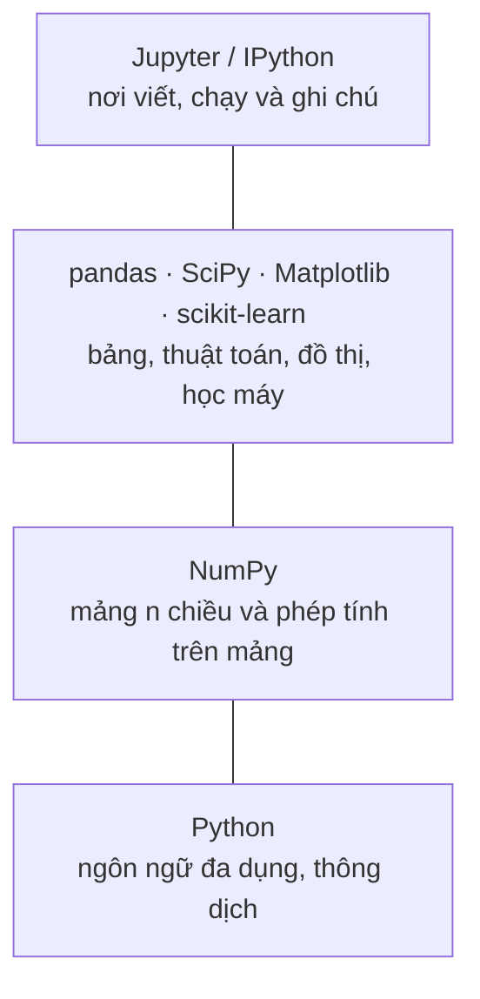
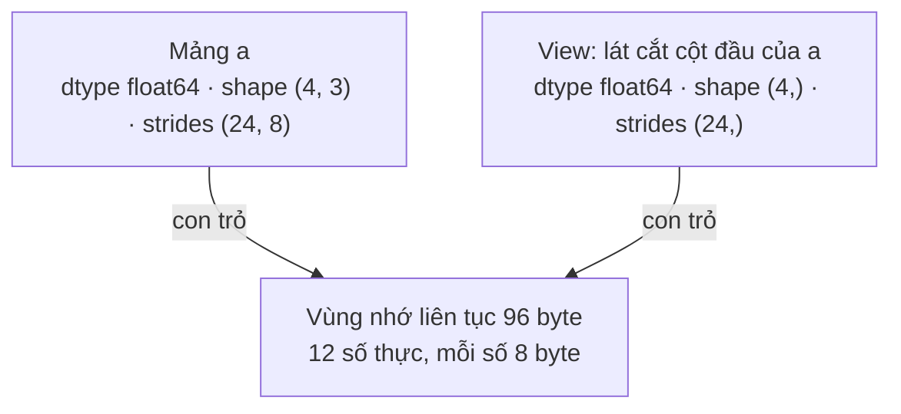
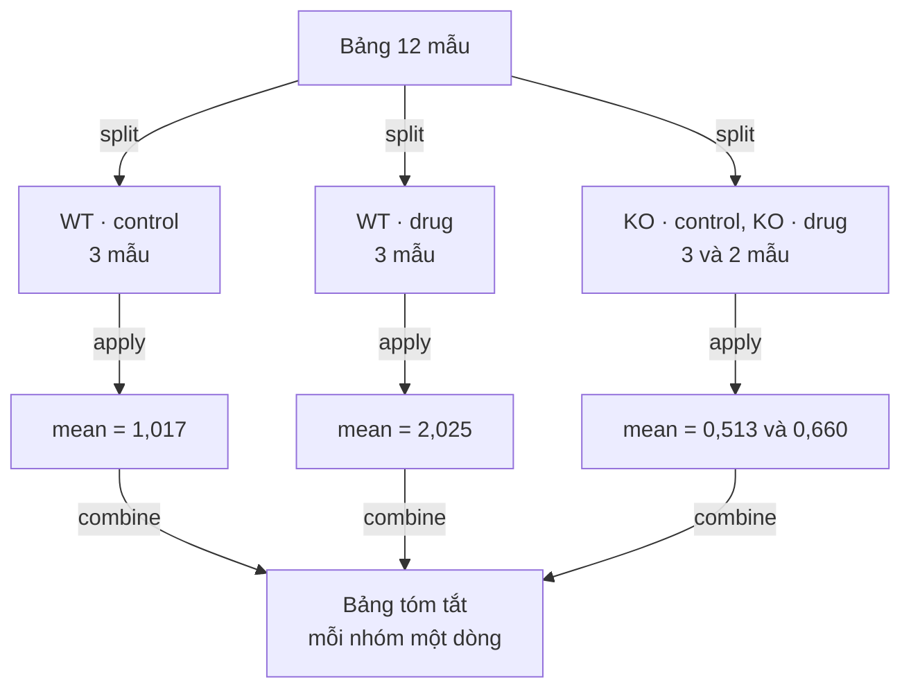

Trong 10.388 Jupyter notebook Python đi kèm bài báo y sinh mà Samuel và Mietchen (2024) cài được đủ thư viện phụ thuộc để chạy lại, chỉ 1.203 chạy hết không lỗi và 879 cho kết quả giống bản gốc. Viết được code Python vì thế chưa đủ để phân tích nhanh, đúng và chạy lại được. Bài thứ bảy của series *Phân tích dữ liệu dựa trên bằng chứng (Evidence-based Data Analytics)* đi qua ba công cụ mà người làm khoa học dùng hằng ngày: mảng NumPy và vectorization, kèm một phép đo thời gian trên máy thật; bảng dữ liệu pandas với các bẫy giá trị thiếu; và Jupyter notebook với bằng chứng về khả năng tái lập. Cuối bài, cả ba được ghép lại trong một ví dụ Biopython tính GC content trên hệ gen ti thể người, với code để bạn tự chạy lại.

## 1. Mở đầu: từ spreadsheet và SQL sang Python

[Bài 05](/blog/analyze-data-to-answer-questions/) dừng ở việc gộp bảng bằng hàm tra cứu và JOIN. Spreadsheet, SQL và Python đều lọc được dữ liệu và đều tính bằng hàm; chúng khác nhau ở chỗ dữ liệu nằm đâu và thao tác được ghi lại thế nào (Bảng 1).

**Bảng 1.** Ba công cụ cho cùng một loại việc

| Công cụ | Dữ liệu nằm ở | Lọc bằng | Thao tác được ghi lại ở |
| --- | --- | --- | --- |
| Spreadsheet | chính file bảng tính | bộ lọc trên cột | công thức trong ô; thao tác tay không để lại dấu vết |
| SQL | bảng trong cơ sở dữ liệu | mệnh đề `WHERE` | câu truy vấn |
| Python | file CSV, bảng tính, cơ sở dữ liệu, API | Boolean mask của pandas | script hoặc notebook |

Python trở nên cần thiết khi dữ liệu lớn dần: một bảng biểu hiện gen có hàng chục nghìn dòng, một file trình tự có hàng triệu read, và ở quy mô đó sửa từng ô trong spreadsheet hay viết vòng lặp qua từng phần tử đều chậm và dễ sai.

Python là ngôn ngữ đa dụng, thông dịch, hợp với những việc như làm sạch dữ liệu, làm việc với tài nguyên web và xử lý văn bản; có thêm phép tính nhanh trên mảng thì nhà khoa học làm được mọi việc trong một ngôn ngữ (Harris et al., 2020). Phần “nhanh trên mảng” đến từ NumPy, thư viện nền của SciPy (Virtanen et al., 2020), Matplotlib (Hunter, 2007), pandas (McKinney, 2010) và scikit-learn (Harris et al., 2020); IPython và Jupyter là môi trường tương tác để viết và chạy tất cả (Pérez & Granger, 2007; Kluyver et al., 2016) (Hình 1). Bài không dạy lại cú pháp cơ bản (Phụ lục có hai bảng tra nhanh); trực quan hoá thuộc về [bài 06](/blog/share-data-through-the-art-of-visualization/).



**Hình 1.** Các tầng của hệ sinh thái Python khoa học dùng trong bài, vẽ theo mô tả của Harris et al. (2020). Tầng trên dùng tầng dưới.

Buffalo (2015) chỉ ra một khác biệt giữa phòng thí nghiệm và máy tính: bản gel điện di hỏng thì nhìn là biết, còn trong tính toán khoa học lỗi có thể im lặng, tức chương trình vẫn chạy và vẫn in ra kết quả, chỉ là kết quả sai. Lỗi im lặng (silent error) là sợi chỉ xuyên suốt bài: mỗi phần chỉ ra chỗ NumPy, pandas hay notebook cho kết quả sai mà không báo, và cách bắt chúng.

<div class="callout callout-note">
<p class="callout-title">Môi trường chạy code trong bài</p>

Code và kết quả trong bài được chạy ngày 15/11/2026 với Python 3.13.2, NumPy 2.4.6, pandas 3.0.3 và Biopython 1.87; phiên bản khác có thể in kết quả hơi khác.

</div>

## 2. Phần 1: ndarray và vectorization

### 2.1. Giải phẫu một ndarray

Theo Harris et al. (2020), một mảng NumPy (ndarray, n-dimensional array) gồm một con trỏ tới vùng nhớ chứa dữ liệu và phần metadata để diễn giải vùng nhớ ấy: kiểu dữ liệu (dtype), hình dạng (shape) và bước nhảy (strides). Đoạn code dưới tạo một mảng 4 hàng × 3 cột rồi thử lần lượt từng đặc điểm (Hình 2):

```python
import numpy as np

a = np.arange(12, dtype=np.float64).reshape(4, 3)   # 12 số thực, 4 hàng × 3 cột
print(a.dtype, a.shape, a.strides, a.nbytes)

col = a[:, 0]                          # lát cắt cột đầu: một view, không sao chép
print(col.strides, np.shares_memory(a, col))
col[0] = -1                            # sửa view...
print(a[0])                            # ...là sửa mảng gốc

mixed = np.array([1.5, 2, "NA"])       # trộn số và chữ
print(mixed, mixed.dtype)

x = np.array([1, 2, 3])
y = np.append(x, 4)                    # trả về một mảng mới
print(x, y)
```

```text
float64 (4, 3) (24, 8) 96
(24,) True
[-1.  1.  2.]
['1.5' '2' 'NA'] <U32
[1 2 3] [1 2 3 4]
```



**Hình 2.** Mảng `a` và view `a[:, 0]` trỏ vào cùng một vùng nhớ; chỉ metadata khác nhau.

- **Một dtype cho cả mảng.** Mọi phần tử cùng kiểu và chiếm cùng số byte (Harris et al., 2020): 12 số float64, mỗi số 8 byte, nằm liền nhau trong 96 byte. Vì vậy khi gặp một giá trị chữ như “NA”, NumPy không báo lỗi mà đổi cả mảng thành chuỗi (`<U32`), và phép tính số trên nó không còn nghĩa.
- **Shape và số chiều.** Một vector số là mảng 1 chiều, một bảng số là mảng 2 chiều, còn video màu là mảng 4 chiều (Harris et al., 2020).
- **Strides.** Bộ nhớ lưu các phần tử thành một dãy thẳng; strides cho biết phải nhảy bao nhiêu byte để sang phần tử kế tiếp theo từng chiều. Với mảng số thực 8 byte có shape (4, 3), sang cột kế tiếp là 8 byte, sang hàng kế tiếp là 3 × 8 = 24 byte, nên strides là (24, 8) (Harris et al., 2020).
- **View.** Lát cắt `a[:, 0]` không sao chép dữ liệu: nó là một view, tức một ndarray khác trỏ vào cùng vùng nhớ với strides riêng là (24,). Sửa view là sửa mảng gốc, như dòng `[-1.  1.  2.]` cho thấy. Chọn phần tử bằng mask hay bằng mảng chỉ số thì trả về bản sao (Harris et al., 2020). Cần bản độc lập thì gọi `.copy()`; không chắc thì hỏi `np.shares_memory()`.
- **Kích thước cố định.** `np.append(x, 4)` cấp phát một mảng mới và trả về bản sao, còn `x` vẫn nguyên ba phần tử (NumPy Developers, n.d.-a). ndarray cũng không có phương thức `.append()` như list: `x.append(4)` báo `AttributeError`.

### 2.2. Vectorization và broadcasting

Vectorization là thao tác trên cả mảng thay vì trên từng phần tử (Harris et al., 2020). Cách nói này dễ gợi hình ảnh mọi phần tử được xử lý cùng một lúc. Thực ra vòng lặp vẫn còn đó, chỉ chuyển từ code Python của bạn vào phần mã C đã biên dịch sẵn của NumPy (NumPy Developers, n.d.-b), nơi việc lặp được tổ chức gần tối ưu và có tính đến strides để tận dụng bộ nhớ đệm (cache) của CPU (Harris et al., 2020). Ví dụ dưới hiệu chỉnh mật độ quang (OD) theo hệ số pha loãng:

```python
od = [0.12, 0.25, 0.51]                # mật độ quang đo được
dilution = [10, 10, 100]               # hệ số pha loãng

try:
    od * dilution                      # list không nhân từng cặp phần tử
except TypeError as err:
    print("TypeError:", err)

corrected = []                         # vòng lặp: từng phần tử một
for i in range(len(od)):
    corrected.append(od[i] * dilution[i])
print(corrected)

print(np.array(od) * np.array(dilution))   # vectorized: cả mảng trong một phép tính
```

```text
TypeError: can't multiply sequence by non-int of type 'list'
[1.2, 2.5, 51.0]
[ 1.2  2.5 51. ]
```

Với list phải viết vòng lặp; với mảng, một phép nhân làm việc đó cho cả dãy. Code ngắn hơn, ít chỗ để nhầm chỉ số hơn và, như mục 2.3 sẽ đo, nhanh hơn nhiều khi dữ liệu nằm sẵn trong mảng.

Broadcasting mở rộng ý tưởng này cho hai mảng khác shape: mảng nhỏ được nhân bản ảo cho khớp với mảng lớn mà không sao chép dữ liệu trong bộ nhớ (Harris et al., 2020). Một ví dụ quen thuộc với dữ liệu RNA-seq là chia ma trận đếm gen × mẫu cho tổng số read của từng mẫu rồi nhân với một triệu (counts per million, CPM) để so sánh được giữa các mẫu (Transcriptomics):

```python
counts = np.array([[120,   98,  15],       # 3 gen (hàng) × 3 mẫu (cột)
                   [ 45,   51,  60],
                   [835, 1851, 425]])
lib_size = counts.sum(axis=0)              # tổng số read của từng mẫu
cpm = counts / lib_size * 1e6              # (3, 3) chia (3,): broadcasting
print(lib_size)
print(cpm.round(0))
```

```text
[1000 2000  500]
[[120000.  49000.  30000.]
 [ 45000.  25500. 120000.]
 [835000. 925500. 850000.]]
```

```text
  counts (3, 3)          lib_size (3,)        counts / lib_size (3, 3)
[[120   98   15]                            [[120/1000   98/2000   15/500]
 [ 45   51   60]    ÷   [1000 2000 500]  =   [ 45/1000   51/2000   60/500]
 [835 1851  425]]                            [835/1000 1851/2000  425/500]]
```

**Hình 3.** Broadcasting: vector `lib_size` được dùng lại cho cả ba hàng của `counts` mà không bị sao chép.

`counts.sum(axis=0)` là một phép rút gọn (reduction), tức gộp các phần tử theo một trục (Harris et al., 2020): `axis=0` trả về một giá trị cho mỗi cột, `axis=1` một giá trị cho mỗi hàng. pandas dùng cùng quy ước này. Người đã học R sẽ thấy quen: Buffalo (2015) dành một mục cho vector, vectorization và indexing ngay trong chương nhập môn R (R Tutorial).

### 2.3. Phép đo: vòng lặp trên list so với NumPy

“Nhanh hơn” là bao nhiêu? Phép đo dưới đây trả lời cho một máy và một phép tính cụ thể.

**Phương pháp.** Phép tính là tích vô hướng của hai dãy n số thực ngẫu nhiên (seed 2026), n từ 10² đến 10⁷, theo bốn cách: (a) vòng `for` với `append` trên list; (b) list comprehension; (c) NumPy trên hai mảng có sẵn; (d) như (c) nhưng xuất phát từ hai list, tức tính cả thời gian đổi list sang mảng. `np.dot` làm đối chứng. Module `timeit` đo thời gian: `autorange()` chọn số lần gọi để mỗi phép đo dài ít nhất 0,2 giây, mỗi cấu hình đo 7 lần và lấy giá trị nhỏ nhất, vì theo tài liệu của `timeit` đó là cận dưới cho tốc độ của máy, còn giá trị cao hơn thường do tiến trình khác chen vào (Python Software Foundation, n.d.-c). Bốn cách phải cho cùng kết quả theo `np.isclose`. Máy đo là một laptop dùng CPU Intel Core i5-5350U 1,8 GHz (2 nhân, bộ nhớ đệm L3 3 MB), RAM 8 GB, macOS 12.7.6.

```python
import sys
import timeit

import numpy as np

def loop_append(a, b):                 # (a) vòng for + append trên list
    out = []
    for i in range(len(a)):
        out.append(a[i] * b[i])
    return sum(out)

def list_comp(a, b):                   # (b) list comprehension
    return sum([a[i] * b[i] for i in range(len(a))])

def numpy_vec(a, b):                   # (c) NumPy trên mảng có sẵn
    return (a * b).sum()

def numpy_from_lists(a, b):            # (d) đổi list sang mảng rồi mới tính
    return (np.array(a) * np.array(b)).sum()

def best_time(fn, *args, repeat=7):
    timer = timeit.Timer(lambda: fn(*args))
    number, _ = timer.autorange()      # số lần gọi để mỗi phép đo dài ít nhất 0,2 s
    return min(timer.repeat(repeat=repeat, number=number)) / number

print("Python", sys.version.split()[0], "| NumPy", np.__version__)
rng = np.random.default_rng(2026)      # seed cố định
print(f"{'n':>9}{'(a)':>10}{'(b)':>10}{'(c)':>10}{'(d)':>10}{'np.dot':>10}{'(a)/(c)':>9}")
for exp in range(2, 8):
    n = 10 ** exp
    arr_a, arr_b = rng.random(n), rng.random(n)
    list_a, list_b = arr_a.tolist(), arr_b.tolist()
    ref = np.dot(arr_a, arr_b)
    results = [loop_append(list_a, list_b), list_comp(list_a, list_b),
               numpy_vec(arr_a, arr_b), numpy_from_lists(list_a, list_b)]
    assert all(np.isclose(r, ref) for r in results)        # bốn cách cho cùng kết quả
    t = [best_time(loop_append, list_a, list_b), best_time(list_comp, list_a, list_b),
         best_time(numpy_vec, arr_a, arr_b), best_time(numpy_from_lists, list_a, list_b),
         best_time(np.dot, arr_a, arr_b)]
    print(f"{n:>9}" + "".join(f"{x:>10.2e}" for x in t) + f"{t[0] / t[2]:>9.1f}", flush=True)
```

**Bảng 2.** Thời gian nhỏ nhất của một lần tính trong 7 phép đo (kết quả của đoạn code trên, đổi sang đơn vị dễ đọc)

| n | (a) `for` + `append` | (b) list comprehension | (c) NumPy, mảng có sẵn | (d) NumPy, từ list | `np.dot` | (a)/(c) |
| --- | --- | --- | --- | --- | --- | --- |
| 10² | 8,7 µs | 7,0 µs | 3,2 µs | 14,6 µs | 1,0 µs | 2,7 |
| 10³ | 100 µs | 87 µs | 4,9 µs | 106 µs | 1,2 µs | 20 |
| 10⁴ | 1,05 ms | 0,92 ms | 18,7 µs | 1,01 ms | 3,8 µs | 56 |
| 10⁵ | 11,8 ms | 9,8 ms | 0,15 ms | 10,2 ms | 29 µs | 78 |
| 10⁶ | 131 ms | 114 ms | 3,7 ms | 102 ms | 0,95 ms | 35 |
| 10⁷ | 1,40 s | 1,24 s | 38 ms | 1,03 s | 9,1 ms | 37 |


**Hình 4.** Thời gian tính theo n trên thang log–log (số liệu Bảng 2). List comprehension không được vẽ vì gần trùng với vòng `for`.

Bảng 2 và Hình 4 cho thấy ba điều.

Thứ nhất, khi dữ liệu đã nằm trong mảng, NumPy nhanh hơn vòng lặp ở mọi kích thước, nhưng mức chênh phụ thuộc n: khoảng 3 lần ở n = 100, 20 lần ở n = 1.000, cao nhất 78 lần ở n = 10⁵ (68–69 lần ở ba lần đo khác), rồi còn 35–37 lần từ n = 10⁶. Ở n nhỏ, chi phí cố định của mỗi lời gọi NumPy chiếm phần lớn thời gian. Ở n lớn, một cách giải thích hợp lý là ba mảng 8 MB (hai mảng đầu vào và mảng tạm `a * b`) không còn nằm gọn trong 3 MB bộ nhớ đệm của CPU. `np.dot` tính thẳng tích vô hướng mà không tạo mảng tạm và nhanh hơn `(a * b).sum()` từ 3 đến 5 lần, khớp với ba kỹ thuật mà van der Walt et al. (2011) nêu để tăng hiệu năng NumPy: vector hoá phép tính, tránh sao chép dữ liệu trong bộ nhớ và giảm số phép toán.

Thứ hai, cột (d) là cảnh báo đáng nhớ nhất: đổi hai list sang mảng tốn gần bằng chính vòng lặp. Ở n ≤ 1.000, đổi rồi tính còn chậm hơn vòng `for`; ở n = 10⁷ chỉ nhanh hơn 1,4 lần. NumPy chỉ có lợi khi dữ liệu nằm trong mảng ngay từ đầu, chẳng hạn khi file được đọc thẳng vào mảng hay DataFrame.

Thứ ba, list comprehension nhanh hơn vòng `for` với `append` 11–20% trong lần đo này (thường 5–10% ở ba lần đo khác, có vài điểm đảo chiều): có lợi, nhưng không đổi bậc độ lớn như vectorization.

Cơ chế đã nói ở mục 2.1 và 2.2: một dtype, bộ nhớ liên tục, vòng lặp trong mã đã biên dịch (Harris et al., 2020; NumPy Developers, n.d.-b). Giới hạn: đây là một máy, một phép tính, đo trong lúc máy còn chạy việc khác; con số trên máy của bạn sẽ khác, nên hãy chạy lại đoạn code thay vì đọc Bảng 2 như kết luận “NumPy nhanh hơn X lần”.

### 2.4. Ba bẫy im lặng với NumPy

Ba đặc điểm làm NumPy nhanh cũng là ba chỗ nó cho kết quả sai mà không báo:

1. **Ép kiểu ngầm.** Mảng chỉ có một dtype, nên một giá trị lạ đổi kiểu của cả mảng (`<U32` ở mục 2.1). Hãy in `dtype` ngay sau khi tạo hoặc nạp dữ liệu.
2. **View.** Sửa một lát cắt là sửa dữ liệu gốc. Khi cần giữ bản gốc, dùng `.copy()`.
3. **Broadcasting ngoài ý muốn.** Hai mảng shape (n,) và (n, 1) trừ nhau không gây lỗi: chúng được broadcast thành một ma trận n × n.

```python
y = np.array([1.0, 2.0, 3.0, 4.0])                  # giá trị đo, shape (4,)
y_hat = np.array([[1.1], [1.9], [3.2], [3.8]])      # giá trị dự đoán, shape (4, 1)

residual = y - y_hat                                # không báo lỗi
print(residual.shape, round((residual ** 2).mean(), 3))
print(round(((y - y_hat.ravel()) ** 2).mean(), 3))  # đưa về cùng shape (4,)
```

```text
(4, 4) 2.375
0.025
```

Sai số bình phương trung bình đúng là 0,025; phiên bản lệch shape cho 2,375, lớn gấp 95 lần, không kèm cảnh báo nào. Hãy in `shape` sau mỗi bước, hoặc thêm một dòng `assert residual.shape == y.shape`.

## 3. Phần 2: dữ liệu dạng bảng với pandas

### 3.1. Series và DataFrame

McKinney (2010) giới thiệu pandas như một bộ cấu trúc dữ liệu cho tính toán thống kê trong Python; cuốn *Python for Data Analysis* của chính tác giả (McKinney, 2022) là tài liệu thực hành để tra cứu thêm. pandas thuộc nhóm thư viện xây trên NumPy (Harris et al., 2020) và thêm vào mảng một thứ: nhãn. **Series** là mảng một chiều có nhãn (index). **DataFrame** là bảng hai chiều có nhãn hàng và nhãn cột, trong đó mỗi cột là một Series.

Ví dụ xuyên suốt phần này là một bảng **mô phỏng** gồm 12 mẫu: mức biểu hiện tương đối của một gen (`expr`) ở tế bào kiểu dại (WT) và tế bào knockout (KO), có hoặc không xử lý thuốc. Bảng cố ý thiếu một giá trị đo (mẫu S06) và một nhãn kiểu gen (mẫu S11).

```python
import io

import pandas as pd

csv_text = """sample,genotype,treatment,batch,expr
S01,WT,control,1,1.02
S02,WT,control,1,0.95
S03,WT,control,2,1.08
S04,WT,drug,1,1.90
S05,WT,drug,2,2.15
S06,WT,drug,2,
S07,KO,control,1,0.48
S08,KO,control,2,0.55
S09,KO,control,2,0.51
S10,KO,drug,1,0.62
S11,,drug,1,0.58
S12,KO,drug,2,0.70
"""
df = pd.read_csv(io.StringIO(csv_text))
df.info()
```

```text
<class 'pandas.DataFrame'>
RangeIndex: 12 entries, 0 to 11
Data columns (total 5 columns):
 #   Column     Non-Null Count  Dtype
---  ------     --------------  -----
 0   sample     12 non-null     str
 1   genotype   11 non-null     str
 2   treatment  12 non-null     str
 3   batch      12 non-null     int64
 4   expr       11 non-null     float64
dtypes: float64(1), int64(1), str(3)
memory usage: 738.0 bytes
```

`info()` nên là lệnh đầu tiên sau `read_csv`: nó cho thấy ngay `genotype` và `expr` chỉ có 11 giá trị không null. pandas biểu diễn giá trị thiếu bằng NaN (not a number). Ba điều cần nắm trước khi đi tiếp:

- Mỗi Series có đúng một dtype, giống mảng NumPy. Cột chuỗi mang dtype `str` từ pandas 3.0; ở các bản trước nó hiện là `object` (pandas development team, 2026).
- `object` chứa được mọi thứ: `pd.Series([1.5, "NA", 2])` có một dtype là `object`, nhưng từng phần tử vẫn là float, str và int của Python. Đây là dạng pandas của bẫy ép kiểu ở mục 2.4: một ô ghi `<0.05` trong file CSV biến cả cột số thành cột chữ, khiến `mean()` báo lỗi và `describe()` lặng lẽ bỏ qua cột đó. `pd.to_numeric(cột, errors="coerce")` đổi những ô như vậy thành NaN để bạn đếm và xử lý ([bài 04](/blog/process-data-from-dirty-to-clean/)).
- `loc` chọn theo nhãn, `iloc` chọn theo vị trí, và hai cách cắt lát khác nhau ở điểm cuối: `df.loc[0:2]` trả về 3 dòng vì gồm cả nhãn 2, còn `df.iloc[0:2]` trả về 2 dòng như lát cắt Python thông thường. Lệch một dòng kiểu này (off-by-one) không gây lỗi, chỉ cho một bảng con khác.

```python
print(pd.Series([1.5, "NA", 2]).dtype)         # một dtype: object
print(len(df.loc[0:2]), len(df.iloc[0:2]))     # theo nhãn: 3 dòng; theo vị trí: 2 dòng
```

```text
object
3 2
```

### 3.2. Boolean masking, WHERE và bộ lọc

Boolean mask là một Series kiểu bool có cùng index với bảng; đặt nó vào ngoặc vuông thì chỉ các dòng `True` được giữ lại. Đây là cùng một thao tác với bộ lọc trên cột của spreadsheet và mệnh đề `WHERE` của SQL (SQL). Tìm các mẫu có xử lý thuốc và biểu hiện trên 1,5:

```python
high = (df["treatment"] == "drug") & (df["expr"] > 1.5)
print(df.loc[high, ["sample", "genotype", "expr"]])
```

```text
  sample genotype  expr
3    S04       WT  1.90
4    S05       WT  2.15
```

```sql
SELECT sample, genotype, expr
FROM samples
WHERE treatment = 'drug' AND expr > 1.5;    -- cũng trả về S04 và S05
```

Các điều kiện nối với nhau bằng `&` (và), `|` (hoặc), `~` (phủ định), và mỗi điều kiện phải nằm trong ngoặc đơn riêng. Lý do nằm ở chính ngôn ngữ: trong Python, phép so sánh có độ ưu tiên thấp hơn các toán tử bitwise như `&` (Python Software Foundation, n.d.-b), nên nếu thiếu ngoặc, Python tính `"drug" & df["expr"]` trước và báo `TypeError`.

Bẫy im lặng ở đây là NaN: các phép so sánh `==`, `>`, `>=`, `<`, `<=` với NaN đều trả về `False`, riêng `!=` trả về `True`.

```python
print((df["expr"] > 1.5).sum(), (df["expr"] <= 1.5).sum(), len(df))
print((~(df["expr"] > 1.5)).sum())
print((df["genotype"] != "WT").sum())
```

```text
2 9 12
10
6
```

Nhóm “cao” và nhóm “thấp” cộng lại chỉ được 11 mẫu: S06 không thuộc nhóm nào. Viết phủ định bằng `~` thì ngược lại, S06 rơi vào nhóm “không cao” dù chưa hề được đo. Còn `!= "WT"` trả về 6 dòng: 5 mẫu KO và S11, mẫu chưa rõ kiểu gen. SQL xử lý chi tiết này theo cách khác: so sánh với NULL cho NULL, nên trên SQLite câu `WHERE NOT (expr > 1.5)` vẫn loại S06 và trả về 9 dòng, trong khi pandas trả về 10.

<div class="callout callout-warning">
<p class="callout-title">Đếm giá trị thiếu trước khi lọc</p>

Chạy `df.isna().sum()` trước mọi phép lọc và quyết định rõ dòng thiếu thuộc về đâu: loại hẳn, xếp vào nhóm riêng, hay tìm lại giá trị gốc. Nếu không, mỗi công cụ sẽ quyết định thay bạn theo một kiểu.

</div>

### 3.3. groupby và agg: split-apply-combine

Wickham (2011) gọi tên một chiến lược chung của phân tích dữ liệu là split-apply-combine: chia bài toán lớn thành các phần dễ xử lý, xử lý từng phần độc lập, rồi ghép kết quả lại. Bài báo minh hoạ chiến lược bằng gói plyr của R, nhưng `groupby` của pandas, `GROUP BY` của SQL và pivot table của spreadsheet đều là cách viết của cùng ý tưởng ấy ([bài 05](/blog/analyze-data-to-answer-questions/)) (Hình 5).



**Hình 5.** Split-apply-combine trên bảng mẫu mô phỏng: chia theo kiểu gen và cách xử lý, tính trung bình từng nhóm, ghép lại.

```python
summary = (df.groupby(["genotype", "treatment"])["expr"]
             .agg(["size", "count", "mean"]))
print(summary.round(3))
print(summary["size"].sum(), "trên", len(df), "mẫu")
```

```text
                    size  count   mean
genotype treatment
KO       control       3      3  0.513
         drug          2      2  0.660
WT       control       3      3  1.017
         drug          3      2  2.025
11 trên 12 mẫu
```

`size` đếm số dòng, còn `count` đếm số giá trị không null: nhóm WT · drug có 3 mẫu nhưng trung bình chỉ tính trên 2. Dòng cuối là bẫy thứ hai: tổng `size` là 11 chứ không phải 12. Theo mặc định `dropna=True`, `groupby` bỏ mọi dòng có khoá nhóm là NA (pandas development team, n.d.-a), nên S11 biến mất không một lời cảnh báo và nhóm KO · drug chỉ còn 2 mẫu. SQL làm ngược lại: `GROUP BY` gom các NULL thành một nhóm riêng, và cùng bảng này trên SQLite cho 5 nhóm. Phép kiểm tra rẻ nhất là so tổng `size` với `len(df)`; muốn thấy nhóm bị bỏ, thêm `dropna=False`:

```python
def cv(x):                                   # hệ số biến thiên, hàm tự viết
    return x.std() / x.mean()

table3 = (df.groupby(["genotype", "treatment"], dropna=False, as_index=False)
            .agg(n=("expr", "size"), n_valid=("expr", "count"),
                 mean=("expr", "mean"), cv=("expr", cv)))
print(table3.round(3))
```

**Bảng 3.** Kết quả `groupby` với `dropna=False` trên bảng mẫu mô phỏng

| genotype | treatment | n | n_valid | mean | cv |
| --- | --- | --- | --- | --- | --- |
| KO | control | 3 | 3 | 0,513 | 0,068 |
| KO | drug | 2 | 2 | 0,660 | 0,086 |
| WT | control | 3 | 3 | 1,017 | 0,064 |
| WT | drug | 3 | 2 | 2,025 | 0,087 |
| NaN | drug | 1 | 1 | 0,580 | NaN |

`agg` nhận nhiều phép tính cùng lúc: hàm có sẵn gọi bằng tên trong chuỗi, hàm tự viết như `cv` truyền thẳng đối tượng hàm. `as_index=False` giữ khoá nhóm làm cột thường thay cho chỉ mục phân cấp (MultiIndex). Có hai lưu ý. Thứ nhất, gọi `mean()` trên cả bảng, như `df.groupby("genotype").mean()`, báo `TypeError` ở pandas 3.0.3 vì cột chuỗi không tính trung bình được; hãy chọn cột trước khi gộp, hoặc thêm `numeric_only=True`. Thứ hai, mỗi nhóm chỉ có 1–3 mẫu, và nhóm một mẫu không có độ lệch chuẩn nên `cv` là NaN. Luôn in cỡ nhóm cạnh giá trị trung bình: trung bình hay tỷ lệ của nhóm quá nhỏ đổi rất mạnh khi thêm bớt một mẫu.

### 3.4. concat và merge: ghép bảng

`pd.concat` nối các bảng cùng cấu trúc theo một trục, ví dụ gộp file của hai mẻ thí nghiệm thành một bảng dài. `merge` ghép hai bảng theo khoá, và tham số `how` nhận `inner`, `left`, `right`, `outer`, tương ứng INNER, LEFT, RIGHT và FULL OUTER JOIN của SQL (pandas development team, n.d.-b); chi tiết ở [bài 05](/blog/analyze-data-to-answer-questions/). Giả sử bảng nồng độ RNA của cùng lô mẫu, cũng là dữ liệu mô phỏng, có ba vấn đề thường gặp: S07 được đo hai lần, thiếu S12 và thừa S13.

```python
qc = pd.DataFrame({
    "sample":    ["S01", "S02", "S03", "S04", "S05", "S06", "S07", "S07",
                  "S08", "S09", "S10", "S11", "S13"],
    "rna_ng_ul": [210, 195, 188, 201, 176, 35, 142, 205,
                  199, 183, 190, 187, 204],
})

for how in ("inner", "left", "right", "outer"):
    print(how, len(df.merge(qc, on="sample", how=how)))

left = df.merge(qc, on="sample", how="left")
ko_control = left[(left["genotype"] == "KO") & (left["treatment"] == "control")]
print(len(ko_control), round(ko_control["expr"].mean(), 3))

checked = df.merge(qc, on="sample", how="outer", indicator=True)
print(checked["_merge"].value_counts().to_dict())

try:
    df.merge(qc, on="sample", how="left", validate="one_to_one")
except pd.errors.MergeError as err:
    print("MergeError:", str(err).splitlines()[0])
```

```text
inner 12
left 13
right 13
outer 14
4 0.505
{'both': 12, 'left_only': 1, 'right_only': 1}
MergeError: Merge keys are not unique in right dataset; not a one-to-one merge
```

Inner join trả về đúng 12 dòng, bằng số dòng ban đầu, dù đã mất S12 và nhân đôi S07: đếm dòng trước và sau khi ghép là thói quen tối thiểu, nhưng chưa đủ. Left join trả về 13 dòng: khoá trùng ở bảng phải làm dòng S07 bị nhân lên (fan-out), nên nhóm KO · control thành 4 dòng và trung bình của nó đổi từ 0,513 sang 0,505 mà không có lỗi nào. Hai tham số bắt được cả hai vấn đề. `indicator=True` thêm cột `_merge` cho biết mỗi dòng có mặt ở bảng nào: 12 dòng `both`, 1 dòng `left_only` (S12) và 1 dòng `right_only` (S13). `validate="one_to_one"` kiểm tra khoá có duy nhất ở cả hai bảng không và dừng lại bằng `MergeError` nếu không (pandas development team, n.d.-b).

NaN sinh ra từ khoá không khớp sẽ đi tiếp vào mask và `groupby`, đúng hai bẫy ở mục 3.2 và 3.3; vì sao khoá không khớp (khác định dạng, định danh đã đổi tên) là chuyện của [bài 04](/blog/process-data-from-dirty-to-clean/).

## 4. Phần 3: Jupyter và vấn đề tái lập

### 4.1. Từ IPython tới Jupyter

Pérez và Granger (2007) mô tả IPython như một hệ thống cho tính toán khoa học tương tác. Kluyver et al. (2016) trình bày Jupyter Notebook như một định dạng tài liệu để công bố code, kết quả và lời giải thích ở dạng vừa đọc được vừa chạy được. Rule et al. (2019) nối ý tưởng này với literate programming của Knuth: notebook gộp code chạy được và văn bản mô tả thành một “câu chuyện tính toán” (computational narrative) để người khác đọc và chạy lại. Theo họ, đến tháng 12/2018 đã có hơn 3 triệu Jupyter notebook công khai trên GitHub. Bảng 4 tóm tắt ba khái niệm cần cho các mục sau.

**Bảng 4.** Ba khái niệm của Jupyter Notebook

| Khái niệm | Ý nghĩa |
| --- | --- |
| Cell | ô chứa code hoặc văn bản Markdown (tiêu đề, danh sách, công thức); mỗi cell chạy riêng được |
| Kernel | tiến trình chạy code và giữ mọi biến trong bộ nhớ cho tới khi được khởi động lại |
| Bộ đếm `In [n]` | thứ tự cell được chạy, không phải vị trí của cell trong notebook |

### 4.2. Hidden state: thứ tự chạy cell quyết định kết quả

Kernel nhớ mọi biến đã tạo, bất kể cell tạo ra chúng được chạy theo thứ tự nào hay có còn trong notebook không. Rule et al. (2019) cảnh báo rằng chạy và sửa code tương tác trong notebook có thể làm mất bước quan trọng hoặc tạo ra trạng thái ẩn (hidden state), thứ làm rối phân tích và gây khó cho người đọc. Pimentel et al. (2019) phân biệt ba nguồn: chạy lại một cell, sửa cell sau khi đã chạy, và xoá cell đã chạy. Một phép đổi đơn vị đủ để minh hoạ nguồn thứ nhất:

```text
In [1]: conc = np.array([0.12, 0.25, 0.51])   # mg/mL
In [2]: conc = conc * 1000                    # đổi sang µg/mL
In [3]: print(round(conc.mean(), 2))
293.33
```

Giả sử bạn quay lại sửa lời chú thích ở cell thứ hai, rồi chạy lại nó và cell thứ ba:

```text
In [1]: conc = np.array([0.12, 0.25, 0.51])   # mg/mL
In [4]: conc = conc * 1000                    # đổi sang µg/mL
In [5]: print(round(conc.mean(), 2))
293333.33
```

Code trên màn hình không đổi một ký tự, nhưng kết quả lớn gấp 1.000 lần, vì `conc` trong kernel đã bị nhân hai lần. Dấu vết duy nhất là bộ đếm nhảy từ 1 sang 4. Nguồn thứ ba còn khó thấy hơn: một biến như `threshold` được tạo trong cell đã xoá vẫn sống trong kernel, nên notebook chạy tốt hôm nay và gặp `NameError` khi người khác mở lại.

Hai thói quen chặn được phần lớn các trường hợp này. Thứ nhất, viết mỗi cell sao cho chạy lại bao nhiêu lần cũng cho cùng kết quả: không ghi đè biến mà đặt tên mới, chẳng hạn `conc_ug = conc * 1000`. Đây là phiên bản notebook của nguyên tắc coi dữ liệu là chỉ đọc (read-only) của Buffalo (2015): chương trình chỉ đọc dữ liệu gốc và ghi kết quả ra chỗ mới. Thứ hai, trước khi tin một con số, chọn Restart Kernel and Run All Cells để notebook chạy lại từ đầu trong một kernel sạch.

### 4.3. Bằng chứng: bao nhiêu notebook chạy lại được?

Hai nghiên cứu quy mô lớn đã đo việc này bằng cách chạy lại notebook một cách tự động.

Pimentel et al. (2019) thu thập hơn 1,4 triệu notebook từ các repository GitHub tạo từ tháng 1/2013 đến tháng 4/2018. Trong các notebook có thứ tự chạy xác định được, 36,36% có cell chạy không theo thứ tự từ trên xuống và 76,90% có ít nhất một bước nhảy trong bộ đếm, đúng loại dấu vết ở mục 4.2. Khi thử chạy lại 863.878 notebook hợp lệ, chỉ 24,11% chạy hết không lỗi và 4,03% cho kết quả giống bản đã lưu. Nhóm lỗi lớn nhất là thiếu thư viện (`ImportError` và `ModuleNotFoundError`, 29,23% số lần chạy), tiếp theo là `NameError` (14,53%), loại lỗi mà nhóm tác giả gắn với hidden state và cell chạy sai thứ tự.

Samuel và Mietchen (2024) làm việc tương tự với notebook gắn với bài báo trong PubMed Central: 27.271 notebook từ 2.660 repository GitHub, liên kết với 3.467 bài báo. Trong đó 22.578 notebook viết bằng Python; 15.817 có khai báo phụ thuộc trong các file chuẩn; 10.388 cài được đủ phụ thuộc và được chạy lại. Kết quả là 1.203 notebook chạy hết không lỗi, gồm 879 cho kết quả giống bản gốc và 324 cho kết quả khác (Hình 6). Tính từ các số liệu này, 879/10.388 ≈ 8,5% số notebook được chạy lại cho đúng kết quả cũ; so với toàn bộ 22.578 notebook Python thì tỷ lệ là khoảng 3,9%. Hai tỷ lệ này là phép tính của bài viết từ số liệu trong tóm tắt của bài báo.


**Hình 6.** Số notebook còn lại qua từng bước chạy lại, vẽ từ số liệu trong tóm tắt của Samuel và Mietchen (2024); tỷ lệ phần trăm do bài viết tính.

Các con số này có giới hạn. Cả hai nghiên cứu chạy lại tự động (Pimentel et al. giới hạn 5 phút cho mỗi notebook), nên một notebook cần dữ liệu không nằm trong repository hay cần thao tác tay bị tính là thất bại dù phân tích gốc có thể vẫn đúng. Pimentel et al. (2019) cũng lưu ý rằng một số notebook trên GitHub, như bài tập của sinh viên, có thể không được viết để tái lập. Dù vậy, hai bộ dữ liệu cho cùng một bức tranh: phần lớn notebook công khai không chạy lại được nếu chỉ dựa vào những gì tác giả để lại.

### 4.4. Checklist tái lập cho notebook

Rule et al. (2019) đề xuất mười quy tắc viết và chia sẻ phân tích trong Jupyter Notebook. Bảng 5 diễn giải chúng thành việc làm cụ thể.

**Bảng 5.** Mười quy tắc của Rule et al. (2019), diễn giải thành việc làm

| Quy tắc | Việc làm cụ thể |
| --- | --- |
| 1. Kể một câu chuyện cho người đọc | Mở đầu giới thiệu đề tài, giữa mô tả các bước, cuối diễn giải kết quả; người đọc thường gặp nhất là chính bạn sau này |
| 2. Ghi lại quá trình, không chỉ kết quả | Ghi ngay lúc làm: vì sao chọn tham số này, kể cả những hướng đã thử và bỏ |
| 3. Chia cell để tách rõ từng bước | Mỗi cell một bước có nghĩa; cell quá 100 dòng là quá dài |
| 4. Module hoá code | Đoạn code lặp lại thì gom thành hàm có docstring |
| 5. Ghi lại phụ thuộc | Quản lý thư viện bằng pip hoặc Conda; xuất `requirements.txt` hay `environment.yml` |
| 6. Dùng version control | Đưa notebook vào Git; file notebook là JSON nên diff khó đọc, có thể dùng nbdime |
| 7. Xây thành pipeline | Đặt tham số quan trọng ở đầu notebook; thường xuyên khởi động lại kernel và chạy lại mọi cell |
| 8. Chia sẻ và mô tả dữ liệu | Kèm dữ liệu hoặc một phần mẫu; mô tả dữ liệu đầu vào và các bước xử lý trước đó |
| 9. Thiết kế để đọc, chạy và khám phá được | Repository công khai có README và giấy phép mở; để lại bản HTML hoặc PDF tĩnh |
| 10. Cổ vũ nghiên cứu mở | Nhờ đồng nghiệp chạy thử notebook của bạn và chạy thử notebook của họ |

Các khuyến nghị chung về tính toán khoa học nói cùng một hướng. Sandve et al. (2013) yêu cầu theo dõi cách mỗi kết quả được tạo ra, tránh thao tác tay trên dữ liệu, lưu đúng phiên bản của chương trình đã dùng và ghi lại seed ngẫu nhiên. Wilson et al. (2014) khuyên để máy tính làm việc lặp lại, dùng version control và module hoá thay vì chép dán; Wilson et al. (2017) rút gọn thành bộ thực hành “đủ tốt” cho mọi nhà nghiên cứu. Từ dữ liệu thu được, Pimentel et al. (2019) thêm bốn việc cụ thể: ghim phiên bản mọi thư viện, đặt lệnh import ở đầu notebook, dùng đường dẫn tương đối tới dữ liệu và chạy lại notebook từ trên xuống trước khi commit. Quy mô lớn hơn, với workflow manager và container, thuộc về Quy trình tái lập.

## 5. Phần 4: ghép ba công cụ trong một ví dụ Biopython

Biopython là dự án mã nguồn mở cung cấp thư viện Python cho nhiều việc của bioinformatics: đọc và ghi các định dạng trình tự và alignment, làm việc với cấu trúc 3D, gọi các công cụ như BLAST và truy cập cơ sở dữ liệu trực tuyến (Cock et al., 2009). Ví dụ dưới dùng hệ gen ti thể người, bản tham chiếu NC_012920.1 của NCBI dài 16.569 bp, tải ngày 15/11/2026 ở hai dạng FASTA: 13 trình tự mã hoá protein (CDS) và toàn bộ hệ gen (National Center for Biotechnology Information, n.d.). Định dạng FASTA được giới thiệu ở Định dạng dữ liệu sinh học.

**Bước 1: đọc FASTA vào DataFrame.** `SeqIO.parse` duyệt từng bản ghi, như đoạn code tính GC trong Nền tảng tính toán. `gc_fraction` trả về tỷ lệ G + C. Tên gen và tên protein được lấy từ dòng tiêu đề của mỗi bản ghi.

```python
import re
from urllib.request import urlretrieve

import numpy as np
import pandas as pd
from Bio import SeqIO
from Bio.SeqUtils import gc_fraction

base = ("https://eutils.ncbi.nlm.nih.gov/entrez/eutils/efetch.fcgi"
        "?db=nuccore&id=NC_012920.1&retmode=text&rettype=")
urlretrieve(base + "fasta_cds_na", "mt_cds.fasta")     # 13 gen mã hoá protein
urlretrieve(base + "fasta", "mt_genome.fasta")         # toàn bộ hệ gen

rows = []
for record in SeqIO.parse("mt_cds.fasta", "fasta"):
    gene = re.search(r"\[gene=([^\]]+)\]", record.description).group(1)
    protein = re.search(r"\[protein=([^\]]+)\]", record.description).group(1)
    rows.append({"gene": gene, "protein": protein,
                 "length": len(record.seq), "gc": gc_fraction(record.seq)})
genes = pd.DataFrame(rows)
print(genes[["gene", "length", "gc"]].round(3).to_string(index=False))
```

```text
gene  length    gc
 ND1     956 0.477
 ND2    1042 0.430
COX1    1542 0.462
COX2     684 0.462
ATP8     207 0.396
ATP6     681 0.442
COX3     784 0.466
 ND3     346 0.402
ND4L     297 0.431
 ND4    1378 0.443
 ND5    1812 0.449
 ND6     525 0.427
CYTB    1141 0.463
```

**Bước 2: mask và groupby.** Nhóm protein được rút ra từ chính tên protein trong tiêu đề FASTA bằng cách bỏ phần “subunit …”, nên phép phân nhóm đến từ dữ liệu chứ không gõ tay.

```python
genes["family"] = genes["protein"].str.replace(r"\s+(F0\s+)?subunit.*$", "", regex=True)
print(genes.loc[genes["gc"] > 0.46, "gene"].tolist())            # Boolean mask

by_family = genes.groupby("family").agg(n=("gene", "size"), bp=("length", "sum"),
                                        gc_mean=("gc", "mean"))
print(by_family.round(3))
pooled = (genes["gc"] * genes["length"]).sum() / genes["length"].sum()
print(f"{genes['gc'].mean():.3f} {pooled:.3f}")
```

```text
['ND1', 'COX1', 'COX2', 'COX3', 'CYTB']
                      n    bp  gc_mean
family
ATP synthase          2   888    0.419
NADH dehydrogenase    7  6356    0.437
cytochrome b          1  1141    0.463
cytochrome c oxidase  3  3010    0.463
0.442 0.450
```

**Bảng 6.** GC content của 13 gen mã hoá protein trong hệ gen ti thể người (NC_012920.1), gộp theo nhóm protein: kết quả in ra ở trên, với `n` là số gen, `bp` là tổng độ dài và `gc_mean` là GC trung bình.

Năm gen có GC trên 46%: ND1, COX1, COX2, COX3 và CYTB. Nhóm cytochrome c oxidase và cytochrome b có GC trung bình 46,3%, nhóm ATP synthase thấp nhất với 41,9%. Bảng 6 là mô tả chứ không phải kiểm định: nhóm cytochrome b chỉ có một gen, đúng tình huống “nhóm quá nhỏ” ở mục 3.3. Dòng in cuối nhắc thêm một điều về phép gộp: trung bình của 13 tỷ lệ là 44,2%, còn tỷ lệ tính trên toàn bộ 11.395 bp CDS là 45,0%, vì gen dài đóng góp nhiều base hơn. Trung bình của các tỷ lệ không phải là tỷ lệ của tổng.

**Bước 3: vectorization trên trình tự thật.** Phép đo ở mục 2.3 được lặp lại trên toàn bộ hệ gen, với ba cách tính GC:

```python
import timeit

genome = SeqIO.read("mt_genome.fasta", "fasta")
seq = str(genome.seq).upper()            # FASTA có thể chứa chữ thường

def gc_loop(seq):                        # từng ký tự một
    gc = valid = 0
    for base in seq:
        if base in "ACGT":
            valid += 1
            if base in "GC":
                gc += 1
    return gc / valid

def gc_numpy(seq):                       # cả trình tự trong vài phép tính trên mảng
    codes = np.frombuffer(seq.encode("ascii"), dtype=np.uint8)   # 1 byte mỗi base
    n = np.bincount(codes, minlength=256)                        # đếm mọi ký tự
    a, c, g, t = (n[ord(b)] for b in "ACGT")
    return (g + c) / (a + c + g + t)

def gc_count(seq):                       # phương thức có sẵn của str
    a, c, g, t = (seq.count(b) for b in "ACGT")
    return (g + c) / (a + c + g + t)

codes = np.frombuffer(seq.encode("ascii"), dtype=np.uint8)
not_acgt = ~np.isin(codes, [ord(b) for b in "ACGT"])
print(len(seq), (np.flatnonzero(not_acgt) + 1).tolist(), seq[3106])
print(np.isclose(gc_loop(seq), gc_numpy(seq)), np.isclose(gc_numpy(seq), gc_count(seq)),
      np.isclose(gc_numpy(seq), gc_fraction(genome.seq)))
print(f"{gc_numpy(seq):.5f} {(seq.count('G') + seq.count('C')) / len(seq):.5f}")

for fn in (gc_loop, gc_numpy, gc_count):
    timer = timeit.Timer(lambda: fn(seq))
    number, _ = timer.autorange()
    best = min(timer.repeat(repeat=7, number=number)) / number
    print(f"{fn.__name__:<9}{best * 1e6:>7.0f} µs")
```

```text
16569 [3107] N
True True True
0.44363 0.44360
gc_loop     1965 µs
gc_numpy      43 µs
gc_count     205 µs
```

Ba cách cho cùng giá trị 44,36% và khớp với `gc_fraction`. Trên 16.569 bp, vòng lặp Python mất gần 2 ms, bản NumPy 43 µs, tức nhanh hơn khoảng 45 lần, cùng bậc với kết quả ở Bảng 2. Phương thức có sẵn `str.count` mất 205 µs, nhanh hơn vòng lặp gần 10 lần mà không cần thư viện nào. Nó nhắc rằng vectorization là một nguyên tắc chứ không phải đặc quyền của NumPy: đẩy vòng lặp xuống phần mã đã biên dịch. Buffalo (2015) cũng dùng chính bài toán đếm nucleotide từ file FASTA và FASTQ làm ví dụ trong chương về dữ liệu trình tự.

Bẫy im lặng cuối cùng nằm ngay trong dữ liệu. Vị trí 3107 của bản tham chiếu là ký tự N, được giữ để bảo toàn cách đánh số vị trí cũ (National Center for Biotechnology Information, n.d.). Công thức quen thuộc (G + C) / len(seq) đếm cả N vào mẫu số. Ở đây sai lệch chỉ xuất hiện ở chữ số thập phân thứ năm (0,44360 so với 0,44363), nhưng nó tăng theo tỷ lệ ký tự không phải A, C, G, T trong trình tự. Ba hàm trên vì thế chỉ đếm bốn base chuẩn, và `gc_fraction` theo mặc định cũng loại các ký tự mơ hồ khỏi mẫu số (Biopython Contributors, n.d.).

Ví dụ này cũng tự áp dụng Bảng 5: accession và địa chỉ tải nằm ngay trong code, file gốc không bị ghi đè, và mọi con số đều do code in ra.

## 6. Kết luận

NumPy nhanh vì cấu trúc dữ liệu chứ không vì cú pháp: một dtype cho cả mảng, bộ nhớ liên tục và vòng lặp nằm trong mã đã biên dịch (Harris et al., 2020; NumPy Developers, n.d.-b). Trên máy đo của bài, mức chênh so với vòng lặp trên list là từ 3 đến 78 lần tuỳ kích thước dữ liệu, và gần như biến mất khi phải đổi list sang mảng trước khi tính.

pandas biến thao tác quen thuộc của spreadsheet và SQL thành code đọc lại được, theo cùng chiến lược split-apply-combine (Wickham, 2011). Chỗ dễ sai nằm ở giá trị thiếu và ở khoá: mask coi NaN là `False`, `groupby` mặc định bỏ nhóm có khoá NA (pandas development team, n.d.-a), còn `merge` nhân dòng khi khoá trùng.

Notebook giúp kể chuyện nhưng không tự bảo đảm tái lập: trong 10.388 notebook được chạy lại, 879 cho đúng kết quả cũ (Samuel & Mietchen, 2024). Tái lập là một thói quen gồm ghi lại phụ thuộc, không ghi đè biến và chạy lại từ đầu trong kernel sạch (Rule et al., 2019).

Điểm chung của cả ba phần là kiểm tra những thứ không tự báo lỗi: dtype, shape, số dòng, số giá trị thiếu và thứ tự chạy. Bài có ba giới hạn: số đo thời gian chỉ đến từ một máy và hai phép tính; bảng mẫu ở mục 3 là dữ liệu mô phỏng, chọn để bẫy dễ thấy; và bài không so sánh Python với R, hai ngôn ngữ dùng chung nhiều ý tưởng như vectorization và split-apply-combine. Bước tiếp theo là [bài 08](/blog/case-study/), nơi toàn bộ quy trình của series được áp dụng vào một case study với dữ liệu thật.

## Phụ lục: hai bảng tra nhanh

**Bảng A1.** Bốn cấu trúc dữ liệu có sẵn của Python

| Cấu trúc | Ví dụ | Sửa được | Thứ tự và cách truy cập |
| --- | --- | --- | --- |
| list | `[1, 2, 2]` | có | có thứ tự; truy cập theo vị trí `x[0]` |
| tuple | `(1, 2)` | không | có thứ tự; truy cập theo vị trí; làm được khoá của dict |
| dict | `{"gene": "TP53"}` | có | truy cập theo khoá, không theo vị trí; giữ thứ tự chèn từ Python 3.7 (Python Software Foundation, n.d.-a) |
| set | `{1, 2}` | có | không có thứ tự, không có chỉ số; phần tử không trùng |

**Bảng A2.** Một thao tác, bốn cách viết

| Thao tác | Spreadsheet | SQL | pandas | R (base) |
| --- | --- | --- | --- | --- |
| Lọc dòng | bộ lọc trên cột | `WHERE` | `df[mask]` | `subset()` |
| Tóm tắt theo nhóm | pivot table | `GROUP BY` | `groupby().agg()` | `aggregate()` |
| Ghép bảng theo khoá | hàm tra cứu | `JOIN` | `merge()` | `merge()` |
| Thêm cột tính từ cột khác | công thức ở cột mới | biểu thức trong `SELECT` | `df["cột_mới"] = ...` | `df$cột_mới <- ...` |

## Tài liệu tham khảo

Biopython Contributors. (n.d.). *Bio.SeqUtils package* (Biopython 1.88 documentation). Truy cập 15/11/2026, https://biopython.org/docs/latest/api/Bio.SeqUtils.html

Buffalo, V. (2015). *Bioinformatics data skills: Reproducible and robust research with open source tools*. O'Reilly Media.

Cock, P. J. A., Antao, T., Chang, J. T., Chapman, B. A., Cox, C. J., Dalke, A., Friedberg, I., Hamelryck, T., Kauff, F., Wilczynski, B., & de Hoon, M. J. L. (2009). Biopython: Freely available Python tools for computational molecular biology and bioinformatics. *Bioinformatics, 25*(11), 1422–1423. https://doi.org/10.1093/bioinformatics/btp163

Harris, C. R., Millman, K. J., van der Walt, S. J., Gommers, R., Virtanen, P., Cournapeau, D., Wieser, E., Taylor, J., Berg, S., Smith, N. J., Kern, R., Picus, M., Hoyer, S., van Kerkwijk, M. H., Brett, M., Haldane, A., del Río, J. F., Wiebe, M., Peterson, P., … Oliphant, T. E. (2020). Array programming with NumPy. *Nature, 585*(7825), 357–362. https://doi.org/10.1038/s41586-020-2649-2

Hunter, J. D. (2007). Matplotlib: A 2D graphics environment. *Computing in Science & Engineering, 9*(3), 90–95. https://doi.org/10.1109/MCSE.2007.55

Kluyver, T., Ragan-Kelley, B., Pérez, F., Granger, B., Bussonnier, M., Frederic, J., Kelley, K., Hamrick, J., Grout, J., Corlay, S., Ivanov, P., Avila, D., Abdalla, S., Willing, C., & Jupyter Development Team. (2016). Jupyter Notebooks – a publishing format for reproducible computational workflows. In *Positioning and power in academic publishing: Players, agents and agendas* (pp. 87–90). IOS Press. https://doi.org/10.3233/978-1-61499-649-1-87

McKinney, W. (2010). Data structures for statistical computing in Python. In *Proceedings of the 9th Python in Science Conference* (pp. 56–61). https://doi.org/10.25080/Majora-92bf1922-00a

McKinney, W. (2022). *Python for data analysis: Data wrangling with pandas, NumPy, and Jupyter* (3rd ed.). O'Reilly Media.

National Center for Biotechnology Information. (n.d.). *Homo sapiens mitochondrion, complete genome* (NCBI Reference Sequence NC_012920.1). Truy cập 15/11/2026, https://www.ncbi.nlm.nih.gov/nuccore/NC_012920.1

NumPy Developers. (n.d.-a). *numpy.append* (NumPy v2.5 Manual). Truy cập 15/11/2026, https://numpy.org/doc/stable/reference/generated/numpy.append.html

NumPy Developers. (n.d.-b). *What is NumPy?* (NumPy v2.5 Manual). Truy cập 15/11/2026, https://numpy.org/doc/stable/user/whatisnumpy.html

pandas development team. (n.d.-a). *pandas.DataFrame.groupby* (pandas 3.1.1 documentation). Truy cập 15/11/2026, https://pandas.pydata.org/docs/reference/api/pandas.DataFrame.groupby.html

pandas development team. (n.d.-b). *pandas.DataFrame.merge* (pandas 3.1.1 documentation). Truy cập 15/11/2026, https://pandas.pydata.org/docs/reference/api/pandas.DataFrame.merge.html

pandas development team. (2026). *What's new in 3.0.0 (January 21, 2026)* (pandas 3.1.1 documentation). https://pandas.pydata.org/docs/whatsnew/v3.0.0.html

Pérez, F., & Granger, B. E. (2007). IPython: A system for interactive scientific computing. *Computing in Science & Engineering, 9*(3), 21–29. https://doi.org/10.1109/MCSE.2007.53

Pimentel, J. F., Murta, L., Braganholo, V., & Freire, J. (2019). A large-scale study about quality and reproducibility of Jupyter notebooks. In *2019 IEEE/ACM 16th International Conference on Mining Software Repositories (MSR)* (pp. 507–517). IEEE. https://doi.org/10.1109/MSR.2019.00077

Python Software Foundation. (n.d.-a). *Built-in types* (Python 3.15 documentation). Truy cập 15/11/2026, https://docs.python.org/3/library/stdtypes.html

Python Software Foundation. (n.d.-b). *6. Expressions* (Python 3.15 documentation, The Python language reference). Truy cập 15/11/2026, https://docs.python.org/3/reference/expressions.html

Python Software Foundation. (n.d.-c). *timeit — Measure execution time of small code snippets* (Python 3.15 documentation). Truy cập 15/11/2026, https://docs.python.org/3/library/timeit.html

Rule, A., Birmingham, A., Zuniga, C., Altintas, I., Huang, S.-C., Knight, R., Moshiri, N., Nguyen, M. H., Rosenthal, S. B., Pérez, F., & Rose, P. W. (2019). Ten simple rules for writing and sharing computational analyses in Jupyter Notebooks. *PLOS Computational Biology, 15*(7), e1007007. https://doi.org/10.1371/journal.pcbi.1007007

Samuel, S., & Mietchen, D. (2024). Computational reproducibility of Jupyter notebooks from biomedical publications. *GigaScience, 13*, giad113. https://doi.org/10.1093/gigascience/giad113

Sandve, G. K., Nekrutenko, A., Taylor, J., & Hovig, E. (2013). Ten simple rules for reproducible computational research. *PLoS Computational Biology, 9*(10), e1003285. https://doi.org/10.1371/journal.pcbi.1003285

van der Walt, S., Colbert, S. C., & Varoquaux, G. (2011). The NumPy array: A structure for efficient numerical computation. *Computing in Science & Engineering, 13*(2), 22–30. https://doi.org/10.1109/MCSE.2011.37

Virtanen, P., Gommers, R., Oliphant, T. E., Haberland, M., Reddy, T., Cournapeau, D., Burovski, E., Peterson, P., Weckesser, W., Bright, J., van der Walt, S. J., Brett, M., Wilson, J., Millman, K. J., Mayorov, N., Nelson, A. R. J., Jones, E., Kern, R., Larson, E., … Vázquez-Baeza, Y. (2020). SciPy 1.0: Fundamental algorithms for scientific computing in Python. *Nature Methods, 17*(3), 261–272. https://doi.org/10.1038/s41592-019-0686-2

Wickham, H. (2011). The split-apply-combine strategy for data analysis. *Journal of Statistical Software, 40*(1). https://doi.org/10.18637/jss.v040.i01

Wilson, G., Aruliah, D. A., Brown, C. T., Chue Hong, N. P., Davis, M., Guy, R. T., Haddock, S. H. D., Huff, K. D., Mitchell, I. M., Plumbley, M. D., Waugh, B., White, E. P., & Wilson, P. (2014). Best practices for scientific computing. *PLoS Biology, 12*(1), e1001745. https://doi.org/10.1371/journal.pbio.1001745

Wilson, G., Bryan, J., Cranston, K., Kitzes, J., Nederbragt, L., & Teal, T. K. (2017). Good enough practices in scientific computing. *PLOS Computational Biology, 13*(6), e1005510. https://doi.org/10.1371/journal.pcbi.1005510
