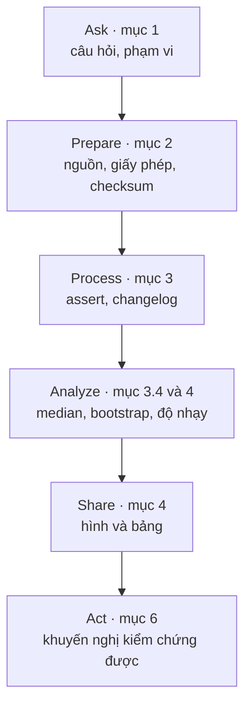

Trong 6.128.575 chuyến xe đạp công cộng ở Chicago từ tháng 11/2025 đến tháng 10/2026, chuyến của khách vãng lai (casual) dài hơn chuyến của hội viên năm (member) 49% nếu tính bằng trung bình, nhưng chỉ 28% nếu tính bằng trung vị: 11,1 so với 8,7 phút. Khác biệt rõ hơn nằm ở thời điểm và địa điểm: 37,6% chuyến casual rơi vào cuối tuần so với 23,7% ở member, member có đỉnh giờ đi làm buổi sáng mà casual gần như không có, và mười trạm đông nhất của hai nhóm không trùng nhau trạm nào. Bài thứ tám, khép lại series *Phân tích dữ liệu dựa trên bằng chứng (Evidence-based Data Analytics)*, đi trọn sáu pha Ask, Prepare, Process, Analyze, Share, Act trên dữ liệu chuyến đi công khai của Divvy, kèm changelog làm sạch có số dòng ở từng bước, khoảng tin cậy bootstrap theo ngày và phân tích độ nhạy. Đây là nghiên cứu mô tả: đơn vị là chuyến đi chứ không phải người, và không kết luận nào trong bài là kết luận nhân quả.

## 1. Mở đầu: câu hỏi và bối cảnh (Ask)

Kịch bản quen thuộc với người học phân tích dữ liệu: Cyclistic, một công ty xe đạp công cộng ở Chicago, muốn chuyển khách mua vé lượt và vé ngày (casual riders) thành hội viên năm (annual members), và đội marketing cần biết hai nhóm dùng xe khác nhau thế nào (Google, n.d.). Cyclistic và các nhân vật trong kịch bản là hư cấu; dữ liệu thì có thật, là dữ liệu chuyến đi của hệ thống Divvy. Bài này dùng tên Divvy chỉ để mô tả nguồn dữ liệu, không liên kết với và không được Lyft, Divvy hay City of Chicago bảo trợ.

Viết theo khung SMART của [bài 02](/blog/ask-questions-to-make-data-driven-decisions/), nhiệm vụ là: mô tả khác biệt giữa hai nhóm về thời lượng chuyến, ngày và giờ, mùa, loại xe và trạm, trên 12 tháng gần nhất, bằng các chỉ số có khoảng tin cậy, để đội marketing có căn cứ đặt giả thuyết cho chiến dịch chuyển đổi. Kịch bản còn hai câu hỏi nữa: vì sao khách vãng lai sẽ mua gói năm, và dùng kênh số thế nào để tác động đến họ. Dữ liệu chuyến đi không trả lời được hai câu này.

Tài liệu khoa học đã có sẵn vài dự đoán. Tổng quan của Fishman (2016), tiếp nối tổng quan trước đó (Fishman et al., 2013), ghi nhận tiện lợi là động lực chính để dùng xe đạp công cộng và đi làm là mục đích phổ biến nhất của hội viên năm. Ở Washington, D.C., khảo sát của Buck et al. (2013) cho thấy người dùng ngắn hạn đi vì giải trí nhiều hơn hội viên năm; dữ liệu GPS từ 94 xe năm 2015 cho thấy chuyến của người dùng ngắn hạn dài hơn, chậm hơn và tập trung quanh National Mall (Wergin & Buehler, 2017). Trên chính hệ thống Divvy, Zhou (2015) phân tích dữ liệu 2013–2014 và thấy mẫu hình khác nhau giữa ngày thường với cuối tuần, giữa customers với subscribers.

Bài này bổ sung ba thứ mà một bản phân tích mô tả dễ bỏ qua: so sánh bằng trung vị bên cạnh trung bình (mean), ghi lại bao nhiêu dòng bị loại ở từng bước, và thử xem kết luận có đổi khi đổi ngưỡng lọc. Sáu câu hỏi cần trả lời: thời lượng (RQ1), ngày và giờ (RQ2), mùa (RQ3), loại xe (RQ4), trạm (RQ5), và kết luận nào bền vững, kết luận nào nhạy với quyết định làm sạch (RQ6). Hình 1 gắn sáu pha của quy trình, đã giới thiệu ở [bài 01](/blog/foundations-data-data-everywhere/), với các mục của bài.



**Hình 1.** Sáu pha của quy trình phân tích và mục tương ứng trong bài.

## 2. Dữ liệu (Prepare)

### 2.1. Nguồn và cách tổ chức

Dữ liệu gồm 12 file ZIP theo tháng, từ 2025-11 đến 2026-10, tải ngày 2026-11-16 từ kho công khai của Divvy (Divvy, n.d.-b). Mỗi dòng là một chuyến, có 13 cột: `ride_id`, `rideable_type`, `started_at`, `ended_at`, tên và mã trạm đi, trạm đến, toạ độ đi và đến, `member_casual`. Bảng 1 ghi kích thước, ngày cập nhật trên kho, số dòng và 12 ký tự đầu của SHA-256 để bạn kiểm tra đúng file đã được phân tích ở đây, theo lời khuyên ghi nguồn, ngày tải và phiên bản dữ liệu của Buffalo (2015).

**Bảng 1.** Danh mục 12 file gốc (tổng 6.294.451 dòng)

| File ZIP | MB | LastModified | Số dòng | SHA-256 (12 ký tự đầu) |
| --- | ---: | --- | ---: | --- |
| 202511 | 13,59 | 2025-12-08 | 356.628 | `7d873352d710` |
| 202512 | 5,70 | 2026-01-05 | 140.534 | `bd171dbffa69` |
| 202601 | 5,91 | 2026-02-04 | 137.787 | `c72e49ced87e` |
| 202602 | 8,20 | 2026-03-04 | 201.450 | `daaccc57e080` |
| 202603 | 13,17 | 2026-04-03 | 317.037 | `7553befd3f66` |
| 202604 | 17,07 | 2026-05-04 | 448.252 | `af16f7c43ddc` |
| 202605 | 24,93 | 2026-06-04 | 653.704 | `880e4ff17b03` |
| 202606 | 28,47 | 2026-07-06 | 762.550 | `34bde1eddace` |
| 202607 | 32,91 | 2026-08-05 | 869.051 | `4e6bc8725a92` |
| 202608 | 32,61 | 2026-09-09 | 868.191 | `3f4de338ee56` |
| 202609 | 29,54 | 2026-10-05 | 770.562 | `c4d77fa960be` |
| 202610 | 37,68 | 2026-11-05 | 768.705 | `01e45b008790` |

Ba chi tiết về cách đóng gói ảnh hưởng trực tiếp đến phân tích. Thứ nhất, file `202601-divvy-tripdata.zip` chứa một CSV mang tên `202501-divvy-tripdata.csv`, dù nội dung là chuyến tháng 01/2026; script nào đặt tên theo CSV bên trong sẽ xếp nhầm năm. Thứ hai, mười file được chia theo thời điểm **kết thúc** chuyến, riêng file 2026-04 và 2026-10 chia theo thời điểm **bắt đầu**. Hệ quả là 35 chuyến bắt đầu ngày 30/04 và kết thúc ngày 01/05 xuất hiện ở cả hai file tháng 4 và tháng 5, còn các chuyến vắt qua nửa đêm 31/03 và 30/09 không có trong file nào: bộ dữ liệu không có chuyến nào bắt đầu ngày 31/03 và kết thúc ngày 01/04, trong khi ranh giới 30/06–01/07 có 120 chuyến như vậy. Thứ ba, `started_at` và `ended_at` là giờ địa phương không kèm múi giờ: cả 29 chuyến có thời lượng âm đều nằm trong khoảng 1–2 giờ sáng ngày 02/11/2025, lúc Chicago lùi đồng hồ khi hết giờ mùa hè.

### 2.2. Giấy phép

Theo Data License Agreement, bên cấp phép là Lyft Bikes and Scooters, LLC, còn City of Chicago sở hữu dữ liệu (Lyft Bikes and Scooters, LLC, n.d.). Giấy phép thuộc loại “non-exclusive, royalty-free, limited, perpetual”, cho phép phân tích, sao chép và sửa đổi dữ liệu, và dùng dữ liệu làm nguồn trong phân tích hay báo cáo công bố phi thương mại. Bốn điều bị cấm liên quan trực tiếp đến một bài portfolio: phân phối lại dữ liệu “as a stand-alone dataset”, tìm cách liên kết dữ liệu với danh tính khách hàng, ngụ ý được bảo trợ, và dùng nhãn hiệu DIVVY khi chưa được phép. Vì vậy bài này không đăng lại dữ liệu đã làm sạch; bạn tải từ kho gốc và đối chiếu checksum ở Bảng 1.

### 2.3. Đánh giá ROCCC

Bảng 2 đánh giá nguồn theo năm tiêu chí ROCCC đã bàn ở [bài 03](/blog/prepare-data-for-exploration/).

**Bảng 2.** Đánh giá ROCCC

| Tiêu chí | Đánh giá |
| --- | --- |
| Reliable | Hệ thống ghi tự động từng chuyến; cấu trúc 13 cột giống nhau ở cả 12 file, nhưng cách chia tháng không thống nhất (mục 2.1) |
| Original | Dữ liệu bên thứ nhất của nhà vận hành |
| Comprehensive | Toàn hệ thống, đủ thời gian, loại xe, trạm; không có mã người dùng, giá vé, mục đích chuyến |
| Current | Cập nhật hằng tháng; tháng 10/2026 có trên kho từ 2026-11-05 |
| Cited | Có trang giấy phép và trang mô tả dữ liệu |

### 2.4. Những gì nhà cung cấp đã xử lý, và quyền riêng tư

Trang mô tả dữ liệu cho biết các chuyến của nhân viên bảo trì và các chuyến dưới 60 giây đã được loại, và liệt kê ba loại người dùng: Member, Single Ride, Day Pass (Divvy, n.d.-a). File thực tế khác ở cả hai điểm. Cột `member_casual` chỉ có hai nhãn, nên `casual` gộp vé lượt và vé ngày. Và vẫn còn 159.643 chuyến dài chưa tới 60 giây (2,5% số dòng), tất cả là `electric_bike`. Tuyên bố của nhà cung cấp là điểm khởi đầu để kiểm tra, không thay cho việc kiểm tra.

Dữ liệu không có mã người dùng hay thông tin thanh toán. Dù vậy, dữ liệu di chuyển nói chung dễ bị tái định danh: trong dữ liệu điện thoại di động, bốn điểm không–thời gian đủ để xác định duy nhất 95% cá nhân (de Montjoye et al., 2013). Bài này không ghép dữ liệu với nguồn nào khác và chỉ báo cáo ở mức tổng hợp theo nhóm, giờ, tháng và trạm.

## 3. Phương pháp (Process và kế hoạch Analyze)

### 3.1. Môi trường

Phân tích chạy bằng Python 3.13.2, pandas 3.0.3, NumPy 2.4.6, pyarrow 24.0.0 và matplotlib 3.11.0 trên macOS 12.7. Ghi phiên bản chính xác là một trong các quy tắc tái lập cơ bản (Sandve et al., 2013; Rule et al., 2019), và [bài 07](/blog/introduction-to-data-analysis-using-python/) đã bàn vì sao notebook khó chạy lại; Pimentel et al. (2019) phân tích 1,4 triệu notebook trên GitHub để tìm các đặc điểm ảnh hưởng tới khả năng tái lập.

### 3.2. Biến dẫn xuất

Từ `started_at` và `ended_at` tính `ride_min` (thời lượng, phút), ngày trong tuần, giờ bắt đầu và tháng. Chuyến vòng (`round_trip`) là chuyến có tên trạm đi trùng tên trạm đến, chỉ xét khi cả hai tên đều có. Toạ độ không dùng để tính quãng đường: mọi chuyến không gắn trạm đều có toạ độ làm tròn hai chữ số thập phân, tức bước làm tròn cỡ một kilomet, quá thô so với chiều dài của nhiều chuyến.

### 3.3. Làm sạch có changelog

Nguyên tắc lấy từ [bài 04](/blog/process-data-from-dirty-to-clean/): dữ liệu gốc không bị sửa, mọi bước nằm trong code, mỗi dòng là một chuyến theo đúng tinh thần tidy data (Wickham, 2014; Broman & Woo, 2018; Wilson et al., 2017), và giả định ngầm được viết thành `assert` để lỗi lộ ra sớm (Buffalo, 2015). Đoạn code dưới đây nạp 12 file, kiểm tra giả định và in changelog.

```python
import re, zipfile, pathlib
import numpy as np, pandas as pd

DATA = pathlib.Path("data")                      # thư mục chứa 12 file ZIP
MONTHS = ["202511", "202512"] + [f"2026{m:02d}" for m in range(1, 11)]
ID_COLS = {c: "string" for c in ["ride_id", "start_station_id", "end_station_id"]}

frames = []
for ym in MONTHS:
    with zipfile.ZipFile(DATA / f"{ym}-divvy-tripdata.zip") as z:
        inner = [n for n in z.namelist() if n.endswith(".csv") and "MACOSX" not in n]
        assert len(inner) == 1                   # đọc theo tháng của ZIP, không theo tên CSV
        df = pd.read_csv(z.open(inner[0]), dtype=ID_COLS,
                         parse_dates=["started_at", "ended_at"])
    assert df.shape[1] == 13, ym
    assert set(df["member_casual"]) == {"member", "casual"}, ym
    frames.append(df.assign(file_month=ym))
raw = pd.concat(frames, ignore_index=True)       # raw không bị sửa ở bất kỳ bước nào

raw["ride_min"] = (raw["ended_at"] - raw["started_at"]).dt.total_seconds() / 60
SERVICE = re.compile(r"depot|warehouse|test|repair|charging", re.I)
service = (raw["start_station_name"].str.contains(SERVICE, na=False)
           | raw["end_station_name"].str.contains(SERVICE, na=False))

steps = [("trùng ride_id", lambda t: t["ride_id"].duplicated()),
         ("thời lượng <= 0", lambda t: t["ride_min"] <= 0),
         ("dưới 1 phút", lambda t: t["ride_min"] < 1),
         ("trên 24 giờ", lambda t: t["ride_min"] > 1440),
         ("trạm nội bộ", lambda t: service.loc[t.index])]
clean = raw
for name, rule in steps:                         # changelog: mỗi bước một dòng
    drop = rule(clean)
    print(f"{name:16s} {len(clean):>9,} -> {(~drop).sum():>9,}  (loại {drop.sum():,})")
    clean = clean[~drop]
```

```text
trùng ride_id    6,294,451 -> 6,294,416  (loại 35)
thời lượng <= 0  6,294,416 -> 6,294,387  (loại 29)
dưới 1 phút      6,294,387 -> 6,134,744  (loại 159,643)
trên 24 giờ      6,134,744 -> 6,129,596  (loại 5,148)
trạm nội bộ      6,129,596 -> 6,128,575  (loại 1,021)
```

**Bảng 3.** Changelog làm sạch: số dòng bị loại theo nhóm và lý do

| Bước | Loại | Member | Casual | Lý do |
| --- | ---: | ---: | ---: | --- |
| Trùng `ride_id` | 35 | 23 | 12 | Cùng chuyến nằm ở file tháng 4 và tháng 5 (mục 2.1) |
| Thời lượng ≤ 0 | 29 | 20 | 9 | Giờ địa phương lúc lùi đồng hồ 02/11/2025 |
| Dưới 1 phút | 159.643 | 86.261 | 73.382 | Nhiều khả năng là mở khoá rồi trả ngay; tất cả là e-bike |
| Trên 24 giờ | 5.148 | 1.078 | 4.070 | Tất cả là `classic_bike`, 98,1% không có trạm đến |
| Trạm nội bộ | 1.021 | 882 | 139 | 9 tên trạm chứa depot, warehouse, test, repair, charging |
| **Còn lại** | **6.128.575** | **3.966.774** | **2.161.801** | 97,4% số dòng gốc |

Hai bước cần giải thích thêm. Trong 5.148 chuyến trên 24 giờ, 5.035 chuyến có thời lượng nằm giữa 1.499 và 1.500 phút, tức gần đúng 25 giờ, và giá trị lớn nhất là 1.560 phút. Mẫu hình này phù hợp với việc hệ thống tự đóng các chuyến không được trả xe ở mốc 25 giờ, nhưng tài liệu công khai của Divvy không xác nhận điều đó, nên đây chỉ là suy đoán. Dù lý do là gì, các dòng này không đo thời gian đạp xe. Ở bước cuối, danh sách chín tên trạm nội bộ được đọc bằng mắt sau khi lọc bằng regex; các trạm có hậu tố `(Temp)`, `Public Rack` hay `Corral` là điểm đỗ của người dùng nên được giữ.

Chuyến thiếu tên trạm không bị loại. Thiếu tên trạm xuất phát chiếm 27,8% chuyến `electric_bike` và 0% chuyến `classic_bike`, vì e-bike có thể khoá ngoài trạm. Loại các chuyến này sẽ làm lệch mọi so sánh theo loại xe, nên chúng chỉ vắng mặt trong phân tích theo trạm.

### 3.4. Kế hoạch thống kê

Thời lượng được tóm tắt bằng trung vị (median), khoảng tứ phân vị (IQR), P90 và P99; mean được báo cáo bên cạnh để so sánh. Median là ước lượng vị trí bền vững với ngoại lai, mean thì không (Bruce & Bruce, 2017), và [bài 05](/blog/analyze-data-to-answer-questions/) đã bàn vì sao lựa chọn này quan trọng với phân phối lệch phải. Giá trị lớn nhất chỉ dùng để phát hiện lỗi dữ liệu.

Độ lớn hiệu ứng gồm chênh lệch và tỷ số median (casual so với member), và chênh lệch tỷ lệ tính bằng điểm phần trăm cho các biến phân loại. Khoảng tin cậy 95% lấy từ bootstrap 2.000 lần, trong đó đơn vị lấy mẫu lại là **ngày** chứ không phải chuyến, phân tầng theo ngày thường và cuối tuần, seed cố định 20261116. Các chuyến trong cùng một ngày chịu chung thời tiết và sự kiện, nên coi chúng là độc lập sẽ cho khoảng tin cậy hẹp một cách giả tạo. Bài không dùng p-value làm tiêu chí: với mẫu rất lớn, p-value nhanh chóng tiến về 0 và khác biệt nhỏ đến đâu cũng “có ý nghĩa thống kê” (Lin et al., 2013). Đoạn code sau, chạy tiếp từ `clean`, tính khoảng tin cậy cho chênh lệch tỷ lệ chuyến cuối tuần.

```python
day = clean["started_at"].dt.normalize()
per_day = clean.groupby([day, "member_casual"]).size().unstack(fill_value=0)
weekend = per_day.index.dayofweek >= 5

def weekend_gap(t, we):
    share = t[we].sum() / t.sum()
    return share["casual"] - share["member"]

rng = np.random.default_rng(20261116)
idx_wd, idx_we = np.where(~weekend)[0], np.where(weekend)[0]
boot = []
for _ in range(2000):                            # lấy mẫu lại ngày, phân tầng
    pick = np.r_[rng.choice(idx_wd, idx_wd.size), rng.choice(idx_we, idx_we.size)]
    boot.append(weekend_gap(per_day.iloc[pick], weekend[pick]))
print(round(weekend_gap(per_day, weekend), 4), np.percentile(boot, [2.5, 97.5]).round(4))
```

```text
0.1392 [0.1169 0.1607]
```

Mẫu hình theo giờ và ngày được chuẩn hoá thành tỷ lệ trong tổng số chuyến của từng nhóm, để so hình dạng chứ không so số tuyệt đối. Phân tích trạm chỉ dùng trạm có ít nhất 1.000 chuyến xuất phát. Phân tích độ nhạy lặp lại các kết quả chính với ngưỡng dưới (không lọc, 1 phút, 2 phút), ngưỡng trên (3 giờ, 24 giờ, không lọc), có hoặc không có trạm nội bộ, và gán tháng theo `started_at` hoặc theo file.

## 4. Kết quả (Analyze và Share)

### 4.1. Dữ liệu sau làm sạch

Còn 6.128.575 chuyến trong 366 ngày, gồm 3.966.774 chuyến member (64,7%) và 2.161.801 chuyến casual (35,3%; khoảng tin cậy 95%: 34,3–36,3%).

### 4.2. Thời lượng (RQ1)

**Bảng 4.** Thời lượng chuyến theo nhóm (phút)

| Nhóm | Median | IQR | P90 | P99 | Mean | Trên 30 phút |
| --- | ---: | --- | ---: | ---: | ---: | ---: |
| Member | 8,68 | 5,19–14,61 | 23,36 | 51,36 | 12,12 | 5,4% |
| Casual | 11,09 | 6,46–19,85 | 35,44 | 108,84 | 18,02 | 13,2% |

Chuyến điển hình của casual dài hơn của member 2,4 phút (2,25–2,58), tức gấp 1,28 lần (1,26–1,30). Tính theo mean, khoảng cách là 5,9 phút, gấp 1,49 lần (1,47–1,51). Phần chênh giữa hai cách tính đến từ đuôi phải: P99 của casual gấp đôi của member, và 3,8% chuyến casual dài hơn một giờ so với 0,6% ở member (Hình 2). Cả hai con số đều đúng, nhưng trả lời hai câu hỏi khác nhau: median nói về chuyến điển hình, mean nói về tổng số phút sử dụng. Câu “khách vãng lai đi lâu gấp rưỡi” mô tả tổng thời gian sử dụng, không mô tả một chuyến thường gặp.


**Hình 2.** Phân phối tích luỹ của thời lượng chuyến theo nhóm, trục hoành thang log. Đường đứt là median, đường chấm là mean.

### 4.3. Ngày và giờ (RQ2)

Chuyến cuối tuần chiếm 37,6% ở casual và 23,7% ở member, chênh 13,9 điểm phần trăm (11,7–16,1). Tính theo ngày, member có trung bình 11.595 chuyến mỗi ngày thường và 8.956 chuyến mỗi ngày cuối tuần; casual thì ngược lại, 5.166 và 7.747. Thứ Bảy là ngày đông nhất của casual (21,5% số chuyến), thứ Ba là ngày đông nhất của member (16,3%).

Trong ngày thường, 18,6% chuyến member bắt đầu từ 6 đến trước 9 giờ sáng, so với 9,5% ở casual, chênh 9,1 điểm (8,9–9,3). Buổi chiều thì hai nhóm gần nhau: 30,7% và 29,2% số chuyến ngày thường bắt đầu từ 16 đến trước 19 giờ, và cả hai cùng đạt đỉnh lúc 17 giờ. Hình 3 cho thấy member có hai đỉnh ngày thường, còn casual có một đỉnh chiều ngày thường và một dải rộng từ trưa đến chiều thứ Bảy, Chủ nhật. Gộp cả 168 ô ngày–giờ, chỉ số khác biệt (dissimilarity index) là 0,18: phải chuyển 18% số chuyến của một nhóm sang ô khác thì hai phân phối mới trùng nhau.


**Hình 3.** Tỷ lệ chuyến theo ngày trong tuần và giờ bắt đầu, tính trên tổng số chuyến của từng nhóm.

### 4.4. Mùa (RQ3)

Cả hai nhóm đều đi nhiều hơn vào mùa ấm, nhưng casual dao động mạnh hơn nhiều. Tháng cao nhất của casual (tháng 7, 345.533 chuyến) gấp 14,5 lần tháng thấp nhất (tháng 1, 23.876 chuyến); ở member tỷ số này là 4,7 (tháng 8 so với tháng 12). Tỷ lệ chuyến casual vì thế đi từ 17,9% trong tháng 1 lên 40,9% trong tháng 7 (Hình 4).


**Hình 4.** Số chuyến theo tháng của từng nhóm (trên) và tỷ lệ chuyến casual (dưới), tháng tính theo `started_at`; không vẽ 108 chuyến bắt đầu ngày 31/10/2025.

### 4.5. Loại xe (RQ4)

E-bike chiếm đa số ở cả hai nhóm: 75,4% chuyến casual và 69,2% chuyến member, chênh 6,2 điểm (5,9–6,5). So với khác biệt về ngày, giờ và mùa, đây là khác biệt nhỏ.

### 4.6. Trạm và chuyến vòng (RQ5)

Khoảng bốn phần năm số chuyến có tên trạm xuất phát; tỷ lệ thiếu gần bằng nhau ở hai nhóm (19,6% ở member, 20,4% ở casual). Có 649 trạm đạt ngưỡng 1.000 chuyến xuất phát, chiếm 96,0% số chuyến có tên trạm. Ở một trạm điển hình, casual chiếm 32,1% số chuyến (IQR 28,7–37,8%), và chỉ 54 trạm có casual chiếm quá nửa.

Mười trạm đông nhất của hai nhóm không trùng nhau trạm nào. Phía casual là Navy Pier (49.970 chuyến casual, 75,8% số chuyến của trạm), DuSable Lake Shore Dr & Monroe St (78,4%), Michigan Ave & Oak St, Millennium Park, Shedd Aquarium (81,8%), Field Museum (81,0%) và các trạm ven hồ khác. Phía member là các trạm trên Canal St, Clinton St, Kingsbury St và Wells St ở khu trung tâm, nơi casual chỉ chiếm khoảng 19–33%. Mười trạm đầu chiếm 11,5% số chuyến casual có tên trạm nhưng chỉ 6,2% số chuyến member: casual tập trung hơn về không gian. Trên Hình 5, các trạm có tỷ lệ casual cao xếp thành một dải dọc bờ hồ.


**Hình 5.** 649 trạm có ít nhất 1.000 chuyến xuất phát, đặt theo toạ độ, không có bản đồ nền. Màu là tỷ lệ chuyến casual, cỡ chấm là số chuyến.

Trong các chuyến có đủ tên hai trạm, chuyến vòng chiếm 7,4% ở casual và 2,2% ở member, chênh 5,2 điểm (5,0–5,3). Chuyến vòng cũng dài hơn: median 16,2 phút ở casual và 14,2 phút ở member, so với 11,8 và 8,6 phút của chuyến một chiều.

### 4.7. Độ nhạy (RQ6)

**Bảng 5.** Kết quả chính dưới từng kịch bản lọc

| Kịch bản | Số chuyến | Casual | Median C / M | Tỷ số median | Tỷ số mean | Chênh cuối tuần |
| --- | ---: | ---: | --- | ---: | ---: | ---: |
| Chính (1 phút–24 giờ) | 6.128.575 | 35,3% | 11,09 / 8,68 | 1,28 | 1,49 | 13,9 |
| Không ngưỡng dưới | 6.288.194 | 35,6% | 10,71 / 8,50 | 1,26 | 1,47 | 14,0 |
| Ngưỡng dưới 2 phút | 5.990.401 | 35,5% | 11,29 / 8,89 | 1,27 | 1,48 | 13,9 |
| Ngưỡng trên 3 giờ | 6.118.782 | 35,2% | 11,06 / 8,67 | 1,28 | 1,44 | 13,9 |
| Không ngưỡng trên | 6.133.723 | 35,3% | 11,11 / 8,68 | 1,28 | 1,66 | 13,9 |
| Giữ trạm nội bộ | 6.129.596 | 35,3% | 11,09 / 8,68 | 1,28 | 1,49 | 13,9 |
| Không lọc gì | 6.294.387 | 35,6% | 10,73 / 8,50 | 1,26 | 1,64 | 14,0 |

Không kết luận nào đổi chiều. Tỷ số median nằm trong khoảng 1,26–1,28 ở mọi kịch bản, và chênh lệch cuối tuần gần như đứng yên. Chỉ số duy nhất nhạy với quyết định làm sạch là mean: bỏ ngưỡng trên thì mean của casual tăng từ 18,0 lên 20,8 phút và tỷ số mean nhảy từ 1,49 lên 1,66, chỉ vì 5.148 dòng, chưa tới 0,1% dữ liệu. Gán tháng theo `started_at` hay theo file làm tỷ lệ casual của một tháng đổi nhiều nhất 0,006 điểm phần trăm.

## 5. Thảo luận

### 5.1. So với tài liệu

Kết quả khớp với những gì đã biết về xe đạp công cộng. Member có hai đỉnh giờ cao điểm ngày thường, đúng với nhận định rằng đi làm là mục đích phổ biến nhất của hội viên năm (Fishman, 2016). Khác biệt giữa ngày thường với cuối tuần và giữa hai loại người dùng mà Zhou (2015) thấy trên Divvy năm 2013–2014 vẫn còn nguyên sau hơn một thập kỷ, dù phần lớn chuyến nay đi bằng e-bike. Chuyến casual dài hơn, nhiều chuyến vòng hơn và tập trung ở bờ hồ, bảo tàng, công viên, tương tự hình ảnh ở Washington, D.C., nơi chuyến của người dùng ngắn hạn dài hơn, chậm hơn và quây quanh National Mall (Wergin & Buehler, 2017), và nơi khảo sát cho thấy họ đi giải trí nhiều hơn (Buck et al., 2013). Cần nhớ hai nghiên cứu này ở thành phố khác và trước thời e-bike.

Về mùa, các nghiên cứu có dữ liệu thời tiết cho thấy nhiệt độ thấp, mưa và độ ẩm cao đi cùng với ít chuyến hơn và chuyến ngắn hơn ở Washington, D.C. (Gebhart & Noland, 2014), và nhiệt độ tương quan với số chuyến ở Toronto (El-Assi et al., 2017). Dao động 14,5 lần của casual phù hợp với hướng đó, nhưng bài này không có dữ liệu thời tiết nên không tách được phần của thời tiết khỏi phần của du lịch, kỳ nghỉ hay sự kiện.

Điểm mới so với cách kể thông thường nằm ở độ lớn. Khác biệt về thời lượng điển hình là có thật nhưng khiêm tốn, 2,4 phút; con số “gấp rưỡi” là sản phẩm của đuôi phải và của ngưỡng lọc. Khác biệt lớn và bền vững nằm ở lịch và bản đồ. Phân tích mô tả trước đó trên cùng dữ liệu trong [báo cáo Cyclistic](/projects/cyclistic-bike-share/phan-tich-chi-tiet-casual-riders-va-annual-members-dung-xe-cyclistic-khac-nhau-t/) cũng đi đến bức tranh tương tự.

### 5.2. Giới hạn

Thứ nhất, đây là nghiên cứu mô tả. Hai nhóm có thể khác nhau về nơi ở, mục đích, giá vé phải trả và nhiều yếu tố khác mà dữ liệu không ghi lại; không biến nào trong 13 cột cho phép tách chúng. Hernán et al. (2019) chia nhiệm vụ của khoa học dữ liệu thành mô tả, dự đoán và dự đoán phản thực (gồm suy luận nhân quả); bài này chỉ làm việc thứ nhất. Hernán (2018) cũng nhắc rằng nên nói thẳng mục tiêu nghiên cứu thay vì dùng uyển ngữ, nên bài tránh các từ như “khiến” hay “ảnh hưởng”: gói hội viên không “làm” người ta đi làm bằng xe đạp, và điều ngược lại cũng chưa được chứng minh.

Thứ hai, đơn vị là chuyến, không phải người. Không đếm được có bao nhiêu khách vãng lai, một số ít người đi rất nhiều có thể chi phối các tỷ lệ, và không biết ai đã chuyển từ casual sang member trong năm.

Thứ ba, nhãn `casual` gộp vé lượt và vé ngày, hai nhóm có thể hành xử khác nhau.

Thứ tư, chất lượng dữ liệu: chuyến dưới 60 giây còn sót, một phần năm số chuyến không có tên trạm, toạ độ làm tròn, hai cách chia tháng làm mất các chuyến vắt qua nửa đêm 31/03 và 30/09, và thời lượng sai với chuyến vắt qua lúc đổi giờ. Các lỗi này nhỏ so với 6,1 triệu chuyến, và phân tích độ nhạy cho thấy chúng không đổi kết luận, nhưng phân tích ở mức một ngày hay một trạm cụ thể sẽ phải thận trọng hơn.

Thứ năm, chỉ có một năm dữ liệu; mùa đông hay mùa hè khác thường sẽ in dấu lên mọi con số theo tháng.

## 6. Khuyến nghị (Act)

Ba khuyến nghị dưới đây dành cho kịch bản Cyclistic và đều là **giả thuyết cần thử**, viết theo trình tự kết quả, giả thuyết, hành động, chỉ số, cách kiểm chứng.

1. **Gói theo mùa và cuối tuần.** Chuyến casual dồn vào cuối tuần (37,6%) và mùa ấm (chênh 14,5 lần giữa tháng 7 và tháng 1). Giả thuyết: với một phần khách vãng lai, gói cả năm không khớp với cách họ dùng xe. Hành động: thử một thông điệp hoặc gói hội viên nhấn vào mùa hè và cuối tuần, chạy từ tháng 5. Chỉ số: tỷ lệ khách vãng lai mua gói trong 30 ngày. Kiểm chứng: A/B test, chia ngẫu nhiên theo tài khoản.
2. **Truyền thông tại các trạm ven hồ.** 54 trạm có casual chiếm quá nửa, đứng đầu là Navy Pier và các trạm quanh bảo tàng. Giả thuyết: ở đây lẫn cả du khách, vốn khó thành hội viên năm, và người địa phương đi chơi cuối tuần. Hành động: chỉ hiển thị ưu đãi cho tài khoản đã có nhiều chuyến trong vài tuần. Chỉ số: tỷ lệ chuyển đổi trên mỗi lượt hiển thị. Kiểm chứng: triển khai lần lượt theo nhóm trạm chọn ngẫu nhiên.
3. **Khách vãng lai có dáng đi làm.** Buổi chiều ngày thường, casual đi gần giống member (29,2% so với 30,7% số chuyến ngày thường), dù buổi sáng thì không. Giả thuyết: một nhóm khách vãng lai dùng xe đều đặn cho chặng về buổi chiều. Hành động: gửi cho tài khoản có nhiều chuyến giờ cao điểm trong tháng một bảng so sánh chi phí vé lẻ với gói năm. Chỉ số và kiểm chứng: như khuyến nghị 1.

Câu hỏi “vì sao” cần dữ liệu khác: khảo sát người dùng, như cách Buck et al. (2013) đã làm, cùng với loại vé và giá vé của từng chuyến, mã người dùng đã ẩn danh hoá an toàn, và thời tiết theo ngày.

## 7. Tuyên bố tái lập

Mọi con số trong bài sinh ra từ ba script Python: nạp và kiểm tra dữ liệu, phân tích, vẽ hình. Phần lõi của hai script đầu được in ở mục 3.3 và 3.4 và chạy lại được nguyên văn. Để tái lập, bạn tải 12 file ZIP từ kho gốc (Divvy, n.d.-b), so 12 ký tự đầu của SHA-256 với Bảng 1, cài đúng các phiên bản thư viện ở mục 3.1 và giữ seed 20261116 với 2.000 lần bootstrap. Dữ liệu gốc và dữ liệu đã làm sạch không được đăng lại vì giấy phép không cho phép phân phối chúng như một bộ dữ liệu độc lập. Hình 2–5 vẽ bằng matplotlib với cặp màu Okabe–Ito cố định cho hai nhóm và bảng màu cividis, viridis, theo các nguyên tắc ở [bài 06](/blog/share-data-through-the-art-of-visualization/). Nếu kho gốc thay file, checksum sẽ khác và các con số có thể lệch; khi đó Bảng 1 cho biết phiên bản nào đã được dùng ở đây.

## 8. Kết luận

Khách vãng lai và hội viên năm của hệ thống xe đạp công cộng Chicago khác nhau trước hết ở **khi nào** và **ở đâu** họ đi: cuối tuần so với giờ đi làm, bờ hồ và bảo tàng so với khu trung tâm, mùa hè so với quanh năm. Chuyến điển hình của khách vãng lai dài hơn khoảng 2,4 phút, không phải gấp rưỡi. Các kết luận này đứng vững qua mọi ngưỡng lọc đã thử, và chỉ mean là chao đảo. Chúng đủ để đặt giả thuyết cho marketing, còn muốn biết giả thuyết nào đúng thì phải thử nghiệm.

## Tài liệu tham khảo

Broman, K. W., & Woo, K. H. (2018). Data organization in spreadsheets. *The American Statistician, 72*(1), 2–10. https://doi.org/10.1080/00031305.2017.1375989

Bruce, P., & Bruce, A. (2017). *Practical statistics for data scientists: 50 essential concepts*. O'Reilly Media.

Buck, D., Buehler, R., Happ, P., Rawls, B., Chung, P., & Borecki, N. (2013). Are bikeshare users different from regular cyclists? A first look at short-term users, annual members, and area cyclists in the Washington, D.C., region. *Transportation Research Record, 2387*(1), 112–119. https://doi.org/10.3141/2387-13

Buffalo, V. (2015). *Bioinformatics data skills: Reproducible and robust research with open source tools*. O'Reilly Media.

de Montjoye, Y.-A., Hidalgo, C. A., Verleysen, M., & Blondel, V. D. (2013). Unique in the crowd: The privacy bounds of human mobility. *Scientific Reports, 3*, 1376. https://doi.org/10.1038/srep01376

Divvy. (n.d.-a). *Divvy data: Historical trip data available to the public*. Truy cập ngày 2026-11-11, từ https://divvybikes.com/system-data

Divvy. (n.d.-b). *divvy-tripdata* [Kho dữ liệu]. Truy cập ngày 2026-11-16, từ https://divvy-tripdata.s3.amazonaws.com/index.html

El-Assi, W., Salah Mahmoud, M., & Nurul Habib, K. (2017). Effects of built environment and weather on bike sharing demand: A station level analysis of commercial bike sharing in Toronto. *Transportation, 44*(3), 589–613. https://doi.org/10.1007/s11116-015-9669-z

Fishman, E. (2016). Bikeshare: A review of recent literature. *Transport Reviews, 36*(1), 92–113. https://doi.org/10.1080/01441647.2015.1033036

Fishman, E., Washington, S., & Haworth, N. (2013). Bike share: A synthesis of the literature. *Transport Reviews, 33*(2), 148–165. https://doi.org/10.1080/01441647.2013.775612

Gebhart, K., & Noland, R. B. (2014). The impact of weather conditions on bikeshare trips in Washington, DC. *Transportation, 41*(6), 1205–1225. https://doi.org/10.1007/s11116-014-9540-7

Google. (n.d.). *Google Data Analytics Capstone: Complete a case study* [MOOC]. Coursera. https://www.coursera.org/learn/google-data-analytics-capstone

Hernán, M. A. (2018). The C-word: Scientific euphemisms do not improve causal inference from observational data. *American Journal of Public Health, 108*(5), 616–619. https://doi.org/10.2105/AJPH.2018.304337

Hernán, M. A., Hsu, J., & Healy, B. (2019). A second chance to get causal inference right: A classification of data science tasks. *CHANCE, 32*(1), 42–49. https://doi.org/10.1080/09332480.2019.1579578

Lin, M., Lucas, H. C., & Shmueli, G. (2013). Research commentary—Too big to fail: Large samples and the p-value problem. *Information Systems Research, 24*(4), 906–917. https://doi.org/10.1287/isre.2013.0480

Lyft Bikes and Scooters, LLC. (n.d.). *Data license agreement*. Divvy. Truy cập ngày 2026-11-11, từ https://divvybikes.com/data-license-agreement

Pimentel, J. F., Murta, L., Braganholo, V., & Freire, J. (2019). A large-scale study about quality and reproducibility of Jupyter notebooks. In *2019 IEEE/ACM 16th International Conference on Mining Software Repositories (MSR)* (pp. 507–517). IEEE. https://doi.org/10.1109/MSR.2019.00077

Rule, A., Birmingham, A., Zuniga, C., Altintas, I., Huang, S.-C., Knight, R., Moshiri, N., Nguyen, M. H., Rosenthal, S. B., Pérez, F., & Rose, P. W. (2019). Ten simple rules for writing and sharing computational analyses in Jupyter Notebooks. *PLOS Computational Biology, 15*(7), e1007007. https://doi.org/10.1371/journal.pcbi.1007007

Sandve, G. K., Nekrutenko, A., Taylor, J., & Hovig, E. (2013). Ten simple rules for reproducible computational research. *PLoS Computational Biology, 9*(10), e1003285. https://doi.org/10.1371/journal.pcbi.1003285

Wergin, J., & Buehler, R. (2017). Where do bikeshare bikes actually go? Analysis of Capital Bikeshare trips with GPS data. *Transportation Research Record, 2662*(1), 12–21. https://doi.org/10.3141/2662-02

Wickham, H. (2014). Tidy data. *Journal of Statistical Software, 59*(10). https://doi.org/10.18637/jss.v059.i10

Wilson, G., Bryan, J., Cranston, K., Kitzes, J., Nederbragt, L., & Teal, T. K. (2017). Good enough practices in scientific computing. *PLOS Computational Biology, 13*(6), e1005510. https://doi.org/10.1371/journal.pcbi.1005510

Zhou, X. (2015). Understanding spatiotemporal patterns of biking behavior by analyzing massive bike sharing data in Chicago. *PLOS ONE, 10*(10), e0137922. https://doi.org/10.1371/journal.pone.0137922
