Giáo trình gồm 12 phần và phụ lục, học trong khoảng 36 tuần với 8–10 giờ mỗi tuần. Bạn đi từ nền tảng tính toán đến phân tích đa omics và AI trong sinh học.

**Mục tiêu sau khóa học**

- Làm việc thành thạo trên Linux, viết script Python và R để xử lý dữ liệu sinh học.
- Tự chạy trọn vẹn một quy trình NGS: từ file FASTQ thô đến danh sách biến thể hoặc gen biểu hiện khác biệt.
- Hiểu thuật toán đằng sau công cụ, để chọn tham số và đánh giá kết quả một cách có căn cứ.
- Có 3–4 dự án hoàn chỉnh trên GitHub làm portfolio xin việc hoặc xin học bổng thạc sĩ.

**Đối tượng.** Giáo trình viết cho người đã có nền tảng sinh học phân tử (DNA, RNA, protein, PCR, biểu hiện gen). Người chưa biết lập trình vẫn theo được, vì Phần 2 bắt đầu từ con số không.

**Ba cấp độ**

1. Nhập môn (Phần 1–4): khái niệm, công cụ, thống kê, dữ liệu.
2. Trung cấp (Phần 5–7): phân tích trình tự, genomics, transcriptomics.
3. Nâng cao (Phần 8–12): proteomics, đa omics, machine learning, quy trình tái lập, dự án.

```mermaid
flowchart LR
    subgraph N["Nhập môn · Tuần 1–11"]
        P1["1. Nhập môn"] --> P2["2. Nền tảng tính toán"] --> P3["3. Toán và thống kê"] --> P4["4. Định dạng và CSDL"]
    end
    subgraph T["Trung cấp · Tuần 12–24"]
        P5["5. Phân tích trình tự"] --> P6["6. NGS và genomics"] --> P7["7. Transcriptomics"]
    end
    subgraph A["Nâng cao · Tuần 25–36"]
        P8["8. Proteomics"] --> P9["9. Epigenomics, metagenomics, đa omics"] --> P10["10. ML và AI"] --> P11["11. Quy trình tái lập"] --> P12["12. Dự án và portfolio"]
    end
    P4 --> P5
    P7 --> P8
```

Mỗi cấp độ xây trên cấp trước. Đích đến là Phần 12: 3–4 dự án hoàn chỉnh trên GitHub.

**Cấu trúc mỗi phần.** Mục tiêu → Kiến thức cốt lõi → Hướng dẫn thực hành (có lệnh và code) → Bài tập → Tài nguyên.

**Chuẩn bị môi trường**

- Máy tính: Linux, macOS, hoặc Windows có WSL2 (Ubuntu). RAM tối thiểu 8 GB, khuyến nghị 16 GB.
- Phần mềm: Miniconda (quản lý gói), VS Code, RStudio, Git.
- Miễn phí trên mây: Google Colab cho Python, Galaxy (usegalaxy.org) để chạy công cụ NGS qua giao diện web khi máy yếu.

**Mẹo học hiệu quả.** Gõ lại mọi lệnh thay vì sao chép. Ghi chép theo mẫu "lệnh → làm gì → khi nào dùng". Mỗi khi xong một phần, viết một README ngắn trên GitHub tóm tắt điều đã làm.
