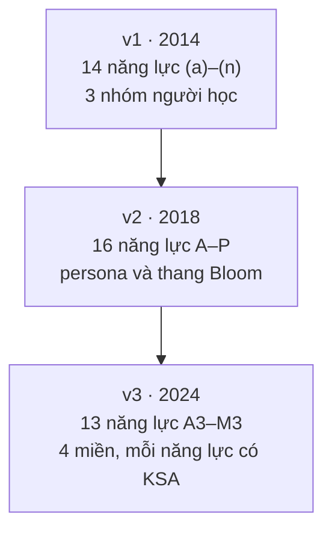
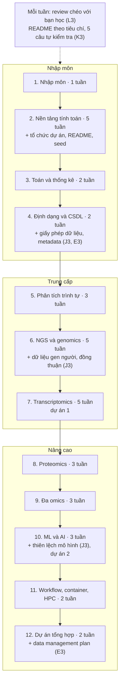

Lộ trình tự học bioinformatics của series *Bioinformatics từ nhập môn đến nâng cao* gồm 12 phần trong 36 tuần, mỗi tuần 8–10 giờ (khoảng 288–360 giờ). Nó đi từ Linux, Python, R và thống kê đến NGS, RNA-seq, đa omics và machine learning. Học hết chừng đó đã đủ chưa? Để trả lời, bài này đặt từng phần cạnh khung năng lực cốt lõi ISCB v3 (Brooksbank et al., 2024), gồm 13 năng lực A3–M3 trong bốn miền. Lộ trình phủ dày các năng lực kỹ thuật. Miền ứng xử nghề nghiệp thì chỉ nhận khoảng 1,7 trong 36 tuần, và không phần nào dạy đạo đức dữ liệu (J3) hay làm việc nhóm (L3). Bài viết cho sinh viên sinh học muốn tự học, kèm bảng ánh xạ để bạn tự kiểm tra, một lộ trình đã chỉnh và lịch học một tuần mẫu.

<div class="callout callout-note">
<p class="callout-title">Tóm tắt nhanh</p>

- Lộ trình: 12 phần, 36 tuần, ba cấp độ; đích là 3–4 dự án trên GitHub.
- Thước đo: khung ISCB v3 (2024), 13 năng lực trong bốn miền, viết như tiêu chuẩn tối thiểu.
- Mạnh: D3, F3, H3, B3. Thiếu: J3, L3. Mỏng: E3 (FAIR), K3 (giao tiếp).
- Cách vá không cần thêm tuần: đưa thói quen tái lập lên Phần 2, rải đạo đức và FAIR vào Phần 4, 6, 10, biến README thành bài tập giao tiếp.

</div>

## 1. Lộ trình 36 tuần gồm những gì

### 1.1. Ba cấp độ, 12 phần

Lộ trình chia ba cấp độ: **Nhập môn** (tuần 1–11, Phần 1–4), **Trung cấp** (tuần 12–24, Phần 5–7) và **Nâng cao** (tuần 25–36, Phần 8–12). Cấp sau xây trên cấp trước.

**Bảng 1.** Mười hai phần của lộ trình

| Phần | Tuần | Nội dung chính |
| --- | --- | --- |
| 1. Nhập môn | 1 | Các tầng omics, quy trình 7 bước của một dự án, nghề nghiệp |
| 2. Nền tảng tính toán | 2–7 | Linux, Bash, Python, R, Bioconductor, conda, Git |
| 3. Toán và thống kê | 8–9 | Kiểm định, multiple testing, chuẩn hoá, giảm chiều, hồi quy |
| 4. Định dạng và cơ sở dữ liệu | 10–11 | FASTA, FASTQ, BAM, VCF; NCBI, Ensembl, UniProt; SRA, GEO |
| 5. Phân tích trình tự | 12–14 | Sắp gióng, BLAST, MSA, phát sinh loài |
| 6. NGS và genomics | 15–19 | QC, căn chỉnh, gọi và chú giải biến thể, lắp ráp |
| 7. Transcriptomics | 20–24 | Thiết kế thí nghiệm, DESeq2, làm giàu, single-cell |
| 8. Proteomics | 25–27 | Proteomics khối phổ, cấu trúc protein, docking |
| 9. Đa omics | 28–30 | Epigenomics, metagenomics, tích hợp |
| 10. Machine learning và AI | 31–33 | scikit-learn, lỗi kiểm chứng, deep learning |
| 11. Quy trình tái lập | 34 | Workflow manager, container, HPC, cloud |
| 12. Dự án và portfolio | 35–36 | Dự án tổng hợp, repo, trình bày, phỏng vấn |

Gần một nửa thời gian rơi vào hai khối: nền tảng tính toán (6 tuần) và NGS cộng transcriptomics (10 tuần). Lý do là hai khối này được dùng lại ở mọi phần sau. Metabolomics có mặt ở [Phần 1](/blog/nhap-mon-bioinformatics/) khi giới thiệu các tầng omics nhưng nằm ngoài phạm vi lộ trình.

### 1.2. Đầu ra, đối tượng và cấu trúc mỗi phần

Sau 36 tuần, bạn cần làm được bốn việc. Một, làm việc thành thạo trên Linux và viết script Python, R cho dữ liệu sinh học. Hai, tự chạy một quy trình NGS từ FASTQ thô đến danh sách biến thể hoặc gen biểu hiện khác biệt. Ba, hiểu thuật toán đủ để chọn tham số có căn cứ. Bốn, có 3–4 dự án trên GitHub: dự án thứ nhất ở Phần 7, dự án thứ hai ở Phần 10, dự án tổng hợp ở Phần 12.

Đối tượng là người đã có nền sinh học phân tử (DNA, RNA, protein, PCR, biểu hiện gen). Chưa biết lập trình vẫn theo được, vì [Phần 2](/blog/nen-tang-tinh-toan/) bắt đầu từ dòng lệnh đầu tiên. Mỗi phần đi theo khuôn **Mục tiêu → Kiến thức cốt lõi → Thực hành → Bài tập → Tài nguyên**; riêng Phần 12 thay bài tập bằng danh sách kiểm tra cuối lộ trình. Mục tiêu và bài tập của từng phần là chuẩn đầu ra (learning outcome) dùng để ánh xạ ở mục 3.

### 1.3. Vì sao cần đối chiếu với một khung năng lực

Một tổng quan các khảo sát nhu cầu đào tạo ghi nhận bioinformatics đã thành phần thiết yếu của nghiên cứu sự sống, nhưng chuyên môn này vẫn thiếu kéo dài. Quản lý dữ liệu cơ bản (data stewardship) hiếm khi được dạy, và lời kêu gọi khẩn thiết nhất là đưa bioinformatics vào chính chương trình đại học (Attwood et al., 2019). Một khảo sát 1.260 giảng viên ngành sự sống ở Mỹ cho thấy rào cản hay gặp nhất là giảng viên thiếu chuyên môn hoặc thiếu đào tạo (Williams et al., 2019).

Người tự học không có hội đồng chương trình nào hỏi "học xong thì làm được gì mà người tuyển dụng cần?". Khung năng lực (competency framework) trả lời đúng câu đó, và ISCB khuyên dùng khung của họ để thiết kế, đánh giá và sửa chương trình (Brooksbank et al., 2024). Bài đặt ba câu hỏi: lộ trình **phủ** năng lực nào, đạt **mức** nào so với các career profile, và **thứ tự** học đã hợp lý chưa.

## 2. Khung năng lực ISCB qua ba phiên bản

Hội Sinh học Tính toán Quốc tế (International Society for Computational Biology, ISCB) xây khung năng lực qua ba phiên bản trong mười năm.



### 2.1. Phiên bản 1 (2014)

Bản đầu dựa trên khảo sát 29 giám đốc core facility (đơn vị dịch vụ bioinformatics) và 75 tin tuyển dụng. Từ đó, nhóm tác giả rút ra 14 năng lực (a)–(n) cho ba nhóm: bioinformatics user, scientist và engineer (Welch et al., 2014). Người mới tuyển bậc thạc sĩ hay thiếu kinh nghiệm phân tích **dữ liệu sinh học thật**. Bậc tiến sĩ thì hay thiếu kỹ năng **giao tiếp**, tổng hợp thông tin và hoàn thành dự án. Làm việc nhóm (g), đạo đức và pháp lý (h), giao tiếp (i) và học tập liên tục (k) được đánh dấu cho cả ba nhóm. Ngay từ bản đầu, các kỹ năng này đã là việc của mọi người học, không riêng nhà khoa học cấp cao.

### 2.2. Phiên bản 2 (2018)

Sau giai đoạn thử áp dụng và tinh chỉnh (Welch et al., 2016), phiên bản 2 có 16 năng lực A–P (Mulder et al., 2018). Ba nhóm người học được mở thành nhiều persona (hình mẫu nghề nghiệp) như bác sĩ, biocurator, discovery biologist, kỹ sư. Mỗi persona có mức yêu cầu riêng, chấm theo **thang Bloom** (Bloom's taxonomy), từ Knowledge, Comprehension, Application đến các mức cao như Synthesis và Evaluation.

Trong cùng bài báo, EMBL-EBI và Đại học Cambridge ánh xạ 71 khoá ngắn (50 + 21) vào khung; 68/71 khoá rèn năng lực F (dùng công cụ), và hai đơn vị đề xuất thêm năng lực **data curation** (Mulder et al., 2018). Mạng NIBLSE cũng công bố khung riêng cho bậc đại học ngành sự sống (Wilson Sayres et al., 2018).

### 2.3. Phiên bản 3 (2024)

Phiên bản hiện hành có 13 năng lực A3–M3 trong bốn miền: khoa học sự sống, khoa học dữ liệu, khoa học máy tính và ứng xử nghề nghiệp. Mỗi năng lực kèm danh sách kiến thức, kỹ năng và thái độ (KSA), và khung được viết như **tiêu chuẩn tối thiểu** (Brooksbank et al., 2024). So với v2 có hai thay đổi lớn. Năng lực mới **E3** về quản lý dữ liệu theo chuẩn cộng đồng nhằm khuyến khích nguyên tắc FAIR (Findable, Accessible, Interoperable, Reusable; Wilkinson et al., 2016). D3 thì mở rộng sang AI/ML.

**Bảng 2.** Mười ba năng lực ISCB v3 (diễn giải từ Brooksbank et al., 2024)

| Miền | Mã | Năng lực |
| --- | --- | --- |
| Khoa học sự sống | A3 | Kiến thức sâu ở một mảng sinh học |
| | B3 | Chuẩn bị dữ liệu sự sống cho phân tích |
| | C3 | Đóng góp vào khám phá khoa học |
| Khoa học dữ liệu | D3 | Phương pháp data science phù hợp dữ liệu, kể cả AI/ML |
| | E3 | Quản lý dữ liệu theo chuẩn cộng đồng |
| | F3 | Dùng công cụ và tài nguyên bioinformatics |
| Khoa học máy tính | G3 | Góp phần thiết kế công cụ hướng người dùng |
| | H3 | Lập trình hiệu quả |
| | I3 | Xây và vận hành hạ tầng tính toán |
| Ứng xử nghề nghiệp | J3 | Tuân thủ chuẩn đạo đức, pháp lý, xã hội |
| | K3 | Giao tiếp với nhiều đối tượng |
| | L3 | Làm việc nhóm |
| | M3 | Phát triển nghề nghiệp liên tục |

Bài dùng ba career profile của khung: **Discovery biologist** (nhà sinh học dùng dữ liệu để khám phá), **Bioinformatics researcher** và **Core facility scientist**.

## 3. Cách ánh xạ lộ trình vào khung năng lực

Bài theo quy trình rà soát chương trình có sẵn trong ISCB v3 (Brooksbank et al., 2024):

1. **Chọn career profile mục tiêu.** Đầu ra là "xin việc hoặc học thạc sĩ", nên mốc chính là Discovery biologist, có so thêm với hai profile kia.
2. **Lấy chuẩn đầu ra:** mục tiêu và bài tập của từng phần.
3. **Gán năng lực và mức Bloom** theo động từ của bài tập ("chạy", "so sánh", "tự viết", "đánh giá").
4. **Tìm khoảng trống:** năng lực không phần nào dạy, bị dồn, hoặc xuất hiện quá muộn.

Thang độ phủ mượn từ ca Wellcome Genome Campus trong bài báo v3, gồm "phủ phần lớn" (●), "phủ một phần" (◐) và "không phủ" (○). Ca này cũng chọn persona Discovery biologist (Brooksbank et al., 2024). Bạn có thể chấm lộ trình của riêng bạn bằng đoạn code dưới đây. Nhập bảng điểm (2 = ●, 1 = ◐, 0 = ○), code sẽ in tổng điểm, số phần có dạy và phần đầu tiên nhắc tới từng năng lực.

```python
import pandas as pd

# Mỗi dòng: một phần của lộ trình, số tuần và độ phủ từng năng lực
# 2 = phủ phần lớn (●), 1 = phủ một phần (◐), 0 = không phủ (○)
data = {
    "phan": ["2 Nền tảng tính toán", "4 Định dạng và CSDL", "11 Tái lập", "12 Dự án"],
    "tuan": [6, 2, 1, 2],
    "E3":   [0, 1, 1, 1],
    "H3":   [2, 1, 1, 0],
    "J3":   [0, 0, 0, 0],
    "K3":   [0, 0, 0, 2],
}
df = pd.DataFrame(data)
nang_luc = ["E3", "H3", "J3", "K3"]

tong_diem = df[nang_luc].sum()
so_phan_co_day = (df[nang_luc] > 0).sum()
phan_dau_tien = {c: (df.loc[df[c] > 0, "phan"].iloc[0] if (df[c] > 0).any() else "không có")
                 for c in nang_luc}

bao_cao = pd.DataFrame({"tong_diem": tong_diem,
                        "so_phan": so_phan_co_day,
                        "lan_dau_xuat_hien": pd.Series(phan_dau_tien)})
print(bao_cao)
print("Khoảng trống:", list(bao_cao.index[bao_cao["tong_diem"] == 0]))
# Kết quả với bốn dòng mẫu: J3 là khoảng trống; K3 chỉ xuất hiện ở Phần 12
```

Cột `lan_dau_xuat_hien` quan trọng không kém tổng điểm. Một năng lực chỉ có ở tuần cuối thì không kịp được luyện trong các dự án trước đó.

Phép ánh xạ có ba giới hạn. Đây là **đánh giá của một người**, trong khi ISCB khuyên rà soát bằng một nhóm; vì vậy bảng ánh xạ được công bố đầy đủ để bạn kiểm tra lại. Mức Bloom là **ước lượng từ bài tập**, chưa có bài kiểm tra đầu ra xác nhận. Và khung ISCB xây chủ yếu từ cộng đồng đào tạo quốc tế, nên không nói chắc được về nhu cầu tuyển dụng ở Việt Nam.

## 4. Kết quả: lộ trình rèn những năng lực nào

### 4.1. Bảng ánh xạ 12 phần × 13 năng lực

**Bảng 3.** Độ phủ năng lực ISCB v3 theo từng phần (● phủ phần lớn, ◐ một phần, ○ không phủ)

| Phần (tuần) | A3 | B3 | C3 | D3 | E3 | F3 | G3 | H3 | I3 | J3 | K3 | L3 | M3 |
| --- | -- | -- | -- | -- | -- | -- | -- | -- | -- | -- | -- | -- | -- |
| 1 Nhập môn (1) | ◐ | ◐ | ◐ | ○ | ○ | ○ | ○ | ○ | ○ | ○ | ○ | ○ | ◐ |
| 2 Nền tảng tính toán (2–7) | ○ | ○ | ○ | ○ | ○ | ◐ | ○ | ● | ◐ | ○ | ○ | ○ | ○ |
| 3 Toán và thống kê (8–9) | ○ | ○ | ○ | ● | ○ | ○ | ○ | ◐ | ○ | ○ | ○ | ○ | ○ |
| 4 Định dạng và CSDL (10–11) | ○ | ● | ○ | ○ | ◐ | ● | ○ | ◐ | ○ | ○ | ○ | ○ | ○ |
| 5 Phân tích trình tự (12–14) | ◐ | ○ | ○ | ◐ | ○ | ● | ○ | ● | ○ | ○ | ○ | ○ | ○ |
| 6 NGS và genomics (15–19) | ◐ | ● | ◐ | ◐ | ○ | ● | ○ | ◐ | ○ | ○ | ○ | ○ | ○ |
| 7 Transcriptomics (20–24) | ◐ | ● | ◐ | ● | ○ | ● | ○ | ◐ | ○ | ○ | ○ | ○ | ○ |
| 8 Proteomics (25–27) | ◐ | ◐ | ○ | ◐ | ○ | ● | ○ | ◐ | ○ | ○ | ○ | ○ | ○ |
| 9 Đa omics (28–30) | ◐ | ◐ | ◐ | ● | ○ | ● | ○ | ◐ | ○ | ○ | ○ | ○ | ○ |
| 10 ML và AI (31–33) | ○ | ○ | ◐ | ● | ○ | ◐ | ○ | ● | ○ | ○ | ◐ | ○ | ○ |
| 11 Tái lập (34) | ○ | ○ | ○ | ○ | ◐ | ◐ | ◐ | ◐ | ● | ○ | ○ | ○ | ○ |
| 12 Dự án, portfolio (35–36) | ○ | ○ | ● | ◐ | ◐ | ○ | ○ | ○ | ○ | ○ | ● | ○ | ● |

Hai cột J3 và L3 trống hoàn toàn. Cột F3 gần như kín, đúng với một lộ trình nhắm tới việc chạy được pipeline. Hình 1 quy đổi 36 tuần sang bốn miền: số tuần của mỗi phần được chia theo trọng số ô (● = 1, ◐ = 0,5, ○ = 0) rồi cộng theo miền.


*Hình 1. Số tuần quy đổi theo bốn miền ISCB v3, tính từ Bảng 3.*

Cách quy đổi này thô, vì một tuần học Git không "bằng" một tuần học DESeq2. Nhưng thứ tự lớn nhỏ thì rõ: khoảng 95% thời gian dành cho ba miền kỹ thuật, chưa tới 5% (1,7 tuần) cho ứng xử nghề nghiệp.

### 4.2. Theo từng miền

**Khoa học sự sống.** A3 là đầu vào. Lộ trình giả định bạn đã có nền sinh học và dùng lại nó khi diễn giải kết quả ở Phần 5–9. B3 có ở Phần 4 (định dạng, tải dữ liệu), Phần 6 (QC, cắt tỉa read), Phần 7 (số mẫu lặp, hiệu ứng lô), Phần 8 và 9. C3 xuất hiện ở quy trình 7 bước của Phần 1, từ câu hỏi sinh học đến kiểm chứng bằng thực nghiệm, và ở dự án tổng hợp.

**Khoa học dữ liệu.** D3 dày nhất: thống kê ở Phần 3, thuật toán sắp gióng ở Phần 5, biểu hiện khác biệt, tích hợp đa omics, machine learning. F3 có ở hầu hết các phần. E3 thì chỉ có mảnh rời. Bạn tải dữ liệu từ SRA và GEO ở Phần 4, đặt thư mục `data/raw/` chỉ đọc ở Phần 11, ghi nguồn dữ liệu và ngày tải trong README ở Phần 12. Chưa phần nào nói về FAIR, metadata theo chuẩn kho hay cách nộp dữ liệu.

**Khoa học máy tính.** H3 mạnh nhờ 6 tuần ở Phần 2. I3 có ở Phần 11 và một phần ở Phần 2 (conda). G3 gần như không có, chấp nhận được vì Discovery biologist chỉ cần mức Knowledge.

**Ứng xử nghề nghiệp.** J3 và L3 không có. L3 vắng là hệ quả tự nhiên của việc tự học không có nhóm. K3 chỉ thật sự có ở Phần 12 (trình bày dự án, phỏng vấn) và một phần ở bài tập chấm chatbot theo rubric ở Phần 10. M3 có ở mục nghề nghiệp của Phần 1, mục cộng đồng của Phần 12 và danh sách tài nguyên.

### 4.3. Mức Bloom và career profile

Phần lớn bài tập ở mức **Application**, tức chạy pipeline theo hướng dẫn trên dữ liệu thật. Vài bài lên tới Analysis hoặc Evaluation: tự viết Needleman–Wunsch rồi so với `PairwiseAligner` của Biopython (Phần 5), chia tập huấn luyện theo cụm trình tự tương đồng thay vì chia ngẫu nhiên, chấm một chatbot bằng 20 câu hỏi có đáp án tham chiếu (Phần 10).

**Bảng 4.** Mức Bloom tối thiểu theo career profile (Brooksbank et al., 2024) và mức ước lượng của lộ trình

| Năng lực | Discovery biologist | Bioinformatics researcher | Core facility scientist | Lộ trình (ước lượng) |
| --- | --- | --- | --- | --- |
| A3 | Evaluation | Evaluation | Evaluation | Đầu vào |
| B3 | Evaluation | Evaluation | Evaluation | Application |
| C3 | Application | Synthesis | Application | Application |
| D3 | Application | Synthesis | Application | Application, một phần Analysis |
| E3 | Application | Application | Evaluation | Knowledge |
| F3 | Application | Synthesis | Application | Application |
| G3 | Knowledge | Comprehension | Evaluation | Dưới Knowledge |
| H3 | Knowledge | Application | Evaluation | Application, một phần Analysis |
| I3 | N/A | Synthesis | Evaluation | Knowledge–Application |
| J3 | Application | Application | Application | Không có |
| K3 | Application | Application | Application | Application, chỉ ở Phần 12 |
| L3 | Application | Application | Application | Không có |
| M3 | Application | Application | Application | Knowledge |

So với Discovery biologist, lộ trình đạt hoặc vượt ở C3, D3, F3, H3. Nó thiếu ở B3 (cần Evaluation, tức tự đánh giá chất lượng dữ liệu chứ không chỉ chạy QC), E3, J3, L3 và M3. Bioinformatics researcher cần Synthesis cho C3, D3, F3 và I3, nghĩa là tự thiết kế phân tích và hạ tầng mới, điều 36 tuần tự học khó đạt. Với 288–360 giờ, đích thực tế là **Discovery biologist vững tay**. Lộ trình gần chạm mốc này nếu vá được miền ứng xử nghề nghiệp.

## 5. Ba khoảng trống và thứ tự học

### 5.1. Đạo đức, pháp lý và quyền riêng tư dữ liệu (J3)

Cả ba phiên bản ISCB đều coi đạo đức và pháp lý là năng lực cho mọi người học (Welch et al., 2014; Mulder et al., 2018; Brooksbank et al., 2024). Lộ trình thì đưa bạn vào dữ liệu người khá sớm: exome từ SRA ở Phần 6, RNA-seq khối u và mô lành từ GEO ở Phần 7, dữ liệu TCGA ở Phần 9 và 10.

Dữ liệu giải trình tự thường được chia sẻ sau khi bỏ tên. Nhưng "ẩn danh" không có nghĩa là không truy ra được người. Gymrek et al. (2013) cho thấy có thể suy ra họ của một người từ genome cá nhân bằng các đoạn lặp ngắn trên nhiễm sắc thể Y (Y-STR) và cơ sở dữ liệu phả hệ công khai. Ghép họ với tuổi và bang cư trú là đủ để thu hẹp tới danh tính. Nhóm tác giả đã truy được danh tính nhiều người tham gia các dự án giải trình tự công khai, chỉ bằng tài nguyên miễn phí trên Internet. Zook et al. (2017) gói các bài học kiểu này thành mười quy tắc cho nghiên cứu dữ liệu lớn có trách nhiệm. Mấy quy tắc đầu nói rằng dữ liệu là con người và có thể gây hại, quyền riêng tư không phải chuyện có hoặc không, cần đề phòng tái định danh và chia sẻ dữ liệu có đạo đức.

Mỗi chỗ chỉ cần một mục ngắn. **Phần 4** thêm giấy phép và dữ liệu truy cập có kiểm soát (controlled access). **Phần 6** thêm dữ liệu gen người, đồng thuận và phát hiện ngoài ý muốn (incidental findings) khi diễn giải biến thể. **Phần 10** thêm chuyện thiên lệch khi tập huấn luyện không đại diện cho quần thể dùng mô hình.

### 5.2. Quản lý dữ liệu theo FAIR (E3)

E3 là năng lực mới của v3, nhằm khuyến khích FAIR (Brooksbank et al., 2024; Wilkinson et al., 2016). Nó nối tiếp đề xuất data curation của EMBL-EBI và Cambridge (Mulder et al., 2018).

Với người tự học, FAIR có thể bắt đầu bằng hai bài tập nhỏ. Ở Phần 4, sau khi tải một bộ dữ liệu từ GEO, bạn làm chiều ngược lại: viết bảng metadata cho một bộ dữ liệu giả định theo các trường kho yêu cầu khi nộp (mô tả mẫu, điều kiện thí nghiệm, nền tảng giải trình tự). Ở Phần 12, bạn viết một **kế hoạch quản lý dữ liệu** (data management plan) dài một trang: dữ liệu từ đâu, lưu ở đâu, ai được dùng, giấy phép gì, giữ bao lâu. Hai bài tập này nối E3 với [thói quen làm sạch dữ liệu có ghi chép](/blog/process-data-from-dirty-to-clean/).

### 5.3. Làm việc nhóm (L3) và giao tiếp (K3)

Phiên bản 1 thấy giao tiếp là kỹ năng hay bị thiếu ở người mới tuyển bậc tiến sĩ, và đánh dấu làm việc nhóm cùng giao tiếp cho cả ba nhóm người học (Welch et al., 2014). Trong mười quy tắc cho nhà sinh học học lập trình, Carey và Papin (2018) có quy tắc "Phone a friend". Tài liệu và diễn đàn như Stack Overflow, Biostars thì nhiều, nhưng không gì thay được sự giúp đỡ của một người bạn hay đồng nghiệp. Có ba cách đưa L3 và K3 vào lộ trình:

- **Một bạn học:** từ Phần 2, mỗi tuần mở một pull request trên GitHub để bạn học review, rồi review lại code của bạn ấy. Đây là L3 ở mức Application với chi phí gần như bằng không.
- **README có tiêu chí:** README cuối mỗi phần chấm theo danh sách kiểm tra repo ở Phần 12 (mục tiêu, dữ liệu, cách chạy, kết quả, giới hạn).
- **Một bài viết phổ thông mỗi cấp độ:** giải thích kết quả một bài tập cho người ngoài ngành, vì K3 yêu cầu giao tiếp với nhiều đối tượng.

### 5.4. Thứ tự học

Phần lớn thứ tự có lý do rõ. Tính toán và thống kê đứng trước dữ liệu thật, nên khi gặp FASTQ bạn đã dùng được dòng lệnh và hiểu vì sao phải hiệu chỉnh kiểm định nhiều lần. DNA (Phần 6) đứng trước RNA (Phần 7) vì hai phần dùng chung QC và căn chỉnh. Machine learning đứng sau các phần omics để bạn huấn luyện mô hình trên dữ liệu bạn đã hiểu.

Chỗ nên đổi là **tái lập**. Git và conda có từ tuần 7, nhưng cách tổ chức một dự án tái lập được (cấu trúc thư mục, dữ liệu gốc chỉ đọc, README, seed ngẫu nhiên) phải tới tuần 34 mới học. Sandve et al. (2013) mở đầu mười quy tắc tái lập bằng "với mỗi kết quả, ghi lại nó được tạo ra như thế nào", kèm kiểm soát phiên bản mọi script, ghi seed và lưu dữ liệu thô đằng sau mỗi hình. Wilson et al. (2017) viết rằng quy trình tính toán cần theo chuẩn của dự án phòng thí nghiệm: dữ liệu có tổ chức, các bước có ghi lại, dự án có cấu trúc để tái lập. Carey và Papin (2018) có hẳn quy tắc "tạo thói quen tốt từ sớm". Buffalo (2015) đặt chương về thiết lập và quản lý dự án ngay sau chương mở đầu.

Vì vậy nên chuyển phần tổ chức dự án lên Phần 2, cạnh Git và conda, và giữ workflow manager, container, HPC, cloud ở Phần 11. Phần 11 hiện gói bốn chủ đề lớn vào **1 tuần**, nên mượn 1 tuần từ Phần 2 sang. Tổng vẫn 36 tuần.

### 5.5. Ôn tập và tự kiểm tra

Tổng quan về mười kỹ thuật học của Dunlosky et al. (2013) xếp tự kiểm tra (practice testing) và ôn tập giãn cách (distributed practice) vào nhóm hữu dụng cao. Phân tích gộp của Cepeda et al. (2006) tổng hợp 839 phép đánh giá trong 317 thí nghiệm từ 184 bài báo về học giãn cách. Các thí nghiệm này chủ yếu là nhiệm vụ nhớ lại từ ngữ, nên đem sang kỹ năng lập trình là suy rộng. Ở cấp lớp học, phân tích gộp 225 nghiên cứu cho thấy học chủ động làm điểm thi STEM tăng khoảng 0,47 độ lệch chuẩn, và sinh viên học kiểu giảng bài truyền thống có odds trượt môn cao gấp 1,95 lần (Freeman et al., 2014).

Cách áp dụng đơn giản: mỗi phần kết thúc bằng 5 câu tự kiểm tra viết theo động từ Bloom ("giải thích vì sao…", "chọn tham số nào khi…"), và buổi ôn tuần sau trả lời lại các câu của phần trước.

### 5.6. Lộ trình sau khi chỉnh

Sơ đồ giữ nguyên 12 phần và 36 tuần, chỉ thêm các mục ngắn cho J3, E3, K3, L3 và đưa thói quen tái lập lên sớm.



## 6. Cách dùng lộ trình này

Bạn có thể dùng lộ trình theo bốn bước:

1. **Tự chấm điểm xuất phát** trên Competency Hub của EMBL-EBI (competency.ebi.ac.uk): chọn khung ISCB v3 và so hồ sơ của bạn với career profile bạn nhắm tới (Brooksbank et al., 2024).
2. **Chọn đích.** Sinh viên sinh học muốn dùng dữ liệu trong nghiên cứu nên nhắm Discovery biologist.
3. **Học theo lộ trình đã chỉnh** ở mục 5.6 và lịch tuần ở phụ lục A.
4. **Chấm lại sau mỗi cấp độ** (tuần 11, 24, 36) bằng đoạn code ở mục 3. Năng lực nào vẫn bằng 0 thì đưa vào kế hoạch của cấp sau.

Bài tiếp theo, [Phần 1 – Nhập môn Bioinformatics](/blog/nhap-mon-bioinformatics/), bắt đầu từ định nghĩa bioinformatics, các tầng omics và quy trình 7 bước của một dự án.

## 7. Phụ lục

### A. Lịch học một tuần mẫu

Năm buổi cố định cộng lại 8–9 giờ. Thêm buổi tự kiểm tra 1 giờ giữa tuần thì đạt 9–10 giờ.

**Bảng 5.** Lịch tuần mẫu và năng lực rèn được

| Buổi | Thời lượng | Nội dung | Năng lực chính |
| --- | --- | --- | --- |
| Thứ Hai | 1,5 giờ | Đọc lý thuyết, ghi chép | Theo phần |
| Thứ Ba | 1,5 giờ | Gõ lại ví dụ code và lệnh | H3, F3 |
| Thứ Tư (tuỳ chọn) | 1 giờ | 5 câu tự kiểm tra | M3 |
| Thứ Năm | 2 giờ | Bài tập, ghi lỗi và cách sửa | B3, D3, F3 |
| Thứ Bảy | 2–3 giờ | Mini-project hoặc dự án portfolio | C3, F3, H3 |
| Chủ Nhật | 1 giờ | Ôn tập, commit, tóm tắt tuần, review chéo | K3, L3, M3 |

### B. Tài nguyên học

**Bảng 6.** Tài nguyên và năng lực chính (đường dẫn kiểm tra ngày 25/11/2026)

| Tài nguyên | Năng lực |
| --- | --- |
| Rosalind (rosalind.info): bài tập lập trình theo cấp độ | H3, D3 |
| Galaxy Training Network (training.galaxyproject.org) | F3, B3 |
| EMBL-EBI Training (ebi.ac.uk/training) | F3, E3 |
| Data Carpentry (datacarpentry.org) | H3, B3 |
| Buffalo (2015), *Bioinformatics Data Skills* | H3, I3 |
| Compeau và Pevzner (2014), *Bioinformatics Algorithms* | D3, H3 |
| Holmes và Huber (2018), *Modern Statistics for Modern Biology*, đọc miễn phí trên web | D3 |
| Ramsundar et al. (2019), *Deep Learning for the Life Sciences* | D3 |
| Biostars, Bioconductor Support, Stack Overflow, r/bioinformatics | K3, L3, M3 |

Khi cần tra nhanh lệnh và công cụ, xem [bảng tra cứu lập trình và công cụ tin sinh](/blog/programming-bang-tra-cuu-lenh-r-sql-cong-cu-tin-sinh-va-hoa-chat/).

### C. Thuật ngữ

Series có bảng 16 thuật ngữ Anh–Việt cho phần kỹ thuật; Bảng 7 bổ sung thuật ngữ thiết kế chương trình.

**Bảng 7.** Thuật ngữ thiết kế chương trình

| Thuật ngữ | Nghĩa trong bài |
| --- | --- |
| competency framework | Khung năng lực: các năng lực người làm nghề cần có, kèm mức yêu cầu |
| career profile, persona | Hình mẫu nghề nghiệp, mỗi hình mẫu có mức yêu cầu riêng |
| learning outcome | Chuẩn đầu ra: điều người học làm được sau một phần học |
| Bloom's taxonomy | Thang Bloom: các mức nhận thức từ Knowledge (biết) đến Evaluation (đánh giá) |
| FAIR | Dữ liệu tìm được, truy cập được, tương thích và tái sử dụng được (Wilkinson et al., 2016) |
| data management plan | Kế hoạch quản lý dữ liệu: nguồn, nơi lưu, quyền dùng, giấy phép, thời hạn |
| controlled access | Truy cập có kiểm soát: dữ liệu chỉ cấp cho người nộp đơn và được duyệt |
| incidental findings | Phát hiện ngoài ý muốn: kết quả có ý nghĩa sức khoẻ nằm ngoài câu hỏi ban đầu |

### D. Chuẩn bị môi trường

Bạn cần Linux, macOS hoặc Windows có WSL2 (Ubuntu), RAM tối thiểu 8 GB (nên có 16 GB), cùng Miniconda, VS Code, RStudio và Git. Khi máy yếu, Google Colab chạy Python trên mây, còn Galaxy (usegalaxy.org) chạy công cụ NGS qua giao diện web.

## Tài liệu tham khảo

Attwood, T. K., Blackford, S., Brazas, M. D., Davies, A., & Schneider, M. V. (2019). A global perspective on evolving bioinformatics and data science training needs. *Briefings in Bioinformatics, 20*(2), 398–404. https://doi.org/10.1093/bib/bbx100

Brooksbank, C., Brazas, M. D., Mulder, N., Schwartz, R., Ras, V., Morgan, S. L., Lloret Llinares, M., Carvajal López, P., Larcombe, L., Ghouila, A., Hancocks, T., Satagopam, V., De Las Rivas, J., Mazandu, G., & Gaeta, B. (2024). The ISCB competency framework v. 3: A revised and extended standard for bioinformatics education and training. *Bioinformatics Advances, 4*(1), vbae166. https://doi.org/10.1093/bioadv/vbae166

Buffalo, V. (2015). *Bioinformatics data skills: Reproducible and robust research with open source tools*. O'Reilly Media.

Carey, M. A., & Papin, J. A. (2018). Ten simple rules for biologists learning to program. *PLOS Computational Biology, 14*(1), e1005871. https://doi.org/10.1371/journal.pcbi.1005871

Cepeda, N. J., Pashler, H., Vul, E., Wixted, J. T., & Rohrer, D. (2006). Distributed practice in verbal recall tasks: A review and quantitative synthesis. *Psychological Bulletin, 132*(3), 354–380. https://doi.org/10.1037/0033-2909.132.3.354

Compeau, P., & Pevzner, P. (2014). *Bioinformatics algorithms: An active learning approach*. Active Learning Publishers.

Dunlosky, J., Rawson, K. A., Marsh, E. J., Nathan, M. J., & Willingham, D. T. (2013). Improving students' learning with effective learning techniques: Promising directions from cognitive and educational psychology. *Psychological Science in the Public Interest, 14*(1), 4–58. https://doi.org/10.1177/1529100612453266

Freeman, S., Eddy, S. L., McDonough, M., Smith, M. K., Okoroafor, N., Jordt, H., & Wenderoth, M. P. (2014). Active learning increases student performance in science, engineering, and mathematics. *Proceedings of the National Academy of Sciences, 111*(23), 8410–8415. https://doi.org/10.1073/pnas.1319030111

Gymrek, M., McGuire, A. L., Golan, D., Halperin, E., & Erlich, Y. (2013). Identifying personal genomes by surname inference. *Science, 339*(6117), 321–324. https://doi.org/10.1126/science.1229566

Holmes, S., & Huber, W. (2018). *Modern statistics for modern biology*. Cambridge University Press. https://www.huber.embl.de/msmb/

Mulder, N., Schwartz, R., Brazas, M. D., Brooksbank, C., Gaeta, B., Morgan, S. L., Pauley, M. A., Rosenwald, A., Rustici, G., Sierk, M., Warnow, T., & Welch, L. (2018). The development and application of bioinformatics core competencies to improve bioinformatics training and education. *PLOS Computational Biology, 14*(2), e1005772. https://doi.org/10.1371/journal.pcbi.1005772

Ramsundar, B., Eastman, P., Walters, P., & Pande, V. (2019). *Deep learning for the life sciences*. O'Reilly Media.

Sandve, G. K., Nekrutenko, A., Taylor, J., & Hovig, E. (2013). Ten simple rules for reproducible computational research. *PLoS Computational Biology, 9*(10), e1003285. https://doi.org/10.1371/journal.pcbi.1003285

Welch, L., Brooksbank, C., Schwartz, R., Morgan, S. L., Gaeta, B., Kilpatrick, A. M., Mietchen, D., Moore, B. L., Mulder, N., Pauley, M., Pearson, W., Radivojac, P., Rosenberg, N., Rosenwald, A., Rustici, G., & Warnow, T. (2016). Applying, evaluating and refining bioinformatics core competencies (an update from the curriculum task force of ISCB's education committee). *PLOS Computational Biology, 12*(5), e1004943. https://doi.org/10.1371/journal.pcbi.1004943

Welch, L., Lewitter, F., Schwartz, R., Brooksbank, C., Radivojac, P., Gaeta, B., & Schneider, M. V. (2014). Bioinformatics curriculum guidelines: Toward a definition of core competencies. *PLoS Computational Biology, 10*(3), e1003496. https://doi.org/10.1371/journal.pcbi.1003496

Wilkinson, M. D., Dumontier, M., Aalbersberg, I. J., Appleton, G., Axton, M., Baak, A., Blomberg, N., Boiten, J.-W., da Silva Santos, L. B., Bourne, P. E., Bouwman, J., Brookes, A. J., Clark, T., Crosas, M., Dillo, I., Dumon, O., Edmunds, S., Evelo, C. T., Finkers, R., … Mons, B. (2016). The FAIR Guiding Principles for scientific data management and stewardship. *Scientific Data, 3*, 160018. https://doi.org/10.1038/sdata.2016.18

Williams, J. J., Drew, J. C., Galindo-Gonzalez, S., Robic, S., Dinsdale, E., Morgan, W. R., Triplett, E. W., Burnette, J. M., Donovan, S. S., Fowlks, E. R., Goodman, A. L., Grandgenett, N. F., Goller, C. C., Hauser, C., Jungck, J. R., Newman, J. D., Pearson, W. R., Ryder, E. F., Sierk, M., … Pauley, M. A. (2019). Barriers to integration of bioinformatics into undergraduate life sciences education: A national study of US life sciences faculty uncover significant barriers to integrating bioinformatics into undergraduate instruction. *PLOS ONE, 14*(11), e0224288. https://doi.org/10.1371/journal.pone.0224288

Wilson, G., Bryan, J., Cranston, K., Kitzes, J., Nederbragt, L., & Teal, T. K. (2017). Good enough practices in scientific computing. *PLOS Computational Biology, 13*(6), e1005510. https://doi.org/10.1371/journal.pcbi.1005510

Wilson Sayres, M. A., Hauser, C., Sierk, M., Robic, S., Rosenwald, A. G., Smith, T. M., Triplett, E. W., Williams, J. J., Dinsdale, E., Morgan, W. R., Burnette, J. M., Donovan, S. S., Drew, J. C., Elgin, S. C. R., Fowlks, E. R., Galindo-Gonzalez, S., Goodman, A. L., Grandgenett, N. F., Goller, C. C., … Pauley, M. A. (2018). Bioinformatics core competencies for undergraduate life sciences education. *PLOS ONE, 13*(6), e0196878. https://doi.org/10.1371/journal.pone.0196878

Zook, M., Barocas, S., boyd, d., Crawford, K., Keller, E., Gangadharan, S. P., Goodman, A., Hollander, R., Koenig, B. A., Metcalf, J., Narayanan, A., Nelson, A., & Pasquale, F. (2017). Ten simple rules for responsible big data research. *PLOS Computational Biology, 13*(3), e1005399. https://doi.org/10.1371/journal.pcbi.1005399
