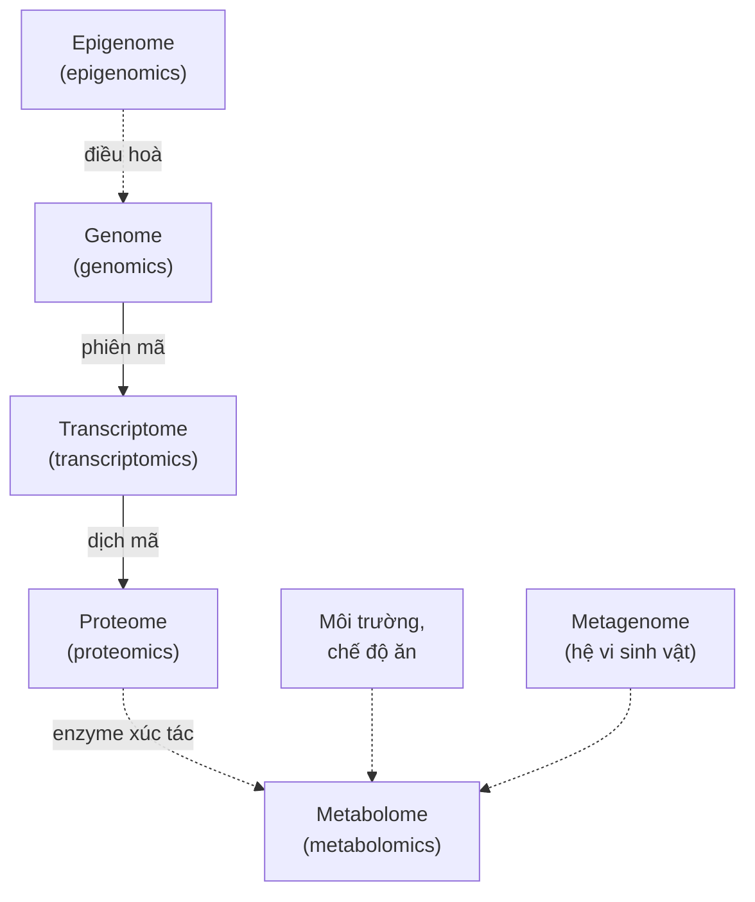
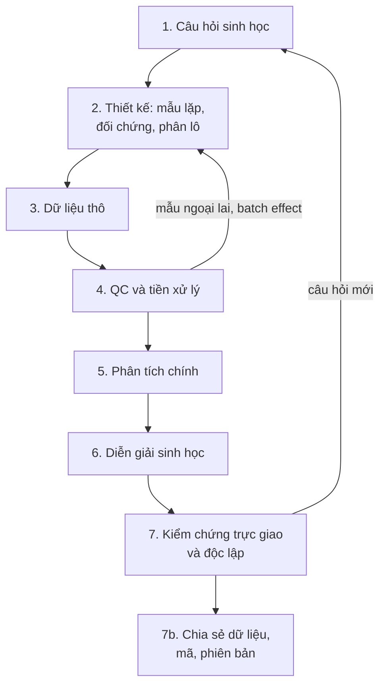

Bioinformatics (tin sinh học) là ngành phát triển và ứng dụng công cụ tính toán để thu nhận, lưu trữ, phân tích và trực quan hoá dữ liệu sinh học; computational biology (sinh học tính toán) thiên về mô hình toán và mô phỏng, và hai ngành chồng lấn đáng kể (NIH BISTIC Definition Committee [NIH], 2000). Dữ liệu của ngành chủ yếu đến từ sáu tầng omics, mỗi tầng đo một lớp phân tử khác nhau. Một dự án đi qua 7 bước từ câu hỏi đến kiểm chứng, và bước thiết kế giới hạn mọi kết luận về sau: trong một thí nghiệm RNA-seq, 3 mẫu lặp chỉ tìm được 20–40% số gen biểu hiện khác biệt (Schurch et al., 2016). Bài dành cho sinh viên sinh học mới bắt đầu, minh hoạ bằng một nghiên cứu proteomics ung thư gan (Dong et al., 2022).

<div class="callout callout-note">
<p class="callout-title">Tóm tắt nhanh</p>

- **Định nghĩa:** bioinformatics thiên về công cụ và dữ liệu, computational biology thiên về mô hình và câu hỏi (NIH, 2000).
- **Lịch sử:** từ "bioinformatics" có từ khoảng năm 1970, với nghĩa rộng hơn nhiều so với ngày nay.
- **Omics:** sáu tầng omics là sáu lớp đo; chỉ genome, transcriptome và proteome nằm trên trục thông tin của học thuyết trung tâm.
- **Dự án:** 7 bước tạo thành vòng lặp; số mẫu lặp và cách phân lô quyết định từ đầu kết luận nào là có thể.

</div>

Một phân tích năm 2015 dự báo rằng đến năm 2025, genomics sẽ ngang bằng hoặc vượt thiên văn học, YouTube và Twitter ở cả bốn khâu thu nhận, lưu trữ, phân phối và phân tích dữ liệu (Stephens et al., 2015). Đó là dự báo, không phải số đo, nhưng hướng đi thì rõ.

## 1. Bioinformatics là gì? Ba định nghĩa và một lịch sử ngắn

### 1.1. Định nghĩa của NIH năm 2000

Ngày 17/7/2000, ủy ban định nghĩa của BISTIC thuộc Viện Y tế Quốc gia Hoa Kỳ (NIH) công bố hai định nghĩa làm việc (NIH BISTIC Definition Committee, 2000):

- **Bioinformatics:** nghiên cứu, phát triển hoặc ứng dụng công cụ tính toán để mở rộng việc dùng dữ liệu sinh học, y học, hành vi hoặc sức khoẻ, gồm thu nhận, lưu trữ, tổ chức, lưu trữ lâu dài, phân tích và trực quan hoá.
- **Computational biology:** phát triển và ứng dụng phương pháp phân tích dữ liệu, lý thuyết, mô hình toán và mô phỏng để nghiên cứu "biological, behavioral, and social systems".

Hai định nghĩa chia việc theo một trục. Bên bioinformatics là công cụ và dữ liệu: phần mềm căn chỉnh read, cơ sở dữ liệu biến thể, pipeline khối phổ. Bên computational biology là mô hình và câu hỏi: mô hình động học một mạng điều hoà gen, mô phỏng tiến hoá của một họ gen. NIH nói rõ hai lĩnh vực chồng lấn đáng kể. Trong thực tế hai từ thường được dùng thay nhau, và một dự án thường cần cả hai.

### 1.2. Nghĩa gốc năm 1970 và sự thu hẹp nghĩa

Paulien Hogeweg và Ben Hesper dùng từ "bioinformatics" từ khoảng năm 1970 với nghĩa "the study of informatic processes in biotic systems", tức nghiên cứu các quá trình thông tin trong hệ sống, gồm cả mô hình động học ở nhiều cấp tổ chức (Hogeweg, 2011). Từ điển Oxford (OED) ghi hai bài báo năm 1978 của họ là nguồn gốc thuật ngữ. Nghĩa hẹp quen thuộc ngày nay chỉ phổ biến từ cuối thập niên 1980, khi dữ liệu trình tự tăng theo cấp số nhân: phương pháp tính toán cho trình tự, cấu trúc protein, dự đoán chức năng theo tương đồng và phát sinh loài (Hogeweg, 2011).

Việc so sánh trình tự còn có trước tên gọi. Năm 1957, Francis Crick dự đoán một ngành "protein taxonomy" so sánh trình tự amino acid giữa các loài; tuy vậy lịch sử ngành thường được tính từ Eck, Dayhoff, Zuckerkandl và Pauling đầu thập niên 1960 (Cobb, 2017). Margaret Dayhoff phổ biến trình tự protein qua các bộ atlas in hằng năm (Hogeweg, 2011).


*Hình 1.* Các mốc của thuật ngữ "bioinformatics"; 196x và 198x là đầu thập niên 1960 và cuối thập niên 1980. Tự vẽ theo Hogeweg (2011), Cobb (2017), NIH (2000) và Luscombe et al. (2001).

### 1.3. Định nghĩa của Luscombe và cộng sự (2001)

Luscombe, Greenbaum và Gerstein (2001) định nghĩa bioinformatics là hiểu sinh học dưới dạng các đại phân tử, rồi áp dụng kỹ thuật informatics từ toán ứng dụng, khoa học máy tính và thống kê để tổ chức thông tin về các phân tử đó ở quy mô lớn. Ba loại dữ liệu chính là cấu trúc đại phân tử, trình tự genome và kết quả functional genomics như dữ liệu biểu hiện. Phân tích một gen bằng tay chưa phải bioinformatics theo nghĩa này; phân tích mọi gen của một genome thì là.

**Bảng 1.** Ba cách định nghĩa

| Định nghĩa | Năm | Phạm vi | Trọng tâm |
| --- | --- | --- | --- |
| Hogeweg và Hesper | ~1970 | Mọi cấp tổ chức sống | Quá trình thông tin, mô hình động |
| NIH – bioinformatics | 2000 | Dữ liệu sinh học, y học, sức khoẻ | Công cụ thu nhận, lưu trữ, phân tích |
| NIH – computational biology | 2000 | Hệ sinh học, hành vi, xã hội | Mô hình toán, mô phỏng |
| Luscombe et al. | 2001 | Đại phân tử, quy mô lớn | Cấu trúc, trình tự, biểu hiện |

## 2. Các tầng omics: đo cái gì, liên hệ với học thuyết trung tâm ra sao

### 2.1. "Omics" nghĩa là gì

Thêm "-omics" vào tên một loại phân tử nghĩa là đánh giá toàn diện cả tập phân tử đó. Genomics là ngành omics đầu tiên: nó nghiên cứu toàn bộ genome, còn genetics truyền thống thường nghiên cứu từng gen (Hasin et al., 2017).

### 2.2. Học thuyết trung tâm thực sự nói gì

Các tầng omics hay được giới thiệu bằng chuỗi "DNA → RNA → protein → chất chuyển hoá", như thể mỗi tầng là một bước của học thuyết trung tâm. Crick nói một chuyện khác. Ghi chép năm 1956 của ông viết: "Once information has got into a protein it can't get out again" (dẫn theo Cobb, 2017). "Thông tin" ở đây là **trình tự**. Học thuyết phân biệt các dòng chuyển trình tự có thể xảy ra giữa DNA, RNA và protein với ba dòng Crick cho là không xảy ra: protein → protein, protein → RNA, protein → DNA. Sau khi reverse transcriptase được phát hiện, bài năm 1970 của Crick nhắc lại rằng RNA → DNA không mâu thuẫn với học thuyết (Crick, 1970; Cobb, 2017).

Cobb (2017) chỉ ra rằng dạy học thuyết trung tâm như chuỗi "DNA → RNA → protein" là cách hiểu sai phổ biến, lan rộng qua giáo trình của Watson năm 1965. Chuỗi đó mô tả tái bản, phiên mã, dịch mã (→ nhân đôi DNA, phiên mã và dịch mã) nhưng bỏ mất ý chính: thông tin không đi ra từ protein. Tài liệu tiếng Việt gọi khái niệm này là "học thuyết trung tâm" hoặc "giáo lý trung tâm của sinh học phân tử" (Hoàng Trọng Phán, 2012).

Từ đó suy ra ba điều cho omics. Chất chuyển hoá không mang trình tự, nên metabolome nằm ngoài trục thông tin. Methyl hoá DNA không đổi trình tự, nên epigenome là một lớp điều hoà. Còn metagenome là genome của những sinh vật khác sống cùng vật chủ.

### 2.3. Sáu tầng omics là sáu lớp đo

Hình 2 vẽ lại các tầng thành lớp đo. Genome, transcriptome, proteome nằm trên trục thông tin; epigenome điều hoà phiên mã; metabolome ở hạ nguồn, chịu tác động của enzyme, môi trường và hệ vi sinh.


*Hình 2.* Sáu tầng omics. Mũi tên liền: dòng thông tin trình tự; mũi tên đứt: điều hoà hoặc trao đổi chất. Sơ đồ tự vẽ.

**Bảng 2.** Sáu tầng omics: đo gì, bằng gì, ra định dạng gì (định dạng giải thích ở [Phần 4](/blog/dinh-dang-du-lieu-va-co-so-du-lieu-sinh-hoc/))

| Tầng | Đo cái gì | Công nghệ chính | Định dạng |
| --- | --- | --- | --- |
| Genomics | Trình tự DNA, biến thể | WGS, WES, long-read | FASTQ, BAM, VCF |
| Epigenomics | Methyl hoá, chromatin | Bisulfite-seq, ChIP-seq, ATAC-seq | BED, bigWig |
| Transcriptomics | Biểu hiện RNA | RNA-seq, scRNA-seq | FASTQ, ma trận đếm |
| Proteomics | Protein, biến đổi sau dịch mã | LC-MS/MS | mzML, bảng cường độ |
| Metabolomics | Chất chuyển hoá | LC-MS, NMR | mzML (khối phổ), bảng đỉnh |
| Microbiome | Quần xã vi sinh vật | Amplicon 16S rRNA; shotgun | FASTQ, bảng OTU/ASV |

*Bảng tự tổng hợp; hai cách đo microbiome theo Ranjan et al. (2016) và Quince et al. (2017).*

Dòng cuối gộp hai cách đo khác nhau. Giải trình tự amplicon 16S rRNA chỉ đọc một gen đánh dấu bảo tồn để nhận diện vi khuẩn; shotgun metagenomics đọc DNA của toàn bộ genome trong mẫu. Trên cùng một mẫu phân người, shotgun phát hiện nhiều loài hơn, đo được độ đa dạng cao hơn và dự đoán được nhiều gen hơn (Ranjan et al., 2016), đổi lại cần pipeline tính toán phức tạp (Quince et al., 2017). [Phần 9](/blog/epigenomics-metagenomics-va-da-omics/) phân tích hai loại này bằng công cụ khác nhau.

### 2.4. Mỗi tầng một nghiên cứu mẫu

Bảng 3 chọn sáu nghiên cứu kinh điển, mỗi tầng một bài. Đây không phải tổng quan hệ thống; cả sáu đều trên người, số liệu lấy từ phần tóm tắt.

**Bảng 3.** Sáu tầng, sáu nghiên cứu

| Tầng | Nghiên cứu | Câu hỏi | Quy mô, kết quả |
| --- | --- | --- | --- |
| Genomics | 1000 Genomes (2015) | Biến dị phân bố thế nào giữa quần thể? | 2.504 người, 26 quần thể; hơn 88 triệu biến thể |
| Epigenomics | Roadmap (2015) | Vùng điều hoà nào hoạt động ở từng mô? | 111 epigenome tham chiếu |
| Transcriptomics | GTEx v8 (2020) | Biến thể ảnh hưởng biểu hiện ở từng mô ra sao? | 15.201 mẫu RNA-seq, 49 mô, 838 người hiến |
| Proteomics | Jiang et al. (2019) | Proteome có phân nhóm ung thư gan sớm? | 110 cặp mô; 3 phân nhóm; đích SOAT1 |
| Metabolomics | Wang et al. (2011) | Chất chuyển hoá có dự báo đái tháo đường? | 2.422 người, 12 năm, 201 người mắc |
| Metagenomics | Qin et al. (2010) | Hệ vi sinh ruột mang những gen gì? | 124 người; 3,3 triệu gen |

Trong hơn 88 triệu biến thể của dự án 1000 Genomes có 84,7 triệu SNP, 3,6 triệu indel và 60.000 biến thể cấu trúc (1000 Genomes Project Consortium, 2015). Roadmap thấy biến thể liên quan tính trạng tập trung ở dấu ấn epigenome đặc hiệu mô (Roadmap Epigenomics Consortium, 2015). GTEx lưu ý rằng thành phần loại tế bào trong mẫu mô là yếu tố quan trọng khi diễn giải (GTEx Consortium, 2020). Phân nhóm S-III trong nghiên cứu của Jiang et al. (2019) rối loạn cân bằng cholesterol và có tiên lượng xấu nhất. Năm amino acid nhánh và thơm (isoleucine, leucine, valine, tyrosine, phenylalanine) liên quan với nguy cơ đái tháo đường, và kết quả lặp lại trong một cohort độc lập (Wang et al., 2011). Danh mục 3,3 triệu gen vi sinh ruột lớn gấp khoảng 150 lần số gen của người (Qin et al., 2010).

### 2.5. Multi-omics: vì sao một tầng chưa đủ

Một tầng omics thường cho một danh sách khác biệt giữa bệnh và đối chứng. Theo Hasin et al. (2017), phân tích một loại dữ liệu chủ yếu cho **tương quan**, phần lớn phản ánh quá trình phản ứng (reactive) hơn là nguyên nhân. Tích hợp nhiều tầng giúp thu hẹp ứng viên nhân quả, theo ba cách bắt đầu:

1. **Genome first:** từ một locus GWAS, tìm gen và cơ chế nó tác động.
2. **Phenotype first:** từ kiểu hình, tìm con đường liên quan qua nhiều tầng.
3. **Environment first:** từ một yếu tố như chế độ ăn, xem nó thay đổi các tầng ra sao.

Không thể lấy tầng này thay tầng kia. Tương quan giữa transcript và protein chỉ ở mức vừa phải với phần lớn các cặp, do điều hoà dịch mã, biến đổi sau dịch mã và tốc độ phân huỷ protein (Hasin et al., 2017; → [Phần 8](/blog/proteomics-va-cau-truc-protein/)). Dữ liệu RNA-seq chỉ so sánh được giữa các nghiên cứu khi dùng cùng phiên bản genome, chú giải và công cụ (→ Phần 11). Và bằng chứng nhân quả cuối cùng vẫn cần thí nghiệm in vivo hoặc in vitro (Hasin et al., 2017). Manzoni et al. (2018) là một tổng quan dễ đọc cho người mới về dữ liệu genomics, transcriptomics và proteomics.

## 3. Vòng đời 7 bước, minh hoạ bằng một nghiên cứu proteomics ung thư gan

Bảy bước của một dự án nối với nhau thành **vòng lặp** (Hình 3): QC xấu ở bước 4 có thể buộc quay lại bước 2, và kết quả bước 7 sinh câu hỏi mới cho bước 1. Bước 7b, chia sẻ dữ liệu và mã, giúp người khác kiểm tra được kết quả.


*Hình 3.* Vòng đời một dự án phân tích dữ liệu sinh học. Sơ đồ tự vẽ.

Ca minh hoạ là nghiên cứu truy cập mở của Dong et al. (2022) về proteome của túi ngoại bào nhỏ (small extracellular vesicle, sEV) trong huyết tương bệnh nhân ung thư biểu mô tế bào gan (HCC).

### Bước 1. Câu hỏi sinh học

Một câu hỏi tốt nêu rõ quần thể, phép so sánh và kết quả đo (→ [câu hỏi SMART](/blog/ask-questions-to-make-data-driven-decisions/)). Câu hỏi của Dong et al. (2022): protein trong sEV huyết tương có phân biệt bệnh nhân HCC với người đối chứng không, để dùng làm dấu ấn sinh thiết lỏng? Câu hỏi đã quyết định loại mẫu, tầng omics và phép so sánh.

### Bước 2. Thiết kế: số mẫu lặp và batch effect

Đây là bước khó sửa nhất, vì không công cụ nào bù được dữ liệu thu sai cách.

**Số mẫu lặp.** Schurch et al. (2016) làm RNA-seq trên nấm men với 48 mẫu lặp sinh học mỗi nhóm. Với 3 mẫu lặp, 9 trên 11 công cụ chỉ tìm được 20–40% số gen khác biệt mà bộ 42 mẫu lặp "sạch" tìm thấy. Tác giả khuyên tối thiểu 6 mẫu lặp, và 12 khi cần tìm gen khác biệt ở mọi mức fold change. Mẫu người biến thiên nhiều hơn nấm men nuôi cấy, nên đây chỉ là mức sàn. Khi ngân sách có hạn, thêm mẫu thường có lợi hơn tăng độ sâu giải trình tự (Hasin et al., 2017).

**Batch effect (hiệu ứng lô)** là khác biệt kỹ thuật do điều kiện phòng thí nghiệm, lô hoá chất hoặc người làm. Nó nguy hiểm nhất khi trùng với biến kết cục, vì khi đó khác biệt kỹ thuật bị đọc thành khác biệt sinh học (Leek et al., 2010). Đoạn code sau mô phỏng điều đó: 12 mẫu, một protein **không** khác nhau thật giữa HCC và đối chứng, lô 2 đo cao hơn lô 1 một đơn vị log2.

```python
import numpy as np
import pandas as pd
from scipy import stats

rng = np.random.default_rng(1)
# 12 mẫu: 6 HCC, 6 đối chứng; protein này KHÔNG khác nhau thật giữa hai nhóm
nhom = ["HCC"] * 6 + ["Đối chứng"] * 6

def mo_phong(lo):
    df = pd.DataFrame({"nhom": nhom, "lo": lo})
    # log2 cường độ = nền 10 + biến thiên sinh học + 1,0 nếu mẫu chạy ở lô 2
    df["log2_cd"] = 10 + rng.normal(0, 0.4, 12) + np.where(df["lo"] == 2, 1.0, 0.0)
    return df

thiet_ke = {
    "Lô trùng nhóm": [2] * 6 + [1] * 6,      # mọi mẫu HCC chạy ở lô 2
    "Lô cân bằng": [1, 1, 1, 2, 2, 2] * 2,   # mỗi lô có 3 HCC và 3 đối chứng
}
ket_qua = {}
for ten, lo in thiet_ke.items():
    df = mo_phong(lo)
    # trừ trung bình từng lô (cách hiệu chỉnh lô đơn giản nhất)
    df["hieu_chinh"] = df["log2_cd"] - df.groupby("lo")["log2_cd"].transform("mean")
    for cot in ["log2_cd", "hieu_chinh"]:
        a = df.loc[df.nhom == "HCC", cot]
        b = df.loc[df.nhom == "Đối chứng", cot]
        p = stats.ttest_ind(a, b).pvalue
        print(f"{ten:14} | {cot:10} | chênh lệch = {a.mean() - b.mean():5.2f} | p = {p:.2g}")
    ket_qua[ten] = df
```

```text
Lô trùng nhóm  | log2_cd    | chênh lệch =  1.02 | p = 4.3e-05
Lô trùng nhóm  | hieu_chinh | chênh lệch =  0.00 | p = 1
Lô cân bằng    | log2_cd    | chênh lệch = -0.14 | p = 0.76
Lô cân bằng    | hieu_chinh | chênh lệch = -0.14 | p = 0.26
```


*Hình 4.* Dữ liệu mô phỏng (12 mẫu, seed = 1), tạo bằng đúng đoạn code trên: khi lô trùng nhóm, một protein không khác biệt thật vẫn cho p < 0,0001.

Khi lô trùng nhóm, protein "tăng" 1,02 đơn vị log2 ở HCC với p = 4,3 × 10⁻⁵, toàn bộ do lô. Hiệu chỉnh cũng không cứu được: trừ trung bình từng lô đưa chênh lệch về đúng 0, vì nó xoá luôn mọi khác biệt giữa nhóm, kể cả khác biệt thật. Khi lô cân bằng, kết quả không có ý nghĩa thống kê, đúng với sự thật đã mô phỏng. Batch effect vì vậy được xử lý chủ yếu bằng thiết kế, nên Hasin et al. (2017) khuyên nghĩ trước cách phân tích ngay khi lên kế hoạch thu mẫu (→ [dữ liệu bẩn và cách làm sạch](/blog/process-data-from-dirty-to-clean/)).

**Áp vào ca minh hoạ.** Dong et al. (2022) có cohort khám phá 21 HCC và 15 đối chứng, cộng cohort kiểm chứng riêng 7 và 7. Để đo khối phổ, mẫu được **gộp** thành 3 mẫu mỗi nhóm (7 bệnh nhân hoặc 5 đối chứng mỗi mẫu gộp) nhằm giảm biến thiên cá thể và chi phí. Đánh đổi: gộp mẫu xoá thông tin về biến thiên giữa người với người, và thống kê chạy trên n = 3 mỗi nhóm, thấp hơn nhiều so với khuyến nghị kiểu Schurch et al. (2016). Chính các tác giả nêu cỡ mẫu nhỏ và việc gộp mẫu là giới hạn.

### Bước 3. Dữ liệu thô

Dữ liệu thô đến từ máy của bạn hoặc từ cơ sở dữ liệu công khai (→ [Phần 4](/blog/dinh-dang-du-lieu-va-co-so-du-lieu-sinh-hoc/)); với dữ liệu tải về, hãy đọc kỹ thông tin lô và loại mẫu đi kèm. Trong ca minh hoạ, máy ghi được 850.808 phổ MS/MS, trong đó 77.850 phổ khớp với UniProt (Dong et al., 2022): chưa đến một phần mười số phổ được gán cho một peptide đã biết.

### Bước 4. Kiểm soát chất lượng và tiền xử lý

Kiểm soát chất lượng (quality control, QC) là một bước riêng: tổng quan best practice RNA-seq của Conesa et al. (2016) liệt kê nó cạnh thiết kế, căn chỉnh, định lượng, biểu hiện khác biệt và phân tích chức năng. Dong et al. (2022) làm QC ở hai cấp. Ở cấp mẫu, họ xác nhận đã tách đúng sEV bằng kính hiển vi điện tử truyền qua (TEM), phân tích vết hạt nano (NTA) và Western blot marker (CD63, CD81, TSG101 dương tính; calnexin âm tính). Ở cấp dữ liệu, họ dùng MaxQuant với FDR dưới 1% cho peptide và protein, và loại protein nhiễm như keratin, albumin huyết thanh bò, trypsin.

### Bước 5. Phân tích chính

Trong ca minh hoạ, 335 protein được định danh và 281 được định lượng. Tiêu chí fold change ≥ 1,5 hoặc < 0,66 cho 54 protein; 27 trong số đó có p < 0,05, gồm 13 tăng và 14 giảm (Dong et al., 2022). Khi đọc một danh sách như vậy, hãy hỏi p-value đã được hiệu chỉnh cho nhiều kiểm định chưa. Kiểm định 281 protein ở ngưỡng 0,05 thì dù không có khác biệt thật nào, trung bình vẫn có khoảng 14 protein "có ý nghĩa" do ngẫu nhiên (→ [Phần 3: FDR](/blog/toan-va-thong-ke-cho-sinh-hoc/)). Bài báo hiệu chỉnh Benjamini–Hochberg ở bước làm giàu (Bước 6); với ngưỡng chọn 27 protein, hãy tự kiểm trong chú thích hình và tệp bổ sung.

### Bước 6. Diễn giải sinh học

Phân tích làm giàu Gene Ontology (GO) và KEGG cho thấy các protein khác biệt tập trung ở con đường bổ thể (C1QB, C1QC, C4BPA, C4BPB) và đông máu (F13B, FGA, FGB, FGG); mạng tương tác protein được dựng bằng STRING (Dong et al., 2022). Nhóm tác giả lấy "nền" (background) là toàn bộ protein đã định lượng và hiệu chỉnh p bằng Benjamini–Hochberg, một cách làm nên học theo: lấy cả proteome của loài làm nền thì những protein vốn nhiều trong huyết tương dễ hiện ra như được "làm giàu". Có điều danh sách 27 protein khá ngắn, nên kết quả nhạy với từng protein.

### Bước 7. Kiểm chứng và tái lập

Kiểm chứng có hai nghĩa. **Xác nhận trực giao** là đo lại cùng mẫu bằng kỹ thuật khác để loại lỗi kỹ thuật. **Kiểm chứng độc lập** là xem kết quả có lặp lại trên người khác không. Dong et al. (2022) làm cả hai: Western blot trên chính các mẫu gộp, rồi trên cohort 7 HCC và 7 đối chứng.

Với RNA-seq, qPCR không phải lúc nào cũng cần. Khi so 5 quy trình RNA-seq với qPCR trên toàn bộ gen mã hoá protein, khoảng 85% số gen có fold change nhất quán; gen không nhất quán thường ngắn, ít exon và biểu hiện thấp (Everaert et al., 2017). Coenye (2021) tóm tắt: chỉ khoảng 1,8% gen không nhất quán nghiêm trọng, và qPCR có giá trị khi kết luận dựa vào vài gen biểu hiện thấp hoặc khác biệt nhỏ, hoặc khi cần đo thêm ở điều kiện khác.

**Bước 7b: chia sẻ dữ liệu, mã và phiên bản.** Khi hai nhóm độc lập thử lặp lại phân tích của 18 bài báo microarray, chỉ 2 bài lặp lại được về nguyên tắc, 6 bài một phần, 10 bài không; lý do chính là dữ liệu không được công bố (Ioannidis et al., 2009). Ca minh hoạ cũng vậy: dữ liệu mức người tham gia của Dong et al. (2022) chỉ được cung cấp theo yêu cầu, khi tác giả liên hệ đồng ý. Hãy nộp dữ liệu thô lên kho công khai, công bố mã và ghi phiên bản genome, chú giải, công cụ (→ Phần 11, Phần 12).

**Bảng 4.** Dong et al. (2022) đọc theo 7 bước

| Bước | Nghiên cứu làm gì | Làm tốt | Cần thận trọng |
| --- | --- | --- | --- |
| 1. Câu hỏi | Protein sEV làm marker HCC | Rõ, có ứng dụng | Chưa gắn giai đoạn u |
| 2. Thiết kế | 21 + 15, gộp thành 3 + 3 | Cohort kiểm chứng 7 + 7 | Gộp mẫu, n = 3 |
| 3. Dữ liệu thô | 850.808 phổ MS/MS | Thông số máy chi tiết | Dữ liệu thô chỉ cấp theo yêu cầu |
| 4. QC | FDR < 1%; TEM, NTA, WB | QC cả mẫu lẫn dữ liệu | |
| 5. Phân tích | FC và p < 0,05 → 27 protein | Ngưỡng nêu rõ | Tự kiểm p có hiệu chỉnh khi chọn 27 protein |
| 6. Diễn giải | GO, KEGG, STRING | Nền là protein đã định lượng; hiệu chỉnh BH | Danh sách ngắn |
| 7. Kiểm chứng | WB mẫu gộp, rồi 7 + 7 | Trực giao và độc lập | Cohort nhỏ |

## 4. Ai làm bioinformatics?

Trục "công cụ hay câu hỏi" của NIH (2000) cũng phân biệt các vai trò. **Bioinformatician** xây và vận hành pipeline, cơ sở dữ liệu. **Computational biologist** dùng mô hình và phân tích để trả lời câu hỏi nghiên cứu. **Data scientist trong dược và công nghệ sinh học** kết hợp dữ liệu omics với các nguồn dữ liệu khác cho phát triển thuốc. **Clinical bioinformatician** xử lý dữ liệu giải trình tự cho chẩn đoán di truyền. Khung năng lực ISCB v3 mô tả 13 năng lực cốt lõi của ngành (Brooksbank et al., 2024), và [bài mở đầu của series](/blog/gioi-thieu-va-cach-dung-giao-trinh/) đối chiếu lộ trình tự học 36 tuần với khung này.

## 5. Kết luận và bài tập

Ba điều nên mang sang các phần sau: bioinformatics là ngành của công cụ và dữ liệu, chồng lấn với computational biology (NIH, 2000); một tầng omics đơn lẻ chủ yếu cho tương quan; và trong bảy bước của một dự án, thiết kế quyết định kết luận nào còn rút ra được.

Bài tập: chọn một bài báo omics truy cập mở trên PubMed, chép Bảng 4 với ba cột cuối để trống, điền cho bài đó và đánh dấu bước làm yếu nhất. [Phần 2](/blog/nen-tang-tinh-toan/) chuyển sang công cụ bạn cần để tự đi qua bước 3–5.

## Câu hỏi thường gặp

**Tin sinh học là gì?** Là tên tiếng Việt của bioinformatics: ngành phát triển và dùng công cụ tính toán để lưu trữ, phân tích và trực quan hoá dữ liệu sinh học như trình tự DNA hay dữ liệu biểu hiện gen.

**Cần học gì trước khi vào bioinformatics?** Series đi theo thứ tự: sinh học phân tử ở bài này, lập trình ở [Phần 2](/blog/nen-tang-tinh-toan/), thống kê ở [Phần 3](/blog/toan-va-thong-ke-cho-sinh-hoc/). [Bài mở đầu](/blog/gioi-thieu-va-cach-dung-giao-trinh/) sắp các phần thành lộ trình 36 tuần và đối chiếu với khung năng lực ISCB.

**Batch effect là gì?** Là khác biệt kỹ thuật giữa các nhóm mẫu xử lý khác ngày, khác lô hoá chất hoặc khác người làm. Cách phòng hiệu quả nhất là chia đều các nhóm so sánh vào mỗi lô ngay khi thiết kế.

## Tài liệu tham khảo

1000 Genomes Project Consortium, Auton, A., Brooks, L. D., Durbin, R. M., Garrison, E. P., Kang, H. M., Korbel, J. O., Marchini, J. L., McCarthy, S., McVean, G. A., & Abecasis, G. R. (2015). A global reference for human genetic variation. *Nature, 526*(7571), 68–74. https://doi.org/10.1038/nature15393

Brooksbank, C., Brazas, M. D., Mulder, N., Schwartz, R., Ras, V., Morgan, S. L., Lloret Llinares, M., Carvajal López, P., Larcombe, L., Ghouila, A., Hancocks, T., Satagopam, V., De Las Rivas, J., Mazandu, G., & Gaeta, B. (2024). The ISCB competency framework v. 3: A revised and extended standard for bioinformatics education and training. *Bioinformatics Advances, 4*(1), vbae166. https://doi.org/10.1093/bioadv/vbae166

Cobb, M. (2017). 60 years ago, Francis Crick changed the logic of biology. *PLOS Biology, 15*(9), e2003243. https://doi.org/10.1371/journal.pbio.2003243

Coenye, T. (2021). Do results obtained with RNA-sequencing require independent verification? *Biofilm, 3*, 100043. https://doi.org/10.1016/j.bioflm.2021.100043

Conesa, A., Madrigal, P., Tarazona, S., Gomez-Cabrero, D., Cervera, A., McPherson, A., Szcześniak, M. W., Gaffney, D. J., Elo, L. L., Zhang, X., & Mortazavi, A. (2016). A survey of best practices for RNA-seq data analysis. *Genome Biology, 17*, 13. https://doi.org/10.1186/s13059-016-0881-8

Crick, F. (1970). Central dogma of molecular biology. *Nature, 227*(5258), 561–563. https://doi.org/10.1038/227561a0

Dong, W., Xia, Z., Chai, Z., Qiu, Z., Wang, X., Yang, Z., Wang, J., Zhang, T., Zhang, Q., & Jin, J. (2022). Proteomic analysis of small extracellular vesicles from the plasma of patients with hepatocellular carcinoma. *World Journal of Surgical Oncology, 20*(1), 387. https://doi.org/10.1186/s12957-022-02849-y

Everaert, C., Luypaert, M., Maag, J. L. V., Cheng, Q. X., Dinger, M. E., Hellemans, J., & Mestdagh, P. (2017). Benchmarking of RNA-sequencing analysis workflows using whole-transcriptome RT-qPCR expression data. *Scientific Reports, 7*(1), 1559. https://doi.org/10.1038/s41598-017-01617-3

GTEx Consortium. (2020). The GTEx Consortium atlas of genetic regulatory effects across human tissues. *Science, 369*(6509), 1318–1330. https://doi.org/10.1126/science.aaz1776

Hasin, Y., Seldin, M., & Lusis, A. (2017). Multi-omics approaches to disease. *Genome Biology, 18*(1), 83. https://doi.org/10.1186/s13059-017-1215-1

Hoàng Trọng Phán. (2012). *Sinh học phân tử: Khái niệm, nguyên lý & quá trình*. Đại học Huế.

Hogeweg, P. (2011). The roots of bioinformatics in theoretical biology. *PLoS Computational Biology, 7*(3), e1002021. https://doi.org/10.1371/journal.pcbi.1002021

Ioannidis, J. P. A., Allison, D. B., Ball, C. A., Coulibaly, I., Cui, X., Culhane, A. C., Falchi, M., Furlanello, C., Game, L., Jurman, G., Mangion, J., Mehta, T., Nitzberg, M., Page, G. P., Petretto, E., & van Noort, V. (2009). Repeatability of published microarray gene expression analyses. *Nature Genetics, 41*(2), 149–155. https://doi.org/10.1038/ng.295

Jiang, Y., Sun, A., Zhao, Y., Ying, W., Sun, H., Yang, X., Xing, B., Sun, W., Ren, L., Hu, B., Li, C., Zhang, L., Qin, G., Zhang, M., Chen, N., Zhang, M., Huang, Y., Zhou, J., Zhao, Y., . . . He, F. (2019). Proteomics identifies new therapeutic targets of early-stage hepatocellular carcinoma. *Nature, 567*(7747), 257–261. https://doi.org/10.1038/s41586-019-0987-8

Leek, J. T., Scharpf, R. B., Bravo, H. C., Simcha, D., Langmead, B., Johnson, W. E., Geman, D., Baggerly, K., & Irizarry, R. A. (2010). Tackling the widespread and critical impact of batch effects in high-throughput data. *Nature Reviews Genetics, 11*(10), 733–739. https://doi.org/10.1038/nrg2825

Luscombe, N. M., Greenbaum, D., & Gerstein, M. (2001). What is bioinformatics? A proposed definition and overview of the field. *Methods of Information in Medicine, 40*(4), 346–358. https://doi.org/10.1055/s-0038-1634431

Manzoni, C., Kia, D. A., Vandrovcova, J., Hardy, J., Wood, N. W., Lewis, P. A., & Ferrari, R. (2018). Genome, transcriptome and proteome: The rise of omics data and their integration in biomedical sciences. *Briefings in Bioinformatics, 19*(2), 286–302. https://doi.org/10.1093/bib/bbw114

NIH BISTIC Definition Committee. (2000, July 17). *NIH working definition of bioinformatics and computational biology*. National Institutes of Health. http://web.archive.org/web/20090927132535/http://www.bisti.nih.gov/docs/CompuBioDef.pdf

Qin, J., Li, R., Raes, J., Arumugam, M., Burgdorf, K. S., Manichanh, C., Nielsen, T., Pons, N., Levenez, F., Yamada, T., Mende, D. R., Li, J., Xu, J., Li, S., Li, D., Cao, J., Wang, B., Liang, H., Zheng, H., . . . Wang, J. (2010). A human gut microbial gene catalogue established by metagenomic sequencing. *Nature, 464*(7285), 59–65. https://doi.org/10.1038/nature08821

Quince, C., Walker, A. W., Simpson, J. T., Loman, N. J., & Segata, N. (2017). Shotgun metagenomics, from sampling to analysis. *Nature Biotechnology, 35*(9), 833–844. https://doi.org/10.1038/nbt.3935

Ranjan, R., Rani, A., Metwally, A., McGee, H. S., & Perkins, D. L. (2016). Analysis of the microbiome: Advantages of whole genome shotgun versus 16S amplicon sequencing. *Biochemical and Biophysical Research Communications, 469*(4), 967–977. https://doi.org/10.1016/j.bbrc.2015.12.083

Roadmap Epigenomics Consortium, Kundaje, A., Meuleman, W., Ernst, J., Bilenky, M., Yen, A., Heravi-Moussavi, A., Kheradpour, P., Zhang, Z., Wang, J., Ziller, M. J., Amin, V., Whitaker, J. W., Schultz, M. D., Ward, L. D., Sarkar, A., Quon, G., Sandstrom, R. S., Eaton, M. L., . . . Kellis, M. (2015). Integrative analysis of 111 reference human epigenomes. *Nature, 518*(7539), 317–330. https://doi.org/10.1038/nature14248

Schurch, N. J., Schofield, P., Gierliński, M., Cole, C., Sherstnev, A., Singh, V., Wrobel, N., Gharbi, K., Simpson, G. G., Owen-Hughes, T., Blaxter, M., & Barton, G. J. (2016). How many biological replicates are needed in an RNA-seq experiment and which differential expression tool should you use? *RNA, 22*(6), 839–851. https://doi.org/10.1261/rna.053959.115

Stephens, Z. D., Lee, S. Y., Faghri, F., Campbell, R. H., Zhai, C., Efron, M. J., Iyer, R., Schatz, M. C., Sinha, S., & Robinson, G. E. (2015). Big data: Astronomical or genomical? *PLOS Biology, 13*(7), e1002195. https://doi.org/10.1371/journal.pbio.1002195

Wang, T. J., Larson, M. G., Vasan, R. S., Cheng, S., Rhee, E. P., McCabe, E., Lewis, G. D., Fox, C. S., Jacques, P. F., Fernandez, C., O'Donnell, C. J., Carr, S. A., Mootha, V. K., Florez, J. C., Souza, A., Melander, O., Clish, C. B., & Gerszten, R. E. (2011). Metabolite profiles and the risk of developing diabetes. *Nature Medicine, 17*(4), 448–453. https://doi.org/10.1038/nm.2307
