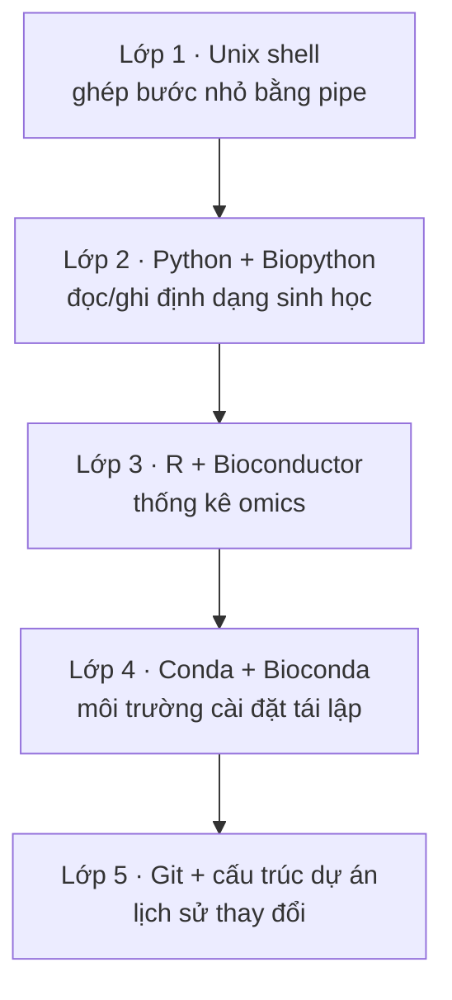

Năm công cụ – Unix shell, Python với Biopython, R với Bioconductor, Conda với Bioconda và Git – là hạ tầng tính toán tối thiểu mà các lộ trình bioinformatics thường yêu cầu người mới học trước tiên. Mỗi công cụ ra đời để chặn một loại lỗi cụ thể: lỗi im lặng trong chuỗi xử lý dài, lỗi đọc định dạng, phần mềm không cài được (28% trong 98 công cụ omics được thử cài; Mangul et al., 2019) và mất dấu thay đổi. Bài này giải thích từng lớp theo bài báo gốc của nó, kèm lệnh cài và cấu hình đúng theo tài liệu hiện hành. Phần thực hành tính số read, độ dài và GC content của file FASTQ công khai SRR2589044 bằng awk, Python thuần và Biopython, rồi đối chiếu với metadata của ENA và genome tham chiếu REL606.

<div class="callout callout-note">
<p class="callout-title">Tóm tắt nhanh</p>

- **Shell**: ghép các chương trình nhỏ bằng pipe, kiểm tra được từng bước. Đừng đếm read bằng `grep -c '^@'`.
- **Biopython**: bộ đọc định dạng dùng chung. Tính GC bằng `gc_fraction`, không tự đếm `seq.count("G")`.
- **Bioconductor**: 2.418 gói phần mềm ở bản 3.23 (29/4/2026), mỗi gói qua review và kiểm thử tự động.
- **Bioconda**: hơn 12.000 gói; cấu hình `conda-forge` ưu tiên cao nhất, `channel_priority strict`.
- **Git**: lưu mã và README, không lưu FASTQ; GitHub chặn file lớn hơn 100 MiB.

</div>

## 1. Năm lớp hạ tầng và bốn loại lỗi

Hạ tầng tính toán (computational infrastructure) của bioinformatics ở đây là bộ công cụ nằm dưới mọi phân tích: nơi bạn gõ lệnh, ngôn ngữ để viết phân tích, thư viện hiểu dữ liệu sinh học, cách cài phần mềm và cách lưu lịch sử thay đổi. Bài này chia thành năm lớp (Hình 1).


*Hình 1. Năm lớp hạ tầng tính toán của một dự án bioinformatics nhỏ.*

Vì sao lại là năm công cụ này? Vì mỗi công cụ giảm một loại rủi ro đã được ghi nhận trong tài liệu.

Rủi ro thứ nhất là **lỗi im lặng**. Buffalo (2015, ch. 1) gọi đây là "quy tắc vàng" của bioinformatics: chương trình vẫn chạy và in ra kết quả, nhưng kết quả sai, và dữ liệu trung gian quá lớn để kiểm tra bằng mắt. Cách chống lại là chia việc thành các bước nhỏ, kiểm tra từng bước.

Rủi ro thứ hai là **lỗi đọc định dạng**. Định dạng FASTQ trông đơn giản nhưng có những chi tiết làm hỏng các cách đọc "tự chế" (Cock et al., 2010). Thư viện đọc định dạng dùng chung giảm rủi ro này.

Rủi ro thứ ba là **phần mềm không cài được**. Phần mềm bioinformatics được viết bằng nhiều ngôn ngữ và cài theo nhiều cách, nên việc quản lý dễ lỗi và tốn thời gian (Grüning, Dale, et al., 2018). Mangul et al. (2019) khảo sát 36.702 tài nguyên phần mềm omics công bố giai đoạn 2005–2017: gần 28% không còn truy cập được qua URL ghi trong bài báo gốc. Trong 98 công cụ nhóm tác giả thử cài, 51% "dễ cài", còn 28% không cài được.

Rủi ro thứ tư là **mất dấu thay đổi**: một hình trong bản thảo được tạo bằng phiên bản script nào, trên dữ liệu nào, không ai còn nhớ (Wilson et al., 2017).

Bảng 1 tóm tắt quan hệ giữa công cụ, vấn đề và bằng chứng.

| Lớp | Công cụ | Vấn đề giải quyết | Nguồn | Số liệu hiện tại |
| --- | --- | --- | --- | --- |
| 1 | Bash, coreutils, awk | Ghép bước nhỏ, kiểm tra từng bước | Buffalo (2015) | – |
| 2 | Python + Biopython | Đọc/ghi định dạng dùng chung, truy cập cơ sở dữ liệu | Cock et al. (2009) | Biopython 1.87 |
| 3 | R + Bioconductor | Gói thống kê omics được review, kiểm thử | Gentleman et al. (2004); Huber et al. (2015) | 2.418 gói phần mềm, bản 3.23 (29/4/2026) |
| 4 | Conda + Bioconda | Cài phần mềm không cần quyền quản trị, tái lập môi trường | Grüning, Dale, et al. (2018) | Hơn 12.000 gói (11/2026) |
| 5 | Git + GitHub | Lưu lịch sử, cộng tác, trích dẫn mã | Blischak et al. (2016); Perez-Riverol et al. (2016) | Giới hạn file 100 MiB |

*Bảng 1. Năm lớp hạ tầng, vấn đề mỗi lớp giải quyết và nguồn gốc.*

Bài đi qua từng lớp với ba câu hỏi: công cụ được thiết kế để giải vấn đề gì; người mới cần dùng nó ở mức tối thiểu nào; và khi tính cùng một chỉ số bằng ba cách trên cùng một file thật, kết quả có khớp nhau và khớp với nguồn bên ngoài không. Dữ liệu thực hành là run SRR2589044, read Illumina của một clone *Escherichia coli* trong thí nghiệm tiến hoá dài hạn của Lenski (Tenaillon et al., 2016).

<div class="callout callout-note">
<p class="callout-title">Bạn cần gì để làm theo</p>

Một máy macOS hoặc Linux có Terminal; trên Windows, dùng WSL (Windows Subsystem for Linux) để có môi trường Linux. Python 3 với Biopython, R, và khoảng 150 MB trống cho file FASTQ. Mọi lệnh và script trong bài đã chạy trên macOS 12.7.6 với Python 3.13.2 và Biopython 1.87. Chỗ nào lệnh khác nhau giữa macOS và Linux, bài nêu ngay tại chỗ.

</div>

## 2. Lớp 1 – Unix shell: ghép chương trình nhỏ bằng pipe

### 2.1. Vì sao bioinformatics bắt đầu từ dòng lệnh

Triết lý Unix gồm hai ý: mỗi chương trình làm tốt một việc, và các chương trình nối với nhau qua luồng văn bản (text stream). Ký tự `|` (pipe) đưa output của lệnh trước làm input của lệnh sau. Buffalo (2015, ch. 3, tr. 37–38) lập luận rằng một pipeline gồm nhiều bước nhỏ dễ kiểm tra hơn một chương trình lớn: bạn có thể dừng ở bất kỳ bước nào, nhìn output, rồi chạy tiếp. Dữ liệu sinh học phần lớn là file văn bản rất lớn (FASTA, FASTQ, SAM, VCF, BED), nên các lệnh đọc từng dòng như `grep`, `awk`, `cut`, `sort` xử lý được file nhiều GB mà không cần nạp cả file vào bộ nhớ.

### 2.2. Bộ lệnh tối thiểu

| Nhóm | Lệnh | Việc làm |
| --- | --- | --- |
| Điều hướng | `pwd`, `ls -lh`, `cd`, `mkdir -p` | Xem thư mục hiện tại, di chuyển, tạo thư mục |
| Xem file | `head`, `tail`, `less`, `wc -l` | Xem vài dòng đầu, đếm dòng |
| Tìm kiếm | `grep`, `grep -c` | Lọc dòng, đếm dòng khớp mẫu |
| Xử lý cột | `cut`, `sort`, `uniq -c`, `awk` | Chọn cột, sắp xếp, đếm, tính toán |
| Nén | `gzip`, `gzip -dc`, `tar` | Nén, giải nén ra stdout |
| Từ xa | `ssh`, `scp`, `curl`, `wget` | Làm việc trên server, tải dữ liệu |

*Bảng 2. Bộ lệnh shell tối thiểu cho người mới.*

Brandies và Hogg (2021) đưa ra mười quy tắc cho người mới học bioinformatics dòng lệnh. Ba quy tắc liên quan trực tiếp đến bài này: kiểm tra kỹ và chạy thử script ở từng bước trước khi chạy cả pipeline (Rule 6), học các lệnh bash cơ bản (Rule 8), và ghi chép lại những gì đã làm (Rule 9). Bài này thêm một thói quen: chạy thử trên một tập con nhỏ của dữ liệu trước.

Một ví dụ pipe trên file thực hành: lệnh dưới giải nén ra stdout, lấy dòng trình tự của mỗi bản ghi, in độ dài, rồi đếm số read theo từng độ dài.

```bash
gzip -dc SRR2589044_1.fastq.gz | awk 'NR % 4 == 2 { print length($0) }' | sort | uniq -c
#  1107090 150
```

Bốn chương trình, mỗi chương trình một việc. Muốn kiểm tra bước nào, bạn cắt pipeline tại đó và thêm `| head`. Kết quả cho biết cả 1.107.090 read đều dài 150 bp, một thông tin bạn sẽ dùng để kiểm tra lại tổng số base ở mục 7.

### 2.3. Vì sao không đếm read bằng `grep -c '^@'`

Mỗi bản ghi FASTQ thường có bốn dòng: tiêu đề bắt đầu bằng `@`, trình tự, dòng `+`, và chuỗi chất lượng. Đây là bản ghi đầu tiên của file thực hành (`gzip -dc SRR2589044_1.fastq.gz | head -4`):

```text
@SRR2589044.1 HWI-ST957:244:H73TDADXX:1:1101:10469:2228/1
GTGGAAACCAGCGACGGTGACGGCTATATCAACTGCGTGATTGAACATCAAAGCTCTGCAGAAAAGAATATGGCTTTTCGGCTAATGCGCTATGCCACTGCCGCCATGCAGCGTCACCTGGATAACTGTCTCTTATACACATCTCCGAGC
+
BBBFFFFFHHHHHJJJJIIGIIJJJJJGIJJIJJJIJIJGHIIJIIFFFGHHFFFFFEEEEEEDDDDDDDEEDCDDDDDD@BDDDDDDDDBDDDDDDDDDCABDDDDCDDCCDBDDDDDDDBDEDDDCCDCDCDDDDCDDDCDDDD@DDD
```

Ký tự `@` đã xuất hiện hai lần trong chuỗi chất lượng của read này, chỉ là chưa ở đầu dòng. Cách đếm read hay gặp là đếm dòng bắt đầu bằng `@`. Cách này sai, vì chuỗi chất lượng mã hoá điểm Phred bằng ký tự ASCII 33–126, trong đó `@` là ký tự 64, tương ứng Phred 31 (Cock et al., 2010). Dòng chất lượng có thể bắt đầu bằng `@`, và khi đó `grep` đếm nó như một tiêu đề. Cock et al. (2010) nói rõ rằng không thể xác định bản ghi chỉ bằng cách tìm dòng bắt đầu bằng `@`.

Cách đếm an toàn là đếm dòng rồi chia 4, kèm bước kiểm tra giả định bốn dòng. Giả định này đúng với output Illumina hiện nay, nhưng đặc tả FASTQ cho phép xuống dòng giữa trình tự và giữa chuỗi chất lượng (Cock et al., 2010). Script dưới đây kiểm tra ba điều: dòng 1 của mỗi bản ghi bắt đầu bằng `@`, dòng 3 bắt đầu bằng `+`, tổng số dòng chia hết cho 4. Sai một điều là script dừng và báo lỗi. File rỗng cũng bị chặn, thay vì để awk chia cho 0.

```bash
#!/usr/bin/env bash
# count_reads.sh – đếm read, tổng base, độ dài trung bình và GC
# cho mọi file *.fastq.gz trong thư mục hiện tại
set -euo pipefail

printf "file\treads\tbases\tmean_len\tgc_pct\n"
for f in *.fastq.gz; do
  gzip -dc "$f" | awk -v name="$f" '
    NR % 4 == 1 && substr($0, 1, 1) != "@" { print "Lỗi định dạng ở dòng " NR > "/dev/stderr"; exit 1 }
    NR % 4 == 3 && substr($0, 1, 1) != "+" { print "Lỗi định dạng ở dòng " NR > "/dev/stderr"; exit 1 }
    NR % 4 == 2 {
      n++; len = length($0); bases += len
      s = toupper($0); gc += gsub(/[GC]/, "", s)
    }
    END {
      if (n == 0) { print "File rỗng: " name > "/dev/stderr"; exit 1 }
      if (NR % 4 != 0) { print "Số dòng không chia hết cho 4" > "/dev/stderr"; exit 1 }
      printf "%s\t%d\t%d\t%.2f\t%.3f\n", name, n, bases, bases / n, 100 * gc / bases
    }'
done
```

Dòng `set -euo pipefail` bật chế độ chạy an toàn: dừng khi một lệnh lỗi (`-e`), báo lỗi khi dùng biến chưa gán (`-u`), và coi cả pipeline là lỗi nếu bất kỳ lệnh nào trong đó lỗi (`pipefail`). Không có `pipefail`, một file `.gz` hỏng vẫn có thể cho ra một dòng kết quả trông bình thường.

### 2.4. Lỗi hay gặp

| Lệnh | Triệu chứng | Cách sửa | Nguồn |
| --- | --- | --- | --- |
| `wc -l reads.fastq` | Ra số dòng, không phải số read | Chia 4 sau khi kiểm tra định dạng | Cock et al. (2010) |
| `grep -c '^@' reads.fastq` | Đếm dư vì dòng chất lượng có thể bắt đầu bằng `@` | Đếm dòng ÷ 4, hoặc `grep -c '^@SRR'` khi biết tiền tố | Cock et al. (2010) |
| Giả định 4 dòng/read | Sai im lặng với FASTQ xuống dòng | Kiểm tra dòng 3 bắt đầu bằng `+`, tổng dòng chia hết cho 4 | Cock et al. (2010) |
| `zcat file.gz` trên macOS | Báo lỗi tìm `file.gz.Z` (thử trên macOS 12.7.6) | `gzip -dc file.gz` hoặc `gzcat` | – |
| `grep -c ">" genome.fa` | Đếm cả dòng có `>` ở giữa | `grep -c '^>'` | – |

*Bảng 3. Lỗi hay gặp khi đếm read và trình tự bằng dòng lệnh.*

Một công cụ có sẵn cho cùng việc là `seqkit stats` (Shen et al., 2016), cài qua Bioconda (mục 5). Khi đã có seqkit, bạn có thêm một phép kiểm chứng độc lập.

## 3. Lớp 2 – Python và Biopython: bộ đọc định dạng dùng chung

### 3.1. Biopython là gì

Biopython là dự án mã nguồn mở quốc tế, bắt đầu năm 1999, được Open Bioinformatics Foundation hỗ trợ cùng các dự án anh em BioPerl, BioJava và BioRuby (Cock et al., 2009). Thư viện gồm các mô-đun đọc và ghi định dạng trình tự và alignment, làm việc với cấu trúc 3D của protein, gọi các chương trình như BLAST, ClustalW, EMBOSS, và truy cập cơ sở dữ liệu trực tuyến như NCBI Entrez (Cock et al., 2009). Các nhà phát triển Biopython cũng tham gia cùng BioPerl, BioJava, BioRuby và EMBOSS thống nhất đặc tả FASTQ (Cock et al., 2010). Bộ đọc của Biopython vì vậy theo sát đặc tả, kể cả những chi tiết như `@` trong chuỗi chất lượng.

Nếu bạn chưa học Python, Ekmekci et al. (2016) viết một bài nhập môn lập trình dành riêng cho người làm sinh học. Phần NumPy, pandas và Jupyter nằm ở bài [Introduction to Data Analysis Using Python](/blog/introduction-to-data-analysis-using-python/).

### 3.2. Hai cách đọc FASTQ

`SeqIO.parse(handle, "fastq")` trả về đối tượng `SeqRecord` đầy đủ, có trình tự, điểm chất lượng dạng số, mô tả. `FastqGeneralIterator` chỉ trả về ba chuỗi (tiêu đề, trình tự, chất lượng) nên nhanh hơn khi bạn chỉ cần đếm. Trên file thực hành, chỉ đếm read mất 11,5 giây với `SeqIO.parse` và 4,7 giây với `FastqGeneralIterator` (một máy, chỉ để minh hoạ). Script dưới dùng cách thứ hai, ghi GC của từng read ra file TSV để vẽ hình ở mục 4.

```python
"""fastq_stats_bio.py – thống kê FASTQ bằng Biopython, xuất GC từng read ra TSV."""
import gzip
import sys
from Bio.SeqIO.QualityIO import FastqGeneralIterator
from Bio.SeqUtils import gc_fraction

ADAPTER = "CTGTCTCTTATACACATCT"  # chuỗi cắt adapter Illumina Prep/Nextera

path, out_tsv = sys.argv[1], sys.argv[2]
n = bases = gc = 0
with gzip.open(path, "rt") as fh, open(out_tsv, "w") as out:
    out.write("read_id\tlength\tgc\thas_adapter\n")
    for title, seq, qual in FastqGeneralIterator(fh):
        seq = seq.upper()
        n += 1
        bases += len(seq)
        gc += seq.count("G") + seq.count("C")
        out.write(f"{title.split()[0]}\t{len(seq)}\t"
                  f"{gc_fraction(seq):.4f}\t{int(ADAPTER in seq)}\n")
print(f"reads={n} bases={bases} mean_len={bases / n:.2f} gc={100 * gc / bases:.3f}%")
```

### 3.3. Tính GC content cho đúng

Cách tính GC hay gặp nhất là `(seq.count("G") + seq.count("C")) / len(seq)`. Đoạn mã này có ba vấn đề. Thứ nhất, `count` phân biệt chữ hoa và chữ thường, nên bỏ sót base viết thường; nhiều file genome dùng chữ thường để đánh dấu vùng lặp (soft-masking). Thứ hai, mẫu số `len(seq)` tính cả ký tự mơ hồ như `N`, làm GC thấp hơn thực tế ở vùng có nhiều N. Thứ ba, trình tự rỗng gây lỗi chia cho 0.

Biopython có sẵn `Bio.SeqUtils.gc_fraction`, thêm từ bản 1.80 (phát hành 18/11/2022; Biopython, n.d.). Hàm không phân biệt hoa thường và theo mặc định loại ký tự mơ hồ khỏi mẫu số. Hàm `GC()` cũ không còn trong Biopython 1.87.

```python
from Bio import SeqIO
from Bio.SeqUtils import gc_fraction

for record in SeqIO.parse("tiny.fa", "fasta"):
    seq = record.seq
    if len(seq) == 0:
        print(f"{record.id}\tbỏ qua (trình tự rỗng)")
        continue
    naive = (seq.count("G") + seq.count("C")) / len(seq)   # cách dễ sai
    print(f"{record.id}\tlen={len(seq)}\tnaive={naive:.3f}\t"
          f"gc_fraction={gc_fraction(seq):.3f}")
```

Với file thử ba bản ghi (`ACGTacgtGCNN`, một bản ghi rỗng, và `GGCCATTA` xuống dòng sau base thứ sáu), cách đếm thủ công cho GC 0,333 ở bản ghi đầu, còn `gc_fraction` cho 0,600: 6 base G/C trên 10 base không mơ hồ. Bản ghi rỗng được bỏ qua thay vì làm chương trình dừng. Bản ghi thứ ba cho 0,500 ở cả hai cách, và `SeqIO` tự ghép hai dòng trình tự.

`gc_fraction` có tham số `ambiguous` với ba giá trị. Mặc định `"remove"` loại ký tự mơ hồ khỏi mẫu số (0,600 ở ví dụ trên). `"ignore"` giữ chúng trong mẫu số, cho 0,500, tức coi N như một base không phải G/C. `"weighted"` tính phần đóng góp của mã mơ hồ như `S` (G hoặc C), nên `gc_fraction("GGSS", ambiguous="weighted")` cho 1,0. Khi so GC giữa các file, hãy ghi rõ bạn dùng lựa chọn nào: với read có nhiều N, chênh lệch giữa `"remove"` và `"ignore"` không nhỏ.

### 3.4. Khi nào dùng shell, khi nào dùng Python

Với câu hỏi một dòng ("file này có bao nhiêu read?", "độ dài read phân bố thế nào?"), pipeline shell thường ngắn và đủ. Khi phải nhớ trạng thái qua nhiều bản ghi, xử lý định dạng phức tạp (GenBank, alignment, cấu trúc protein), hoặc viết code có kiểm thử để dùng lại, Python với Biopython dễ đọc và dễ sửa hơn. Hai lớp này không thay thế nhau: ở mục 7, cả hai được dùng để kiểm tra chéo nhau.

## 4. Lớp 3 – R và Bioconductor: gói được review và kiểm thử

### 4.1. Bioconductor ra đời để làm gì

Gentleman et al. (2004) mô tả mục tiêu của Bioconductor: phát triển phần mềm theo cách cộng tác, giảm rào cản cho nghiên cứu liên ngành, và giúp người khác tái lập kết quả từ xa.

Mười một năm sau, Huber et al. (2015) ghi nhận Bioconductor có 934 gói tương thích nhau. Mỗi gói qua review ban đầu trước khi được nhận, sau đó được kiểm thử tự động liên tục. Một kho gói thông thường không làm hai việc này.

Bản phát hành 3.23 (29/4/2026) có 2.418 gói phần mềm, 437 gói dữ liệu thí nghiệm, 928 gói annotation, 28 workflow và 8 sách (Bioconductor, 2026). Con số "hơn 2.000 gói" hay gặp chỉ đúng khi hiểu là gói phần mềm; nếu tính mọi loại gói, tổng lớn hơn nhiều.

### 4.2. Cấu trúc dữ liệu dùng chung

Các gói Bioconductor nối được với nhau vì dùng chung cấu trúc dữ liệu. Ví dụ quen thuộc là `GenomicRanges`, biểu diễn các đoạn trên genome (gen, exon, peak) với nhiễm sắc thể, toạ độ đầu, toạ độ cuối và mạch. Một gói tìm peak ChIP-seq và một gói annotation gen cùng đọc được cùng một đối tượng, nên bạn không phải đổi định dạng qua lại.

Bên ngoài Bioconductor, tidyverse là bộ gói R dùng chung một triết lý thiết kế, gồm dplyr để biến đổi bảng và ggplot2 để vẽ hình (Wickham et al., 2019). Với người làm sinh học, tidyverse dùng cho bảng kết quả, còn Bioconductor dùng cho dữ liệu omics. Loạt bài Introduction to tidyverse và Visualizations (R) đi sâu hơn.

### 4.3. Ví dụ R: đọc bảng TSV và vẽ phân bố GC

Đoạn R dưới đọc file TSV do script Biopython ở mục 3.2 tạo ra và vẽ histogram GC theo read bằng R base, chỉ dùng hàm có sẵn.

```r
gc <- read.delim("gc_per_read.tsv")
summary(gc$gc)
png("gc_hist.png", width = 800, height = 500)
hist(gc$gc * 100, breaks = 50, main = "GC theo read", xlab = "GC (%)")
abline(v = 50.77, col = "red", lwd = 2)   # GC genome REL606
dev.off()
```

Trên file TSV của SRR2589044_1, `summary()` cho GC theo read từ 0,1667 đến 0,8067, trung vị 0,5133, trung bình 0,5054. Đọc bảng, tóm tắt, vẽ: đó là chỗ R hợp nhất trong một pipeline, nhận bảng kết quả từ shell hoặc Python rồi mô tả nó bằng thống kê và hình. Hình 3 ở mục 7 vẽ lại cùng dữ liệu, tô màu riêng nhóm read chứa chuỗi adapter. Nếu đã quen ggplot2, bạn có thể viết lại đoạn này bằng `geom_histogram()`; kết quả tương đương.

Chia việc giữa hai ngôn ngữ có thể tóm như sau. Python mạnh ở đọc, lọc và biến đổi file trình tự lớn, gọi công cụ khác, viết script chạy lại được. R mạnh ở thống kê, mô hình và hình vẽ, và Bioconductor có nhiều gói cho dữ liệu omics, ví dụ phân tích biểu hiện gen khác biệt. Nhiều dự án dùng cả hai, nối với nhau bằng file TSV như trong bài này.

## 5. Lớp 4 – Conda và Bioconda: môi trường riêng, không cần quyền quản trị

### 5.1. Vấn đề "không cài được"

Grüning, Dale, et al. (2018) mô tả cách conda giải quyết vấn đề cài đặt: mỗi phần mềm được mô tả bằng một "recipe" và một build script; conda tạo môi trường tách biệt cho từng dự án và không cần quyền quản trị hệ thống; môi trường chia sẻ được qua một file mô tả. Bioconda là kênh conda chuyên cho phần mềm sinh học. Khi bài báo ra năm 2018, Bioconda có hơn 3.000 gói cho Linux và macOS, hơn 200 người đóng góp và hơn 6,3 triệu lượt tải. Bioconda bổ sung cho conda-forge, kênh chứa các gói không riêng cho sinh học như Python, NumPy hay zlib.

Trang Bioconda hiện ghi hơn 12.000 gói và chỉ hỗ trợ Linux (64-bit và AArch64) và macOS (x86_64 và ARM64) (Bioconda, n.d.). Người dùng Windows chạy Bioconda qua WSL hoặc một máy Linux từ xa.

### 5.2. Cấu hình kênh đúng

Theo tài liệu Bioconda hiện hành, bạn cấu hình một lần:

```bash
conda config --add channels bioconda
conda config --add channels conda-forge
conda config --set channel_priority strict
```

Lệnh `--add` đặt kênh mới lên đầu danh sách, nên sau hai lệnh trên conda-forge có ưu tiên cao nhất, rồi đến bioconda. `channel_priority strict` buộc conda lấy gói từ kênh ưu tiên cao hơn nếu kênh đó có gói, tránh trộn bản build từ nhiều kênh. Kênh `defaults` đã bị bỏ khỏi bộ kênh khuyến nghị từ tháng 8/2024 (Bioconda, n.d.). Lệnh dạng `conda create -n ngs -c bioconda -c conda-forge …` đặt bioconda trước conda-forge, ngược với thứ tự khuyến nghị.

Sau đó tạo môi trường riêng cho dự án và xuất ra file:

```bash
conda create -n fastq-stats python=3.13 biopython seqkit
conda activate fastq-stats
conda env export --from-history > environment.yml
```

Tuỳ chọn `--from-history` chỉ ghi những gói bạn đã yêu cầu khi tạo môi trường (ở đây là python, biopython, seqkit), không ghi mọi gói phụ thuộc kèm bản build của từng hệ điều hành. File ngắn hơn và dễ dựng lại trên máy khác; đổi lại, phiên bản các gói phụ thuộc có thể khác. Vì vậy hãy ghi thêm phiên bản của công cụ chính vào README, ví dụ "Biopython 1.87".

<div class="callout callout-warning">
<p class="callout-title">Ba lỗi conda hay gặp</p>

Cài mọi thứ vào môi trường `base` khiến các dự án dùng chung một bộ gói và dễ xung đột phiên bản; mỗi dự án nên có môi trường riêng. Quên `conda activate` trước khi chạy script thì script chạy bằng Python hệ thống, không có Biopython. Trộn `pip install` vào môi trường conda làm `environment.yml` không còn mô tả đủ môi trường; nếu buộc phải dùng pip, ghi lại trong README.

</div>

Trang Bioconda cũng hướng dẫn dùng Pixi, một frontend mới cho gói conda. Container và BioContainers là bước tiếp theo khi conda chưa đủ để tái lập, thuộc bài [Quy trình tái lập](/blog/quy-trinh-tai-lap-workflow-container-hpc-va-cloud/) (Grüning, Chilton, et al., 2018).

## 6. Lớp 5 – Git và tổ chức dự án "đủ tốt"

### 6.1. Thực hành "đủ tốt"

Wilson et al. (2017) gom thực hành tính toán thành sáu nhóm: quản lý dữ liệu, phần mềm, cộng tác, tổ chức dự án, theo dõi thay đổi và viết bản thảo. Một số khuyến nghị:

- Giữ dữ liệu gốc, có thể đặt quyền chỉ đọc; ghi lại mọi bước xử lý.
- Mỗi dự án một thư mục; tách `doc/`, `data/`, `results/`, `src/`, `bin/`; tên file phản ánh nội dung.
- Theo dõi thay đổi bằng sao lưu thủ công kèm file `CHANGELOG.txt`, hoặc bằng hệ thống quản lý phiên bản.

Noble (2009) đề xuất thư mục `results/` xếp theo ngày, một nhật ký thí nghiệm điện tử (lab notebook) ghi theo ngày, và một driver script chạy lại toàn bộ thí nghiệm. Buffalo (2015, ch. 1, tr. 14) khuyên coi dữ liệu là chỉ đọc, vì sửa trực tiếp file có thể làm hỏng dữ liệu và mất dấu thay đổi.

```text
fastq-stats-tutorial/
├── README.md            # nguồn dữ liệu, md5, cách chạy lại
├── environment.yml      # môi trường conda
├── .gitignore           # loại data/raw/ khỏi Git
├── data/
│   └── raw/             # FASTQ gốc, chỉ đọc (chmod a-w)
├── src/                 # count_reads.sh, fastq_stats_plain.py, fastq_stats_bio.py
├── results/
│   └── 2026-11-26/      # bảng TSV, hình
└── doc/                 # ghi chép theo ngày
```
*Hình 2. Cây thư mục của dự án thực hành, theo Wilson et al. (2017) và Noble (2009).*

Đặt dữ liệu gốc chỉ đọc chỉ cần một lệnh: `chmod a-w data/raw/*.fastq.gz`. Sau đó mọi lệnh vô tình ghi đè (ví dụ gõ nhầm `>` thay cho `<`) sẽ báo "permission denied" thay vì xoá mất file. Kết quả trung gian luôn ghi vào `results/`, không bao giờ ghi vào `data/raw/`. Thư mục `results/` xếp theo ngày giúp bạn so lần chạy hôm nay với lần chạy tuần trước mà không phải đoán file nào mới hơn (Noble, 2009).

### 6.2. Git tối thiểu

Blischak et al. (2016) giới thiệu quy trình Git cho nhà khoa học. Sáu lệnh tối thiểu để đưa dự án lên GitHub:

```bash
git init
git add README.md environment.yml .gitignore src/
git commit -m "Thêm script đếm read và môi trường"
git branch -M main
git remote add origin https://github.com/<tài-khoản>/fastq-stats-tutorial.git
git push -u origin main
```

`git init` với cấu hình mặc định đặt tên nhánh đầu tiên là `master`, nên `git branch -M main` đổi tên nhánh cho khớp lệnh push; bỏ dòng này thì `git push -u origin main` báo lỗi `src refspec main does not match any`. `git remote add` nối repo cục bộ với repo trên GitHub; thiếu bước này `git push` không biết đẩy lên đâu. Repo trên GitHub cần được tạo trước (trống, không có README) để lệnh push đầu tiên không bị từ chối vì hai lịch sử khác nhau.

Sau lần đầu, vòng làm việc hằng ngày chỉ còn ba lệnh: `git add` những file vừa sửa, `git commit -m` với một câu nói rõ *vì sao* sửa ("Sửa đếm read: dùng số dòng ÷ 4 thay cho grep '^@'"), và `git push`. Commit nhỏ, thường xuyên giúp bạn quay lại đúng phiên bản script đã tạo ra một hình trong bản thảo.

FASTQ không nên vào Git. GitHub chặn file lớn hơn 100 MiB (GitHub, n.d.), và file SRR2589044_1 đã nặng 129 MB. Ghi mã truy cập, URL và md5 của dữ liệu vào README, và loại thư mục dữ liệu bằng `.gitignore`:

```text
data/raw/
*.fastq.gz
results/**/*.tsv
```

Perez-Riverol et al. (2016) đưa ra mười quy tắc dùng Git và GitHub cho nghiên cứu, trong đó có dùng GitHub để theo dõi dự án (Rule 1) và làm mã có thể trích dẫn được (Rule 8).

## 7. Thực hành: số read, độ dài trung bình và GC content của SRR2589044

### 7.1. Dữ liệu và giá trị kỳ vọng

Run SRR2589044 thuộc BioProject PRJNA295606, mẫu SAMN04096081, dòng REL2181A: một clone ở thế hệ 5.000 của quần thể Ara-3 (European Nucleotide Archive [ENA], n.d.). Read được giải trình tự trên Illumina HiSeq 2500, paired-end, thư viện WGS. Bộ dữ liệu là một phần của nghiên cứu giải trình tự 264 genome từ 12 quần thể qua 50.000 thế hệ (Tenaillon et al., 2016), lưu trong Sequence Read Archive (Leinonen et al., 2011). Bài "Wrangling Genomics" của Data Carpentry cũng dùng run này (Data Carpentry, n.d.).

Metadata ENA cho `read_count` = 1.107.090 cặp read và `base_count` = 332.127.000 = 1.107.090 × 2 × 150. Vậy file `_1` phải có 1.107.090 read dài 150 bp, tổng 166.063.500 base. File `SRR2589044_1.fastq.gz` nặng 129.138.426 byte, md5 `21476c1587a76d4160b346fa3668561c`.

Giá trị tham chiếu cho GC là genome *E. coli* B str. REL606, tổ tiên của các quần thể Lenski (Jeong et al., 2009). Bản ghi NC_012967.1 trên NCBI dài 4.629.812 bp (National Center for Biotechnology Information [NCBI], n.d.); tính từ FASTA, GC là 50,77%.

### 7.2. Cách làm

```bash
curl -O https://ftp.sra.ebi.ac.uk/vol1/fastq/SRR258/004/SRR2589044/SRR2589044_1.fastq.gz
md5 SRR2589044_1.fastq.gz          # Linux: md5sum
```

Kiểm tra md5 trùng với giá trị ENA trước khi phân tích. Sau đó tính cùng các chỉ số bằng ba cách độc lập: (1) `count_reads.sh` (awk); (2) Python thuần; (3) Biopython với `FastqGeneralIterator`. Cách Python thuần như sau:

```python
"""fastq_stats_plain.py – thống kê FASTQ bằng Python thuần."""
import gzip
import sys

def fastq_stats(path):
    n = bases = gc = n_count = 0
    with gzip.open(path, "rt") as fh:
        for i, line in enumerate(fh):
            if i % 4 == 0 and not line.startswith("@"):
                raise ValueError(f"Dòng {i + 1} không phải tiêu đề FASTQ")
            if i % 4 == 2 and not line.startswith("+"):
                raise ValueError(f"Dòng {i + 1} không phải dòng '+'")
            if i % 4 == 1:
                seq = line.strip().upper()
                n += 1
                bases += len(seq)
                gc += seq.count("G") + seq.count("C")
                n_count += seq.count("N")
    return n, bases, bases / n, 100 * gc / bases, n_count

if __name__ == "__main__":
    reads, bases, mean_len, gc_pct, n_count = fastq_stats(sys.argv[1])
    print(f"reads={reads} bases={bases} mean_len={mean_len:.2f} "
          f"gc={gc_pct:.3f}% N={n_count}")
```

Môi trường chạy: macOS 12.7.6, Python 3.13.2, Biopython 1.87, awk bản 20200816 của macOS, ngày 26/11/2026.

### 7.3. Kết quả

File tải về có md5 trùng giá trị ENA. Ba cách tính cho cùng kết quả đến ba chữ số thập phân (Bảng 4), và cả hai số đếm khớp metadata ENA.

| Chỉ số | Kỳ vọng (ENA/NCBI) | awk | Python thuần | Biopython |
| --- | --- | --- | --- | --- |
| Số read | 1.107.090 | 1.107.090 | 1.107.090 | 1.107.090 |
| Tổng base | 166.063.500 | 166.063.500 | 166.063.500 | 166.063.500 |
| Độ dài trung bình (bp) | 150 | 150,00 | 150,00 | 150,00 |
| GC gộp (%) | 50,77 (genome) | 50,540 | 50,540 | 50,540 |
| Thời gian chạy (s) | – | 38,4 | 6,5 | 15,5 |

*Bảng 4. Kết quả trên toàn bộ SRR2589044_1, chạy ngày 26/11/2026. Thời gian đo trên một máy, chỉ để minh hoạ; script Biopython còn ghi file TSV cho từng read.*

Mọi read đều dài đúng 150 bp. Có 8.480 base N trên 166.063.500 base. GC theo từng read có trung bình 50,54%, độ lệch chuẩn 6,49 điểm phần trăm, trung vị 51,33% (Hình 3).


*Hình 3. Phân bố GC theo read của SRR2589044_1. Màu cam là read chứa chuỗi cắt adapter. Vạch liền: GC genome REL606; vạch đứt: GC gộp của mọi read.*

Hai phép đếm "nhanh" cho kết quả khác. `gzip -dc SRR2589044_1.fastq.gz | grep -c '^@'` trả về 1.367.821, dư 260.731 dòng, nghĩa là 23,55% số read có dòng chất lượng bắt đầu bằng `@`. Không có thông báo lỗi nào; con số chỉ lộ ra khi so với ENA. Thêm tiền tố, `grep -c '^@SRR'` cho đúng 1.107.090. Tổng số dòng (`wc -l`) là 4.428.360, đúng bằng 4 × 1.107.090.

Có 130.011 read (11,74%) chứa chuỗi 19 nt `CTGTCTCTTATACACATCT`. Đây là chuỗi Illumina khuyến nghị dùng để cắt adapter cho các bộ kit Illumina Prep và Nextera (Illumina, n.d.). Bỏ các read này, GC gộp của 146.561.850 base còn lại là 50,80%.

### 7.4. Diễn giải

GC gộp của mọi read (50,54%) thấp hơn GC genome (50,77%) 0,23 điểm phần trăm. Có hai giả thuyết, và cần nói rõ đây là giả thuyết.

Giả thuyết thứ nhất: read chứa adapter kéo GC xuống. Số liệu ủng hộ: nhóm read chứa chuỗi adapter có GC trung bình 48,58%, thấp hơn nhóm còn lại (50,80%), và bỏ nhóm này thì GC gộp gần sát giá trị genome. Tuy vậy, phần Methods của Tenaillon et al. (2016) chỉ ghi thư viện được chuẩn bị "theo quy trình chuẩn" trên Illumina Genome Analyzer và HiSeq, không nêu bộ kit, nên bài không khẳng định kit cụ thể dùng cho run này.

Giả thuyết thứ hai: GC bias của Illumina. Benjamini và Speed (2012) cho thấy dữ liệu Illumina thiếu cả đoạn giàu GC lẫn đoạn giàu AT, và nguyên nhân chính có lẽ là PCR. Hiệu ứng này có thể làm GC đo từ read lệch khỏi GC genome theo hướng nào cũng được.

Muốn phân biệt hai giả thuyết, bạn cần cắt adapter bằng công cụ chuyên dụng rồi tính lại, việc thuộc bài [Giải trình tự thế hệ mới (NGS) và genomics](/blog/giai-trinh-tu-the-he-moi-ngs-va-genomics/). Con số GC không phải điều đáng giữ lại nhất từ phần thực hành. Điều đáng giữ là cách làm: hai cách tính độc lập và một giá trị tham chiếu bên ngoài đã bắt được lỗi `^@` mà không lệnh nào báo, đúng tinh thần quy tắc vàng của Buffalo (2015).

## 8. Bàn luận và kết luận

Câu hỏi thứ nhất là vì sao năm công cụ này thành chuẩn. Bảng 1 cho câu trả lời: không phải vì nhanh nhất, mà vì mỗi công cụ chặn một loại rủi ro có ghi nhận trong tài liệu, và mỗi công cụ có cơ chế cộng đồng giữ chất lượng: review và kiểm thử tự động ở Bioconductor (Huber et al., 2015), recipe công khai ở Bioconda (Grüning, Dale, et al., 2018), đặc tả định dạng thống nhất mà Biopython tham gia (Cock et al., 2010).

Câu hỏi thứ hai là người mới cần làm gì ngay từ tuần đầu. Theo Wilson et al. (2017), Noble (2009) và Blischak et al. (2016):

1. Tạo thư mục dự án với `data/raw/`, `src/`, `results/`, `doc/`.
2. Tải dữ liệu, kiểm tra md5, đặt `data/raw/` chỉ đọc.
3. Viết README ghi nguồn dữ liệu, mã truy cập, md5.
4. Cấu hình kênh Bioconda, tạo môi trường riêng, xuất `environment.yml`.
5. `git init`, thêm `.gitignore` cho dữ liệu, commit, đổi nhánh thành `main`, nối remote, push.

Câu hỏi thứ ba là ba cách tính có cho cùng kết quả không. Có: awk, Python thuần và Biopython cho cùng 1.107.090 read, 166.063.500 base và GC 50,540%, khớp metadata ENA. Lỗi không đến từ ngôn ngữ mà từ **giả định sai về định dạng** (`^@` đếm dư 23,55%, giả định bốn dòng/read) và **khác biệt hệ điều hành** (`zcat` trên macOS).

Bộ chuẩn này có giới hạn. Công cụ thay đổi nhanh: Pixi xuất hiện trong tài liệu Bioconda, kênh `defaults` bị bỏ năm 2024. Conda không bảo đảm tái lập tuyệt đối, nên bước tiếp theo là container và workflow manager (Grüning, Chilton, et al., 2018). Bài này cũng không phải benchmark tốc độ.

Bài tập đề xuất:

1. Giải 10 bài đầu của bộ Bioinformatics Stronghold trên [Rosalind](https://rosalind.info/problems/list-view/) bằng Python.
2. Sửa `count_reads.sh` để in thêm số base N và độ dài min/max.
3. Chạy `fastq_stats_bio.py` trên file `_2` và so GC hai file.
4. Vẽ histogram GC bằng ggplot2 thay cho R base.
5. Đưa dự án lên GitHub với `.gitignore` loại dữ liệu.

Bài tiếp theo trong series nói về toán và thống kê cho sinh học; bài 04 nói về định dạng FASTQ, điểm Phred và các cơ sở dữ liệu sinh học ([Định dạng dữ liệu và cơ sở dữ liệu sinh học](/blog/dinh-dang-du-lieu-va-co-so-du-lieu-sinh-hoc/)).

## Câu hỏi thường gặp

**Học Linux cho bioinformatics cần học đến đâu?** Đủ để đi lại giữa các thư mục, xem và lọc file văn bản lớn, nối lệnh bằng pipe, và viết một script bash ngắn có `set -euo pipefail`. Bảng lệnh ở mục 2.2 là mức khởi đầu; phần còn lại học dần theo dự án.

**Vì sao `zcat` báo lỗi trên Mac?** Trên macOS (thử trên bản 12.7.6), `zcat` tìm file có đuôi `.Z` thay vì đọc file `.gz`. Dùng `gzip -dc file.gz`, chạy được trên cả macOS và Linux; trên macOS cũng có `gzcat file.gz`.

**`Bio.SeqUtils.GC` không còn, dùng gì thay?** Dùng `gc_fraction` trong `Bio.SeqUtils` (có từ Biopython 1.80). Hàm trả về tỷ lệ 0–1 thay vì phần trăm, nên nhân 100 nếu cần.

**Có nên đẩy file FASTQ lên GitHub?** Không. GitHub chặn file lớn hơn 100 MiB, và dữ liệu công khai đã có bản gốc trong ENA/SRA. Ghi mã truy cập và md5 vào README là đủ để người khác tải lại đúng file.

**Nên học Python hay R trước?** Tuỳ việc bạn làm trước. Xử lý file trình tự và viết pipeline thì Python; thống kê và vẽ hình cho dữ liệu biểu hiện gen thì R với Bioconductor. Về lâu dài, bạn sẽ cần đọc được cả hai.

## Tài liệu tham khảo

Benjamini, Y., & Speed, T. P. (2012). Summarizing and correcting the GC content bias in high-throughput sequencing. *Nucleic Acids Research, 40*(10), e72. https://doi.org/10.1093/nar/gks001

Bioconda. (n.d.). *Bioconda documentation*. Truy cập ngày 26/11/2026, từ https://bioconda.github.io/

Bioconductor. (2026). *Bioconductor 3.23 released*. Truy cập ngày 11/11/2026, từ https://bioconductor.org/news/bioc_3_23_release/

Biopython. (n.d.). *NEWS.rst* [Release notes]. GitHub. Truy cập ngày 11/11/2026, từ https://github.com/biopython/biopython/blob/master/NEWS.rst

Blischak, J. D., Davenport, E. R., & Wilson, G. (2016). A quick introduction to version control with Git and GitHub. *PLOS Computational Biology, 12*(1), e1004668. https://doi.org/10.1371/journal.pcbi.1004668

Brandies, P. A., & Hogg, C. J. (2021). Ten simple rules for getting started with command-line bioinformatics. *PLOS Computational Biology, 17*(2), e1008645. https://doi.org/10.1371/journal.pcbi.1008645

Buffalo, V. (2015). *Bioinformatics data skills: Reproducible and robust research with open source tools*. O'Reilly Media.

Cock, P. J. A., Antao, T., Chang, J. T., Chapman, B. A., Cox, C. J., Dalke, A., Friedberg, I., Hamelryck, T., Kauff, F., Wilczynski, B., & de Hoon, M. J. L. (2009). Biopython: Freely available Python tools for computational molecular biology and bioinformatics. *Bioinformatics, 25*(11), 1422–1423. https://doi.org/10.1093/bioinformatics/btp163

Cock, P. J. A., Fields, C. J., Goto, N., Heuer, M. L., & Rice, P. M. (2010). The Sanger FASTQ file format for sequences with quality scores, and the Solexa/Illumina FASTQ variants. *Nucleic Acids Research, 38*(6), 1767–1771. https://doi.org/10.1093/nar/gkp1137

Data Carpentry. (n.d.). *Wrangling genomics: Assessing read quality*. Truy cập ngày 11/11/2026, từ https://datacarpentry.github.io/wrangling-genomics/02-quality-control.html

Ekmekci, B., McAnany, C. E., & Mura, C. (2016). An introduction to programming for bioscientists: A Python-based primer. *PLOS Computational Biology, 12*(6), e1004867. https://doi.org/10.1371/journal.pcbi.1004867

European Nucleotide Archive. (n.d.). *Run SRR2589044* [Dataset]. EMBL-EBI. Truy cập ngày 26/11/2026, từ https://www.ebi.ac.uk/ena/browser/view/SRR2589044

Gentleman, R. C., Carey, V. J., Bates, D. M., Bolstad, B., Dettling, M., Dudoit, S., Ellis, B., Gautier, L., Ge, Y., Gentry, J., Hornik, K., Hothorn, T., Huber, W., Iacus, S., Irizarry, R., Leisch, F., Li, C., Maechler, M., Rossini, A. J., . . . Zhang, J. (2004). Bioconductor: Open software development for computational biology and bioinformatics. *Genome Biology, 5*(10), R80. https://doi.org/10.1186/gb-2004-5-10-r80

GitHub. (n.d.). *About large files on GitHub*. GitHub Docs. Truy cập ngày 11/11/2026, từ https://docs.github.com/en/repositories/working-with-files/managing-large-files/about-large-files-on-github

Grüning, B., Chilton, J., Köster, J., Dale, R., Soranzo, N., van den Beek, M., Goecks, J., Backofen, R., Nekrutenko, A., & Taylor, J. (2018). Practical computational reproducibility in the life sciences. *Cell Systems, 6*(6), 631–635. https://doi.org/10.1016/j.cels.2018.03.014

Grüning, B., Dale, R., Sjödin, A., Chapman, B. A., Rowe, J., Tomkins-Tinch, C. H., Valieris, R., Köster, J., & The Bioconda Team. (2018). Bioconda: Sustainable and comprehensive software distribution for the life sciences. *Nature Methods, 15*(7), 475–476. https://doi.org/10.1038/s41592-018-0046-7

Huber, W., Carey, V. J., Gentleman, R., Anders, S., Carlson, M., Carvalho, B. S., Bravo, H. C., Davis, S., Gatto, L., Girke, T., Gottardo, R., Hahne, F., Hansen, K. D., Irizarry, R. A., Lawrence, M., Love, M. I., MacDonald, J., Obenchain, V., Oleś, A. K., . . . Morgan, M. (2015). Orchestrating high-throughput genomic analysis with Bioconductor. *Nature Methods, 12*(2), 115–121. https://doi.org/10.1038/nmeth.3252

Illumina. (n.d.). *Sequences for Illumina Prep and Nextera kits* (Document No. 1000000002694 v22). Truy cập ngày 26/11/2026, từ https://support-docs.illumina.com/SHARE/AdapterSequences/Content/Nextera_Illumina-Sequences.htm

Jeong, H., Barbe, V., Lee, C. H., Vallenet, D., Yu, D. S., Choi, S.-H., Couloux, A., Lee, S.-W., Yoon, S. H., Cattolico, L., Hur, C.-G., Park, H.-S., Ségurens, B., Kim, S. C., Oh, T. K., Lenski, R. E., Studier, F. W., Daegelen, P., & Kim, J. F. (2009). Genome sequences of *Escherichia coli* B strains REL606 and BL21(DE3). *Journal of Molecular Biology, 394*(4), 644–652. https://doi.org/10.1016/j.jmb.2009.09.052

Leinonen, R., Sugawara, H., Shumway, M., & International Nucleotide Sequence Database Collaboration. (2011). The Sequence Read Archive. *Nucleic Acids Research, 39*(Database issue), D19–D21. https://doi.org/10.1093/nar/gkq1019

Mangul, S., Mosqueiro, T., Abdill, R. J., Duong, D., Mitchell, K., Sarwal, V., Hill, B., Brito, J., Littman, R. J., Statz, B., Lam, A. K.-M., Dayama, G., Grieneisen, L., Martin, L. S., Flint, J., Eskin, E., & Blekhman, R. (2019). Challenges and recommendations to improve the installability and archival stability of omics computational tools. *PLOS Biology, 17*(6), e3000333. https://doi.org/10.1371/journal.pbio.3000333

National Center for Biotechnology Information. (n.d.). *Escherichia coli B str. REL606, complete sequence* (NC_012967.1) [Dataset]. Truy cập ngày 26/11/2026, từ https://www.ncbi.nlm.nih.gov/nuccore/NC_012967.1

Noble, W. S. (2009). A quick guide to organizing computational biology projects. *PLoS Computational Biology, 5*(7), e1000424. https://doi.org/10.1371/journal.pcbi.1000424

Perez-Riverol, Y., Gatto, L., Wang, R., Sachsenberg, T., Uszkoreit, J., Leprevost, F. da V., Fufezan, C., Ternent, T., Eglen, S. J., Katz, D. S., Pollard, T. J., Konovalov, A., Flight, R. M., Blin, K., & Vizcaíno, J. A. (2016). Ten simple rules for taking advantage of Git and GitHub. *PLOS Computational Biology, 12*(7), e1004947. https://doi.org/10.1371/journal.pcbi.1004947

Shen, W., Le, S., Li, Y., & Hu, F. (2016). SeqKit: A cross-platform and ultrafast toolkit for FASTA/Q file manipulation. *PLOS ONE, 11*(10), e0163962. https://doi.org/10.1371/journal.pone.0163962

Tenaillon, O., Barrick, J. E., Ribeck, N., Deatherage, D. E., Blanchard, J. L., Dasgupta, A., Wu, G. C., Wielgoss, S., Cruveiller, S., Médigue, C., Schneider, D., & Lenski, R. E. (2016). Tempo and mode of genome evolution in a 50,000-generation experiment. *Nature, 536*(7615), 165–170. https://doi.org/10.1038/nature18959

Wickham, H., Averick, M., Bryan, J., Chang, W., McGowan, L., François, R., Grolemund, G., Hayes, A., Henry, L., Hester, J., Kuhn, M., Pedersen, T., Miller, E., Bache, S., Müller, K., Ooms, J., Robinson, D., Seidel, D., Spinu, V., . . . Yutani, H. (2019). Welcome to the tidyverse. *Journal of Open Source Software, 4*(43), 1686. https://doi.org/10.21105/joss.01686

Wilson, G., Bryan, J., Cranston, K., Kitzes, J., Nederbragt, L., & Teal, T. K. (2017). Good enough practices in scientific computing. *PLOS Computational Biology, 13*(6), e1005510. https://doi.org/10.1371/journal.pcbi.1005510
