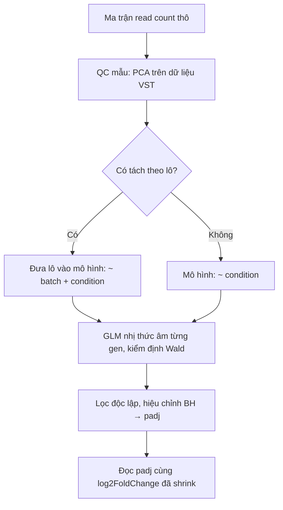

Khi kiểm định 20.000 gen ở ngưỡng p < 0,05 mà không gen nào thật sự thay đổi, bạn vẫn nhận trung bình 1.000 "phát hiện" giả: đó là toán học của kiểm định nhiều lần (multiple testing), không phải lỗi phần mềm. Bài này giải thích bốn công cụ giúp danh sách gen biểu hiện khác biệt không đầy dương tính giả: hiệu chỉnh tỷ lệ phát hiện sai (false discovery rate, FDR) theo Benjamini–Hochberg, cách hiểu đúng p-value, mô hình nhị thức âm (negative binomial) cho read count, và PCA để phát hiện batch effect. Mỗi phần có một mô phỏng Python chạy lại được với seed cố định. Bài dành cho sinh viên sinh học và người làm wet-lab sắp phải đọc bảng kết quả DESeq2 hoặc limma.

<div class="callout callout-note">
<p class="callout-title">Tóm tắt nhanh</p>

- **Lọc theo `padj`, không theo `pvalue`.** `padj` của DESeq2 là p-value hiệu chỉnh theo Benjamini–Hochberg, kiểm soát FDR; nó không phải q-value của Storey.
- **Bonferroni kiểm soát FWER** (xác suất có ít nhất một dương tính giả), nên với 20.000 gen ngưỡng chỉ còn 2,5 × 10⁻⁶ và gần như mất hết power.
- **p-value đo mức không tương thích giữa dữ liệu và cả một mô hình**, gồm H0 và mọi giả định; nó không phải xác suất H0 đúng và không đo độ lớn hiệu ứng.
- **Read count giữa các mẫu lặp sinh học quá phân tán (overdispersed)** so với Poisson, nên DESeq2 và edgeR dùng nhị thức âm với $\mathrm{Var} = \mu + \alpha\mu^2$.
- **PCA trên dữ liệu VST để phát hiện batch effect, thiết kế cân bằng để phòng nó**; UMAP chỉ để xem.

</div>

## 1. Ba cột số trong một bảng kết quả RNA-seq

Giả sử bạn nhận một bảng kết quả phân tích biểu hiện khác biệt (differential expression, DE). Mỗi dòng là một gen, và ba cột quan trọng nhất là `log2FoldChange`, `pvalue` và `padj`. `log2FoldChange` cho biết gen thay đổi bao nhiêu và theo chiều nào. `pvalue` cho biết dữ liệu của riêng gen đó khó giải thích đến đâu nếu không có khác biệt. `padj` đặt p-value đó vào bối cảnh hàng chục nghìn kiểm định chạy cùng lúc.

Mỗi gen là một kiểm định, và bộ gen người có thể có khoảng 19.000 gen mã hoá protein (Ezkurdia et al., 2014), chưa kể gen không mã hoá. Nghiên cứu airway xử lý tế bào cơ trơn đường thở người từ bốn dòng tế bào bằng dexamethasone 1 µM trong 18 giờ và báo cáo 316 gen biểu hiện khác biệt ở ngưỡng p hiệu chỉnh Benjamini–Hochberg < 0,05 (Himes et al., 2014). Con số 316 chỉ có nghĩa khi bạn biết nó được chọn từ bao nhiêu gen và bằng thủ tục nào.



## 2. Kiểm định nhiều lần: FWER, FDR và thủ tục Benjamini–Hochberg

### 2.1. Dưới H0, p-value phân phối đều

Nếu một kiểm định hợp lệ và giả thuyết không (H0) đúng, p-value phân phối đều trên đoạn [0, 1]: xác suất p < 0,05 đúng bằng 0,05, xác suất p < 0,01 đúng bằng 0,01. Thủ tục Benjamini–Hochberg dựa trên chính tính chất này (Noble, 2009).

Khi kiểm định m gen độc lập mà mọi H0 đều đúng, mỗi gen giống một lần tung đồng xu có xác suất "ngửa" bằng α. Số gen có p < α vì vậy theo phân phối nhị thức Binomial(m, α), có kỳ vọng $m\alpha$ và độ lệch chuẩn $\sqrt{m\alpha(1-\alpha)}$. Với m = 20.000 và α = 0,05, kỳ vọng là 1.000 và độ lệch chuẩn khoảng 30,8; với m = 10.000, kỳ vọng là 500 và độ lệch chuẩn khoảng 21,8. Con số 1.000 là **trung bình**: lặp lại thí nghiệm, số dương tính giả dao động quanh 1.000, phần lớn trong khoảng 940–1.060.

Tính chất "đều" có điều kiện. Với số đếm rất thấp, kiểm định trở nên rời rạc và p-value không phân phối đều hoàn toàn; đây là một lý do DESeq2 lọc bớt gen trước khi hiệu chỉnh (Love et al., 2014). Khái niệm cơ bản về kiểm định giả thuyết có ở bài về kiểm định giả thuyết và p-value.

### 2.2. FWER và hiệu chỉnh Bonferroni

Cách hiệu chỉnh lâu đời nhất là Bonferroni: với ngưỡng α và m kiểm định, chỉ coi một kết quả là có ý nghĩa khi $p \le \alpha/m$ (Noble, 2009). Cách viết tương đương là adjusted p = min(1, m·p), rồi so với α.

Bonferroni kiểm soát tỷ lệ sai số theo họ (family-wise error rate, FWER): xác suất có **ít nhất một** dương tính giả trong cả họ kiểm định không vượt quá α (Noble, 2009). Khi m = 20.000, ngưỡng thành 0,05 / 20.000 = 2,5 × 10⁻⁶. Một gen thật sự tăng gấp đôi nhưng chỉ có ba mẫu lặp mỗi nhóm hầu như không thể đạt p nhỏ như vậy. Bonferroni hợp lý khi một dương tính giả rất đắt, ví dụ khi chọn vài marker cho xét nghiệm; nó không hợp với bước sàng lọc gen.

### 2.3. FDR và thủ tục Benjamini–Hochberg

Benjamini và Hochberg (1995) đề xuất kiểm soát một đại lượng khác: tỷ lệ kỳ vọng các giả thuyết bị bác bỏ sai trong số các giả thuyết bị bác bỏ, gọi là FDR. Nếu bạn công bố 300 gen ở FDR 5%, trung bình khoảng 15 gen trong đó là dương tính giả; bạn không biết 15 gen nào, vì FDR là cam kết về cả danh sách. Khi mọi H0 đều đúng, FDR bằng FWER; trong các trường hợp còn lại FDR không lớn hơn FWER, nên kiểm soát FDR cho nhiều power hơn (Benjamini & Hochberg, 1995).

Thủ tục Benjamini–Hochberg (BH) là thủ tục step-up gồm ba bước:

1. Sắp m p-value tăng dần: $p_{(1)} \le p_{(2)} \le \dots \le p_{(m)}$, với $H_{(k)}$ là giả thuyết ứng với $p_{(k)}$.
2. Tìm k lớn nhất thoả $p_{(k)} \le \frac{k}{m}\alpha$.
3. Bác bỏ $H_{(1)}, \dots, H_{(k)}$.

"Step-up" nghĩa là một gen nằm trên đường $k\alpha/m$ ở hạng của nó vẫn được bác bỏ nếu một gen hạng sau nằm dưới đường. p-value hiệu chỉnh BH của gen hạng k là $\min_{j \ge k} \min(1, m\,p_{(j)}/j)$; gen có `padj` ≤ α khi và chỉ khi BH bác bỏ nó ở mức α. Ví dụ tám gen:

```python
import pandas as pd

# Bảng kết quả nhỏ, 8 gen, giống ba cột của DESeq2::results()
res = pd.DataFrame({
    "gene":   ["G1", "G2", "G3", "G4", "G5", "G6", "G7", "G8"],
    "log2FoldChange": [2.1, -1.4, 0.15, 0.9, -0.2, 3.0, 0.05, -0.6],
    "pvalue": [0.0001, 0.0040, 0.0060, 0.0300, 0.0410, 0.0420, 0.6000, 0.9000],
})
m = len(res)
res = res.sort_values("pvalue").reset_index(drop=True)
res["rank"] = range(1, m + 1)
# BH-adjusted p: m·p/k, rồi lấy min cộng dồn từ dưới lên để giữ thứ tự, chặn ở 1
res["padj"] = (res["pvalue"] * m / res["rank"])[::-1].cummin()[::-1].clip(upper=1)
res["BH_line"] = res["rank"] / m * 0.05          # ngưỡng kα/m của từng hạng
print(res.round(4).to_string(index=False))
print("Gen có padj < 0,05:", list(res.loc[res.padj < 0.05, "gene"]))
```

Sáu gen có p < 0,05, nhưng chỉ G1, G2, G3 có `padj` < 0,05 (0,0008; 0,016; 0,016). G4 có p = 0,03 nhưng vượt đường BH ở hạng 4 (0,025), nên `padj` = 0,056. Cột tính tay khớp với `scipy.stats.false_discovery_control(p, method="bh")`.

BH có điều kiện. Benjamini và Hochberg (1995) chứng minh thủ tục kiểm soát FDR khi các thống kê kiểm định độc lập; Benjamini và Yekutieli (2001) mở rộng cho phụ thuộc hồi quy dương (positive regression dependency, PRDS), gồm thống kê chuẩn nhiều chiều có tương quan dương, và đưa ra một phiên bản bảo thủ hơn cho phụ thuộc bất kỳ (`method="by"` trong SciPy). Gen trong cùng pathway thường đồng biến thiên, nên khi báo cáo FDR bạn đang ngầm giả định kiểu phụ thuộc này.

<div class="callout callout-warning">
<p class="callout-title">Lỗi hay gặp khi hiệu chỉnh</p>

- **Hiệu chỉnh trên tập con đã chọn theo p-value.** Lọc trước các gen có p < 0,05 rồi chạy BH trên tập đó làm mất ý nghĩa của hiệu chỉnh. Lọc chỉ hợp lệ khi tiêu chí độc lập với p-value dưới H0, như số đếm trung bình mà DESeq2 dùng (Love et al., 2014).

</div>

### 2.4. BH-adjusted p-value và q-value không phải một

Cột `padj` của DESeq2 là p-value hiệu chỉnh theo BH (Love et al., 2014). q-value là đại lượng do Storey đề xuất: q-value của một gen là FDR nhỏ nhất có thể đạt được khi gọi gen đó là có ý nghĩa (Storey & Tibshirani, 2003), một đại lượng tương tự p-value cho positive FDR (Storey, 2002). Khác biệt chính nằm ở tỷ lệ giả thuyết không đúng $\pi_0$: phương pháp của Storey ước lượng $\pi_0$ từ phân phối p-value, còn thủ tục BH ngầm đặt $\pi_0 = 1$, nên bảo thủ hơn khi nhiều gen thật sự thay đổi (Storey & Tibshirani, 2003).

| | FWER (Bonferroni) | FDR (Benjamini–Hochberg) | q-value (Storey) |
| --- | --- | --- | --- |
| Kiểm soát gì | P(ít nhất 1 dương tính giả) | Tỷ lệ kỳ vọng dương tính giả trong các phát hiện | FDR nhỏ nhất khi gọi gen đó có ý nghĩa |
| Cách tính | p ≤ α/m | Step-up, so $p_{(k)}$ với $k\alpha/m$ | Ước lượng FDR, có ước lượng $\pi_0$ |
| Khi nào dùng | Vài kiểm định, sai một lần rất đắt | Sàng lọc gen, mặc định trong DESeq2 | Sàng lọc khi muốn dùng ước lượng $\pi_0$ |

*Bảng 1. Ba cách kiểm soát sai số khi kiểm định nhiều lần (Benjamini & Hochberg, 1995; Noble, 2009; Storey & Tibshirani, 2003).*

### 2.5. Mô phỏng 1: 10.000 kiểm định khi không gen nào thay đổi

Mô phỏng tạo 10.000 "gen", mỗi gen 3 mẫu mỗi nhóm lấy từ cùng phân phối chuẩn N(0, 1), rồi chạy t-test hai mẫu cho từng gen. Cách dùng mô phỏng để kiểm tra phương pháp thống kê có ở bài về phương pháp mô phỏng.

```python
import numpy as np
from scipy import stats

rng = np.random.default_rng(2026)        # seed cố định để chạy lại được
m, n, alpha = 10_000, 3, 0.05            # 10.000 "gen", 3 mẫu mỗi nhóm
x = rng.normal(size=(m, n))
y = rng.normal(size=(m, n))
# Kịch bản 2: bỏ dấu # ở dòng dưới để 1.000 gen đầu có hiệu ứng thật (δ = 2)
# y[:1000] += 2.0
p = stats.ttest_ind(x, y, axis=1).pvalue

raw  = (p < alpha).sum()
bonf = (np.minimum(1, p * m) <= alpha).sum()                           # Bonferroni
bh   = (stats.false_discovery_control(p, method="bh") <= alpha).sum()  # Benjamini–Hochberg
print(raw, bonf, bh)
```

Lần chạy này in `487 0 0`: 487 gen có p < 0,05, không gen nào qua Bonferroni hay BH. Lặp 200 lần, số p < 0,05 trung bình 499,6 (độ lệch chuẩn 22,5; thấp nhất 447, cao nhất 562), khớp kỳ vọng 500 ± 21,8. Sau hiệu chỉnh, 4,0% số lần lặp có ít nhất một phát hiện, với cả Bonferroni lẫn BH: dưới null toàn phần, FDR bằng FWER.


*Hình 1. Histogram 10.000 p-value null (mô phỏng 1, n = 3 mỗi nhóm, seed 2026). Mỗi khoảng rộng 0,05 chứa khoảng 500 gen; khoảng đỏ là 487 gen có p < 0,05.*

### 2.6. Mô phỏng 2: 9.000 gen null và 1.000 gen thật

Mô phỏng thứ hai cho 1.000 trong 10.000 gen dịch trung bình đi δ độ lệch chuẩn ở nhóm xử lý, với n ∈ {3, 6, 10} mẫu mỗi nhóm và δ ∈ {1,5; 2; 3}, mỗi ô lặp 100 lần. Mỗi phương pháp được chấm bằng số dương tính giả V, tỷ lệ phát hiện sai thực tế FDP = V / max(số phát hiện, 1) và power = số gen thật được phát hiện / 1.000.


*Hình 2. Thủ tục BH trên một lần chạy (n = 6, δ = 2): p-value đã sắp xếp, đường BH kα/m (đỏ) và ngưỡng Bonferroni α/m (xanh). BH dừng ở hạng 328; Bonferroni chỉ giữ 7 gen.*

| n mỗi nhóm | Phương pháp | Phát hiện | Dương tính giả V | FDP | Power |
| --- | --- | --- | --- | --- | --- |
| 3 | Không hiệu chỉnh | 910,1 | 448,0 | 0,49 | 0,46 |
| 3 | BH | 0,3 | 0,1 | – | 0,000 |
| 6 | Không hiệu chỉnh | 1.325,1 | 448,8 | 0,34 | 0,88 |
| 6 | Bonferroni | 5,8 | 0,0 | 0,007 | 0,006 |
| 6 | BH | 318,1 | 14,8 | 0,046 | 0,30 |
| 10 | Không hiệu chỉnh | 1.441,7 | 453,5 | 0,31 | 0,99 |
| 10 | Bonferroni | 102,3 | 0,0 | 0,000 | 0,10 |
| 10 | BH | 910,2 | 41,1 | 0,045 | 0,87 |

*Bảng 2. Trung bình của mô phỏng 2 với δ = 2 (100 lần lặp mỗi ô, seed 7). Với n = 3, Bonferroni cho trung bình 0,2 phát hiện.*


*Hình 3. Số phát hiện trung bình chia theo đúng (xanh) và sai (đỏ), δ = 2.*

Không hiệu chỉnh, khoảng 450 gen null lọt vào danh sách ở mọi cỡ mẫu, nên FDP từ 0,31 đến 0,49. Bonferroni giữ FDP gần 0 nhưng với n = 10 vẫn bỏ sót 90% gen thật. BH giữ FDP quanh 0,045–0,046, tức mức 0,05 nhân với tỷ lệ gen null 0,9, và power tăng nhanh theo n. Với n = 3, t-test từng gen gần như không phát hiện được gì sau hiệu chỉnh, kể cả khi δ = 3 (trung bình 1,3 phát hiện).

Mô phỏng giả định gen độc lập, dữ liệu chuẩn và mọi gen thật có cùng δ; với dữ liệu thật có tương quan giữa gen, FDP của một thí nghiệm cụ thể có thể lệch khỏi mức danh nghĩa nhiều hơn.

### 2.7. DESeq2 làm gì với p-value

Trong DESeq2, mỗi gen có một p-value từ kiểm định Wald. Trước khi hiệu chỉnh, DESeq2 lọc độc lập (independent filtering) để bỏ các gen có số đếm trung bình quá thấp, vốn gần như không có cơ hội đạt ý nghĩa; p-value của các gen còn lại được hiệu chỉnh theo BH và ghi vào cột `padj` (Love et al., 2014). Gen bị lọc có `padj` là `NA`, nên số gen đi vào bước BH thường nhỏ hơn số dòng của bảng.

## 3. Hiểu đúng p-value: sáu nguyên tắc ASA cho bảng kết quả omics

Năm 2016, Hiệp hội Thống kê Hoa Kỳ (American Statistical Association, ASA) công bố tuyên bố về p-value gồm sáu nguyên tắc (Wasserstein & Lazar, 2016).

p-value là xác suất, dưới một **mô hình thống kê xác định**, để một thống kê tóm tắt của dữ liệu bằng hoặc cực đoan hơn giá trị quan sát được. Mô hình đó gồm H0 **và mọi giả định** của kiểm định: phân phối của dữ liệu, tính độc lập giữa các mẫu, cách chọn dữ liệu để phân tích. Greenland et al. (2016) nhấn mạnh rằng p-value được tính khi giả định giả thuyết đang kiểm định là đúng, nên nó không thể là xác suất giả thuyết đó đúng. Chiều ngược lại cũng sai: p > 0,05 không chứng minh gen không thay đổi. Trong mô phỏng 2 với n = 3, gần như cả 1.000 gen thật có `padj` > 0,05; thí nghiệm chỉ thiếu power.

| Nguyên tắc ASA (diễn đạt lại) | Hiểu sai trong omics | Nên làm |
| --- | --- | --- |
| 1. p-value cho biết dữ liệu không tương thích đến đâu với một mô hình xác định | p nhỏ thì gen chắc chắn thay đổi | Kiểm tra giả định: kiểm định Poisson trên dữ liệu quá phân tán cho p nhỏ vì **mô hình sai** (mục 4.3) |
| 2. p-value không đo xác suất giả thuyết đúng hay xác suất kết quả chỉ do ngẫu nhiên | `padj` = 0,01 nghĩa là gen có 1% khả năng sai | Đọc FDR như cam kết trên cả danh sách |
| 3. Kết luận không nên chỉ dựa vào việc p vượt một ngưỡng | `padj` = 0,049 "có", 0,051 "không" | Coi hai gen có mức bằng chứng gần nhau |
| 4. Suy luận đúng cần báo cáo đầy đủ, minh bạch | Chỉ báo cáo gen có ý nghĩa | Báo cáo số gen kiểm định, bước lọc, phương pháp hiệu chỉnh, phiên bản phần mềm, code |
| 5. p-value không đo độ lớn hay tầm quan trọng của hiệu ứng | Gen p nhỏ nhất là quan trọng nhất | Đọc kèm log2 fold change đã shrink và sai số chuẩn |
| 6. Riêng p-value không phải thước đo bằng chứng tốt | Chỉ xếp hạng theo p | Kết hợp độ lớn hiệu ứng, chất lượng mẫu, kiểm chứng độc lập |

*Bảng 3. Sáu nguyên tắc ASA (Wasserstein & Lazar, 2016) áp dụng cho bảng kết quả DE (Greenland et al., 2016).*

Với dữ liệu giải trình tự, nguyên tắc 5 là chỗ dễ trượt nhất. Bảng tám gen ở mục 2.3 có đủ hai tình huống. G3 qua ngưỡng FDR với log2 fold change 0,15, tức thay đổi khoảng 11%, còn G6 tăng 8 lần nhưng không qua. Gen số đếm thấp còn có thể có log2 fold change rất lớn chỉ do nhiễu. DESeq2 xử lý việc này bằng cách co (shrink) log2 fold change của các gen ít thông tin về 0 để ước lượng ổn định hơn (Love et al., 2014). Phương pháp apeglm dùng phân phối tiên nghiệm đuôi nặng (Cauchy), nên co mạnh nhiễu nhưng giữ được khác biệt lớn thật (Zhu et al., 2019); trong R là `lfcShrink(dds, coef = ..., type = "apeglm")`.

## 4. Read count: vì sao nhị thức âm chứ không Poisson

### 4.1. Poisson mô tả biến thiên kỹ thuật

Đếm số read rơi vào một gen giống lấy mẫu ngẫu nhiên từ một rổ rất lớn các mảnh cDNA. Số đếm là biến nhị thức, và vì mỗi gen chỉ chiếm phần rất nhỏ tổng số read, nó được xấp xỉ tốt bằng phân phối Poisson, có phương sai bằng trung bình (Gierliński et al., 2015).

Bằng chứng đến từ một thí nghiệm RNA-seq nấm men có 48 mẫu lặp mỗi điều kiện. Khi so cùng thư viện trên 7 lane của flow cell, nhóm tác giả chạy 630.850 kiểm định overdispersion và chỉ 2 kiểm định bác bỏ giả thuyết Poisson sau hiệu chỉnh BH (Gierliński et al., 2015). Poisson vì vậy đúng cho **mẫu lặp kỹ thuật** (technical replicates): cùng một mẫu, giải trình tự nhiều lần.

### 4.2. Mẫu lặp sinh học làm phương sai vượt trung bình

Giữa các **mẫu lặp sinh học** (biological replicates), tức các cá thể, dòng tế bào hay mẻ nuôi cấy khác nhau, câu chuyện khác. Trong cùng dữ liệu 48 mẫu lặp, số đếm theo Poisson khi thấp, nhưng từ khoảng 10 read mỗi gen trở lên thì lệch dần khỏi Poisson và trở nên quá phân tán, mô tả được bằng $\sigma^2 = \mu + \phi\mu^2$; dispersion trung vị khoảng 0,01, tương ứng hệ số biến thiên sinh học khoảng 10% (Gierliński et al., 2015).

Nghiên cứu này cũng thấy số đếm phù hợp với cả phân phối log-normal lẫn nhị thức âm (Gierliński et al., 2015). Nhị thức âm vì vậy không phải mô hình duy nhất khả dĩ; nó được chọn vì gắn được vào khung mô hình tuyến tính tổng quát. Mẫu lặp kém chất lượng cũng làm méo phân phối mạnh: ở chủng đột biến Δsnf2, tỷ lệ gen không khớp log-normal tăng từ 5% lên 54% khi giữ lại các mẫu lặp kém (Gierliński et al., 2015). QC mẫu vì vậy phải đi trước mọi kiểm định.

| Phân phối | Phương sai theo trung bình | Dùng cho |
| --- | --- | --- |
| Poisson | Var = μ | Số read giữa các lần giải trình tự lặp kỹ thuật của cùng một mẫu |
| Nhị thức âm (gamma-Poisson) | Var = μ + αμ² | Số read giữa các mẫu lặp sinh học; mô hình của DESeq2, edgeR |
| Log-normal | log(count) xấp xỉ chuẩn | Số đếm đủ lớn; cơ sở của phân tích trên log-expression |

*Bảng 4. Ba phân phối thường gặp cho read count RNA-seq (Gierliński et al., 2015; Love et al., 2014).*


*Hình 4. Trung bình và phương sai của 3.000 gen mô phỏng theo nhị thức âm (α = 0,05, 6 mẫu lặp). Từ khoảng 1/α = 20 read trở lên, phương sai tách khỏi đường Poisson.*

### 4.3. Mô phỏng 3: dùng kiểm định Poisson cho dữ liệu nhị thức âm

Mô phỏng 3 tạo số đếm nhị thức âm **không có khác biệt thật** giữa hai nhóm 3 mẫu, với μ ∈ {10, 50, 200, 1.000} và α ∈ {0; 0,01; 0,05; 0,1; 0,2} (α = 0 là Poisson), 2.000 gen mỗi ô. Mỗi gen được kiểm định bằng kiểm định Poisson chính xác có điều kiện và bằng t-test trên log2(count + 1).

```python
import numpy as np
from scipy import stats

rng = np.random.default_rng(11)
G, n, mu, a = 2_000, 3, 200, 0.1          # 2.000 gen, 3 vs 3 mẫu, μ = 200, α = 0,1
r = 1 / a                                 # numpy tham số hoá NB bằng (r, p)
x = rng.negative_binomial(r, r / (r + mu), size=(G, n))
y = rng.negative_binomial(r, r / (r + mu), size=(G, n))   # cùng phân phối: không gen nào khác biệt

# Kiểm định Poisson chính xác có điều kiện: với tổng T, số đếm nhóm 1 ~ Binomial(T, 0,5)
k, T = x.sum(1), x.sum(1) + y.sum(1)
p_pois = np.minimum(1, 2 * np.minimum(stats.binom.cdf(k, T, 0.5), stats.binom.sf(k - 1, T, 0.5)))
# So sánh: t-test trên log2(count + 1)
p_t = stats.ttest_ind(np.log2(x + 1), np.log2(y + 1), axis=1).pvalue
print(f"Poisson: {(p_pois < 0.05).mean():.1%}   t-test log: {(p_t < 0.05).mean():.1%}")
print("Var/mean trung bình:", round((x.var(1, ddof=1) / x.mean(1)).mean(), 1))
```

Đoạn code in `Poisson: 66.8%   t-test log: 4.8%` và tỷ số phương sai/trung bình 20,0, gần kỳ vọng 1 + αμ = 21. Dưới null, kiểm định hợp lệ phải cho khoảng 5% p < 0,05; kiểm định Poisson cho hai phần ba.


*Hình 5. Tỷ lệ gen có p < 0,05 khi dùng kiểm định Poisson cho dữ liệu nhị thức âm không có khác biệt thật (2.000 gen mỗi ô, 3 vs 3 mẫu, seed 11).*

Tỷ lệ báo động giả tăng theo tích αμ, vì phần overdispersion αμ² so với phần Poisson μ đúng bằng αμ (Love et al., 2014). Với α = 0, kiểm định Poisson cho 4,0–4,9%. Với α = 0,01, mức dispersion điển hình của dữ liệu nấm men, tỷ lệ lên 24,6% ở μ = 200 và 54,6% ở μ = 1.000; với α = 0,2 và μ = 1.000 là 89,4%. Trên toàn lưới, t-test trên log counts giữ tỷ lệ trong khoảng 3,8–5,9%. Đây là minh hoạ cho nguyên tắc ASA thứ nhất: p nhỏ ở đây nói rằng **mô hình Poisson sai**, không nói gen thay đổi.

### 4.4. DESeq2 là một GLM nhị thức âm

Mô hình tuyến tính tổng quát (generalized linear model, GLM), do Nelder và Wedderburn (1972) đề xuất, mở rộng hồi quy tuyến tính cho biến đáp ứng không chuẩn như số đếm, qua một hàm liên kết (xem bài về hồi quy tuyến tính và logistic). DESeq2 khớp một GLM cho mỗi gen (Love et al., 2014):

- Số đếm $K_{ij}$ của gen i ở mẫu j theo phân phối nhị thức âm (gamma-Poisson) với trung bình $\mu_{ij}$ và dispersion $\alpha_i$.
- $\mu_{ij} = s_j q_{ij}$: $s_j$ là size factor của mẫu, ước lượng bằng phương pháp median-of-ratios; $q_{ij}$ tỷ lệ với nồng độ cDNA của gen.
- Hàm liên kết log: $\log_2 q_{ij} = \sum_r x_{jr}\beta_{ir}$; hệ số của biến điều kiện là log2 fold change.
- $\mathrm{Var}\,K_{ij} = \mu_{ij} + \alpha_i\mu_{ij}^2$: phần Poisson μ cộng phần overdispersion αμ².

Cái khó nằm ở cỡ mẫu. Thí nghiệm RNA-seq thường chỉ có 2–3 mẫu lặp mỗi điều kiện, nên ước lượng dispersion của từng gen riêng lẻ rất bất định (Love et al., 2014). DESeq2 mượn thông tin giữa các gen bằng empirical Bayes: nó khớp một đường xu hướng dispersion theo số đếm trung bình trên mọi gen, rồi co ước lượng của từng gen về phía đường đó. Ý tưởng này đã có trong phân tích microarray: Smyth (2004) kết hợp mô hình tuyến tính với empirical Bayes để co phương sai mẫu của từng gen, tạo ra thống kê t điều tiết (moderated t). Nhờ vậy DESeq2 chạy được ở n = 3, nơi t-test thường của mô phỏng 2 thất bại.

Kiểm định Wald chia log2 fold change ước lượng cho sai số chuẩn của nó để được thống kê z, rồi so với phân phối chuẩn; mẫu có Cook's distance vượt phân vị 0,99 của phân phối F(p, m − p) bị gắn cờ outlier (Love et al., 2014). Ở các phiên bản DESeq2 hiện hành, cột `log2FoldChange` của `results()` là ước lượng hợp lý cực đại (MLE), còn LFC đã shrink lấy bằng hàm `lfcShrink()` riêng (Love et al., n.d.).

### 4.5. `~ batch + condition` nghĩa là gì

Công thức thiết kế (design formula) là vế phải của GLM. Viết `~ batch + condition` nghĩa là hệ số `condition` được ước lượng **sau khi đã tính đến** khác biệt trung bình giữa các lô (Love et al., 2014).

Cách này chỉ làm được khi lô không trùng hoàn toàn với điều kiện. Nếu mọi mẫu đối chứng nằm ở lô 1 và mọi mẫu xử lý ở lô 2, hai cột `batch` và `condition` của ma trận thiết kế giống hệt nhau, và không phương pháp nào tách được hai hiệu ứng (mục 5.4).

Có một điểm hay nhầm. DESeq2 dùng **số đếm thô** (raw counts) cho suy luận. Biến đổi ổn định phương sai (variance stabilizing transformation, VST) hay rlog chỉ dùng cho trực quan hoá, phân cụm và PCA (Love et al., 2014).

<div class="callout callout-warning">
<p class="callout-title">"n ≥ 30" không phải quy tắc của omics</p>

Quy tắc "cỡ mẫu từ 30 trở lên thì định lý giới hạn trung tâm đúng" không phải ngưỡng chung. Kiểm định và khoảng tin cậy t kém chính xác hơn người ta thường nghĩ khi dữ liệu lệch (Hesterberg, 2015). Với quần thể theo phân phối mũ, cần n ≥ 5.000 để t-test hai phía ở α = 0,05 hay khoảng tin cậy 95% sai không quá 10% mỗi phía (Hesterberg, 2014). Trong omics, câu hỏi về n là câu hỏi về **power**. DESeq2 được thiết kế cho 2–3 mẫu lặp mỗi điều kiện (Love et al., 2014), và mô phỏng 1 cho thấy p-value null vẫn đều ở n = 3 nếu kiểm định hợp lệ. Số mẫu lặp khuyến nghị đến từ nghiên cứu power thực nghiệm: ít nhất 6 mẫu lặp sinh học mỗi điều kiện, và ít nhất 12 nếu cần bắt gen ở mọi mức fold change (Schurch et al., 2016). Xem thêm [bài về dữ liệu bẩn và "n ≥ 30"](/blog/process-data-from-dirty-to-clean/) và bài về định lý giới hạn trung tâm.

</div>

## 5. PCA, UMAP và batch effect

### 5.1. Batch effect là gì và khi nào nguy hiểm

Batch effect là biến thiên do điều kiện kỹ thuật chứ không do sinh học: phòng thí nghiệm, lô hoá chất, người làm, ngày xử lý mẫu. Leek et al. (2010) cho rằng chúng phổ biến và phải xử lý, và trở thành vấn đề nghiêm trọng khi tương quan với biến kết cục. Một ví dụ trong bài của họ: ở một nghiên cứu ung thư biểu mô chuyển tiếp, việc mẫu có carcinoma in situ hay không trùng mạnh với ngày xử lý mẫu. Khi lô và nhóm phân bố không cân bằng, batch effect thành biến gây nhiễu (confounder) và có thể tạo khác biệt giả giữa các nhóm (Nygaard et al., 2016).

### 5.2. PCA để phát hiện

Phân tích thành phần chính (principal component analysis, PCA) tạo các biến mới không tương quan, lần lượt giữ nhiều phương sai nhất; về toán học, đó là bài toán trị riêng và vectơ riêng (Jolliffe & Cadima, 2016). Leek et al. (2010) dùng thành phần chính để định lượng ảnh hưởng của biến phi sinh học: nếu PC1 tương quan mạnh với ngày xử lý thay vì với điều kiện, đó là dấu hiệu batch.

Khi vẽ PCA cho RNA-seq, nên giữ ba quy tắc. Thứ nhất, chạy trên dữ liệu VST hoặc rlog, vì trên log thông thường gen số đếm thấp có trọng số quá lớn (Love et al., 2014). Thứ hai, tô màu theo điều kiện, đổi hình dạng điểm theo lô, ghi % phương sai trên trục; ngoài hình, tính tương quan giữa điểm của từng PC với lô và với điều kiện để có một con số kiểm chứng được. Thứ ba, xem cả PC3–PC5, vì batch có thể nằm ở thành phần thấp hơn.

### 5.3. UMAP và t-SNE: dùng để xem, không dùng để đo

Nén dữ liệu hàng nghìn chiều xuống 2 chiều tất yếu gây méo đáng kể khoảng cách, và Chari và Pachter (2023) lập luận rằng méo này khiến embedding 2D phản tác dụng cho phân tích khám phá. t-SNE thể hiện tốt cấu trúc cục bộ nhưng cấu trúc toàn cục thường sai khi dùng tham số mặc định (Kobak & Berens, 2019). UMAP (McInnes et al., 2018) phổ biến trong single-cell nhưng chịu cùng giới hạn của mọi phép nhúng 2D. Kết luận về batch vì vậy nên dựa trên PCA và các chỉ số định lượng; UMAP chỉ để minh hoạ. Tích hợp nhiều mẫu trong single-cell là bài toán riêng (xem bài về transcriptomics).

### 5.4. Mô phỏng 4: thiết kế cân bằng và thiết kế lệch

Mô phỏng 4 tạo 2.000 gen × 12 mẫu, hai điều kiện, hai lô: 600 gen chịu hiệu ứng lô, 220 gen chịu hiệu ứng điều kiện thật, 65 gen chịu cả hai. Thiết kế **cân bằng** có 3 mẫu đối chứng và 3 mẫu xử lý ở mỗi lô; thiết kế **lệch** đặt 6 mẫu đối chứng ở lô 1 và 6 mẫu xử lý ở lô 2. Mỗi gen được kiểm định bằng hồi quy tuyến tính trên log-expression với `~ condition` và `~ batch + condition`, rồi hiệu chỉnh BH ở 0,05.


*Hình 6. PCA của hai thiết kế (mô phỏng 4, seed 42); màu là điều kiện, hình dạng là lô. Thiết kế cân bằng: PC1 (41,1%) tách lô, PC2 (18,0%) tách điều kiện. Thiết kế lệch: PC1 (55,2%) tách cả hai cùng lúc.*

| Thiết kế | Mô hình | Phát hiện | Dương tính giả | FDP | Power |
| --- | --- | --- | --- | --- | --- |
| Cân bằng | `~ condition` | 168 | 4 | 0,024 | 0,745 |
| Cân bằng | `~ batch + condition` | 200 | 6 | 0,030 | 0,882 |
| Lệch | `~ condition` | 512 | 310 | 0,605 | 0,918 |
| Lệch | `~ batch + condition` | Không ước lượng được | | | |

*Bảng 5. Kết quả mô phỏng 4 (một lần chạy, BH ở 0,05). Ở thiết kế lệch, ma trận thiết kế của `~ batch + condition` suy biến.*

Trong thiết kế cân bằng, cả hai mô hình giữ FDP dưới 5%, và đưa lô vào mô hình làm power tăng từ 0,745 lên 0,882 vì phương sai do lô được tách khỏi phần dư. Trong thiết kế lệch, PCA trông "đẹp": PC1 tách hai nhóm rất rõ, nhưng tương quan tuyệt đối của PC1 với lô và với điều kiện đều là 0,9997, vì hai biến là một. Mô hình `~ condition` báo 512 gen, trong đó 310 gen chỉ chịu hiệu ứng lô. Dữ liệu không chứa thông tin nào để tách lô khỏi điều kiện, và không phần mềm nào sửa được điều đó sau khi thí nghiệm đã chạy.

### 5.5. Thiết kế trước, mô hình sau, "sửa dữ liệu" sau cùng

Nygaard et al. (2016) khuyên trước hết phải bảo đảm thiết kế cân bằng; nếu dữ liệu đã lệch một phần, đưa lô vào mô hình thống kê thay vì sửa dữ liệu trước rồi mới kiểm định. Các phương pháp chỉnh lô giữ lại khác biệt nhóm, như ComBat với nhóm làm covariate, có thể làm khoảng tin cậy hẹp giả tạo và phóng đại độ tin cậy của khác biệt giữa các nhóm khi thiết kế không cân bằng (Nygaard et al., 2016). ComBat dùng empirical Bayes để tránh chỉnh quá tay với lô nhỏ (Johnson et al., 2007), nhưng điều đó không giải quyết vấn đề thiết kế. Dữ liệu đã chỉnh lô hợp với trực quan hoá hoặc làm đầu vào machine learning, không hợp để tính p-value; trong machine learning, mô hình có thể học lô thay vì học sinh học (xem bài về machine learning trong sinh học).

## 6. Checklist đọc một bảng kết quả DE

1. **Đã kiểm định bao nhiêu gen, sau bước lọc nào?** Số gen có `padj` khác `NA` là số đi vào BH (Love et al., 2014).
2. **Hiệu chỉnh bằng phương pháp gì, ngưỡng FDR bao nhiêu?** BH, Bonferroni và q-value của Storey là ba đại lượng khác nhau (Benjamini & Hochberg, 1995; Storey & Tibshirani, 2003).
3. **Mô hình đếm có tham số dispersion không?** Không dùng kiểm định Poisson cho mẫu lặp sinh học (Gierliński et al., 2015).
4. **Có log2 fold change đã shrink và sai số chuẩn không?** (Love et al., 2014; Zhu et al., 2019).
5. **PCA trên VST có tách theo lô không, lô có cân bằng giữa các nhóm không?** (Leek et al., 2010; Nygaard et al., 2016).
6. **Bao nhiêu mẫu lặp sinh học mỗi nhóm, có mẫu kém chất lượng bị loại không?** (Schurch et al., 2016; Gierliński et al., 2015).
7. **Có câu nào nói "p > 0,05 nghĩa là không khác biệt" không?** Đó là hiểu sai (Greenland et al., 2016).
8. **Code và phiên bản phần mềm có được công bố không?** (Wasserstein & Lazar, 2016, nguyên tắc 4).

Bảng nào không trả lời được câu 1, 2 và 5 thì nên hỏi lại người phân tích trước khi chọn gen để làm tiếp. Bài 4 của series nói về định dạng dữ liệu, tức ma trận đếm đến từ đâu ([Định dạng dữ liệu và cơ sở dữ liệu sinh học](/blog/dinh-dang-du-lieu-va-co-so-du-lieu-sinh-hoc/)); bài 7 đi qua pipeline RNA-seq đầy đủ.

## Câu hỏi thường gặp

**`pvalue` và `padj` trong DESeq2 khác nhau thế nào?** `pvalue` là p-value Wald của từng gen; `padj` là p-value đó sau hiệu chỉnh Benjamini–Hochberg trên các gen qua bước lọc độc lập. Chọn gen theo `padj`.

**Có nên chạy ComBat rồi đưa dữ liệu đã chỉnh vào DESeq2 không?** Không nên. DESeq2 cần số đếm thô, và chỉnh lô trước khi kiểm định có thể phóng đại độ tin cậy khi thiết kế không cân bằng (Nygaard et al., 2016). Đưa lô vào công thức thiết kế thay thế.

**RNA-seq cần bao nhiêu mẫu lặp?** Ít nhất 6 mẫu lặp sinh học mỗi điều kiện theo Schurch et al. (2016), nhiều hơn nếu cần bắt thay đổi nhỏ.

## Phụ lục: chạy lại mô phỏng

Bốn mô phỏng dùng numpy 2.4.6, SciPy 1.17.1 và scikit-learn 1.9.0 trên Python 3.13, với seed 2026 (mô phỏng 1), 7 (mô phỏng 2), 11 (mô phỏng 3) và 42 (mô phỏng 4). Hàm `scipy.stats.false_discovery_control` có từ SciPy 1.11; với statsmodels, `multipletests(p, method="fdr_bh")` cho cùng kết quả.

## Tài liệu tham khảo

Benjamini, Y., & Hochberg, Y. (1995). Controlling the false discovery rate: A practical and powerful approach to multiple testing. *Journal of the Royal Statistical Society: Series B (Methodological), 57*(1), 289–300. https://doi.org/10.1111/j.2517-6161.1995.tb02031.x

Benjamini, Y., & Yekutieli, D. (2001). The control of the false discovery rate in multiple testing under dependency. *The Annals of Statistics, 29*(4), 1165–1188. https://doi.org/10.1214/aos/1013699998

Chari, T., & Pachter, L. (2023). The specious art of single-cell genomics. *PLOS Computational Biology, 19*(8), e1011288. https://doi.org/10.1371/journal.pcbi.1011288

Ezkurdia, I., Juan, D., Rodriguez, J. M., Frankish, A., Diekhans, M., Harrow, J., Vazquez, J., Valencia, A., & Tress, M. L. (2014). Multiple evidence strands suggest that there may be as few as 19 000 human protein-coding genes. *Human Molecular Genetics, 23*(22), 5866–5878. https://doi.org/10.1093/hmg/ddu309

Gierliński, M., Cole, C., Schofield, P., Schurch, N. J., Sherstnev, A., Singh, V., Wrobel, N., Gharbi, K., Simpson, G., Owen-Hughes, T., Blaxter, M., & Barton, G. J. (2015). Statistical models for RNA-seq data derived from a two-condition 48-replicate experiment. *Bioinformatics, 31*(22), 3625–3630. https://doi.org/10.1093/bioinformatics/btv425

Greenland, S., Senn, S. J., Rothman, K. J., Carlin, J. B., Poole, C., Goodman, S. N., & Altman, D. G. (2016). Statistical tests, P values, confidence intervals, and power: A guide to misinterpretations. *European Journal of Epidemiology, 31*(4), 337–350. https://doi.org/10.1007/s10654-016-0149-3

Hesterberg, T. C. (2014). *What teachers should know about the bootstrap: Resampling in the undergraduate statistics curriculum* (arXiv:1411.5279). arXiv. https://doi.org/10.48550/arXiv.1411.5279

Hesterberg, T. C. (2015). What teachers should know about the bootstrap: Resampling in the undergraduate statistics curriculum. *The American Statistician, 69*(4), 371–386. https://doi.org/10.1080/00031305.2015.1089789

Himes, B. E., Jiang, X., Wagner, P., Hu, R., Wang, Q., Klanderman, B., Whitaker, R. M., Duan, Q., Lasky-Su, J., Nikolos, C., Jester, W., Johnson, M., Panettieri, R. A., Jr., Tantisira, K. G., Weiss, S. T., & Lu, Q. (2014). RNA-Seq transcriptome profiling identifies CRISPLD2 as a glucocorticoid responsive gene that modulates cytokine function in airway smooth muscle cells. *PLoS ONE, 9*(6), e99625. https://doi.org/10.1371/journal.pone.0099625

Johnson, W. E., Li, C., & Rabinovic, A. (2007). Adjusting batch effects in microarray expression data using empirical Bayes methods. *Biostatistics, 8*(1), 118–127. https://doi.org/10.1093/biostatistics/kxj037

Jolliffe, I. T., & Cadima, J. (2016). Principal component analysis: A review and recent developments. *Philosophical Transactions of the Royal Society A, 374*(2065), 20150202. https://doi.org/10.1098/rsta.2015.0202

Kobak, D., & Berens, P. (2019). The art of using t-SNE for single-cell transcriptomics. *Nature Communications, 10*(1), 5416. https://doi.org/10.1038/s41467-019-13056-x

Leek, J. T., Scharpf, R. B., Bravo, H. C., Simcha, D., Langmead, B., Johnson, W. E., Geman, D., Baggerly, K., & Irizarry, R. A. (2010). Tackling the widespread and critical impact of batch effects in high-throughput data. *Nature Reviews Genetics, 11*(10), 733–739. https://doi.org/10.1038/nrg2825

Love, M. I., Anders, S., & Huber, W. (n.d.). *Analyzing RNA-seq data with DESeq2* [Bioconductor vignette]. Truy cập ngày 26/11/2026, từ https://bioconductor.org/packages/release/bioc/vignettes/DESeq2/inst/doc/DESeq2.html

Love, M. I., Huber, W., & Anders, S. (2014). Moderated estimation of fold change and dispersion for RNA-seq data with DESeq2. *Genome Biology, 15*(12), 550. https://doi.org/10.1186/s13059-014-0550-8

McInnes, L., Healy, J., & Melville, J. (2018). *UMAP: Uniform manifold approximation and projection for dimension reduction* (arXiv:1802.03426). arXiv. https://doi.org/10.48550/arXiv.1802.03426

Nelder, J. A., & Wedderburn, R. W. M. (1972). Generalized linear models. *Journal of the Royal Statistical Society: Series A (General), 135*(3), 370–384. https://doi.org/10.2307/2344614

Noble, W. S. (2009). How does multiple testing correction work? *Nature Biotechnology, 27*(12), 1135–1137. https://doi.org/10.1038/nbt1209-1135

Nygaard, V., Rødland, E. A., & Hovig, E. (2016). Methods that remove batch effects while retaining group differences may lead to exaggerated confidence in downstream analyses. *Biostatistics, 17*(1), 29–39. https://doi.org/10.1093/biostatistics/kxv027

Schurch, N. J., Schofield, P., Gierliński, M., Cole, C., Sherstnev, A., Singh, V., Wrobel, N., Gharbi, K., Simpson, G. G., Owen-Hughes, T., Blaxter, M., & Barton, G. J. (2016). How many biological replicates are needed in an RNA-seq experiment and which differential expression tool should you use? *RNA, 22*(6), 839–851. https://doi.org/10.1261/rna.053959.115

Smyth, G. K. (2004). Linear models and empirical Bayes methods for assessing differential expression in microarray experiments. *Statistical Applications in Genetics and Molecular Biology, 3*(1), Article 3. https://doi.org/10.2202/1544-6115.1027

Storey, J. D. (2002). A direct approach to false discovery rates. *Journal of the Royal Statistical Society: Series B (Statistical Methodology), 64*(3), 479–498. https://doi.org/10.1111/1467-9868.00346

Storey, J. D., & Tibshirani, R. (2003). Statistical significance for genomewide studies. *Proceedings of the National Academy of Sciences, 100*(16), 9440–9445. https://doi.org/10.1073/pnas.1530509100

Wasserstein, R. L., & Lazar, N. A. (2016). The ASA statement on p-values: Context, process, and purpose. *The American Statistician, 70*(2), 129–133. https://doi.org/10.1080/00031305.2016.1154108

Zhu, A., Ibrahim, J. G., & Love, M. I. (2019). Heavy-tailed prior distributions for sequence count data: Removing the noise and preserving large differences. *Bioinformatics, 35*(12), 2084–2092. https://doi.org/10.1093/bioinformatics/bty895
