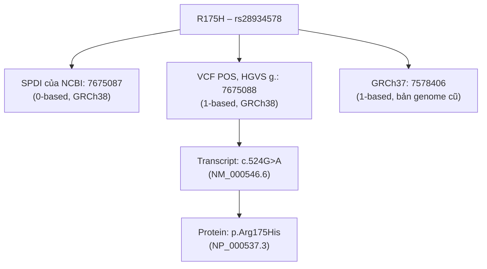

FASTA, FASTQ, SAM/BAM, VCF và BED là năm định dạng file mà gần như mọi phân tích dữ liệu giải trình tự đều đi qua, và mỗi định dạng có một đặc tả (specification) riêng do nhóm hts-specs, UCSC hoặc Sequence Ontology duy trì. Hai lỗi phổ biến khi làm việc với chúng lại không làm chương trình báo lỗi: đọc sai điểm chất lượng Phred (Q = −10 log10 P, mã hoá với offset 33 hay 64) và lệch một base khi chuyển giữa hệ 0-based (BED, BAM, BCF) và hệ 1-based (VCF, GFF, SAM). Ví dụ xuyên suốt là đột biến TP53 R175H: trong VCF nó nằm ở POS 7675088 trên GRCh38, còn nếu đặt nhầm con số này làm BED start thì bạn lấy base G ở 7675089, nơi ClinVar ghi một biến thể khác. Bài viết cho sinh viên sinh học mới vào bioinformatics, kèm code Python chạy được, một checklist 8 mục và bảng các cơ sở dữ liệu với cách ghi phiên bản.

<div class="callout callout-note">
<p class="callout-title">Tóm tắt nhanh</p>

- **Phred**: Q = −10 log10 P. Q30 nghĩa là xác suất gọi sai base là 1/1.000. Muốn tóm tắt chất lượng một read, lấy trung bình **P**, không lấy trung bình **Q**.
- **Offset**: FASTQ chuẩn Sanger và Illumina hiện hành dùng offset 33; Solexa và Illumina 1.3+ dùng offset 64. Đọc nhầm offset làm mọi Q lệch 31 điểm.
- **Tọa độ**: BED, BAM, BCF đếm từ 0 và nửa mở; SAM, VCF, GFF đếm từ 1 và đóng. BED start = start 1-based − 1, BED end giữ nguyên.
- **Bốn thông tin đi kèm mọi con số tọa độ**: hệ đếm, bản genome, tên trình tự (17 hay chr17), phiên bản transcript.
- **Cơ sở dữ liệu**: ghi số release, ngày tải và accession có phiên bản (NM_000546.6, không phải NM_000546).

</div>

## 1. Một đột biến, năm địa chỉ

TP53 mã hoá protein p53, một yếu tố ức chế khối u. Đột biến TP53 rất hay gặp trong ung thư. Phần lớn là đột biến sai nghĩa (missense), chiếm khoảng 70% các thay đổi của TP53, và một số vị trí lặp lại nhiều đến mức được gọi là điểm nóng (hotspot) (Hassin & Oren, 2023). R175H, tức arginine ở vị trí 175 bị thay bằng histidine, là một đột biến cấu trúc điển hình: nó làm protein p53 mất cấu dạng bình thường (Hassin & Oren, 2023). Ở mức DNA, đây là một đột biến thay thế một cặp base.

Cùng một thay đổi đó được ghi bằng năm con số khác nhau, tuỳ nguồn bạn mở:



Không con số nào sai. Mỗi con số thuộc một hệ quy ước: đếm từ 0 hay từ 1, GRCh37 hay GRCh38, trên nhiễm sắc thể, transcript hay protein. Lỗi xảy ra khi chuyển con số sang hệ khác mà quên đổi quy ước, và phần mềm thường không báo gì: nó vẫn trả về một base, một vùng, một biến thể, chỉ không phải cái bạn cần.

Lỗi kiểu này đã xảy ra trong nghiên cứu thật. Khi phân tích lại các bài báo dùng dòng tế bào để dự đoán độ nhạy với hoá trị, Baggerly và Coombes (2009) nhận thấy lỗi phổ biến nhất lại là những lỗi đơn giản, như lệch hàng hoặc lệch cột. Buffalo (2015) kể lại một chi tiết của vụ này: cả một danh sách giá trị biểu hiện gen bị dịch đi một dòng so với tên gen.

Mục 2–7 đi qua từng định dạng theo đặc tả của nó, mục 8 thực hành trên TP53, mục 9 bàn về các cơ sở dữ liệu và cách ghi phiên bản.

## 2. Định dạng file sinh học là gì và đặc tả nằm ở đâu

Định dạng file (file format) là quy ước về cách sắp xếp dữ liệu trong file để chương trình khác đọc được. Đặc tả là văn bản viết ra quy ước đó: trường nào bắt buộc, giá trị nào hợp lệ, đếm tọa độ từ đâu. Phần lớn định dạng sinh học ra đời như định dạng đầu vào của một công cụ cụ thể, được nhiều người dùng theo, rồi mới được viết thành đặc tả.

**FASTA** do Bill Pearson tạo ra làm đầu vào cho bộ công cụ so sánh trình tự FASTA (Pearson & Lipman, 1988). Định dạng này phát triển theo đồng thuận, không có tiêu chuẩn chính thức, và một số parser hỏng khi gặp dòng tiêu đề hoặc trình tự rất dài (Cock et al., 2010). **FASTQ** được Jim Mullikin tạo ra ở Wellcome Trust Sanger Institute vào khoảng năm 2000 và chưa từng có văn bản định nghĩa, cho đến khi Cock et al. (2010) viết định nghĩa công khai dựa trên quy ước chung của các dự án Open Bioinformatics Foundation (Biopython, BioPerl, BioRuby, BioJava, EMBOSS).

**SAM/BAM** (Li et al., 2009) và **VCF** (Danecek et al., 2011) được thiết kế cho Dự án 1000 Genomes, rồi trở thành tiêu chuẩn do Global Alliance for Genomics and Health (GA4GH) quản lý (Bonfield et al., 2021). Đặc tả của chúng nằm trong kho hts-specs. **BED** ra đời từ UCSC Genome Browser (Kent et al., 2002) và mãi đến năm 2022 mới có đặc tả chính thức, BEDv1, viết để chuẩn hoá các cách hiểu hợp lý của mô tả gốc (Niu et al., 2022). **GFF3** do Sequence Ontology duy trì, bản hiện hành là 1.26 (Stein, 2020).

**Bảng 1.** Năm định dạng cốt lõi, bài gốc, đặc tả hiện hành và hệ tọa độ

| Định dạng | Chứa gì | Bài gốc | Đặc tả hiện hành | Hệ tọa độ | Công cụ chính |
|---|---|---|---|---|---|
| FASTA | trình tự | Pearson & Lipman (1988) | không có đặc tả chính thức | không có tọa độ | samtools faidx, Biopython |
| FASTQ | trình tự + chất lượng từng base | Cock et al. (2010) | định nghĩa trong Cock et al. (2010) | không có tọa độ | seqkit, FastQC |
| SAM / BAM / CRAM | read đã căn chỉnh và read không căn chỉnh được | Li et al. (2009) | SAMv1, 12/8/2025 (SAM/BAM v1.6); CRAMv3 | SAM 1-based; BAM 0-based | samtools, HTSlib |
| VCF / BCF | SNP, indel, biến thể cấu trúc | Danecek et al. (2011) | VCFv4.5 và BCFv2.2, 25/2/2026 | VCF 1-based; BCF 0-based | bcftools, tabix |
| BED | vùng trên genome | Kent et al. (2002) | BEDv1, 5/1/2022 | 0-based, nửa mở | bedtools |
| GFF3 / GTF | chú giải gen | – | GFF3 1.26, 18/8/2020 | 1-based, đóng | gffread, Ensembl |

Khi hai công cụ cho kết quả khác nhau trên cùng một file, hãy mở đặc tả trước khi tìm trên diễn đàn. Đặc tả hts-specs là file PDF có ngày và mã phiên bản, dẫn được đúng mục, đúng trang.

## 3. FASTA: đơn giản nhưng không có chuẩn cho dòng tiêu đề

Một bản ghi FASTA bắt đầu bằng dòng `>` chứa mã định danh và mô tả, sau đó là một hoặc nhiều dòng trình tự. Phần sau dấu `>` không có chuẩn chung (Cock et al., 2010): NCBI ghi accession rồi mô tả, Ensembl ghi ID kèm vị trí trên genome, còn file tự tạo thì muốn ghi gì cũng được. Vì vậy, script tách ID bằng khoảng trắng chạy tốt với file này nhưng có thể sai với file khác.

Với genome lớn, bạn không nên đọc cả file để lấy một đoạn. Lệnh `samtools faidx genome.fa` tạo file index `.fai` ghi vị trí byte của từng trình tự, sau đó `samtools faidx genome.fa chr17:7675083-7675093` lấy đúng 11 base cần thiết. Lưu ý vùng trong lệnh này viết theo kiểu 1-based, đóng.

Chi tiết dễ bị bỏ qua là **phiên bản accession**. NM_000546 là mã RefSeq của mRNA TP53, nhưng bản ghi này đã được sửa nhiều lần; mỗi lần sửa trình tự, số sau dấu chấm tăng lên. Ngày 26/11/2026, mã không kèm phiên bản trỏ tới NM_000546.6, dài 2.512 nt. Nếu chỉ ghi NM_000546, người chạy lại sau vài năm có thể nhận trình tự khác mà không biết. Đoạn code dưới đây tải đúng phiên bản và đóng kết nối sau khi đọc:

```python
from Bio import Entrez

Entrez.email = "[email hidden]"        # NCBI yêu cầu email của người dùng
handle = Entrez.efetch(db="nucleotide", id="NM_000546.6",
                       rettype="fasta", retmode="text")
fasta = handle.read()
handle.close()
print(fasta.splitlines()[0])
print(sum(len(l) for l in fasta.splitlines()[1:]), "nt")
```

Kết quả chạy ngày 26/11/2026:

```text
>NM_000546.6 Homo sapiens tumor protein p53 (TP53), transcript variant 1, mRNA
2512 nt
```

## 4. FASTQ và điểm Phred: đọc đúng dòng chất lượng

### 4.1. Bốn loại dòng

FASTQ lưu trình tự kèm điểm chất lượng cho từng base. Theo Cock et al. (2010), mỗi bản ghi gồm bốn loại dòng: dòng `@` chứa tên read; một hoặc nhiều dòng trình tự; dòng `+`, trước đây lặp lại tên read, nay thường để trống cho nhẹ file; và dòng chất lượng dài đúng bằng trình tự. Đặc tả cho phép xuống dòng giữa trình tự và chất lượng. Phần lớn công cụ ghi đúng 4 dòng cho mỗi read, nhưng đó là quy ước chứ không phải quy định.

Ký tự `@` cũng là một ký tự chất lượng hợp lệ và có thể đứng đầu dòng chất lượng. Vì thế `grep -c '^@'` có thể đếm dư số read; [bài 02 của series](/blog/nen-tang-tinh-toan/) có ví dụ cụ thể và cách đếm đúng.

Đây là bản ghi đầu tiên của file SRR390728_1 tải từ European Nucleotide Archive (ENA):

```text
@SRR390728.1 1/1
CATTCTTCACGTAGTTCTCGAGCCTTGGTTTTCAGC
+
????????????????????????????????????
```

### 4.2. Điểm Phred là gì

Phần mềm gọi base PHRED gán cho mỗi base một xác suất gọi sai ước lượng P, và điểm chất lượng được định nghĩa là Q = −10 log10 P (Ewing & Green, 1998; Ewing et al., 1998; Cock et al., 2010). Thang này là thang log: Q10, Q20, Q30, Q40 tương ứng P = 0,1; 0,01; 0,001; 0,0001. Q30 tức là trung bình 1 lỗi trên 1.000 base. Cứ tăng 10 điểm Q thì P giảm 10 lần (→ [bài 03 về thang log](/blog/toan-va-thong-ke-cho-sinh-hoc/)).


*Hình 1. Quan hệ giữa điểm Phred Q và xác suất gọi sai P, vẽ từ công thức Q = −10 log10 P. Trục tung theo thang log nên đường thẳng.*

### 4.3. Ba kiểu mã hoá không tương thích

Để mỗi base chỉ tốn một byte, Q được ghi thành một ký tự ASCII bằng cách cộng thêm một số gọi là offset. Cock et al. (2010) mô tả ba biến thể:

**Bảng 2.** Ba kiểu mã hoá chất lượng FASTQ

| Biến thể | Offset | Dải ký tự ASCII | Dải điểm | Công thức |
|---|---|---|---|---|
| Sanger | 33 | 33–126 | Q 0–93 | Phred |
| Solexa / Illumina đời đầu | 64 | 59–126 | −5 đến 62 | Solexa (log-odds) |
| Illumina 1.3+ | 64 | 64–126 | Q 0–62 | Phred |

Tài liệu trợ giúp BaseSpace của Illumina mô tả FASTQ của hãng ghi điểm chất lượng bằng ký tự có mã ASCII bằng Q + 33, tức cùng offset với Sanger (Illumina, n.d.). Nhìn phần mở rộng file thì không phân biệt được, vì cả ba đều là `.fastq`. Đọc nhầm offset làm mọi Q lệch 31 điểm.

Giải mã thử: `I` có mã ASCII 73, nên với offset 33 thì Q = 40; `9` có mã ASCII 57, nên Q = 24 và P ≈ 0,004. Nếu đọc nhầm offset 64, `I` chỉ còn Q9.

### 4.4. Đừng lấy trung bình Q

Q là thang log, nên trung bình cộng của Q không tương ứng với xác suất sai trung bình. Xét chuỗi chất lượng 20 base `IIIIIIIIIIIIIIIIII9I` (19 base Q40 và một base Q24):

```python
import math

def phred_scores(qual, offset=33):
    """Đổi chuỗi chất lượng FASTQ thành danh sách điểm Q."""
    return [ord(ch) - offset for ch in qual]

qual = "IIIIIIIIIIIIIIIIII9I"           # 20 base, một base có ký tự '9'
q = phred_scores(qual)
p = [10 ** (-qi / 10) for qi in q]      # P = 10^(-Q/10)

mean_q = sum(q) / len(q)
mean_p = sum(p) / len(p)
q_from_mean_p = -10 * math.log10(mean_p)
expected_errors = sum(p)

print(f"Q của 'I' = {ord('I') - 33}, Q của '9' = {ord('9') - 33}")
print(f"Trung bình Q          : {mean_q:.1f}")
print(f"P trung bình          : {mean_p:.2e}")
print(f"Q tính từ P trung bình: {q_from_mean_p:.1f}")
print(f"Số lỗi kỳ vọng / read : {expected_errors:.4f}")
print(f"Đọc nhầm offset 64    : Q của 'I' = {ord('I') - 64}")
```

```text
Q của 'I' = 40, Q của '9' = 24
Trung bình Q          : 39.2
P trung bình          : 2.94e-04
Q tính từ P trung bình: 35.3
Số lỗi kỳ vọng / read : 0.0059
Đọc nhầm offset 64    : Q của 'I' = 9
```

Trung bình Q là 39,2, nhưng xác suất sai trung bình là 2,94 × 10⁻⁴, tương ứng Q35,3. Một base Q24 đóng góp vào tổng lỗi nhiều gấp khoảng hai lần 19 base Q40 cộng lại, còn phép trung bình Q gần như xoá nó đi. Muốn tóm tắt chất lượng, hãy cộng hoặc lấy trung bình P, hoặc báo số lỗi kỳ vọng trên read (ở đây 0,0059).

### 4.5. Dòng chất lượng có thể đã bị đơn giản hoá

SRR390728 là bộ dữ liệu RNA-seq người, giải trình tự trên Illumina Genome Analyzer IIx, paired-end 2 × 36 bp, 7.178.576 spot, công khai ngày 23/12/2011 (theo ENA). Đếm ký tự chất lượng trong 10.000 read đầu của file _1 tải từ ENA (26/11/2026) thì chỉ thấy hai ký tự, `?` (Q30) và `$` (Q3). Mỗi read mang đúng một mức cho mọi base của nó: 9.875 read toàn Q30, 125 read toàn Q3.

```python
import gzip
from collections import Counter

def quality_profile(path, max_reads=10_000):
    """Đếm ký tự chất lượng và số mức chất lượng khác nhau trong mỗi read."""
    chars, levels = Counter(), Counter()
    with gzip.open(path, "rt") as fh:
        for i, line in enumerate(fh):
            if i // 4 >= max_reads:
                break
            if i % 4 == 3:                  # dòng thứ 4 của mỗi bản ghi
                qual = line.rstrip("\n")
                chars.update(qual)
                levels[len(set(qual))] += 1
    return chars, levels

chars, levels = quality_profile("SRR390728_1.fastq.gz")
for ch, n in sorted(chars.items()):
    print(f"'{ch}'  Q{ord(ch) - 33:<3} {n:>8} base")
print("Số mức chất lượng trong một read:", dict(levels))
```

```text
'$'  Q3       4500 base
'?'  Q30    355500 base
Số mức chất lượng trong một read: {1: 10000}
```

Kiểu phân bố này khớp với quy tắc của **SRA Lite**, định dạng rút gọn của NCBI: mỗi read nhận Q30 nếu đạt bộ lọc, Q3 nếu bị loại, và file nhỏ hơn khoảng 60% (NCBI, 2022). Kết quả trên chưa đủ để khẳng định file ENA được tạo từ SRA Lite; muốn biết chắc cần tải bản đầy đủ bằng `fasterq-dump` và so sánh. Nhưng hệ quả thì rõ: chạy FastQC trên một file như vậy sẽ cho biểu đồ chất lượng "đẹp" mà không phản ánh chất lượng thật của từng base. Vì vậy, trước khi diễn giải điểm chất lượng, hãy kiểm tra file được tải từ đâu và ở định dạng nào.

Có hai đường lấy file này. Từ NCBI, lệnh `fasterq-dump SRR390728 --split-files` (bộ SRA Toolkit) tách hai đầu đọc thành `SRR390728_1.fastq` và `SRR390728_2.fastq`. Từ ENA, bạn tải trực tiếp file `.fastq.gz`; trang filereport của ENA ghi kèm mã md5 cho từng file, và kiểm tra md5 sau khi tải là bước nên làm trước mọi phân tích. Sau đó `seqkit stats` cho bạn số read, tổng số base và độ dài read để so với metadata.

## 5. SAM, BAM, CRAM: một read đã căn chỉnh nằm ở đâu

SAM (Sequence Alignment/Map) là định dạng chung để lưu read đã căn chỉnh (aligned) lên trình tự tham chiếu, cho cả read ngắn và dài, từ nhiều nền tảng giải trình tự; bộ SAMtools đi kèm cung cấp các bước index, xem alignment và gọi biến thể (Li et al., 2009). SAMtools và BCFtools được duy trì liên tục từ năm 2009, dựa trên thư viện chung HTSlib (Danecek et al., 2021; Bonfield et al., 2021).

Mỗi dòng alignment có 11 cột bắt buộc: QNAME (tên read), FLAG, RNAME (tên trình tự tham chiếu), POS, MAPQ, CIGAR, RNEXT, PNEXT, TLEN, SEQ và QUAL. Ba trường dễ đọc nhầm:

- **FLAG** là tổng các bit. Bit 0x4 là cách duy nhất đáng tin để biết read không căn chỉnh được (SAM/BAM Format Specification Working Group, 2025, §1.4). Như vậy file SAM/BAM chứa cả read unmapped, không chỉ read đã căn chỉnh.
- **MAPQ** cũng dùng thang Phred: −10 log10 của xác suất vị trí căn chỉnh bị sai (§1.4).
- **CIGAR** mô tả read khớp với tham chiếu ra sao: bao nhiêu base khớp (M), chèn (I), mất (D), bị cắt (S).

Riêng về tọa độ, **cột POS của SAM là 1-based, nhưng BAM lưu `pos` dạng 0-based** (bằng POS − 1) (§1.4, §4.2). Người dùng `samtools view` không thấy sự khác biệt vì samtools tự chuyển. Người viết code đọc BAM trực tiếp, ví dụ bằng pysam, thì phải biết đang nhận giá trị theo hệ nào trước khi đem so với VCF hay GFF. Đặc tả SAMv1 (§1.2) liệt kê rõ: SAM, VCF, GFF và Wiggle dùng hệ 1-based; BAM, BCFv2, BED và PSL dùng hệ 0-based.

Tại sao có BAM và CRAM? Trong bài báo gốc, căn chỉnh 112 Gbp dữ liệu Illumina GA cần 116 GB BAM, tức khoảng 1 byte cho mỗi base đầu vào, phần lớn dành cho điểm chất lượng (Li et al., 2009). CRAM giảm kích thước bằng cách chỉ lưu chỗ read khác với trình tự tham chiếu (Hsi-Yang Fritz et al., 2011); bản 3.1 bổ sung các codec nén mới (Bonfield, 2022). Đổi lại, muốn đọc CRAM bạn cần đúng file tham chiếu đã dùng khi nén, một lý do nữa để ghi rõ bản genome.

## 6. VCF và BCF: biến thể, kiểu gen và padding base

VCF (Variant Call Format) lưu SNP, indel và biến thể cấu trúc cùng chú giải, thường được nén bằng bgzip và index bằng tabix để truy xuất nhanh theo vùng (Danecek et al., 2011). Sau phần header bắt đầu bằng `##` là 8 cột cố định: CHROM, POS (1-based), ID, REF, ALT, QUAL (thang Phred), FILTER và INFO; tiếp theo là cột FORMAT và một cột cho mỗi mẫu, chứa kiểu gen như `0/1`.

R175H viết thành một dòng VCF (8 cột đầu) như sau:

```text
#CHROM  POS      ID          REF  ALT  QUAL  FILTER  INFO
17      7675088  rs28934578  C    T    .     .       .
```

REF là C và ALT là T vì VCF ghi allele theo mạch + của genome. TP53 nằm trên mạch −, nên trên transcript cùng thay đổi đó là G → A, tức c.524G>A.

Quy tắc dễ gây nhầm là **padding base**. Với indel đơn giản, REF và ALT phải chứa thêm base đứng **trước** biến thể, và POS chỉ vào base đó; ngoại lệ là khi biến thể nằm ở vị trí 1 của contig, lúc đó dùng base đứng sau (VCFv4.5, 2026, §1.6.1). Ví dụ minh hoạ: trên đoạn ACTGCG, mất base G ở vị trí 4 được ghi là `POS=3 REF=TG ALT=T`. Cùng mất đoạn đó trong BED là `start=3 end=4`. Hai con số "3" trùng nhau nhưng chỉ vào hai base khác nhau, dù cả hai file đều đúng quy ước. Đây là nguồn lệch thứ hai, độc lập với chuyện 0 hay 1.

BCF là bản nhị phân của VCF, và giống BAM, nó lưu tọa độ 0-based (SAM/BAM Format Specification Working Group, 2025, §1.2). `bcftools view` tự chuyển về 1-based khi in ra.

## 7. BED, GFF3/GTF và bigWig: hai cách đếm

### 7.1. BED: đếm khe giữa các base

Theo BEDv1, BED dùng hệ **0-based, nửa mở** (half-open): base đầu tiên của nhiễm sắc thể có chỉ số 0, điểm đầu thuộc khoảng còn điểm cuối thì không (Niu et al., 2022, §1.3). Ví dụ của chính đặc tả: trong chuỗi ACTGCG, khoảng [2, 4) là TG. Cách dễ nhớ là coi BED đếm các **khe** giữa các base, còn VCF và GFF đếm chính các **base**.

BED có từ 3 đến 12 trường; 3 trường đầu (chrom, chromStart, chromEnd) là bắt buộc, còn BED10 và BED11 bị cấm (§1.5). Khi chromStart bằng chromEnd, dòng BED biểu diễn một điểm chèn nằm giữa hai base (§1.6). Hệ này có lợi thế: độ dài vùng đúng bằng end − start, và hai vùng liền nhau có end của vùng trước bằng start của vùng sau.


*Hình 2. Đoạn chr17:7675083–7675093 (GRCh38, mạch +). Hàng trên là chỉ số khe 0-based, hàng dưới là chỉ số base 1-based (ghi bốn chữ số cuối). Base xanh là vị trí R175H (7675088); base đỏ là base bạn lấy được khi đặt nhầm VCF POS làm BED start. Trình tự lấy từ Ensembl REST (release 116, 26/11/2026).*

### 7.2. GFF3, GTF, Wiggle và bedGraph

GFF3 dùng tọa độ **1-based**, start ≤ end; một đặc trưng dài 0 base, như điểm chèn, được ghi với start = end và vị trí ngầm hiểu nằm bên phải base đó (Stein, 2020). GTF cũng dùng 1-based. UCSC Genome Browser hiển thị tọa độ 1-based, đóng, nhưng lưu bảng dữ liệu và file BED theo 0-based, nửa mở; chuyển từ bảng sang hiển thị bằng cách cộng 1 vào start và giữ nguyên end (UCSC Genome Browser, 2016). Wiggle là 1-based, còn bedGraph là 0-based. bigWig và bigBed là bản nhị phân có index, cho phép trình duyệt chỉ tải phần đang xem thay vì cả file (Kent et al., 2010).

**Bảng 3.** Chuyển đổi giữa BED và hệ 1-based (VCF, GFF, SAM)

| Việc | Công thức |
|---|---|
| 1-based → BED | start₀ = start₁ − 1; end₀ = end₁ |
| BED → 1-based | start₁ = start₀ + 1; end₁ = end₀ |
| Độ dài vùng BED | end − start |
| Độ dài vùng 1-based | end − start + 1 |
| Một base ở vị trí POS (VCF) | BED: POS − 1, POS |

Muốn so sánh, giao hay mở rộng các vùng giữa BED, GFF và BAM, công cụ chuẩn là BEDTools, thiết kế để ghép với các lệnh Unix khác qua pipe (Quinlan & Hall, 2010). Lỗi thường không nằm trong công cụ mà ở bước bạn tự viết script để tạo file BED từ một bảng 1-based, chẳng hạn bảng biến thể xuất từ Excel hay từ trang web của một CSDL.

<div class="callout callout-warning">
<p class="callout-title">Ba dấu hiệu file BED có thể đang lệch 1</p>

- Mọi vùng một base có `end − start = 0` thay vì 1: start đã bị chép nguyên từ hệ 1-based.
- Độ dài vùng tính được ngắn hơn độ dài ghi trong CSDL đúng 1 bp.
- Base lấy ra ở vị trí biến thể không khớp với cột REF của VCF.

</div>

## 8. Tự làm: chuyển vùng TP53 giữa GFF3, BED và VCF

Phần này lấy dữ liệu thật của TP53 từ Ensembl REST (release 116), NCBI và ClinVar, rồi cho thấy lỗi lệch 1 trông như thế nào. Tọa độ dưới đây là GRCh38.

### 8.1. Vùng gen

Ensembl ghi gen TP53 (ENSG00000141510.21) ở `17  ensembl_havana  gene  7661779  7687546  .  -` trong GFF3, tức 1-based, mạch −. BED đúng tương ứng là `chr17  7661778  7687546  TP53  0  -`. Độ dài theo cả hai cách tính đều là 25.768 bp. Nếu chép nguyên 7661779 làm BED start, vùng chỉ còn 25.767 bp; vì gen nằm trên mạch −, base bị mất thuộc đầu 3′ của gen.

Lỗi thứ hai ít người để ý: cột 1 của Ensembl là "17", còn UCSC và nhiều file BED dùng "chr17". Với máy, đó là hai tên trình tự khác nhau. Công cụ ghép theo tên sẽ không tìm thấy giao nhau, và tuỳ công cụ, phiên bản, bạn có thể chỉ nhận kết quả rỗng thay vì một thông báo lỗi. Ví dụ với pandas:

```python
import pandas as pd

genes = pd.DataFrame({"chrom": ["17"], "start": [7661778], "end": [7687546], "name": ["TP53"]})
variants = pd.DataFrame({"chrom": ["chr17"], "pos0": [7675087], "id": ["rs28934578"]})

def overlaps(genes, variants):
    m = genes.merge(variants, on="chrom")      # ghép theo tên nhiễm sắc thể
    return m[(m.pos0 >= m.start) & (m.pos0 < m.end)]

print("Trước khi chuẩn hoá:", len(overlaps(genes, variants)), "dòng giao")
genes["chrom"] = "chr" + genes["chrom"].str.removeprefix("chr")
print("Sau khi chuẩn hoá  :", len(overlaps(genes, variants)), "dòng giao")
```

```text
Trước khi chuẩn hoá: 0 dòng giao
Sau khi chuẩn hoá  : 1 dòng giao
```

### 8.2. Transcript MANE Select

MANE Select là bộ transcript chung do NCBI và EMBL-EBI chọn, mỗi gen mã hoá protein một transcript đại diện, dùng cho diễn giải lâm sàng (Morales et al., 2022). Với TP53, đó là ENST00000269305.9 ↔ NM_000546.6, protein NP_000537.3. Ensembl ghi transcript này ở 7668421–7687490 (1-based); UCSC ghi 7668420–7687490 (0-based, truy vấn ngày 11/11/2026). Hai nguồn khớp sau khi cộng 1 vào start. Transcript có 11 exon, dài 2.512 nt, và vùng mã hoá (CDS) nằm ở 7669609–7676594 (1-based).

Như vậy "vùng TP53" có thể là 25.768 bp (gen theo Ensembl, gồm mọi transcript) hoặc 19.070 bp (riêng transcript MANE). Khác biệt này đến từ chú giải, không phải từ hệ đếm, và chỉ tránh được bằng cách ghi rõ bạn dùng vùng nào.


*Hình 3. Locus TP53 trên chr17 (GRCh38): gen ENSG00000141510 theo Ensembl 116, transcript MANE ENST00000269305.9 với 11 exon (phần xanh đậm là CDS) và vị trí R175H. Dữ liệu từ Ensembl REST, 26/11/2026.*

### 8.3. Biến thể R175H trong bảy cách ghi

**Bảng 4.** R175H (rs28934578) theo từng hệ quy ước

| Cách ghi | Giá trị | Hệ đếm |
|---|---|---|
| SPDI (NCBI) | NC_000017.11:7675087:C:T | 0-based |
| HGVS genomic | NC_000017.11:g.7675088C>T | 1-based |
| VCF | 17 7675088 C T | 1-based |
| BED | chr17 7675087 7675088 | 0-based, nửa mở |
| GRCh37 | 17:7578406 | 1-based, bản genome cũ |
| HGVS transcript | NM_000546.6:c.524G>A | 1-based từ A của ATG |
| HGVS protein | NP_000537.3:p.Arg175His | 1-based từ Met đầu tiên |

Cách ghi g., c. và p. theo khuyến nghị HGVS (den Dunnen et al., 2016). ClinVar ghi biến thể này là VCV000012374, phân loại Pathogenic, reviewed by expert panel (Landrum et al., 2025; truy vấn ngày 11/11/2026).

Kiểm chứng chéo bằng hai nguồn dùng hai hệ đếm khác nhau: UCSC API với `start=7675087;end=7675088` (0-based) trả về **C** (11/11/2026); Ensembl REST với `17:7675088..7675088:1` (1-based) cũng trả về **C**, và trên mạch −1 trả về **G**, đúng base c.524G trên transcript (26/11/2026). Hai hệ đếm, một base. Đoạn code dưới đây lặp lại phép kiểm tra phía Ensembl:

```python
import json, urllib.request

def ensembl_base(chrom, pos1, strand=1):
    """Lấy một base từ Ensembl REST (tọa độ 1-based, đóng)."""
    url = (f"https://rest.ensembl.org/sequence/region/human/"
           f"{chrom}:{pos1}..{pos1}:{strand}?content-type=application/json")
    with urllib.request.urlopen(url, timeout=30) as r:
        return json.load(r)["seq"]

pos = 7675088
print("Mạch +, POS     :", ensembl_base("17", pos))
print("Mạch -, POS     :", ensembl_base("17", pos, -1))
print("Mạch +, POS + 1 :", ensembl_base("17", pos + 1))
```

```text
Mạch +, POS     : C
Mạch -, POS     : G
Mạch +, POS + 1 : G
```

Giờ thử lỗi lệch 1. Đặt thẳng VCF POS làm BED start (`start=7675088;end=7675089`) thì UCSC trả về **G**. Đó là base ở 7675089, tức vị trí c.523, base đầu của codon 175 (CGC). Tại vị trí này ClinVar ghi những biến thể khác hẳn: R175C (VCV000245851, Uncertain significance, reviewed by expert panel) và R175G (VCV000376649, Pathogenic, reviewed by expert panel). Lệch theo chiều ngược lại (trừ 1 hai lần) cho 7675087, tức c.525, base cuối của codon. Chỉ lệch một số đếm, bạn đã mở hồ sơ lâm sàng của một biến thể khác.

Đoạn code sau tái hiện cả hai phép chuyển trên 11 base quanh R175H, không cần mạng:

```python
# Đoạn chr17:7675083-7675093 (GRCh38, 1-based, đóng), mạch +
REGION_START_1 = 7675083
SEQ = "GGCAGCGCCTC"

def one_to_bed(start1, end1):
    """1-based đóng [start, end] -> BED 0-based nửa mở [start, end)."""
    return start1 - 1, end1

def bed_to_one(start0, end0):
    """BED 0-based nửa mở -> 1-based đóng."""
    return start0 + 1, end0

def base_at_bed(start0, end0):
    """Lấy base trong SEQ theo khoảng BED."""
    off = REGION_START_1 - 1            # khe 0-based ngay trước base đầu đoạn
    return SEQ[start0 - off:end0 - off]

vcf_pos = 7675088                       # R175H trong VCF
s, e = one_to_bed(vcf_pos, vcf_pos)
print("BED đúng :", s, e, "->", base_at_bed(s, e))
print("BED lệch :", vcf_pos, vcf_pos + 1, "->", base_at_bed(vcf_pos, vcf_pos + 1))
print("Quay lại :", bed_to_one(s, e))

gene_gff = (7661779, 7687546)           # gen TP53 trong GFF3 của Ensembl
bs, be = one_to_bed(*gene_gff)
print("Độ dài GFF :", gene_gff[1] - gene_gff[0] + 1)
print("Độ dài BED :", be - bs)
print("BED chép sai start:", be - gene_gff[0])
```

```text
BED đúng : 7675087 7675088 -> C
BED lệch : 7675088 7675089 -> G
Quay lại : (7675088, 7675088)
Độ dài GFF : 25768
Độ dài BED : 25768
BED chép sai start: 25767
```

Lỗi bản genome còn lớn hơn: dùng tọa độ GRCh37 (7578406) trên GRCh38 sẽ trỏ tới một vị trí cách gần 97 kb, ra khỏi gen TP53.

### 8.4. Tọa độ protein

UniProt P04637 (P53_HUMAN) dài 393 amino acid, với vùng gắn DNA (DNA binding) từ 102 đến 292; R175 nằm trong vùng này (The UniProt Consortium, 2025). Tọa độ protein cũng đếm từ 1. Mô hình AlphaFold AF-P04637-F1 (phiên bản 6) có pLDDT toàn cục 75,06 (Varadi et al., 2024; truy vấn 11/11/2026); cách đọc pLDDT để dành cho Phần 8.

### 8.5. Bài tập tự làm

1. Mở IGV với genome hg38, đi tới `chr17:7675088` và kiểm tra base trên mạch + có phải C không. Thanh tọa độ của IGV hiển thị theo hệ nào?
2. Tìm P04637 trên UniProt, xác định vùng DNA binding (gợi ý: 102–292) và đổi vị trí R175 sang khoảng cách tính từ đầu vùng này.
3. Mở mô hình AF-P04637-F1 trên AlphaFold DB và xem pLDDT quanh residue 175.
4. Viết dòng BED cho mất đoạn ví dụ ở mục 6 (mất G trong ACTGCG), rồi kiểm tra bằng hàm `base_at_bed` ở trên với một chuỗi tự đặt.

## 9. Cơ sở dữ liệu chính: dùng đúng, ghi đúng phiên bản

Mục 8 đã dùng sáu nguồn khác nhau cho một gen. Mục này nhìn lại các nguồn đó như những CSDL: chúng chứa gì, ai mô tả chúng, và cần ghi gì để người khác lấy lại đúng dữ liệu bạn đã dùng.

Một cách chia hay dùng là xếp cơ sở dữ liệu (CSDL) sinh học thành hai nhóm. CSDL **sơ cấp** (primary) nhận dữ liệu nộp trực tiếp và lưu trữ gần như nguyên dạng, như ENA/GenBank/DDBJ, GEO và PDB. CSDL **thứ cấp** (secondary) tổng hợp và biên tập (curate) từ nhiều nguồn, như UniProt, InterPro và Ensembl. Ranh giới không tuyệt đối: ClinVar nhận bản nộp của từng phòng xét nghiệm nhưng cũng tổng hợp chúng thành một phân loại chung. Phân biệt này vẫn hữu ích vì nó cho biết dữ liệu đã qua bao nhiêu bước xử lý trước khi đến tay bạn.

**Bảng 5.** Các CSDL dùng trong bài, con số chính và cách ghi phiên bản

| CSDL | Loại | Chứa gì, con số chính | Bài mô tả | Ghi gì khi dùng |
|---|---|---|---|---|
| Ensembl | thứ cấp | hơn 4.800 genome nhân thực và hơn 31.300 genome nhân sơ; có VEP | Dyer et al. (2025) | số release (116), bản genome |
| GENCODE / MANE | thứ cấp | chú giải gen người và chuột; bộ transcript chung NCBI–EMBL-EBI | Mudge et al. (2025); Morales et al. (2022) | phiên bản GENCODE, transcript có số phiên bản |
| UniProt | thứ cấp | UniProtKB giới hạn vào reference proteome chất lượng cao | The UniProt Consortium (2025) | accession, bản phát hành |
| ClinVar | lưu bản nộp, có tổng hợp | hơn 3 triệu biến thể từ hơn 2.800 tổ chức nộp | Landrum et al. (2025) | VCV, ngày tải |
| gnomAD | thứ cấp | v2: 125.748 exome và 15.708 genome; v3: 76.156 genome | Karczewski et al. (2020); Chen et al. (2024) | phiên bản (v2, v3…) |
| dbSNP | sơ cấp | mã rs cho biến thể | Sherry et al. (2001) | mã rs, build |
| GEO | sơ cấp | platform, sample, series | Edgar et al. (2002); Clough et al. (2024) | mã GSE/GSM |
| SRA / ENA | sơ cấp | read thô và alignment | Leinonen et al. (2011); Katz et al. (2022) | mã SRR, định dạng tải |
| BioStudies (gồm ArrayExpress) | sơ cấp | dữ liệu biểu hiện gen chức năng | Sarkans et al. (2021) | mã E-MTAB |
| PDB | sơ cấp | cấu trúc thực nghiệm | Berman et al. (2000) | mã PDB |
| AlphaFold DB | thứ cấp | mô hình dự đoán cho hơn 214 triệu trình tự | Varadi et al. (2024) | mã AF, phiên bản mô hình |
| COSMIC, cBioPortal | thứ cấp | biến thể soma trong ung thư | Sondka et al. (2024); Cerami et al. (2012) | phiên bản, ngày tải |

Ensembl đang ở release 116 (REST API, 26/11/2026). Đường dẫn FTP chứa `current_fasta` luôn trỏ tới bản mới nhất, nên sau một bản phát hành nó sẽ cho file khác; khi viết lệnh tải để người khác chạy lại, hãy dùng đường dẫn có số release (`release-116/...`). File primary assembly của người nặng khoảng 882 MB, nên khi thực hành bạn chỉ cần tải riêng chromosome 17.

ClinVar không còn chỉ là CSDL biến thể di truyền mầm (germline). Bài cập nhật năm 2025 mô tả ba loại phân loại: germline, oncogenicity và clinical impact cho biến thể soma (somatic) (Landrum et al., 2025). ArrayExpress đã được chuyển vào BioStudies (Sarkans et al., 2021), và giao diện ArrayExpress cũ ngừng hoạt động ngày 30/9/2022 (EMBL-EBI, 2022); tài liệu cũ dẫn link ArrayExpress cần được đổi sang BioStudies.

Về ung thư, The Cancer Genome Atlas (TCGA) đã phân tích phân tử hơn 20.000 mẫu ung thư nguyên phát và mẫu lành đi kèm, thuộc 33 loại ung thư (National Cancer Institute, n.d.); phân loại phân tử 10.000 khối u của 33 loại ung thư được công bố năm 2018 (Hoadley et al., 2018). Dữ liệu TCGA được truy cập phổ biến qua cBioPortal (Cerami et al., 2012).

Từ đó có một quy tắc ghi nguồn đơn giản: mỗi lần lấy dữ liệu, ghi tên CSDL, số release, ngày tải, accession có phiên bản và bản genome. Năm thông tin này nên nằm trong README của dự án (→ Phần 12).

## 10. Kết luận và checklist

Khi một trường trong file khó hiểu, hãy mở đặc tả có ngày và phiên bản trước khi đoán. Điểm Phred là thang log của xác suất sai, mã hoá bằng offset 33 hoặc 64; muốn tóm tắt thì tính trên P, đừng lấy trung bình Q. Lỗi lệch 1 trên TP53 đưa bạn từ R175H sang vị trí c.523, nơi ClinVar ghi R175C và R175G, mà không có thông báo nào. Không hệ tọa độ nào "đúng" hơn hệ kia. Một con số tọa độ chỉ có nghĩa khi đi kèm bốn thông tin: hệ đếm, bản genome, tên trình tự và phiên bản chú giải hoặc transcript. Trước khi chạy một file mới, hãy đi qua tám câu hỏi dưới đây.

**Bảng 6.** Checklist 8 mục trước khi chạy một file

| # | Câu hỏi | Kiểm tra bằng |
|---|---|---|
| 1 | Offset Phred là bao nhiêu? | ký tự thấp nhất trong dòng chất lượng |
| 2 | Dòng chất lượng có bị đơn giản hoá không? | đếm số ký tự chất lượng khác nhau |
| 3 | File dùng hệ 0 hay 1? | đặc tả của định dạng (Bảng 1) |
| 4 | Bản genome là gì? | header file, tên file tham chiếu |
| 5 | Tên nhiễm sắc thể có "chr" không? | `cut -f1 file | sort -u` |
| 6 | Transcript và phiên bản nào? | accession có số sau dấu chấm |
| 7 | CSDL bản release nào? | trang thông tin hoặc API của CSDL |
| 8 | Đã thử một vị trí đã biết bằng hai nguồn chưa? | ví dụ R175H = C ở 7675088 |

Bài tiếp theo trong series, Phần 5, dùng trình tự TP53 ở nhiều loài để học gióng hàng trình tự. Phần 6 đi qua cả pipeline FASTQ → BAM → VCF, nơi mọi định dạng trong bài này xuất hiện ở đúng bước của nó.

## Câu hỏi thường gặp

**Q30 nghĩa là gì?** Xác suất base đó bị gọi sai là 0,001, tức trung bình 1 lỗi trên 1.000 base. Q20 là 1 lỗi trên 100 base.

**BED đếm từ 0 hay từ 1?** Từ 0, và khoảng là nửa mở: base cuối không thuộc khoảng. Một base ở VCF POS 7675088 tương ứng với dòng BED `7675087 7675088`.

**BED và GFF khác nhau thế nào?** BED mô tả vùng, 0-based, nửa mở, tối thiểu ba cột. GFF3 mô tả đặc trưng chú giải (gen, exon, CDS) với quan hệ cha con, 1-based, đóng, chín cột.

**SAM, BAM và CRAM khác nhau thế nào?** Cùng một nội dung: SAM là văn bản, BAM là bản nhị phân nén, CRAM nén thêm dựa trên trình tự tham chiếu nên cần đúng file tham chiếu khi đọc.

## Tài liệu tham khảo

- Baggerly, K. A., & Coombes, K. R. (2009). Deriving chemosensitivity from cell lines: Forensic bioinformatics and reproducible research in high-throughput biology. *The Annals of Applied Statistics, 3*(4), 1309–1334. https://doi.org/10.1214/09-AOAS291
- Berman, H. M., Westbrook, J., Feng, Z., Gilliland, G., Bhat, T. N., Weissig, H., Shindyalov, I. N., & Bourne, P. E. (2000). The Protein Data Bank. *Nucleic Acids Research, 28*(1), 235–242. https://doi.org/10.1093/nar/28.1.235
- Bonfield, J. K. (2022). CRAM 3.1: Advances in the CRAM file format. *Bioinformatics, 38*(6), 1497–1503. https://doi.org/10.1093/bioinformatics/btac010
- Bonfield, J. K., Marshall, J., Danecek, P., Li, H., Ohan, V., Whitwham, A., Keane, T., & Davies, R. M. (2021). HTSlib: C library for reading/writing high-throughput sequencing data. *GigaScience, 10*(2), giab007. https://doi.org/10.1093/gigascience/giab007
- Buffalo, V. (2015). *Bioinformatics data skills: Reproducible and robust research with open source tools*. O'Reilly Media. https://www.oreilly.com/library/view/bioinformatics-data-skills/9781449367480/
- Cerami, E., Gao, J., Dogrusoz, U., Gross, B. E., Sumer, S. O., Aksoy, B. A., Jacobsen, A., Byrne, C. J., Heuer, M. L., Larsson, E., Antipin, Y., Reva, B., Goldberg, A. P., Sander, C., & Schultz, N. (2012). The cBio cancer genomics portal: An open platform for exploring multidimensional cancer genomics data. *Cancer Discovery, 2*(5), 401–404. https://doi.org/10.1158/2159-8290.CD-12-0095
- Chen, S., Francioli, L. C., Goodrich, J. K., Collins, R. L., Kanai, M., Wang, Q., Alföldi, J., Watts, N. A., Vittal, C., Gauthier, L. D., Poterba, T., Wilson, M. W., Tarasova, Y., Phu, W., Grant, R., Yohannes, M. T., Koenig, Z., Farjoun, Y., Banks, E., . . . Karczewski, K. J. (2024). A genomic mutational constraint map using variation in 76,156 human genomes. *Nature, 625*(7993), 92–100. https://doi.org/10.1038/s41586-023-06045-0
- Clough, E., Barrett, T., Wilhite, S. E., Ledoux, P., Evangelista, C., Kim, I. F., Tomashevsky, M., Marshall, K. A., Phillippy, K. H., Sherman, P. M., Lee, H., Zhang, N., Serova, N., Wagner, L., Zalunin, V., Kochergin, A., & Soboleva, A. (2024). NCBI GEO: Archive for gene expression and epigenomics data sets: 23-year update. *Nucleic Acids Research, 52*(D1), D138–D144. https://doi.org/10.1093/nar/gkad965
- Cock, P. J. A., Fields, C. J., Goto, N., Heuer, M. L., & Rice, P. M. (2010). The Sanger FASTQ file format for sequences with quality scores, and the Solexa/Illumina FASTQ variants. *Nucleic Acids Research, 38*(6), 1767–1771. https://doi.org/10.1093/nar/gkp1137
- Danecek, P., Auton, A., Abecasis, G., Albers, C. A., Banks, E., DePristo, M. A., Handsaker, R. E., Lunter, G., Marth, G. T., Sherry, S. T., McVean, G., Durbin, R., & 1000 Genomes Project Analysis Group. (2011). The variant call format and VCFtools. *Bioinformatics, 27*(15), 2156–2158. https://doi.org/10.1093/bioinformatics/btr330
- Danecek, P., Bonfield, J. K., Liddle, J., Marshall, J., Ohan, V., Pollard, M. O., Whitwham, A., Keane, T., McCarthy, S. A., Davies, R. M., & Li, H. (2021). Twelve years of SAMtools and BCFtools. *GigaScience, 10*(2), giab008. https://doi.org/10.1093/gigascience/giab008
- den Dunnen, J. T., Dalgleish, R., Maglott, D. R., Hart, R. K., Greenblatt, M. S., McGowan-Jordan, J., Roux, A.-F., Smith, T., Antonarakis, S. E., & Taschner, P. E. M. (2016). HGVS recommendations for the description of sequence variants: 2016 update. *Human Mutation, 37*(6), 564–569. https://doi.org/10.1002/humu.22981
- Dyer, S. C., Austine-Orimoloye, O., Azov, A. G., Barba, M., Barnes, I., Barrera-Enriquez, V. P., Becker, A., Bennett, R., Beracochea, M., Berry, A., Bhai, J., Bhurji, S. K., Boddu, S., Branco Lins, P. R., Brooks, L., Ramaraju, S. B., Campbell, L. I., Martinez, M. C., Charkhchi, M., . . . Yates, A. D. (2025). Ensembl 2025. *Nucleic Acids Research, 53*(D1), D948–D957. https://doi.org/10.1093/nar/gkae1071
- Edgar, R., Domrachev, M., & Lash, A. E. (2002). Gene Expression Omnibus: NCBI gene expression and hybridization array data repository. *Nucleic Acids Research, 30*(1), 207–210. https://doi.org/10.1093/nar/30.1.207
- EMBL-EBI. (2022, October 19). *ArrayExpress interface now retired*. https://www.ebi.ac.uk/about/news/updates-from-data-resources/arrayexpress-retired
- Ewing, B., & Green, P. (1998). Base-calling of automated sequencer traces using Phred. II. Error probabilities. *Genome Research, 8*(3), 186–194. https://doi.org/10.1101/gr.8.3.186
- Ewing, B., Hillier, L., Wendl, M. C., & Green, P. (1998). Base-calling of automated sequencer traces using Phred. I. Accuracy assessment. *Genome Research, 8*(3), 175–185. https://doi.org/10.1101/gr.8.3.175
- Hassin, O., & Oren, M. (2023). Drugging p53 in cancer: One protein, many targets. *Nature Reviews Drug Discovery, 22*(2), 127–144. https://doi.org/10.1038/s41573-022-00571-8
- Hoadley, K. A., Yau, C., Hinoue, T., Wolf, D. M., Lazar, A. J., Drill, E., Shen, R., Taylor, A. M., Cherniack, A. D., Thorsson, V., Akbani, R., Bowlby, R., Wong, C. K., Wiznerowicz, M., Sanchez-Vega, F., Robertson, A. G., Schneider, B. G., Lawrence, M. S., Noushmehr, H., . . . Laird, P. W. (2018). Cell-of-origin patterns dominate the molecular classification of 10,000 tumors from 33 types of cancer. *Cell, 173*(2), 291–304.e6. https://doi.org/10.1016/j.cell.2018.03.022
- Hsi-Yang Fritz, M., Leinonen, R., Cochrane, G., & Birney, E. (2011). Efficient storage of high throughput DNA sequencing data using reference-based compression. *Genome Research, 21*(5), 734–740. https://doi.org/10.1101/gr.114819.110
- Illumina. (n.d.). *Quality scores*. BaseSpace Sequence Hub help. Truy cập ngày 26/11/2026, từ https://help.bioinsight.illumina.com/basespace/files-used-by-basespace/quality-scores
- Karczewski, K. J., Francioli, L. C., Tiao, G., Cummings, B. B., Alföldi, J., Wang, Q., Collins, R. L., Laricchia, K. M., Ganna, A., Birnbaum, D. P., Gauthier, L. D., Brand, H., Solomonson, M., Watts, N. A., Rhodes, D., Singer-Berk, M., England, E. M., Seaby, E. G., Kosmicki, J. A., . . . MacArthur, D. G. (2020). The mutational constraint spectrum quantified from variation in 141,456 humans. *Nature, 581*(7809), 434–443. https://doi.org/10.1038/s41586-020-2308-7
- Katz, K., Shutov, O., Lapoint, R., Kimelman, M., Brister, J. R., & O'Sullivan, C. (2022). The Sequence Read Archive: A decade more of explosive growth. *Nucleic Acids Research, 50*(D1), D387–D390. https://doi.org/10.1093/nar/gkab1053
- Kent, W. J., Sugnet, C. W., Furey, T. S., Roskin, K. M., Pringle, T. H., Zahler, A. M., & Haussler, D. (2002). The human genome browser at UCSC. *Genome Research, 12*(6), 996–1006. https://doi.org/10.1101/gr.229102
- Kent, W. J., Zweig, A. S., Barber, G., Hinrichs, A. S., & Karolchik, D. (2010). BigWig and BigBed: Enabling browsing of large distributed datasets. *Bioinformatics, 26*(17), 2204–2207. https://doi.org/10.1093/bioinformatics/btq351
- Landrum, M. J., Chitipiralla, S., Kaur, K., Brown, G., Chen, C., Hart, J., Hoffman, D., Jang, W., Liu, C., Maddipatla, Z., Maiti, R., Mitchell, J., Rezaie, T., Riley, G., Song, G., Yang, J., Ziyabari, L., Russette, A., & Kattman, B. L. (2025). ClinVar: Updates to support classifications of both germline and somatic variants. *Nucleic Acids Research, 53*(D1), D1313–D1321. https://doi.org/10.1093/nar/gkae1090
- Leinonen, R., Sugawara, H., Shumway, M., & International Nucleotide Sequence Database Collaboration. (2011). The Sequence Read Archive. *Nucleic Acids Research, 39*(Database issue), D19–D21. https://doi.org/10.1093/nar/gkq1019
- Li, H., Handsaker, B., Wysoker, A., Fennell, T., Ruan, J., Homer, N., Marth, G., Abecasis, G., Durbin, R., & 1000 Genome Project Data Processing Subgroup. (2009). The Sequence Alignment/Map format and SAMtools. *Bioinformatics, 25*(16), 2078–2079. https://doi.org/10.1093/bioinformatics/btp352
- Morales, J., Pujar, S., Loveland, J. E., Astashyn, A., Bennett, R., Berry, A., Cox, E., Davidson, C., Ermolaeva, O., Farrell, C. M., Fatima, R., Gil, L., Goldfarb, T., Gonzalez, J. M., Haddad, D., Hardy, M., Hunt, T., Jackson, J., Joardar, V. S., . . . Murphy, T. D. (2022). A joint NCBI and EMBL-EBI transcript set for clinical genomics and research. *Nature, 604*(7905), 310–315. https://doi.org/10.1038/s41586-022-04558-8
- Mudge, J. M., Carbonell-Sala, S., Diekhans, M., Martinez, J. G., Hunt, T., Jungreis, I., Loveland, J. E., Arnan, C., Barnes, I., Bennett, R., Berry, A., Bignell, A., Cerdán-Vélez, D., Cochran, K., Cortés, L. T., Davidson, C., Donaldson, S., Dursun, C., Fatima, R., . . . Frankish, A. (2025). GENCODE 2025: Reference gene annotation for human and mouse. *Nucleic Acids Research, 53*(D1), D966–D975. https://doi.org/10.1093/nar/gkae1078
- National Cancer Institute. (n.d.). *The Cancer Genome Atlas Program (TCGA)*. Truy cập ngày 26/11/2026, từ https://www.cancer.gov/ccg/research/genome-sequencing/tcga
- NCBI. (2022, December 2). *SRA data formats*. https://www.ncbi.nlm.nih.gov/sra/docs/sra-data-formats/
- Niu, J., Denisko, D., & Hoffman, M. M. (2022). *The Browser Extensible Data (BED) format* (BEDv1, 5/1/2022). hts-specs. https://samtools.github.io/hts-specs/BEDv1.pdf
- Pearson, W. R., & Lipman, D. J. (1988). Improved tools for biological sequence comparison. *Proceedings of the National Academy of Sciences of the United States of America, 85*(8), 2444–2448. https://doi.org/10.1073/pnas.85.8.2444
- Quinlan, A. R., & Hall, I. M. (2010). BEDTools: A flexible suite of utilities for comparing genomic features. *Bioinformatics, 26*(6), 841–842. https://doi.org/10.1093/bioinformatics/btq033
- SAM/BAM Format Specification Working Group. (2025). *Sequence Alignment/Map format specification* (SAMv1, 12/8/2025). hts-specs. https://samtools.github.io/hts-specs/SAMv1.pdf
- Sarkans, U., Füllgrabe, A., Ali, A., Athar, A., Behrangi, E., Diaz, N., Fexova, S., George, N., Iqbal, H., Kurri, S., Munoz, J., Rada, J., Papatheodorou, I., & Brazma, A. (2021). From ArrayExpress to BioStudies. *Nucleic Acids Research, 49*(D1), D1502–D1506. https://doi.org/10.1093/nar/gkaa1062
- Sherry, S. T., Ward, M. H., Kholodov, M., Baker, J., Phan, L., Smigielski, E. M., & Sirotkin, K. (2001). dbSNP: The NCBI database of genetic variation. *Nucleic Acids Research, 29*(1), 308–311. https://doi.org/10.1093/nar/29.1.308
- Sondka, Z., Dhir, N. B., Carvalho-Silva, D., Jupe, S., Madhumita, McLaren, K., Starkey, M., Ward, S., Wilding, J., Ahmed, M., Argasinska, J., Beare, D., Chawla, M. S., Duke, S., Fasanella, I., Neogi, A. G., Haller, S., Hetenyi, B., Hodges, L., . . . Teague, J. (2024). COSMIC: A curated database of somatic variants and clinical data for cancer. *Nucleic Acids Research, 52*(D1), D1210–D1217. https://doi.org/10.1093/nar/gkad986
- Stein, L. (2020). *Generic Feature Format version 3 (GFF3)* (version 1.26, 18/8/2020). Sequence Ontology. https://github.com/The-Sequence-Ontology/Specifications/blob/master/gff3.md
- The UniProt Consortium. (2025). UniProt: The Universal Protein Knowledgebase in 2025. *Nucleic Acids Research, 53*(D1), D609–D617. https://doi.org/10.1093/nar/gkae1010
- UCSC Genome Browser. (2016, December 12). *The UCSC Genome Browser coordinate counting systems*. https://genome-blog.gi.ucsc.edu/blog/2016/12/12/the-ucsc-genome-browser-coordinate-counting-systems/
- Varadi, M., Bertoni, D., Magana, P., Paramval, U., Pidruchna, I., Radhakrishnan, M., Tsenkov, M., Nair, S., Mirdita, M., Yeo, J., Kovalevskiy, O., Tunyasuvunakool, K., Laydon, A., Žídek, A., Tomlinson, H., Hariharan, D., Abrahamson, J., Green, T., Jumper, J., . . . Velankar, S. (2024). AlphaFold Protein Structure Database in 2024: Providing structure coverage for over 214 million protein sequences. *Nucleic Acids Research, 52*(D1), D368–D375. https://doi.org/10.1093/nar/gkad1011
- *The Variant Call Format specification: VCFv4.5 and BCFv2.2*. (2026, February 25). hts-specs. https://samtools.github.io/hts-specs/VCFv4.5.pdf

**Dữ liệu truy vấn trực tiếp**: Ensembl REST API, release 116 (https://rest.ensembl.org, truy vấn 26/11/2026); UCSC Genome Browser API, hg38 (https://api.genome.ucsc.edu, truy vấn 11/11/2026); NCBI Variation API và E-utilities (rs28934578, NM_000546.6; truy vấn 11/11 và 26/11/2026); ClinVar VCV000012374, VCV000245851, VCV000376649 (https://www.ncbi.nlm.nih.gov/clinvar/, truy vấn 11/11/2026); UniProt P04637 (https://www.uniprot.org/uniprotkb/P04637); AlphaFold DB AF-P04637-F1 (https://alphafold.ebi.ac.uk/entry/P04637); ENA SRR390728 (https://www.ebi.ac.uk/ena/browser/view/SRR390728, tải 26/11/2026).
