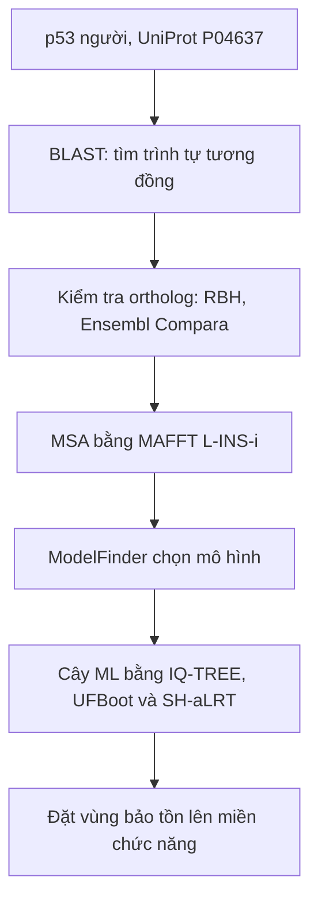

Sắp gióng trình tự (sequence alignment) là phép đặt hai hay nhiều trình tự DNA hoặc protein cạnh nhau để tìm các vị trí tương ứng, và là bước đầu của gần như mọi phân tích, từ tìm gen tương đồng trong cơ sở dữ liệu đến dựng cây phát sinh loài. Bài này đi theo một trình tự cụ thể, protein p53 người (UniProt P04637, 393 amino acid), qua năm bước: quy hoạch động, BLAST, chọn ortholog, sắp gióng đa trình tự bằng MAFFT và dựng cây bằng IQ-TREE. Hai con số cần nhớ: với tìm kiếm protein, E-value < 0,001 đã đủ để suy ra tương đồng (Pearson, 2013), còn nhánh cây chỉ đáng tin khi ultrafast bootstrap đạt từ 95% (Hoang et al., 2018). Bài dành cho sinh viên sinh học, công nghệ sinh học và người tự học bioinformatics đã biết Python cơ bản. Mọi đoạn code đều chạy lại được.

<div class="callout callout-note">
<p class="callout-title">Tóm tắt nhanh</p>

- Needleman–Wunsch (toàn cục) và Smith–Waterman (cục bộ) là quy hoạch động, thời gian tỷ lệ với tích độ dài hai trình tự.
- Điểm sắp gióng phụ thuộc hoàn toàn vào ma trận thay thế và cách phạt gap; tuyến tính và affine cho điểm khác nhau trên cùng một cặp.
- E-value tăng theo kích thước cơ sở dữ liệu; protein:protein E < 0,001 đủ suy ra homology, nhưng không cho biết đó là ortholog hay paralog.
- Với họ p53, p63 và p73 người giống p53 người ở miền gắn DNA khoảng 57–61% identity, gần mức của p53 cá ngựa vằn (71%) (sắp gióng cặp, BLOSUM62, mục 7).
- Trong IQ-TREE, `-B` là ultrafast bootstrap: đọc theo ngưỡng 95%, kèm SH-aLRT ≥ 80%.

</div>

## 1. Sắp gióng trình tự là gì, và đường đi của bài

Sắp gióng hai trình tự là tìm cách chèn khoảng trống (gap) vào mỗi trình tự sao cho các ký tự đặt cùng cột có tổng điểm cao nhất theo một hệ thống tính điểm. Sắp gióng toàn cục (global alignment) gióng hai trình tự từ đầu đến cuối; sắp gióng cục bộ (local alignment) chỉ tìm đoạn giống nhau nhất. Khi so một trình tự với cả cơ sở dữ liệu, người ta dùng heuristic như BLAST. Khi đã có một nhóm trình tự tương đồng, sắp gióng đa trình tự (multiple sequence alignment, MSA) đặt tất cả vào chung một bảng cột, và bảng này là đầu vào để dựng cây phát sinh loài.

p53 hợp để đi hết chuỗi bước này vì hai lẽ. Đột biến TP53 rất thường gặp trong ung thư, và khoảng 70% các biến đổi của TP53 là đột biến missense (Hassin & Oren, 2023) (→ Đột biến gen). Họ gen p53/p63/p73 đã giữ cấu trúc và chức năng qua hơn một tỷ năm tiến hoá (Belyi et al., 2010), nên có đủ trình tự ở cả động vật có xương sống lẫn không xương sống để thấy rõ cả phần bảo tồn lẫn phần khác biệt.



## 2. Sắp gióng hai trình tự bằng quy hoạch động

### 2.1. Vì sao cần quy hoạch động

Số cách đặt gap vào hai trình tự tăng rất nhanh theo độ dài, nên không thể liệt kê hết rồi chọn. Quy hoạch động (dynamic programming) giải bài toán bằng cách lưu điểm tốt nhất của mọi cặp tiền tố vào một ma trận $F$: ô $F(i,j)$ là điểm tốt nhất khi gióng $i$ ký tự đầu của $x$ với $j$ ký tự đầu của $y$. Mỗi ô chỉ cần ba ô láng giềng đã tính trước, nên toàn bộ bảng được lấp trong thời gian tỷ lệ với tích độ dài $n \times m$. Tăng gấp đôi độ dài hai trình tự thì thời gian tăng gấp bốn (Pearson, 2013). Eddy (2004) có một bài giới thiệu ngắn về quy hoạch động cho người làm sinh học.

### 2.2. Needleman–Wunsch: sắp gióng toàn cục

Needleman và Wunsch (1970) đưa ra phương pháp tổng quát để so sánh toàn bộ hai trình tự protein. Với gap tuyến tính (mỗi vị trí gap bị trừ $d$) và hàm điểm thay thế $s(a,b)$, công thức truy hồi là:

$$F(i,j) = \max \begin{cases} F(i-1,j-1) + s(x_i, y_j) \\ F(i-1,j) - d \\ F(i,j-1) - d \end{cases}$$

Khởi tạo $F(0,0)=0$, $F(i,0) = -i\,d$, $F(0,j) = -j\,d$, vì gióng một tiền tố với chuỗi rỗng nghĩa là toàn gap (Durbin et al., 1998). Điểm tối ưu nằm ở ô góc $F(n,m)$; truy ngược từ ô này về $F(0,0)$, mỗi bước đi theo ô đã cho giá trị max, sẽ ra sắp gióng.

Tính tay vài ô đầu giúp thấy công thức hoạt động. Với $x$ = GATTACA (hàng) và $y$ = GCATGCT (cột), ô $F(1,1)$ gióng G với G: $\max(0+1,\ -1-1,\ -1-1) = 1$. Ô $F(1,2)$ gióng G với GC: đi chéo từ $F(0,1) = -1$ cộng điểm lệch G/C là −2, đi ngang từ $F(1,1) = 1$ trừ gap là 0, đi dọc từ $F(0,2) = -2$ trừ gap là −3; max là 0, nghĩa là cách tốt nhất là gióng G với G rồi đặt C đối với một gap. Phần còn lại của bảng 8 × 8 lấp theo đúng quy tắc đó, từng hàng một.

Sắp gióng toàn cục hợp khi hai trình tự tương đồng trên toàn bộ chiều dài, không chỉ vì chúng dài bằng nhau. Khi miền tương đồng nằm trong bối cảnh khác nhau, chẳng hạn một miền chung giữa hai protein có cấu trúc miền khác nhau, nên dùng sắp gióng cục bộ (Pearson, 2013).

Hình 1 là ma trận $F$ cho cặp GATTACA/GCATGCT với khớp +1, lệch −1, gap −1. Điểm tối ưu là 0, và Biopython trả về ba sắp gióng cùng đạt điểm này. Hệ quả thực hành: khi kiểm thử code tự viết với một thư viện, phải so **điểm**, không so chuỗi sắp gióng, vì hai chương trình đúng có thể chọn hai đường truy ngược khác nhau.


*Hình 1. Ma trận F của Needleman–Wunsch cho GATTACA (hàng) và GCATGCT (cột); số đỏ là một đường truy ngược tối ưu. Vẽ từ code ở mục 2.6.*

### 2.3. Smith–Waterman: sắp gióng cục bộ

Smith và Waterman (1981) sửa thuật toán để tìm đoạn con chung tốt nhất. Thay đổi nằm ở hai chỗ. Thứ nhất, hàm max có thêm 0, nên điểm không bao giờ âm: một đoạn tệ không kéo điểm của đoạn tốt phía sau xuống. Thứ hai, truy ngược bắt đầu từ ô có điểm cao nhất ở bất kỳ đâu trong ma trận, không phải từ góc, và dừng khi gặp ô bằng 0 (Durbin et al., 1998). Bỏ quy tắc thứ hai thì code vẫn chạy nhưng trả về sai đoạn.

<div class="callout callout-warning">
<p class="callout-title">Ba lỗi hay gặp khi tự cài đặt</p>

- Quên khởi tạo hàng và cột đầu của Needleman–Wunsch: để toàn số 0 là vô tình cho gap ở đầu miễn phí, và điểm sẽ cao hơn thư viện.
- Truy ngược Smith–Waterman từ góc dưới phải như Needleman–Wunsch: code vẫn chạy, nhưng đoạn trả về không phải đoạn có điểm cao nhất.
- Lệch chỉ số: hàng $i$ của ma trận ứng với ký tự $x_{i-1}$ trong Python (đánh số từ 0). Lệch một vị trí ở đây cho điểm sai mà không báo lỗi.

</div>

Ví dụ hợp với sắp gióng cục bộ: CEP-1 của giun tròn *C. elegans* dài 644 amino acid, p53 người dài 393 (UniProt Consortium, 2025). Gióng toàn cục sẽ ép hai protein khớp từ đầu đến cuối và tạo nhiều gap vô nghĩa; gióng cục bộ chỉ giữ vùng chung.

### 2.4. Affine gap: phạt mở gap khác phạt kéo dài

Một sự kiện chèn hoặc mất (indel) thường thêm hay bớt nhiều residue cùng lúc, nên một gap dài 5 không nên bị phạt bằng năm gap rời. Mô hình affine phạt gap dài $g$ là $d + (g-1)\,e$, với $d$ là phạt mở và $e < d$ là phạt kéo dài. Gotoh (1982) đưa ra thuật toán giải mô hình này mà vẫn giữ thời gian $O(nm)$, bằng ba ma trận: $M$ (kết thúc bằng một cặp gióng), $I_x$ (kết thúc bằng một residue của $x$ đối với gap), $I_y$ (ngược lại). Theo ký hiệu của Durbin et al. (1998):

$$M(i,j) = s(x_i,y_j) + \max\{M(i-1,j-1),\ I_x(i-1,j-1),\ I_y(i-1,j-1)\}$$
$$I_x(i,j) = \max\{M(i-1,j) - d,\ I_x(i-1,j) - e\}$$
$$I_y(i,j) = \max\{M(i,j-1) - d,\ I_y(i,j-1) - e\}$$

Công thức của Durbin et al. (1998) không cho một gap ở $x$ nối ngay sau một gap ở $y$. Code ở mục 2.6 thì cho phép bước chuyển trực tiếp $I_x$ ↔ $I_y$ (mỗi bên bị tính phạt mở riêng) để theo quy ước của Biopython; nhờ vậy điểm khớp với Biopython trên mọi cặp thử. Ai cài đúng ba dòng công thức trên có thể ra điểm khác code này ở một vài cặp. Ba ma trận cùng kích thước $(n+1)\times(m+1)$, mỗi ô tính trong thời gian hằng số, nên tổng thời gian vẫn là $O(nm)$, chỉ chậm hơn bản tuyến tính một hằng số.

Vì thế phải nói rõ mô hình gap. Cùng cặp GATTACA/GCATGCT, gap tuyến tính −1 cho điểm tối ưu 0, còn affine với mở −2, kéo dài −0,5 cho điểm −1,0 và sắp gióng không có gap nào. Ai cài công thức tuyến tính rồi so với code dùng `open_gap_score=-2, extend_gap_score=-0.5` sẽ không ra cùng điểm, trừ khi đặt mở bằng kéo dài. Không có cách nào "đúng" duy nhất: mở −10, kéo dài −0,5 với BLOSUM62 là một bộ tham số hay gặp cho protein, nhưng đổi tham số là đổi câu trả lời. Vì thế mọi báo cáo sắp gióng cần ghi ma trận thay thế, phạt mở và phạt kéo dài, và cả việc có phạt gap ở hai đầu hay không.

### 2.5. Ma trận thay thế

Với protein, $s(a,b)$ lấy từ ma trận thay thế. Henikoff và Henikoff (1992) xây họ ma trận BLOSUM từ khoảng 2.000 khối đoạn sắp gióng không gap của hơn 500 nhóm protein liên quan, và cho thấy chúng cải thiện cả sắp gióng lẫn tìm kiếm so với các ma trận dựa trên mô hình Dayhoff (PAM). BLOSUM62 là ma trận hay dùng cho protein; trong Biopython, nạp bằng `substitution_matrices.load("BLOSUM62")`. Giá trị dương trong ma trận nghĩa là cặp amino acid đó gặp trong các protein tương đồng nhiều hơn mức ngẫu nhiên; giá trị âm là ít hơn. Ví dụ, trong BLOSUM62 cặp cysteine–cysteine được +9, còn cysteine với nhiều amino acid khác bị điểm âm, nghĩa là trong các khối protein tương đồng, cysteine hiếm khi bị thay bằng amino acid khác. Ở p53, bốn residue gắn kẽm gồm ba cysteine và một histidine, và mục 7 cho thấy chúng giữ nguyên đến tận ruồi giấm.

### 2.6. Tự cài đặt và kiểm thử

Code dưới đây cài ba thuật toán bằng Python thuần.

```python
# align.py
NEG = float("-inf")

def score_fn(match=1, mismatch=-1, matrix=None):
    if matrix is not None:
        return lambda a, b: matrix[a][b]
    return lambda a, b: match if a == b else mismatch

def nw(x, y, s, d):
    """Toàn cục, gap tuyến tính: mỗi vị trí gap bị trừ d."""
    n, m = len(x), len(y)
    F = [[0.0] * (m + 1) for _ in range(n + 1)]
    for i in range(1, n + 1):
        F[i][0] = -i * d
    for j in range(1, m + 1):
        F[0][j] = -j * d
    for i in range(1, n + 1):
        for j in range(1, m + 1):
            F[i][j] = max(F[i-1][j-1] + s(x[i-1], y[j-1]),
                          F[i-1][j] - d, F[i][j-1] - d)
    return F[n][m], F

def sw(x, y, s, d):
    """Cục bộ: thêm 0 vào max; điểm là ô lớn nhất của cả ma trận."""
    n, m = len(x), len(y)
    F = [[0.0] * (m + 1) for _ in range(n + 1)]
    best, best_ij = 0.0, (0, 0)
    for i in range(1, n + 1):
        for j in range(1, m + 1):
            F[i][j] = max(0.0, F[i-1][j-1] + s(x[i-1], y[j-1]),
                          F[i-1][j] - d, F[i][j-1] - d)
            if F[i][j] > best:
                best, best_ij = F[i][j], (i, j)
    return best, best_ij, F

def gotoh(x, y, s, d, e):
    """Toàn cục, affine: gap dài g bị trừ d + (g-1)*e."""
    n, m = len(x), len(y)
    M = [[NEG] * (m + 1) for _ in range(n + 1)]
    Ix = [[NEG] * (m + 1) for _ in range(n + 1)]
    Iy = [[NEG] * (m + 1) for _ in range(n + 1)]
    M[0][0] = 0.0
    for i in range(1, n + 1):
        Ix[i][0] = -d - (i - 1) * e
    for j in range(1, m + 1):
        Iy[0][j] = -d - (j - 1) * e
    for i in range(1, n + 1):
        for j in range(1, m + 1):
            M[i][j] = s(x[i-1], y[j-1]) + max(M[i-1][j-1], Ix[i-1][j-1], Iy[i-1][j-1])
            Ix[i][j] = max(M[i-1][j] - d, Ix[i-1][j] - e, Iy[i-1][j] - d)
            Iy[i][j] = max(M[i][j-1] - d, Iy[i][j-1] - e, Ix[i][j-1] - d)
    return max(M[n][m], Ix[n][m], Iy[n][m])
```

Bộ kiểm thử so điểm với `Bio.Align.PairwiseAligner` của Biopython (Cock et al., 2009) trên 200 cặp DNA ngẫu nhiên dài 5–40 ký tự, seed cố định:

```python
import random
from Bio import Align
from align import nw, sw, gotoh, score_fn

s = score_fn(1, -1)
g = Align.PairwiseAligner(mode="global", match_score=1, mismatch_score=-1, gap_score=-1)
l = Align.PairwiseAligner(mode="local",  match_score=1, mismatch_score=-1, gap_score=-1)
a = Align.PairwiseAligner(mode="global", match_score=1, mismatch_score=-1,
                          open_gap_score=-2, extend_gap_score=-0.5)
random.seed(42)
bad = {"global": 0, "local": 0, "affine": 0}
for _ in range(200):
    p = "".join(random.choices("ACGT", k=random.randint(5, 40)))
    q = "".join(random.choices("ACGT", k=random.randint(5, 40)))
    bad["global"] += nw(p, q, s, 1)[0] != g.score(p, q)
    bad["local"]  += sw(p, q, s, 1)[0] != l.score(p, q)
    bad["affine"] += abs(gotoh(p, q, s, 2, 0.5) - a.score(p, q)) > 1e-9
print(bad)   # {'global': 0, 'local': 0, 'affine': 0}
```

Kết quả chạy ngày 26/11/2026 với Biopython 1.87: không cặp nào lệch điểm ở cả ba thuật toán. Thêm một phép thử với protein thật: miền gắn DNA của p53 người (residue 102–292) và đoạn tương ứng của p53 chuột, BLOSUM62, mở gap −10, kéo dài −0,5; `gotoh()` và Biopython cùng cho 927,0. Bài tập GLOB và LOCA trên Rosalind có đáp án sẵn, dùng làm thêm hai ca kiểm thử với ma trận thay thế.

Hình 2 đo thời gian trên cặp DNA ngẫu nhiên dài 100 đến 1.600. Từ 800 lên 1.600, thời gian của bản Python thuần tăng từ 0,29 s lên 1,33 s, khoảng 4,5 lần, gần với mức gấp bốn mà lý thuyết dự đoán. Biopython (lõi viết bằng C) nhanh hơn khoảng 130–210 lần trên cùng máy, nhưng độ dốc giống nhau: viết bằng ngôn ngữ nhanh hơn không đổi được bậc của thuật toán.


*Hình 2. Thời gian tính điểm Needleman–Wunsch theo độ dài, thang log–log. Đo ngày 26/11/2026, Python 3.13, Biopython 1.87.*

| | Needleman–Wunsch | Smith–Waterman | Gotoh (affine, toàn cục) |
|---|---|---|---|
| Kiểu | toàn cục | cục bộ | toàn cục (có bản cục bộ) |
| Khởi tạo | $-i\,d$, $-j\,d$ | 0 | $-d-(i-1)e$ ở $I_x$, $I_y$ |
| Hàm max | 3 lựa chọn | 3 lựa chọn và 0 | 3 ma trận |
| Bắt đầu truy ngược | ô $F(n,m)$ | ô lớn nhất | ô lớn nhất của 3 ma trận ở $(n,m)$ |
| Kết thúc truy ngược | ô $F(0,0)$ | ô bằng 0 | ô $(0,0)$ |
| Thời gian | $O(nm)$ | $O(nm)$ | $O(nm)$ |

*Bảng 1. So sánh ba thuật toán quy hoạch động. Cột Gotoh mô tả bản toàn cục, đúng như hàm `gotoh()` ở trên.*

## 3. BLAST: tìm trình tự tương đồng trong cơ sở dữ liệu

### 3.1. Seed-and-extend

Smith–Waterman cho đáp án tối ưu nhưng quá chậm khi so một truy vấn với hàng trăm triệu trình tự. BLAST (Altschul et al., 1990) xấp xỉ trực tiếp điểm maximal segment pair (MSP), tức đoạn ghép không gap có điểm cao nhất giữa hai trình tự. Cách làm: tìm các từ ngắn (seed) có điểm cao, rồi mở rộng hai phía. Lý thuyết thống kê về điểm MSP (Karlin & Altschul, 1990) cho phép tính ý nghĩa của từng kết quả. Bài báo năm 1990 công bố BLAST nhanh hơn khoảng một bậc độ lớn so với các công cụ có độ nhạy tương đương lúc đó. Gapped BLAST năm 1997 chạy nhanh khoảng ba lần bản gốc, và PSI-BLAST dùng ma trận điểm theo vị trí để tìm tương đồng xa (Altschul et al., 1997). Bộ dòng lệnh hiện hành là BLAST+ (Camacho et al., 2009).

Cái giá của heuristic là có thể bỏ sót tương đồng xa. Vì vậy khi BLAST không thấy kết quả có ý nghĩa, không được kết luận hai trình tự không tương đồng (Pearson, 2013).

### 3.2. Các chương trình BLAST

| Chương trình | Truy vấn | Cơ sở dữ liệu |
|---|---|---|
| blastn | nucleotide | nucleotide |
| blastp | protein | protein |
| blastx | nucleotide dịch 6 khung | protein |
| tblastn | protein | nucleotide dịch 6 khung |
| tblastx | nucleotide dịch 6 khung | nucleotide dịch 6 khung |

*Bảng 2. Năm chương trình BLAST chính.*

Tìm bằng protein hoặc DNA đã dịch nhạy hơn DNA:DNA khoảng 5–10 lần, và so sánh DNA:DNA hiếm khi phát hiện tương đồng sau 200–400 triệu năm phân ly (Pearson, 2013). Với p53 người và ruồi giấm, hai dòng đã tách nhau lâu hơn thế nhiều, nên phải tìm bằng protein.

### 3.3. Đọc E-value, bit score và % identity

**E-value** là số kết quả kỳ vọng có điểm bằng hoặc cao hơn do ngẫu nhiên, trong một cơ sở dữ liệu có kích thước như đã tìm. Cùng một điểm, tìm trong cơ sở dữ liệu lớn gấp 100 lần thì E-value lớn gấp 100 lần (Pearson, 2013). Ngưỡng cho protein:protein: E < 0,001 đã đủ tin cậy để suy ra homology. Ngưỡng 1e-5 hay gặp là một quy ước chặt hơn. Với DNA:DNA thì khác: E < 10⁻⁶ vẫn thường xảy ra do ngẫu nhiên, và 10⁻¹⁰ là ngưỡng an toàn hơn. Tham số `-evalue` trong lệnh BLAST+ chỉ là ngưỡng báo cáo, không phải một phép kiểm định.

**Bit score** là điểm đã chuẩn hoá, không phụ thuộc kích thước cơ sở dữ liệu; với protein độ dài trung bình, bit score khoảng 50 gần như luôn có ý nghĩa (Pearson, 2013).

**% identity** dễ đọc nhưng dễ dẫn sai. Quy tắc "trên 30% identity là tương đồng" bỏ sót nhiều homolog: trong 3.084 protein nấm men có tương đồng có ý nghĩa với protein người, chỉ 2.081 protein có trên 30% identity (Pearson, 2013). Homology cũng không có phần trăm: hai trình tự hoặc chung tổ tiên, hoặc không. Cách nói "% homology" là sai; hãy dùng "% identity" hoặc "% similarity".

E-value là một dạng hiệu chỉnh cho việc so một truy vấn với hàng triệu trình tự, cùng tinh thần với hiệu chỉnh kiểm định nhiều lần trong bài về [p-value và FDR](/blog/toan-va-thong-ke-cho-sinh-hoc/).

<div class="callout callout-example">
<p class="callout-title">Đọc một dòng kết quả</p>

Giả sử lệnh `blastp -outfmt "6 qseqid sseqid pident length evalue bitscore"` trả về một dòng có pident 29,5, length 180, evalue 3e-12, bitscore 65. Đọc theo thứ tự: bit score 65 vượt mức 50, E-value nhỏ hơn 0,001 rất xa, nên có thể kết luận hai protein tương đồng, dù identity dưới 30%. Nếu cùng truy vấn này được tìm trong một cơ sở dữ liệu lớn gấp 100 lần, E-value sẽ thành khoảng 3e-10, vẫn có ý nghĩa; bit score không đổi. Điều dòng này không nói: hai protein là ortholog hay paralog.

</div>

### 3.4. Khi dữ liệu quá lớn

Với hàng triệu truy vấn, DIAMOND (Buchfink et al., 2015) và MMseqs2 (Steinegger & Söding, 2017) thay BLAST cho tìm kiếm protein quy mô lớn. MMseqs2 còn dùng để chia tập huấn luyện và kiểm tra theo cụm tương đồng, chủ đề của bài về machine learning trong sinh học.

## 4. Homolog, ortholog, paralog: bẫy trong họ p53

Tương đồng có ý nghĩa thống kê cho phép suy ra homology, tức chung tổ tiên. Nó không cho biết hai gen tách ra theo cách nào. Ortholog là các gen tương đồng tách ra do một sự kiện hình thành loài; paralog tách ra do nhân đôi gen (Pearson, 2013). Phân biệt này quan trọng vì dựng cây loài từ một hỗn hợp ortholog và paralog sẽ cho cây sai.

Họ p53 là ví dụ rõ nhất cho bẫy này. Theo Belyi et al. (2010), tổ tiên chung của p53, p63 và p73 đã có ở hải quỳ với vai trò bảo vệ dòng mầm; hầu hết động vật không xương sống chỉ mang một gen kiểu p63/p73 tổ tiên; lần nhân đôi đầu tiên sinh ra p53 và tổ tiên p63/p73 xảy ra ở cá sụn, và cá xương đã có đủ cả ba gen. Hệ quả: protein mang tên "p53" của ruồi giấm không phải ortholog 1–1 của TP53 người. Nó là hậu duệ của gen trước lần nhân đôi, nên tương đồng với cả ba gen người. Về chức năng, Dmp53 gắn được vị trí gắn của p53 người và gây apoptosis khi DNA tổn thương, nhưng không gây dừng chu kỳ ở G1 (Brodsky et al., 2000; Ollmann et al., 2000).

Bẫy BLAST: tìm p53 người trong proteome của một loài có xương sống sẽ trả về cả TP53, TP63 và TP73 với E-value rất nhỏ. Ở miền gắn DNA, TP73 và TP63 người giống p53 người 61% và 57% identity, không xa mức của p53 cá ngựa vằn (71%) (mục 7).

Hai cách kiểm tra ortholog:

1. **Reciprocal best hit (RBH):** gen A ở loài 1 và gen B ở loài 2 là kết quả tốt nhất của nhau khi BLAST theo cả hai chiều. Quy trình cụ thể: BLAST p53 người với toàn bộ proteome chuột và lấy kết quả có bit score cao nhất; BLAST ngược protein đó với proteome người; nếu kết quả cao nhất quay về đúng p53 người thì cặp này là ứng viên ortholog. TP63 chuột cũng sẽ có E-value rất nhỏ khi tìm bằng p53 người, nhưng khi BLAST ngược, nhiều khả năng nó tìm thấy TP63 người trước, nên bị loại. Tuỳ chọn BLAST như lọc vùng phức tạp thấp hay cách sắp gióng cuối ảnh hưởng số ortholog tìm được (Moreno-Hagelsieb & Latimer, 2008).
2. **Cây gen có xét nhân đôi:** Ensembl Compara GeneTrees dựng cây cho từng họ gen và tách ortholog khỏi paralog (Vilella et al., 2009). Đối chiếu kết quả RBH với chú giải này.

Khi dựng cây, đưa TP63 và TP73 người vào làm đối chứng paralog: nếu các TP53 tụ thành một nhánh riêng, việc chọn trình tự đã đúng hướng. RBH có điểm yếu riêng: khi một loài mất gen hoặc có nhân đôi gần đây chỉ ở một dòng, "tốt nhất của nhau" có thể rơi vào paralog. Vì thế RBH là bộ lọc nhanh, còn cây gen có xét nhân đôi là phép kiểm tra cuối.

## 5. Sắp gióng đa trình tự với MAFFT

MSA chính xác tuyệt đối tốn kém theo cấp số mũ, nên các chương trình dùng phương pháp tiến dần (progressive), rồi tinh chỉnh lặp (iterative) để sửa các gap đặt sai từ sớm (Pearson, 2013). MAFFT phiên bản 7 bổ sung nhiều tính năng (Katoh & Standley, 2013). Theo tài liệu MAFFT (Katoh, n.d.), `--auto` tự chọn giữa L-INS-i, FFT-NS-i và FFT-NS-2 theo kích thước dữ liệu, còn L-INS-i được khuyến nghị cho dưới 200 trình tự. Với 8–10 trình tự, gọi thẳng L-INS-i và ghi rõ lựa chọn. Clustal Omega (Sievers et al., 2011) và MUSCLE (Edgar, 2004) là các lựa chọn khác.

Chương trình MSA không kiểm định homology: nó vẫn xếp cả trình tự không tương đồng (Pearson, 2013). Mỗi trình tự đưa vào phải có bằng chứng tương đồng độc lập từ bước BLAST và ortholog. Khác biệt độ dài lớn cũng gây rắc rối: CEP-1 dài 644 amino acid so với 393 của p53 người, và phần thừa ra sẽ thành những khối cột gần như toàn gap. Accession unreviewed có thêm rủi ro ở đầu hoặc cuối protein, nơi mô hình gen dễ sai nhất; một đoạn N-terminal lạ chỉ có ở một trình tự thường là dấu hiệu cần mở lại bản ghi UniProt trước khi dựng cây.

Có nên cắt tỉa (trim) MSA? Tan et al. (2015) cho thấy lọc MSA tự động thường làm cây gen đơn tệ hơn và tăng tỷ lệ nhánh được hỗ trợ cao nhưng sai; lọc nhẹ, tối đa 20% vị trí, ít ảnh hưởng. Chạy cả bản không trim và bản trim nhẹ bằng trimAl (Capella-Gutiérrez et al., 2009) rồi so hai cây. Xem MSA bằng Jalview (Waterhouse et al., 2009). Một phép kiểm tra nhanh chất lượng MSA của p53: R175 người phải nằm cùng cột với R172 chuột, vì đột biến R175H ở người tương ứng R172H ở chuột (Hassin & Oren, 2023). Nếu hai residue này lệch cột, MSA có vấn đề ngay ở vùng bảo tồn nhất.

## 6. Dựng cây: Neighbor-Joining và Maximum Likelihood với IQ-TREE

### 6.1. Phương pháp khoảng cách

Neighbor-Joining (NJ) ghép dần các cặp "láng giềng" sao cho tổng chiều dài nhánh nhỏ nhất. Trong mô phỏng của Saitou và Nei (1987), NJ tốt hơn UPGMA. NJ nhanh và dễ hiểu, nhưng nén toàn bộ thông tin của MSA thành một con số cho mỗi cặp.

### 6.2. Maximum Likelihood với IQ-TREE

Maximum Likelihood (ML) tìm cây và tham số làm dữ liệu quan sát có xác suất cao nhất theo một mô hình tiến hoá. IQ-TREE 2 là phần mềm ML phổ biến, tích hợp nhiều mô hình (Minh, Schmidt et al., 2020); IQ-TREE 3 công bố tháng 5/2026 (Wong et al., 2026) và tài liệu chính thức dùng lệnh `iqtree3`. Ghi rõ phiên bản đã chạy.

Tuỳ chọn `-m MFP` chạy ModelFinder rồi dựng cây bằng mô hình tốt nhất. ModelFinder cải thiện độ chính xác nhờ mô hình hoá khác biệt tốc độ giữa các vị trí và tìm đồng thời trong không gian mô hình và không gian cây (Kalyaanamoorthy et al., 2017).

### 6.3. Độ hỗ trợ nhánh: bootstrap chuẩn và UFBoot

Bootstrap chuẩn của Felsenstein (1985) lấy mẫu lại các cột của MSA, dựng lại cây nhiều lần và đếm tỷ lệ một nhánh xuất hiện (→ The Bootstrap). Trong IQ-TREE, `-b` là bootstrap chuẩn (khuyến nghị ít nhất 100 lần), còn `-B` là ultrafast bootstrap (UFBoot), khuyến nghị ít nhất 1.000 lần (IQ-TREE, n.d.-b).

UFBoot ít lệch hơn bootstrap chuẩn vốn bảo thủ (Minh et al., 2013). Khi mô hình không bị vi phạm hoặc vi phạm nhẹ, có thể tin nhánh có UFBoot2 ≥ 95%; UFBoot2 nhanh hơn bootstrap chuẩn khoảng 778 lần (trung vị) trên bộ dữ liệu thử (Hoang et al., 2018). FAQ của IQ-TREE khuyên chạy kèm SH-aLRT (`-alrt 1000`; Guindon et al., 2010) và tin hơn khi SH-aLRT ≥ 80% và UFBoot ≥ 95% (IQ-TREE, n.d.-a). Một nhánh UFBoot 80% không "khá tốt" như bootstrap chuẩn 80%.

<div class="callout callout-example">
<p class="callout-title">Đọc nhãn nhánh của IQ-TREE</p>

Khi chạy với `-B 1000 -alrt 1000`, file `.treefile` ghi hai số ở mỗi nhánh trong, dạng `SH-aLRT/UFBoot`. Nhánh `98.7/100` đạt cả hai ngưỡng. Nhánh `85.2/91` qua ngưỡng SH-aLRT nhưng chưa đạt 95% UFBoot: nên coi là chưa giải được. Nhánh `39/51` gần như không có hỗ trợ; vẽ nó thành đa phân (polytomy) trung thực hơn là để nguyên một thứ tự phân nhánh trông chắc chắn.

</div>

Hai trong năm tác giả UFBoot2, Hoang D. T. và Vinh L. S., thuộc Trường Đại học Công nghệ, Đại học Quốc gia Hà Nội (Hoang et al., 2018).

### 6.4. Đặt gốc và nhánh dài

Cây ML không có gốc. Với nhánh TP53 động vật có xương sống, trình tự trước lần nhân đôi (ruồi giấm, Ciona) là nhóm ngoài hợp lý (Belyi et al., 2010). Các nhánh rất dài như CEP-1 có nguy cơ gây hút nhánh dài (long-branch attraction; Bergsten, 2005), nên chỉ đưa vào ở phân tích độ nhạy. Hiển thị cây bằng iTOL (Letunic & Bork, 2024) hoặc FigTree.

## 7. Thực hành: TP53 ở 8 loài

Phần này chạy được hoàn toàn bằng Python và Biopython: tải trình tự từ UniProt, sắp gióng cặp từng loài với p53 người, ánh xạ residue then chốt, vẽ hồ sơ bảo tồn và một cây NJ minh hoạ. BLAST, MAFFT và IQ-TREE cần cài qua Bioconda (→ [Nền tảng tính toán](/blog/nen-tang-tinh-toan/)); lệnh ở phụ lục. Cách tải trình tự bằng REST API của UniProt được trình bày trong [bài về định dạng dữ liệu](/blog/dinh-dang-du-lieu-va-co-so-du-lieu-sinh-hoc/).

Tám loài được chọn để trải từ động vật có vú tới côn trùng: người, chuột, gà, ếch, cá ngựa vằn, cá sụn (nhóm có lần nhân đôi đầu tiên sinh ra p53 theo Belyi et al., 2010), Ciona và ruồi giấm (hai nhóm ngoài mang gen trước nhân đôi). TP63, TP73 người làm đối chứng paralog; CEP-1 dành cho phân tích độ nhạy với nhánh dài.

| Loài | Gen | Accession | Trạng thái | Độ dài (aa) |
|---|---|---|---|---|
| *Homo sapiens* | TP53 | P04637 | reviewed | 393 |
| *Mus musculus* | Trp53 | P02340 | reviewed | 390 |
| *Gallus gallus* | TP53 | P10360 | reviewed | 367 |
| *Xenopus tropicalis* | tp53 | Q6NTF1 | unreviewed | 362 |
| *Danio rerio* | tp53 | P79734 | reviewed | 373 |
| *Callorhinchus milii* (cá sụn) | p53 | G9J1L8 | unreviewed | 387 |
| *Ciona intestinalis* | p53 | F6SSG7 | unreviewed | 419 |
| *Drosophila melanogaster* | p53 | Q9N6D8 | unreviewed | 385 |
| *H. sapiens* (đối chứng paralog) | TP63 | Q9H3D4 | reviewed | 680 |
| *H. sapiens* (đối chứng paralog) | TP73 | O15350 | reviewed | 636 |
| *C. elegans* (nhánh dài) | cep-1 | Q20646 | reviewed | 644 |

*Bảng 3. Trình tự dùng trong phân tích, tải từ UniProt REST ngày 26/11/2026.*

Code dưới đây tải trình tự, sắp gióng cặp và ánh xạ vị trí. Hàm `mapping()` dùng toạ độ các khối đã gióng (`aligned`) của Biopython để đổi số thứ tự residue từ người sang loài khác.

```python
import urllib.request
from Bio import Align
from Bio.Align import substitution_matrices

ACC = ["P04637", "P02340", "P10360", "Q6NTF1", "P79734", "G9J1L8",
       "F6SSG7", "Q9N6D8", "Q9H3D4", "O15350", "Q20646"]
def fetch(acc):
    url = f"https://rest.uniprot.org/uniprotkb/{acc}.fasta"
    lines = urllib.request.urlopen(url).read().decode().splitlines()
    return "".join(l for l in lines if not l.startswith(">"))
seq = {a: fetch(a) for a in ACC}

al = Align.PairwiseAligner(mode="global",
                           substitution_matrix=substitution_matrices.load("BLOSUM62"),
                           open_gap_score=-10, extend_gap_score=-0.5)
al.end_insertion_score = al.end_deletion_score = 0   # không phạt gap ở hai đầu

def mapping(a, b):
    # vị trí (đánh số từ 1) trên a -> vị trí trên b; vị trí rơi vào gap không có trong dict
    aln = al.align(seq[a], seq[b])[0]
    m = {}
    for (s1, e1), (s2, e2) in zip(*aln.aligned):
        for k in range(e1 - s1):
            m[s1 + k + 1] = s2 + k + 1
    return m

def identity(a, b, lo=1, hi=None):
    m = mapping(a, b)
    pos = [i for i in m if lo <= i <= (hi or len(seq[a]))]
    return sum(seq[a][i-1] == seq[b][m[i]-1] for i in pos) / len(pos)

H = "P04637"
for b in ACC[1:]:
    print(b, round(identity(H, b), 2), round(identity(H, b, 102, 292), 2))
m = mapping(H, "P02340")
print("R175 người ->", seq["P02340"][m[175]-1] + str(m[175]))   # R172
```

Sắp gióng cặp toàn cục, BLOSUM62, mở gap −10, kéo dài −0,5, không phạt gap ở hai đầu. % identity tính trên các vị trí đã gióng; miền gắn DNA (DBD) là residue 102–292 của p53 người theo UniProt. Lưu ý: identity tính trên vị trí đã gióng nên không phạt phần thừa ở hai đầu; với ruồi giấm, chỉ 318 trên 393 vị trí của p53 người được gióng, với CEP-1 là 278.

| So với p53 người | Toàn chiều dài | DBD |
|---|---|---|
| Chuột | 0,79 | 0,88 |
| Gà | 0,59 | 0,72 |
| Ếch *X. tropicalis* | 0,58 | 0,68 |
| Cá ngựa vằn | 0,57 | 0,71 |
| Cá sụn *C. milii* | 0,53 | 0,67 |
| Ciona | 0,38 | 0,43 |
| Ruồi giấm | 0,25 | 0,29 |
| TP73 người | 0,46 | 0,61 |
| TP63 người | 0,46 | 0,57 |
| CEP-1 | 0,31 | 0,33 |

*Bảng 4. % identity so với p53 người (Biopython 1.87, 26/11/2026).*

Nên đặt câu hỏi kiểm tra trước khi chạy để không đọc kết quả theo ý muốn. Dưới đây là năm câu, kèm kết quả.

Câu hỏi 1: DBD có bảo tồn hơn phần còn lại không? Có, với mọi loài: ở chuột 0,88 so với 0,79 trên toàn chiều dài, ở cá ngựa vằn 0,71 so với 0,57. Hình 3 cho thấy cùng điều đó theo từng vị trí: trung bình, một residue của DBD giữ nguyên ở 62% số loài, so với 39% ở miền hoạt hoá phiên mã (1–44) và 51% ở miền tetramer hoá (325–356). 35 trên 191 vị trí của DBD giữ nguyên ở cả bảy loài. Miền hoạt hoá phiên mã có một đỉnh nhỏ quanh residue 17–25, đúng vùng motif TADI theo UniProt, còn phần còn lại của miền này thay đổi nhiều.


*Hình 3. Số loài (trên 7) giữ nguyên residue của p53 người tại mỗi vị trí, tính từ sắp gióng cặp; đường liền là trung bình trượt 9 vị trí. Hộp màu: miền theo UniProt; vạch xanh: residue gắn kẽm; vạch đỏ: R175, Y220, R248, R273.*

Câu hỏi 2: residue gắn kẽm và residue hotspot có giữ nguyên không?

| p53 người | Chuột | Gà | Ếch | Cá ngựa vằn | Cá sụn | Ciona | Ruồi giấm |
|---|---|---|---|---|---|---|---|
| R175 | R172 | R160 | R149 | R143 | R165 | R217 | R155 |
| C176 | C173 | C161 | C150 | C144 | C166 | C218 | C156 |
| H179 | H176 | H164 | H153 | H147 | H169 | H221 | H159 |
| Y220 | Y217 | Y206 | Y195 | Y188 | Y211 | Y265 | L205 |
| C238 | C235 | C224 | C213 | C206 | C229 | C283 | C227 |
| C242 | C239 | C228 | C217 | C210 | C233 | C287 | C231 |
| G245 | G242 | G231 | G220 | G213 | G236 | G292 | gap |
| R248 | R245 | R234 | R223 | R216 | R239 | R295 | R234 |
| R273 | R270 | R259 | R248 | R241 | R264 | R320 | K259 |

*Bảng 5. Ánh xạ residue then chốt từ p53 người sang 7 loài.*

Bốn residue gắn kẽm giữ nguyên ở cả bảy loài. R175, R248 và R273 giữ nguyên ở mọi động vật có xương sống và Ciona; ở ruồi giấm, R273 tương ứng một lysine, Y220 tương ứng leucine, G245 rơi vào gap.

Câu hỏi 3: ánh xạ có khớp tài liệu không? R175 người gióng với R172 chuột, đúng với tương ứng R175H ở người và R172H ở chuột (Hassin & Oren, 2023). Phép thử này rẻ mà bắt được lỗi thật: nếu code đổi toạ độ sai một vị trí, R175 sẽ rơi vào C173 hoặc một residue khác, và mọi bảng phía sau đều lệch theo.

Câu hỏi 4: paralog có "lọt" như ortholog không? TP73 và TP63 người giống p53 người ở DBD 61% và 57%, sát mức cá ngựa vằn (71%), ếch (68%), cá sụn (67%). Một ngưỡng % identity không tách được ortholog xa khỏi paralog gần. Thêm: p53 ruồi giấm giống TP63 và TP73 người (29–30%) nhỉnh hơn giống TP53 người (25%), phù hợp với việc nó là hậu duệ của gen kiểu p63/p73 tổ tiên (Belyi et al., 2010).

Câu hỏi 5: cây có tách được ortholog khỏi paralog? Hình 4 là cây NJ từ khoảng cách p (1 − identity) của mọi cặp, đặt gốc ở ruồi giấm. Sáu TP53 tụ thành một nhánh, TP63 và TP73 thành nhánh riêng, Ciona nằm ngoài cả hai. Bên trong nhánh TP53, thứ tự phân nhánh không khớp quan hệ loài thường được chấp nhận (cá ngựa vằn đứng cạnh nhóm có người, chuột, gà). Theo TimeTree (Kumar et al., 2022), cá ngựa vằn tách ra trước nhóm động vật bốn chân (ếch, gà, chuột, người). Đây là giới hạn của khoảng cách p không hiệu chỉnh, không có độ hỗ trợ nhánh. Cây ML với ModelFinder và UFBoot từ MSA của MAFFT là bước thay thế đúng. Kết quả đáng tin của Hình 4 là ở mức nhóm gen (TP53 tách khỏi TP63/TP73), không phải ở thứ tự loài bên trong.


*Hình 4. Cây NJ minh hoạ từ khoảng cách p của sắp gióng cặp (10 trình tự, không có CEP-1). Chỉ dùng để minh hoạ việc tách ortholog và paralog, không thay cây ML.*

## 8. Thảo luận và giới hạn

Hassin và Oren (2023) chia đột biến p53 trong ung thư thành đột biến tiếp xúc DNA (như R248Q, R273H) và đột biến cấu trúc (như R175H, làm hỏng gắn kẽm). Các vị trí này giữ nguyên ở mọi động vật có xương sống trong Bảng 5, và residue gắn kẽm giữ nguyên đến tận ruồi giấm. Điều đó phù hợp với vai trò của chúng: một vị trí mà chọn lọc tự nhiên giữ nguyên qua hàng trăm triệu năm thường là vị trí mà thay đổi làm hỏng chức năng. Nhưng đây là quan sát mô tả trên vài trình tự, không phải chứng minh; kiểm định áp lực chọn lọc (ví dụ tỷ số dN/dS trên trình tự mã hoá) nằm ngoài phạm vi bài.

Muốn nối sang cấu trúc 3D, có thể tô điểm bảo tồn của Hình 3 lên cấu trúc DBD trong PDB hoặc mô hình AlphaFold (→ [Proteomics và cấu trúc protein](/blog/proteomics-va-cau-truc-protein/)). Các residue gắn kẽm và các arginine tiếp xúc DNA khi đó sẽ hiện ra như một cụm trên bề mặt gắn DNA, thay vì những vạch rời rạc trên trục số thứ tự.

Các giới hạn cần nêu khi báo cáo một phân tích như thế này: một gen và ít trình tự nên cây có ít vị trí mang thông tin; cây gen có thể khác cây loài do khác biệt tốc độ giữa các dòng hoặc do chọn nhầm paralog; vài accession là unreviewed nên mô hình gen có thể sai; hồ sơ bảo tồn từ sắp gióng cặp, không phải MSA; không kiểm định áp lực chọn lọc. Tìm kiếm protein phát hiện được gần như mọi homolog phân ly trong khoảng 500 triệu năm gần đây (Pearson, 2013), đủ cho phạm vi động vật có xương sống của bài. Chiều ngược lại thì không đúng: không thấy tương đồng có ý nghĩa không chứng minh hai trình tự không tương đồng, nhất là với các dòng tách nhau từ rất sớm như giun tròn và động vật có xương sống.

## 9. Checklist và kết luận

| # | Việc cần làm |
|---|---|
| 1 | Ghi phiên bản Biopython, BLAST+, MAFFT, IQ-TREE; ghi accession và ngày tải |
| 2 | Kiểm thử code tự viết bằng cách so điểm, không so chuỗi |
| 3 | Nêu rõ gap tuyến tính hay affine, ma trận thay thế |
| 4 | Ghi kích thước cơ sở dữ liệu cùng ngưỡng E-value |
| 5 | Báo cáo E-value và bit score; không viết "% homology" |
| 6 | Kiểm tra ortholog bằng RBH và/hoặc cây gen; đưa paralog vào đối chứng |
| 7 | Chọn chế độ MAFFT có chủ đích; không trim mặc định |
| 8 | Báo cáo mô hình ModelFinder chọn |
| 9 | Ghi rõ UFBoot hay bootstrap chuẩn; đọc UFBoot theo ngưỡng 95% |
| 10 | Nói rõ cây là cây gen |

*Bảng 6. Checklist.*

Đi hết các bước, một trình tự p53 người đã thành một bảng so sánh, một hồ sơ bảo tồn và một cây. Ở mỗi bước có một tham số làm đổi kết quả: mô hình gap ở bước sắp gióng cặp, kích thước cơ sở dữ liệu ở bước BLAST, cách chọn ortholog, chế độ MAFFT và việc có trim hay không, mô hình tiến hoá và loại bootstrap. Ghi lại các tham số đó quan trọng không kém chính kết quả. Và cây cuối cùng, dù có độ hỗ trợ cao, vẫn là giả thuyết về lịch sử của một gen. Bài sau của series, [giải trình tự thế hệ mới](/blog/giai-trinh-tu-the-he-moi-ngs-va-genomics/), chuyển từ vài trình tự protein sang hàng triệu read ngắn, nơi sắp gióng cần những thuật toán khác hẳn.

Đọc thêm: Durbin et al. (1998) cho phần thuật toán, Pearson (2013) cho cách đọc kết quả tìm kiếm tương đồng.

## Câu hỏi thường gặp

**Needleman–Wunsch và Smith–Waterman khác nhau thế nào?** Needleman–Wunsch gióng toàn bộ hai trình tự, điểm nằm ở ô cuối ma trận. Smith–Waterman thêm 0 vào hàm max và lấy ô có điểm cao nhất, nên chỉ trả về đoạn giống nhau nhất. Dùng toàn cục khi hai trình tự tương đồng trên toàn chiều dài; dùng cục bộ khi chỉ chung một miền.

**E-value bao nhiêu là có ý nghĩa?** Với protein:protein, E < 0,001 đủ để suy ra homology; DNA:DNA cần chặt hơn, khoảng 10⁻¹⁰ (Pearson, 2013). E-value luôn phải đọc cùng kích thước cơ sở dữ liệu.

**30% identity có phải ngưỡng tương đồng không?** Không. Nhiều cặp protein tương đồng có identity dưới 30%; hãy dựa vào E-value và bit score.

**Ortholog và paralog khác nhau ra sao?** Ortholog tách ra khi loài tách ra; paralog tách ra khi gen nhân đôi. TP53 người và Tp53 chuột là ortholog; TP53 và TP63 người là paralog.

**UFBoot bao nhiêu là tin cậy?** Từ 95%, tốt nhất kèm SH-aLRT từ 80%. Không đọc UFBoot theo cùng thang với bootstrap chuẩn.

**Có nên trim MSA trước khi dựng cây không?** Không mặc định. Lọc mạnh thường làm cây gen đơn tệ hơn; nếu trim, trim nhẹ và so với cây không trim.

## Phụ lục: lệnh chạy lại

Các lệnh dưới đây là lệnh mẫu cho BLAST+, MAFFT và IQ-TREE; tên file là ví dụ. Chạy `blastp -help`, `mafft --help` và `iqtree3 -h` để kiểm tra tuỳ chọn của phiên bản trên máy bạn, rồi ghi phiên bản vào README.

```bash
# Môi trường (Bioconda)
conda create -n tp53 -c conda-forge -c bioconda biopython blast mafft iqtree trimal
conda activate tp53

# BLAST: cơ sở dữ liệu từ proteome chuột, tìm p53 người, rồi tìm ngược
makeblastdb -in mouse_proteome.fasta -dbtype prot -out mouse
blastp -query P04637.fasta -db mouse -evalue 1e-3 \
       -outfmt "6 qseqid sseqid pident length evalue bitscore" -out human_vs_mouse.tsv
# lấy kết quả bit score cao nhất, BLAST ngược với proteome người để kiểm tra RBH

# MSA bằng L-INS-i
mafft --localpair --maxiterate 1000 tp53_8species.fasta > tp53.aln.fasta

# Trim nhẹ để làm phân tích độ nhạy
# -gt 0.8: giữ cột có ít nhất 80% trình tự không gap; ghi lại tỷ lệ cột bị bỏ
trimal -in tp53.aln.fasta -out tp53.trim.fasta -gt 0.8

# Cây ML: ModelFinder, UFBoot và SH-aLRT, seed cố định
iqtree3 -s tp53.aln.fasta -m MFP -B 1000 -alrt 1000 -seed 12345 --prefix tp53
```

## Tài liệu tham khảo

- Altschul, S. F., Gish, W., Miller, W., Myers, E. W., & Lipman, D. J. (1990). Basic local alignment search tool. *Journal of Molecular Biology, 215*(3), 403–410. https://doi.org/10.1016/S0022-2836(05)80360-2
- Altschul, S. F., Madden, T. L., Schäffer, A. A., Zhang, J., Zhang, Z., Miller, W., & Lipman, D. J. (1997). Gapped BLAST and PSI-BLAST: A new generation of protein database search programs. *Nucleic Acids Research, 25*(17), 3389–3402. https://doi.org/10.1093/nar/25.17.3389
- Belyi, V. A., Ak, P., Markert, E., Wang, H., Hu, W., Puzio-Kuter, A., & Levine, A. J. (2010). The origins and evolution of the p53 family of genes. *Cold Spring Harbor Perspectives in Biology, 2*(6), a001198. https://doi.org/10.1101/cshperspect.a001198
- Bergsten, J. (2005). A review of long-branch attraction. *Cladistics, 21*(2), 163–193. https://doi.org/10.1111/j.1096-0031.2005.00059.x
- Brodsky, M. H., Nordstrom, W., Tsang, G., Kwan, E., Rubin, G. M., & Abrams, J. M. (2000). Drosophila p53 binds a damage response element at the reaper locus. *Cell, 101*(1), 103–113. https://doi.org/10.1016/S0092-8674(00)80627-3
- Buchfink, B., Xie, C., & Huson, D. H. (2015). Fast and sensitive protein alignment using DIAMOND. *Nature Methods, 12*(1), 59–60. https://doi.org/10.1038/nmeth.3176
- Camacho, C., Coulouris, G., Avagyan, V., Ma, N., Papadopoulos, J., Bealer, K., & Madden, T. L. (2009). BLAST+: Architecture and applications. *BMC Bioinformatics, 10*, 421. https://doi.org/10.1186/1471-2105-10-421
- Capella-Gutiérrez, S., Silla-Martínez, J. M., & Gabaldón, T. (2009). trimAl: A tool for automated alignment trimming in large-scale phylogenetic analyses. *Bioinformatics, 25*(15), 1972–1973. https://doi.org/10.1093/bioinformatics/btp348
- Cock, P. J. A., Antao, T., Chang, J. T., Chapman, B. A., Cox, C. J., Dalke, A., Friedberg, I., Hamelryck, T., Kauff, F., Wilczynski, B., & de Hoon, M. J. L. (2009). Biopython: Freely available Python tools for computational molecular biology and bioinformatics. *Bioinformatics, 25*(11), 1422–1423. https://doi.org/10.1093/bioinformatics/btp163
- Durbin, R., Eddy, S. R., Krogh, A., & Mitchison, G. (1998). *Biological sequence analysis*. Cambridge University Press. https://doi.org/10.1017/CBO9780511790492
- Eddy, S. R. (2004). What is dynamic programming? *Nature Biotechnology, 22*(7), 909–910. https://doi.org/10.1038/nbt0704-909
- Edgar, R. C. (2004). MUSCLE: Multiple sequence alignment with high accuracy and high throughput. *Nucleic Acids Research, 32*(5), 1792–1797. https://doi.org/10.1093/nar/gkh340
- Felsenstein, J. (1985). Confidence limits on phylogenies: An approach using the bootstrap. *Evolution, 39*(4), 783–791. https://doi.org/10.1111/j.1558-5646.1985.tb00420.x
- Gotoh, O. (1982). An improved algorithm for matching biological sequences. *Journal of Molecular Biology, 162*(3), 705–708. https://doi.org/10.1016/0022-2836(82)90398-9
- Guindon, S., Dufayard, J.-F., Lefort, V., Anisimova, M., Hordijk, W., & Gascuel, O. (2010). New algorithms and methods to estimate maximum-likelihood phylogenies: Assessing the performance of PhyML 3.0. *Systematic Biology, 59*(3), 307–321. https://doi.org/10.1093/sysbio/syq010
- Hassin, O., & Oren, M. (2023). Drugging p53 in cancer: One protein, many targets. *Nature Reviews Drug Discovery, 22*(2), 127–144. https://doi.org/10.1038/s41573-022-00571-8
- Henikoff, S., & Henikoff, J. G. (1992). Amino acid substitution matrices from protein blocks. *Proceedings of the National Academy of Sciences, 89*(22), 10915–10919. https://doi.org/10.1073/pnas.89.22.10915
- Hoang, D. T., Chernomor, O., von Haeseler, A., Minh, B. Q., & Vinh, L. S. (2018). UFBoot2: Improving the ultrafast bootstrap approximation. *Molecular Biology and Evolution, 35*(2), 518–522. https://doi.org/10.1093/molbev/msx281
- IQ-TREE. (n.d.-a). *Frequently asked questions*. Truy cập ngày 26/11/2026, từ https://iqtree.github.io/doc/Frequently-Asked-Questions
- IQ-TREE. (n.d.-b). *Beginner's tutorial*. Truy cập ngày 26/11/2026, từ https://iqtree.github.io/doc/Tutorial
- Kalyaanamoorthy, S., Minh, B. Q., Wong, T. K. F., von Haeseler, A., & Jermiin, L. S. (2017). ModelFinder: Fast model selection for accurate phylogenetic estimates. *Nature Methods, 14*(6), 587–589. https://doi.org/10.1038/nmeth.4285
- Karlin, S., & Altschul, S. F. (1990). Methods for assessing the statistical significance of molecular sequence features by using general scoring schemes. *Proceedings of the National Academy of Sciences, 87*(6), 2264–2268. https://doi.org/10.1073/pnas.87.6.2264
- Katoh, K. (n.d.). *MAFFT version 7 manual*. Truy cập ngày 26/11/2026, từ https://mafft.cbrc.jp/alignment/software/manual/manual.html
- Katoh, K., & Standley, D. M. (2013). MAFFT multiple sequence alignment software version 7: Improvements in performance and usability. *Molecular Biology and Evolution, 30*(4), 772–780. https://doi.org/10.1093/molbev/mst010
- Kumar, S., Suleski, M., Craig, J. M., Kasprowicz, A. E., Sanderford, M., Li, M., Stecher, G., & Hedges, S. B. (2022). TimeTree 5: An expanded resource for species divergence times. *Molecular Biology and Evolution, 39*(8), msac174. https://doi.org/10.1093/molbev/msac174
- Letunic, I., & Bork, P. (2024). Interactive Tree of Life (iTOL) v6: Recent updates to the phylogenetic tree display and annotation tool. *Nucleic Acids Research, 52*(W1), W78–W82. https://doi.org/10.1093/nar/gkae268
- Minh, B. Q., Nguyen, M. A. T., & von Haeseler, A. (2013). Ultrafast approximation for phylogenetic bootstrap. *Molecular Biology and Evolution, 30*(5), 1188–1195. https://doi.org/10.1093/molbev/mst024
- Minh, B. Q., Schmidt, H. A., Chernomor, O., Schrempf, D., Woodhams, M. D., von Haeseler, A., & Lanfear, R. (2020). IQ-TREE 2: New models and efficient methods for phylogenetic inference in the genomic era. *Molecular Biology and Evolution, 37*(5), 1530–1534. https://doi.org/10.1093/molbev/msaa015
- Moreno-Hagelsieb, G., & Latimer, K. (2008). Choosing BLAST options for better detection of orthologs as reciprocal best hits. *Bioinformatics, 24*(3), 319–324. https://doi.org/10.1093/bioinformatics/btm585
- Needleman, S. B., & Wunsch, C. D. (1970). A general method applicable to the search for similarities in the amino acid sequence of two proteins. *Journal of Molecular Biology, 48*(3), 443–453. https://doi.org/10.1016/0022-2836(70)90057-4
- Ollmann, M., Young, L. M., Di Como, C. J., Karim, F., Belvin, M., Robertson, S., Whittaker, K., Demsky, M., Fisher, W. W., Buchman, A., Duyk, G., Friedman, L., Prives, C., & Kopczynski, C. (2000). Drosophila p53 is a structural and functional homolog of the tumor suppressor p53. *Cell, 101*(1), 91–101. https://doi.org/10.1016/S0092-8674(00)80626-1
- Pearson, W. R. (2013). An introduction to sequence similarity ("homology") searching. *Current Protocols in Bioinformatics, 42*, 3.1.1–3.1.8. https://doi.org/10.1002/0471250953.bi0301s42
- Saitou, N., & Nei, M. (1987). The neighbor-joining method: A new method for reconstructing phylogenetic trees. *Molecular Biology and Evolution, 4*(4), 406–425. https://doi.org/10.1093/oxfordjournals.molbev.a040454
- Sievers, F., Wilm, A., Dineen, D., Gibson, T. J., Karplus, K., Li, W., Lopez, R., McWilliam, H., Remmert, M., Söding, J., Thompson, J. D., & Higgins, D. G. (2011). Fast, scalable generation of high-quality protein multiple sequence alignments using Clustal Omega. *Molecular Systems Biology, 7*, 539. https://doi.org/10.1038/msb.2011.75
- Smith, T. F., & Waterman, M. S. (1981). Identification of common molecular subsequences. *Journal of Molecular Biology, 147*(1), 195–197. https://doi.org/10.1016/0022-2836(81)90087-5
- Steinegger, M., & Söding, J. (2017). MMseqs2 enables sensitive protein sequence searching for the analysis of massive data sets. *Nature Biotechnology, 35*(11), 1026–1028. https://doi.org/10.1038/nbt.3988
- Tan, G., Muffato, M., Ledergerber, C., Herrero, J., Goldman, N., Gil, M., & Dessimoz, C. (2015). Current methods for automated filtering of multiple sequence alignments frequently worsen single-gene phylogenetic inference. *Systematic Biology, 64*(5), 778–791. https://doi.org/10.1093/sysbio/syv033
- The UniProt Consortium. (2025). UniProt: The Universal Protein Knowledgebase in 2025. *Nucleic Acids Research, 53*(D1), D609–D617. https://doi.org/10.1093/nar/gkae1010
- Vilella, A. J., Severin, J., Ureta-Vidal, A., Heng, L., Durbin, R., & Birney, E. (2009). EnsemblCompara GeneTrees: Complete, duplication-aware phylogenetic trees in vertebrates. *Genome Research, 19*(2), 327–335. https://doi.org/10.1101/gr.073585.107
- Waterhouse, A. M., Procter, J. B., Martin, D. M. A., Clamp, M., & Barton, G. J. (2009). Jalview Version 2—a multiple sequence alignment editor and analysis workbench. *Bioinformatics, 25*(9), 1189–1191. https://doi.org/10.1093/bioinformatics/btp033
- Wong, T. K. F., Ly-Trong, N., Ren, H., Demotte, P., Baños, H., Roger, A. J., Susko, E., Bielow, C., De Maio, N., Goldman, N., Hahn, M. W., dos Reis, M., Vinh, L. S., Huttley, G., Lanfear, R., & Minh, B. Q. (2026). IQ-TREE 3: Phylogenomic inference software using complex evolutionary models. *Molecular Biology and Evolution, 43*(5), msag117. https://doi.org/10.1093/molbev/msag117
