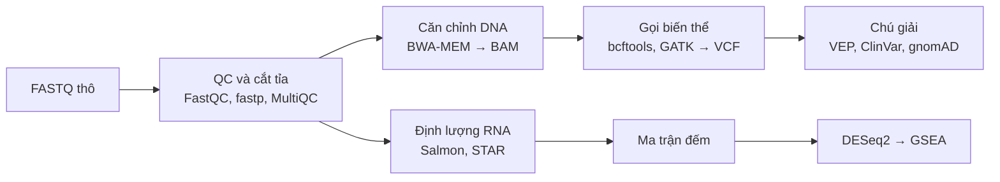

Đây là quy trình cốt lõi mà mọi bioinformatician phải tự chạy được: từ read thô đến danh sách biến thể đã chú giải.

**Mục tiêu:** hiểu công nghệ giải trình tự, kiểm soát chất lượng read, căn chỉnh lên genome, gọi và chú giải biến thể, lắp ráp genome cơ bản.



Hai nhánh dùng chung bước QC. Nhánh DNA được học ở phần này, nhánh RNA ở Phần 7.

## 6.1 Công nghệ giải trình tự

| Nền tảng              | Độ dài read           | Ưu điểm                                              | Hạn chế                             |
| --------------------- | --------------------- | ---------------------------------------------------- | ----------------------------------- |
| Illumina (short-read) | 50–300 bp, paired-end | Chính xác cao (> 99,9%), rẻ                          | Khó với vùng lặp, biến thể cấu trúc |
| PacBio HiFi           | 10–25 kb              | Dài và chính xác                                     | Đắt hơn mỗi base                    |
| Oxford Nanopore       | Đến hàng trăm kb      | Read rất dài, thiết bị nhỏ, đọc methyl hóa trực tiếp | Tỷ lệ lỗi cao hơn Illumina          |

Khái niệm cần nắm: độ sâu (depth/coverage, ví dụ 30x), paired-end, insert size, adapter, PCR duplicate.

## 6.2 Kiểm soát chất lượng và cắt tỉa

```bash
fastqc data/*.fastq.gz -o qc/
fastp -i R1.fastq.gz -I R2.fastq.gz -o R1.trim.fq.gz -O R2.trim.fq.gz -h qc/fastp.html
multiqc qc/ -o qc/
```

Trong báo cáo FastQC, chú ý: chất lượng theo vị trí base, hàm lượng GC, adapter, và tỷ lệ trùng lặp.

## 6.3 Căn chỉnh lên genome tham chiếu

```bash
bwa index ref.fa
bwa mem -t 8 -R '@RG\tID:s1\tSM:sample1' ref.fa R1.trim.fq.gz R2.trim.fq.gz \
  | samtools sort -o sample1.bam
samtools index sample1.bam
samtools flagstat sample1.bam   # tỷ lệ read căn chỉnh được
```

- DNA: BWA-MEM, Bowtie2. Long-read: minimap2. RNA: STAR, HISAT2 (xử lý được mối nối exon).
- Đánh dấu PCR duplicate bằng `samtools markdup` hoặc Picard MarkDuplicates.
- Tính độ phủ bằng mosdepth; xem trực quan bằng IGV.

## 6.4 Gọi biến thể

- Germline (di truyền): GATK HaplotypeCaller, bcftools, DeepVariant (dùng deep learning).
- Somatic (đột biến ung thư, so khối u với mô lành): GATK Mutect2, Strelka2.
- Biến thể cấu trúc: Manta, Delly; long-read: Sniffles.

```bash
bcftools mpileup -f ref.fa sample1.bam | bcftools call -mv -Oz -o sample1.vcf.gz
bcftools filter -i 'QUAL>30 && DP>10' sample1.vcf.gz -Oz -o sample1.filt.vcf.gz
```

## 6.5 Chú giải biến thể

- Công cụ: Ensembl VEP, ANNOVAR, SnpEff.
- Thông tin cần đọc: gen bị ảnh hưởng, hậu quả (missense, nonsense, splice) (→ [Đột biến gen](/blog/dot-bien-gen/)), tần số trong gnomAD, ý nghĩa trong ClinVar, điểm dự đoán (CADD, AlphaMissense).
- Diễn giải lâm sàng theo hướng dẫn ACMG/AMP gồm 5 mức: gây bệnh, có thể gây bệnh, chưa rõ ý nghĩa (VUS), có thể lành tính, lành tính.

## 6.6 Lắp ráp genome (de novo assembly)

- Short-read: SPAdes (vi khuẩn). Long-read: Flye, hifiasm.
- Đánh giá: QUAST (N50, số contig), BUSCO (độ đầy đủ theo gen bảo tồn).
- Chú giải gen: Prokka hoặc Bakta cho vi khuẩn.

**Bài tập (dự án nhỏ)**

- [ ] Tải dữ liệu exome một mẫu từ SRA (hoặc bộ dữ liệu nhỏ của Galaxy Training), chạy QC → cắt tỉa → căn chỉnh → gọi biến thể.
- [ ] Chú giải VCF bằng VEP, lọc các biến thể missense hiếm (gnomAD AF < 0,01).
- [ ] Lắp ráp genome một chủng vi khuẩn bằng SPAdes, báo cáo N50 và điểm BUSCO.

**Tài nguyên:** [Galaxy Training Network](https://training.galaxyproject.org) (có bài Variant Analysis và Assembly), [GATK Best Practices](https://gatk.broadinstitute.org), [Sanger – Genomics tutorials](https://www.sanger.ac.uk/).

## Ghi chép khi học

-
