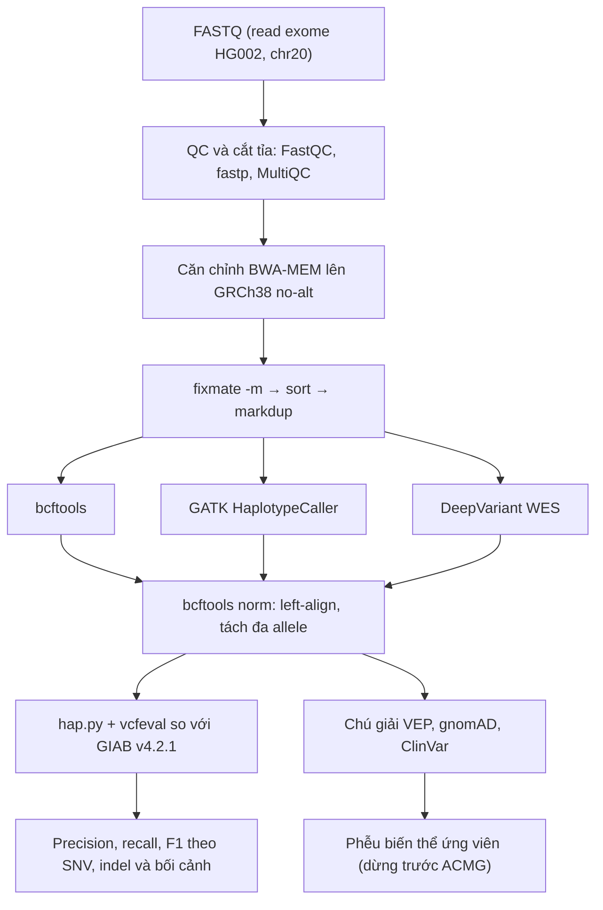

Gọi biến thể germline (germline variant calling) là bước biến hàng triệu read ngắn từ máy giải trình tự thành danh sách SNV và indel mà một người mang từ khi sinh ra. Cùng một mẫu, ba phần mềm phổ biến là bcftools, GATK HaplotypeCaller và DeepVariant có thể cho ba danh sách khác nhau, nên một pipeline chạy không lỗi chưa cho biết kết quả đúng đến đâu. Cách đo chuẩn hiện nay là so với bộ đáp án của Genome in a Bottle (GIAB): với mẫu HG002, bộ v4.2.1 phủ 92% phần autosome của GRCh38 (Wagner et al., 2022a), và phép so khớp theo hướng dẫn GA4GH cho ra precision, recall và F1 tách riêng cho SNV và indel (Krusche et al., 2019). Bài *methods tutorial* thứ sáu của series *Bioinformatics từ nhập môn đến nâng cao* này dành cho sinh viên sinh học, công nghệ sinh học đã dùng được dòng lệnh Linux và muốn tự kiểm tra một pipeline exome.

<div class="callout callout-note">
<p class="callout-title">Tóm tắt nhanh</p>

- **Pipeline**: FASTQ → fastp → BWA-MEM → `fixmate -m` → `sort` → `markdup` → ba caller → `bcftools norm` → hap.py.
- **Dữ liệu**: exome của HG002 trên chr20, đối chiếu với GIAB v4.2.1 (GRCh38) và phân tầng GIAB v3.6.
- **Chỉ số**: precision, recall, F1 cho SNV và indel riêng, kèm khoảng tin cậy Wilson 95%; không dùng specificity.
- **Số tham chiếu**: DeepVariant 1.9.0 trên exome HG003 đạt F1 0,9929 (SNP) và 0,9833 (indel) theo case study của nhà phát triển.
- **Giới hạn**: pipeline chỉ cho ra *biến thể ứng viên*; phân loại 5 mức theo ACMG/AMP cần bằng chứng ngoài dữ liệu giải trình tự.

</div>

## 1. Gọi biến thể germline là gì, và vì sao phải đo độ chính xác

Máy giải trình tự không "đọc" một genome từ đầu đến cuối. Nó cho ra hàng triệu đoạn ngắn, mỗi đoạn vài trăm base, và mỗi base đi kèm một xác suất sai. Gọi biến thể là bài toán suy luận: từ các read đã căn chỉnh lên một genome tham chiếu, ước lượng xem ở mỗi vị trí người này mang allele gì, với genotype nào, và mức tin cậy bao nhiêu. Nhóm phát triển DeepVariant mô tả nó như một bài toán thống kê trên dữ liệu có lỗi chứ không phải việc chép lại trình tự (Poplin et al., 2018). Mỗi bước trước đó, từ cắt tỉa read, căn chỉnh đến đánh dấu duplicate, đều thay đổi đầu vào của bài toán này.

Vì là suy luận, các phương pháp khác nhau cho kết quả khác nhau. Năm 2014, nhóm GIAB của Viện Tiêu chuẩn và Công nghệ Hoa Kỳ (NIST) tích hợp 14 bộ dữ liệu từ 5 công nghệ giải trình tự, 7 aligner và 3 variant caller cho cùng một mẫu NA12878, và ghi nhận các phương pháp lệch nhau đáng kể (Zook et al., 2014). Kết luận của họ là cần một bộ genotype chuẩn, được xây từ nhiều công nghệ, để mọi phòng thí nghiệm đối chiếu. Từ NA12878, GIAB mở rộng sang bộ ba gia đình Ashkenazi (HG002 là con trai, HG003 và HG004 là bố mẹ) và bộ ba người Hán (HG005–HG007) (Zook et al., 2016). HG002 thuộc Personal Genome Project, có sự đồng ý cho phép công bố dữ liệu rộng rãi, nên hiện là mẫu được dùng nhiều nhất để đánh giá pipeline (Zook et al., 2019; Krusche et al., 2019).

Hai thuật ngữ cần tách bạch ngay từ đầu. **SNV** (single nucleotide variant, biến thể đơn nucleotide) là một vị trí mà một cá thể khác genome tham chiếu ở một base. **SNP** (single nucleotide polymorphism, đa hình đơn nucleotide) là SNV đã có tần số đáng kể trong một quần thể. VCF của một người chứa SNV; một số trong đó trùng với SNP đã biết. Về mặt sinh học, SNV và indel (insertion/deletion, thêm hoặc mất vài nucleotide) chính là các đột biến điểm thay thế, thêm và mất cặp nucleotide trong Đột biến gen. Một số phần mềm, như hap.py, vẫn ghi nhãn "SNP" cho loại biến thể; khi đọc bảng kết quả, hiểu đó là SNV.

Các mục sau đi theo đúng thứ tự công việc: chạy từng bước của pipeline exome germline cho đúng, đo độ chính xác của ba caller trên cùng một bộ read và đọc các con số đó, rồi xem phần mềm đi được bao xa trên quãng đường từ "biến thể" đến "ý nghĩa lâm sàng". Phạm vi là biến thể nhỏ germline (SNV và indel dưới 50 bp) trên read ngắn Illumina. Biến thể somatic trong ung thư và biến thể cấu trúc có cách gọi và cách benchmark khác, nằm ngoài bài.

Hình 1 tóm tắt toàn bộ quy trình. Nhánh trái là pipeline quen thuộc; nhánh phải là phần hay bị bỏ qua: so với bộ đáp án.


*Hình 1. Pipeline gọi biến thể germline có nhánh đo độ chính xác.*

## 2. Nền tảng: từ phân tử DNA đến read

### 2.1. Từ Sanger đến giải trình tự song song

Thế hệ đầu gồm phương pháp Sanger, kết thúc chuỗi bằng dideoxynucleotide, và Maxam–Gilbert, cắt DNA bằng hoá chất. Cả hai đọc từng đoạn DNA một. Pyrosequencing đi theo hướng khác: phát hiện pyrophosphate giải phóng mỗi khi một nucleotide được gắn vào, nên không cần điện di. Chiến lược shotgun cắt genome thành nhiều mảnh ngẫu nhiên rồi ghép lại nhờ phần chồng lấp. Giải trình tự thế hệ mới (next-generation sequencing, NGS) giữ ý tưởng shotgun, nhưng đọc hàng triệu mảnh cùng lúc trên một flow cell. Giá thành giảm rất mạnh. Cái giá phải trả là read ngắn hơn và tỷ lệ lỗi cao hơn Sanger: theo tổng quan năm 2016 của Goodwin và cộng sự, tỷ lệ lỗi dao động khoảng 0,1–15% tuỳ nền tảng và read ngắn dài khoảng 35–700 bp (Goodwin et al., 2016).

### 2.2. Ba nền tảng chính

**Illumina** dùng hoá học kết thúc thuận nghịch theo chu kỳ (cyclic reversible termination): mỗi chu kỳ gắn một nucleotide có huỳnh quang, chụp ảnh, rồi gỡ nhóm chặn. Read dài tới 300 bp, độ chính xác tổng thể **trên 99,5%**; lỗi chủ yếu là lỗi thay thế, và vùng rất giàu AT hoặc GC có xu hướng bị thiếu đại diện (Goodwin et al., 2016).

Con số "99,9%" hay gặp không phải độ chính xác của cả nền tảng mà là ý nghĩa của điểm chất lượng Phred Q30 cho **một base**. Điểm Phred liên hệ với xác suất lỗi $p$ theo công thức $Q = -10\log_{10} p$, tức $p = 10^{-Q/10}$ (định dạng điểm chất lượng trong FASTQ được trình bày ở [Phần 4](/blog/dinh-dang-du-lieu-va-co-so-du-lieu-sinh-hoc/)):

```python
for q in (10, 20, 30, 40):
    p = 10 ** (-q / 10)
    print(f"Q{q}: xác suất lỗi = {p:.4f}, độ chính xác = {100 * (1 - p):.2f}%")
# Q30: xác suất lỗi = 0.0010, độ chính xác = 99.90%
```

**PacBio HiFi** đọc vòng nhiều lần cùng một phân tử DNA đã nối thành vòng (circular consensus sequencing), rồi lấy đồng thuận. Bài báo gốc báo cáo độ chính xác 99,8% với độ dài read trung bình 13,5 kb (Wenger et al., 2019).

**Oxford Nanopore** đo thay đổi dòng điện khi sợi DNA đi qua một lỗ protein. Read "ultra-long" có N50 trên 100 kb, read dài nhất đạt 882 kb (Jain et al., 2018). Vì đo trực tiếp phân tử gốc, nanopore phát hiện được methyl hoá cytosine mà không cần xử lý bisulfite (Simpson et al., 2017). Tỷ lệ lỗi cao là đặc điểm của các thế hệ đầu: năm 2016 MinION có lỗi tới khoảng 30% với read 1D (Goodwin et al., 2016); hoá chất và basecaller đã thay đổi nhiều kể từ đó, nên số này chỉ có giá trị lịch sử.

*Bảng 1. Ba nền tảng giải trình tự, số liệu từ các bài báo gốc.*

| Nền tảng | Nguyên lý | Độ dài read | Độ chính xác | Đặc điểm |
|---|---|---|---|---|
| Illumina | Kết thúc thuận nghịch theo chu kỳ | Tới 300 bp | > 99,5% tổng thể (Goodwin et al., 2016) | Lỗi thay thế; thiếu đại diện vùng giàu AT/GC |
| PacBio HiFi | Đồng thuận vòng (CCS) | Trung bình 13,5 kb (Wenger et al., 2019) | 99,8% (Wenger et al., 2019) | Phù hợp vùng lặp, biến thể cấu trúc |
| Oxford Nanopore | Đo dòng điện qua lỗ protein | N50 > 100 kb, tối đa 882 kb (Jain et al., 2018) | Lỗi tới ~30% với read 1D năm 2016 (Goodwin et al., 2016) | Đọc được methyl hoá (Simpson et al., 2017) |

### 2.3. Độ sâu, độ phủ và exome

**Độ sâu** (depth) là số read phủ lên một vị trí; **độ phủ** (coverage, breadth) là tỷ lệ vùng quan tâm được phủ ít nhất một ngưỡng độ sâu nào đó. Không có một độ sâu "đúng" cho mọi nghiên cứu: mức cần thiết phụ thuộc loại biến thể, loại mẫu và câu hỏi (Sims et al., 2014). Với exome, độ sâu đặc biệt không đều giữa các vùng đích, nên báo cáo mỗi độ sâu trung bình là không đủ; cần báo cáo tỷ lệ base đích đạt 10x, 20x, 30x, việc mà mosdepth làm nhanh (Pedersen & Quinlan, 2018).

**Giải trình tự exome** (whole exome sequencing, WES) bắt giữ các exon bằng probe rồi khuếch đại bằng PCR trước khi giải trình tự. PCR tạo ra nhiều bản sao của cùng một phân tử gốc (→ PCR – Các vấn đề cơ bản). Nếu phân tử gốc có lỗi, hoặc PCR gây lỗi ở chu kỳ đầu, lỗi đó xuất hiện trên nhiều read và trông giống một biến thể thật. Vì vậy cần **đánh dấu PCR duplicate** (các cặp read có cùng toạ độ đầu cuối) để caller chỉ tính chúng một lần.

### 2.4. Genome tham chiếu

Bài dùng GRCh38 bản *no-alt analysis set*: bộ trình tự GRCh38 bỏ các contig ALT (haplotype thay thế), để read không bị chia điểm mapping quality giữa hai bản sao gần giống nhau. GRCh38 vẫn là genome tham chiếu chất lượng cao được dùng rộng rãi (Schneider et al., 2017). Genome T2T-CHM13 hoàn chỉnh hơn, lấp các khoảng trống còn lại (Nurk et al., 2022), và GIAB đã có benchmark nháp trên CHM13; hướng này để dành cho một bài mở rộng.

## 3. Vật liệu và phương pháp

### 3.1. Dữ liệu và tài nguyên

*Bảng 2. Dữ liệu và tài nguyên (kiểm tra trên FTP của GIAB ngày 11/11/2026).*

| Thành phần | File hoặc phiên bản | Kích thước, ngày | Nguồn |
|---|---|---|---|
| Read exome HG002 | BAM đã sắp theo toạ độ, đã đánh dấu duplicate, thư mục `OsloUniversityHospital_Exome` | 10.339.495.604 byte, 25/11/2015, kèm `.bai` | Genome in a Bottle Consortium (n.d.) |
| Bộ đáp án | `HG002_GRCh38_1_22_v4.2.1_benchmark.vcf.gz` | 156.252.944 byte, 7/12/2020 | Wagner et al. (2022a) |
| Vùng tin cậy | `HG002_GRCh38_1_22_v4.2.1_benchmark_noinconsistent.bed` | 11.494.021 byte, 4/12/2020 | Wagner et al. (2022a) |
| Phân tầng | GIAB genome stratifications v3.6 | — | Dwarshuis et al. (2024) |
| Genome tham chiếu | GRCh38 no-alt analysis set | — | Schneider et al. (2017) |

**Mẫu.** HG002 (NA24385) là con trai trong bộ ba Ashkenazi. Vì là nam, khi so trên nhiễm sắc thể giới tính phải khai báo giới tính cho công cụ so sánh.

**Read exome.** Thư mục dữ liệu của GIAB có một BAM exome từ Bệnh viện Đại học Oslo. Tên file chứa chuỗi "KIT-Av5", gợi ý bộ bắt giữ Agilent SureSelect All Exon V5; đây là suy luận từ tên file, cần xác nhận bằng metadata. Barbitoff và cộng sự cho biết các exome GIAB họ dùng đều bắt giữ bằng SureSelect v5 hoặc v7, với độ sâu 100–200x (Barbitoff et al., 2022). Để bài vẫn "bắt đầu từ FASTQ", read vùng chr20 được lấy ra từ BAM, chuyển về FASTQ, rồi chạy lại toàn bộ pipeline từ đầu.

**Vì sao chr20.** Lý do thứ nhất là một nhiễm sắc thể vừa sức máy cá nhân. Lý do thứ hai quan trọng hơn: mô hình WES v1.9 của DeepVariant được huấn luyện có dùng HG002, nhưng tài liệu dữ liệu huấn luyện của DeepVariant ghi rằng chr20–22 luôn được loại khỏi tập huấn luyện (Google, n.d.-a). Chấm điểm DeepVariant trên chr20 vì vậy là chấm trên dữ liệu nó chưa học.

**Bộ đáp án.** GIAB v4.2.1 cho HG002 trên GRCh38 dùng thêm linked read và long read để mở rộng sang vùng khó: so với bản trước, vùng benchmark tăng từ 85% lên 92% autosome, thêm hơn 300.000 SNV và hơn 50.000 indel, và nhiều hơn 16% biến thể trong exon (Wagner et al., 2022a). Bản v5.0q dựa trên assembly hiện được GIAB ghi là bản nháp (draft), nên chỉ phù hợp cho phân tích độ nhạy.

**Vùng đánh giá.** Vùng cuối cùng để tính chỉ số là giao của ba tập: vùng đích của bộ bắt giữ, vùng tin cậy của benchmark, và chr20. Nếu không có file BED chính thức của bộ bắt giữ trên GRCh38, một phương án là dùng exon từ GENCODE cộng 150 bp mỗi đầu, như Barbitoff và cộng sự đã làm (Barbitoff et al., 2022).

### 3.2. QC và cắt tỉa

FastQC cho bức tranh chất lượng từng file; fastp cắt adapter, cắt base chất lượng thấp và lọc read trong một lần chạy (Chen et al., 2018); MultiQC gom báo cáo của nhiều công cụ vào một trang (Ewels et al., 2016). Nhóm tác giả fastp báo cáo công cụ nhanh hơn Trimmomatic hay Cutadapt 2–5 lần; đây là đánh giá của chính nhóm phát triển (Chen et al., 2018). Cờ `-j` ghi báo cáo JSON để MultiQC đọc được.

```bash
fastqc R1.fq.gz R2.fq.gz -o qc/
fastp -i R1.fq.gz -I R2.fq.gz -o R1.trim.fq.gz -O R2.trim.fq.gz \
      -h qc/fastp.html -j qc/fastp.json -w 4
multiqc qc/ -o qc/
```

Khi đọc báo cáo, cần nhìn bốn thứ: chất lượng theo vị trí base (thường giảm dần về cuối read), hàm lượng adapter, tỷ lệ duplicate và phân bố GC. Ghi lại số read trước và sau cắt tỉa để đưa vào bảng kết quả.

### 3.3. Căn chỉnh và xử lý BAM

**BWA-MEM.** Căn chỉnh read là một bài toán sắp gióng trình tự (→ [Phần 5](/blog/phan-tich-trinh-tu/)), nhưng ở quy mô hàng triệu read lên một genome 3 tỷ base thì phải dùng chỉ mục. BWA dùng Burrows–Wheeler transform; bài năm 2009 mô tả thuật toán cho read ngắn (bản "backtrack") và báo cáo nhanh hơn MAQ 10–20 lần với độ chính xác tương tự (Li & Durbin, 2009). Thuật toán BWA-MEM, cách được dùng mặc định cho read Illumina hiện nay, được mô tả trong một preprint năm 2013 chứ không phải trong bài năm 2009 (Li, 2013). Read group (`ID`, `SM`, `PL`, `LB`) nên khai báo ngay khi căn chỉnh: GATK cần thông tin này để biết read thuộc mẫu nào, và `SM` cũng là tên mẫu sẽ xuất hiện trong cột cuối của VCF.

Bowtie2 nhanh và phổ biến (Langmead & Salzberg, 2012), nhưng trong benchmark hệ thống trên dữ liệu GIAB, Bowtie2 cho độ chính xác gọi biến thể kém hơn đáng kể và nhóm tác giả khuyên không dùng nó cho gọi biến thể y khoa (Barbitoff et al., 2022). Read dài dùng minimap2 (Li, 2018).

**Đánh dấu duplicate đúng thứ tự.** Theo tài liệu samtools, `markdup` cần các tag mà `fixmate -m` thêm vào (như `MC` và `ms`), và cần BAM đã sắp theo toạ độ (SAMtools, n.d.; Danecek et al., 2021). `fixmate` lại cần read được nhóm theo tên. Đầu ra của `bwa mem` đã để các mate liền nhau, nên có thể đưa thẳng vào `fixmate -m` rồi mới `sort`:

```bash
bwa index GRCh38_no_alt.fa
bwa mem -t 8 -R '@RG\tID:HG002_oslo\tSM:HG002\tPL:ILLUMINA\tLB:lib1' \
    GRCh38_no_alt.fa R1.trim.fq.gz R2.trim.fq.gz \
  | samtools fixmate -m -u - - \
  | samtools sort -o hg002.sorted.bam -
samtools markdup hg002.sorted.bam hg002.md.bam
samtools index hg002.md.bam
```

Đường ống ngắn hơn `bwa mem | samtools sort` rồi `markdup` sẽ báo lỗi hoặc đánh dấu thiếu, vì thiếu tag từ `fixmate -m`.

**QC sau căn chỉnh.** `samtools flagstat` cho tỷ lệ map, tỷ lệ cặp đúng và tỷ lệ duplicate (Danecek et al., 2021). mosdepth tính độ sâu theo từng vùng đích với các ngưỡng 10/20/30x (Pedersen & Quinlan, 2018). IGV dùng để xem trực quan các vị trí nghi ngờ (Robinson et al., 2011).

```bash
samtools flagstat hg002.md.bam
mosdepth -t 4 --by targets_chr20.bed --thresholds 10,20,30 cov/hg002 hg002.md.bam
```

### 3.4. Gọi biến thể bằng ba cách

Ba caller nhận cùng một BAM và cùng một vùng đích có padding, để mọi khác biệt về kết quả đến từ caller.

**bcftools** dùng mô hình xác suất trên từng cột pileup: ở mỗi vị trí, tính khả năng của từng genotype từ các base và điểm chất lượng quan sát được (Li, 2011; Danecek et al., 2021). Với exome, cần giới hạn vào vùng đích bằng `-R` và ghi thêm `AD` (số read mỗi allele) và `DP` để lọc và kiểm tra sau này:

```bash
bcftools mpileup -f GRCh38_no_alt.fa -R targets_chr20_pad.bed \
    -a FORMAT/AD,FORMAT/DP -Ou hg002.md.bam \
  | bcftools call -m -v -Oz -o bcftools.raw.vcf.gz
bcftools filter -e 'QUAL<=30 || INFO/DP<=10' -Oz -o bcftools.filt.vcf.gz bcftools.raw.vcf.gz
```

Lệnh lọc cuối giữ biến thể có `QUAL>30` và `DP>10`, một bộ lọc cứng thường gặp. Lưu ý là `-e` **xoá** hẳn các dòng không đạt khỏi file. Muốn giữ các dòng đó và chỉ đánh dấu ở cột FILTER, thêm `-s LowQual` vào lệnh. Nên chạy hap.py trên cả bản chưa lọc và bản đã lọc để thấy bộ lọc đổi precision lấy recall bao nhiêu.

**GATK HaplotypeCaller.** Bài báo năm 2010 về GATK mô tả **framework** kiểu MapReduce của bộ công cụ, không phải HaplotypeCaller (McKenna et al., 2010). Quy trình năm 2011 gồm căn chỉnh, realign quanh indel, hiệu chỉnh điểm chất lượng base (BQSR), gọi biến thể và lọc bằng machine learning (DePristo et al., 2011); Best Practices năm 2013 hệ thống hoá các bước từ FASTQ đến VCF (Van der Auwera et al., 2013). HaplotypeCaller, được mô tả trong preprint năm 2017, xác định các vùng hoạt động có dấu hiệu biến thể rồi lắp ráp lại haplotype cục bộ từ read ở vùng đó (Poplin et al., 2017). Nhờ bước lắp ráp này, pipeline trong bài không có bước realign quanh indel riêng.

Với dữ liệu nhỏ như một nhiễm sắc thể của một exome, VQSR (lọc bằng mô hình học trên rất nhiều biến thể) không đủ dữ liệu để huấn luyện. Thay vào đó dùng **hard filter** theo tài liệu GATK: SNP bị lọc khi QD < 2,0, FS > 60, SOR > 3, MQ < 40, MQRankSum < −12,5 hoặc ReadPosRankSum < −8; indel bị lọc khi QD < 2,0, FS > 200 hoặc ReadPosRankSum < −20 (Broad Institute, n.d.). Tài liệu GATK coi đây là điểm khởi đầu, cần chỉnh theo dữ liệu. Barbitoff và cộng sự thấy HaplotypeCaller chỉ đạt độ chính xác cao khi được lọc bằng 1D CNN hoặc hard filter (Barbitoff et al., 2022).

```bash
gatk HaplotypeCaller -R GRCh38_no_alt.fa -I hg002.md.bam \
     -L targets_chr20_pad.bed -O gatk.raw.vcf.gz
gatk SelectVariants -V gatk.raw.vcf.gz -select-type SNP -O gatk.snp.vcf.gz
gatk VariantFiltration -V gatk.snp.vcf.gz -O gatk.snp.filt.vcf.gz \
     -filter "QD < 2.0" --filter-name "QD2" \
     -filter "FS > 60.0" --filter-name "FS60" \
     -filter "SOR > 3.0" --filter-name "SOR3" \
     -filter "MQ < 40.0" --filter-name "MQ40" \
     -filter "MQRankSum < -12.5" --filter-name "MQRankSum-12.5" \
     -filter "ReadPosRankSum < -8.0" --filter-name "ReadPosRankSum-8"
```

Indel lọc tương tự với `-select-type INDEL` và ba ngưỡng tương ứng, rồi gộp hai file bằng `gatk MergeVcfs`.

**DeepVariant** biến vùng quanh mỗi vị trí ứng viên thành một "ảnh" nhiều kênh (base, chất lượng base, mapping quality, mạch…) rồi dùng mạng nơ-ron tích chập để phân loại genotype (Poplin et al., 2018). Mô hình tổng quát hoá được sang genome build khác, loài thú khác và cả exome (Poplin et al., 2018). Với exome, chạy mô hình `WES` và giới hạn vùng bằng `--regions`, đúng như case study exome chính thức (Google, n.d.-b):

```bash
run_deepvariant --model_type WES --ref GRCh38_no_alt.fa --reads hg002.md.bam \
    --regions targets_chr20_pad.bed --output_vcf dv.vcf.gz \
    --output_gvcf dv.g.vcf.gz --num_shards 8
```

Còn nhiều caller khác như FreeBayes (Garrison & Marth, 2012), Strelka2, Clair3 hay Octopus; bài giới hạn ở ba caller đại diện cho ba cách tiếp cận.

### 3.5. Chuẩn hoá, so sánh và thống kê

**Chuẩn hoá.** Cùng một indel trong vùng lặp có thể ghi ở nhiều vị trí khác nhau trong VCF; biến thể nhiều allele có thể nằm trên một dòng hay tách thành nhiều dòng. Trước khi so giữa các caller cần left-align và tách đa allele (Tan et al., 2015):

```bash
bcftools norm -f GRCh38_no_alt.fa -m -any -Oz -o dv.norm.vcf.gz dv.vcf.gz
```

Chuẩn hoá từng dòng vẫn chưa đủ với biến thể phức tạp (nhiều thay đổi gần nhau có thể biểu diễn bằng nhiều tổ hợp dòng khác nhau). Vì vậy so với bộ đáp án phải dùng so khớp theo haplotype: vcfeval dựng lại haplotype từ cả hai VCF rồi so trình tự (Krusche et al., 2019).

**So với bộ đáp án.** hap.py là công cụ so sánh VCF do Illumina phát triển và được nhóm GA4GH dùng làm khung chuẩn (Illumina, n.d.; Krusche et al., 2019), chạy với engine vcfeval:

```bash
hap.py HG002_GRCh38_1_22_v4.2.1_benchmark.vcf.gz dv.vcf.gz \
  -f HG002_GRCh38_1_22_v4.2.1_benchmark_noinconsistent.bed \
  -T targets_chr20.bed -r GRCh38_no_alt.fa \
  --engine vcfeval --gender male --pass-only \
  --stratification GRCh38@all/GRCh38-all-stratifications.tsv -o happy/deepvariant
```

`-f` là vùng tin cậy của benchmark, `-T` là vùng đích, `--pass-only` chỉ tính biến thể có FILTER là PASS. `--stratification` cho kết quả theo từng tầng bối cảnh (Krusche et al., 2019; Dwarshuis et al., 2024). File TSV này nằm trong thư mục `GRCh38@all/` của bộ phân tầng v3.6 trên FTP của GIAB, cạnh các thư mục chứa file BED của từng tầng (LowComplexity, Mappability, GCcontent…). Cách an toàn là tải cả gói `[email hidden]`, giải nén, rồi trỏ tới file TSV bên trong.

**Định nghĩa chỉ số.** Theo GA4GH, TP, FP và FN tính ở mức khớp genotype: một biến thể gọi đúng vị trí và allele nhưng sai genotype (dị hợp thay vì đồng hợp) không được tính là TP (Krusche et al., 2019). Vì biểu diễn của query và truth có thể khác nhau, precision tính bằng TP theo biểu diễn của query còn recall tính bằng TP theo biểu diễn của truth:

$$\text{Precision} = \frac{TP_{query}}{TP_{query} + FP}, \qquad \text{Recall} = \frac{TP_{truth}}{TP_{truth} + FN}, \qquad F_1 = \frac{2 \cdot \text{Precision} \cdot \text{Recall}}{\text{Precision} + \text{Recall}}$$

Không có true negative và specificity, vì số vị trí "không có biến thể" trong genome không xác định được: tại một vị trí có thể xảy ra vô số indel khác nhau (Krusche et al., 2019).

**Khoảng tin cậy.** Recall là một tỷ lệ $k/n$ (số biến thể đúng tìm được trên tổng số biến thể đúng), nên có độ bất định nhị thức. Khoảng Wilson 95% hoạt động tốt hơn khoảng Wald khi tỷ lệ gần 0 hoặc 1 (Brown et al., 2001), đúng tình huống của recall và precision (→ [Phần 3](/blog/toan-va-thong-ke-cho-sinh-hoc/), phân phối nhị thức):

$$\frac{\hat p + \frac{z^2}{2n} \pm z\sqrt{\frac{\hat p(1-\hat p)}{n} + \frac{z^2}{4n^2}}}{1 + \frac{z^2}{n}}, \quad z = 1{,}96$$

**Đường precision–recall và độ trùng khớp.** hap.py xuất bảng ROC theo một trường điểm như QUAL hoặc GQ (Krusche et al., 2019). Tập TP, FP, FN của ba caller vẽ bằng UpSet thay cho biểu đồ Venn ba vòng (Lex et al., 2014; Conway et al., 2017).

### 3.6. Chú giải

VEP (Variant Effect Predictor) gắn cho mỗi biến thể gen, transcript và hậu quả trên protein (McLaren et al., 2016); SnpEff (Cingolani et al., 2012) và ANNOVAR (Wang et al., 2010) là hai lựa chọn khác. Kèm theo là tần số allele gnomAD (Karczewski et al., 2020), nhãn ClinVar (Landrum et al., 2025), điểm CADD (Kircher et al., 2014; Rentzsch et al., 2019) và AlphaMissense (Cheng et al., 2023). Phễu lọc gồm: PASS → trong vùng đích → hậu quả trên protein (missense, nonsense, frameshift, splice) → hiếm (AF gnomAD < 0,01) → có nhãn ClinVar. Mục 5 bàn vì sao phễu này chưa phải diễn giải lâm sàng.

### 3.7. Tái lập

Snakemake với môi trường conda riêng cho mỗi rule giúp chạy lại toàn bộ pipeline bằng một lệnh (Mölder et al., 2021). DeepVariant và hap.py chạy trong container (Docker hoặc Apptainer). nf-core/sarek là pipeline cộng đồng tương đương, hữu ích để đối chiếu (Ewels et al., 2020). Ghi phiên bản mọi công cụ, mã hash các file tham chiếu, ngày tải, thời gian và RAM của mỗi bước.

## 4. Đọc kết quả: chỉ số, khoảng tin cậy và số tham chiếu

### 4.1. QC và độ phủ

Bảng QC nên có số cặp read lấy ra từ chr20, tỷ lệ còn lại sau fastp, tỷ lệ map, tỷ lệ duplicate, độ sâu trung vị trên vùng đích và tỷ lệ base đích đạt ≥ 10x, ≥ 20x, ≥ 30x. Các exome GIAB được giải trình tự ở 100–200x (Barbitoff et al., 2022), nên phần lớn vùng đích sẽ vượt xa 20x; vùng nào dưới 20x thường là exon giàu GC hoặc vùng probe bắt kém, và là nơi FN tập trung.

### 4.2. Precision, recall và F1 theo caller

hap.py ghi bảng tổng hợp theo loại biến thể (SNP, INDEL) và theo bộ lọc. Đoạn code dưới đọc một bảng có cấu trúc tương tự, tính lại chỉ số và khoảng Wilson cho recall.

<div class="callout callout-warning">
<p class="callout-title">Số minh hoạ</p>

Các con số trong bảng dưới là số giả lập để minh hoạ cách tính, không phải kết quả của HG002.

</div>

```python
import io, math
import pandas as pd

# Số minh hoạ, không phải kết quả thật
csv = """Caller,Type,TRUTH.TP,TRUTH.FN,QUERY.TP,QUERY.FP
bcftools,SNP,980,20,980,15
bcftools,INDEL,85,15,85,9
GATK,SNP,985,15,985,8
GATK,INDEL,90,10,90,6
DeepVariant,SNP,990,10,990,3
DeepVariant,INDEL,95,5,95,2
"""
df = pd.read_csv(io.StringIO(csv))

def wilson(k, n, z=1.96):
    """Khoảng Wilson 95% cho tỷ lệ k/n."""
    p = k / n
    den = 1 + z**2 / n
    centre = (p + z**2 / (2 * n)) / den
    half = z * math.sqrt(p * (1 - p) / n + z**2 / (4 * n**2)) / den
    return centre - half, centre + half

df["Recall"] = df["TRUTH.TP"] / (df["TRUTH.TP"] + df["TRUTH.FN"])
df["Precision"] = df["QUERY.TP"] / (df["QUERY.TP"] + df["QUERY.FP"])
df["F1"] = 2 * df["Precision"] * df["Recall"] / (df["Precision"] + df["Recall"])
ci = df.apply(lambda r: wilson(r["TRUTH.TP"], r["TRUTH.TP"] + r["TRUTH.FN"]), axis=1)
df["Recall_CI95"] = [f"{lo:.3f}–{hi:.3f}" for lo, hi in ci]
print(df[["Caller", "Type", "Recall", "Precision", "F1", "Recall_CI95"]].round(3).to_string(index=False))
```

Kết quả:

```text
     Caller  Type  Recall  Precision    F1 Recall_CI95
   bcftools   SNP   0.980      0.985 0.982 0.969–0.987
   bcftools INDEL   0.850      0.904 0.876 0.767–0.907
       GATK   SNP   0.985      0.992 0.988 0.975–0.991
       GATK INDEL   0.900      0.938 0.918 0.826–0.945
DeepVariant   SNP   0.990      0.997 0.993 0.982–0.995
DeepVariant INDEL   0.950      0.979 0.964 0.888–0.978
```

Cột cuối mới là cột cần đọc kỹ. Với 100 indel, khoảng tin cậy recall của GATK (0,826–0,945) và DeepVariant (0,888–0,978) chồng lên nhau. Chênh lệch 5 điểm phần trăm vì vậy chưa đủ để nói caller nào tốt hơn. Với 1.000 SNV thì các khoảng hẹp hơn nhiều.

**Số tham chiếu đã công bố.** Để biết kết quả của bạn nằm ở đâu, có thể đặt cạnh các con số sau, với lưu ý là khác mẫu, khác vùng và khác phiên bản nên chỉ để định hướng:

| Nghiên cứu | Dữ liệu | Caller | SNV/SNP | Indel |
|---|---|---|---|---|
| Case study exome DeepVariant 1.9.0 (Google, n.d.-b) | HG003, exome IDT, ~100x, benchmark v4.2.1 | DeepVariant | Recall 0,9883; precision 0,9976; F1 0,9929 | Recall 0,9743; precision 0,9924; F1 0,9833 |
| Supernat et al. (2018) | NA12878, WGS 30x | DeepVariant / GATK / SpeedSeq | F 0,98 cả ba | F 0,94 / 0,90 / 0,84 |


*Hình 2. F1 đã công bố, tách SNV và indel. Trái: WGS 30x của NA12878 (Supernat et al., 2018). Phải: exome HG003 với DeepVariant 1.9.0 (Google, n.d.-b). Trục tung bắt đầu từ 0,80 để thấy rõ chênh lệch.*

Hai giả thuyết rút ra từ tài liệu. **H1**: với SNV, F1 của ba caller gần nhau; trên WGS 30x cả ba đều đạt 0,98 (Supernat et al., 2018), và trên dữ liệu GIAB độ chính xác SNV giữa WES và WGS tương đương (Barbitoff et al., 2022). **H2**: khác biệt lớn hơn ở indel và DeepVariant dẫn đầu; trên 14 bộ WES và WGS của GIAB, DeepVariant cho kết quả tốt nhất, và indel khó gọi hơn khi dùng exome (Barbitoff et al., 2022).

### 4.3. Khoảng tin cậy phụ thuộc số biến thể

Hình 3 cho thấy độ rộng khoảng Wilson 95% của recall giảm theo số biến thể đúng trong vùng đánh giá. Ở recall thật 0,95, khoảng rộng khoảng 0,09 với n = 100, 0,027 với n = 1.000 và 0,009 với n = 10.000.


*Hình 3. Độ rộng khoảng Wilson 95% của recall theo số biến thể đúng n (tính theo công thức, không phải dữ liệu đo).*

Trên một nhiễm sắc thể của một exome, số indel ít hơn SNV rất nhiều, nên recall indel luôn có khoảng tin cậy rộng. Một F1 indel ghi đến bốn chữ số thập phân mà không kèm khoảng tin cậy chỉ tạo cảm giác chính xác giả.

### 4.4. Phân tầng theo bối cảnh genome

Bộ phân tầng GIAB chia genome thành các tầng như homopolymer, tandem repeat, vùng khó map, vùng GC thấp hoặc cao và vùng trùng lặp đoạn (Dwarshuis et al., 2024). hap.py tính chỉ số riêng cho từng tầng. **H3**: FP và FN tập trung ở homopolymer, tandem repeat và vùng khó map. Krusche và cộng sự thấy với WGS có PCR, recall và precision indel thấp hơn hẳn, chủ yếu do lỗi ở homopolymer và tandem repeat (Krusche et al., 2019). Thư viện exome cũng có bước PCR, nhưng bằng chứng này đến từ WGS, nên với exome đây là giả thuyết cần kiểm tra. Ở mỗi tầng có nhiều lỗi, mở IGV tại vài FP và FN để xem read thật sự trông thế nào (Robinson et al., 2011).

### 4.5. Ba caller trùng nhau đến đâu

Biểu đồ UpSet cho biết bao nhiêu FN chung cho cả ba caller và bao nhiêu FP chỉ một caller có (Lex et al., 2014). Với ba tập, biểu đồ Venn vẫn đọc được, nhưng UpSet đặt kích thước mỗi giao vào một cột có trục số, nên so sánh các giao dễ hơn và mở rộng được khi thêm caller thứ tư (Conway et al., 2017). FN chung cho cả ba caller gợi ý giới hạn của dữ liệu (read ngắn không map được, vùng phủ thấp), vì ba cách tiếp cận khác nhau cùng bỏ sót. FP chỉ một caller có gợi ý đặc điểm của mô hình đó. Một FP có mặt ở cả ba caller đáng được mở IGV xem kỹ, vì đôi khi chính bộ đáp án sai ở chỗ đó. GA4GH đã tính đến khả năng này: một bộ đáp án chỉ được coi là hợp lệ khi hơn một nửa số FP và FN được xác nhận là lỗi của phương pháp đang đánh giá, không phải của bộ đáp án (Krusche et al., 2019).

### 4.6. Lỗi hay gặp khi đọc kết quả

Một số lỗi làm sai con số mà không gây thông báo lỗi nào:

1. **Không giới hạn vùng đánh giá.** Chạy hap.py không có `-T` trên dữ liệu exome sẽ tính mọi biến thể đúng ngoài vùng đích là FN, và recall rơi xuống rất thấp. Ngược lại, quên `-f` sẽ tính biến thể ở vùng khó (không nằm trong vùng tin cậy) là FP.
2. **Tên contig không khớp.** BAM lấy từ dữ liệu cũ có thể dùng tên "20" trong khi GRCh38 và bộ đáp án dùng "chr20". Khi đó giao các vùng rỗng và hap.py báo số biến thể bằng 0. Kiểm tra header bằng `samtools view -H` trước khi chạy.
3. **So VCF chưa lọc với VCF đã lọc.** `--pass-only` loại biến thể có FILTER khác PASS. `bcftools call` để trống cột FILTER (`.`), tức chưa áp bộ lọc nào, nên mọi dòng đều được tính. Chỉ sau `bcftools filter` có `-s` mới có dòng bị đánh dấu; còn `-e` như ở mục 3.4 thì xoá dòng chứ không đánh dấu. Với GATK sau `VariantFiltration`, các dòng bị lọc vẫn nằm trong file nhưng không được tính.
4. **Gộp SNV và indel.** F1 chung bị chi phối bởi SNV vì SNV nhiều hơn indel rất nhiều, nên một caller yếu ở indel vẫn có F1 chung cao (Krusche et al., 2019).
5. **Quên giới tính.** HG002 là nam; nếu đánh giá cả nhiễm sắc thể X, genotype đơn bội phải được xử lý đúng, nên cần `--gender male`.

### 4.7. Ngưỡng lọc và đường precision–recall

**H4**: ngưỡng lọc dịch chuyển cân bằng giữa precision và recall. Bộ lọc `QUAL>30 && DP>10` tăng precision nhưng giảm recall ở vùng phủ thấp. Cách kiểm tra là vẽ đường precision–recall theo QUAL hoặc GQ từ bảng ROC của hap.py, rồi đánh dấu vị trí của bộ lọc trên đường cong (Krusche et al., 2019).

### 4.8. Phân tích độ nhạy

**H5**: kết quả phụ thuộc phiên bản benchmark. Khi vùng đánh giá rộng hơn và chứa nhiều vùng khó, mọi phương pháp đều giảm điểm (Barbitoff et al., 2022). Có thể chạy lại với bản v5.0q, với GATK có và không có BQSR, và với hai định nghĩa vùng đích. **H6** (tuỳ chọn): chạy DeepVariant trên một nhiễm sắc thể có trong tập huấn luyện để thấy ảnh hưởng của rò rỉ dữ liệu, dùng GATK làm đối chứng.

## 5. Từ "biến thể" đến "ý nghĩa lâm sàng"

**Chú giải là gắn thông tin, chưa phải diễn giải.** VEP cho biết biến thể nằm ở gen và transcript nào, gây hậu quả gì trên protein, và tra cứu các cơ sở dữ liệu (McLaren et al., 2016). Missense, nonsense và splice tương ứng với các dạng đột biến điểm trong Đột biến gen.

**Tần số quần thể.** gnomAD bản v2 tổng hợp dữ liệu của 141.456 người (Karczewski et al., 2020). Ngưỡng AF < 0,01 là bộ lọc nghiên cứu thường dùng, không phải tiêu chí ACMG. Trong ACMG/AMP, tần số allele trên 5% trong quần thể đối chứng là bằng chứng lành tính ở mức độc lập (BA1) (Richards et al., 2015). Whiffin và cộng sự đề xuất dùng tần số biến thể chi tiết theo từng quần thể để lọc chặt hơn cho từng bệnh (Whiffin et al., 2017).

**Điểm dự đoán.** CADD xếp hạng mức có hại cho mọi biến thể trong genome (Kircher et al., 2014; Rentzsch et al., 2019). AlphaMissense xếp 89% biến thể missense vào nhóm có thể lành tính hoặc có thể gây bệnh (Cheng et al., 2023). ACMG/AMP coi bằng chứng tính toán là mức hỗ trợ (PP3 cho gây bệnh, BP4 cho lành tính) và cảnh báo không nên đánh giá quá mức (Richards et al., 2015). Pejaver và cộng sự hiệu chỉnh ngưỡng cho 13 công cụ: phần lớn đạt mức hỗ trợ, một vài công cụ đạt mức mạnh (Pejaver et al., 2022).

**Khung ACMG/AMP 2015.** Hướng dẫn chung của American College of Medical Genetics and Genomics và Association for Molecular Pathology chia biến thể ở gen gây bệnh Mendel thành năm mức: gây bệnh (pathogenic), có thể gây bệnh (likely pathogenic), chưa rõ ý nghĩa (VUS), có thể lành tính (likely benign) và lành tính (benign) (Richards et al., 2015). "Có thể" được quy ước là chắc chắn hơn 90%. Tiêu chí gây bệnh có các mức rất mạnh (PVS1), mạnh (PS), trung bình (PM) và hỗ trợ (PP); tiêu chí lành tính có mức độc lập (BA1), mạnh (BS) và hỗ trợ (BP). Nhóm tác giả khuyến nghị xét nghiệm làm trong phòng xét nghiệm đạt chuẩn CLIA và do chuyên gia di truyền phân tử diễn giải (Richards et al., 2015). Tavtigian và cộng sự đã mô hình hoá khung này thành một hệ phân loại Bayes (Tavtigian et al., 2018).

*Bảng 3. Bằng chứng ACMG/AMP và phần pipeline cung cấp được.*

| Loại bằng chứng | Pipeline cung cấp | Pipeline không cung cấp |
|---|---|---|
| Tần số quần thể (BA1, BS1, PM2) | AF gnomAD | Tần số trong quần thể phù hợp với bệnh cụ thể |
| Dự đoán tính toán (PP3, BP4) | CADD, AlphaMissense | Ngưỡng đã hiệu chỉnh cho gen đó |
| Hậu quả trên protein (PVS1) | Nonsense, frameshift, splice | Gen đó có cơ chế mất chức năng hay không |
| De novo (PS2, PM6) | — | Mẫu bố mẹ, xác nhận quan hệ huyết thống |
| Đồng phân ly trong gia đình (PP1) | — | Phả hệ, kiểu gen của người thân |
| Chức năng (PS3, BS3) | — | Thí nghiệm chức năng |
| Kiểu hình (PP4) | — | Thông tin lâm sàng của bệnh nhân |

Bảng 3 cho thấy vì sao một pipeline tự động không thể tự gắn nhãn "gây bệnh". Những bằng chứng có trọng số cao nhất trong khung ACMG/AMP, như biến thể de novo đã xác nhận, đồng phân ly với bệnh trong gia đình hay thí nghiệm chức năng, đều nằm ngoài file VCF. Phần pipeline cung cấp được chủ yếu là tần số và dự đoán, tức các bằng chứng ở mức hỗ trợ hoặc trung bình, cùng hậu quả trên protein mà việc dùng cho PVS1 còn tuỳ cơ chế bệnh của từng gen (Richards et al., 2015). Nhãn ClinVar cũng không thay được diễn giải: ClinVar là kho lưu trữ các phân loại do phòng xét nghiệm và nhóm chuyên gia nộp lên, và mỗi bản ghi đi kèm trạng thái xét duyệt cho biết mức độ đồng thuận (Landrum et al., 2025). Một biến thể có nhãn "pathogenic" từ một người nộp duy nhất, không kèm bằng chứng, khác hẳn một biến thể đã được nhóm chuyên gia xét duyệt.

Vì vậy, đầu ra hợp lý của pipeline là một danh sách **biến thể ứng viên** kèm đủ thông tin để chuyên gia xem xét: gen, hậu quả, tần số, điểm dự đoán, nhãn ClinVar và trạng thái xét duyệt, cùng chất lượng gọi biến thể (QUAL, GQ, độ sâu, tỷ lệ allele). Phân loại cuối cùng là việc của phòng xét nghiệm.

**Đạo đức.** HG002 là một người thật đã đồng ý công bố dữ liệu. Pipeline trên chỉ nên báo cáo số đếm của phễu lọc, không nêu tên biến thể có thể liên quan bệnh của người này. Khi cần minh hoạ cách đọc một bản ghi ClinVar, nên dùng một biến thể công khai không lấy từ HG002.

## 6. Thảo luận và giới hạn

**So với tài liệu.** Nếu kết quả trên chr20 giống Barbitoff và cộng sự và Supernat và cộng sự (DeepVariant dẫn đầu ở indel, SNV gần nhau), đó là một xác nhận trên mẫu nhỏ, chưa phải bằng chứng mới. Nếu khác, cần liệt kê khác biệt về thiết kế trước khi kết luận caller nào "tốt hơn": exome so với WGS, phiên bản phần mềm và mô hình, vùng đánh giá, cách lọc, phiên bản benchmark. Supernat và cộng sự đo trên WGS 30x của NA12878 (Supernat et al., 2018), còn case study của DeepVariant dùng exome HG003 ở khoảng 100x (Google, n.d.-b); mỗi khác biệt trong số đó đủ để đổi thứ hạng ở indel. Barbitoff và cộng sự không thử bcftools (Barbitoff et al., 2022), nên kết quả của bcftools trên dữ liệu GIAB là phần bổ sung so với benchmark đó.

**Caller quan trọng hơn aligner.** Trong benchmark của Barbitoff và cộng sự, với các aligner (trừ Bowtie2), độ chính xác chủ yếu do caller quyết định; chênh F1 lớn nhất giữa hai aligner chỉ 0,0038 với SNP và 0,0104 với indel (Barbitoff et al., 2022). Đó là lý do pipeline chỉ dùng một aligner và dồn công sức vào so sánh caller. Hệ quả thực tế: khi một pipeline cho kết quả kém, đổi aligner hiếm khi là cách sửa hiệu quả nhất; xem lại vùng đánh giá, bước đánh dấu duplicate và bộ lọc của caller trước.

**Giới hạn của bộ đáp án.** Benchmark chỉ đánh giá được trong vùng tin cậy (Krusche et al., 2019). Ngoài vùng đó, các phương pháp lệch nhau nhiều hơn hẳn: trong ví dụ của nhóm GA4GH, độ trùng khớp SNV giữa hai phương pháp là 99,7% bên trong vùng tin cậy nhưng chỉ 76,5% bên ngoài (Krusche et al., 2019). Ngay cả v4.2.1 cũng chỉ phủ 92% autosome (Wagner et al., 2022a). Vùng tin cậy trong CDS của bản v4.2 dài 30,4 Mbp và chỉ chứa khoảng 79% biến thể gây bệnh đã biết trong ClinVar (Barbitoff et al., 2022). Một số gen y học khó, nằm trong vùng trùng lặp đoạn hoặc vùng lặp, cần bộ benchmark riêng (Wagner et al., 2022b). precisionFDA Truth Challenge V2 cho thấy ở vùng khó, phương pháp dựa trên đồ thị tốt nhất với read ngắn, còn machine learning tốt nhất với long read (Olson et al., 2022).

Điều này có hệ quả trực tiếp cho người dùng: con số "99%" của một pipeline chỉ đúng trong vùng mà benchmark đánh giá được, và đó lại là vùng dễ. Một biến thể gây bệnh nằm trong gen có bản sao giả (pseudogene) gần giống có thể không bao giờ xuất hiện trong phép đo, dù pipeline gọi nó sai hay đúng.

**Rò rỉ dữ liệu.** DeepVariant học từ các mẫu GIAB: bảng dữ liệu huấn luyện của mô hình WES v1.9 có HG001, HG002, HG004, HG005, HG006 và HG007 (Google, n.d.-a). Điểm cao trên mẫu và vùng đã học không chứng minh được khả năng với mẫu mới, cùng một bẫy với việc chấm mô hình machine learning trên chính tập huấn luyện (→ [Phần 10](/blog/machine-learning-va-ai-trong-sinh-hoc/)). Chọn chr20, vùng luôn bị loại khỏi tập huấn luyện, là cách tránh vấn đề này. Caller cổ điển như bcftools không học từ GIAB, nhưng tham số mặc định và ngưỡng lọc của mọi công cụ đều được tinh chỉnh trên những bộ dữ liệu quen thuộc, nên điểm trên HG002 thường là cận trên của điểm trên mẫu lâm sàng thật.

**Nguồn gốc lỗi.** Li (2014) phân tích các artifact khi gọi biến thể từ mẫu độ phủ cao, một chủ đề nối thẳng với H3: lỗi không phân bố đều mà tập trung ở vùng lặp và vùng có độ phủ bất thường. Đọc phân tầng của hap.py cùng ảnh IGV ở các vị trí lỗi là cách nhanh nhất để biết lỗi của một pipeline đến từ dữ liệu, từ căn chỉnh hay từ caller.

**Giới hạn thiết kế.** Một mẫu, một nhiễm sắc thể, một bộ exome giải trình tự năm 2015, và bộ bắt giữ là suy luận từ tên file. Read được lấy từ một BAM đã căn chỉnh trước lên genome tham chiếu cũ, nên read thuộc chr20 nhưng từng bị map sang chỗ khác sẽ bị mất; đây là một nguồn FN không do pipeline mới gây ra. Số indel trong vùng đánh giá nhỏ, nên khoảng tin cậy của recall indel rộng (Hình 3). Phiên bản phần mềm thay đổi nhanh, nên kết quả chỉ đúng cho đúng phiên bản và tham số đã ghi (Barbitoff et al., 2022). Không tổng quát hoá sang somatic, biến thể cấu trúc hay long read.

## 7. Kết luận và checklist

Pipeline chạy không báo lỗi chỉ chứng minh một điều: máy đã chạy xong. Precision và recall trên một bộ đáp án độc lập, trong vùng tin cậy, với cách khớp biến thể chuẩn hoá, mới cho biết danh sách biến thể đáng tin đến đâu (Krusche et al., 2019). Các con số đó phải tách SNV và indel, kèm khoảng tin cậy và phân tầng theo bối cảnh, vì chỗ yếu của mọi caller nằm ở indel và vùng lặp chứ không ở SNV trong vùng dễ. Và kể cả khi pipeline tốt, nó chỉ cho ra biến thể ứng viên; phân loại lâm sàng cần bằng chứng mà dữ liệu giải trình tự không chứa (Richards et al., 2015).

**Checklist 8 điểm trước khi tin một VCF:**

1. Dữ liệu có bộ đáp án (GIAB) để đo.
2. Vùng đánh giá = vùng đích ∩ vùng tin cậy benchmark.
3. Duplicate đánh dấu đúng thứ tự `fixmate -m` → `sort` → `markdup`.
4. Caller chạy đúng chế độ exome và đúng vùng đích.
5. Biến thể đã chuẩn hoá; so khớp theo haplotype bằng vcfeval.
6. SNV và indel báo cáo riêng, có khoảng tin cậy.
7. Có phân tầng theo bối cảnh genome.
8. Ghi phiên bản, tham số và hash file tham chiếu.

Tám điểm này cũng là khung của một dự án portfolio hoàn chỉnh: một repo chứa Snakefile, file môi trường cho từng bước, bảng kết quả hap.py và một hình precision/recall theo caller cho thấy người làm hiểu cả cách chạy lẫn cách kiểm tra pipeline (→ Phần 12). Với mẫu của phòng thí nghiệm, nơi không có bộ đáp án, việc nên làm tiếp là chạy kèm một mẫu GIAB trong cùng lô giải trình tự. Điểm của mẫu đó qua từng lô cho biết chất lượng pipeline có giữ được theo thời gian hay không.

Nhánh RNA của sơ đồ được trình bày trong [Phần 7](/blog/transcriptomics-rna-seq-va-single-cell/); đóng gói pipeline thành Snakemake ở [Phần 11](/blog/quy-trinh-tai-lap-workflow-container-hpc-va-cloud/).

## Tài liệu tham khảo

Barbitoff, Y. A., Abasov, R., Tvorogova, V. E., Glotov, A. S., & Predeus, A. V. (2022). Systematic benchmark of state-of-the-art variant calling pipelines identifies major factors affecting accuracy of coding sequence variant discovery. *BMC Genomics, 23*, 155. https://doi.org/10.1186/s12864-022-08365-3

Broad Institute. (n.d.). *Hard-filtering germline short variants*. GATK Technical Documentation. Truy cập ngày 11/11/2026, từ https://gatk.broadinstitute.org/hc/en-us/articles/360035890471-Hard-filtering-germline-short-variants

Brown, L. D., Cai, T. T., & DasGupta, A. (2001). Interval estimation for a binomial proportion. *Statistical Science, 16*(2), 101–133. https://doi.org/10.1214/ss/1009213286

Chen, S., Zhou, Y., Chen, Y., & Gu, J. (2018). fastp: An ultra-fast all-in-one FASTQ preprocessor. *Bioinformatics, 34*(17), i884–i890. https://doi.org/10.1093/bioinformatics/bty560

Cheng, J., Novati, G., Pan, J., Bycroft, C., Žemgulytė, A., Applebaum, T., Pritzel, A., Wong, L. H., Zielinski, M., Sargeant, T., Schneider, R. G., Senior, A. W., Jumper, J., Hassabis, D., Kohli, P., & Avsec, Ž. (2023). Accurate proteome-wide missense variant effect prediction with AlphaMissense. *Science, 381*(6664), eadg7492. https://doi.org/10.1126/science.adg7492

Cingolani, P., Platts, A., Wang, L. L., Coon, M., Nguyen, T., Wang, L., Land, S. J., Lu, X., & Ruden, D. M. (2012). A program for annotating and predicting the effects of single nucleotide polymorphisms, SnpEff. *Fly, 6*(2), 80–92. https://doi.org/10.4161/fly.19695

Conway, J. R., Lex, A., & Gehlenborg, N. (2017). UpSetR: An R package for the visualization of intersecting sets and their properties. *Bioinformatics, 33*(18), 2938–2940. https://doi.org/10.1093/bioinformatics/btx364

Danecek, P., Bonfield, J. K., Liddle, J., Marshall, J., Ohan, V., Pollard, M. O., Whitwham, A., Keane, T., McCarthy, S. A., Davies, R. M., & Li, H. (2021). Twelve years of SAMtools and BCFtools. *GigaScience, 10*(2), giab008. https://doi.org/10.1093/gigascience/giab008

DePristo, M. A., Banks, E., Poplin, R., Garimella, K. V., Maguire, J. R., Hartl, C., Philippakis, A. A., del Angel, G., Rivas, M. A., Hanna, M., McKenna, A., Fennell, T. J., Kernytsky, A. M., Sivachenko, A. Y., Cibulskis, K., Gabriel, S. B., Altshuler, D., & Daly, M. J. (2011). A framework for variation discovery and genotyping using next-generation DNA sequencing data. *Nature Genetics, 43*(5), 491–498. https://doi.org/10.1038/ng.806

Dwarshuis, N., Kalra, D., McDaniel, J., Sanio, P., Alvarez Jerez, P., Jadhav, B., Huang, W., Mondal, R., Busby, B., Olson, N. D., Sedlazeck, F. J., Wagner, J., Majidian, S., & Zook, J. M. (2024). The GIAB genomic stratifications resource for human reference genomes. *Nature Communications, 15*, 9029. https://doi.org/10.1038/s41467-024-53260-y

Ewels, P. A., Peltzer, A., Fillinger, S., Patel, H., Alneberg, J., Wilm, A., Garcia, M. U., Di Tommaso, P., & Nahnsen, S. (2020). The nf-core framework for community-curated bioinformatics pipelines. *Nature Biotechnology, 38*(3), 276–278. https://doi.org/10.1038/s41587-020-0439-x

Ewels, P., Magnusson, M., Lundin, S., & Käller, M. (2016). MultiQC: Summarize analysis results for multiple tools and samples in a single report. *Bioinformatics, 32*(19), 3047–3048. https://doi.org/10.1093/bioinformatics/btw354

Garrison, E., & Marth, G. (2012). *Haplotype-based variant detection from short-read sequencing* (arXiv:1207.3907). arXiv. https://arxiv.org/abs/1207.3907

Genome in a Bottle Consortium. (n.d.). *GIAB reference samples: FTP release and data directories* [Tập dữ liệu]. National Institute of Standards and Technology. Truy cập ngày 11/11/2026, từ https://ftp-trace.ncbi.nlm.nih.gov/ReferenceSamples/

Goodwin, S., McPherson, J. D., & McCombie, W. R. (2016). Coming of age: Ten years of next-generation sequencing technologies. *Nature Reviews Genetics, 17*(6), 333–351. https://doi.org/10.1038/nrg.2016.49

Google. (n.d.-a). *DeepVariant training data* (nhánh r1.9). GitHub. Truy cập ngày 27/11/2026, từ https://github.com/google/deepvariant/blob/r1.9/docs/deepvariant-details-training-data.md

Google. (n.d.-b). *DeepVariant whole exome sequencing (WES) case study* (nhánh r1.9). GitHub. Truy cập ngày 11/11/2026, từ https://github.com/google/deepvariant/blob/r1.9/docs/deepvariant-exome-case-study.md

Illumina. (n.d.). *hap.py: Haplotype VCF comparison tools* [Phần mềm]. GitHub. Truy cập ngày 11/11/2026, từ https://github.com/Illumina/hap.py

Jain, M., Koren, S., Miga, K. H., Quick, J., Rand, A. C., Sasani, T. A., Tyson, J. R., Beggs, A. D., Dilthey, A. T., Fiddes, I. T., Malla, S., Marriott, H., Nieto, T., O'Grady, J., Olsen, H. E., Pedersen, B. S., Rhie, A., Richardson, H., Quinlan, A. R., . . . Loose, M. (2018). Nanopore sequencing and assembly of a human genome with ultra-long reads. *Nature Biotechnology, 36*(4), 338–345. https://doi.org/10.1038/nbt.4060

Karczewski, K. J., Francioli, L. C., Tiao, G., Cummings, B. B., Alföldi, J., Wang, Q., Collins, R. L., Laricchia, K. M., Ganna, A., Birnbaum, D. P., Gauthier, L. D., Brand, H., Solomonson, M., Watts, N. A., Rhodes, D., Singer-Berk, M., England, E. M., Seaby, E. G., Kosmicki, J. A., . . . MacArthur, D. G. (2020). The mutational constraint spectrum quantified from variation in 141,456 humans. *Nature, 581*(7809), 434–443. https://doi.org/10.1038/s41586-020-2308-7

Kircher, M., Witten, D. M., Jain, P., O'Roak, B. J., Cooper, G. M., & Shendure, J. (2014). A general framework for estimating the relative pathogenicity of human genetic variants. *Nature Genetics, 46*(3), 310–315. https://doi.org/10.1038/ng.2892

Krusche, P., Trigg, L., Boutros, P. C., Mason, C. E., De La Vega, F. M., Moore, B. L., Gonzalez-Porta, M., Eberle, M. A., Tezak, Z., Lababidi, S., Truty, R., Asimenos, G., Funke, B., Fleharty, M., Chapman, B. A., Salit, M., Zook, J. M., & the Global Alliance for Genomics and Health Benchmarking Team. (2019). Best practices for benchmarking germline small-variant calls in human genomes. *Nature Biotechnology, 37*(5), 555–560. https://doi.org/10.1038/s41587-019-0054-x

Landrum, M. J., Chitipiralla, S., Kaur, K., Brown, G., Chen, C., Hart, J., Hoffman, D., Jang, W., Liu, C., Maddipatla, Z., Maiti, R., Mitchell, J., Rezaie, T., Riley, G., Song, G., Yang, J., Ziyabari, L., Russette, A., & Kattman, B. L. (2025). ClinVar: Updates to support classifications of both germline and somatic variants. *Nucleic Acids Research, 53*(D1), D1313–D1321. https://doi.org/10.1093/nar/gkae1090

Langmead, B., & Salzberg, S. L. (2012). Fast gapped-read alignment with Bowtie 2. *Nature Methods, 9*(4), 357–359. https://doi.org/10.1038/nmeth.1923

Lex, A., Gehlenborg, N., Strobelt, H., Vuillemot, R., & Pfister, H. (2014). UpSet: Visualization of intersecting sets. *IEEE Transactions on Visualization and Computer Graphics, 20*(12), 1983–1992. https://doi.org/10.1109/TVCG.2014.2346248

Li, H. (2011). A statistical framework for SNP calling, mutation discovery, association mapping and population genetical parameter estimation from sequencing data. *Bioinformatics, 27*(21), 2987–2993. https://doi.org/10.1093/bioinformatics/btr509

Li, H. (2013). *Aligning sequence reads, clone sequences and assembly contigs with BWA-MEM* (arXiv:1303.3997). arXiv. https://arxiv.org/abs/1303.3997

Li, H. (2014). Toward better understanding of artifacts in variant calling from high-coverage samples. *Bioinformatics, 30*(20), 2843–2851. https://doi.org/10.1093/bioinformatics/btu356

Li, H. (2018). Minimap2: Pairwise alignment for nucleotide sequences. *Bioinformatics, 34*(18), 3094–3100. https://doi.org/10.1093/bioinformatics/bty191

Li, H., & Durbin, R. (2009). Fast and accurate short read alignment with Burrows–Wheeler transform. *Bioinformatics, 25*(14), 1754–1760. https://doi.org/10.1093/bioinformatics/btp324

McKenna, A., Hanna, M., Banks, E., Sivachenko, A., Cibulskis, K., Kernytsky, A., Garimella, K., Altshuler, D., Gabriel, S., Daly, M., & DePristo, M. A. (2010). The Genome Analysis Toolkit: A MapReduce framework for analyzing next-generation DNA sequencing data. *Genome Research, 20*(9), 1297–1303. https://doi.org/10.1101/gr.107524.110

McLaren, W., Gil, L., Hunt, S. E., Riat, H. S., Ritchie, G. R. S., Thormann, A., Flicek, P., & Cunningham, F. (2016). The Ensembl Variant Effect Predictor. *Genome Biology, 17*, 122. https://doi.org/10.1186/s13059-016-0974-4

Mölder, F., Jablonski, K. P., Letcher, B., Hall, M. B., Tomkins-Tinch, C. H., Sochat, V., Forster, J., Lee, S., Twardziok, S. O., Kanitz, A., Wilm, A., Holtgrewe, M., Rahmann, S., Nahnsen, S., & Köster, J. (2021). Sustainable data analysis with Snakemake. *F1000Research, 10*, 33. https://doi.org/10.12688/f1000research.29032.2

Nurk, S., Koren, S., Rhie, A., Rautiainen, M., Bzikadze, A. V., Mikheenko, A., Vollger, M. R., Altemose, N., Uralsky, L., Gershman, A., Aganezov, S., Hoyt, S. J., Diekhans, M., Logsdon, G. A., Alonge, M., Antonarakis, S. E., Borchers, M., Bouffard, G. G., Brooks, S. Y., . . . Phillippy, A. M. (2022). The complete sequence of a human genome. *Science, 376*(6588), 44–53. https://doi.org/10.1126/science.abj6987

Olson, N. D., Wagner, J., McDaniel, J., Stephens, S. H., Westreich, S. T., Prasanna, A. G., Johanson, E., Boja, E., Maier, E. J., Serang, O., Jáspez, D., Lorenzo-Salazar, J. M., Muñoz-Barrera, A., Rubio-Rodríguez, L. A., Flores, C., Kyriakidis, K., Malousi, A., Shafin, K., Pesout, T., . . . Zook, J. M. (2022). PrecisionFDA Truth Challenge V2: Calling variants from short and long reads in difficult-to-map regions. *Cell Genomics, 2*(5), 100129. https://doi.org/10.1016/j.xgen.2022.100129

Pedersen, B. S., & Quinlan, A. R. (2018). Mosdepth: Quick coverage calculation for genomes and exomes. *Bioinformatics, 34*(5), 867–868. https://doi.org/10.1093/bioinformatics/btx699

Pejaver, V., Byrne, A. B., Feng, B.-J., Pagel, K. A., Mooney, S. D., Karchin, R., O'Donnell-Luria, A., Harrison, S. M., Tavtigian, S. V., Greenblatt, M. S., Biesecker, L. G., Radivojac, P., Brenner, S. E., & ClinGen Sequence Variant Interpretation Working Group. (2022). Calibration of computational tools for missense variant pathogenicity classification and ClinGen recommendations for PP3/BP4 criteria. *American Journal of Human Genetics, 109*(12), 2163–2177. https://doi.org/10.1016/j.ajhg.2022.10.013

Poplin, R., Chang, P.-C., Alexander, D., Schwartz, S., Colthurst, T., Ku, A., Newburger, D., Dijamco, J., Nguyen, N., Afshar, P. T., Gross, S. S., Dorfman, L., McLean, C. Y., & DePristo, M. A. (2018). A universal SNP and small-indel variant caller using deep neural networks. *Nature Biotechnology, 36*(10), 983–987. https://doi.org/10.1038/nbt.4235

Poplin, R., Ruano-Rubio, V., DePristo, M. A., Fennell, T. J., Carneiro, M. O., Van der Auwera, G. A., Kling, D. E., Gauthier, L. D., Levy-Moonshine, A., Roazen, D., Shakir, K., Thibault, J., Chandran, S., Whelan, C., Lek, M., Gabriel, S., Daly, M. J., Neale, B., MacArthur, D. G., & Banks, E. (2017). *Scaling accurate genetic variant discovery to tens of thousands of samples* [Preprint]. bioRxiv. https://doi.org/10.1101/201178

Rentzsch, P., Witten, D., Cooper, G. M., Shendure, J., & Kircher, M. (2019). CADD: Predicting the deleteriousness of variants throughout the human genome. *Nucleic Acids Research, 47*(D1), D886–D894. https://doi.org/10.1093/nar/gky1016

Richards, S., Aziz, N., Bale, S., Bick, D., Das, S., Gastier-Foster, J., Grody, W. W., Hegde, M., Lyon, E., Spector, E., Voelkerding, K., & Rehm, H. L. (2015). Standards and guidelines for the interpretation of sequence variants: A joint consensus recommendation of the American College of Medical Genetics and Genomics and the Association for Molecular Pathology. *Genetics in Medicine, 17*(5), 405–424. https://doi.org/10.1038/gim.2015.30

Robinson, J. T., Thorvaldsdóttir, H., Winckler, W., Guttman, M., Lander, E. S., Getz, G., & Mesirov, J. P. (2011). Integrative genomics viewer. *Nature Biotechnology, 29*(1), 24–26. https://doi.org/10.1038/nbt.1754

SAMtools. (n.d.). *samtools-markdup(1) manual page* (phiên bản 1.25). Truy cập ngày 11/11/2026, từ https://www.htslib.org/doc/samtools-markdup.html

Schneider, V. A., Graves-Lindsay, T., Howe, K., Bouk, N., Chen, H.-C., Kitts, P. A., Murphy, T. D., Pruitt, K. D., Thibaud-Nissen, F., Albracht, D., Fulton, R. S., Kremitzki, M., Magrini, V., Markovic, C., McGrath, S., Steinberg, K. M., Auger, K., Chow, W., Collins, J., . . . Church, D. M. (2017). Evaluation of GRCh38 and de novo haploid genome assemblies demonstrates the enduring quality of the reference assembly. *Genome Research, 27*(5), 849–864. https://doi.org/10.1101/gr.213611.116

Simpson, J. T., Workman, R. E., Zuzarte, P. C., David, M., Dursi, L. J., & Timp, W. (2017). Detecting DNA cytosine methylation using nanopore sequencing. *Nature Methods, 14*(4), 407–410. https://doi.org/10.1038/nmeth.4184

Sims, D., Sudbery, I., Ilott, N. E., Heger, A., & Ponting, C. P. (2014). Sequencing depth and coverage: Key considerations in genomic analyses. *Nature Reviews Genetics, 15*(2), 121–132. https://doi.org/10.1038/nrg3642

Supernat, A., Vidarsson, O. V., Steen, V. M., & Stokowy, T. (2018). Comparison of three variant callers for human whole genome sequencing. *Scientific Reports, 8*, 17851. https://doi.org/10.1038/s41598-018-36177-7

Tan, A., Abecasis, G. R., & Kang, H. M. (2015). Unified representation of genetic variants. *Bioinformatics, 31*(13), 2202–2204. https://doi.org/10.1093/bioinformatics/btv112

Tavtigian, S. V., Greenblatt, M. S., Harrison, S. M., Nussbaum, R. L., Prabhu, S. A., Boucher, K. M., & Biesecker, L. G. (2018). Modeling the ACMG/AMP variant classification guidelines as a Bayesian classification framework. *Genetics in Medicine, 20*(9), 1054–1060. https://doi.org/10.1038/gim.2017.210

Van der Auwera, G. A., Carneiro, M. O., Hartl, C., Poplin, R., del Angel, G., Levy-Moonshine, A., Jordan, T., Shakir, K., Roazen, D., Thibault, J., Banks, E., Garimella, K. V., Altshuler, D., Gabriel, S., & DePristo, M. A. (2013). From FastQ data to high-confidence variant calls: The Genome Analysis Toolkit best practices pipeline. *Current Protocols in Bioinformatics, 43*(1), 11.10.1–11.10.33. https://doi.org/10.1002/0471250953.bi1110s43

Wagner, J., Olson, N. D., Harris, L., Khan, Z., Farek, J., Mahmoud, M., Stankovic, A., Kovacevic, V., Yoo, B., Miller, N., Rosenfeld, J. A., Ni, B., Zarate, S., Kirsche, M., Aganezov, S., Schatz, M. C., Narzisi, G., Byrska-Bishop, M., Clarke, W., . . . Zook, J. M. (2022a). Benchmarking challenging small variants with linked and long reads. *Cell Genomics, 2*(5), 100128. https://doi.org/10.1016/j.xgen.2022.100128

Wagner, J., Olson, N. D., Harris, L., McDaniel, J., Cheng, H., Fungtammasan, A., Hwang, Y.-C., Gupta, R., Wenger, A. M., Rowell, W. J., Khan, Z. M., Farek, J., Zhu, Y., Pisupati, A., Mahmoud, M., Xiao, C., Yoo, B., Sahraeian, S. M. E., Miller, D. E., . . . Sedlazeck, F. J. (2022b). Curated variation benchmarks for challenging medically relevant autosomal genes. *Nature Biotechnology, 40*(5), 672–680. https://doi.org/10.1038/s41587-021-01158-1

Wang, K., Li, M., & Hakonarson, H. (2010). ANNOVAR: Functional annotation of genetic variants from high-throughput sequencing data. *Nucleic Acids Research, 38*(16), e164. https://doi.org/10.1093/nar/gkq603

Wenger, A. M., Peluso, P., Rowell, W. J., Chang, P.-C., Hall, R. J., Concepcion, G. T., Ebler, J., Fungtammasan, A., Kolesnikov, A., Olson, N. D., Töpfer, A., Alonge, M., Mahmoud, M., Qian, Y., Chin, C.-S., Phillippy, A. M., Schatz, M. C., Myers, G., DePristo, M. A., . . . Hunkapiller, M. W. (2019). Accurate circular consensus long-read sequencing improves variant detection and assembly of a human genome. *Nature Biotechnology, 37*(10), 1155–1162. https://doi.org/10.1038/s41587-019-0217-9

Whiffin, N., Minikel, E., Walsh, R., O'Donnell-Luria, A. H., Karczewski, K., Ing, A. Y., Barton, P. J. R., Funke, B., Cook, S. A., MacArthur, D., & Ware, J. S. (2017). Using high-resolution variant frequencies to empower clinical genome interpretation. *Genetics in Medicine, 19*(10), 1151–1158. https://doi.org/10.1038/gim.2017.26

Zook, J. M., Catoe, D., McDaniel, J., Vang, L., Spies, N., Sidow, A., Weng, Z., Liu, Y., Mason, C. E., Alexander, N., Henaff, E., McIntyre, A. B. R., Chandramohan, D., Chen, F., Jaeger, E., Moshrefi, A., Pham, K., Stedman, W., Liang, T., . . . Salit, M. (2016). Extensive sequencing of seven human genomes to characterize benchmark reference materials. *Scientific Data, 3*, 160025. https://doi.org/10.1038/sdata.2016.25

Zook, J. M., Chapman, B., Wang, J., Mittelman, D., Hofmann, O., Hide, W., & Salit, M. (2014). Integrating human sequence data sets provides a resource of benchmark SNP and indel genotype calls. *Nature Biotechnology, 32*(3), 246–251. https://doi.org/10.1038/nbt.2835

Zook, J. M., McDaniel, J., Olson, N. D., Wagner, J., Parikh, H., Heaton, H., Irvine, S. A., Trigg, L., Truty, R., McLean, C. Y., De La Vega, F. M., Xiao, C., Sherry, S., & Salit, M. (2019). An open resource for accurately benchmarking small variant and reference calls. *Nature Biotechnology, 37*(5), 561–566. https://doi.org/10.1038/s41587-019-0074-6
