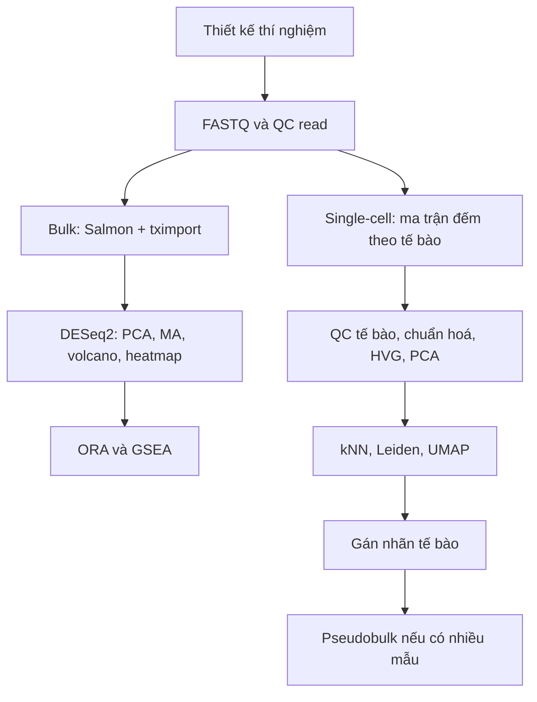

Phân tích RNA-seq là một chuỗi quyết định nối tiếp nhau: bao nhiêu mẫu lặp, loại thư viện nào, định lượng bằng căn chỉnh hay bằng Salmon, kiểm định bằng DESeq2 với công thức thiết kế nào, diễn giải bằng ORA hay GSEA. Với single-cell, thêm cả quy trình Scanpy từ QC đến gán nhãn tế bào. Quyết định đầu tiên thường nặng ký nhất. Trong một thí nghiệm có 48 mẫu lặp mỗi điều kiện, khi chỉ giữ 3 mẫu lặp, 9 trong 11 công cụ chỉ tìm được 20–40% số gen khác biệt mà bộ dữ liệu đầy đủ tìm ra (Schurch et al., 2016).

Bài đi theo đúng thứ tự quyết định của một dự án và chỉ rõ chỗ khuyến nghị đã đổi giữa hướng dẫn năm 2019 và năm 2023, như chuyển từ Louvain sang Leiden, từ kiểm định từng tế bào sang pseudobulk. Người đọc chính là sinh viên, học viên sắp làm luận văn có dữ liệu RNA-seq, và người làm wet-lab cần đọc đúng bảng DESeq2 hay hình UMAP. Cuối bài có quy trình tái phân tích hai bộ dữ liệu công khai (ung thư gan GSE94660 và PBMC 3k) cùng một checklist 12 dòng.

<div class="callout callout-note">
<p class="callout-title">Tóm tắt nhanh</p>

- Thiết kế quyết định phần lớn chất lượng: nên có ít nhất 6 mẫu lặp sinh học và không để lô trùng với điều kiện so sánh (Schurch et al., 2016; Leek et al., 2010).
- DESeq2 cần số đếm thô hoặc số đếm ước lượng (Salmon + tximport), không nhận bảng RPKM/FPKM/TPM (Love et al., 2014).
- Muốn kết luận "thay đổi hơn 2 lần" thì kiểm định thẳng ngưỡng bằng `lfcThreshold = 1`, không lọc |log2FC| > 1 sau kiểm định.
- Kết quả ORA phụ thuộc vào nền gen; GSEA phụ thuộc vào kiểu hoán vị và thống kê dùng để xếp hạng.
- Single-cell: QC theo từng mẫu, Leiden ở nhiều độ phân giải, UMAP chỉ để nhìn, so sánh giữa điều kiện bằng pseudobulk theo mẫu (Heumos et al., 2023).

</div>

## 1. RNA-seq là gì: một câu hỏi, hai độ phân giải

RNA-seq (RNA sequencing) đo lượng RNA của mỗi gen trong mẫu bằng cách chuyển RNA thành cDNA, giải trình tự hàng chục triệu đoạn ngắn rồi đếm xem bao nhiêu đoạn thuộc về mỗi gen. Lượng RNA phản ánh bước phiên mã, tầng đầu tiên của dòng thông tin từ DNA đến protein (xem phiên mã và dịch mã).

**Bulk RNA-seq** nghiền cả mẫu mô và đo trung bình biểu hiện của hàng triệu tế bào. **Single-cell RNA-seq** (scRNA-seq) gắn mã vạch cho từng tế bào nên đo được biểu hiện của từng tế bào riêng, đổi lại dữ liệu thưa hơn và nhiễu hơn nhiều, ma trận đếm có rất nhiều giá trị bằng 0 (Luecken & Theis, 2019). Hai cách đo trả lời hai câu hỏi khác nhau. Bulk hỏi "trong mô khối u, gen nào và chương trình chức năng nào thay đổi so với mô lành?". Single-cell hỏi "mẫu này gồm những loại tế bào nào, và mỗi loại biểu hiện gì?".

Bài dùng hai câu hỏi ví dụ. Câu thứ nhất: trong ung thư biểu mô tế bào gan (hepatocellular carcinoma, HCC), gen và chương trình chức năng nào khác giữa mô u và mô gan không u của cùng bệnh nhân? Câu thứ hai: tế bào đơn nhân máu ngoại vi (peripheral blood mononuclear cells, PBMC) của một người gồm những nhóm nào? Hình 1 tóm tắt hai nhánh phân tích.


*Hình 1. Hai nhánh của một dự án RNA-seq: nhánh bulk (C → F) và nhánh single-cell (D → J) dùng chung bước thiết kế và QC read.*

Phạm vi của bài: bulk RNA-seq poly(A) ở người, phân tích ở mức gen, hai điều kiện ghép cặp; single-cell dạng droplet với một mẫu. Isoform, splicing, gen dung hợp (fusion) và RNA nhỏ nằm ngoài phạm vi (Conesa et al., 2016). Nền thống kê (phân phối nhị thức âm, p-value, FDR) được trình bày trong [bài toán và thống kê cho sinh học](/blog/toan-va-thong-ke-cho-sinh-hoc/); bài này chỉ nhắc lại khi cần.

Các mục đi theo thứ tự quyết định. Mục 2 và 3 nói về những gì phải chốt trước khi có bảng số đếm; mục 4 và 5 về kiểm định và diễn giải; mục 6 về single-cell; mục 7 là quy trình để bạn tự chạy lại trên dữ liệu công khai. Nếu bạn định đưa phân tích vào hồ sơ năng lực, mục 7 có thể trở thành một repo hoàn chỉnh (xem bài về dự án portfolio), và làm đúng một tầng omics là bước cần có trước khi tích hợp nhiều tầng (xem [bài về đa omics](/blog/epigenomics-metagenomics-va-da-omics/)).

## 2. Thiết kế thí nghiệm: quyết định trước khi giải trình tự

### 2.1. Cần bao nhiêu mẫu lặp sinh học?

Mẫu lặp sinh học (biological replicate) là các cá thể, bệnh nhân hay mẻ nuôi cấy độc lập; mẫu lặp kỹ thuật (technical replicate) là cùng một mẫu RNA được làm thư viện hoặc giải trình tự lại. Số mẫu lặp sinh học cần thiết phụ thuộc vào biến thiên kỹ thuật, biến thiên sinh học và power thống kê mong muốn (Conesa et al., 2016).

Bằng chứng thực nghiệm rõ nhất đến từ Schurch et al. (2016). Nhóm tác giả giải trình tự 48 mẫu lặp sinh học cho mỗi điều kiện ở nấm men, loại các mẫu kém chất lượng, rồi coi kết quả trên bộ "sạch" 42 mẫu lặp là chuẩn để so sánh. Khi rút ngẫu nhiên chỉ 3 mẫu lặp, 9 trong 11 công cụ tìm được 20–40% số gen khác biệt so với bộ đầy đủ. Tỷ lệ này vượt 85% với các gen thay đổi trên 4 lần, nghĩa là 3 mẫu lặp đủ để thấy thay đổi lớn nhưng bỏ sót phần lớn thay đổi nhỏ. Muốn tìm hơn 85% số gen khác biệt ở mọi mức fold change cần hơn 20 mẫu lặp. Khuyến nghị của nhóm tác giả: ít nhất 6 mẫu lặp, và ít nhất 12 khi cần bắt được gen ở mọi mức thay đổi. Với dưới 12 mẫu lặp, edgeR và DESeq2 cho cân bằng giữa dương tính thật và dương tính giả tốt nhất.

3 mẫu lặp vẫn là mức thường gặp. DESeq2 được thiết kế để chạy được với 2–3 mẫu lặp nhờ mượn thông tin giữa các gen khi ước lượng độ phân tán (Love et al., 2014), nhưng "chạy được" khác với "đủ power". Thí nghiệm của Schurch lại dùng nấm men đồng nhất di truyền, nuôi trong điều kiện phòng thí nghiệm. Mẫu mô người có biến thiên sinh học lớn hơn nhiều, nên con số 6 nên được hiểu là mức sàn chứ không phải mức đủ.

<div class="callout callout-warning">
<p class="callout-title">Quy tắc "n ≥ 30" không áp dụng cho omics</p>

Con số 30 đến từ xấp xỉ phân phối của trung bình mẫu, không phải từ tính toán power cho hàng chục nghìn gen kiểm định cùng lúc. Với RNA-seq, số mẫu lặp cần thiết phụ thuộc độ phân tán của từng gen và mức fold change bạn muốn phát hiện. Xem thêm [bài về p-value, FDR và nhị thức âm](/blog/toan-va-thong-ke-cho-sinh-hoc/).

</div>

### 2.2. Hiệu ứng lô

Hiệu ứng lô (batch effect) là khác biệt do điều kiện xử lý: ngày tách RNA, lô hoá chất, người làm, lần chạy máy. Leek et al. (2010) cho thấy hiệu ứng lô phổ biến trong dữ liệu thông lượng cao và trở thành vấn đề nghiêm trọng khi nó trùng với biến kết cục. Khi buộc phải xử lý nhiều lô, Conesa et al. (2016) khuyên có mẫu đối chứng, xử lý mẫu theo thứ tự ngẫu nhiên và phân bố mẫu của mỗi điều kiện đều giữa các lô.

Nếu toàn bộ mẫu u được tách RNA vào tuần 1 và toàn bộ mẫu lành vào tuần 2, lô và điều kiện trùng nhau hoàn toàn (confounded). Không mô hình thống kê nào tách được hai thứ này, vì dữ liệu không chứa thông tin để tách. Lỗi thiết kế kiểu này không sửa được ở bước phân tích.

Một ví dụ cụ thể: bạn có 6 bệnh nhân, mỗi người một mẫu u và một mẫu lành, nhưng mỗi ngày chỉ tách được 6 mẫu. Cách xếp tệ nhất là 6 mẫu u ngày 1, 6 mẫu lành ngày 2. Cách tốt hơn là xếp 3 bệnh nhân ngày 1, 3 bệnh nhân ngày 2, và giữ cả hai mẫu của một người trong cùng một ngày. Khi đó mỗi lô có đủ hai điều kiện, và vì lô lồng trong bệnh nhân, biến `patient` trong công thức `~ patient + condition` (mục 4.2) hấp thụ luôn khác biệt giữa hai ngày. Ghi ngày xử lý của từng mẫu vào bảng mẫu ngay từ đầu, kể cả khi bạn nghĩ sẽ không cần đến.

### 2.3. Loại thư viện: poly(A) hay ribo-depletion, stranded hay không

rRNA thường chiếm hơn 90% RNA tổng số, còn mRNA chỉ khoảng 1–2% (Conesa et al., 2016). Nếu giải trình tự thẳng, phần lớn read sẽ rơi vào rRNA. Có hai cách làm giàu: chọn mRNA có đuôi poly(A) bằng oligo-dT, hoặc loại rRNA (ribo-depletion).

Poly(A) cần RNA ít bị phân huỷ, tức chỉ số RIN (RNA integrity number) cao. Mẫu sinh thiết nhỏ, mẫu khó lấy và mẫu vi khuẩn (mRNA không có đuôi poly(A)) nên dùng ribo-depletion (Conesa et al., 2016). Poly(A) cũng không bắt được transcript không có đuôi poly(A) hay mRNA đã bị phân huỷ một phần, nên không hợp với RNA từ mẫu FFPE (Zhao et al., 2014).

Thư viện có hướng (stranded) giữ thông tin read đến từ mạch nào được phiên mã, giúp định lượng transcript antisense và các gen chồng lấp nhau trên hai mạch (Conesa et al., 2016). Khi so sánh bảy quy trình tạo thư viện có hướng, phương pháp dUTP là một trong hai quy trình cho kết quả tốt nhất (Levin et al., 2010).

<div class="callout callout-example">
<p class="callout-title">Từ phòng thí nghiệm đến FASTQ</p>

Quy trình TRIzol tách **RNA tổng số**, không tách riêng mRNA; mRNA chỉ được làm giàu ở bước làm thư viện. RNA tinh sạch có tỷ số A260/A280 khoảng 2,0; dung dịch đo có tính axit làm tỷ số thấp đi 0,2–0,3 (Desjardins & Conklin, 2010). Tỷ số này phản ánh nhiễm protein hoặc phenol, không nói gì về độ nguyên vẹn của RNA. Độ nguyên vẹn đo bằng RIN trên máy điện di mao quản (Conesa et al., 2016). Ví dụ, bản ghi GEO của bộ GSE94660 ghi RIN trung bình 8,2 ± 0,7 (Yoo et al., 2017).

</div>

### 2.4. Độ sâu giải trình tự

Độ sâu tối ưu tuỳ mục tiêu. Có tác giả cho rằng khoảng 5 triệu read đã căn chỉnh đủ để định lượng gen biểu hiện trung bình và cao, trong khi có nhóm giải trình tự đến 100 triệu read để định lượng chính xác gen biểu hiện thấp (Conesa et al., 2016). Đường cong bão hoà (số gen phát hiện theo số read lấy mẫu con) cho biết thêm read có còn mang thêm thông tin hay không.

**Bảng 1. Checklist thiết kế và giá trị thực tế của GSE94660**

| Quyết định | Khuyến nghị | GSE94660 (Yoo et al., 2017) |
|---|---|---|
| Mẫu lặp sinh học | ≥ 6 mỗi nhóm; ≥ 12 nếu cần mọi mức thay đổi | 21 bệnh nhân, mỗi người 2 mẫu |
| Lô | Phân bố đều, ngẫu nhiên hoá, ghi lại biến lô | Không có biến lô trên GEO |
| Làm giàu mRNA | poly(A) nếu RIN cao; ribo-depletion nếu RNA phân huỷ, FFPE, vi khuẩn | poly(A), oligo-dT |
| Có hướng | Stranded (dUTP) nếu quan tâm antisense, gen chồng lấp | TruSeq RNA v2, không stranded |
| Chất lượng RNA | Báo cáo RIN | RIN 8,2 ± 0,7 |
| Độ sâu, kiểu đọc | Tuỳ mục tiêu; ~5 triệu read cho gen biểu hiện trung bình–cao | HiSeq 2500, paired-end 2 × 100 nt; trung vị 41,0 triệu spot mỗi run |

## 3. Từ FASTQ đến ma trận đếm

Bước kiểm tra chất lượng read (FastQC, fastp, MultiQC) giống hệt các dự án giải trình tự khác, đã trình bày trong [bài về NGS](/blog/giai-trinh-tu-the-he-moi-ngs-va-genomics/). Riêng với RNA-seq, sau bước định lượng nên kiểm tra thêm thiên lệch GC và thiên lệch theo độ dài gen (Conesa et al., 2016).

Có hai cách đi từ read đến số đếm. Cách thứ nhất là **căn chỉnh rồi đếm**: STAR (Dobin et al., 2013) hoặc HISAT2 (Kim et al., 2019) căn chỉnh read lên genome, cho phép read vắt qua mối nối exon–exon, rồi featureCounts (Liao et al., 2014) đếm số read rơi vào mỗi gen. Ưu điểm là có file BAM để mở trong IGV, kiểm tra read tại từng gen.

Cách thứ hai là **định lượng ở mức transcript mà không căn chỉnh đầy đủ**. kallisto dùng pseudoalignment: chỉ xác định read tương thích với những transcript nào, không tính vị trí căn chỉnh từng base (Bray et al., 2016). Salmon dùng mapping nhẹ kết hợp mô hình thiên lệch, và là công cụ định lượng toàn transcriptome đầu tiên hiệu chỉnh thiên lệch GC của đoạn (Patro et al., 2017). Gộp cả hai dưới cái tên "giả căn chỉnh" là chưa chính xác. Srivastava et al. (2020) cho thấy cách căn chỉnh hay mapping ảnh hưởng đáng kể đến ước lượng transcript và kết quả biểu hiện khác biệt; chế độ selective alignment của Salmon ra đời để giảm mapping sai.

Hai chi tiết thực hành theo tài liệu của Salmon (Salmon developers, n.d.): hiệu chỉnh GC **không bật mặc định**, phải thêm `--gcBias`; và nên dựng index có **decoy** (chuỗi genome) để read từ vùng genome chưa chú giải không bị gán nhầm vào transcript.

```bash
# Index có decoy: nối transcriptome với genome, liệt kê tên chuỗi genome làm decoy
grep "^>" genome.fa | cut -d " " -f 1 | sed 's/>//' > decoys.txt
cat transcripts.fa genome.fa > gentrome.fa
salmon index -t gentrome.fa -d decoys.txt -i salmon_index -k 31

# Định lượng một mẫu paired-end; -l A để Salmon tự đoán loại thư viện
salmon quant -i salmon_index -l A -1 S1_R1.fastq.gz -2 S1_R2.fastq.gz \
    --validateMappings --gcBias -p 8 -o quant/S1
```

Salmon cho ước lượng ở mức transcript, nhưng câu hỏi thường ở mức gen. tximport gộp ước lượng transcript thành số đếm mức gen. Soneson et al. (2016) chỉ ra ước lượng và suy luận ở mức gen có lợi về hiệu năng và dễ diễn giải hơn mức transcript. Khi các mẫu dùng isoform khác nhau, ma trận đếm gộp đơn giản có thể làm FDR tăng; dùng offset tính từ ước lượng mức transcript khắc phục được điều này.

**Bảng 2. Căn chỉnh rồi đếm so với định lượng mức transcript**

| Tiêu chí | STAR/HISAT2 + featureCounts | Salmon/kallisto + tximport |
|---|---|---|
| Đầu ra chính | BAM + bảng số đếm mức gen | Ước lượng mức transcript, gộp thành mức gen |
| Xem read trong IGV | Có | Không (trừ khi xuất thêm) |
| Hiệu chỉnh thiên lệch | Không có sẵn trong bước đếm | Salmon: GC, vị trí, chuỗi (`--gcBias` phải bật) |
| Mức transcript | Cần thêm công cụ | Có sẵn |
| Dùng tiếp cho | Đột biến, splicing, kiểm tra trực quan | Biểu hiện khác biệt mức gen, mức transcript |

Một cạm bẫy hay gặp khi tái phân tích dữ liệu công khai: bảng đã xử lý trên GEO thường không phải số đếm. GSE94660 chỉ có bảng "RPKM_normalized" (Yoo et al., 2017); GSE124535, bộ 35 cặp HCC của Jiang et al. (2019), theo mô tả GEO chỉ cung cấp FPKM từ TopHat/Cufflinks. DESeq2 cần số đếm chưa chuẩn hoá hoặc số đếm ước lượng (Love et al., 2014), nên phải chạy lại từ FASTQ. Bảng RPKM/FPKM chỉ dùng để đối chiếu chiều thay đổi. Nếu không muốn tự nối từng công cụ, nf-core/rnaseq chạy toàn bộ chuỗi này với báo cáo QC (xem bài về quy trình tái lập).

<div class="callout callout-warning">
<p class="callout-title">Lỗi hay gặp ở bước định lượng</p>

- Đưa bảng TPM của Salmon vào DESeq2 như thể đó là số đếm. Hãy để tximport tạo đối tượng đầu vào, hoặc dùng số đếm ước lượng kèm offset (Soneson et al., 2016).
- Index Salmon dựng từ một phiên bản transcriptome, còn bảng nối transcript với gen (tx2gene) lấy từ phiên bản khác. Nhiều transcript không khớp tên, và gen tương ứng biến mất khỏi kết quả mà không có lỗi nào được báo.
- Quên `--gcBias` hoặc dựng index không có decoy, rồi không ghi lại trong phần phương pháp.
- Không xem tỷ lệ read được map của từng mẫu trong báo cáo MultiQC trước khi chạy DESeq2. Một mẫu có tỷ lệ map thấp bất thường cần được xem lại trước, không phải sau khi nó đã kéo lệch PCA.

</div>

## 4. Biểu hiện khác biệt với DESeq2 và bốn hình chuẩn

### 4.1. DESeq2 làm gì

DESeq2 khớp một mô hình tuyến tính tổng quát (GLM) với phân phối nhị thức âm cho từng gen. Vì mỗi gen chỉ có vài mẫu, độ phân tán (dispersion) và log2 fold change (LFC) được "co" về phía xu hướng chung của mọi gen, giúp ước lượng ổn định khi chỉ có 2–3 mẫu lặp (Love et al., 2014). Mỗi gen có một p-value Wald. Gen có số đếm trung bình quá thấp bị loại bởi bước lọc độc lập (independent filtering), và p-value của các gen còn lại được hiệu chỉnh theo Benjamini–Hochberg thành `padj` (Benjamini & Hochberg, 1995; Love et al., 2014).

### 4.2. Công thức thiết kế cho mẫu ghép cặp

Công thức thiết kế (design formula) cho DESeq2 biết biến nào giải thích biến thiên. Ví dụ quen thuộc là `~ batch + condition`. Với GSE94660 không có biến lô, nhưng mỗi bệnh nhân đóng góp một mẫu u và một mẫu không u. Công thức hợp lý là `~ patient + condition`: hệ số `condition` khi đó đo khác biệt u – không u **trong cùng một người**, loại bỏ khác biệt nền giữa các bệnh nhân. Biến quan tâm đặt cuối công thức.

Mức tham chiếu của một factor trong R mặc định theo thứ tự chữ cái. "normal" đứng trước "tumor" nên tình cờ đúng, nhưng chỉ cần đổi tên thành "non_tumor" là chiều của log2FC đảo ngược. Hãy đặt rõ bằng `relevel()` (Love et al., n.d.).

### 4.3. Lọc gen biểu hiện thấp

Lọc trước khi chạy DESeq2 không bắt buộc. Vignette DESeq2 lấy ví dụ giữ gen có ít nhất 10 read ở số mẫu bằng cỡ nhóm nhỏ nhất (Love et al., n.d.). Bước này chủ yếu giảm bộ nhớ và thời gian; kiểm soát FDR đã có independent filtering lo (Love et al., 2014).

### 4.4. Shrinkage và kiểm định có ngưỡng

Đoạn code dưới đây đã chạy thử trên DESeq2 1.46.0 và apeglm 1.28.0, với dữ liệu mô phỏng 6 bệnh nhân × 2 loại mô.

```r
library(DESeq2)
# counts_mat: ma trận số đếm (gen x mẫu); coldata: bảng mẫu có cột patient, condition
coldata$condition <- relevel(factor(coldata$condition), ref = "normal")
dds <- DESeqDataSetFromMatrix(countData = counts_mat, colData = coldata,
                              design = ~ patient + condition)
keep <- rowSums(counts(dds) >= 10) >= 6       # 6 = cỡ nhóm nhỏ nhất
dds  <- dds[keep, ]
dds  <- DESeq(dds)
resultsNames(dds)                               # kiểm tra tên hệ số

# Kiểm định H0: LFC = 0 (dùng để báo cáo p-value)
res     <- results(dds, name = "condition_tumor_vs_normal", alpha = 0.05)
# Kiểm định H0: |LFC| <= 1 (dùng khi kết luận "thay đổi hơn 2 lần")
res_thr <- results(dds, name = "condition_tumor_vs_normal", alpha = 0.05,
                   lfcThreshold = 1, altHypothesis = "greaterAbs")
# LFC đã co (dùng để vẽ hình và xếp hạng), cần gói apeglm
res_shr <- lfcShrink(dds, coef = "condition_tumor_vs_normal", type = "apeglm")
```

Ba đối tượng có ba vai trò. `lfcShrink` chỉ thay đổi log2FC và sai số chuẩn, không thay đổi p-value; trên dữ liệu thử, cột `pvalue` của `res_shr` trùng với `res`. Vì vậy đừng gán đè `res` bằng kết quả shrink: giữ `res` để báo cáo kiểm định, `res_shr` để vẽ hình và xếp hạng. apeglm dùng prior đuôi nặng (Cauchy), giảm nhiễu ở gen số đếm thấp mà vẫn giữ những khác biệt lớn thật sự (Zhu et al., 2019).

Chỗ quan trọng hơn là câu hỏi thống kê. Lệnh `subset(res, padj < 0.05 & abs(log2FoldChange) > 1)` kiểm định giả thuyết H0: LFC = 0, rồi mới lọc theo độ lớn ước lượng. Một gen có LFC thật là 0,8 nhưng ước lượng nhiễu ra 1,2 vẫn lọt qua. Muốn kết luận "thay đổi hơn 2 lần" có kiểm soát FDR, hãy kiểm định thẳng H0: |LFC| ≤ 1 bằng `lfcThreshold = 1` (Love et al., 2014). Ý tưởng này tương tự TREAT của McCarthy và Smyth (2009) cho microarray.


*Hình 2. Mô phỏng 10.000 gen (3.000 gen có LFC thật theo phân phối chuẩn, sai số chuẩn 0,15–0,6). Lọc |LFC| > 1 sau kiểm định gọi 812 gen, trong đó 146 gen thật ra thay đổi không quá 2 lần. Kiểm định có ngưỡng gọi 116 gen và không gen nào thuộc loại này. Dữ liệu mô phỏng, không phải kết quả thực nghiệm.*

Hình 2 cho thấy cái giá của mỗi lựa chọn. Lọc sau kiểm định cho danh sách dài hơn nhiều, nhưng khoảng 18% số gen trong đó không thật sự thay đổi quá 2 lần. Kiểm định có ngưỡng chặt hơn hẳn: nó chỉ gọi gen mà dữ liệu đủ chắc chắn rằng LFC vượt ngưỡng, nên bỏ sót nhiều gen thật. Không có lựa chọn "đúng" cho mọi trường hợp; điều bắt buộc là phần phương pháp nói rõ đã kiểm định giả thuyết nào.

### 4.5. Bốn hình chuẩn

Mỗi hình trả lời một câu hỏi khác nhau (nguyên tắc chọn hình xem [bài về trực quan hoá](/blog/share-data-through-the-art-of-visualization/)).

**PCA** trên dữ liệu đã biến đổi ổn định phương sai (`vst`, mặc định `blind = TRUE`) trả lời: mẫu có tách theo điều kiện không, theo bệnh nhân không, có mẫu ngoại lai không? Với dữ liệu ghép cặp, nối hai mẫu của cùng bệnh nhân bằng một đoạn thẳng giúp thấy ngay hiệu ứng bệnh nhân. Biến đổi `vst` hay `rlog` chỉ dùng để trực quan hoá và phân cụm; suy luận vẫn dùng số đếm thô (Love et al., 2014).

**MA plot** đặt log2FC theo số đếm trung bình. So hai phiên bản chưa shrink và đã shrink sẽ thấy gen số đếm thấp có log2FC lớn giả tạo bị kéo về gần 0.

**Volcano plot** đặt log2FC (đã shrink) trên trục x và −log10(padj) trên trục y. Gen ở hai góc trên vừa có ý nghĩa thống kê vừa có hiệu ứng ước lượng lớn. Điều đó chưa có nghĩa là gen "quan trọng" về sinh học; tầm quan trọng sinh học cần bằng chứng khác.

**Heatmap** 50 gen dùng giá trị VST chuẩn hoá theo hàng (z-score). Ghi rõ cách chọn 50 gen (theo padj nhỏ nhất hay theo |LFC| lớn nhất), vì hai cách cho hai danh sách khác nhau. Workflow RNA-seq của Bioconductor là tài liệu đối chiếu tốt cho cả bốn hình (Love et al., 2016).

Bốn hình nên được đọc theo một thứ tự cố định. Xem PCA **trước** khi đọc bảng kết quả: nếu một mẫu nằm tách hẳn khỏi mọi mẫu khác, hoặc mẫu u của bệnh nhân A nằm giữa nhóm mẫu lành, hãy kiểm tra khả năng nhầm nhãn mẫu hay lỗi kỹ thuật trước khi tin vào danh sách gen. Nếu PC1 tách theo bệnh nhân mạnh hơn theo điều kiện, đó là dấu hiệu công thức ghép cặp sẽ có ích. MA plot tiếp theo cho biết shrinkage có làm việc đúng không. Volcano và heatmap đến sau cùng, khi bạn đã tin vào dữ liệu.

## 5. Phân tích làm giàu chức năng: ORA, GSEA và các thiên lệch

### 5.1. ORA và vấn đề nền gen

Phân tích quá đại diện (over-representation analysis, ORA) hỏi: trong danh sách gen có ý nghĩa, một nhóm gen (một GO term, một pathway KEGG) có xuất hiện nhiều hơn mức ngẫu nhiên không? Phép kiểm định thường dùng là siêu bội (hypergeometric) hay Fisher chính xác.

Kết quả phụ thuộc mạnh vào **nền gen (background)**, tức tập gen được coi là "có thể được chọn". Wijesooriya et al. (2022) khảo sát 186 bài báo truy cập mở và thấy 95% phân tích ORA không dùng nền phù hợp hoặc không mô tả nền, còn 43% không hiệu chỉnh kiểm định nhiều lần. Với RNA-seq, nền đúng là các gen **được đo và qua lọc**, không phải toàn bộ genome: một gen không biểu hiện trong mô không bao giờ có thể xuất hiện trong danh sách khác biệt.

Ví dụ giả định dưới đây cho thấy nền làm thay đổi p-value ra sao. Một bộ gen 200 gen, đều biểu hiện trong mô nên đều qua lọc; 1.000 gen có ý nghĩa được chọn từ 12.000 gen qua lọc, 30 trong số đó thuộc bộ gen.

```python
from scipy.stats import hypergeom

# Ví dụ giả định: bộ gen 200 gen, đều qua lọc; 1.000 gen có ý nghĩa, 30 gen thuộc bộ gen
k, n_set, n_de = 30, 200, 1000
for ten_nen, N in [("toàn genome", 20000), ("gen qua lọc", 12000)]:
    p = hypergeom.sf(k - 1, N, n_set, n_de)   # P(X >= k)
    ky_vong = n_set * n_de / N
    print(f"Nền {ten_nen:12s} N = {N:6d}  kỳ vọng = {ky_vong:5.1f}  p = {p:.2g}")
# Nền toàn genome  N =  20000  kỳ vọng =  10.0  p = 7.1e-08
# Nền gen qua lọc  N =  12000  kỳ vọng =  16.7  p = 0.0011
```

Cùng 30 gen, nền toàn genome cho p = 7,1 × 10⁻⁸; nền gen qua lọc cho p = 0,0011. Nền sai làm số gen kỳ vọng thấp đi (10 thay vì 16,7), nên mọi nhóm gen biểu hiện trong mô đều trông "giàu" hơn thực tế.

Nguồn thiên lệch thứ hai là độ dài gen. Với cùng mức thay đổi, transcript dài và biểu hiện cao có nhiều read hơn nên dễ đạt ý nghĩa thống kê hơn; nhóm gen gồm nhiều gen dài vì thế dễ "giàu" hơn. GOseq hiệu chỉnh thiên lệch này (Young et al., 2010). Timmons et al. (2015) cảnh báo nhiều nguồn thiên lệch như vậy cùng lúc làm sai lệch phân tích làm giàu khi dùng để "xác nhận" kết quả omics.

Một ví dụ làm đúng từ proteomics: Dong et al. (2022) phân tích protein túi ngoại bào nhỏ trong huyết tương bệnh nhân HCC và dùng tổng số protein đã định lượng làm nền cho phân tích làm giàu (xem thêm bài tổng hợp về protein exosome ung thư gan).

### 5.2. GSEA

Phân tích làm giàu bộ gen (gene set enrichment analysis, GSEA) không cần ngưỡng. Mọi gen được xếp hạng theo mức liên quan với kiểu hình, rồi GSEA hỏi các gen của một bộ có dồn về đầu hay cuối danh sách không. Điểm làm giàu (enrichment score, ES) là độ lệch cực đại của một tổng chạy có trọng số, giống thống kê Kolmogorov–Smirnov; điểm chuẩn hoá (NES) điều chỉnh theo kích thước bộ gen; nhóm **leading edge** là các gen đóng góp chính vào ES (Subramanian et al., 2005).

Kiểu hoán vị quyết định ý nghĩa của p-value. GSEA gốc hoán vị **nhãn kiểu hình** của mẫu, giữ nguyên tương quan giữa các gen. Hoán vị **gen** bỏ qua tương quan đó và có xu hướng đánh giá quá cao ý nghĩa (Subramanian et al., 2005). Các công cụ GSEA dạng preranked như fgsea (Korotkevich et al., 2016) hay `GSEA()` của clusterProfiler (Yu et al., 2012; Wu et al., 2021) nhận vào một danh sách đã xếp hạng, nên chỉ hoán vị được bộ gen. Phần phương pháp cần nói rõ điều này.

Ngưỡng FDR ≤ 0,25 hay gặp là ngưỡng báo cáo mà bài GSEA gốc chọn vì mục tiêu là sinh giả thuyết (Subramanian et al., 2005), không phải chuẩn chung cho mọi phân tích. Đầu vào xếp hạng cho fgsea thường là thống kê Wald (`stat`) hoặc log2FC đã shrink; hai lựa chọn cho thứ hạng khác nhau nên phải ghi rõ.

Đọc kết quả GSEA cũng cần nhớ chiều so sánh. Với mức tham chiếu là mô lành, NES dương nghĩa là gen của bộ dồn về phía biểu hiện cao hơn ở mô u; đổi mức tham chiếu thì dấu của NES đổi theo. Danh sách leading edge thường hữu ích hơn bản thân NES: nó cho biết những gen nào thật sự tạo nên tín hiệu, và đó là các gen nên xem lại trên heatmap hay chọn để xác nhận bằng qPCR.

### 5.3. Bộ gen Hallmark

MSigDB phiên bản 1.0 đi kèm bài GSEA có 1.325 bộ gen (Subramanian et al., 2005). Bộ Hallmark gồm 50 bộ gen tinh lọc, tổng hợp từ 4.022 trong 8.380 bộ gen gốc của MSigDB nhằm giảm trùng lặp (Liberzon et al., 2015). Ít bộ hơn nghĩa là ít kiểm định hơn và kết quả dễ đọc hơn. Hãy ghi phiên bản MSigDB đã tải, vì nội dung bộ gen thay đổi giữa các phiên bản.

### 5.4. Công cụ

Trong R: clusterProfiler cho ORA và GSEA (Yu et al., 2012; Wu et al., 2021), fgsea cho GSEA preranked nhanh (Korotkevich et al., 2016). Trên web: g:Profiler (Kolberg et al., 2023) và Enrichr (Kuleshov et al., 2016). Với công cụ web, kiểm tra xem có tải được nền gen riêng không.

## 6. Single-cell RNA-seq: quy trình chuẩn và những gì đã thay đổi

Hai mốc tham chiếu cho phần này là hướng dẫn của Luecken và Theis (2019) và bản cập nhật của Heumos et al. (2023). Scanpy (Wolf et al., 2018) là bộ công cụ Python phổ biến; người dùng R có Seurat (Hao et al., 2024) và hệ sinh thái Bioconductor (Amezquita et al., 2020).

### 6.1. Từ giọt đến ma trận đếm

Hệ thống droplet của 10x Genomics bọc từng tế bào vào một giọt có hạt mang mã vạch, rồi đếm đầu 3' của mRNA. Bài báo nền tảng của Zheng et al. (2017) báo cáo tỷ lệ bắt giữ tế bào khoảng 50% và công bố bộ 68 nghìn PBMC. Mỗi phân tử được gắn một mã định danh phân tử (UMI) để loại bản sao PCR. Định lượng thường dùng Cell Ranger của 10x Genomics hoặc alevin-fry (He et al., 2022). Một "barcode" trong ma trận chưa chắc là một tế bào: nó có thể là giọt rỗng chỉ chứa RNA môi trường, hoặc một doublet gồm hai tế bào (Luecken & Theis, 2019).

### 6.2. QC tế bào

Ba chỉ số QC cơ bản là tổng số đếm mỗi barcode, số gen phát hiện mỗi barcode và tỷ lệ số đếm từ gen ty thể (Luecken & Theis, 2019). Tế bào vỡ mất mRNA tế bào chất nhưng giữ mRNA trong ty thể, nên tỷ lệ ty thể cao là dấu hiệu tế bào chất lượng thấp. Ba chỉ số nên được xem chung và đặt ngưỡng càng rộng càng tốt, để không loại nhầm một quần thể sống có đặc điểm khác thường (Luecken & Theis, 2019). Bản 2023 khuyến nghị đặt ngưỡng thủ công hoặc ngưỡng tự động theo số lần độ lệch tuyệt đối trung vị (MAD), **tính theo từng mẫu** (Heumos et al., 2023).

Ngưỡng ty thể 5% là mặc định lâu đời, nhưng tỷ lệ ty thể ở mô người cao hơn ở chuột; Osorio và Cai (2021) đề xuất giá trị tham chiếu cho 44 mô người. Ngưỡng 5% dùng được cho PBMC như trong hướng dẫn Scanpy, nhưng với mô khác nên tra giá trị tham chiếu của mô đó trước khi áp, để không loại oan cả một quần thể tế bào khoẻ mạnh.

Doublet chiếm vài phần trăm số barcode trong đa số thí nghiệm (Wolock et al., 2019). Scrublet (Wolock et al., 2019) và scDblFinder (Germain et al., 2022) phát hiện doublet bằng cách tạo doublet nhân tạo rồi so sánh; scDblFinder được các benchmark đánh giá cao (Heumos et al., 2023). RNA môi trường (ambient RNA) từ tế bào vỡ có thể làm gen đánh dấu của một loại tế bào xuất hiện ở loại khác (Heumos et al., 2023).

### 6.3. Chuẩn hoá, gen biến thiên cao và PCA

Chuẩn hoá đưa các tế bào có độ sâu khác nhau về cùng thang. Năm 2019, Luecken và Theis khuyến nghị scran; cách đơn giản hơn là chuẩn hoá theo tổng số đếm rồi lấy log(x + 1), vẫn chấp nhận được với dữ liệu như PBMC 3k nếu ghi rõ. Sau đó chọn khoảng 1.000–5.000 gen biến thiên cao (highly variable genes, HVG) tuỳ độ phức tạp của dữ liệu (Luecken & Theis, 2019), rồi giảm chiều bằng PCA.

### 6.4. Tích hợp nhiều mẫu

Khi có nhiều mẫu hay nhiều lô, cần tích hợp để tế bào cùng loại từ các mẫu khác nhau nằm cạnh nhau. Harmony (Korsunsky et al., 2019) và scVI (Lopez et al., 2018) là hai lựa chọn phổ biến. Một benchmark 68 tổ hợp phương pháp trên 85 lô dữ liệu cho thấy chọn HVG trước giúp tích hợp tốt hơn, và scANVI, Scanorama, scVI, scGen làm tốt ở các bài toán phức tạp (Luecken et al., 2022). PBMC 3k chỉ có một mẫu nên bỏ qua bước này.

### 6.5. Phân cụm và UMAP

Tế bào được nối thành đồ thị k láng giềng gần nhất (kNN) trong không gian PCA, rồi phân cụm bằng thuật toán phát hiện cộng đồng. Năm 2019 khuyến nghị Louvain (Luecken & Theis, 2019). Traag et al. (2019) chỉ ra Louvain có thể tạo cụm kết nối kém: trong thử nghiệm của họ, tới 25% cụm kết nối kém và tới 16% cụm thậm chí rời rạc. Thuật toán Leiden đảm bảo cụm liên thông và chạy nhanh hơn. Bản 2023 khuyến nghị Leiden và chạy ở nhiều độ phân giải (Heumos et al., 2023), vì số cụm phụ thuộc trực tiếp vào tham số này. Không có độ phân giải "đúng": chạy vài giá trị (ví dụ 0,4, 0,7 và 1,0) rồi xem cụm nào tách ra, cụm nào giữ nguyên. Một cụm chỉ xuất hiện ở một giá trị và một seed duy nhất cần thêm bằng chứng trước khi được đặt tên.

UMAP (McInnes et al., 2018) chiếu dữ liệu xuống hai chiều để nhìn. Chari và Pachter (2023) cho thấy giảm từ hàng nghìn chiều xuống 2 chiều tất yếu làm méo khoảng cách. Khoảng cách giữa hai cụm trên UMAP, kích thước cụm hay hình dạng "dải" không đo được điều gì; kết luận không được dựa chỉ trên hình 2D (Heumos et al., 2023).

### 6.6. Gán nhãn tế bào

Bản 2023 khuyến nghị ba bước: gán nhãn tự động, chuyên gia gán nhãn thủ công bằng gen đánh dấu, rồi kiểm chứng (Heumos et al., 2023). CellTypist là công cụ gán nhãn tự động dựa trên machine learning, huấn luyện trên tế bào miễn dịch từ nhiều mô (Domínguez Conde et al., 2022). Kết quả của bất kỳ bộ phân loại có sẵn nào cũng phụ thuộc nhiều vào loại mô hình và dữ liệu huấn luyện (Heumos et al., 2023).

### 6.7. Biểu hiện khác biệt: gen đánh dấu và so sánh giữa điều kiện

Có hai câu hỏi khác nhau dưới cùng cái tên "biểu hiện khác biệt". Câu thứ nhất là gen đánh dấu: gen nào phân biệt cụm này với các cụm khác? Ở đây có cái bẫy "nhúng hai lần" (double dipping): kiểm định trên chính dữ liệu vừa dùng để phân cụm cho p-value thấp giả tạo, vì thuật toán phân cụm đã "ép" các nhóm tách nhau (Zhang et al., 2019). p-value của gen đánh dấu chỉ nên dùng để xếp hạng.

Câu thứ hai là so sánh giữa điều kiện: trong tế bào T CD4, gen nào khác giữa người bệnh và người khoẻ? Năm 2019, Luecken và Theis khuyến nghị MAST hoặc limma. Năm 2021, Squair et al. so sánh 14 phương pháp trên 18 bộ dữ liệu có chuẩn đối chiếu và thấy cả 6 phương pháp tốt nhất đều gộp tế bào theo mẫu lặp sinh học, tức **pseudobulk**. Các phương pháp phổ biến nhất, coi từng tế bào là một quan sát độc lập, có thể "phát hiện" hàng trăm gen khác biệt khi không có khác biệt sinh học nào. Bản 2023 kết luận pseudoreplication làm tăng FDR, và pseudobulk dạng tổng cùng mô hình hỗn hợp tốt hơn Wilcoxon (Heumos et al., 2023). Khung muscat thực hiện pseudobulk theo từng loại tế bào (Crowell et al., 2020).


*Hình 3. Mô phỏng 1.000 gen, 3 người hiến mỗi điều kiện, 200 tế bào mỗi người; giữa các người hiến có biến thiên ngẫu nhiên nhưng không có khác biệt giữa hai điều kiện. Kiểm định từng tế bào cho 70,5% gen có p < 0,05; pseudobulk cho 5,3%. Cho đơn giản, mô phỏng lấy trung bình theo người hiến; trong thực tế pseudobulk cộng số đếm rồi dùng DESeq2 hoặc edgeR. Dữ liệu mô phỏng.*

Hình 3 cho thấy lý do. Khi coi 600 tế bào mỗi bên là 600 quan sát độc lập, kiểm định nhầm khác biệt giữa người hiến thành khác biệt giữa điều kiện. Đơn vị độc lập thật là người hiến: mỗi bên chỉ có 3. Pseudobulk đưa phân tích về đúng đơn vị đó, và tỷ lệ dương tính giả trở về quanh mức 5% kỳ vọng.

### 6.8. Phân tích hạ nguồn khác

Suy luận quỹ đạo (trajectory) và giao tiếp tế bào bằng CellChat (Jin et al., 2021) là các bước thường gặp sau gán nhãn. Luecken và Theis (2019) lưu ý quỹ đạo suy ra từ dữ liệu chưa chắc phản ánh quá trình sinh học thật; cần bằng chứng độc lập.

**Bảng 3. Khuyến nghị năm 2019 và năm 2023**

| Bước | Luecken & Theis (2019) | Heumos et al. (2023) |
|---|---|---|
| QC | Ba chỉ số xem chung, ngưỡng rộng | Ngưỡng thủ công hoặc MAD, theo từng mẫu; doublet, ambient RNA |
| Chuẩn hoá | scran | Nhiều lựa chọn, tuỳ bước hạ nguồn |
| Phân cụm | Louvain trên đồ thị kNN | Leiden, nhiều độ phân giải |
| Trực quan hoá | UMAP | UMAP chỉ để nhìn, không kết luận từ hình 2D |
| Gán nhãn | Gen đánh dấu | Tự động → thủ công → kiểm chứng |
| DE giữa điều kiện | MAST, limma | Pseudobulk hoặc mô hình hỗn hợp |

Đoạn code Scanpy dưới đây có đủ các bước QC đã nêu (ty thể, lọc gen, doublet) và đặt seed ở mọi bước có yếu tố ngẫu nhiên. Ngưỡng 200–2.500 gen và 5% ty thể lấy theo hướng dẫn PBMC 3k của Scanpy; với dữ liệu khác, hãy thay bằng ngưỡng MAD theo từng mẫu. Code cần Scanpy 1.10 trở lên (có `sc.pp.scrublet`) cùng gói igraph. Khi chạy thử trên Scanpy 1.12.6 và anndata 0.13.4, sau QC còn 2.638 tế bào, Scrublet đánh dấu 43 barcode là doublet, và Leiden độ phân giải 0,7 cho 9 cụm thay vì 8 như trong hướng dẫn cũ. Code chỉ chấm điểm doublet, chưa loại chúng; muốn loại thì lọc theo cột `predicted_doublet`. Chênh một cụm so với hướng dẫn là ví dụ đúng cho điều mục 6.5 đã nói: số cụm phụ thuộc phiên bản phần mềm, cách cài đặt thuật toán và seed.

```python
import scanpy as sc

adata = sc.datasets.pbmc3k()
adata.var["mt"] = adata.var_names.str.startswith("MT-")
sc.pp.calculate_qc_metrics(adata, qc_vars=["mt"], percent_top=None,
                           log1p=False, inplace=True)
sc.pp.filter_cells(adata, min_genes=200)
sc.pp.filter_genes(adata, min_cells=3)
adata = adata[(adata.obs.n_genes_by_counts < 2500)
              & (adata.obs.pct_counts_mt < 5)].copy()
sc.pp.scrublet(adata, random_state=0)          # điểm doublet
adata.layers["counts"] = adata.X.copy()
sc.pp.normalize_total(adata, target_sum=1e4)
sc.pp.log1p(adata)
sc.pp.highly_variable_genes(adata, n_top_genes=2000)
sc.tl.pca(adata, n_comps=50, random_state=0)
sc.pp.neighbors(adata, n_neighbors=10, n_pcs=40, random_state=0)
sc.tl.leiden(adata, resolution=0.7, random_state=0,
             flavor="igraph", n_iterations=2, directed=False)
sc.tl.umap(adata, random_state=0)
sc.tl.rank_genes_groups(adata, "leiden", method="wilcoxon")
```

## 7. Thực hành: tái phân tích hai bộ dữ liệu công khai

Phần này là quy trình để bạn tự chạy, kèm giả thuyết viết trước khi có kết quả. Viết giả thuyết trước giúp bạn ghi lại kết quả dù đúng hay sai, thay vì chọn câu chuyện sau khi thấy số.

### 7.1. Dữ liệu

**GSE94660** gồm 42 mẫu từ 21 bệnh nhân HCC liên quan virus viêm gan B (HBV); mỗi người có một mẫu mô u và một mẫu mô gan không u ở xa khối u (Yoo et al., 2017). Theo GEO (National Center for Biotechnology Information, n.d.), RNA tổng số có RIN 8,2 ± 0,7, chọn poly(A) bằng oligo-dT, thư viện TruSeq RNA v2 không có hướng, giải trình tự HiSeq 2500 paired-end 100 nt. Trên SRA (SRP099053) có 42 run, trung vị 41,0 triệu spot mỗi run (15,3–54,0 triệu), tổng khoảng 220 GB định dạng SRA (tra ngày 11/11/2026). Bộ này hợp để thực hành vì thiết kế ghép cặp rõ ràng và kích thước vừa máy cá nhân nếu xử lý từng mẫu.

**GSE77314** là bộ kiểm chứng độc lập: 50 cặp HCC và mô lành, dùng trong bài báo cho thấy dimethylglycine dehydrogenase (DMGDH) giảm trong HCC (Liu et al., 2016). Bộ này có 100 run, khoảng 618 GB fastq.gz theo ENA, nên quá nặng để chạy lại; chỉ dùng kết luận đã công bố để đối chiếu.

**PBMC 3k** gồm 2.700 tế bào PBMC của một người hiến khoẻ mạnh từ 10x Genomics, tải bằng `sc.datasets.pbmc3k()`. Hướng dẫn PBMC 3k bản cũ của Scanpy (Scanpy developers, n.d.) lọc tế bào có 200–2.500 gen và dưới 5% số đếm ty thể, giữ gen có mặt ở ít nhất 3 tế bào, còn lại 2.638 tế bào; Leiden độ phân giải 0,7 cho 8 cụm, gán nhãn CD4 T, B, CD14+ Monocytes, NK, CD8 T, FCGR3A+ Monocytes, Dendritic và Megakaryocytes.

### 7.2. Quy trình bulk

1. Lập bảng mẫu `samples.tsv` (run, patient, condition) từ tiêu đề mẫu trên GEO.
2. Tải từng run bằng `fasterq-dump`, QC bằng fastp và MultiQC, định lượng xong thì xoá FASTQ để tiết kiệm ổ đĩa.
3. Salmon với index có decoy và `--gcBias`; ghi phiên bản Salmon và transcriptome (GENCODE hoặc Ensembl).
4. tximport gộp về mức gen.
5. DESeq2 với `~ condition` và `~ patient + condition`; `relevel`; `results()` thường và `lfcThreshold = 1`; `lfcShrink(type = "apeglm")`.
6. PCA, MA, volcano, heatmap.
7. fgsea với bộ Hallmark (ghi phiên bản MSigDB, thống kê xếp hạng, seed); ORA với hai loại nền.

### 7.3. Giả thuyết cho phần bulk

- **H1 (PCA).** PC1 tách mô u và mô không u; mẫu của cùng bệnh nhân gần nhau trên các PC sau.
- **H2 (thiết kế ghép cặp).** `~ patient + condition` cho nhiều gen có `padj < 0,05` hơn `~ condition`, vì khác biệt nền giữa bệnh nhân được loại khỏi phần dư.
- **H3 (ngưỡng).** `lfcThreshold = 1` cho ít gen hơn cách lọc |LFC| > 1 sau kiểm định, như mô phỏng ở Hình 2.
- **H4 (tái lập).** DMGDH giảm trong mô u, như ở GSE77314 (Liu et al., 2016).
- **H5 (GSEA).** Hallmark về tăng sinh có NES dương; Hallmark về chuyển hoá đặc trưng của gan có NES âm. Đây thuần tuý là giả thuyết.
- **H6 (nền ORA).** Nền toàn genome cho nhiều GO term "có ý nghĩa" hơn nền gen đã lọc (Wijesooriya et al., 2022).
- **H7 (đối chiếu với GEO).** log2FC từ DESeq2 tương quan dương với hiệu số trên bảng RPKM của GEO.

### 7.4. Quy trình và giả thuyết cho PBMC 3k

Chạy hai phiên bản: bản tối giản chỉ lọc `min_genes=200`, và bản QC đầy đủ ở mục 6. Sau đó phân tích độ nhạy: ngưỡng ty thể 5% so với ngưỡng MAD; Leiden độ phân giải 0,4, 0,7 và 1,0; năm seed khác nhau; nhãn thủ công so với CellTypist; điểm doublet bằng Scrublet.

- **S1.** Bản tối giản giữ nhiều hơn 2.638 tế bào và có thể sinh một cụm tế bào chất lượng thấp.
- **S2.** Bản QC đầy đủ với Leiden 0,7 cho khoảng 8 cụm, gán được ít nhất 6 nhóm bằng gen đánh dấu: IL7R (T CD4), CD14 và LYZ (monocyte CD14+), MS4A1 (B), CD8A (T CD8), GNLY và NKG7 (NK), FCGR3A và MS4A7 (monocyte FCGR3A+), FCER1A và CST3 (dendritic), PPBP (megakaryocyte).
- **S3.** Số cụm thay đổi theo độ phân giải và seed; nhóm nhỏ (dendritic, megakaryocyte) kém ổn định nhất.
- **S4.** CellTypist khớp với nhãn thủ công ở các nhóm lớn, khác ở nhóm nhỏ hoặc nhãn chi tiết như T nhớ và T naive.
- **S5.** Bố cục UMAP thay đổi theo seed trong khi nhãn cụm ổn định hơn (Chari & Pachter, 2023).

Ghi phiên bản scanpy, anndata, leidenalg hoặc igraph, CellTypist và mô hình CellTypist đã dùng.

### 7.5. Khi giả thuyết không đúng

Giả thuyết sai cũng là kết quả, và cần được báo cáo. Nếu H1 sai vì một mẫu nằm lạc nhóm trên PCA, việc đầu tiên là kiểm tra nhãn mẫu và báo cáo QC của mẫu đó, không phải loại nó cho hình đẹp hơn. Nếu H2 sai, tức công thức ghép cặp không cho thêm gen, có thể khác biệt nền giữa bệnh nhân nhỏ so với khác biệt u – lành; ghi lại điều đó thay vì chọn công thức cho nhiều gen hơn. Nếu H4 sai, hãy xem lại chiều so sánh và mức tham chiếu trước khi kết luận hai cohort mâu thuẫn. Với PBMC 3k, nếu số cụm không ổn định giữa các seed, hãy báo cáo bảng số cụm theo độ phân giải và seed thay vì chỉ một hình UMAP.

## 8. Thảo luận và giới hạn

Xuyên suốt bài là một phép phân biệt: kết quả nào phụ thuộc vào lựa chọn phân tích, kết quả nào ổn định. Công thức thiết kế, cách đặt ngưỡng, nền ORA và độ phân giải Leiden đều đổi danh sách cuối cùng. Một kết quả đáng tin là kết quả vẫn đứng khi đổi những lựa chọn hợp lý.

Với GSE94660, các giới hạn cần nói rõ. Đây là HCC liên quan HBV, mô gan nền có xơ hoá ở nhiều mức độ (Yoo et al., 2017), nên kết quả không suy rộng cho mọi HCC. Mô "không u" không phải gan khoẻ mạnh. 21 cặp đến từ một trung tâm, không có biến lô công bố. Đối chiếu với GSE77314 nếu khớp cũng chỉ là tái lập ở mức hướng thay đổi của một gen như DMGDH, không phải ở mức danh sách gen.

Liên hệ với proteomics cần thận trọng. Dong et al. (2022) thấy protein C1QB, C1QC, C4BPA và C4BPB tăng trong túi ngoại bào nhỏ huyết tương của bệnh nhân HCC và đề xuất chúng là dấu ấn tiềm năng. mRNA trong mô khối u và protein trong túi ngoại bào huyết tương là hai ngăn sinh học khác nhau, nên kết quả RNA-seq mô chỉ có thể "phù hợp" hoặc "không phù hợp", không xác nhận hay bác bỏ dấu ấn huyết tương. Proteomics mô HCC giai đoạn sớm của Jiang et al. (2019) là hướng mở rộng tự nhiên (xem [bài về proteomics](/blog/proteomics-va-cau-truc-protein/)).

Với PBMC 3k: một người hiến, không có điều kiện so sánh, nên không làm được pseudobulk giữa điều kiện; bài tập pseudobulk cần bộ dữ liệu có nhiều người hiến mỗi điều kiện. Gen đánh dấu có p-value thấp giả tạo (Zhang et al., 2019) và UMAP không đo khoảng cách (Chari & Pachter, 2023).

Hai hình mô phỏng trong bài (Hình 2 và Hình 3) chỉ minh hoạ cơ chế. Con số cụ thể của chúng, như 146 gen hay 70,5%, phụ thuộc vào tham số mô phỏng đã chọn (độ nhiễu, số người hiến, số tế bào) và không nên trích như ước lượng cho dữ liệu thật. Điều mô phỏng cho thấy là chiều của hiệu ứng, trùng với các benchmark trên dữ liệu thật (Love et al., 2014; Squair et al., 2021).

Mọi kết quả tính toán là giả thuyết cho tới khi được xác nhận bằng thí nghiệm độc lập như qPCR hoặc Western blot.

## 9. Kết luận và checklist

Những quyết định nặng ký nhất nằm trước và sau lệnh `DESeq()`: số mẫu lặp, đầu vào, câu hỏi thống kê, nền gen và đơn vị thống kê là người hay tế bào. Ghi lại từng lựa chọn là cách rẻ nhất để kết quả tái lập được.

**Bảng 4. Checklist 12 dòng cho một phân tích RNA-seq**

| # | Mục | Nguồn |
|---|---|---|
| 1 | Ít nhất 6 mẫu lặp sinh học, hoặc nêu rõ vì sao ít hơn | Schurch et al. (2016) |
| 2 | Lô không trùng với điều kiện; ghi biến lô hoặc biến ghép cặp vào công thức | Conesa et al. (2016); Leek et al. (2010) |
| 3 | Ghi loại thư viện (poly(A)/ribo-depletion, stranded) và RIN | Conesa et al. (2016) |
| 4 | Ghi phiên bản Salmon/STAR, transcriptome, có decoy và `--gcBias` hay không | Patro et al. (2017); Srivastava et al. (2020) |
| 5 | Đưa số đếm thô hoặc số đếm ước lượng (tximport) vào DESeq2, không đưa RPKM/FPKM/TPM | Soneson et al. (2016); Love et al. (2014) |
| 6 | Đặt rõ mức tham chiếu; dùng `lfcThreshold` nếu kết luận về độ lớn | Love et al. (2014); McCarthy & Smyth (2009) |
| 7 | Tách log2FC đã shrink (hình, xếp hạng) khỏi kiểm định | Love et al. (2014); Zhu et al. (2019) |
| 8 | ORA: nêu nền gen, hiệu chỉnh nhiều lần, xét thiên lệch độ dài gen | Wijesooriya et al. (2022); Young et al. (2010) |
| 9 | GSEA: nêu thống kê xếp hạng, kiểu hoán vị, phiên bản MSigDB, ngưỡng FDR | Subramanian et al. (2005); Liberzon et al. (2015) |
| 10 | Single-cell: QC theo từng mẫu, nêu ngưỡng ty thể và cách phát hiện doublet | Heumos et al. (2023); Osorio & Cai (2021) |
| 11 | Leiden ở nhiều độ phân giải, đặt seed; không kết luận từ UMAP | Traag et al. (2019); Chari & Pachter (2023) |
| 12 | So sánh giữa điều kiện bằng pseudobulk theo mẫu | Squair et al. (2021); Crowell et al. (2020) |

## Câu hỏi thường gặp

**RNA-seq cần bao nhiêu mẫu lặp sinh học?** Ít nhất 6 mỗi nhóm theo thí nghiệm 48 mẫu lặp của Schurch et al. (2016); 3 mẫu lặp chỉ bắt được phần lớn các thay đổi lớn.

**Có đưa bảng FPKM hay TPM tải từ GEO vào DESeq2 được không?** Không. DESeq2 cần số đếm thô hoặc số đếm ước lượng; bảng đã chuẩn hoá chỉ dùng để đối chiếu.

**GSEA khác ORA thế nào?** ORA cần một ngưỡng để tạo danh sách gen và một nền gen; GSEA dùng toàn bộ danh sách gen đã xếp hạng, không cần ngưỡng.

**Pseudobulk là gì?** Cộng số đếm của các tế bào cùng loại trong mỗi mẫu thành một "mẫu bulk", rồi so sánh giữa điều kiện bằng công cụ bulk như DESeq2, với người hiến là đơn vị độc lập.

## Tài liệu tham khảo

Amezquita, R. A., Lun, A. T. L., Becht, E., Carey, V. J., Carpp, L. N., Geistlinger, L., Marini, F., Rue-Albrecht, K., Risso, D., Soneson, C., Waldron, L., Pagès, H., Smith, M. L., Huber, W., Morgan, M., Gottardo, R., & Hicks, S. C. (2020). Orchestrating single-cell analysis with Bioconductor. *Nature Methods, 17*(2), 137–145. https://doi.org/10.1038/s41592-019-0654-x

Benjamini, Y., & Hochberg, Y. (1995). Controlling the false discovery rate: A practical and powerful approach to multiple testing. *Journal of the Royal Statistical Society: Series B (Methodological), 57*(1), 289–300. https://doi.org/10.1111/j.2517-6161.1995.tb02031.x

Bray, N. L., Pimentel, H., Melsted, P., & Pachter, L. (2016). Near-optimal probabilistic RNA-seq quantification. *Nature Biotechnology, 34*(5), 525–527. https://doi.org/10.1038/nbt.3519

Chari, T., & Pachter, L. (2023). The specious art of single-cell genomics. *PLOS Computational Biology, 19*(8), e1011288. https://doi.org/10.1371/journal.pcbi.1011288

Conesa, A., Madrigal, P., Tarazona, S., Gomez-Cabrero, D., Cervera, A., McPherson, A., Szcześniak, M. W., Gaffney, D. J., Elo, L. L., Zhang, X., & Mortazavi, A. (2016). A survey of best practices for RNA-seq data analysis. *Genome Biology, 17*, 13. https://doi.org/10.1186/s13059-016-0881-8

Crowell, H. L., Soneson, C., Germain, P.-L., Calini, D., Collin, L., Raposo, C., Malhotra, D., & Robinson, M. D. (2020). muscat detects subpopulation-specific state transitions from multi-sample multi-condition single-cell transcriptomics data. *Nature Communications, 11*, 6077. https://doi.org/10.1038/s41467-020-19894-4

Desjardins, P., & Conklin, D. (2010). NanoDrop microvolume quantitation of nucleic acids. *Journal of Visualized Experiments*, (45), e2565. https://doi.org/10.3791/2565

Dobin, A., Davis, C. A., Schlesinger, F., Drenkow, J., Zaleski, C., Jha, S., Batut, P., Chaisson, M., & Gingeras, T. R. (2013). STAR: Ultrafast universal RNA-seq aligner. *Bioinformatics, 29*(1), 15–21. https://doi.org/10.1093/bioinformatics/bts635

Domínguez Conde, C., Xu, C., Jarvis, L. B., Rainbow, D. B., Wells, S. B., Gomes, T., Howlett, S. K., Suchanek, O., Polanski, K., King, H. W., Mamanova, L., Huang, N., Szabo, P. A., Richardson, L., Bolt, L., Fasouli, E. S., Mahbubani, K. T., Prete, M., Tuck, L., … Teichmann, S. A. (2022). Cross-tissue immune cell analysis reveals tissue-specific features in humans. *Science, 376*(6594), eabl5197. https://doi.org/10.1126/science.abl5197

Dong, W., Xia, Z., Chai, Z., Qiu, Z., Wang, X., Yang, Z., Wang, J., Zhang, T., Zhang, Q., & Jin, J. (2022). Proteomic analysis of small extracellular vesicles from the plasma of patients with hepatocellular carcinoma. *World Journal of Surgical Oncology, 20*, 387. https://doi.org/10.1186/s12957-022-02849-y

Germain, P.-L., Lun, A., Garcia Meixide, C., Macnair, W., & Robinson, M. D. (2022). Doublet identification in single-cell sequencing data using scDblFinder. *F1000Research, 10*, 979. https://doi.org/10.12688/f1000research.73600.2

Hao, Y., Stuart, T., Kowalski, M. H., Choudhary, S., Hoffman, P., Hartman, A., Srivastava, A., Molla, G., Madad, S., Fernandez-Granda, C., & Satija, R. (2024). Dictionary learning for integrative, multimodal and scalable single-cell analysis. *Nature Biotechnology, 42*(2), 293–304. https://doi.org/10.1038/s41587-023-01767-y

He, D., Zakeri, M., Sarkar, H., Soneson, C., Srivastava, A., & Patro, R. (2022). Alevin-fry unlocks rapid, accurate and memory-frugal quantification of single-cell RNA-seq data. *Nature Methods, 19*(3), 316–322. https://doi.org/10.1038/s41592-022-01408-3

Heumos, L., Schaar, A. C., Lance, C., Litinetskaya, A., Drost, F., Zappia, L., Lücken, M. D., Strobl, D. C., Henao, J., Curion, F., Single-cell Best Practices Consortium, Aliee, H., Ansari, M., Badia-i-Mompel, P., Büttner, M., Dann, E., Dimitrov, D., Dony, L., Frishberg, A., … Theis, F. J. (2023). Best practices for single-cell analysis across modalities. *Nature Reviews Genetics, 24*(8), 550–572. https://doi.org/10.1038/s41576-023-00586-w

Jiang, Y., Sun, A., Zhao, Y., Ying, W., Sun, H., Yang, X., Xing, B., Sun, W., Ren, L., Hu, B., Li, C., Zhang, L., Qin, G., Zhang, M., Chen, N., Zhang, M., Huang, Y., Zhou, J., Zhao, Y., … He, F. (2019). Proteomics identifies new therapeutic targets of early-stage hepatocellular carcinoma. *Nature, 567*(7747), 257–261. https://doi.org/10.1038/s41586-019-0987-8

Jin, S., Guerrero-Juarez, C. F., Zhang, L., Chang, I., Ramos, R., Kuan, C.-H., Myung, P., Plikus, M. V., & Nie, Q. (2021). Inference and analysis of cell-cell communication using CellChat. *Nature Communications, 12*, 1088. https://doi.org/10.1038/s41467-021-21246-9

Kim, D., Paggi, J. M., Park, C., Bennett, C., & Salzberg, S. L. (2019). Graph-based genome alignment and genotyping with HISAT2 and HISAT-genotype. *Nature Biotechnology, 37*(8), 907–915. https://doi.org/10.1038/s41587-019-0201-4

Kolberg, L., Raudvere, U., Kuzmin, I., Adler, P., Vilo, J., & Peterson, H. (2023). g:Profiler—interoperable web service for functional enrichment analysis and gene identifier mapping (2023 update). *Nucleic Acids Research, 51*(W1), W207–W212. https://doi.org/10.1093/nar/gkad347

Korotkevich, G., Sukhov, V., Budin, N., Shpak, B., Artyomov, M. N., & Sergushichev, A. (2016). *Fast gene set enrichment analysis* [Preprint]. bioRxiv. https://doi.org/10.1101/060012

Korsunsky, I., Millard, N., Fan, J., Slowikowski, K., Zhang, F., Wei, K., Baglaenko, Y., Brenner, M., Loh, P.-R., & Raychaudhuri, S. (2019). Fast, sensitive and accurate integration of single-cell data with Harmony. *Nature Methods, 16*(12), 1289–1296. https://doi.org/10.1038/s41592-019-0619-0

Kuleshov, M. V., Jones, M. R., Rouillard, A. D., Fernandez, N. F., Duan, Q., Wang, Z., Koplev, S., Jenkins, S. L., Jagodnik, K. M., Lachmann, A., McDermott, M. G., Monteiro, C. D., Gundersen, G. W., & Ma'ayan, A. (2016). Enrichr: A comprehensive gene set enrichment analysis web server 2016 update. *Nucleic Acids Research, 44*(W1), W90–W97. https://doi.org/10.1093/nar/gkw377

Leek, J. T., Scharpf, R. B., Bravo, H. C., Simcha, D., Langmead, B., Johnson, W. E., Geman, D., Baggerly, K., & Irizarry, R. A. (2010). Tackling the widespread and critical impact of batch effects in high-throughput data. *Nature Reviews Genetics, 11*(10), 733–739. https://doi.org/10.1038/nrg2825

Levin, J. Z., Yassour, M., Adiconis, X., Nusbaum, C., Thompson, D. A., Friedman, N., Gnirke, A., & Regev, A. (2010). Comprehensive comparative analysis of strand-specific RNA sequencing methods. *Nature Methods, 7*(9), 709–715. https://doi.org/10.1038/nmeth.1491

Liao, Y., Smyth, G. K., & Shi, W. (2014). featureCounts: An efficient general purpose program for assigning sequence reads to genomic features. *Bioinformatics, 30*(7), 923–930. https://doi.org/10.1093/bioinformatics/btt656

Liberzon, A., Birger, C., Thorvaldsdóttir, H., Ghandi, M., Mesirov, J. P., & Tamayo, P. (2015). The Molecular Signatures Database (MSigDB) hallmark gene set collection. *Cell Systems, 1*(6), 417–425. https://doi.org/10.1016/j.cels.2015.12.004

Liu, G., Hou, G., Li, L., Li, Y., Zhou, W., & Liu, L. (2016). Potential diagnostic and prognostic marker dimethylglycine dehydrogenase (DMGDH) suppresses hepatocellular carcinoma metastasis in vitro and in vivo. *Oncotarget, 7*(22), 32607–32616. https://doi.org/10.18632/oncotarget.8927

Lopez, R., Regier, J., Cole, M. B., Jordan, M. I., & Yosef, N. (2018). Deep generative modeling for single-cell transcriptomics. *Nature Methods, 15*(12), 1053–1058. https://doi.org/10.1038/s41592-018-0229-2

Love, M. I., Anders, S., & Huber, W. (n.d.). *Analyzing RNA-seq data with DESeq2* [Bioconductor vignette]. Bioconductor. Retrieved November 11, 2026, from https://bioconductor.org/packages/release/bioc/vignettes/DESeq2/inst/doc/DESeq2.html

Love, M. I., Anders, S., Kim, V., & Huber, W. (2016). RNA-Seq workflow: Gene-level exploratory analysis and differential expression. *F1000Research, 4*, 1070. https://doi.org/10.12688/f1000research.7035.2

Love, M. I., Huber, W., & Anders, S. (2014). Moderated estimation of fold change and dispersion for RNA-seq data with DESeq2. *Genome Biology, 15*(12), 550. https://doi.org/10.1186/s13059-014-0550-8

Luecken, M. D., & Theis, F. J. (2019). Current best practices in single-cell RNA-seq analysis: A tutorial. *Molecular Systems Biology, 15*(6), e8746. https://doi.org/10.15252/msb.20188746

Luecken, M. D., Büttner, M., Chaichoompu, K., Danese, A., Interlandi, M., Mueller, M. F., Strobl, D. C., Zappia, L., Dugas, M., Colomé-Tatché, M., & Theis, F. J. (2022). Benchmarking atlas-level data integration in single-cell genomics. *Nature Methods, 19*(1), 41–50. https://doi.org/10.1038/s41592-021-01336-8

McCarthy, D. J., & Smyth, G. K. (2009). Testing significance relative to a fold-change threshold is a TREAT. *Bioinformatics, 25*(6), 765–771. https://doi.org/10.1093/bioinformatics/btp053

McInnes, L., Healy, J., & Melville, J. (2018). *UMAP: Uniform manifold approximation and projection for dimension reduction* (arXiv:1802.03426) [Preprint]. arXiv. https://arxiv.org/abs/1802.03426

National Center for Biotechnology Information. (n.d.). *GSE94660* [Data set]. Gene Expression Omnibus. Retrieved November 11, 2026, from https://www.ncbi.nlm.nih.gov/geo/query/acc.cgi?acc=GSE94660

Osorio, D., & Cai, J. J. (2021). Systematic determination of the mitochondrial proportion in human and mice tissues for single-cell RNA-sequencing data quality control. *Bioinformatics, 37*(7), 963–967. https://doi.org/10.1093/bioinformatics/btaa751

Patro, R., Duggal, G., Love, M. I., Irizarry, R. A., & Kingsford, C. (2017). Salmon provides fast and bias-aware quantification of transcript expression. *Nature Methods, 14*(4), 417–419. https://doi.org/10.1038/nmeth.4197

Salmon developers. (n.d.). *Salmon documentation*. Retrieved November 11, 2026, from https://salmon.readthedocs.io/en/latest/salmon.html

Scanpy developers. (n.d.). *Preprocessing and clustering 3k PBMCs (legacy workflow)*. Retrieved November 11, 2026, from https://scanpy.readthedocs.io/en/stable/tutorials/basics/clustering-2017.html

Schurch, N. J., Schofield, P., Gierliński, M., Cole, C., Sherstnev, A., Singh, V., Wrobel, N., Gharbi, K., Simpson, G. G., Owen-Hughes, T., Blaxter, M., & Barton, G. J. (2016). How many biological replicates are needed in an RNA-seq experiment and which differential expression tool should you use? *RNA, 22*(6), 839–851. https://doi.org/10.1261/rna.053959.115

Soneson, C., Love, M. I., & Robinson, M. D. (2016). Differential analyses for RNA-seq: Transcript-level estimates improve gene-level inferences. *F1000Research, 4*, 1521. https://doi.org/10.12688/f1000research.7563.2

Squair, J. W., Gautier, M., Kathe, C., Anderson, M. A., James, N. D., Hutson, T. H., Hudelle, R., Qaiser, T., Matson, K. J. E., Barraud, Q., Levine, A. J., La Manno, G., Skinnider, M. A., & Courtine, G. (2021). Confronting false discoveries in single-cell differential expression. *Nature Communications, 12*, 5692. https://doi.org/10.1038/s41467-021-25960-2

Srivastava, A., Malik, L., Sarkar, H., Zakeri, M., Almodaresi, F., Soneson, C., Love, M. I., Kingsford, C., & Patro, R. (2020). Alignment and mapping methodology influence transcript abundance estimation. *Genome Biology, 21*, 239. https://doi.org/10.1186/s13059-020-02151-8

Subramanian, A., Tamayo, P., Mootha, V. K., Mukherjee, S., Ebert, B. L., Gillette, M. A., Paulovich, A., Pomeroy, S. L., Golub, T. R., Lander, E. S., & Mesirov, J. P. (2005). Gene set enrichment analysis: A knowledge-based approach for interpreting genome-wide expression profiles. *Proceedings of the National Academy of Sciences, 102*(43), 15545–15550. https://doi.org/10.1073/pnas.0506580102

Timmons, J. A., Szkop, K. J., & Gallagher, I. J. (2015). Multiple sources of bias confound functional enrichment analysis of global -omics data. *Genome Biology, 16*, 186. https://doi.org/10.1186/s13059-015-0761-7

Traag, V. A., Waltman, L., & van Eck, N. J. (2019). From Louvain to Leiden: Guaranteeing well-connected communities. *Scientific Reports, 9*, 5233. https://doi.org/10.1038/s41598-019-41695-z

Wijesooriya, K., Jadaan, S. A., Perera, K. L., Kaur, T., & Ziemann, M. (2022). Urgent need for consistent standards in functional enrichment analysis. *PLOS Computational Biology, 18*(3), e1009935. https://doi.org/10.1371/journal.pcbi.1009935

Wolf, F. A., Angerer, P., & Theis, F. J. (2018). SCANPY: Large-scale single-cell gene expression data analysis. *Genome Biology, 19*, 15. https://doi.org/10.1186/s13059-017-1382-0

Wolock, S. L., Lopez, R., & Klein, A. M. (2019). Scrublet: Computational identification of cell doublets in single-cell transcriptomic data. *Cell Systems, 8*(4), 281–291.e9. https://doi.org/10.1016/j.cels.2018.11.005

Wu, T., Hu, E., Xu, S., Chen, M., Guo, P., Dai, Z., Feng, T., Zhou, L., Tang, W., Zhan, L., Fu, X., Liu, S., Bo, X., & Yu, G. (2021). clusterProfiler 4.0: A universal enrichment tool for interpreting omics data. *The Innovation, 2*(3), 100141. https://doi.org/10.1016/j.xinn.2021.100141

Yoo, S., Wang, W., Wang, Q., Fiel, M. I., Lee, E., Hiotis, S. P., & Zhu, J. (2017). A pilot systematic genomic comparison of recurrence risks of hepatitis B virus-associated hepatocellular carcinoma with low- and high-degree liver fibrosis. *BMC Medicine, 15*, 214. https://doi.org/10.1186/s12916-017-0973-7

Young, M. D., Wakefield, M. J., Smyth, G. K., & Oshlack, A. (2010). Gene ontology analysis for RNA-seq: Accounting for selection bias. *Genome Biology, 11*(2), R14. https://doi.org/10.1186/gb-2010-11-2-r14

Yu, G., Wang, L.-G., Han, Y., & He, Q.-Y. (2012). clusterProfiler: An R package for comparing biological themes among gene clusters. *OMICS: A Journal of Integrative Biology, 16*(5), 284–287. https://doi.org/10.1089/omi.2011.0118

Zhang, J. M., Kamath, G. M., & Tse, D. N. (2019). Valid post-clustering differential analysis for single-cell RNA-seq. *Cell Systems, 9*(4), 383–392.e6. https://doi.org/10.1016/j.cels.2019.07.012

Zhao, W., He, X., Hoadley, K. A., Parker, J. S., Hayes, D. N., & Perou, C. M. (2014). Comparison of RNA-Seq by poly (A) capture, ribosomal RNA depletion, and DNA microarray for expression profiling. *BMC Genomics, 15*, 419. https://doi.org/10.1186/1471-2164-15-419

Zheng, G. X. Y., Terry, J. M., Belgrader, P., Ryvkin, P., Bent, Z. W., Wilson, R., Ziraldo, S. B., Wheeler, T. D., McDermott, G. P., Zhu, J., Gregory, M. T., Shuga, J., Montesclaros, L., Underwood, J. G., Masquelier, D. A., Nishimura, S. Y., Schnall-Levin, M., Wyatt, P. W., Hindson, C. M., … Bielas, J. H. (2017). Massively parallel digital transcriptional profiling of single cells. *Nature Communications, 8*, 14049. https://doi.org/10.1038/ncomms14049

Zhu, A., Ibrahim, J. G., & Love, M. I. (2019). Heavy-tailed prior distributions for sequence count data: Removing the noise and preserving large differences. *Bioinformatics, 35*(12), 2084–2092. https://doi.org/10.1093/bioinformatics/bty895
