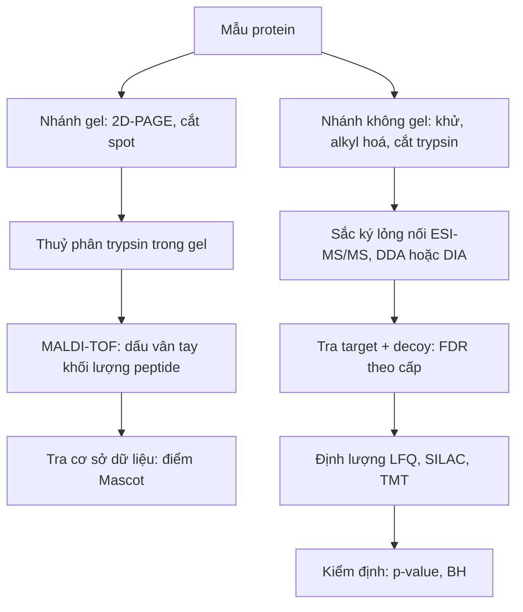

Proteomics khối phổ (mass spectrometry-based proteomics) và dự đoán cấu trúc bằng AlphaFold gắn vào kết quả sáu con số tin cậy: điểm Mascot, FDR 1% của chiến lược target-decoy, p-value của kiểm định từng protein, pLDDT, PAE và điểm AutoDock Vina. Con số nào cũng là ước lượng có điều kiện. Điểm Mascot đổi theo kích thước cơ sở dữ liệu, FDR đổi theo cấp tính (PSM, peptide hay protein), pLDDT chỉ là mô hình tự đoán độ chính xác cục bộ của chính nó, còn điểm Vina dùng để xếp hạng tư thế gắn chứ không đo ái lực. Bài thứ tám của series *Bioinformatics từ nhập môn đến nâng cao* giải thích từng con số cho sinh viên sinh học và người tự học bioinformatics, kèm code chạy được, dữ liệu AlphaFold DB thật của p53 và ABL1, và một bảng kiểm để dùng ngay.

<div class="callout callout-note">
<p class="callout-title">Tóm tắt nhanh</p>

- Điểm Mascot = −10·log10(P). Ngưỡng ý nghĩa phụ thuộc số mục được tra: với Swiss-Prot 576.073 mục, phép hiệu chỉnh Bonferroni cho khoảng 70,6.
- FDR 1% ở cấp PSM không tự động là 1% ở cấp protein; cần ước lượng riêng cho từng cấp.
- Với 281 protein không hề đổi và t-test 3 vs 3, trung bình khoảng 14 protein vẫn có p < 0,05 chưa hiệu chỉnh.
- pLDDT trung bình của p53 là 75,06, nhưng miền gắn DNA đạt khoảng 95 còn hai đầu chỉ quanh 49: phải đọc theo vùng.
- Điểm Vina giúp xếp hạng tư thế gắn, không phải ái lực đo được.

</div>

## 1. Proteomics khối phổ là gì và sáu con số tin cậy

Proteomics là việc đo hàng loạt protein trong một mẫu: có những protein nào, bao nhiêu, mang biến đổi gì và tương tác với ai. Khối phổ đã thành công cụ chính để khám phá cấu trúc và chức năng của proteome (Aebersold & Mann, 2016). Bài này chỉ bàn hướng **bottom-up**. Protein bị cắt thành peptide, peptide được đo trong máy khối phổ, rồi phần mềm suy ngược ra protein. Top-down, cross-linking MS, HDX-MS và proteomics đơn bào nằm ngoài phạm vi.

Protein là sản phẩm cuối của dòng thông tin di truyền và trực tiếp làm phần lớn việc của tế bào (thành phần hoá học của tế bào). [Bài 7](/blog/transcriptomics-rna-seq-va-single-cell/) dừng ở mức RNA, nhưng lượng mRNA không cho biết protein có bị cắt, bị phosphoryl hoá hay bị phân huỷ nhanh hay không.

Định danh là so dữ liệu đo với hàng trăm nghìn protein trong cơ sở dữ liệu, nên luôn có trùng khớp ngẫu nhiên. Các con số tin cậy ra đời để định lượng xác suất đó (Perkins et al., 1999; Elias & Gygi, 2007). Ở phía cấu trúc, AlphaFold đạt độ chính xác cạnh tranh với cấu trúc thực nghiệm trong đa số mục tiêu của CASP14 (Jumper et al., 2021), và mỗi mô hình cũng đi kèm chỉ số tin cậy riêng.

Sáu con số bài này lần lượt giải thích:

1. **Điểm Mascot**: xác suất một trùng khớp là ngẫu nhiên, đổi sang thang logarit.
2. **FDR target-decoy**: tỷ lệ kết quả sai ước lượng trong một danh sách định danh.
3. **p-value hoặc adjusted p** của kiểm định từng protein (limma, MSstats).
4. **pLDDT**: độ tin cậy cục bộ của từng residue trong mô hình AlphaFold.
5. **PAE**: độ tin cậy về vị trí tương đối giữa hai phần của mô hình.
6. **Điểm AutoDock Vina**: điểm gắn ước lượng của một tư thế ligand.

Keratin từ da và tóc của người làm thí nghiệm là protein nhiễm điển hình trong khối phổ (Matrix Science, n.d.). Một lần tra cứu có thể cho keratin vượt ngưỡng Mascot mà vẫn hoàn toàn đúng về thống kê, vì danh sách khối lượng thật sự khớp với keratin tốt hơn ngẫu nhiên. Con số trả lời câu hỏi "trùng khớp này có ngẫu nhiên không". Nó không trả lời "protein này từ đâu ra". Mục 3.1 đi qua một ca như vậy.

## 2. Từ protein đến phổ: quy trình bottom-up

Sơ đồ dưới đây tóm tắt hai nhánh của quy trình và chỗ mỗi con số tin cậy xuất hiện.



### 2.1. Chuẩn bị mẫu

Đầu tiên, cầu disulfide của protein được khử bằng DTT (dithiothreitol), rồi cysteine được alkyl hoá bằng IAA (iodoacetamide) để cầu không tái tạo. Sau đó trypsin cắt chuỗi sau lysine (K) và arginine (R), trừ khi residue kế tiếp là proline (P).

Cysteine đã alkyl hoá bằng IAA nặng thêm một nhóm carbamidomethyl. Vì vậy khi tra cứu phải khai báo **Carbamidomethyl (C)** là biến đổi cố định; quên khai báo thì mọi peptide chứa cysteine lệch khối lượng và không khớp. Trypsin cũng tự cắt chính nó. Các peptide tự cắt này là nhiễu, nhưng cũng dùng được làm nội chuẩn hiệu chỉnh khối lượng vì khối lượng lý thuyết của chúng đã biết trước.

### 2.2. Tách trước khối phổ: gel hay sắc ký

Proteome quá phức tạp để đo một lượt. Hướng **dựa trên gel** (gel-based) dùng điện di hai chiều 2D-PAGE: chiều thứ nhất tách theo điểm đẳng điện (pI), chiều thứ hai theo khối lượng phân tử. Mỗi spot trên gel chứa một hoặc vài protein; spot được cắt ra, thuỷ phân trong gel rồi đưa lên máy.

Hướng **không gel** (gel-free) cắt cả hỗn hợp protein thành peptide rồi tách peptide bằng sắc ký lỏng. Washburn et al. (2001) gọi cách làm này là MudPIT (multidimensional protein identification technology): sắc ký lỏng nhiều chiều nối thẳng với khối phổ hai lần (MS/MS), tra cứu bằng SEQUEST, định danh được 1.484 protein nấm men trong một phân tích. Peptide ra khỏi cột được ion hoá và đo liên tục, nên mỗi lần chạy sinh ra hàng chục nghìn phổ.

### 2.3. Ion hoá và phân tích khối

Máy khối phổ đo tỷ số khối lượng trên điện tích (m/z), nên peptide phải được ion hoá trước. MALDI (matrix-assisted laser desorption/ionization) tạo chủ yếu ion một điện tích và hay đi cùng bộ phân tích thời gian bay (TOF). ESI (electrospray ionization) tạo ion nhiều điện tích và nối thẳng được với dòng sắc ký lỏng.

### 2.4. Hai cách định danh: PMF và MS/MS

**Dấu vân tay khối lượng peptide** (peptide mass fingerprinting, PMF) chỉ dùng danh sách khối lượng peptide trong một phổ MS. Phần mềm cắt "ảo" mọi protein trong cơ sở dữ liệu bằng trypsin, tính khối lượng peptide lý thuyết, rồi tìm protein có nhiều peptide khớp nhất. Pappin et al. (1993) là một trong các nhóm đầu tiên công bố cách nhận dạng này. PMF nhanh và rẻ, nhưng chỉ chạy tốt khi spot chứa một protein gần như tinh khiết. Hai protein trộn lẫn sẽ cho hai bộ khối lượng chồng lên nhau.

**Định danh bằng MS/MS** chọn một ion peptide (ion tiền chất), phân mảnh nó, rồi so phổ mảnh với phổ lý thuyết của các peptide ứng viên. Phổ MS/MS mang thông tin trình tự, nên định danh được cả hỗn hợp phức tạp (Aebersold & Mann, 2016). Mỗi lần ghép một phổ với một peptide gọi là một PSM (peptide-spectrum match). MaxQuant (Cox & Mann, 2008) hay MSFragger (Kong et al., 2017) tạo ra hàng chục nghìn PSM cho mỗi lần chạy. Câu hỏi "PSM nào đúng" dẫn thẳng đến target-decoy ở mục 3.

### 2.5. DDA và DIA

Với MS/MS, máy phải chọn ion nào để phân mảnh. Hai chế độ thu nhận (acquisition) chính được so trong Bảng 1.

**Bảng 1.** Thu nhận phụ thuộc dữ liệu (DDA) và thu nhận độc lập dữ liệu (DIA).

| Tiêu chí | DDA (data-dependent acquisition) | DIA (data-independent acquisition) |
|---|---|---|
| Chọn ion để phân mảnh | Các ion mạnh nhất trong mỗi chu kỳ (ví dụ top 10) | Mọi ion trong từng cửa sổ m/z liên tiếp |
| Phổ MS/MS | Phần lớn là phổ của một peptide | Phổ trộn nhiều peptide |
| Độ tái lập giữa các lần chạy | Peptide yếu lúc được chọn lúc không | Nhất quán hơn (Gillet et al., 2012) |
| Giá trị thiếu | Nhiều, một phần do lấy mẫu ngẫu nhiên | Ít hơn |
| Phần mềm tiêu biểu | MaxQuant, MSFragger | Trích xuất có định hướng; DIA-NN (Demichev et al., 2020) |

DDA đơn giản và cho phổ sạch. Nhược điểm là peptide gần ngưỡng cường độ được chọn ở lần chạy này mà bị bỏ ở lần khác, sinh ra giá trị thiếu chẳng liên quan gì đến sinh học. Gillet et al. (2012) đề xuất trích xuất có định hướng từ phổ DIA (SWATH), cho định lượng nhất quán và chính xác hơn. DIA-NN dùng mạng nơ-ron và hiệu chỉnh nhiễu để đi sâu hơn vào proteome (Demichev et al., 2020). Đổi lại, phổ DIA phức tạp, cần phần mềm chuyên biệt và thường cần thư viện phổ để giải.

## 3. Định danh và kiểm soát sai

### 3.1. Điểm Mascot là một p-value đổi thang

Mascot chấm điểm theo xác suất. Gọi P là xác suất trùng khớp quan sát được là ngẫu nhiên, điểm bằng −10·log10(P) (Perkins et al., 1999; Matrix Science, n.d.). P = 0,001 cho điểm 30; P = 10⁻⁷ cho điểm 70. Điểm càng cao, trùng khớp càng khó xảy ra do tình cờ.

Ngưỡng ý nghĩa xuất phát từ mức 0,05 nhưng phải hiệu chỉnh cho số lần thử, vì mỗi protein trong cơ sở dữ liệu là một phép thử. Mascot dùng hiệu chỉnh Bonferroni theo số mục được tra, cộng thêm một hiệu chỉnh thực nghiệm (Matrix Science, n.d.). Hệ quả là **ngưỡng không cố định**. Tra toàn bộ Swiss-Prot thì ngưỡng cao; giới hạn taxonomy về một loài thì số mục giảm và ngưỡng hạ xuống. Bản Swiss-Prot 2026_04 có 576.073 mục (UniProt Consortium, 2026). Riêng phần Bonferroni đã cho:

$$S_{\text{ngưỡng}} = -10\log_{10}\left(\frac{0{,}05}{576\,073}\right) \approx 70{,}6$$

Phép tính này chỉ để kiểm tra. Ngưỡng thật phải đọc trên trang kết quả, vì còn phần hiệu chỉnh thực nghiệm.

<div class="callout callout-example">
<p class="callout-title">Ca minh hoạ: một kết quả PMF vượt ngưỡng</p>

Một spot protein huyết tương được thuỷ phân trypsin, đo trên MALDI-TOF và cho 10 khối lượng peptide trong khoảng m/z 1064,9 đến 2385,4. Tra Mascot PMF trên Swiss-Prot, taxonomy "All", trypsin, cho phép 1 vị trí cắt sót, dung sai ±1,2 Da. Protein trúng cao nhất là "Keratin, type I cytoskeletal" (MW 50.995, pI 5,43), điểm 78 trên ngưỡng khoảng 70, độ phủ trình tự 20%.

</div>

Kết quả này cần đọc qua bốn lớp. Lớp đầu là điểm: 78 vượt ngưỡng khoảng 70, nghĩa là danh sách khối lượng khớp với một keratin type I tốt hơn ngẫu nhiên ở mức 0,05 sau hiệu chỉnh. Lớp kế tiếp là dung sai. ±1,2 Da là rất rộng: đổi sang đơn vị tương đối, nó bằng khoảng 1.127 ppm ở m/z 1064,9 và 503 ppm ở m/z 2385,4. Cửa sổ càng rộng thì càng nhiều peptide lý thuyết lọt vào, trùng khớp ngẫu nhiên tăng và sức phân biệt giảm. Matrix Science đưa một ví dụ: nới dung sai từ ±0,1 Da lên ±1,0 Da làm điểm của kết quả đúng rơi xuống dưới ngưỡng (Matrix Science, n.d.). Nên đặt dung sai theo độ chính xác khối lượng máy đạt được thật, đọc từ các peptide nội chuẩn.

Lớp thứ ba là lượng dữ liệu. 10 khối lượng là ít; Matrix Science khuyên đưa càng nhiều khối lượng trong khoảng 1000–3500 Da càng tốt (Matrix Science, n.d.), còn độ phủ 20% cho thấy phần lớn chuỗi keratin không có peptide nào khớp. Lớp cuối, và nặng ký nhất, là bản chất của protein: keratin là protein nhiễm điển hình. Matrix Science viết thẳng rằng không bao giờ loại trừ được protein nhiễm và khuyên luôn tra kèm một cơ sở dữ liệu protein nhiễm (Matrix Science, n.d.). Frankenfield et al. (2022) xây các thư viện protein nhiễm dùng chung cho DDA và DIA và cho thấy đưa chúng vào tra cứu giúp giảm phát hiện sai. Vậy điểm 78 nói rằng trùng khớp với keratin không phải ngẫu nhiên. Nó không nói keratin có sẵn trong huyết tương hay lẫn vào trong lúc thao tác.

Đoạn code dưới đây tính lại ngưỡng Bonferroni và đổi dung sai sang ppm:

```python
import math
# Ngưỡng Mascot ước lượng bằng Bonferroni: -10*log10(0.05 / N)
for n_entries in (576_073, 20_000):
    print(n_entries, round(-10 * math.log10(0.05 / n_entries), 1))
# Đổi dung sai tuyệt đối (Da) sang ppm ở từng m/z
tol_da = 1.2
for mz in (1064.9, 2385.4):
    print(mz, round(tol_da / mz * 1e6))
# 576073 70.6 | 20000 56.0 | 1064.9 1127 | 2385.4 503
```

Dòng thứ hai cho thấy ảnh hưởng của taxonomy: nếu chỉ tra 20.000 mục (con số giả định, ví dụ khi giới hạn về một loài), ngưỡng Bonferroni hạ xuống khoảng 56.

### 3.2. Target-decoy: ước lượng FDR bằng kết quả sai biết trước

Với hàng chục nghìn PSM, áp Bonferroni cho từng phổ sẽ giết độ nhạy. Chiến lược **target-decoy** xử lý bằng một mẹo: tra phổ vào cơ sở dữ liệu thật (target) gộp với một cơ sở dữ liệu giả (decoy), thường là trình tự đảo ngược. Không peptide decoy nào có thật trong mẫu, nên PSM nào trúng decoy cũng sai. Nếu decoy mô phỏng đúng cách kết quả sai phân bố, số PSM decoy trên một ngưỡng điểm sẽ xấp xỉ số PSM target sai trên cùng ngưỡng (Elias & Gygi, 2007):

$$\widehat{\text{FDR}}(s) = \frac{N_{\text{decoy}}(\geq s)}{N_{\text{target}}(\geq s)}$$

Elias và Gygi (2007) cho thấy giả định này hợp lý, việc tra **gộp** target với decoy tốt hơn tra riêng, sai số của ước lượng tính được, và các cách dựng decoy khác nhau cho kết quả tương tự nếu làm đúng. Hình 1 minh hoạ trên dữ liệu mô phỏng.


*Hình 1. Mô phỏng 60.000 PSM target (15.000 đúng, 45.000 sai) và 45.000 PSM decoy. Ngưỡng nhỏ nhất cho FDR ước lượng ≤ 1% là điểm 49,5; trong mô phỏng biết đáp án, FDR thật trên ngưỡng đó là 1,10%. Dữ liệu mô phỏng, không phải dữ liệu đo.*

Phần mềm thường báo **q-value** cho mỗi PSM: FDR nhỏ nhất đạt được nếu đặt ngưỡng tại PSM đó hoặc thấp hơn. Code dưới đây tính FDR và q-value trên 12 PSM giả định:

```python
import pandas as pd
psm = pd.DataFrame({
    "score":  [88, 75, 71, 66, 64, 60, 58, 55, 52, 50, 47, 45],
    "is_decoy": [0, 0, 0, 0, 1, 0, 0, 0, 1, 0, 1, 0],
}).sort_values("score", ascending=False)
psm["n_target"] = (psm["is_decoy"] == 0).cumsum()
psm["n_decoy"] = psm["is_decoy"].cumsum()
psm["fdr"] = psm["n_decoy"] / psm["n_target"]
# q-value: FDR nhỏ nhất đạt được khi chọn ngưỡng tại điểm này hoặc thấp hơn
psm["q"] = psm["fdr"][::-1].cummin()[::-1]
print(psm.to_string(index=False))
```

Bốn PSM đầu có q = 0. PSM điểm 60 có FDR 0,20 nhưng q ≈ 0,14: hạ ngưỡng xuống 55 vẫn giữ nó trong danh sách, và ở ngưỡng 55 có 1 decoy so với 7 target.

Mỗi PSM còn nhiều đặc trưng khác ngoài điểm chính. Percolator dùng học bán giám sát, lấy PSM decoy làm ví dụ âm, để kết hợp các đặc trưng đó và tách PSM đúng khỏi PSM sai tốt hơn (Käll et al., 2007). Đây là một ứng dụng sớm của học máy trong proteomics; bài 10 sẽ quay lại chủ đề này.

### 3.3. FDR theo cấp: PSM, peptide, protein

"FDR 1%" chỉ có nghĩa khi nói rõ ở cấp nào. Một peptide có thể được nhiều PSM hỗ trợ; một protein được suy ra từ một hoặc nhiều peptide. Lý do nằm ở cơ chế gom: PSM sai thường rải rác, mỗi protein sai chỉ nhận một PSM, còn PSM đúng dồn vào ít protein hơn. Vì thế khi gom lên cấp protein, tỷ lệ sai không giữ nguyên như ở cấp PSM. Với bộ dữ liệu rất lớn, cách target-decoy "cổ điển" ở cấp protein ước lượng dư số dương tính giả; Savitski et al. (2015) đề xuất cách "picked" để ước lượng FDR protein riêng. Báo cáo đầy đủ nên ghi FDR ở cả ba cấp PSM, peptide và protein.

FDR target-decoy và thủ tục Benjamini–Hochberg (BH) ở mục 4 cùng nhắm kiểm soát tỷ lệ phát hiện sai nhưng làm khác nhau. Target-decoy ước lượng FDR thực nghiệm từ kết quả sai biết trước; BH làm việc trên một danh sách p-value. [Bài 3](/blog/toan-va-thong-ke-cho-sinh-hoc/) trình bày BH chi tiết.

Bước cuối của định danh là **suy luận protein** (protein inference). Một peptide có thể nằm trong nhiều protein tương đồng hoặc nhiều isoform, nên MaxQuant báo cáo **protein group**: nhóm các protein không phân biệt được bằng những peptide đã quan sát (Cox & Mann, 2008). Khi định lượng, peptide "unique" chỉ thuộc một nhóm, còn peptide "razor" được gán cho nhóm có nhiều bằng chứng nhất.

## 4. Định lượng, giá trị thiếu và kiểm định

### 4.1. Ba cách định lượng

**Bảng 2.** Ba cách định lượng phổ biến trong proteomics bottom-up.

| | Label-free (LFQ) | SILAC | TMT |
|---|---|---|---|
| Nguyên lý | So cường độ peptide giữa các lần chạy riêng | Đánh dấu đồng vị bền qua chuyển hoá: nuôi tế bào với amino acid nặng | Thẻ đẳng khối (isobaric) gắn hoá học vào peptide sau khi cắt |
| Mẫu ghép trong một lần chạy | Không, mỗi mẫu một lần chạy | 2–3 mẫu (nhẹ, trung, nặng) | Nhiều mẫu, phân biệt bằng ion báo cáo sau phân mảnh |
| Áp dụng được cho | Mọi loại mẫu | Tế bào nuôi cấy; không đánh dấu trực tiếp được huyết tương người | Mọi loại mẫu đã cắt thành peptide |
| Điểm yếu chính | Giá trị thiếu, biến thiên giữa các lần chạy | Giới hạn loại mẫu | Tỷ lệ bị nén do đồng phân mảnh |
| Nguồn | Cox et al. (2014) | Ong et al. (2002) | Thompson et al. (2003); Ting et al. (2011) |

Mỗi mẫu LFQ là một lần chạy riêng, nên phải chuẩn hoá giữa các lần chạy. MaxLFQ chuẩn hoá trễ (delayed normalization) và lấy tỷ lệ peptide tối đa để định lượng chính xác trên toàn proteome (Cox et al., 2014). SILAC được Ong et al. (2002) giới thiệu như một cách định lượng đơn giản và chính xác; các mẫu được trộn ngay sau khi thu tế bào. TMT thì khác hẳn: thẻ được gắn bằng phản ứng hoá học, các thẻ có cùng tổng khối lượng và chỉ tách ra khi phân mảnh (Thompson et al., 2003). Nếu một ion khác lẫn vào cửa sổ cách ly, ion báo cáo của nó cộng thêm vào và kéo mọi tỷ lệ về gần 1. Thu nhận MS3 gần như loại bỏ được sự méo tỷ lệ này (Ting et al., 2011).

### 4.2. Giá trị thiếu không ngẫu nhiên

Bảng LFQ gần như luôn có giá trị thiếu, và cách xử lý chúng có thể đổi hẳn danh sách protein khác biệt. Lazar et al. (2016) phân biệt các cơ chế thiếu. **MNAR** (missing not at random) là thiếu vì tín hiệu dưới ngưỡng phát hiện, gần với dữ liệu bị cắt trái (left-censored): protein ít thì hay thiếu. **MCAR** (missing completely at random) là thiếu ngẫu nhiên, ví dụ do DDA bỏ sót một peptide. Mỗi phương pháp impute hợp với một cơ chế. Câu cần hỏi là phương pháp nào **phù hợp** với cơ chế thiếu trong dữ liệu đang có, thay vì phương pháp nào "tốt nhất" (Lazar et al., 2016).

Perseus (Tyanova et al., 2016) phổ biến một cách làm: lọc protein theo số giá trị hợp lệ, rồi thay giá trị thiếu bằng số ngẫu nhiên rút từ một phân phối chuẩn hẹp dịch về phía cường độ thấp. Mặc định trong tài liệu của Perseus là độ rộng 0,3 và dịch xuống 1,8 lần độ lệch chuẩn của các giá trị hợp lệ (Cox Lab, n.d.). Cách này ngầm giả định MNAR, tức giá trị thiếu là giá trị thấp. Nếu phần lớn giá trị thiếu là MCAR, giả định đó sai và sinh ra khác biệt giả.

Còn một bẫy kỹ thuật nằm trước cả bước impute. MaxQuant ghi cường độ không đo được là 0, và log2(0) là âm vô cùng. Phải đổi 0 thành NA trước khi lấy log, đồng thời loại các dòng protein nhiễm (tiền tố `CON__`) và decoy (`REV__`). Code dưới đây làm đủ bốn bước trên một bảng nhỏ:

```python
import numpy as np, pandas as pd
lfq = pd.DataFrame({
    "protein": ["P1", "P2", "P3", "P4", "CON__P04264", "REV__P5"],
    "T1": [2.1e8, 4.5e6, 5.5e6, 9.0e7, 3.0e9, 1.0e6],
    "T2": [1.9e8, 4.1e6, 0,     8.7e7, 2.5e9, 0],
    "T3": [2.3e8, 3.8e6, 0,     9.4e7, 2.8e9, 0],
    "N1": [1.0e8, 0,     0,     8.9e7, 3.1e9, 0],
    "N2": [1.1e8, 0,     6.0e6, 9.1e7, 2.9e9, 2.0e6],
    "N3": [0.9e8, 0,     0,     9.3e7, 3.3e9, 0],
}).set_index("protein")
# 1. Bỏ protein nhiễm (CON__) và decoy (REV__)
lfq = lfq[~lfq.index.str.startswith(("CON__", "REV__"))]
# 2. Đổi 0 thành NA rồi mới log2 (log2(0) = -inf)
log = np.log2(lfq.replace(0, np.nan))
# 3. Giữ protein có ít nhất 3 giá trị hợp lệ trong ít nhất một nhóm
tumor, normal = ["T1", "T2", "T3"], ["N1", "N2", "N3"]
keep = (log[tumor].notna().sum(axis=1) >= 3) | (log[normal].notna().sum(axis=1) >= 3)
log = log[keep]
# 4. Impute kiểu "phân phối dịch xuống" (giả định MNAR), từng mẫu một
rng = np.random.default_rng(1)
imp = log.copy()
for col in imp:
    mu, sd = log[col].mean(), log[col].std()
    miss = imp[col].isna()
    imp.loc[miss, col] = rng.normal(mu - 1.8 * sd, 0.3 * sd, miss.sum())
print(log.round(2)); print(imp.round(2))
```

P3 bị loại vì không nhóm nào đủ 3 giá trị. P2 đủ 3 giá trị ở nhóm Tumor và thiếu cả 3 ở nhóm Normal. Chạy code sẽ lộ ra bẫy thứ hai: giá trị impute cho P2 ở nhóm Normal rơi vào khoảng 26,3, **cao hơn** nhóm Tumor (khoảng 22). Mỗi cột Normal chỉ còn 2 giá trị hợp lệ, cả hai đều cao, nên "phân phối dịch xuống" ước lượng từ 2 điểm vẫn nằm trên P2. Dữ liệu thật có hàng nghìn protein nên ổn định hơn, nhưng vẫn nên vẽ phân phối trước và sau impute để xem giá trị điền vào có thật sự nằm ở vùng cường độ thấp không.

### 4.3. Kiểm định từng protein

Với 3 mẫu mỗi nhóm, phương sai ước lượng cho từng protein rất bất ổn. Một protein tình cờ có ba giá trị gần nhau sẽ có t-statistic lớn dù khác biệt nhỏ. limma xử lý bằng mô hình tuyến tính kèm cơ chế mượn thông tin giữa các đặc trưng (empirical Bayes): phương sai của từng protein được co về phía một giá trị chung, nhờ đó ổn định hơn khi cỡ mẫu nhỏ (Ritchie et al., 2015). MSstats mô hình hoá ở cấp peptide hoặc đặc trưng rồi tổng hợp lên protein (Choi et al., 2014).

Một chi tiết hay làm code limma báo lỗi: tương phản `makeContrasts(groupTumor - groupNormal, levels = design)` chỉ chạy khi `group` là factor có đúng hai mức "Tumor" và "Normal", và ma trận thiết kế được tạo bằng `model.matrix(~ 0 + group)`. Sau kiểm định, p-value của mọi protein phải được hiệu chỉnh bằng BH rồi mới gọi protein nào là "khác biệt". Hàm BH viết tay để thấy rõ cách tính:

```python
import numpy as np
def bh(p):
    """Adjusted p theo Benjamini–Hochberg."""
    p = np.asarray(p); m = len(p); order = np.argsort(p)
    adj = p[order] * m / np.arange(1, m + 1)
    adj = np.minimum.accumulate(adj[::-1])[::-1]
    out = np.empty(m); out[order] = np.minimum(adj, 1); return out
p = [0.001, 0.008, 0.02, 0.03, 0.04, 0.2, 0.5, 0.9]
print(np.round(bh(p), 3))
# [0.008 0.032 0.053 0.06  0.064 0.267 0.571 0.9  ]
```

Trong ví dụ tám protein, năm protein có p < 0,05 thô, nhưng sau BH chỉ còn hai protein có adjusted p < 0,05.

### 4.4. Ca phân tích: Dong et al. (2022)

Dong et al. (2022) phân tích proteome của túi ngoại bào nhỏ (small extracellular vesicles) trong huyết tương bệnh nhân ung thư biểu mô tế bào gan (HCC). Phần phương pháp được mô tả khá đầy đủ, nên đây là ca tốt để áp dụng mục 4.1–4.3.

Nhóm khám phá có 21 bệnh nhân HCC và 15 người đối chứng, nhưng mẫu được **gộp** thành 3 mẫu mỗi nhóm (mỗi pool đối chứng gồm 5 người, mỗi pool HCC gồm 7 người) để giảm biến thiên giữa cá thể và tiết kiệm chi phí. Mẫu được đo bằng DDA top 10 trên máy Q Exactive, xử lý bằng MaxQuant 1.5.3.17 với FDR peptide và protein dưới 1%, loại protein nhiễm, định lượng LFQ. Kết quả gồm 335 protein định danh và 281 protein định lượng. Lọc theo fold change ≥ 1,5 hoặc < 0,66 được 54 protein; trong đó 27 protein có p < 0,05 (Dong et al., 2022).

Chỗ đầu tiên cần đọc kỹ là hiệu chỉnh nhiều lần. Phần phương pháp chỉ nêu Benjamini–Hochberg cho phân tích làm giàu GO và KEGG; với protein khác biệt, bài chỉ nêu t-test và p < 0,05, không nhắc đến hiệu chỉnh (Dong et al., 2022). Nếu kiểm định cả 281 protein và mọi giả thuyết không đều đúng, kỳ vọng số dương tính giả ở p < 0,05 là 281 × 0,05 ≈ 14; nếu chỉ kiểm định 54 protein đã lọc theo fold change, kỳ vọng khoảng 2,7. Hình 2 mô phỏng tình huống thứ nhất.


*Hình 2. Mô phỏng 2.000 lần: 281 protein không đổi giữa hai nhóm, mỗi nhóm 3 mẫu, t-test hai mẫu. Trung bình 13,97 protein có p < 0,05 chưa hiệu chỉnh; sau BH ở mức 0,05, trung bình 0,06 protein và 94,7% số lần mô phỏng không còn protein nào. Dữ liệu mô phỏng.*

Chỗ thứ hai là gộp mẫu. Gộp làm mất ước lượng biến thiên sinh học giữa người: ba pool, mỗi pool trộn 7 bệnh nhân, cho phương sai của trung bình các pool chứ không cho biết protein dao động thế nào giữa từng bệnh nhân. n = 3 pool không có sức nặng thống kê như n = 21 cá thể. Chỗ thứ ba là giá trị thiếu. Bài báo không mô tả cách xử lý, nên không biết một protein "chỉ có ở nhóm HCC" là có thật hay chỉ dưới ngưỡng phát hiện ở nhóm đối chứng (Lazar et al., 2016; Dong et al., 2022).

Bài báo cũng có một điểm mạnh rõ ràng: bốn protein bổ thể được kiểm chứng bằng Western blot trên 7 bệnh nhân và 7 người đối chứng độc lập (Dong et al., 2022), tức kiểm bằng phương pháp khác trên mẫu khác. Vì vậy đừng kết luận "phát hiện của bài báo sai". Bằng chứng proteomics của bài yếu hơn bằng chứng Western blot, và danh sách 27 protein nên được đọc như danh sách ứng viên.

### 4.5. Tự luyện trên bộ dữ liệu có đáp án

Muốn thấy ảnh hưởng của xử lý giá trị thiếu, hãy thử trên dữ liệu biết trước đáp án. Khi phát triển MaxLFQ, Cox et al. (2014) công bố bộ benchmark trộn hai proteome theo tỷ lệ biết trước; dữ liệu nằm trên PRIDE với mã PXD000279 (Perez-Riverol et al., 2022; PRIDE Archive, 2014). Biết protein nào phải đổi và protein nào không, bạn đếm được dương tính giả cho từng cách xử lý: bỏ protein có giá trị thiếu, impute dịch xuống, hoặc impute kNN. Sau đó lấy mẫu con 3 vs 3 để so p < 0,05 thô với BH 0,05. Đây là một dự án nhỏ hợp cho portfolio (bài 12).

## 5. AlphaFold và cách đọc pLDDT, PAE

Từ đây bài chuyển từ câu hỏi "có protein nào" sang "protein trông như thế nào".

### 5.1. Khoảng trống giữa trình tự và cấu trúc

Cấu trúc ba chiều của protein được xác định bằng tinh thể học tia X, cộng hưởng từ hạt nhân (NMR) hoặc kính hiển vi điện tử lạnh (cryo-EM), rồi lưu trong Protein Data Bank (PDB), kho chung toàn cầu cho dữ liệu cấu trúc đại phân tử (wwPDB consortium, 2019). Theo Jumper et al. (2021), khi AlphaFold2 ra đời, khoảng 100.000 protein riêng biệt đã có cấu trúc thực nghiệm, rất nhỏ so với hàng tỷ trình tự đã biết.

### 5.2. AlphaFold, AlphaFold DB và các công cụ khác

AlphaFold2 kết hợp sắp gióng đa trình tự (multiple sequence alignment, MSA) với một kiến trúc học sâu tích hợp hiểu biết vật lý và sinh học về cấu trúc protein; ở CASP14 nó đạt độ chính xác cạnh tranh với thực nghiệm trong đa số trường hợp (Jumper et al., 2021). MSA là đầu vào cốt lõi, nên chất lượng mô hình phụ thuộc vào số trình tự tương đồng tìm được (xem [bài 5](/blog/phan-tich-trinh-tu/) về MSA).

Áp lên proteome người, AlphaFold dự đoán cấu trúc cho 98,5% protein; 58% tổng số residue được dự đoán tin cậy, trong đó 36% tổng số residue có độ tin cậy rất cao (Tunyasuvunakool et al., 2021). AlphaFold DB ra mắt với hơn 360.000 cấu trúc của 21 proteome sinh vật mô hình (Varadi et al., 2022), và đến bản 2024 đã phủ hơn 214 triệu trình tự (Varadi et al., 2024).

Vài công cụ khác đáng biết. ColabFold chạy nhanh hơn và dễ tiếp cận hơn nhờ tìm MSA bằng MMseqs2 (Mirdita et al., 2022). ESMFold dự đoán từ một mô hình ngôn ngữ protein, không cần MSA (Lin et al., 2023). RoseTTAFold dùng mạng ba luồng (Baek et al., 2021). AlphaFold 3 mở rộng sang phức hợp với ligand và acid nucleic (Abramson et al., 2024); bài này chỉ bàn dự đoán một chuỗi.

### 5.3. pLDDT: độ tin cậy cục bộ

pLDDT (predicted local distance difference test) là điểm lDDT mà mô hình tự dự đoán cho từng residue. lDDT là điểm so sánh cục bộ, không cần chồng khít toàn bộ cấu trúc, đo xem khoảng cách giữa các nguyên tử lân cận được giữ đúng đến đâu (Mariani et al., 2013). AlphaFold DB chia pLDDT thành bốn mức (Bảng 3).

**Bảng 3.** Bốn mức pLDDT theo AlphaFold DB (EMBL-EBI, n.d.-a).

| pLDDT | Mức | Cách dùng |
|---|---|---|
| > 90 | Rất cao | Dùng được cho việc cần chính xác cao, như mô tả vị trí gắn |
| 70–90 | Tin cậy | Khung xương thường được dự đoán tốt |
| 50–70 | Thấp | Thận trọng khi diễn giải |
| < 50 | Rất thấp | Không nên diễn giải toạ độ |

pLDDT dưới 50 là chỉ báo khá mạnh cho vùng mất trật tự (EMBL-EBI, n.d.-a; Tunyasuvunakool et al., 2021). Vùng đó có thể không có cấu trúc cố định trong điều kiện sinh lý, hoặc chỉ gấp khi nằm trong phức hợp. Chiều ngược lại không luôn đúng: Alderson et al. (2023) thấy AlphaFold2 gán cấu trúc tin cậy cho gần 15% vùng mất trật tự nội tại (IDR) ở người, thường là trạng thái gấp có điều kiện, ví dụ khi gắn đối tác. Ruff và Pappu (2021) bàn kỹ hệ quả của AlphaFold với protein mất trật tự.

Hai protein thật cho thấy vì sao không nên đọc pLDDT trung bình. Mô hình AlphaFold DB v6 của p53 (P04637, 393 amino acid) có pLDDT trung bình 75,06, với 52,7% residue rất cao và 29,8% rất thấp. ABL1 (P00519, 1.130 amino acid) có pLDDT trung bình 63,38 và 49,2% residue rất thấp (EMBL-EBI, n.d.-b). Hình 3 vẽ pLDDT theo vị trí, tô nền theo chú giải của UniProt.


*Hình 3. pLDDT theo residue của p53 và ABL1 (AlphaFold DB, mô hình v6). Nền xám: vùng mất trật tự theo UniProt; nền xanh lá: miền gắn DNA của p53 (102–292) và miền kinase của ABL1 (242–493); nền tím: vùng oligomer hoá của p53 (325–356). Đường chấm: ngưỡng 90, 70, 50.*

Tính theo vùng, miền gắn DNA của p53 (102–292) có pLDDT trung bình 95,5, vùng oligomer hoá (325–356) đạt 90,9, trong khi đoạn 1–96 (vùng hoạt hoá phiên mã và vùng mất trật tự) chỉ 49,6 và đầu C (351–393) là 48,6. Ở ABL1, miền kinase đạt 92,4, còn vùng mất trật tự 518–996 chỉ 36,1. Con số 75 của p53 là trung bình của hai kiểu vùng rất khác nhau và không mô tả đúng vùng nào. Code dưới đây đọc pLDDT từ file PDB của AlphaFold DB, nơi pLDDT được ghi ở cột B-factor:

```python
import numpy as np
def plddt_from_pdb(path):
    """pLDDT nằm ở cột B-factor của nguyên tử CA trong file PDB của AlphaFold DB."""
    v = {}
    for line in open(path):
        if line.startswith("ATOM") and line[12:16].strip() == "CA":
            v[int(line[22:26])] = float(line[60:66])
    return v
# Tải trước: https://alphafold.ebi.ac.uk/files/AF-P04637-F1-model_v6.pdb
v = plddt_from_pdb("AF-P04637-F1-model_v6.pdb")
regions = {"1-96": (1, 96), "102-292 (miền gắn DNA)": (102, 292),
           "325-356 (oligomer hoá)": (325, 356), "351-393": (351, 393)}
for name, (a, b) in regions.items():
    x = np.array([v[i] for i in range(a, b + 1)])
    print(f"{name}: pLDDT TB {x.mean():.1f}; tỷ lệ < 50: {(x < 50).mean():.0%}")
```

### 5.4. PAE: độ tin cậy về vị trí tương đối

pLDDT cho biết từng vùng có được dự đoán tốt không, nhưng không cho biết hai vùng có được đặt đúng chỗ so với nhau không. Việc đó thuộc về PAE (predicted aligned error). Ô (x, y) của ma trận PAE là sai số vị trí kỳ vọng, tính bằng ångström, ở residue x khi chồng cấu trúc dự đoán lên cấu trúc thật theo residue y (EMBL-EBI, n.d.-a). PAE thấp giữa hai miền nghĩa là vị trí tương đối của chúng được dự đoán chắc chắn. PAE cao nghĩa là đừng diễn giải hướng tương đối giữa hai miền.


*Hình 4. Ma trận PAE của ABL1 (AlphaFold DB, mô hình v6). Màu đậm là sai số thấp. Đường đỏ đánh dấu miền kinase 242–493.*

Trong miền kinase của ABL1, PAE trung bình khoảng 4,0 Å, tức hình dạng bên trong miền được dự đoán chắc. Giữa miền kinase và đoạn đầu C 997–1130, PAE trung bình khoảng 28–30 Å theo cả hai chiều, gần mức trần 31,75 Å của file. Bản thân đoạn đầu C có pLDDT trung bình 72,4, với 43 trong 134 residue (32%) trên 90 (Hình 3), nên có những phần được dự đoán gấp tốt. Vị trí của nó so với miền kinase trong mô hình thì gần như tuỳ ý. Ảnh 3D của cả chuỗi trông gọn gàng và dễ khiến người xem tin vào cách sắp xếp hai phần này; PAE cho thấy không có cơ sở để tin.

### 5.5. Giới hạn: mô hình là giả thuyết

Terwilliger et al. (2024) so trực tiếp dự đoán AlphaFold với bản đồ mật độ điện tử tinh thể học. Nhiều dự đoán khớp rất sát. Nhưng cả những dự đoán có độ tin cậy rất cao cũng có thể lệch ở mức toàn cục (méo, hướng tương đối của miền) lẫn cục bộ (khung xương, chuỗi bên). Dự đoán cũng không tính đến ligand và biến đổi cộng hoá trị. Nhóm tác giả đề nghị xem mô hình AlphaFold như những giả thuyết rất hữu ích, giúp tăng tốc nhưng không thay thế xác định cấu trúc bằng thực nghiệm (Terwilliger et al., 2024).

## 6. Docking: tư thế gắn không phải ái lực

Docking phân tử đặt một phân tử nhỏ (ligand) vào túi gắn của protein, tìm các tư thế (pose) hợp lý và chấm điểm chúng. AutoDock Vina nhanh hơn AutoDock 4 khoảng hai bậc độ lớn và cải thiện độ chính xác dự đoán tư thế gắn trên bộ kiểm tra của nhóm tác giả (Trott & Olson, 2010). Vina 1.2.0 thêm phương pháp docking mới, mở rộng trường lực và có giao diện Python (Eberhardt et al., 2021).

Điểm Vina có đơn vị kcal/mol nên rất dễ bị đọc như năng lượng gắn thật. Warren et al. (2006) đánh giá 10 chương trình docking và 37 hàm chấm điểm trên 8 protein đích. Chương trình nào cũng sinh được tư thế giống tinh thể với ít nhất một đích. Hàm chấm điểm thì kém hơn khi phải chọn ra tư thế đúng trong các tư thế đã dock, và **không** chương trình hay hàm chấm điểm nào dự đoán ái lực gắn một cách hữu ích. Câu nên viết là "Vina ước lượng điểm gắn để xếp hạng tư thế"; tránh viết "Vina dự đoán ái lực".

Muốn tin một quy trình docking, trước hết hãy kiểm nó bằng **redocking**: lấy một cấu trúc tinh thể đã có ligand, tách ligand ra, rồi xem phần mềm có đặt nó trở lại đúng chỗ không. Với imatinib và ABL1, cấu trúc phù hợp là PDB 1IEP: miền kinase của c-Abl gắn STI-571 (imatinib), độ phân giải 2,1 Å (RCSB PDB, n.d.; Nagar et al., 2002). Quy trình:

1. Tải 1IEP, giữ một chuỗi protein và tách imatinib thành file riêng làm tư thế tham chiếu.
2. Chuẩn bị receptor (thêm hydrogen, gán điện tích) và ligand (xác định liên kết xoay được).
3. Đặt hộp tìm kiếm quanh vị trí imatinib trong tinh thể, tức vùng gắn ATP của miền kinase.
4. Dock lại bằng Vina và lấy vài tư thế điểm tốt nhất.
5. Tính RMSD giữa nguyên tử nặng của tư thế dock và tư thế tinh thể, trong cùng hệ toạ độ.

```python
import numpy as np
def rmsd(a, b):
    """RMSD giữa hai tư thế cùng thứ tự nguyên tử, cùng hệ toạ độ (không chồng khít lại)."""
    a, b = np.asarray(a), np.asarray(b)
    return float(np.sqrt(((a - b) ** 2).sum(axis=1).mean()))
crystal = [[0.0, 0.0, 0.0], [1.5, 0.0, 0.0], [1.5, 1.5, 0.0]]
docked  = [[0.3, 0.1, 0.0], [1.8, 0.2, 0.1], [1.2, 1.9, 0.2]]
print(round(rmsd(crystal, docked), 2))   # 0.42
```

Nhiều nghiên cứu coi RMSD dưới khoảng 2 Å là redocking thành công. Đây là một quy ước hay gặp; bài này chưa truy được nguồn gốc của nó, nên hãy ghi rõ ngưỡng đã chọn trước khi chạy.

Cấu hình của receptor quan trọng không kém. Imatinib bắt giữ một cấu hình bất hoạt đặc trưng của vòng hoạt hoá của Abl (Nagar et al., 2002). Mô hình AlphaFold của ABL1 được dự đoán không có ligand (Terwilliger et al., 2024) và không có gì bảo đảm nó ở đúng cấu hình đó. Dock vào mô hình AlphaFold vì thế chỉ là phép thử phụ, có thể cho kết quả kém hơn redocking vào 1IEP. Nếu thử, chỉ dùng miền kinase 242–493, vì gần một nửa chuỗi 1.130 residue có pLDDT rất thấp (EMBL-EBI, n.d.-b; UniProt Consortium, 2026).

## 7. Nối hai phần

Peptide định danh được và vị trí biến đổi sau dịch mã có thể được đặt lên cấu trúc để xem chúng nằm ở bề mặt hay trong lõi, ở vùng có trật tự hay không (Aebersold & Mann, 2016). Một vị trí phosphoryl hoá rơi vào vùng pLDDT dưới 50 thì không diễn giải được bằng toạ độ của mô hình, dù bản thân biến đổi đó có thật.

Hai lĩnh vực cũng dùng chung một cách kiểm: so pipeline với đáp án độc lập, như bộ trộn proteome theo tỷ lệ biết trước (Cox et al., 2014), PDB và các vòng đánh giá mù như CASP (wwPDB consortium, 2019; Jumper et al., 2021), hay redocking vào cấu trúc tinh thể (Nagar et al., 2002). [Bài 6](/blog/giai-trinh-tu-the-he-moi-ngs-va-genomics/) áp đúng cách này với bộ chuẩn biến thể.

## 8. Kết luận và bảng kiểm "con số tin cậy"

Mỗi con số tin cậy trả lời một câu hỏi hẹp, dưới điều kiện cụ thể (Bảng 4).

**Bảng 4.** Bảng kiểm sáu con số tin cậy.

| Con số | Ước lượng gì | Phụ thuộc vào | Bẫy thường gặp | Nguồn |
|---|---|---|---|---|
| Điểm Mascot | Xác suất trùng khớp là ngẫu nhiên | Cỡ cơ sở dữ liệu, taxonomy, dung sai, số khối lượng | Protein nhiễm vượt ngưỡng; dung sai quá rộng | Perkins et al. (1999); Matrix Science (n.d.) |
| FDR target-decoy | Tỷ lệ kết quả sai trong danh sách | Chất lượng decoy; cấp tính | Lẫn FDR PSM với FDR protein | Elias & Gygi (2007); Savitski et al. (2015) |
| p-value, adjusted p | Bằng chứng khác biệt giữa nhóm | Số mẫu, xử lý giá trị thiếu, hiệu chỉnh nhiều lần | Mẫu gộp; p thô không hiệu chỉnh | Lazar et al. (2016); Ritchie et al. (2015) |
| pLDDT | Độ tin cậy cục bộ từng residue | Độ sâu MSA; vùng mất trật tự | Đọc trung bình toàn protein | Tunyasuvunakool et al. (2021); EMBL-EBI (n.d.-a) |
| PAE | Độ tin cậy vị trí tương đối giữa hai phần | Miền, linker | Diễn giải hướng miền khi PAE cao | EMBL-EBI (n.d.-a) |
| Điểm Vina | Điểm gắn ước lượng của một tư thế | Hàm chấm điểm; cấu hình receptor | Đọc như ái lực thật | Warren et al. (2006) |

Lần tới khi đọc một bảng kết quả, hãy hỏi ba câu trước khi trích con số: nó ước lượng gì, dưới giả định nào, và đã được so với đáp án độc lập nào chưa. Nếu muốn tự kiểm, bắt đầu bằng hai việc nhỏ: chạy lại khối code pLDDT ở mục 5.3 trên một protein bạn quan tâm, và đếm dương tính giả trên PXD000279 như mục 4.5.

## Câu hỏi thường gặp

**Điểm Mascot bao nhiêu thì có ý nghĩa?** Không có con số chung. Mascot tính ngưỡng theo số mục được tra (Bonferroni cộng hiệu chỉnh thực nghiệm), nên phải đọc trên trang kết quả. Với toàn bộ Swiss-Prot, riêng phần Bonferroni đã khoảng 70,6 (mục 3.1).

**FDR 1% có nghĩa là 99% protein trong danh sách là đúng không?** Chỉ đúng ở cấp mà FDR được tính. FDR 1% ở cấp PSM không bảo đảm 1% ở cấp protein (Savitski et al., 2015), nên báo cáo cần ghi rõ cấp (mục 3.3).

**AlphaFold có thay được tinh thể học không?** Không. Mô hình tin cậy cao vẫn có thể lệch ở hướng miền và chuỗi bên, và không tính đến ligand (Terwilliger et al., 2024). Hãy dùng nó như giả thuyết và đọc pLDDT, PAE theo vùng (mục 5).

**Điểm Vina có phải ái lực gắn không?** Không. Điểm Vina giúp xếp hạng tư thế; trong đánh giá của Warren et al. (2006), chưa chương trình docking nào dự đoán ái lực một cách hữu ích (mục 6).

## Tài liệu tham khảo

Abramson, J., Adler, J., Dunger, J., Evans, R., et al. (2024). Accurate structure prediction of biomolecular interactions with AlphaFold 3. *Nature, 630*(8016), 493–500. https://doi.org/10.1038/s41586-024-07487-w

Aebersold, R., & Mann, M. (2016). Mass-spectrometric exploration of proteome structure and function. *Nature, 537*(7620), 347–355. https://doi.org/10.1038/nature19949

Alderson, T. R., Pritišanac, I., Kolarić, Đ., Moses, A. M., & Forman-Kay, J. D. (2023). Systematic identification of conditionally folded intrinsically disordered regions by AlphaFold2. *Proceedings of the National Academy of Sciences, 120*(44), e2304302120. https://doi.org/10.1073/pnas.2304302120

Baek, M., DiMaio, F., Anishchenko, I., Dauparas, J., et al. (2021). Accurate prediction of protein structures and interactions using a three-track neural network. *Science, 373*(6557), 871–876. https://doi.org/10.1126/science.abj8754

Choi, M., Chang, C.-Y., Clough, T., Broudy, D., et al. (2014). MSstats: An R package for statistical analysis of quantitative mass spectrometry-based proteomic experiments. *Bioinformatics, 30*(17), 2524–2526. https://doi.org/10.1093/bioinformatics/btu305

Cox, J., Hein, M. Y., Luber, C. A., Paron, I., Nagaraj, N., & Mann, M. (2014). Accurate proteome-wide label-free quantification by delayed normalization and maximal peptide ratio extraction, termed MaxLFQ. *Molecular & Cellular Proteomics, 13*(9), 2513–2526. https://doi.org/10.1074/mcp.M113.031591

Cox, J., & Mann, M. (2008). MaxQuant enables high peptide identification rates, individualized p.p.b.-range mass accuracies and proteome-wide protein quantification. *Nature Biotechnology, 26*(12), 1367–1372. https://doi.org/10.1038/nbt.1511

Cox Lab. (n.d.). *Replace missing values from normal distribution* [Perseus documentation]. Truy cập ngày 27/11/2026, từ https://cox-labs.github.io/coxdocs/replacemissingfromgaussian.html

Demichev, V., Messner, C. B., Vernardis, S. I., Lilley, K. S., & Ralser, M. (2020). DIA-NN: Neural networks and interference correction enable deep proteome coverage in high throughput. *Nature Methods, 17*(1), 41–44. https://doi.org/10.1038/s41592-019-0638-x

Dong, W., Xia, Z., Chai, Z., Qiu, Z., et al. (2022). Proteomic analysis of small extracellular vesicles from the plasma of patients with hepatocellular carcinoma. *World Journal of Surgical Oncology, 20*(1), 387. https://doi.org/10.1186/s12957-022-02849-y

Eberhardt, J., Santos-Martins, D., Tillack, A. F., & Forli, S. (2021). AutoDock Vina 1.2.0: New docking methods, expanded force field, and Python bindings. *Journal of Chemical Information and Modeling, 61*(8), 3891–3898. https://doi.org/10.1021/acs.jcim.1c00203

Elias, J. E., & Gygi, S. P. (2007). Target-decoy search strategy for increased confidence in large-scale protein identifications by mass spectrometry. *Nature Methods, 4*(3), 207–214. https://doi.org/10.1038/nmeth1019

EMBL-EBI. (n.d.-a). *AlphaFold Protein Structure Database: Frequently asked questions*. Truy cập ngày 11/11/2026, từ https://alphafold.ebi.ac.uk/faq

EMBL-EBI. (n.d.-b). *AlphaFold Protein Structure Database: AF-P04637-F1 và AF-P00519-F1, mô hình v6*. Truy cập ngày 27/11/2026, từ https://alphafold.ebi.ac.uk/entry/P04637 và https://alphafold.ebi.ac.uk/entry/P00519

Frankenfield, A. M., Ni, J., Ahmed, M., & Hao, L. (2022). Protein contaminants matter: Building universal protein contaminant libraries for DDA and DIA proteomics. *Journal of Proteome Research, 21*(9), 2104–2113. https://doi.org/10.1021/acs.jproteome.2c00145

Gillet, L. C., Navarro, P., Tate, S., Röst, H., Selevsek, N., Reiter, L., Bonner, R., & Aebersold, R. (2012). Targeted data extraction of the MS/MS spectra generated by data-independent acquisition: A new concept for consistent and accurate proteome analysis. *Molecular & Cellular Proteomics, 11*(6), O111.016717. https://doi.org/10.1074/mcp.O111.016717

Jumper, J., Evans, R., Pritzel, A., Green, T., et al. (2021). Highly accurate protein structure prediction with AlphaFold. *Nature, 596*(7873), 583–589. https://doi.org/10.1038/s41586-021-03819-2

Käll, L., Canterbury, J. D., Weston, J., Noble, W. S., & MacCoss, M. J. (2007). Semi-supervised learning for peptide identification from shotgun proteomics datasets. *Nature Methods, 4*(11), 923–925. https://doi.org/10.1038/nmeth1113

Kong, A. T., Leprevost, F. V., Avtonomov, D. M., Mellacheruvu, D., & Nesvizhskii, A. I. (2017). MSFragger: Ultrafast and comprehensive peptide identification in mass spectrometry–based proteomics. *Nature Methods, 14*(5), 513–520. https://doi.org/10.1038/nmeth.4256

Lazar, C., Gatto, L., Ferro, M., Bruley, C., & Burger, T. (2016). Accounting for the multiple natures of missing values in label-free quantitative proteomics data sets to compare imputation strategies. *Journal of Proteome Research, 15*(4), 1116–1125. https://doi.org/10.1021/acs.jproteome.5b00981

Lin, Z., Akin, H., Rao, R., Hie, B., et al. (2023). Evolutionary-scale prediction of atomic-level protein structure with a language model. *Science, 379*(6637), 1123–1130. https://doi.org/10.1126/science.ade2574

Mariani, V., Biasini, M., Barbato, A., & Schwede, T. (2013). lDDT: A local superposition-free score for comparing protein structures and models using distance difference tests. *Bioinformatics, 29*(21), 2722–2728. https://doi.org/10.1093/bioinformatics/btt473

Matrix Science. (n.d.). *Mascot help: Probability based scoring; Peptide mass fingerprint search*. Truy cập ngày 11/11/2026, từ https://www.matrixscience.com/help/scoring_help.html và https://www.matrixscience.com/help/pmf_help.html

Mirdita, M., Schütze, K., Moriwaki, Y., Heo, L., Ovchinnikov, S., & Steinegger, M. (2022). ColabFold: Making protein folding accessible to all. *Nature Methods, 19*(6), 679–682. https://doi.org/10.1038/s41592-022-01488-1

Nagar, B., Bornmann, W. G., Pellicena, P., Schindler, T., Veach, D. R., Miller, W. T., Clarkson, B., & Kuriyan, J. (2002). Crystal structures of the kinase domain of c-Abl in complex with the small molecule inhibitors PD173955 and imatinib (STI-571). *Cancer Research, 62*(15), 4236–4243. https://pubmed.ncbi.nlm.nih.gov/12154025/

Ong, S.-E., Blagoev, B., Kratchmarova, I., Kristensen, D. B., et al. (2002). Stable isotope labeling by amino acids in cell culture, SILAC, as a simple and accurate approach to expression proteomics. *Molecular & Cellular Proteomics, 1*(5), 376–386. https://doi.org/10.1074/mcp.M200025-MCP200

Pappin, D. J. C., Hojrup, P., & Bleasby, A. J. (1993). Rapid identification of proteins by peptide-mass fingerprinting. *Current Biology, 3*(6), 327–332. https://doi.org/10.1016/0960-9822(93)90195-T

Perez-Riverol, Y., Bai, J., Bandla, C., García-Seisdedos, D., et al. (2022). The PRIDE database resources in 2022: A hub for mass spectrometry-based proteomics evidences. *Nucleic Acids Research, 50*(D1), D543–D552. https://doi.org/10.1093/nar/gkab1038

Perkins, D. N., Pappin, D. J. C., Creasy, D. M., & Cottrell, J. S. (1999). Probability-based protein identification by searching sequence databases using mass spectrometry data. *Electrophoresis, 20*(18), 3551–3567. https://doi.org/10.1002/(SICI)1522-2683(19991201)20:18<3551::AID-ELPS3551>3.0.CO;2-2

PRIDE Archive. (2014). *PXD000279: MaxLFQ label-free quantification algorithm benchmark datasets*. EMBL-EBI. https://www.ebi.ac.uk/pride/archive/projects/PXD000279

RCSB PDB. (n.d.). *1IEP: Crystal structure of the c-Abl kinase domain in complex with STI-571*. Truy cập ngày 11/11/2026, từ https://www.rcsb.org/structure/1IEP

Ritchie, M. E., Phipson, B., Wu, D., Hu, Y., et al. (2015). limma powers differential expression analyses for RNA-sequencing and microarray studies. *Nucleic Acids Research, 43*(7), e47. https://doi.org/10.1093/nar/gkv007

Ruff, K. M., & Pappu, R. V. (2021). AlphaFold and implications for intrinsically disordered proteins. *Journal of Molecular Biology, 433*(20), 167208. https://doi.org/10.1016/j.jmb.2021.167208

Savitski, M. M., Wilhelm, M., Hahne, H., Kuster, B., & Bantscheff, M. (2015). A scalable approach for protein false discovery rate estimation in large proteomic data sets. *Molecular & Cellular Proteomics, 14*(9), 2394–2404. https://doi.org/10.1074/mcp.M114.046995

Terwilliger, T. C., Liebschner, D., Croll, T. I., Williams, C. J., et al. (2024). AlphaFold predictions are valuable hypotheses and accelerate but do not replace experimental structure determination. *Nature Methods, 21*(1), 110–116. https://doi.org/10.1038/s41592-023-02087-4

Thompson, A., Schäfer, J., Kuhn, K., Kienle, S., et al. (2003). Tandem mass tags: A novel quantification strategy for comparative analysis of complex protein mixtures by MS/MS. *Analytical Chemistry, 75*(8), 1895–1904. https://doi.org/10.1021/ac0262560

Ting, L., Rad, R., Gygi, S. P., & Haas, W. (2011). MS3 eliminates ratio distortion in isobaric multiplexed quantitative proteomics. *Nature Methods, 8*(11), 937–940. https://doi.org/10.1038/nmeth.1714

Trott, O., & Olson, A. J. (2010). AutoDock Vina: Improving the speed and accuracy of docking with a new scoring function, efficient optimization, and multithreading. *Journal of Computational Chemistry, 31*(2), 455–461. https://doi.org/10.1002/jcc.21334

Tunyasuvunakool, K., Adler, J., Wu, Z., Green, T., et al. (2021). Highly accurate protein structure prediction for the human proteome. *Nature, 596*(7873), 590–596. https://doi.org/10.1038/s41586-021-03828-1

Tyanova, S., Temu, T., Sinitcyn, P., Carlson, A., et al. (2016). The Perseus computational platform for comprehensive analysis of (prote)omics data. *Nature Methods, 13*(9), 731–740. https://doi.org/10.1038/nmeth.3901

UniProt Consortium. (2026). *UniProtKB/Swiss-Prot release 2026_04; entries P04637 (P53_HUMAN) và P00519 (ABL1_HUMAN)*. Truy cập ngày 11/11/2026, từ https://www.uniprot.org/uniprotkb/P04637/entry và https://www.uniprot.org/uniprotkb/P00519/entry

Varadi, M., Anyango, S., Deshpande, M., Nair, S., et al. (2022). AlphaFold Protein Structure Database: Massively expanding the structural coverage of protein-sequence space with high-accuracy models. *Nucleic Acids Research, 50*(D1), D439–D444. https://doi.org/10.1093/nar/gkab1061

Varadi, M., Bertoni, D., Magana, P., Paramval, U., et al. (2024). AlphaFold Protein Structure Database in 2024: Providing structure coverage for over 214 million protein sequences. *Nucleic Acids Research, 52*(D1), D368–D375. https://doi.org/10.1093/nar/gkad1011

Warren, G. L., Andrews, C. W., Capelli, A.-M., Clarke, B., et al. (2006). A critical assessment of docking programs and scoring functions. *Journal of Medicinal Chemistry, 49*(20), 5912–5931. https://doi.org/10.1021/jm050362n

Washburn, M. P., Wolters, D., & Yates, J. R. (2001). Large-scale analysis of the yeast proteome by multidimensional protein identification technology. *Nature Biotechnology, 19*(3), 242–247. https://doi.org/10.1038/85686

wwPDB consortium. (2019). Protein Data Bank: The single global archive for 3D macromolecular structure data. *Nucleic Acids Research, 47*(D1), D520–D528. https://doi.org/10.1093/nar/gky949
