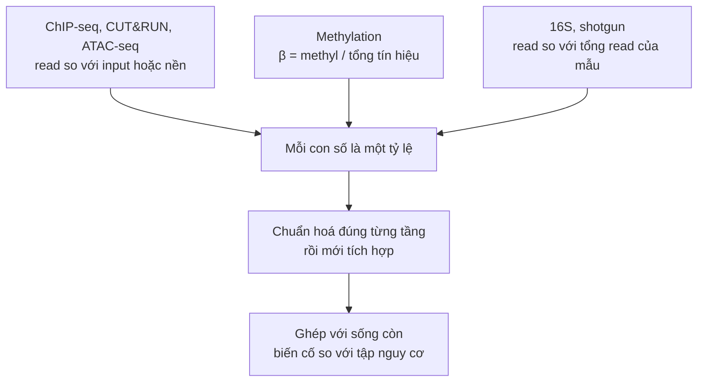
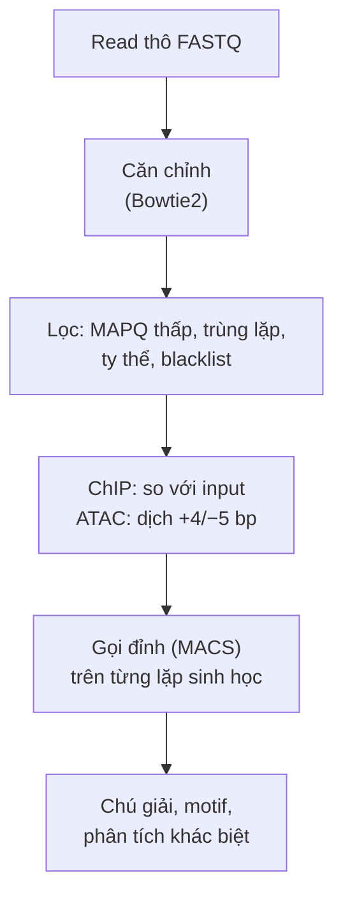

Tích hợp đa omics (multi-omics integration) ghép epigenomics, metagenomics, transcriptomics và dữ liệu lâm sàng để hiểu bệnh đầy đủ hơn, nhưng gần như mọi tầng trong đó là phép đo tương đối: đỉnh ChIP-seq so với mẫu input, giá trị β so với tổng tín hiệu tại một CpG, bảng đếm 16S so với tổng read do máy giải trình tự áp đặt. Bỏ qua mẫu số này sinh ra lỗi rất cụ thể: một loài vi khuẩn tăng 10 lần làm ba loài khác "giảm" từ 25% xuống 7,7% dù không mất tế bào nào. Trên 365 bệnh nhân ung thư gan của TCGA, cùng câu hỏi "đột biến TP53 có tiên lượng xấu không" cho p = 0,086 nếu đo sống còn toàn bộ, nhưng p = 0,049 với sống không tiến triển và p = 0,037 với sống đặc hiệu theo bệnh. Bài viết dành cho sinh viên và người tự học bioinformatics, đi qua epigenomics, metagenomics, bẫy dữ liệu compositional, các chiến lược tích hợp và một ví dụ Kaplan–Meier tự làm, kèm code Python chạy được.

<div class="callout callout-note">
<p class="callout-title">Tóm tắt nhanh</p>

- Mỗi tầng omics là một tỷ lệ: gọi tên mẫu số trước khi phân tích.
- ChIP-seq cần input control và lặp sinh học; ATAC-seq cần bỏ read ty thể, vùng blacklist và dịch đầu read Tn5; bisulfite không tách được 5-mC với 5-hmC.
- Bảng đếm microbiome là dữ liệu compositional: giảm giả, tương quan giả (trung bình −1/(D−1)) và các phương pháp DA bất đồng.
- Tích hợp có năm chiến lược; chọn phương pháp chấp nhận tầng thiếu khi giao các tầng làm mất nửa số mẫu (TCGA-LIHC: 372 → 173).
- Kết luận lâm sàng đổi theo endpoint: chọn endpoint trước, báo cáo số còn nguy cơ, kiểm tra giả định và nhiễu.

</div>

## 1. Mỗi tầng omics đo tỷ lệ so với cái gì

Đa omics hứa hẹn nối các tầng phân tử, từ DNA, chromatin, RNA, protein tới chất chuyển hoá và quần xã vi sinh, để thấy dòng thông tin dẫn đến bệnh rõ hơn khi nhìn từng tầng riêng (Hasin et al., 2017). Điều đó chỉ đúng khi từng tầng được đo và đọc đúng. Hai ví dụ dưới đây là hai con số tính không sai, nhưng rất dễ đọc sai.

**Ví dụ 1: loài "nở hoa".** Một mẫu phân có bốn loài vi khuẩn A, B, C, D, mỗi loài 100 tế bào, nên mỗi loài chiếm 25%. Một tuần sau, loài A tăng lên 1.000 tế bào, ba loài còn lại vẫn 100. Máy giải trình tự không đếm tế bào; nó trả về một số read gần như cố định cho mỗi mẫu. Trên bảng tỷ lệ, A chiếm 1.000/1.300 ≈ 76,9%, còn B, C, D cùng tụt xuống 100/1.300 ≈ 7,7%. Người đọc bảng sẽ viết "ba loài giảm hơn ba lần", trong khi số tế bào của chúng không đổi (Hình 1). Tình huống này không hề xa vời. Khi đếm tế bào song song với giải trình tự, người ta thấy tải lượng vi sinh trong phân của người khoẻ chênh nhau tới mười lần (Vandeputte et al., 2017).


*Hình 1. Ví dụ "nở hoa": chỉ taxon A tăng 10 lần, nhưng trên thang tỷ lệ B, C, D tụt từ 25% xuống 7,7%. Số liệu tính tay.*

**Ví dụ 2: trung vị đảo chiều.** Trên dữ liệu ung thư biểu mô tế bào gan (hepatocellular carcinoma, HCC) của TCGA, trung vị sống còn toàn bộ của nhóm có đột biến TP53 là 81,7 tháng, dài hơn nhóm TP53 wild-type (58,9 tháng). Đọc vội thì dễ kết luận đột biến TP53 "có lợi". Nhưng ở các mốc 12, 24, 36 và 48 tháng, xác suất sống của nhóm đột biến đều thấp hơn (mục 6). Trung vị của nhóm đột biến rơi vào đoạn đuôi đường cong, nơi chỉ còn vài bệnh nhân được theo dõi (7 người ở mốc 60 tháng).

Cả hai cùng một gốc: con số đúng về tính toán vẫn bị diễn giải sai khi người đọc không biết mẫu số (tổng read, tổng tế bào) hay tập nguy cơ (risk set, số người còn được theo dõi tại một thời điểm). Sơ đồ dưới tóm tắt "mẫu số" của các tầng dữ liệu trong bài.



Bài này nối tiếp phần DNA ([NGS và genomics](/blog/giai-trinh-tu-the-he-moi-ngs-va-genomics/)), RNA ([transcriptomics](/blog/transcriptomics-rna-seq-va-single-cell/)) và protein ([proteomics](/blog/proteomics-va-cau-truc-protein/)) của series, trong bức tranh các tầng omics đã giới thiệu ở [phần nhập môn](/blog/nhap-mon-bioinformatics/).

## 2. Epigenomics: đo điều hoà gen trên chromatin

Epigenomics đo những thay đổi trên chromatin điều hoà việc gen nào được phiên mã, mà không đổi trình tự DNA. Câu hỏi của tầng này là "vùng nào của genome đang được điều hoà, và bằng cơ chế gì".

### 2.1 Nền sinh học

DNA trong nhân quấn quanh các octamer histone thành nucleosome. Acetyl hoá histone thường gắn với chromatin mở và phiên mã hoạt động, methyl hoá histone có thể kích hoạt hoặc ức chế tuỳ vị trí, còn các phức hợp tái cấu trúc chromatin (chromatin remodelling) đẩy hoặc tháo nucleosome để yếu tố phiên mã tiếp cận DNA (xem thêm điều hoà hoạt động gen).

Methyl hoá DNA ở động vật có vú là việc gắn nhóm methyl vào cytosine, tạo 5-methylcytosine (5-mC), do các enzyme DNMT1, DNMT3A và DNMT3B đảm nhận (Carey, 2013). Methyl hoá xảy ra chủ yếu ở cytosine trong dinucleotide CpG, và các CpG này trải khắp genome chứ không nằm gọn trong các đảo CpG (CpG island). Bản đồ độ phân giải base đầu tiên của methylome người còn cho thấy ở tế bào gốc phôi, gần một phần tư lượng methyl hoá nằm ngoài ngữ cảnh CG (Lister et al., 2009).

Hai dự án tạo ra bản đồ tham chiếu mà mọi phân tích epigenomics đều so tới: ENCODE, bách khoa toàn thư các yếu tố chức năng trên genome người (ENCODE Project Consortium, 2012), và Roadmap Epigenomics với 111 epigenome tham chiếu của người (Roadmap Epigenomics Consortium et al., 2015).

### 2.2 ChIP-seq và CUT&RUN

ChIP-seq (chromatin immunoprecipitation sequencing) dùng kháng thể kéo xuống các đoạn DNA gắn với một protein, rồi giải trình tự chúng. Kỹ thuật này lập bản đồ vị trí gắn của yếu tố phiên mã (Johnson et al., 2007) và của biến đổi histone (Barski et al., 2007) trên toàn genome.

Một đỉnh ChIP-seq không phải tín hiệu tuyệt đối. MACS, công cụ gọi đỉnh phổ biến nhất, ước lượng độ dịch của tag và dùng phân phối Poisson động, với tham số λ cục bộ, để xử lý thiên lệch theo vùng; đỉnh là vùng có số read **cao hơn kỳ vọng so với nền cục bộ** (Zhang et al., 2008). Nền đó lấy từ mẫu input, tức chromatin đã cắt nhỏ nhưng không qua kết tủa miễn dịch. Không có input, phần mềm vẫn gọi được đỉnh, nhưng những vùng dễ cắt, nhiều bản sao hoặc dễ khuếch đại sẽ trông như vùng gắn.

Hướng dẫn của ENCODE và modENCODE nêu bốn nhóm yêu cầu: kiểm định kháng thể, lặp thí nghiệm, độ sâu giải trình tự và đánh giá chất lượng dữ liệu (Landt et al., 2012). Lặp sinh học (biological replicate) là mẫu từ các lần nuôi cấy hoặc cá thể khác nhau, không phải chạy lại cùng một thư viện. Một chuỗi công cụ thường gặp là Bowtie2 để căn chỉnh (Langmead & Salzberg, 2012), MACS để gọi đỉnh (Zhang et al., 2008; phiên bản hiện hành là MACS3), HOMER để tìm motif (Heinz et al., 2010) và ChIPseeker để chú giải đỉnh theo gen (Yu et al., 2015).

CUT&RUN đi ngược lại: thay vì kéo chromatin xuống, nó đưa một nuclease gắn theo kháng thể vào nhân và cắt tại chỗ. Vì chỉ những đoạn được cắt mới thoát ra, nền rất thấp, nên chỉ cần khoảng một phần mười độ sâu giải trình tự của ChIP-seq (Skene & Henikoff, 2017).

<div class="callout callout-warning">
<p class="callout-title">Lỗi hay gặp với ChIP-seq</p>

- Gọi đỉnh không có input, rồi diễn giải mọi đỉnh mạnh là vị trí gắn: vùng dễ cắt hoặc lặp lại cũng cho đỉnh mạnh.
- Gộp read của hai lần chạy cùng một thư viện rồi gọi đó là hai lặp: đó là lặp kỹ thuật, không cho biết độ biến thiên sinh học.
- So số đỉnh giữa hai điều kiện khi độ sâu giải trình tự chênh nhau: số đỉnh phụ thuộc độ sâu, nên cần chuẩn hoá hoặc lấy mẫu con về cùng độ sâu trước khi so.

</div>

Cùng logic "so với nền" áp dụng cho kỹ thuật thứ ba của tầng này, nơi không cần kháng thể.

### 2.3 ATAC-seq

ATAC-seq dùng enzyme Tn5 transposase chèn adapter giải trình tự trực tiếp vào chromatin tự nhiên. Tn5 chỉ chèn được vào vùng không bị nucleosome che, nên mật độ vết chèn phản ánh mức chromatin mở. Phương pháp cần 500–50.000 tế bào và cho cùng lúc bản đồ chromatin mở, vị trí gắn yếu tố phiên mã và vị trí nucleosome (Buenrostro et al., 2013).

Tổng quan của Yan et al. (2020) chia phân tích ATAC-seq thành QC, căn chỉnh, gọi đỉnh, phân tích khác biệt, motif và footprinting, kèm các ngưỡng thực hành. Tỷ lệ read căn chỉnh duy nhất trên 80% là điển hình cho một thí nghiệm thành công. Với động vật có vú, nên có tối thiểu 50 triệu read căn chỉnh cho phát hiện chromatin mở và phân tích khác biệt, 200 triệu cho footprinting. Sau căn chỉnh, ba nhóm read phải bỏ: read trên genome ty thể (vốn dễ tiếp cận vì không đóng gói chromatin, nên có độ phủ rất cao), read trong vùng blacklist của ENCODE, và read trùng lặp do PCR. Cuối cùng, đầu read được dịch +4 bp trên mạch dương và −5 bp trên mạch âm, vì Tn5 tạo một đoạn lặp 9 bp khi sửa vết cắt (Yan et al., 2020). Hai biểu đồ QC giúp nhận ra thư viện tốt: phân bố kích thước đoạn có đỉnh quanh 100 bp (đoạn không có nucleosome) và quanh 200 bp (đoạn quấn một nucleosome), còn biểu đồ quanh TSS cho thấy đoạn không nucleosome tập trung ngay tại TSS.

Vùng blacklist là những vùng genome cho tín hiệu cao bất thường trong mọi thí nghiệm giải trình tự chức năng, bất kể kháng thể hay loại tế bào; loại chúng là bước chất lượng thiết yếu (Amemiya et al., 2019).



Phân tích khác biệt giữa điều kiện dùng các gói như DiffBind; một ứng dụng tiêu biểu của cách tiếp cận này là phát hiện gắn thụ thể oestrogen khác nhau giữa các khối u vú, liên quan tới kết cục lâm sàng (Ross-Innes et al., 2012). Để xem tín hiệu, deepTools tạo file bigWig và heatmap quanh vị trí bắt đầu phiên mã (TSS) (Ramírez et al., 2016), còn IGV cho phép duyệt từng vùng (Robinson et al., 2011); định dạng BED và bigWig được giới thiệu ở [phần định dạng dữ liệu](/blog/dinh-dang-du-lieu-va-co-so-du-lieu-sinh-hoc/).

### 2.4 Methyl hoá DNA: bisulfite và array

Xử lý bisulfite chuyển cytosine chưa methyl hoá thành uracil (đọc thành T sau PCR), còn 5-mC giữ nguyên là C (Frommer et al., 1992). So read với genome tham chiếu, mỗi vị trí C/T cho biết một phân tử DNA có methyl hoá ở đó hay không. Giải trình tự bisulfite toàn genome (WGBS) cho bản đồ methyl hoá độ phân giải base (Lister et al., 2009); RRBS (reduced representation bisulfite sequencing) giảm chi phí bằng cách cắt enzyme giới hạn để chỉ giải trình tự các vùng giàu CpG (Meissner et al., 2005).

Giới hạn quan trọng: bisulfite **không phân biệt** 5-mC với 5-hydroxymethylcytosine (5-hmC), và vùng nhiều 5-hmC còn có thể bị khuếch đại kém (Huang et al., 2010). Một "vùng methyl hoá cao" trên dữ liệu bisulfite có thể chứa cả hai dạng.

Công cụ phổ biến gồm Bismark để căn chỉnh và gọi methyl hoá (Krueger & Andrews, 2011), methylKit để phân tích khác biệt (Akalin et al., 2012) và DSS, dùng mô hình Bayes phân cấp cho dữ liệu độ phân giải base (Feng et al., 2014). Với mẫu lâm sàng số lượng lớn, array Infinium rẻ hơn: 450K đo hơn 450.000 CpG với độ phân giải từng vị trí (Bibikova et al., 2011), EPIC mở rộng độ phủ (Pidsley et al., 2016); minfi (Aryee et al., 2014) và SeSAMe (Zhou et al., 2018) xử lý dữ liệu thô.

Array và bisulfite đều trả về một tỷ lệ. Giá trị β = methyl / (methyl + không methyl) nằm trong [0, 1]. Giá trị M = log₂(β / (1 − β)) là logit cơ số 2 của β. Du et al. (2010) cho thấy β có phương sai không đồng nhất mạnh ở các CpG methyl hoá rất cao hoặc rất thấp; họ khuyên dùng M cho phân tích methyl hoá khác biệt và báo cáo kèm β vì β dễ diễn giải sinh học hơn (Hình 2). Ví dụ: một CpG đi từ β = 0,80 lên 0,95 và một CpG khác đi từ 0,40 lên 0,55 cùng tăng 0,15 trên thang β. Trên thang M, CpG thứ nhất tăng từ 2,00 lên 4,25 (thêm 2,25 đơn vị), còn CpG thứ hai từ −0,58 lên 0,29 (thêm 0,87 đơn vị). Vì phương sai của β co lại ở hai đầu, cùng một khác biệt 0,15 ở gần 1 hiếm gặp hơn nhiều so với ở giữa thang, và M phản ánh điều đó.

```python
import numpy as np
beta = np.array([0.05, 0.2, 0.5, 0.8, 0.95])
M = np.log2(beta / (1 - beta))          # [-4.25 -2.  0.  2.  4.25]
beta_back = 2**M / (2**M + 1)           # đổi ngược về β
print(M.round(2), beta_back.round(2))
```


*Hình 2. Quan hệ giữa β và M: gần 0 và 1, một thay đổi nhỏ của β tương ứng thay đổi lớn của M.*

**Bảng 1. Các kỹ thuật epigenomics: đo gì, so với cái gì**

| Kỹ thuật | Đo gì | So với cái gì | QC không được bỏ | Công cụ | Nguồn |
|---|---|---|---|---|---|
| ChIP-seq | Vị trí gắn protein hoặc biến đổi histone | Input (chromatin không kết tủa) | Kiểm định kháng thể, lặp sinh học, độ sâu | Bowtie2, MACS, HOMER, ChIPseeker | Landt et al. (2012); Zhang et al. (2008) |
| CUT&RUN | Như ChIP-seq, cắt tại chỗ | Nền thấp do chỉ đoạn bị cắt thoát ra | Độ sâu ~1/10 ChIP | MACS | Skene & Henikoff (2017) |
| ATAC-seq | Chromatin mở, nucleosome | Mật độ vết chèn Tn5 so với nền | Bỏ ty thể, blacklist, trùng lặp; dịch +4/−5 bp | MACS, DiffBind, deepTools | Buenrostro et al. (2013); Yan et al. (2020) |
| WGBS, RRBS | Methyl hoá từng CpG | Tỷ lệ C/(C+T) tại mỗi vị trí | Tỷ lệ chuyển đổi bisulfite; 5-mC/5-hmC | Bismark, methylKit, DSS | Lister et al. (2009); Huang et al. (2010) |
| 450K, EPIC | Methyl hoá CpG chọn sẵn | β = methyl / tổng | Chuẩn hoá, probe lỗi | minfi, SeSAMe | Du et al. (2010) |

## 3. Metagenomics: ai có mặt và làm gì

Metagenomics giải trình tự DNA của cả một quần xã vi sinh mà không cần nuôi cấy. Hai câu hỏi của tầng này là "ai có mặt" và "chúng làm được gì".

### 3.1 16S rRNA và shotgun

Có hai cách tiếp cận chính (Knight et al., 2018; Quince et al., 2017). Giải trình tự amplicon 16S rRNA khuếch đại một vùng biến đổi của gen 16S rồi giải trình tự, nên rẻ và nhanh nhưng chỉ cho biết phân loại. Shotgun metagenomics giải trình tự ngẫu nhiên toàn bộ DNA, nên cho cả phân loại tới mức loài và thông tin gen chức năng. So sánh trực tiếp trên mẫu ruột gà, 16S chỉ thấy một phần quần xã mà shotgun thấy; khi đủ read, shotgun phát hiện tốt hơn các chi ít phổ biến, và các chi hiếm đó có ý nghĩa sinh học trong việc phân biệt các điều kiện (Durazzi et al., 2021).

**Bảng 2. So sánh 16S và shotgun**

| Tiêu chí | 16S rRNA amplicon | Shotgun metagenomics |
|---|---|---|
| Đối tượng giải trình tự | Một vùng gen marker | Toàn bộ DNA trong mẫu |
| Độ phân giải phân loại | Thường tới chi | Tới loài, có khi tới chủng |
| Thông tin chức năng | Không đo trực tiếp | Có (gen, pathway) |
| Chi phí, độ sâu cần | Thấp | Cao hơn |
| Công cụ chính | QIIME 2, DADA2, SILVA | Kraken 2, Bracken, MetaPhlAn, HUMAnN |
| Bằng chứng so sánh | Thấy một phần quần xã | Phát hiện tốt hơn taxon hiếm khi đủ read (Durazzi et al., 2021) |

### 3.2 Từ read đến bảng ASV

QIIME 2 là nền tảng phổ biến cho dữ liệu amplicon (Bolyen et al., 2019). DADA2 suy ra chính xác các trình tự có trong mẫu và phân biệt được khác biệt chỉ 1 nucleotide (Callahan et al., 2016). Đơn vị kết quả là biến thể trình tự amplicon (amplicon sequence variant, ASV), và Callahan et al. (2017) lập luận ASV nên thay OTU vì có thể so sánh trực tiếp giữa các nghiên cứu. Gán phân loại thường dùng cơ sở dữ liệu SILVA (Quast et al., 2013).

Hướng dẫn "Moving Pictures" của QIIME 2 dùng một phần dữ liệu của Caporaso et al. (2011): mẫu từ 2 người, 4 vị trí cơ thể, 5 thời điểm, khử nhiễu bằng DADA2 hoặc Deblur rồi tính đa dạng alpha và beta (QIIME 2 Development Team, n.d.).

### 3.3 Shotgun: phân loại, chức năng, genome

Với shotgun, Kraken 2 gán phân loại cho từng read (Wood et al., 2019), Bracken ước lượng lại độ phong phú ở mức loài (Lu et al., 2017), còn MetaPhlAn dùng gen marker đặc hiệu trong bộ bioBakery 3 (Beghini et al., 2021). HUMAnN tính độ phong phú gen và pathway ở mức loài (Franzosa et al., 2018). Muốn có genome từ metagenome (metagenome-assembled genome, MAG), read được lắp ráp bằng MEGAHIT (Li et al., 2015) rồi chia nhóm contig bằng MetaBAT 2 (Kang et al., 2019).

### 3.4 Nhiễm bẩn và đối chứng âm

DNA nhiễm có mặt trong kit tách chiết và hoá chất phòng thí nghiệm, và ảnh hưởng nặng nhất tới mẫu sinh khối thấp; Salter et al. (2014) khuyên giải trình tự đồng thời mẫu đối chứng âm. Gói decontam dùng nồng độ DNA hoặc tần suất xuất hiện trong đối chứng âm để nhận diện trình tự nhiễm bằng thống kê (Davis et al., 2018).

### 3.5 Đa dạng và kiểm định

Đa dạng alpha mô tả một mẫu. Độ phong phú (richness, trong QIIME 2 là Observed Features) chỉ đếm số taxon có mặt. Chỉ số Shannon tính cả số taxon lẫn độ đồng đều giữa chúng, nên hai mẫu cùng 100 taxon có thể có Shannon rất khác nhau. Lấy ví dụ nhỏ hơn: mẫu X có 4 taxon chia đều 25% mỗi taxon, mẫu Y cũng 4 taxon nhưng một taxon chiếm 97%, ba taxon còn lại mỗi taxon 1%. Richness của hai mẫu bằng nhau (4), nhưng chỉ số Shannon tính bằng logarit tự nhiên là 1,386 cho X và 0,168 cho Y. Viết "đa dạng alpha (Shannon, số loài)" là gộp hai đại lượng này làm một. Faith's PD thêm thông tin cây phát sinh, Pielou's evenness chỉ đo độ đồng đều.

Đa dạng beta so sánh các mẫu với nhau: Bray–Curtis dựa trên độ phong phú (Bray & Curtis, 1957), UniFrac dựa trên phần nhánh cây phát sinh chung hay riêng (Lozupone & Knight, 2005). Ma trận khoảng cách sau đó được kiểm định bằng PERMANOVA (Anderson, 2001).

PERMANOVA kiểm định giả thuyết không rằng tâm (centroid) các nhóm trùng nhau. Mô phỏng của Anderson và Walsh (2013) cho thấy ANOSIM và kiểm định Mantel rất nhạy với độ phân tán (dispersion) khác nhau giữa nhóm, còn PERMANOVA ít bị ảnh hưởng khi thiết kế cân bằng; với thiết kế không cân bằng và độ phân tán khác nhau thì không kiểm định nào đáng tin cậy. Cách làm thực tế: đếm số mẫu mỗi nhóm trước, chạy PERMANOVA cho "vị trí" và PERMDISP (betadisper) cho "độ phân tán", rồi diễn giải cặp kết quả.

Đơn vị lặp cũng quan trọng. Trong Moving Pictures, các mẫu của cùng một người không độc lập, nên p-value của PERMANOVA theo vị trí cơ thể mô tả hai người này chứ không khái quát cho quần thể (xem [toán và thống kê cho sinh học](/blog/toan-va-thong-ke-cho-sinh-hoc/)).

Cả đa dạng alpha, beta lẫn PERMANOVA đều được tính trên một bảng đếm mà tổng mỗi mẫu là con số do máy quyết định. Chi tiết này nặng ký hơn việc chọn chỉ số nào, và mục sau giải thích vì sao.

## 4. Bẫy dữ liệu compositional

### 4.1 Dữ liệu compositional là gì

Dữ liệu compositional là dữ liệu mà thông tin nằm ở **tỷ số giữa các phần**, không ở giá trị tuyệt đối của từng phần. Nền tảng thống kê cho loại dữ liệu này là phân tích log-ratio của Aitchison (1982). Gloor et al. (2017) lập luận rằng bộ dữ liệu 16S, metagenome và metatranscriptome đều là compositional, vì tổng số read của mỗi mẫu do máy giải trình tự áp đặt một cách tuỳ ý, và việc xử lý chúng như composition ở mọi bước "không phải tuỳ chọn".

Microbiome không phải trường hợp riêng. Bất cứ khi nào read được đếm và gán vào nhiều đặc trưng trên một tổng cố định, ta có dữ liệu cùng loại: RNA-seq, ChIP-seq, 16S, metagenomics, thí nghiệm tăng trưởng chọn lọc. ALDEx2 được xây dựng trên nhận xét đó và được thử trên RNA-seq, 16S lẫn tăng trưởng chọn lọc (Fernandes et al., 2014). Vì vậy bài học của mục này cũng áp dụng cho [dữ liệu RNA-seq](/blog/transcriptomics-rna-seq-va-single-cell/).

### 4.2 Ba bệnh lý

**Giảm giả.** Ví dụ "nở hoa" ở mục 1 là trường hợp đơn giản nhất: một taxon tăng làm mọi taxon khác giảm trên thang tỷ lệ. Phân tích tương đối không cho biết hướng và độ lớn thay đổi của số lượng thật (Vandeputte et al., 2017).

**Tương quan giả.** Giả sử có D taxon với số lượng tuyệt đối hoàn toàn độc lập. Khi chia cho tổng, các tỷ lệ cộng lại bằng 1, nên phương sai của tổng bằng 0. Viết ra: Var(Σpᵢ) = Σ Var(pᵢ) + Σ_{i≠j} Cov(pᵢ, pⱼ) = 0. Nếu các taxon có phương sai như nhau, tổng các hiệp phương sai phải bằng −D lần phương sai, và tương quan trung bình giữa các cặp là

$$\bar r = -\frac{1}{D-1}.$$

Với 3 taxon, tương quan trung bình là −0,5 dù không có tương tác sinh học nào. Mô phỏng 1.000 mẫu lognormal (σ = 1, seed 42) cho đúng giá trị này: tương quan trên số tuyệt đối gần 0 (0,005; −0,008; 0,000), trên tỷ lệ là −0,500 với D = 3, −0,250 với D = 5 và −0,052 với D = 20 (Hình 3). Biến đổi centred log-ratio (CLR) cũng không sửa được tương quan trung bình (−0,500; −0,250; −0,053), vì CLR có tổng bằng 0 theo hàng, một ràng buộc tương tự. Lovell et al. (2015) kết luận tương quan không hợp lệ cho dữ liệu tương đối và đề xuất thay bằng proportionality, đo bằng thống kê ϕ dựa trên phương sai của log-ratio giữa hai thành phần.


*Hình 3. Phân phối tương quan giữa các cặp taxon độc lập (dữ liệu mô phỏng). Đường đứt: −1/(D−1).*

```python
import numpy as np, pandas as pd

# Ví dụ "nở hoa": chỉ A tăng 10 lần
truoc = pd.Series({"A": 100, "B": 100, "C": 100, "D": 100})
sau = truoc.copy(); sau["A"] = 1000
print((sau / sau.sum()).round(3).to_dict())   # B, C, D: 0.25 -> 0.077

# Tương quan giả giữa các taxon độc lập
rng = np.random.default_rng(42)
def tuong_quan_tb(m):
    c = np.corrcoef(m, rowvar=False)
    return c[~np.eye(len(c), dtype=bool)].mean()
for D in (3, 5, 20):
    x = rng.lognormal(0, 1, size=(1000, D))          # số tuyệt đối
    p = x / x.sum(axis=1, keepdims=True)              # tỷ lệ
    clr = np.log(p) - np.log(p).mean(axis=1, keepdims=True)
    print(D, round(tuong_quan_tb(x), 3), round(tuong_quan_tb(p), 3),
          round(tuong_quan_tb(clr), 3), round(-1 / (D - 1), 3))
```

Với hàng trăm taxon, tương quan giả trung bình nhỏ, nhưng từng cặp vẫn lệch, nhất là khi vài taxon chiếm phần lớn read. Cặp Bacteroides–Prevotella thường được mô tả là "đánh đổi nhau" trong ruột; khi đo tải lượng tuyệt đối, Vandeputte et al. (2017) cho thấy quan hệ này một phần là sản phẩm của phân tích tương đối.

**Các phương pháp phân tích khác biệt (DA) bất đồng.** Nearing et al. (2022) chạy 14 phương pháp DA trên 38 bộ dữ liệu 16S và nhận được số lượng lẫn tập ASV có ý nghĩa khác nhau rất xa giữa các phương pháp. ALDEx2 và ANCOM-II cho kết quả nhất quán nhất giữa các nghiên cứu, và tác giả khuyên dùng đồng thuận của nhiều phương pháp thay vì tin một phương pháp.

<div class="callout callout-warning">
<p class="callout-title">Lỗi hay gặp khi biến đổi log-ratio</p>

- Bảng ASV có rất nhiều số 0, mà log(0) không xác định. Cộng một pseudocount nhỏ trước khi lấy log là cách làm phổ biến, nhưng giá trị chọn ảnh hưởng tới kết quả của taxon hiếm; nên thử hai giá trị và báo cáo cả hai.
- Lọc taxon hiếm **sau** khi chuẩn hoá tỷ lệ làm đổi mẫu số; lọc trước, rồi mới chuẩn hoá.
- Dùng tương quan Pearson hay Spearman trên bảng tỷ lệ để dựng mạng đồng xuất hiện: mạng đó chứa cả tương quan âm giả theo công thức ở trên.

</div>

### 4.3 Lối thoát

Không có cách nào "khôi phục" số tuyệt đối từ dữ liệu tương đối mà không thêm thông tin. Các lối thoát có căn cứ chia thành ba nhóm (Bảng 3).

**Bảng 3. Phương pháp cho dữ liệu compositional**

| Cách tiếp cận | Giả định, ý tưởng | Đầu ra | Nguồn |
|---|---|---|---|
| ALDEx2 | Mô phỏng Monte Carlo Dirichlet, biến đổi CLR | Khác biệt trên thang log-ratio | Fernandes et al. (2014) |
| ANCOM | Kiểm định log-ratio của mỗi taxon với mọi taxon khác | Taxon khác biệt (thống kê W) | Mandal et al. (2015) |
| ANCOM-BC | Ước lượng và hiệu chỉnh sampling fraction | Hệ số, khoảng tin cậy, kiểm soát FDR | Lin & Peddada (2020) |
| Reference frames | So mỗi taxon với một taxon tham chiếu | Thay đổi tương đối có hướng, không cần tổng tải lượng | Morton et al. (2019) |
| Đo tuyệt đối | Đếm tế bào bằng flow cytometry song song giải trình tự | Số tế bào ước lượng mỗi taxon | Vandeputte et al. (2017) |
| Proportionality | Phương sai log-ratio giữa hai thành phần | Thống kê ϕ thay cho tương quan | Lovell et al. (2015) |

Còn rarefying, tức rút ngẫu nhiên read để mọi mẫu cùng độ sâu, thì McMurdie và Holmes (2014) cho rằng cả rarefying lẫn tỷ lệ đơn thuần đều sinh nhiều dương tính giả, và khuyên tránh rarefying khi phân tích khác biệt. Đây là một quan điểm trong một cuộc tranh luận vẫn đang tiếp diễn; rarefying vẫn được dùng trong nhiều quy trình tính đa dạng.

### 4.4 Liên hệ các tầng khác

Mục 2 đã cho thấy β là tỷ lệ của hai phần, và tín hiệu ChIP-seq là mức làm giàu so với input. Thông điệp cho phần tích hợp: mỗi tầng phải được đưa về một thang có ý nghĩa thống kê (log-ratio, M-value, log-count đã chuẩn hoá) **trước** khi ghép. Nếu một tầng còn chứa tương quan giả, một tầng khác còn phụ thuộc độ sâu giải trình tự, thì phương pháp tích hợp sẽ tìm ra đúng những "trục biến thiên chung" sinh ra từ cách đo chứ không từ sinh học.

## 5. Tích hợp đa omics

### 5.1 Năm chiến lược

Ritchie et al. (2015) tổng hợp các phương pháp tích hợp dữ liệu để tìm tương tác kiểu gen – kiểu hình. Picard et al. (2021) phân loại chiến lược tích hợp cho học máy thành năm nhóm: early, mixed, intermediate, late và hierarchical. Cách chia ba (sớm, trung gian, muộn) hay gặp là bản rút gọn của sơ đồ này.

**Bảng 4. Chiến lược tích hợp**

| Chiến lược | Cách làm | Điểm mạnh | Điểm yếu | Ví dụ |
|---|---|---|---|---|
| Early (sớm) | Ghép các ma trận theo cột | Đơn giản | Cần mẫu đủ mọi tầng; tầng nhiều biến lấn át | Ghép rồi chạy PCA |
| Mixed (hỗn hợp) | Biến đổi riêng từng tầng rồi ghép | Giảm chênh lệch số biến | Mất một phần thông tin | Kernel, đồ thị từng tầng |
| Intermediate (trung gian) | Học biểu diễn chung | Thấy biến thiên chung và riêng | Khó diễn giải | MOFA, DIABLO, jDR |
| Late (muộn) | Phân tích riêng, kết hợp kết quả | Linh hoạt, chịu tầng thiếu | Bỏ qua tương tác giữa tầng | Kết hợp dự đoán |
| Hierarchical (phân cấp) | Theo quan hệ sinh học giữa tầng | Gắn với dòng thông tin DNA → RNA → protein | Cần tri thức trước | Mô hình điều hoà |

Ghi chú: cột điểm mạnh và yếu tóm tắt lập luận chung về các chiến lược; năm nhóm theo Picard et al. (2021).

Trong thực hành, một trình tự câu hỏi đơn giản giúp chọn chiến lược:

1. Câu hỏi là khám phá (các tầng cùng biến thiên theo trục nào) hay dự đoán, phân loại (đặc trưng nào phân biệt hai nhóm)? Khám phá hợp với phương pháp không giám sát như MOFA; phân loại hợp với phương pháp có giám sát như DIABLO.
2. Bao nhiêu mẫu có đủ mọi tầng? Nếu giao các tầng làm mất nhiều mẫu, chọn phương pháp chấp nhận tầng thiếu hoặc tích hợp muộn.
3. Số biến mỗi tầng chênh nhau bao nhiêu? Một tầng hàng trăm nghìn CpG ghép với một tầng vài trăm protein sẽ lấn át nếu không chọn biến hoặc chuẩn hoá trọng số theo tầng.
4. Mỗi tầng đã được biến đổi về thang phù hợp chưa (mục 4.4)? Chưa thì quay lại bước tiền xử lý.
5. Có bộ dữ liệu độc lập để kiểm chứng không? Không có thì kết quả tích hợp nên được trình bày như giả thuyết.

### 5.2 Công cụ

**MOFA** (Multi-Omics Factor Analysis) suy ra một số factor ẩn gom các nguồn biến thiên chung giữa các tầng và riêng của từng tầng; bài gốc áp dụng trên 200 bệnh nhân bạch cầu lympho mạn (CLL) với đột biến, RNA, methyl hoá và đáp ứng thuốc (Argelaguet et al., 2018). **MOFA+** mở rộng cho dữ liệu đơn bào đa phương thức nhiều nhóm mẫu, dùng suy luận biến phân (Argelaguet et al., 2020). Với dữ liệu bulk như TCGA, bài MOFA năm 2018 là tài liệu phương pháp phù hợp; gói MOFA2 hiện thực cả hai.

**DIABLO**, trong gói mixOmics (Rohart et al., 2017), là phương pháp có giám sát: chọn các đặc trưng tương quan giữa các tầng đồng thời phân biệt nhóm kiểu hình (Singh et al., 2019). MOFA trả lời "các tầng cùng biến thiên theo trục nào", còn DIABLO trả lời "đặc trưng nào ở các tầng cùng phân biệt bệnh và chứng".

**WGCNA** dựng mạng tương quan có trọng số và các module gen đồng biểu hiện (Langfelder & Horvath, 2008). Bản chất đây là phân tích **một tầng**, thường là biểu hiện gen; module có thể được đối chiếu với tầng khác sau đó, nhưng WGCNA không tự nó là phương pháp tích hợp.

**Benchmark.** Cantini et al. (2021) so sánh 9 phương pháp giảm chiều kết hợp (joint dimensionality reduction, jDR) trên dữ liệu mô phỏng, TCGA (dự đoán sống còn, chú giải lâm sàng, pathway) và đơn bào. intNMF tốt nhất về phân cụm, MCIA ổn định trong nhiều bối cảnh; không phương pháp nào thắng ở mọi tiêu chí. Với người mới, chạy hai phương pháp khác nhau rồi so kết quả đáng làm hơn đi tìm "phương pháp tốt nhất". Phần tích hợp sâu bằng deep learning được bàn ở [phần machine learning](/blog/machine-learning-va-ai-trong-sinh-hoc/).

### 5.3 Thực tế dữ liệu TCGA-LIHC

Nghiên cứu `lihc_tcga_pan_can_atlas_2018` trên cBioPortal có 372 mẫu: 366 có dữ liệu đột biến, 366 có RNA-seq, 372 có methyl hoá HM450 nhưng chỉ 179 có RPPA (protein). Giao đột biến với RNA còn 361 mẫu, thêm methyl hoá vẫn 361, thêm RPPA chỉ còn 173, tức mất hơn một nửa (Hình 4). So với 361 mẫu có đủ đột biến, RNA và methyl hoá, ghép sớm cả bốn tầng buộc bỏ 188 mẫu (199 nếu tính trên 372). MOFA chấp nhận tầng thiếu nên giữ được các mẫu này trong mô hình (Argelaguet et al., 2018).


*Hình 4. TCGA-LIHC: số mẫu theo tầng và phần giao (cBioPortal REST API, truy vấn 27/11/2026).*

Phân tích tích hợp gốc của TCGA cho HCC giải trình tự exome 363 ca, trong đó 196 ca có thêm methyl hoá, RNA, miRNA và proteomics; phân nhóm từ 5 nền tảng ra 3 phân nhóm, một nhóm tiên lượng xấu hơn, và một chữ ký biểu hiện các gen đích của p53 tương quan với sống còn kém (Cancer Genome Atlas Research Network, 2017). Mục tiếp theo kiểm tra một phiên bản đơn giản của câu hỏi đó trên dữ liệu công khai.

## 6. Ví dụ tự làm: Kaplan–Meier theo TP53 trên TCGA-LIHC

### 6.1 Dữ liệu và định nghĩa nhóm

Dữ liệu lấy từ cBioPortal (Cerami et al., 2012; Gao et al., 2013), nghiên cứu Liver Hepatocellular Carcinoma (TCGA, PanCancer Atlas), qua REST API. Dữ liệu lâm sàng của PanCancer Atlas đã được chuẩn hoá theo TCGA Clinical Data Resource (TCGA-CDR), nguồn đưa ra bốn endpoint (OS, DSS, DFI, PFI) và khuyến nghị endpoint nào dùng được cho từng loại ung thư (Liu et al., 2018).

Nhóm "TP53 đột biến" gồm bệnh nhân có ít nhất một đột biến TP53 trong profile mutations của 366 bệnh nhân được giải trình tự: 110 người (30%). Một người trong số 366 không có dữ liệu OS, nên các phân tích sống còn dưới đây dùng 365 người. Theo loại: 64 người chỉ có missense, 41 người có ít nhất một đột biến cắt cụt (frameshift, nonsense, splice site), 5 người có loại khác (in-frame, splice region).

Để tự lặp lại, bạn có thể đi theo các bước sau với REST API công khai của cBioPortal (không cần tài khoản):

1. Lấy danh sách mẫu đã giải trình tự: `GET /api/sample-lists/lihc_tcga_pan_can_atlas_2018_sequenced/sample-ids`.
2. Lấy đột biến TP53 (Entrez 7157): `POST /api/molecular-profiles/lihc_tcga_pan_can_atlas_2018_mutations/mutations/fetch` với `sampleListId` ở bước 1 và `entrezGeneIds: [7157]`.
3. Lấy dữ liệu lâm sàng cấp bệnh nhân: `GET /api/studies/lihc_tcga_pan_can_atlas_2018/clinical-data?clinicalDataType=PATIENT`, giữ các trường `OS_MONTHS`, `OS_STATUS`, `PFS_MONTHS`, `PFS_STATUS`, `DSS_MONTHS`, `DSS_STATUS`, `AGE`, `AJCC_PATHOLOGIC_TUMOR_STAGE`.
4. Ghép theo mã bệnh nhân, đánh dấu `tp53 = 1` cho bệnh nhân có ít nhất một đột biến, mã hoá trạng thái "1:DECEASED" (hoặc "1:PROGRESSION") thành biến cố.

Các con số trong mục này có thể lệch nhẹ nếu cBioPortal cập nhật bản import; ghi ngày tải dữ liệu cùng kết quả.

Gộp các loại này thành một nhóm là một lựa chọn cần nói rõ. Đột biến TP53 trong ung thư chủ yếu là missense, khoảng 70% các biến đổi, và khoảng 10% khối u đột biến TP53 mang đột biến nonsense (Hassin & Oren, 2023). Missense và cắt cụt khác nhau về cơ chế (xem [phân tích trình tự](/blog/phan-tich-trinh-tu/)). Phân tích TP53 trên 10.225 mẫu thuộc 32 loại ung thư của TCGA cho thấy hơn 91% ung thư đột biến TP53 mất allele thứ hai, và một chữ ký RNA của TP53 đột biến tương quan với sống còn giảm ở 11 loại ung thư (Donehower et al., 2019).

### 6.2 Công cụ thống kê

Ước lượng Kaplan–Meier tính hàm sống từ quan sát không đầy đủ, nơi một số bệnh nhân bị kiểm duyệt (censored) vì mất theo dõi hoặc nghiên cứu kết thúc (Kaplan & Meier, 1958; Clark et al., 2003). Kiểm định log-rank so sánh hai đường cong trên toàn bộ thời gian theo dõi (Bland & Altman, 2004). Mô hình Cox ước lượng tỷ số nguy cơ (hazard ratio, HR) và cho phép hiệu chỉnh biến khác, với giả định HR không đổi theo thời gian (Cox, 1972; Therneau & Grambsch, 2000).

Toàn bộ số liệu dưới đây được tính bằng gói Python lifelines 0.30.3 (Davidson-Pilon, 2019) trên dữ liệu tải ngày 27/11/2026. Năm bệnh nhân có thời gian OS bằng 0 được giữ nguyên trong phân tích.

### 6.3 Kết quả

**Bảng 5. Đột biến TP53 và sống còn trên TCGA-LIHC**

| Endpoint | n (đột biến / WT) | Biến cố (đột biến / WT) | Log-rank | HR Cox một biến (KTC 95%) | Trung vị, tháng (đột biến / WT) |
|---|---|---|---|---|---|
| OS (sống còn toàn bộ) | 110 / 255 | 40 / 87 | χ² = 2,95; p = 0,086 | 1,39 (0,95–2,04) | 81,7 / 58,9 |
| PFS (sống không tiến triển) | 110 / 255 | 60 / 117 | χ² = 3,89; p = 0,049 | 1,37 (1,00–1,87) | 12,7 / 25,5 |
| DSS (sống đặc hiệu theo bệnh) | 108 / 248 | 26 / 49 | χ² = 4,33; p = 0,037 | 1,66 (1,02–2,69) | chưa đạt / 83,2 |

Với OS, xác suất sống của nhóm đột biến so với WT là 0,745 và 0,866 ở 12 tháng; 0,626 và 0,732 ở 24 tháng; 0,567 và 0,653 ở 36 tháng; 0,505 và 0,590 ở 48 tháng; 0,505 và 0,500 ở 60 tháng. Số bệnh nhân còn trong tập nguy cơ ở 60 tháng là 7 và 33. Ở mốc 12 tháng hai nhóm cách nhau 12 điểm phần trăm (74,5% so với 86,6%), một khoảng cách có ý nghĩa lâm sàng. Log-rank vẫn chưa qua ngưỡng 0,05 vì nó xét cả đường cong, và hai đường hội tụ dần về sau. Trung vị thời gian theo dõi, tính bằng Kaplan–Meier đảo (reverse KM), chỉ khoảng 26,9 tháng (Hình 5), nên phần lớn thông tin nằm ở hai năm đầu và mọi nhận định về năm thứ năm trở đi dựa trên rất ít bệnh nhân.


*Hình 5. Kaplan–Meier OS theo trạng thái TP53, kèm khoảng tin cậy 95% và số còn nguy cơ (TCGA-LIHC qua cBioPortal, tính bằng lifelines).*

Mô hình Cox OS hiệu chỉnh giai đoạn bệnh và tuổi (n = 346, 117 tử vong): TP53 đột biến HR 1,51 (1,02–2,25), p = 0,040; giai đoạn III–IV so với I–II HR 2,47 (1,70–3,58); tuổi, mỗi 10 năm, HR 1,16 (1,00–1,34).

Phân tích nhóm con, làm sau khi đã thấy kết quả chính nên là hậu kiểm (post hoc): đột biến cắt cụt so với WT p = 0,040 (n = 41); chỉ missense so với WT p = 0,52 (n = 64).

```python
# pip install lifelines pandas   (đã chạy với lifelines 0.30.3)
import pandas as pd
from lifelines import KaplanMeierFitter, CoxPHFitter
from lifelines.statistics import logrank_test, proportional_hazard_test

# d: mỗi dòng một bệnh nhân; dur = OS_MONTHS, E = 1 nếu tử vong, tp53 = 1 nếu đột biến
def phan_tich(d):
    m = d.tp53 == 1
    lr = logrank_test(d.dur[m], d.dur[~m], d.E[m], d.E[~m])
    cox = CoxPHFitter().fit(d[["dur", "E", "tp53"]], "dur", "E")
    km = KaplanMeierFitter().fit(d.dur[m], d.E[m])
    ph = proportional_hazard_test(cox, d[["dur", "E", "tp53"]], time_transform="km")
    return lr.p_value, cox.hazard_ratios_["tp53"], km.median_survival_time_, ph.p_value[0]

# Dữ liệu nhỏ để chạy thử
d = pd.DataFrame({"dur": [5, 8, 12, 20, 30, 3, 15, 25, 40, 60, 70, 80],
                  "E":   [1, 1, 0, 1, 0, 1, 0, 1, 0, 0, 1, 0],
                  "tp53":[1, 1, 1, 1, 1, 0, 0, 0, 0, 0, 0, 0]})
print(phan_tich(d))
```

### 6.4 Năm bẫy khi đọc kết quả

**Endpoint.** Ba endpoint cho ba kết luận ở hai phía ngưỡng 0,05. TCGA-CDR khuyến nghị endpoint theo từng loại ung thư vì thời gian theo dõi và chất lượng dữ liệu khác nhau (Liu et al., 2018). Endpoint chính phải được chọn **trước** khi xem kết quả; chọn sau là một dạng "khu vườn rẽ nhánh".

**Đuôi đường cong.** Trung vị 81,7 tháng của nhóm đột biến nằm ở đoạn chỉ còn vài bệnh nhân (7 người ở mốc 60 tháng, 4 người ở mốc 72 tháng), và đường cong rơi về 0 khi bệnh nhân cuối cùng tử vong. Luôn đi kèm bảng số còn nguy cơ và khoảng tin cậy.

**Giả định tỷ lệ nguy cơ (PH).** Hai đường OS gần chạm nhau quanh 60 tháng, nên đáng nghi PH bị vi phạm. Kiểm định dựa trên phần dư Schoenfeld (tương đương `cox.zph` của R với biến đổi thời gian theo KM; Therneau & Grambsch, 2000) cho χ² = 0,46, p = 0,50: không có bằng chứng vi phạm, dù với 7 bệnh nhân ở đuôi thì kiểm định này có lực thấp.

**Nhiễu.** Giai đoạn bệnh là yếu tố tiên lượng mạnh (HR 2,47). Trong mẫu này tỷ lệ giai đoạn III–IV ở nhóm đột biến là 25/105 (24%) và ở WT là 66/241 (27%), nên chưa thấy nhiễu mạnh theo giai đoạn; dù vậy hiệu chỉnh vẫn đổi HR từ 1,39 sang 1,51. Đây vẫn là liên kết quan sát, không phải quan hệ nhân quả (xem suy luận nhân quả).

**Định nghĩa nhóm và kiểm định nhiều lần.** Ba endpoint nhân với ba cách định nghĩa nhóm (mọi đột biến, cắt cụt, missense) cho ít nhất 9 kiểm định. Báo cáo tất cả, hiệu chỉnh cho kiểm định nhiều lần, hoặc khai báo trước một phân tích chính.

## 7. Bảng kiểm và kết luận

Mỗi tầng omics trong bài là một phép đo tương đối: đỉnh so với input, vết chèn so với nền, methyl so với tổng tín hiệu, read so với tổng read, biến cố so với tập nguy cơ. Đối chứng là bắt buộc: input cho ChIP-seq (Landt et al., 2012), đối chứng âm cho microbiome (Salter et al., 2014). Tích hợp chỉ tốt khi từng tầng đã đúng, và benchmark cho thấy không có phương pháp tốt nhất cho mọi bối cảnh (Cantini et al., 2021).

**Bảng 6. Bảng kiểm trước khi tích hợp**

| Tầng dữ liệu | Đo so với cái gì | QC bắt buộc | Biến đổi trước khi tích hợp | Bẫy thường gặp |
|---|---|---|---|---|
| ChIP-seq, CUT&RUN | Input, nền cục bộ | Kháng thể, lặp sinh học | Log-count đã chuẩn hoá theo vùng | Không có input |
| ATAC-seq | Nền vết chèn Tn5 | Ty thể, blacklist, trùng lặp, dịch +4/−5 | Log-count | Đỉnh giả ở vùng blacklist |
| Methylation | Tổng tín hiệu tại CpG | Chuyển đổi bisulfite, probe lỗi | M-value | Coi bisulfite là 5-mC thuần |
| 16S, shotgun | Tổng read của mẫu | Đối chứng âm, decontam | CLR hoặc log-ratio | Giảm giả, tương quan giả |
| Sống còn | Tập nguy cơ | Endpoint định trước | Không áp dụng | Trung vị ở đuôi, nhiều kiểm định |

Toàn bộ phân tích nên được đóng gói thành notebook và workflow tái lập được (xem quy trình tái lập).

Câu hỏi đáng mang theo nhất là câu hỏi ở đầu bài: con số này là tỷ lệ so với cái gì? Ví dụ TCGA-LIHC cho thấy cùng một bộ dữ liệu có thể cho kết luận "có ý nghĩa" hay "không có ý nghĩa" chỉ vì đổi endpoint; ví dụ "nở hoa" cho thấy ba loài có thể "giảm" mà không mất tế bào nào. Tích hợp đa omics không sửa được những lỗi đó, nó cộng dồn chúng. Gọi tên mẫu số, đặt đối chứng, chọn trước phân tích chính, rồi mới ghép các tầng.

## Câu hỏi thường gặp

**Dữ liệu compositional trong microbiome là gì?** Là dữ liệu mà mỗi mẫu chỉ cho biết tỷ lệ giữa các taxon, vì tổng số read do máy giải trình tự quyết định chứ không phản ánh số vi khuẩn thật. Hệ quả là một taxon tăng sẽ làm các taxon khác giảm trên giấy, và tương quan giữa các taxon bị kéo về phía âm (Gloor et al., 2017).

**Nên dùng 16S hay shotgun?** 16S rẻ hơn và đủ khi câu hỏi là thành phần phân loại ở mức chi trên nhiều mẫu. Shotgun cần khi bạn cần mức loài, thông tin gen chức năng, hoặc muốn phát hiện taxon hiếm, với điều kiện có đủ read (Durazzi et al., 2021).

**β-value hay M-value?** Dùng M cho kiểm định thống kê vì phương sai ổn định hơn, và báo cáo β cho người đọc vì β là tỷ lệ methyl hoá dễ hiểu (Du et al., 2010).

**MOFA hay DIABLO?** MOFA khi muốn khám phá không giám sát các nguồn biến thiên chung và chấp nhận tầng thiếu (Argelaguet et al., 2018); DIABLO khi có nhãn nhóm và muốn chọn đặc trưng đa tầng phân biệt các nhóm (Singh et al., 2019).

**Có nên rarefy dữ liệu 16S không?** Với phân tích khác biệt, McMurdie và Holmes (2014) khuyên tránh vì mất dữ liệu và tăng dương tính giả; với tính đa dạng, rarefying vẫn được dùng. Ghi rõ lựa chọn và lý do trong phần phương pháp.

**Tập dữ liệu nào để thực hành?** Hướng dẫn Moving Pictures của QIIME 2 cho 16S, bài thực hành ATAC-seq của Galaxy Training Network (Batut et al., 2018) cho epigenomics, và nghiên cứu TCGA-LIHC trên cBioPortal cho phân tích sống còn như mục 6.

## Tài liệu tham khảo

- Aitchison, J. (1982). The statistical analysis of compositional data. *Journal of the Royal Statistical Society: Series B (Methodological), 44*(2), 139–160. https://doi.org/10.1111/j.2517-6161.1982.tb01195.x

- Akalin, A., Kormaksson, M., Li, S., Garrett-Bakelman, F. E., Figueroa, M. E., Melnick, A., & Mason, C. E. (2012). methylKit: A comprehensive R package for the analysis of genome-wide DNA methylation profiles. *Genome Biology, 13*(10), R87. https://doi.org/10.1186/gb-2012-13-10-r87

- Amemiya, H. M., Kundaje, A., & Boyle, A. P. (2019). The ENCODE Blacklist: Identification of problematic regions of the genome. *Scientific Reports, 9*(1), 9354. https://doi.org/10.1038/s41598-019-45839-z

- Anderson, M. J. (2001). A new method for non-parametric multivariate analysis of variance. *Austral Ecology, 26*(1), 32–46. https://doi.org/10.1111/j.1442-9993.2001.01070.pp.x

- Anderson, M. J., & Walsh, D. C. I. (2013). PERMANOVA, ANOSIM, and the Mantel test in the face of heterogeneous dispersions: What null hypothesis are you testing? *Ecological Monographs, 83*(4), 557–574. https://doi.org/10.1890/12-2010.1

- Argelaguet, R., Arnol, D., Bredikhin, D., Deloro, Y., Velten, B., Marioni, J. C., & Stegle, O. (2020). MOFA+: A statistical framework for comprehensive integration of multi-modal single-cell data. *Genome Biology, 21*(1), 111. https://doi.org/10.1186/s13059-020-02015-1

- Argelaguet, R., Velten, B., Arnol, D., Dietrich, S., Zenz, T., Marioni, J. C., Buettner, F., Huber, W., & Stegle, O. (2018). Multi-Omics Factor Analysis—a framework for unsupervised integration of multi-omics data sets. *Molecular Systems Biology, 14*(6), e8124. https://doi.org/10.15252/msb.20178124

- Aryee, M. J., Jaffe, A. E., Corrada-Bravo, H., Ladd-Acosta, C., Feinberg, A. P., Hansen, K. D., & Irizarry, R. A. (2014). Minfi: A flexible and comprehensive Bioconductor package for the analysis of Infinium DNA methylation microarrays. *Bioinformatics, 30*(10), 1363–1369. https://doi.org/10.1093/bioinformatics/btu049

- Barski, A., Cuddapah, S., Cui, K., Roh, T.-Y., Schones, D. E., Wang, Z., …, & Zhao, K. (2007). High-resolution profiling of histone methylations in the human genome. *Cell, 129*(4), 823–837. https://doi.org/10.1016/j.cell.2007.05.009

- Batut, B., Hiltemann, S., Bagnacani, A., Baker, D., Bhardwaj, V., Blank, C., …, & Grüning, B. (2018). Community-driven data analysis training for biology. *Cell Systems, 6*(6), 752–758.e1. https://doi.org/10.1016/j.cels.2018.05.012

- Beghini, F., McIver, L. J., Blanco-Míguez, A., Dubois, L., Asnicar, F., Maharjan, S., …, & Segata, N. (2021). Integrating taxonomic, functional, and strain-level profiling of diverse microbial communities with bioBakery 3. *eLife, 10*, e65088. https://doi.org/10.7554/eLife.65088

- Bibikova, M., Barnes, B., Tsan, C., Ho, V., Klotzle, B., Le, J. M., …, & Shen, R. (2011). High density DNA methylation array with single CpG site resolution. *Genomics, 98*(4), 288–295. https://doi.org/10.1016/j.ygeno.2011.07.007

- Bland, J. M., & Altman, D. G. (2004). The logrank test. *BMJ, 328*(7447), 1073. https://doi.org/10.1136/bmj.328.7447.1073

- Bolyen, E., Rideout, J. R., Dillon, M. R., Bokulich, N. A., Abnet, C. C., Al-Ghalith, G. A., …, & Caporaso, J. G. (2019). Reproducible, interactive, scalable and extensible microbiome data science using QIIME 2. *Nature Biotechnology, 37*(8), 852–857. https://doi.org/10.1038/s41587-019-0209-9

- Bray, J. R., & Curtis, J. T. (1957). An ordination of the upland forest communities of southern Wisconsin. *Ecological Monographs, 27*(4), 325–349. https://doi.org/10.2307/1942268

- Buenrostro, J. D., Giresi, P. G., Zaba, L. C., Chang, H. Y., & Greenleaf, W. J. (2013). Transposition of native chromatin for fast and sensitive epigenomic profiling of open chromatin, DNA-binding proteins and nucleosome position. *Nature Methods, 10*(12), 1213–1218. https://doi.org/10.1038/nmeth.2688

- Callahan, B. J., McMurdie, P. J., & Holmes, S. P. (2017). Exact sequence variants should replace operational taxonomic units in marker-gene data analysis. *The ISME Journal, 11*(12), 2639–2643. https://doi.org/10.1038/ismej.2017.119

- Callahan, B. J., McMurdie, P. J., Rosen, M. J., Han, A. W., Johnson, A. J. A., & Holmes, S. P. (2016). DADA2: High-resolution sample inference from Illumina amplicon data. *Nature Methods, 13*(7), 581–583. https://doi.org/10.1038/nmeth.3869

- Cancer Genome Atlas Research Network (Ally, A., et al.). (2017). Comprehensive and integrative genomic characterization of hepatocellular carcinoma. *Cell, 169*(7), 1327–1341.e23. https://doi.org/10.1016/j.cell.2017.05.046

- Cantini, L., Zakeri, P., Hernandez, C., Naldi, A., Thieffry, D., Remy, E., & Baudot, A. (2021). Benchmarking joint multi-omics dimensionality reduction approaches for the study of cancer. *Nature Communications, 12*(1), 124. https://doi.org/10.1038/s41467-020-20430-7

- Caporaso, J. G., Lauber, C. L., Costello, E. K., Berg-Lyons, D., Gonzalez, A., Stombaugh, J., …, & Knight, R. (2011). Moving pictures of the human microbiome. *Genome Biology, 12*(5), R50. https://doi.org/10.1186/gb-2011-12-5-r50

- Carey, N. (2013). *The epigenetics revolution: How modern biology is rewriting our understanding of genetics, disease, and inheritance*. Columbia University Press.

- cBioPortal for Cancer Genomics. (2026). *Liver Hepatocellular Carcinoma (TCGA, PanCancer Atlas)* [Dữ liệu và REST API]. Truy cập ngày 27/11/2026, từ https://www.cbioportal.org/study/summary?id=lihc_tcga_pan_can_atlas_2018

- Cerami, E., Gao, J., Dogrusoz, U., Gross, B. E., Sumer, S. O., Aksoy, B. A., …, & Schultz, N. (2012). The cBio Cancer Genomics Portal: An open platform for exploring multidimensional cancer genomics data. *Cancer Discovery, 2*(5), 401–404. https://doi.org/10.1158/2159-8290.CD-12-0095

- Clark, T. G., Bradburn, M. J., Love, S. B., & Altman, D. G. (2003). Survival analysis part I: Basic concepts and first analyses. *British Journal of Cancer, 89*(2), 232–238. https://doi.org/10.1038/sj.bjc.6601118

- Cox, D. R. (1972). Regression models and life-tables. *Journal of the Royal Statistical Society: Series B (Methodological), 34*(2), 187–202. https://doi.org/10.1111/j.2517-6161.1972.tb00899.x

- Davidson-Pilon, C. (2019). lifelines: Survival analysis in Python. *Journal of Open Source Software, 4*(40), 1317. https://doi.org/10.21105/joss.01317

- Davis, N. M., Proctor, D. M., Holmes, S. P., Relman, D. A., & Callahan, B. J. (2018). Simple statistical identification and removal of contaminant sequences in marker-gene and metagenomics data. *Microbiome, 6*(1), 226. https://doi.org/10.1186/s40168-018-0605-2

- Donehower, L. A., Soussi, T., Korkut, A., Liu, Y., Schultz, A., Cardenas, M., …, & Wheeler, D. A. (2019). Integrated analysis of TP53 gene and pathway alterations in The Cancer Genome Atlas. *Cell Reports, 28*(5), 1370–1384.e5. https://doi.org/10.1016/j.celrep.2019.07.001

- Du, P., Zhang, X., Huang, C.-C., Jafari, N., Kibbe, W. A., Hou, L., & Lin, S. M. (2010). Comparison of Beta-value and M-value methods for quantifying methylation levels by microarray analysis. *BMC Bioinformatics, 11*(1), 587. https://doi.org/10.1186/1471-2105-11-587

- Durazzi, F., Sala, C., Castellani, G., Manfreda, G., Remondini, D., & De Cesare, A. (2021). Comparison between 16S rRNA and shotgun sequencing data for the taxonomic characterization of the gut microbiota. *Scientific Reports, 11*(1), 3030. https://doi.org/10.1038/s41598-021-82726-y

- ENCODE Project Consortium. (2012). An integrated encyclopedia of DNA elements in the human genome. *Nature, 489*(7414), 57–74. https://doi.org/10.1038/nature11247

- Feng, H., Conneely, K. N., & Wu, H. (2014). A Bayesian hierarchical model to detect differentially methylated loci from single nucleotide resolution sequencing data. *Nucleic Acids Research, 42*(8), e69. https://doi.org/10.1093/nar/gku154

- Fernandes, A. D., Reid, J. N. S., Macklaim, J. M., McMurrough, T. A., Edgell, D. R., & Gloor, G. B. (2014). Unifying the analysis of high-throughput sequencing datasets: Characterizing RNA-seq, 16S rRNA gene sequencing and selective growth experiments by compositional data analysis. *Microbiome, 2*(1), 15. https://doi.org/10.1186/2049-2618-2-15

- Franzosa, E. A., McIver, L. J., Rahnavard, G., Thompson, L. R., Schirmer, M., Weingart, G., …, & Huttenhower, C. (2018). Species-level functional profiling of metagenomes and metatranscriptomes. *Nature Methods, 15*(11), 962–968. https://doi.org/10.1038/s41592-018-0176-y

- Frommer, M., McDonald, L. E., Millar, D. S., Collis, C. M., Watt, F., Grigg, G. W., Molloy, P. L., & Paul, C. L. (1992). A genomic sequencing protocol that yields a positive display of 5-methylcytosine residues in individual DNA strands. *Proceedings of the National Academy of Sciences, 89*(5), 1827–1831. https://doi.org/10.1073/pnas.89.5.1827

- Gao, J., Aksoy, B. A., Dogrusoz, U., Dresdner, G., Gross, B., Sumer, S. O., …, & Schultz, N. (2013). Integrative analysis of complex cancer genomics and clinical profiles using the cBioPortal. *Science Signaling, 6*(269), pl1. https://doi.org/10.1126/scisignal.2004088

- Gloor, G. B., Macklaim, J. M., Pawlowsky-Glahn, V., & Egozcue, J. J. (2017). Microbiome datasets are compositional: And this is not optional. *Frontiers in Microbiology, 8*, 2224. https://doi.org/10.3389/fmicb.2017.02224

- Hasin, Y., Seldin, M., & Lusis, A. (2017). Multi-omics approaches to disease. *Genome Biology, 18*(1), 83. https://doi.org/10.1186/s13059-017-1215-1

- Hassin, O., & Oren, M. (2023). Drugging p53 in cancer: One protein, many targets. *Nature Reviews Drug Discovery, 22*(2), 127–144. https://doi.org/10.1038/s41573-022-00571-8

- Heinz, S., Benner, C., Spann, N., Bertolino, E., Lin, Y. C., Laslo, P., …, & Glass, C. K. (2010). Simple combinations of lineage-determining transcription factors prime cis-regulatory elements required for macrophage and B cell identities. *Molecular Cell, 38*(4), 576–589. https://doi.org/10.1016/j.molcel.2010.05.004

- Huang, Y., Pastor, W. A., Shen, Y., Tahiliani, M., Liu, D. R., & Rao, A. (2010). The behaviour of 5-hydroxymethylcytosine in bisulfite sequencing. *PLoS ONE, 5*(1), e8888. https://doi.org/10.1371/journal.pone.0008888

- Johnson, D. S., Mortazavi, A., Myers, R. M., & Wold, B. (2007). Genome-wide mapping of in vivo protein-DNA interactions. *Science, 316*(5830), 1497–1502. https://doi.org/10.1126/science.1141319

- Kang, D. D., Li, F., Kirton, E., Thomas, A., Egan, R., An, H., & Wang, Z. (2019). MetaBAT 2: An adaptive binning algorithm for robust and efficient genome reconstruction from metagenome assemblies. *PeerJ, 7*, e7359. https://doi.org/10.7717/peerj.7359

- Kaplan, E. L., & Meier, P. (1958). Nonparametric estimation from incomplete observations. *Journal of the American Statistical Association, 53*(282), 457–481. https://doi.org/10.1080/01621459.1958.10501452

- Knight, R., Vrbanac, A., Taylor, B. C., Aksenov, A., Callewaert, C., Debelius, J., …, & Dorrestein, P. C. (2018). Best practices for analysing microbiomes. *Nature Reviews Microbiology, 16*(7), 410–422. https://doi.org/10.1038/s41579-018-0029-9

- Krueger, F., & Andrews, S. R. (2011). Bismark: A flexible aligner and methylation caller for Bisulfite-Seq applications. *Bioinformatics, 27*(11), 1571–1572. https://doi.org/10.1093/bioinformatics/btr167

- Landt, S. G., Marinov, G. K., Kundaje, A., Kheradpour, P., Pauli, F., Batzoglou, S., …, & Snyder, M. (2012). ChIP-seq guidelines and practices of the ENCODE and modENCODE consortia. *Genome Research, 22*(9), 1813–1831. https://doi.org/10.1101/gr.136184.111

- Langfelder, P., & Horvath, S. (2008). WGCNA: An R package for weighted correlation network analysis. *BMC Bioinformatics, 9*(1), 559. https://doi.org/10.1186/1471-2105-9-559

- Langmead, B., & Salzberg, S. L. (2012). Fast gapped-read alignment with Bowtie 2. *Nature Methods, 9*(4), 357–359. https://doi.org/10.1038/nmeth.1923

- Li, D., Liu, C.-M., Luo, R., Sadakane, K., & Lam, T.-W. (2015). MEGAHIT: An ultra-fast single-node solution for large and complex metagenomics assembly via succinct de Bruijn graph. *Bioinformatics, 31*(10), 1674–1676. https://doi.org/10.1093/bioinformatics/btv033

- Lin, H., & Peddada, S. D. (2020). Analysis of compositions of microbiomes with bias correction. *Nature Communications, 11*(1), 3514. https://doi.org/10.1038/s41467-020-17041-7

- Lister, R., Pelizzola, M., Dowen, R. H., Hawkins, R. D., Hon, G., Tonti-Filippini, J., …, & Ecker, J. R. (2009). Human DNA methylomes at base resolution show widespread epigenomic differences. *Nature, 462*(7271), 315–322. https://doi.org/10.1038/nature08514

- Liu, J., Lichtenberg, T., Hoadley, K. A., Poisson, L. M., Lazar, A. J., Cherniack, A. D., …, & Hu, H. (2018). An integrated TCGA Pan-Cancer Clinical Data Resource to drive high-quality survival outcome analytics. *Cell, 173*(2), 400–416.e11. https://doi.org/10.1016/j.cell.2018.02.052

- Lovell, D., Pawlowsky-Glahn, V., Egozcue, J. J., Marguerat, S., & Bähler, J. (2015). Proportionality: A valid alternative to correlation for relative data. *PLOS Computational Biology, 11*(3), e1004075. https://doi.org/10.1371/journal.pcbi.1004075

- Lozupone, C., & Knight, R. (2005). UniFrac: A new phylogenetic method for comparing microbial communities. *Applied and Environmental Microbiology, 71*(12), 8228–8235. https://doi.org/10.1128/AEM.71.12.8228-8235.2005

- Lu, J., Breitwieser, F. P., Thielen, P., & Salzberg, S. L. (2017). Bracken: Estimating species abundance in metagenomics data. *PeerJ Computer Science, 3*, e104. https://doi.org/10.7717/peerj-cs.104

- Mandal, S., Van Treuren, W., White, R. A., Eggesbø, M., Knight, R., & Peddada, S. D. (2015). Analysis of composition of microbiomes: A novel method for studying microbial composition. *Microbial Ecology in Health & Disease, 26*, 27663. https://doi.org/10.3402/mehd.v26.27663

- McMurdie, P. J., & Holmes, S. (2014). Waste not, want not: Why rarefying microbiome data is inadmissible. *PLoS Computational Biology, 10*(4), e1003531. https://doi.org/10.1371/journal.pcbi.1003531

- Meissner, A., Gnirke, A., Bell, G. W., Ramsahoye, B., Lander, E. S., & Jaenisch, R. (2005). Reduced representation bisulfite sequencing for comparative high-resolution DNA methylation analysis. *Nucleic Acids Research, 33*(18), 5868–5877. https://doi.org/10.1093/nar/gki901

- Morton, J. T., Marotz, C., Washburne, A., Silverman, J., Zaramela, L. S., Edlund, A., Zengler, K., & Knight, R. (2019). Establishing microbial composition measurement standards with reference frames. *Nature Communications, 10*(1), 2719. https://doi.org/10.1038/s41467-019-10656-5

- Nearing, J. T., Douglas, G. M., Hayes, M. G., MacDonald, J., Desai, D. K., Allward, N., …, & Langille, M. G. I. (2022). Microbiome differential abundance methods produce different results across 38 datasets. *Nature Communications, 13*(1), 342. https://doi.org/10.1038/s41467-022-28034-z

- Picard, M., Scott-Boyer, M.-P., Bodein, A., Périn, O., & Droit, A. (2021). Integration strategies of multi-omics data for machine learning analysis. *Computational and Structural Biotechnology Journal, 19*, 3735–3746. https://doi.org/10.1016/j.csbj.2021.06.030

- Pidsley, R., Zotenko, E., Peters, T. J., Lawrence, M. G., Risbridger, G. P., Molloy, P., …, & Clark, S. J. (2016). Critical evaluation of the Illumina MethylationEPIC BeadChip microarray for whole-genome DNA methylation profiling. *Genome Biology, 17*(1), 208. https://doi.org/10.1186/s13059-016-1066-1

- QIIME 2 Development Team. (n.d.). *Moving Pictures tutorial*. QIIME 2 amplicon documentation. Truy cập ngày 11/11/2026, từ https://amplicon-docs.qiime2.org/en/latest/tutorials/moving-pictures.html

- Quast, C., Pruesse, E., Yilmaz, P., Gerken, J., Schweer, T., Yarza, P., Peplies, J., & Glöckner, F. O. (2013). The SILVA ribosomal RNA gene database project: Improved data processing and web-based tools. *Nucleic Acids Research, 41*(D1), D590–D596. https://doi.org/10.1093/nar/gks1219

- Quince, C., Walker, A. W., Simpson, J. T., Loman, N. J., & Segata, N. (2017). Shotgun metagenomics, from sampling to analysis. *Nature Biotechnology, 35*(9), 833–844. https://doi.org/10.1038/nbt.3935

- Ramírez, F., Ryan, D. P., Grüning, B., Bhardwaj, V., Kilpert, F., Richter, A. S., …, & Manke, T. (2016). deepTools2: A next generation web server for deep-sequencing data analysis. *Nucleic Acids Research, 44*(W1), W160–W165. https://doi.org/10.1093/nar/gkw257

- Ritchie, M. D., Holzinger, E. R., Li, R., Pendergrass, S. A., & Kim, D. (2015). Methods of integrating data to uncover genotype–phenotype interactions. *Nature Reviews Genetics, 16*(2), 85–97. https://doi.org/10.1038/nrg3868

- Roadmap Epigenomics Consortium, Kundaje, A., Meuleman, W., Ernst, J., et al. (2015). Integrative analysis of 111 reference human epigenomes. *Nature, 518*(7539), 317–330. https://doi.org/10.1038/nature14248

- Robinson, J. T., Thorvaldsdóttir, H., Winckler, W., Guttman, M., Lander, E. S., Getz, G., & Mesirov, J. P. (2011). Integrative genomics viewer. *Nature Biotechnology, 29*(1), 24–26. https://doi.org/10.1038/nbt.1754

- Rohart, F., Gautier, B., Singh, A., & Lê Cao, K.-A. (2017). mixOmics: An R package for 'omics feature selection and multiple data integration. *PLOS Computational Biology, 13*(11), e1005752. https://doi.org/10.1371/journal.pcbi.1005752

- Ross-Innes, C. S., Stark, R., Teschendorff, A. E., Holmes, K. A., Ali, H. R., Dunning, M. J., …, & Carroll, J. S. (2012). Differential oestrogen receptor binding is associated with clinical outcome in breast cancer. *Nature, 481*(7381), 389–393. https://doi.org/10.1038/nature10730

- Salter, S. J., Cox, M. J., Turek, E. M., Calus, S. T., Cookson, W. O., Moffatt, M. F., …, & Walker, A. W. (2014). Reagent and laboratory contamination can critically impact sequence-based microbiome analyses. *BMC Biology, 12*(1), 87. https://doi.org/10.1186/s12915-014-0087-z

- Singh, A., Shannon, C. P., Gautier, B., Rohart, F., Vacher, M., Tebbutt, S. J., & Lê Cao, K.-A. (2019). DIABLO: An integrative approach for identifying key molecular drivers from multi-omics assays. *Bioinformatics, 35*(17), 3055–3062. https://doi.org/10.1093/bioinformatics/bty1054

- Skene, P. J., & Henikoff, S. (2017). An efficient targeted nuclease strategy for high-resolution mapping of DNA binding sites. *eLife, 6*, e21856. https://doi.org/10.7554/eLife.21856

- Therneau, T. M., & Grambsch, P. M. (2000). *Modeling survival data: Extending the Cox model*. Springer. https://doi.org/10.1007/978-1-4757-3294-8

- Vandeputte, D., Kathagen, G., D'hoe, K., Vieira-Silva, S., Valles-Colomer, M., Sabino, J., …, & Raes, J. (2017). Quantitative microbiome profiling links gut community variation to microbial load. *Nature, 551*(7681), 507–511. https://doi.org/10.1038/nature24460

- Wood, D. E., Lu, J., & Langmead, B. (2019). Improved metagenomic analysis with Kraken 2. *Genome Biology, 20*(1), 257. https://doi.org/10.1186/s13059-019-1891-0

- Yan, F., Powell, D. R., Curtis, D. J., & Wong, N. C. (2020). From reads to insight: A hitchhiker's guide to ATAC-seq data analysis. *Genome Biology, 21*(1), 22. https://doi.org/10.1186/s13059-020-1929-3

- Yu, G., Wang, L.-G., & He, Q.-Y. (2015). ChIPseeker: An R/Bioconductor package for ChIP peak annotation, comparison and visualization. *Bioinformatics, 31*(14), 2382–2383. https://doi.org/10.1093/bioinformatics/btv145

- Zhang, Y., Liu, T., Meyer, C. A., Eeckhoute, J., Johnson, D. S., Bernstein, B. E., …, & Liu, X. S. (2008). Model-based analysis of ChIP-Seq (MACS). *Genome Biology, 9*(9), R137. https://doi.org/10.1186/gb-2008-9-9-r137

- Zhou, W., Triche, T. J., Laird, P. W., & Shen, H. (2018). SeSAMe: Reducing artifactual detection of DNA methylation by Infinium BeadChips in genomic deletions. *Nucleic Acids Research, 46*(20), e123. https://doi.org/10.1093/nar/gky691
