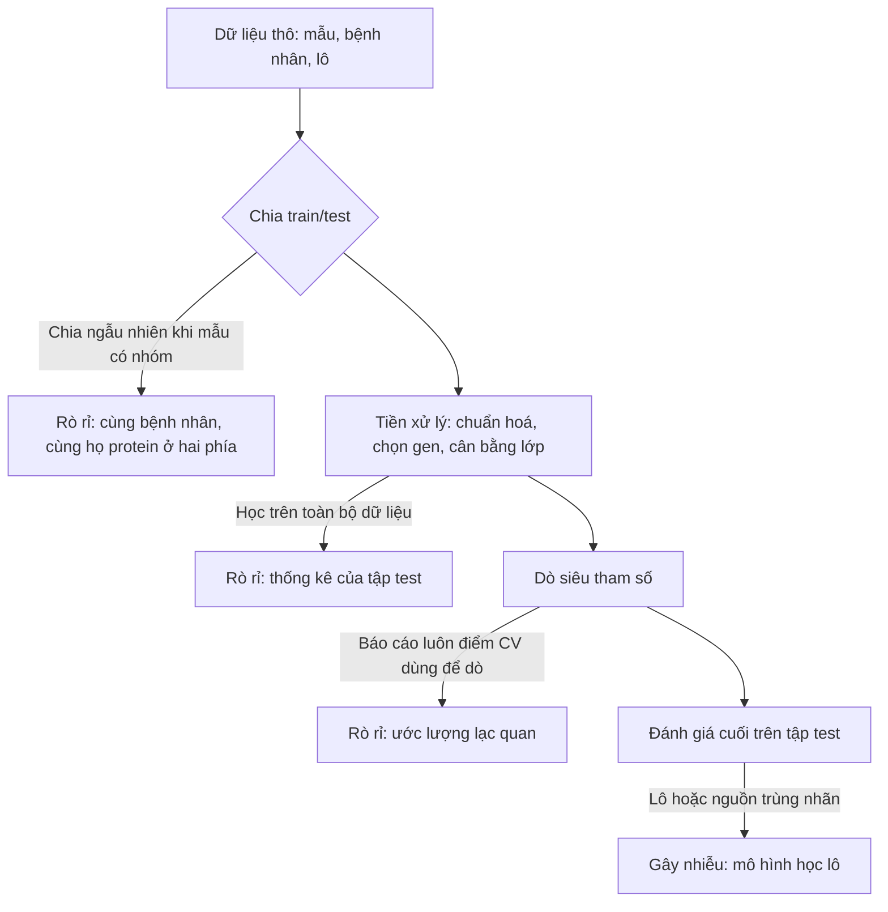

Rò rỉ dữ liệu (data leakage) là khi thông tin của tập test lọt vào quá trình huấn luyện, và trên dữ liệu sinh học nó có thể làm một mô hình machine learning trông chính xác hơn thực tế rất nhiều. Trong mô phỏng ở bài này, một mô hình học trên 10.000 "gen" toàn nhiễu đạt AUROC trung bình 0,76 chỉ vì bước chọn gen nằm trước cross-validation; đưa bước đó vào `Pipeline` thì AUROC về 0,49, đúng mức đoán mò. Kapoor và Narayanan (2023) ghi nhận rò rỉ ở 17 lĩnh vực khoa học, ảnh hưởng 294 bài báo, còn Whalen và cộng sự (2022) tóm lại năm cạm bẫy riêng của genomics. Bài thứ 10 của series *Bioinformatics từ nhập môn đến nâng cao* viết cho sinh viên và người tự học đã quen scikit-learn. Bạn sẽ có ba thứ: cách chia tập theo bệnh nhân và theo cụm tương đồng, cách đọc bảng xếp hạng ProteinGym (ESM-2 650M đạt Spearman 0,414, hạng 45/97), và cách chấm một chatbot trả lời câu hỏi sinh học.

<div class="callout callout-note">
<p class="callout-title">Tóm tắt nhanh</p>

- Câu hỏi đầu tiên với mọi con số "chính xác": tập test có thật sự độc lập với những gì mô hình đã thấy không?
- Chuẩn hoá, chọn gen, cân bằng lớp, dò tham số phải nằm **trong** vòng cross-validation (`Pipeline`, nested CV).
- Nhiều mẫu cùng bệnh nhân thì chia theo bệnh nhân (`StratifiedGroupKFold`); protein cùng họ thì chia theo cụm tương đồng, thử nhiều ngưỡng identity.
- Trên ProteinGym, ESM-2 vượt mô hình cơ sở Site-Independent ở mức trung bình nhưng thua nó với protein virus và protein có MSA nông; bản 15B không hơn bản 650M.
- Đánh giá chatbot cũng là bài toán kiểm chứng: đáp án tham chiếu khoá trước, rubric, chấm mù, chấm lại và kiểm từng trích dẫn.

</div>

## 1. Rò rỉ dữ liệu là gì: AUROC 0,76 trên dữ liệu không có tín hiệu

Kaufman và cộng sự (2012) định nghĩa rò rỉ trong data mining là việc đưa vào mô hình thông tin mà lúc dùng thật mô hình sẽ không có. Trong bài toán dự đoán, dạng hay gặp nhất là thông tin từ tập test (hoặc từ fold dùng để đánh giá) đi ngược vào bước huấn luyện. Khi đó con số đo được không còn trả lời câu "mô hình làm tốt đến đâu trên dữ liệu mới". Nó trả lời một câu dễ hơn nhiều.

Thí nghiệm sau chạy được trên laptop trong vài phút. Tạo 100 mẫu, mỗi mẫu có 10.000 "gen" lấy ngẫu nhiên từ phân phối chuẩn, rồi gán nhãn bệnh/khỏe ngẫu nhiên 50/50. Không gen nào liên quan đến nhãn. Cách làm thứ nhất chọn 20 gen có thống kê F mạnh nhất trên **toàn bộ** 100 mẫu, rồi mới chạy 5-fold cross-validation (CV) với hồi quy logistic phạt L1 (→ Classification). Cách làm thứ hai đặt bước chọn gen **trong** `Pipeline`, để mỗi fold tự chọn 20 gen chỉ từ phần train của fold đó. Lặp lại 100 lần với 100 bộ dữ liệu khác nhau:


*Hình 1. AUROC trung bình 5-fold trên dữ liệu toàn nhiễu, 100 lần lặp. Chọn gen trước CV: trung bình 0,760 (khoảng 0,632–0,886). Chọn gen trong Pipeline: trung bình 0,488 (0,330–0,700). Dữ liệu mô phỏng, script chạy ngày 28/11/2026 với scikit-learn 1.9.0.*

Không lần lặp nào của cách thứ nhất cho AUROC dưới 0,63, dù mô hình không có gì để học. 20 gen kia được chọn vì chúng *tình cờ* tách hai nhóm tốt trên chính các mẫu về sau đóng vai tập test. Với 10.000 gen và 100 mẫu, luôn có vài chục gen như vậy.

Các mô phỏng trong bài (Hình 1, Hình 2) là ví dụ có đáp án biết trước. Chúng không cho biết lỗi này phổ biến đến đâu trong tài liệu khoa học; con số tần suất phải lấy từ tổng quan như Kapoor và Narayanan (2023).

Đây không phải phát hiện mới. Năm 2002, Ambroise và McLachlan chỉ ra rằng các quy tắc dự đoán ung thư từ dữ liệu microarray với sai số cross-validation gần bằng 0 là do thiên lệch chọn lọc (selection bias): gen được chọn trên toàn bộ dữ liệu trước khi CV. Khi đưa bước chọn gen vào trong CV, sai số không còn bằng 0 (Ambroise & McLachlan, 2002). Varma và Simon (2006) đi thêm một bước với việc dò tham số: trên dữ liệu "null" không có tín hiệu, CV của bộ phân loại đã được tối ưu tham số cho sai số dưới 30% ở 18,5% số bộ dữ liệu mô phỏng với shrunken centroids và 38% với SVM.

Hai mươi năm sau, vấn đề vẫn còn, và rộng hơn. Whalen và cộng sự (2022) nhận xét rằng machine learning được dùng rộng rãi trong genomics nhờ dữ liệu lớn và bộ công cụ dễ dùng, nhưng các giả định ngầm của bộ công cụ thường không đúng với dữ liệu sinh học. Kapoor và Narayanan (2023) gọi rò rỉ là một phần của khủng hoảng tái lập trong khoa học dùng ML. Cả bài xoay quanh một câu hỏi: **tập test có thật sự độc lập không?** Mục 2 xét quy trình huấn luyện và cấu trúc dữ liệu, mục 3 xét dữ liệu tiền huấn luyện của mô hình nền tảng (qua ESM-2 và ProteinGym), mục 4 xét người chấm khi đánh giá chatbot.

## 2. Năm cạm bẫy khi kiểm chứng ML trong genomics

### 2.1. Giả định i.i.d. và dữ liệu sinh học

Phần mềm ML mặc định các mẫu độc lập và cùng phân phối (independent and identically distributed, i.i.d.), và dữ liệu train, test giống với dữ liệu mà mô hình sẽ gặp khi dùng thật. Dữ liệu sinh học vi phạm giả định này theo nhiều cách: mẫu đến từ cùng bệnh nhân, protein cùng họ, gen cùng locus, mẫu chạy cùng ngày. Whalen và cộng sự (2022) gom các vi phạm thành năm cạm bẫy: khác biệt phân phối (distributional differences), mẫu phụ thuộc (dependent examples), gây nhiễu (confounding), tiền xử lý rò rỉ (leaky preprocessing) và lớp mất cân bằng (unbalanced classes). Kapoor và Narayanan (2023) phân rò rỉ thành tám loại, từ lỗi kiểu sách giáo khoa đến những vấn đề nghiên cứu còn mở, và đề xuất mỗi bài báo kèm một "model info sheet" mô tả cách tách dữ liệu.

**Bảng 1.** Năm cạm bẫy, ví dụ trong omics và công cụ khắc phục.

| Cạm bẫy (Whalen et al., 2022) | Ví dụ trong omics | Cách khắc phục | Công cụ scikit-learn |
|---|---|---|---|
| Tiền xử lý rò rỉ | Chuẩn hoá, chọn gen, SMOTE trên toàn bộ dữ liệu trước CV | Mọi bước học từ dữ liệu nằm trong vòng CV | `Pipeline`, `make_pipeline` |
| Mẫu phụ thuộc | Nhiều sinh thiết của một bệnh nhân; protein cùng họ; cặp protein chung thành phần | Chia theo nhóm hoặc theo cụm | `GroupKFold`, `StratifiedGroupKFold`, `LeaveOneGroupOut` |
| Gây nhiễu | Lô giải trình tự trùng với nhóm bệnh | Thiết kế cân bằng; đánh giá trên lô, cohort mới | `LeaveOneGroupOut` với nhóm = lô |
| Khác biệt phân phối | Train trên một bệnh viện, dùng ở bệnh viện khác | Kiểm tra trên cohort độc lập | (ngoài CV) |
| Lớp mất cân bằng | 2% biến thể gây bệnh | Báo cáo tỷ lệ lớp dương, AUPRC kèm AUROC; cân bằng lớp trong fold | `StratifiedKFold`, `average_precision_score` |

Sơ đồ dưới đây đánh dấu những chỗ thông tin của tập test hay lọt vào pipeline:



### 2.2. Rò rỉ do tiền xử lý, chọn đặc trưng và tinh chỉnh tham số

Nguyên tắc gói trong một câu: bước nào **học từ dữ liệu** (tính trung bình và độ lệch chuẩn để chuẩn hoá, xếp hạng gen, sinh mẫu tổng hợp để cân bằng lớp, chọn số thành phần PCA) thì chỉ được học trên phần train của mỗi fold. Hướng dẫn sử dụng của scikit-learn nêu đúng nguyên tắc này ở mục cross-validation và dùng `Pipeline` để bảo đảm nó: khi `cross_val_score` nhận một `Pipeline`, mọi bước bên trong được `fit` lại trên phần train của từng fold (scikit-learn developers, n.d.-b; Pedregosa et al., 2011).

Đoạn code dưới đây là phiên bản rút gọn của mô phỏng ở Hình 1, chạy một lần:

```python
import numpy as np
from sklearn.pipeline import make_pipeline
from sklearn.feature_selection import SelectKBest, f_classif
from sklearn.preprocessing import StandardScaler
from sklearn.linear_model import LogisticRegression
from sklearn.model_selection import StratifiedKFold, cross_val_score

rng = np.random.default_rng(0)
X = rng.normal(size=(100, 10_000))          # 100 mẫu, 10.000 "gen" toàn nhiễu
y = np.repeat([0, 1], 50); rng.shuffle(y)   # nhãn ngẫu nhiên: không có gì để học
cv = StratifiedKFold(n_splits=5, shuffle=True, random_state=0)
clf = make_pipeline(StandardScaler(),
                    LogisticRegression(l1_ratio=1, solver="liblinear", C=0.1))

# SAI: chọn 20 gen bằng toàn bộ dữ liệu, kể cả các mẫu sau này làm test
X_top = SelectKBest(f_classif, k=20).fit_transform(X, y)
print("Rò rỉ :", cross_val_score(clf, X_top, y, cv=cv, scoring="roc_auc").mean().round(3))

# ĐÚNG: bước chọn gen nằm trong Pipeline, được học lại trên phần train của từng fold
pipe = make_pipeline(SelectKBest(f_classif, k=20), clf)
print("Đúng  :", cross_val_score(pipe, X, y, cv=cv, scoring="roc_auc").mean().round(3))
```

Với scikit-learn 1.9.0, kết quả là 0,806 cho cách sai và 0,494 cho cách đúng. Hồi quy logistic phạt L1 được khai báo bằng `l1_ratio=1`: từ bản 1.8, tham số `penalty` của `LogisticRegression` bị đánh dấu deprecated và sẽ bị bỏ ở bản 1.10; solver `liblinear` vẫn hỗ trợ phạt L1 (scikit-learn developers, n.d.-a).

Dò siêu tham số là dạng rò rỉ khó thấy hơn. Cố định `C=0.1` từ trước thì không sao. Còn nếu bạn thử nhiều giá trị `C` bằng `GridSearchCV` rồi báo cáo luôn điểm CV tốt nhất, con số đó lạc quan vì chính dữ liệu đánh giá đã được dùng để chọn `C`. Varma và Simon (2006) cho thấy nested CV (một vòng CV trong để dò tham số, lồng trong một vòng CV ngoài để đánh giá) cho ước lượng gần như không lệch. Lever và cộng sự (2016b) tóm tắt cùng ý: dữ liệu dùng để chọn mô hình không được dùng lại để báo cáo hiệu năng. Trong scikit-learn, nested CV chỉ là truyền một `GridSearchCV` vào `cross_val_score`.

Ambroise và McLachlan (2002) còn khuyên dùng 10-fold CV thay vì leave-one-out, hoặc bootstrap .632+, khi ước lượng sai số sau bước chọn gen.

<div class="callout callout-warning">
<p class="callout-title">Ba chỗ rò rỉ hay gặp trong notebook Jupyter</p>

- Gọi `StandardScaler().fit_transform(X)` cho cả bảng rồi mới `train_test_split`: trung bình và độ lệch chuẩn đã chứa thông tin tập test. Với dữ liệu lớn, sai lệch thường nhỏ, nhưng thói quen này kéo theo lỗi lớn hơn.
- Cân bằng lớp bằng oversampling (sinh thêm mẫu lớp hiếm) trước khi chia: bản sao hoặc mẫu tổng hợp của cùng một mẫu gốc nằm ở cả train và test.
- Lọc gen theo phương sai hay theo p-value của phép so sánh hai nhóm trên toàn bộ dữ liệu, rồi mới đưa vào mô hình. Lọc theo phương sai không dùng nhãn nên ít nguy hiểm hơn; lọc theo p-value dùng nhãn thì chính là thí nghiệm ở Hình 1.

</div>

### 2.3. Mẫu phụ thuộc: cùng bệnh nhân, cùng cặp

Một bệnh nhân có thể đóng góp nhiều mẫu: sinh thiết ở nhiều vùng của khối u, nhiều thời điểm, hàng nghìn tế bào trong dữ liệu single-cell. Các mẫu này mang chung "dấu vân tay" của người đó: kiểu gen, tuổi, cách lấy mẫu. Chia ngẫu nhiên theo mẫu thì mẫu của cùng một người rơi vào cả train lẫn test. Mô hình có thể đạt điểm cao chỉ nhờ nhận ra bệnh nhân, không phải nhận ra bệnh. Whalen và cộng sự (2022) khuyên chia theo nhóm (group k-fold). scikit-learn có sẵn `GroupKFold`, `StratifiedGroupKFold` (giữ tỷ lệ lớp và tách nhóm), `LeaveOneGroupOut` và `GroupShuffleSplit` (scikit-learn developers, n.d.-b).

Mô phỏng thứ hai dùng 30 bệnh nhân × 4 mẫu, 200 đặc trưng; nhãn gán theo bệnh nhân, còn dấu vân tay biểu hiện riêng của mỗi người **không liên quan** đến nhãn. Random forest với `StratifiedKFold` đạt AUROC trung bình 0,996, với `StratifiedGroupKFold` theo bệnh nhân chỉ còn 0,491 (Hình 2, trái).


*Hình 2. Cùng dữ liệu, chỉ khác cách chia train/test, 30 lần lặp. Trái: 30 bệnh nhân × 4 mẫu, AUROC 0,996 khi chia theo mẫu và 0,491 khi chia theo bệnh nhân. Phải: 60 họ protein giả lập × 10 thành viên, độ chính xác 0,960 khi chia ngẫu nhiên và 0,572 khi chia theo họ. Dữ liệu mô phỏng.*

Cách chia có đúng không thì kiểm tra thẳng: không nhóm nào được xuất hiện ở cả hai phía.

```python
import numpy as np
from sklearn.model_selection import StratifiedGroupKFold

rng = np.random.default_rng(1)
patient = np.repeat(np.arange(30), 4)           # 30 bệnh nhân, mỗi người 4 mẫu
y = np.repeat(rng.permutation([0, 1] * 15), 4)  # nhãn theo bệnh nhân
X = rng.normal(size=(120, 50))

cv = StratifiedGroupKFold(n_splits=5, shuffle=True, random_state=0)
for train, test in cv.split(X, y, groups=patient):
    assert not set(patient[train]) & set(patient[test])  # không bệnh nhân nào ở cả hai phía
print("OK: không có bệnh nhân nào nằm ở cả train và test")
```

Bài toán có đầu vào là một **cặp** (tương tác protein–protein, thuốc–đích) còn rắc rối hơn. Park và Marcotte (2012) chỉ ra rằng phương pháp dự đoán cặp làm tốt hơn nhiều trên những cặp test có chung thành phần với tập train, nên phải tách riêng cặp test theo mức chồng lấn: cả hai protein đã thấy, một protein đã thấy, hay không protein nào. Bernett và cộng sự (2024) tái lập các mô hình deep learning dự đoán tương tác protein–protein từ trình tự: chia ngẫu nhiên làm hiệu năng bị ước lượng quá cao; khi giảm tương đồng trình tự giữa train và test, hiệu năng về mức ngẫu nhiên; và mô hình cơ sở chỉ dựa trên tương đồng và bậc nút trong mạng đạt kết quả tốt với chi phí rất thấp.

### 2.4. Trình tự tương đồng: chia theo cụm, không chia ngẫu nhiên

Protein cùng họ nằm ở hai phía train/test cũng là mẫu phụ thuộc. Khuyến nghị DOME yêu cầu giảm dư thừa theo cách phù hợp với từng lĩnh vực, ví dụ loại các homolog giữa tập train và tập test (Walsh et al., 2021). Cách làm phổ biến là phân cụm toàn bộ trình tự bằng MMseqs2 (Steinegger & Söding, 2017), hoặc Linclust khi bộ dữ liệu rất lớn (Steinegger & Söding, 2018), rồi đưa cả cụm vào cùng một phía, tức là dùng mã cụm làm `groups` cho `GroupKFold`.

Ngưỡng identity bao nhiêu thì đủ? Con số 30% hay gặp là một quy ước, gắn với "twilight zone" của sắp gióng protein. Theo Rost (1999), vùng này nằm ở khoảng 20–35% identity: trên ngưỡng xấp xỉ 30%, khoảng 90% cặp trình tự là homolog thật, dưới 25% thì chưa đến 10%. Nghiên cứu này nói về suy luận tương đồng cấu trúc, không phải quy tắc chia tập train/test. Cách làm an toàn là thử nhiều ngưỡng (ví dụ 30%, 50%, 70%) và báo cáo hiệu năng theo từng ngưỡng.

Dự đoán vị trí nội bào (subcellular localization) là ví dụ quen thuộc. DeepLoc dùng deep learning cho bài toán này (Almagro Armenteros et al., 2017). Stärk và cộng sự (2021) dùng embedding của protein language model, vượt phương pháp tốt nhất trước đó khoảng 8 điểm phần trăm (độ chính xác 10 lớp), và phải dựng thêm một tập test mới để thấy giới hạn của bộ dữ liệu tĩnh. DeepLoc 2.0 chuyển hẳn sang protein language model (Thumuluri et al., 2022).

Hình 2 (phải) mô phỏng điều này: 60 "họ protein" giả lập, mỗi họ 10 thành viên nằm gần nhau trong không gian 64 chiều như embedding của protein cùng họ. Nhãn "vị trí" gán theo họ, phần lớn theo một tín hiệu chung yếu, phần còn lại ngẫu nhiên. Chia ngẫu nhiên, hồi quy logistic đạt độ chính xác 0,960 vì đã thấy họ hàng của gần như mọi protein test. Chia theo họ thì còn 0,572. Con số sau mới là khả năng dự đoán cho một họ protein chưa từng gặp.

Với mô hình nền tảng có thêm một tầng rò rỉ: protein trong tập test có thể đã nằm trong dữ liệu tiền huấn luyện của language model. Hermann và cộng sự (2024, preprint) so sánh cách chia có tính đến dữ liệu tiền huấn luyện với cách chia theo cụm thông thường trên bài toán dự đoán nhiệt độ nóng chảy, và thấy rò rỉ từ tiền huấn luyện làm sai lệch hiệu năng đo được một cách nhất quán.

Về trực quan hoá: embedding ESM-2 tách thành cụm theo họ protein trên UMAP chưa chứng minh mô hình "hiểu chức năng", vì cụm có thể chỉ phản ánh tương đồng trình tự. UMAP giúp nhìn dữ liệu, nó không phải phép đánh giá.

### 2.5. Hiệu ứng lô và gây nhiễu

Hiệu ứng lô (batch effect) là khác biệt kỹ thuật giữa các nhóm mẫu xử lý khác nhau: ngày chạy máy, lô hoá chất, người làm, phòng thí nghiệm. Leek và cộng sự (2010) cho thấy nó phổ biến trong dữ liệu thông lượng cao và nguy hiểm nhất khi trùng với biến kết quả, ví dụ toàn bộ mẫu bệnh chạy tuần đầu và mẫu khỏe chạy tuần sau (→ [Transcriptomics](/blog/transcriptomics-rna-seq-va-single-cell/)).

Cross-validation **không** phát hiện được lô gây nhiễu. Nếu lô trùng nhãn thì trong mọi fold, mô hình học lô cũng dự đoán đúng nhãn. Soneson và cộng sự (2014) mô phỏng nhiều mức gây nhiễu giữa lô và nhóm, và thấy ước lượng hiệu năng bằng CV lệch mạnh so với hiệu năng trên dữ liệu độc lập.

Hiệu chỉnh lô cũng có bẫy riêng. ComBat (Johnson et al., 2007) cho phép đưa biến nhóm vào mô hình để giữ khác biệt nhóm trong khi loại khác biệt lô. Nygaard và cộng sự (2016) chỉ ra rằng khi thiết kế mất cân bằng (tỷ lệ nhóm khác nhau giữa các lô), cách hiệu chỉnh "giữ khác biệt nhóm" này có thể tạo khác biệt nhóm giả và làm các phân tích sau tự tin quá mức.

Cách làm theo thứ tự ưu tiên: (1) thiết kế cân bằng ngay từ đầu, mỗi lô có đủ các nhóm; (2) vẽ PCA tô màu theo lô và theo nhóm trước khi làm gì khác (→ [Toán và thống kê cho sinh học](/blog/toan-va-thong-ke-cho-sinh-hoc/)); (3) đưa lô vào mô hình như một biến số khi có thể; (4) đánh giá cuối cùng trên lô hoặc cohort chưa từng thấy, ví dụ `LeaveOneGroupOut` với nhóm là lô (Leek et al., 2010; Whalen et al., 2022).

### 2.6. Chọn chỉ số và luôn có mô hình cơ sở

Độ nhạy, độ đặc hiệu, PPV, NPV, đường ROC và AUROC là bộ chỉ số quen thuộc; PPV và NPV phụ thuộc tỷ lệ hiện mắc nên không chuyển được giữa các quần thể (→ Error Rates and the Bayes Classifier). Lever và cộng sự (2016a) có bản tóm tắt ngắn về các chỉ số này.

Khi lớp mất cân bằng, ví dụ 2% biến thể gây bệnh, Saito và Rehmsmeier (2015) cho thấy đường precision-recall (PR) cung cấp nhiều thông tin hơn ROC. Nhưng McDermott và cộng sự (2024) phản biện rằng AUPRC không phải lúc nào cũng tốt hơn AUROC khi mất cân bằng, và có thể làm tăng chênh lệch giữa các nhóm con vì ưu tiên nhóm có nhiều mẫu dương. Cách an toàn là báo cáo cả hai, kèm tỷ lệ lớp dương (đường cơ sở của AUPRC bằng đúng tỷ lệ này) và khoảng tin cậy.

Một con số đơn lẻ, không có mô hình cơ sở (baseline) để so, gần như không nói được gì. Mô hình cơ sở có thể là hồi quy logistic trên vài đặc trưng, "dự đoán theo protein tương đồng gần nhất", hay Site-Independent trên ProteinGym (mục 3). Khi Kapoor và Narayanan (2023) sửa lỗi rò rỉ trong các nghiên cứu dự báo nội chiến, mô hình ML phức tạp không còn vượt trội đáng kể so với hồi quy logistic. Ở single-cell, Kedzierska và cộng sự (2025) cho thấy mô hình nền tảng dùng zero-shot có thể thua phương pháp đơn giản, còn Ahlmann-Eltze và cộng sự (2025) thấy năm mô hình nền tảng và hai mô hình deep learning khác không vượt mô hình cơ sở tuyến tính trong dự đoán hiệu ứng nhiễu loạn gen.

Câu hỏi "10 gen quan trọng nhất là gì" cũng dễ dẫn sai. Tập gen do L1 hay random forest chọn thường đổi giữa các fold khi p ≫ n. Thay vì báo cáo một danh sách, hãy báo cáo tần suất mỗi gen được chọn qua các fold hoặc qua nhiều lần lấy mẫu lại, theo tinh thần stability selection (Meinshausen & Bühlmann, 2010).

### 2.7. Báo cáo theo chuẩn: DOME, TRIPOD+AI, model card

DOME là khuyến nghị của ELIXIR Machine Learning Focus Group cho kiểm chứng ML có giám sát trong sinh học, gồm bốn thành phần **Data, Optimization, Model, Evaluation**, kèm bảng kiểm dạng câu hỏi (Walsh et al., 2021). TRIPOD+AI là hướng dẫn báo cáo cho mô hình dự đoán lâm sàng dùng hồi quy hoặc ML (Collins et al., 2024). Model card là mẫu tài liệu đi kèm mô hình, mô tả mục đích, dữ liệu và hiệu năng theo nhóm (Mitchell et al., 2019).

**Bảng 2.** Áp bảng kiểm DOME lên nghiên cứu giả định ở Hình 1 (phân loại bệnh từ 10.000 gen, 100 mẫu).

| DOME | Câu hỏi chính | Phiên bản rò rỉ | Phiên bản sửa |
|---|---|---|---|
| Data | Train/test không chồng lấn? Giảm dư thừa? Công bố cách chia? | Chọn gen đã "thấy" mọi mẫu | Mọi bước học nằm trong fold; ghi seed và cách chia |
| Optimization | Tham số và đặc trưng được chọn bằng dữ liệu nào? | 20 gen chọn trên toàn bộ dữ liệu | `SelectKBest` trong `Pipeline`; nested CV nếu dò `k` hay `C` |
| Model | Mô hình có giải thích được, có công bố không? | Không nói tập gen dao động | Báo cáo tần suất chọn gen qua fold |
| Evaluation | So với baseline? Khoảng tin cậy? Ma trận nhầm lẫn? | AUROC 0,76, không baseline | AUROC 0,49 so với mức 0,5; phân phối qua 100 lần lặp |

## 3. ESM-2 và ProteinGym: đọc một benchmark cho đúng

Mục 2 nói về mô hình của chính bạn. Mục này chuyển sang đọc kết quả mô hình của người khác, lấy ESM-2 và ProteinGym làm ca nghiên cứu. Benchmark công khai giải quyết một phần vấn đề: mọi mô hình được chấm trên cùng tập assay, cùng chỉ số, bởi cùng một nhóm. Phần việc còn lại là của người đọc: nhìn bảng theo nhóm, tìm mô hình cơ sở, và nhận ra khi nào chênh lệch quá nhỏ.

### 3.1. Protein language model là gì

Protein language model (pLM) học trình tự protein giống cách mô hình ngôn ngữ học văn bản: che một số amino acid rồi bắt mô hình đoán lại (masked language modelling), trên hàng chục đến hàng trăm triệu trình tự. Rives và cộng sự (2021) cho thấy thông tin về cấu trúc và chức năng tự xuất hiện trong biểu diễn của mô hình ESM-1b khi mở rộng học không giám sát lên 250 triệu trình tự. ProtTrans là một họ pLM tự giám sát khác, phát triển song song (Elnaggar et al., 2022).

ESM-2 là họ mô hình từ 8 triệu đến 15 tỷ tham số (Lin et al., 2023). Checkpoint 650M có 33 lớp, phát hành trên Hugging Face với giấy phép MIT (Meta AI, n.d.). Lin và cộng sự dùng ESM-2 làm nền cho ESMFold và dự đoán cấu trúc cho hơn 617 triệu protein metagenome, trong đó hơn 225 triệu có độ tin cậy cao (→ [Proteomics và cấu trúc protein](/blog/proteomics-va-cau-truc-protein/)).

Có hai cách dùng pLM. Cách thứ nhất lấy **embedding** (vector biểu diễn của từng protein) làm đặc trưng cho một mô hình có giám sát nhỏ, như bài toán định vị nội bào ở mục 2.4. Cách thứ hai là **zero-shot**: không huấn luyện gì thêm, so xác suất mô hình gán cho amino acid đột biến với amino acid gốc ở cùng vị trí để chấm hiệu ứng đột biến. Meier và cộng sự (2021) giới thiệu cách này với ESM-1v.

**Bảng 3.** Một số kiến trúc deep learning trong sinh học và loại học.

| Mô hình | Kiến trúc | Học | Đầu vào → đầu ra |
|---|---|---|---|
| DeepBind (Alipanahi et al., 2015) | CNN | Có giám sát | DNA/RNA → độ đặc hiệu gắn của protein |
| Basset (Kelley et al., 2016) | CNN | Có giám sát | DNA → vùng chromatin mở |
| DNABERT (Y. Ji et al., 2021) | Transformer | Tự giám sát (language model) | DNA → embedding |
| Nucleotide Transformer (Dalla-Torre et al., 2025) | Transformer | Tự giám sát (language model) | DNA → embedding |
| Enformer (Avsec et al., 2021) | CNN + Transformer | **Có giám sát** | DNA → biểu hiện gen, tương tác xa đến 100 kb |
| ESM-2 (Lin et al., 2023) | Transformer | Tự giám sát (language model) | Protein → embedding, xác suất amino acid |
| scGPT (Cui et al., 2024); Geneformer (Theodoris et al., 2023) | Transformer | Tiền huấn luyện trên single-cell | Biểu hiện tế bào → embedding |
| RFdiffusion (Watson et al., 2023) | Diffusion | Sinh (generative) | Thiết kế cấu trúc protein mới |
| AlphaFold 3 (Abramson et al., 2024) | Pairformer + module diffusion | Có giám sát | Trình tự các phân tử → cấu trúc phức hợp |

### 3.2. ProteinGym và dữ liệu deep mutational scanning

Deep mutational scanning (DMS) đo hiệu ứng của hàng nghìn đột biến của một protein trong một thí nghiệm, bằng cách gắn mỗi biến thể với một phép chọn lọc chức năng rồi giải trình tự trước và sau chọn lọc (Fowler & Fields, 2014). Dữ liệu DMS đã được dùng để đánh giá các công cụ dự đoán hiệu ứng biến thể từ trước ProteinGym (Livesey & Marsh, 2020). Các mô hình học từ sắp gióng đa trình tự (multiple sequence alignment, MSA) của họ protein như DeepSequence (Riesselman et al., 2018) và EVE (Frazer et al., 2021) là mốc so sánh quen thuộc.

ProteinGym gom các assay DMS đã chuẩn hoá cùng dữ liệu biến thể lâm sàng, đánh giá cả thiết lập zero-shot và có giám sát; bản preprint mô tả hơn 250 assay và hơn 70 mô hình (Notin et al., 2023a), bản hội nghị NeurIPS 2023 là Notin et al. (2023b). README của bản v1.3 ghi 217 assay thay thế (khoảng 2,7 triệu biến thể missense) và 74 assay indel (khoảng 300 nghìn biến thể) (OATML-Markslab, n.d.-a).

Cách ProteinGym thiết kế phần đánh giá đáng để học theo. Chỉ số chính là hệ số tương quan Spearman giữa điểm mô hình và giá trị đo, tức là chỉ hỏi mô hình có xếp đúng thứ tự các đột biến hay không. Assay được nhóm theo loại chức năng đo được (activity, binding, expression, organismal fitness, stability), theo nhóm phân loại (người, nhân chuẩn khác, nhân sơ, virus) và theo độ sâu MSA (thấp, trung bình, cao). Ở thiết lập có giám sát, có ba cách chia 5 fold: random, contiguous (theo đoạn liền nhau trên chuỗi) và modulo (theo vị trí chia dư), để đo khả năng ngoại suy sang vị trí chưa thấy (Notin et al., 2023a; OATML-Markslab, n.d.-a). Contiguous và modulo chính là "chia theo nhóm" của mục 2.3, áp vào vị trí trên protein.

### 3.3. Đọc bảng xếp hạng: ESM-2 đứng ở đâu?

Bảng tổng hợp zero-shot trên 217 assay thay thế gồm 97 mô hình (OATML-Markslab, n.d.-b; truy cập 28/11/2026). Một số dòng:

**Bảng 4.** Spearman trung bình zero-shot trên ProteinGym, tổng và theo nhóm.

| Mô hình | Hạng | Trung bình | SE bootstrap | Virus | MSA nông | MSA sâu |
|---|---|---|---|---|---|---|
| AIDO Protein-RAG (16B) | 1 | 0,518 | 0,000 | 0,522 | 0,498 | 0,585 |
| TranceptEVE L | 18 | 0,456 | 0,007 | 0,461 | 0,436 | 0,490 |
| GEMME | 20 | 0,455 | 0,009 | 0,472 | 0,446 | 0,493 |
| EVE (ensemble) | 26 | 0,439 | 0,009 | 0,434 | 0,420 | 0,477 |
| ESM2 (650M) | 45 | 0,414 | 0,012 | 0,261 | 0,338 | 0,513 |
| ESM-1v (ensemble) | 47 | 0,407 | 0,013 | 0,294 | 0,316 | 0,495 |
| ESM2 (3B) | 50 | 0,406 | 0,011 | 0,294 | 0,336 | 0,485 |
| ESM2 (15B) | 52 | 0,400 | 0,010 | 0,333 | 0,341 | 0,467 |
| ESM-1b | 57 | 0,394 | 0,011 | 0,260 | 0,365 | 0,480 |
| Site-Independent | 76 | 0,359 | 0,012 | 0,375 | 0,427 | 0,317 |
| ESM2 (8M) | 93 | 0,226 | 0,015 | 0,090 | 0,200 | 0,262 |


*Hình 3. Spearman trung bình zero-shot theo nhóm cho sáu mô hình, vẽ lại từ bảng ProteinGym (OATML-Markslab, n.d.-b), truy cập 28/11/2026.*

Bảng này cho ba bài học.

**Lớn hơn không chắc tốt hơn.** Ở mức trung bình, ESM2 650M (0,414) cao hơn 3B (0,406) và 15B (0,400). Bản 8M chỉ đạt 0,226, nên kích thước có tác dụng ở đầu thang, nhưng sau 650M thì không còn tăng.

**Trung bình che giấu nhóm.** Với protein virus, ESM2 650M chỉ đạt 0,261, thấp hơn cả Site-Independent (0,375), mô hình cơ sở chỉ dùng tần suất amino acid ở từng cột MSA. Với protein có MSA nông, ESM2 650M đạt 0,338, Site-Independent 0,427, GEMME 0,446. Ngược lại, với MSA sâu, ESM2 650M (0,513) vượt GEMME (0,493). Một người chỉ nhìn cột trung bình sẽ không thấy những đảo chiều này.

**Sai số chuẩn cho biết khoảng cách nào có nghĩa.** README của ProteinGym giải thích cột sai số chuẩn bootstrap phản ánh độ dao động của con số tổng hợp theo từng assay (OATML-Markslab, n.d.-a). Mô hình đứng đầu có SE bằng 0; README không giải thích chi tiết cách tính. Sai số của nhóm ESM vào khoảng 0,010–0,013, trong khi ESM2 650M, ESM-1v và ESM2 3B chỉ cách nhau 0,007–0,008. Thứ hạng 45, 47 và 50 vì vậy không đủ để nói mô hình nào trong ba mô hình này tốt hơn.

Vài dòng pandas đủ để bạn tự kiểm các con số trên từ bảng công khai trên GitHub. Số có thể đổi khi nhóm tác giả thêm mô hình, nên nhớ ghi ngày truy cập khi trích:

```python
import pandas as pd
url = ("https://raw.githubusercontent.com/OATML-Markslab/ProteinGym/main/benchmarks/"
       "DMS_zero_shot/substitutions/Spearman/Summary_performance_DMS_substitutions_Spearman.csv")
bang = pd.read_csv(url)
cot = ["Model_rank", "Model_name", "Average_Spearman", "Taxa_Virus", "Low_MSA_depth"]
mo_hinh = ["ESM2 (650M)", "ESM2 (15B)", "GEMME", "Site-Independent"]
print(bang.loc[bang["Model_name"].isin(mo_hinh), cot].to_string(index=False))
```

### 3.4. Ca TP53: cùng một protein, kết luận đổi theo assay

TP53 là gen ức chế khối u được nhắc ở bài phân tích trình tự (→ [Phân tích trình tự](/blog/phan-tich-trinh-tu/)). ProteinGym có bốn assay DMS cho TP53: ba assay mang nhãn `Giacomelli_2018` ứng với ba điều kiện chọn lọc khác nhau (Null_Etoposide, Null_Nutlin, WT_Nutlin) và một assay mang nhãn `Kotler_2018`, theo tên trong bảng của ProteinGym.


*Hình 4. Spearman zero-shot trên bốn assay TP53, vẽ lại từ bảng theo assay của ProteinGym (OATML-Markslab, n.d.-c), truy cập 28/11/2026.*

ESM2 650M đạt 0,432 (Null_Etoposide), 0,404 (Null_Nutlin), 0,400 (WT_Nutlin) và 0,678 (Kotler). Ở WT_Nutlin, ESM2 650M **thấp hơn** Site-Independent (0,445); ở Kotler thì cao hơn (0,678 so với 0,629). Ngược với xu hướng trung bình ở mục 3.3, trên cả bốn assay TP53 bản 15B đều cao hơn bản 650M, ví dụ 0,497 so với 0,432 ở Null_Etoposide (OATML-Markslab, n.d.-c). Hỏi "mô hình nào tốt hơn với TP53" thì câu trả lời tuỳ vào assay bạn chọn.

Vì sao pLM có những hành vi này? Gordon và cộng sự (2024, preprint) cho thấy khả năng zero-shot của pLM dự đoán được từ likelihood mô hình gán cho trình tự kiểu dại: trình tự được mô hình "ưa" quá mức hay quá ít đều cho dự đoán kém hơn. Ding và Steinhardt (2024, preprint) chỉ ra likelihood của pLM mang thiên lệch loài, do cơ sở dữ liệu trình tự lấy mẫu không đều trên cây sự sống. Hai nghiên cứu này còn là preprint; chúng gợi ý một cách giải thích cho kết quả kém với protein virus, không phải kết luận đã được xác nhận.

### 3.5. Năm câu hỏi khi đọc một benchmark

<div class="callout callout-example">
<p class="callout-title">Đọc một bảng xếp hạng</p>

1. Chỉ số là gì và vì sao chọn nó (Spearman, AUROC, độ chính xác)?
2. Trung bình trên những nhóm nào; kết quả theo nhóm con có đảo chiều không?
3. Sai số chuẩn hay khoảng tin cậy bao nhiêu; chênh lệch có vượt sai số không?
4. Mô hình cơ sở đơn giản nhất trong bảng là gì, và mô hình bạn quan tâm hơn nó bao nhiêu?
5. Tập test có thể đã nằm trong dữ liệu tiền huấn luyện không?

</div>

## 4. Đánh giá chatbot AI trên câu hỏi bioinformatics

### 4.1. Vì sao phải tự đánh giá

Ảo giác (hallucination) là khi mô hình sinh văn bản trôi chảy nhưng không trung thành với nguồn hoặc không đúng sự thật (Z. Ji et al., 2023). Trong sinh học, dạng nguy hiểm nhất là trích dẫn bịa. Walters và Wilder (2023) kiểm 636 trích dẫn trong 84 bài tổng quan ngắn do ChatGPT viết: 55% trích dẫn của GPT-3.5 và 18% của GPT-4 là bịa. Bhattacharyya và cộng sự (2023) kiểm 115 tài liệu tham khảo trong 30 bài y khoa ngắn do ChatGPT-3.5 viết: 47% bịa, 46% có thật nhưng sai chi tiết, chỉ 7% đúng hoàn toàn; PMID sai là lỗi phổ biến nhất. Hai nghiên cứu dùng mô hình đời 2023, chatbot hiện nay có thể khác. Vì vậy bạn cần tự đo trên đúng loại câu hỏi bạn hay hỏi.

Đã có nhiều benchmark. MultiMedQA chấm câu trả lời y khoa bằng người theo nhiều trục: đúng sự kiện, hiểu câu hỏi, suy luận, khả năng gây hại, thiên lệch (Singhal et al., 2023). GeneTuring có 16 nhiệm vụ genomics, 1.600 câu hỏi và 48.000 câu trả lời chấm tay (Shang et al., 2025). LAB-Bench có hơn 2.400 câu trắc nghiệm về năng lực nghiên cứu sinh học thực tế (Laurent et al., 2024, preprint). PubMedQA hỏi đáp từ tóm tắt PubMed (Jin et al., 2019). Ở mảng cấu trúc và biến thể, CASP (Kryshtafovych et al., 2021) và CAGI (The Critical Assessment of Genome Interpretation Consortium, 2024) là các cuộc đánh giá mù lâu đời. Bộ câu hỏi nhỏ tự xây không thay được các benchmark này, nhưng cho bạn biết chatbot đáng tin đến đâu với đúng việc bạn đang làm.

### 4.2. Thiết kế bộ câu hỏi

Khoảng 20 câu là đủ để thực hành, chia bốn loại:

1. **Tra cứu sự kiện có đáp án trong cơ sở dữ liệu**, ví dụ số exon của transcript chuẩn TP53 trong một bản Ensembl cụ thể. Luôn ghi rõ bản phát hành, vì đáp án đổi theo bản.
2. **Khái niệm và suy luận**, ví dụ vì sao kiểm soát FDR khác hiệu chỉnh Bonferroni, vì sao cần `GroupKFold` khi có nhiều mẫu mỗi bệnh nhân.
3. **Tính toán hoặc code**, ví dụ đổi điểm chất lượng Phred sang xác suất lỗi, đổi toạ độ BED (bắt đầu từ 0) sang VCF (bắt đầu từ 1).
4. **Yêu cầu trích dẫn**, ví dụ xin hai bài báo gốc cho một phương pháp kèm DOI.

Câu tính toán có cái lợi là đáp án đúng hay sai rõ ràng. Điểm Phred $Q$ liên hệ với xác suất gọi base sai $P$ theo $P = 10^{-Q/10}$, nên Q30 ứng với $P = 0{,}001$ và Q20 ứng với $P = 0{,}01$. Một vị trí ghi trong file BED là `chr1  99  100` (toạ độ bắt đầu từ 0, nửa mở) tương ứng `POS = 100` trong VCF (bắt đầu từ 1). Chatbot trả lời Q30 là "1%" hay giữ nguyên 99 khi chuyển sang VCF là lỗi sai sự kiện rõ ràng, chấm không cần tranh luận.

Mỗi câu có **đáp án tham chiếu** viết trước, kèm nguồn đã kiểm chứng (UniProt, ClinVar, NCBI, Ensembl, bài báo có DOI). Lưu đáp án và rubric vào một repo có dấu thời gian **trước** khi hỏi chatbot, giống đăng ký trước một nghiên cứu. Ghi tên chatbot, phiên bản mô hình (nếu hiển thị), ngày giờ, có bật tìm kiếm web không và prompt nguyên văn. Hỏi mỗi câu ba lần trong ba cuộc hội thoại mới để thấy độ dao động.

Bài học rò rỉ của mục 2 cũng đúng ở đây: câu hỏi chép nguyên văn từ giáo trình hay bài tập công khai có thể đã nằm trong dữ liệu huấn luyện của chatbot. Hãy viết lại và thêm chi tiết cụ thể (phiên bản cơ sở dữ liệu, số liệu riêng).

### 4.3. Rubric ba tiêu chí và phân loại lỗi

**Bảng 5.** Rubric chấm mỗi câu trả lời, thang 0–2 cho từng tiêu chí.

| Tiêu chí | 2 | 1 | 0 |
|---|---|---|---|
| Đúng sự kiện | Khớp đáp án tham chiếu | Đúng ý chính, sai chi tiết | Sai |
| Căn cứ và trích dẫn | Mọi trích dẫn có thật và đúng chi tiết (kiểm qua Crossref, PubMed) | Có thật nhưng sai năm, tập, trang, PMID; hoặc không trích dẫn khi cần | Có ít nhất một trích dẫn bịa |
| Nhận biết giới hạn | Nói rõ khi không chắc, khi đáp án phụ thuộc phiên bản, khi câu hỏi có giả định sai | Có cảnh báo chung chung | Tự tin sai, bịa số liệu hoặc tên gen |

Ba tiêu chí gần với các trục của MultiMedQA (Singhal et al., 2023), rút gọn cho bài toán tra cứu và tính toán. Mỗi câu trả lời có thể mắc nhiều lỗi, phân thành bốn loại: **sai sự kiện**, **bịa trích dẫn**, **sai suy luận** và **thiếu bối cảnh**. Bịa trích dẫn nên là loại riêng, không gộp vào sai sự kiện, vì tần suất của nó cao (Bhattacharyya et al., 2023; Walters & Wilder, 2023) và cách phát hiện khác hẳn: phải tra từng DOI, PMID.

### 4.4. Độ tin cậy của chính người chấm

Người chấm cũng có thể không độc lập. Có ba biện pháp: chấm mù (một người khác hoặc một script xáo trộn và ẩn tên chatbot trước khi chấm); chấm lại sau ít nhất hai tuần để đo độ ổn định; và tính hệ số kappa của Cohen (1960) giữa hai lần chấm. Vì thang 0–1–2 có thứ bậc, kappa có trọng số hợp hơn kappa thường. Với tỷ lệ lỗi trên mẫu nhỏ, dùng khoảng tin cậy Wilson (1927).

```python
from math import sqrt
from sklearn.metrics import cohen_kappa_score

def wilson(k, n, z=1.96):
    """Khoảng tin cậy Wilson 95% cho tỷ lệ k/n."""
    p = k / n
    center = (p + z**2 / (2 * n)) / (1 + z**2 / n)
    half = z * sqrt(p * (1 - p) / n + z**2 / (4 * n**2)) / (1 + z**2 / n)
    return center - half, center + half

# Ví dụ giả định: 4 trong 20 câu trả lời có ít nhất một trích dẫn bịa
lo, hi = wilson(4, 20)
print(f"20% (KTC 95% Wilson: {lo:.1%} – {hi:.1%})")

# Ví dụ giả định: điểm 0–2 cho 20 câu, chấm lần 1 và chấm lại sau 2 tuần
lan1 = [2,2,1,0,2,1,1,2,0,2,2,1,2,2,0,1,2,2,1,2]
lan2 = [2,1,1,0,2,1,2,2,0,2,2,1,2,1,0,1,2,2,2,2]
print("kappa không trọng số:", round(cohen_kappa_score(lan1, lan2), 2))
print("kappa trọng số tuyến tính:", round(cohen_kappa_score(lan1, lan2, weights="linear"), 2))
```

Kết quả: 20% với khoảng tin cậy 95% từ 8,1% đến 41,6%; kappa 0,66 và kappa trọng số tuyến tính 0,73. Các số này là ví dụ giả định để minh hoạ cách tính, không phải kết quả đánh giá thật. Khoảng tin cậy rộng gần 34 điểm phần trăm cho thấy 20 câu chỉ đủ để phát hiện vấn đề lớn, không đủ để xếp hạng hai chatbot gần nhau.

Có thể dùng một mô hình ngôn ngữ làm giám khảo (LLM-as-a-judge) để đối chứng. Zheng và cộng sự (2023) thấy giám khảo LLM mạnh đạt hơn 80% đồng thuận với người, nhưng có thiên lệch theo vị trí câu trả lời, độ dài và xu hướng ưu ái câu trả lời do chính nó sinh ra. Nó chỉ nên là đối chứng, không thay người chấm.

### 4.5. Giới hạn

Bộ 20 câu là mẫu nhỏ, một người soạn và chấm. Ngôn ngữ câu hỏi (tiếng Việt hay tiếng Anh) có thể ảnh hưởng kết quả. Mô hình đằng sau chatbot thay đổi theo thời gian, nên kết quả chỉ đúng cho phiên bản và ngày đã ghi. Nếu bạn từng dùng chính chatbot đó để viết tài liệu học, hãy nói rõ xung đột lợi ích, và tốt nhất là so ít nhất hai chatbot với chấm mù.

## 5. Thảo luận: một câu hỏi cho cả ba phần

Ba phần của bài hỏi cùng một câu: tập test độc lập với cái gì? Mục 2 đòi độc lập với **quy trình huấn luyện** (chuẩn hoá, chọn gen, dò tham số) và **cấu trúc dữ liệu** (bệnh nhân, cặp, họ protein, lô) (Kapoor & Narayanan, 2023; Whalen et al., 2022). Mục 3 thêm **dữ liệu tiền huấn luyện**, và kết quả phải đọc theo nhóm, kèm sai số chuẩn (Hermann et al., 2024; Notin et al., 2023a). Mục 4 thêm **kỳ vọng của người chấm** (rubric khoá trước, chấm mù), cùng việc kiểm từng trích dẫn (Cohen, 1960; Walters & Wilder, 2023).

Không phải lúc nào cũng có cohort độc lập. Khi thiếu, mức tối thiểu là chia theo đúng đơn vị độc lập, đặt mọi bước học trong vòng CV, so với một mô hình cơ sở và ghi rõ ở phần giới hạn rằng chưa có kiểm chứng ngoài. Một con số khiêm tốn với cách chia minh bạch có ích hơn một AUROC 0,95 không ai tái lập được. Bài giải trình tự thế hệ mới đi đến cùng ý: chỉ biết một pipeline gọi biến thể đúng đến đâu khi so với bộ đáp án độc lập như Genome in a Bottle (→ [Giải trình tự thế hệ mới](/blog/giai-trinh-tu-the-he-moi-ngs-va-genomics/)).

**Bảng 6.** Mười câu hỏi trước khi tin một con số.

| # | Câu hỏi |
|---|---|
| 1 | Bước tiền xử lý nào học trên toàn bộ dữ liệu? |
| 2 | Đơn vị độc lập là gì: mẫu, bệnh nhân, protein, cụm, lô? |
| 3 | Có trình tự tương đồng ở hai phía ranh giới không, ở ngưỡng nào? |
| 4 | Lô kỹ thuật có trùng nhãn không? |
| 5 | Tham số được chọn bằng dữ liệu nào? |
| 6 | Chỉ số nào, tỷ lệ lớp dương bao nhiêu, khoảng tin cậy ra sao? |
| 7 | Mô hình cơ sở đơn giản nào được so? |
| 8 | Kết quả theo nhóm con có đảo chiều không? |
| 9 | Tập test có nằm trong dữ liệu tiền huấn luyện không? |
| 10 | Mọi trích dẫn đã được kiểm qua Crossref, PubMed chưa? |

## 6. Câu hỏi thường gặp

**Khi nào dùng `GroupKFold` thay cho `StratifiedKFold`?** Khi một đơn vị sinh học (bệnh nhân, cá thể, họ protein, lô) đóng góp nhiều hơn một mẫu. Nếu lớp mất cân bằng thì dùng `StratifiedGroupKFold`.

**Ngưỡng 30% identity có bắt buộc không?** Không. Đó là quy ước gắn với twilight zone 20–35% (Rost, 1999). Hãy thử nhiều ngưỡng và báo cáo hiệu năng theo từng ngưỡng.

## 7. Kết luận

Phần lớn con số đẹp bị thổi phồng trong ML sinh học đến từ tập test không độc lập, không phải từ thuật toán kém. Lần tới khi huấn luyện một mô hình, trước khi báo cáo hãy làm ba việc: đưa mọi bước học vào `Pipeline`, chọn đơn vị chia (bệnh nhân, cụm tương đồng, lô) và đặt một mô hình cơ sở cạnh kết quả. Khi đọc một benchmark như ProteinGym, xem cột theo nhóm và cột sai số trước cột trung bình. Với chatbot, khoá đáp án tham chiếu trước khi hỏi và tra từng DOI nó đưa ra. Bài tiếp theo của series bàn về quy trình tái lập (→ Quy trình tái lập).

## Tài liệu tham khảo

Abramson, J., Adler, J., Dunger, J., Evans, R., Green, T., Pritzel, A., Ronneberger, O., Willmore, L., et al. (2024). Accurate structure prediction of biomolecular interactions with AlphaFold 3. *Nature, 630*(8016), 493–500. https://doi.org/10.1038/s41586-024-07487-w

Ahlmann-Eltze, C., Huber, W., & Anders, S. (2025). Deep-learning-based gene perturbation effect prediction does not yet outperform simple linear baselines. *Nature Methods, 22*(8), 1657–1661. https://doi.org/10.1038/s41592-025-02772-6

Alipanahi, B., Delong, A., Weirauch, M. T., & Frey, B. J. (2015). Predicting the sequence specificities of DNA- and RNA-binding proteins by deep learning. *Nature Biotechnology, 33*(8), 831–838. https://doi.org/10.1038/nbt.3300

Almagro Armenteros, J. J., Sønderby, C. K., Sønderby, S. K., Nielsen, H., & Winther, O. (2017). DeepLoc: Prediction of protein subcellular localization using deep learning. *Bioinformatics, 33*(21), 3387–3395. https://doi.org/10.1093/bioinformatics/btx431

Ambroise, C., & McLachlan, G. J. (2002). Selection bias in gene extraction on the basis of microarray gene-expression data. *Proceedings of the National Academy of Sciences, 99*(10), 6562–6566. https://doi.org/10.1073/pnas.102102699

Avsec, Ž., Agarwal, V., Visentin, D., Ledsam, J. R., Grabska-Barwinska, A., Taylor, K. R., Assael, Y., Jumper, J., Kohli, P., & Kelley, D. R. (2021). Effective gene expression prediction from sequence by integrating long-range interactions. *Nature Methods, 18*(10), 1196–1203. https://doi.org/10.1038/s41592-021-01252-x

Bernett, J., Blumenthal, D. B., & List, M. (2024). Cracking the black box of deep sequence-based protein–protein interaction prediction. *Briefings in Bioinformatics, 25*(2), bbae076. https://doi.org/10.1093/bib/bbae076

Bhattacharyya, M., Miller, V. M., Bhattacharyya, D., & Miller, L. E. (2023). High rates of fabricated and inaccurate references in ChatGPT-generated medical content. *Cureus, 15*(5), e39238. https://doi.org/10.7759/cureus.39238

Cohen, J. (1960). A coefficient of agreement for nominal scales. *Educational and Psychological Measurement, 20*(1), 37–46. https://doi.org/10.1177/001316446002000104

Collins, G. S., Moons, K. G. M., Dhiman, P., Riley, R. D., Beam, A. L., Van Calster, B., Ghassemi, M., Liu, X., et al. (2024). TRIPOD+AI statement: Updated guidance for reporting clinical prediction models that use regression or machine learning methods. *BMJ, 385*, e078378. https://doi.org/10.1136/bmj-2023-078378

Cui, H., Wang, C., Maan, H., Pang, K., Luo, F., Duan, N., & Wang, B. (2024). scGPT: Toward building a foundation model for single-cell multi-omics using generative AI. *Nature Methods, 21*(8), 1470–1480. https://doi.org/10.1038/s41592-024-02201-0

Dalla-Torre, H., Gonzalez, L., Mendoza-Revilla, J., Lopez Carranza, N., Grzywaczewski, A. H., Oteri, F., Dallago, C., Trop, E., de Almeida, B. P., Sirelkhatim, H., Richard, G., Skwark, M., Beguir, K., Lopez, M., & Pierrot, T. (2025). Nucleotide Transformer: Building and evaluating robust foundation models for human genomics. *Nature Methods, 22*(2), 287–297. https://doi.org/10.1038/s41592-024-02523-z

Ding, F., & Steinhardt, J. N. (2024). *Protein language models are biased by unequal sequence sampling across the tree of life* [Preprint]. bioRxiv. https://doi.org/10.1101/2024.03.07.584001

Elnaggar, A., Heinzinger, M., Dallago, C., Rehawi, G., Wang, Y., Jones, L., Gibbs, T., Feher, T., Angerer, C., Steinegger, M., Bhowmik, D., & Rost, B. (2022). ProtTrans: Toward understanding the language of life through self-supervised learning. *IEEE Transactions on Pattern Analysis and Machine Intelligence, 44*(10), 7112–7127. https://doi.org/10.1109/TPAMI.2021.3095381

Fowler, D. M., & Fields, S. (2014). Deep mutational scanning: A new style of protein science. *Nature Methods, 11*(8), 801–807. https://doi.org/10.1038/nmeth.3027

Frazer, J., Notin, P., Dias, M., Gomez, A., Min, J. K., Brock, K., Gal, Y., & Marks, D. S. (2021). Disease variant prediction with deep generative models of evolutionary data. *Nature, 599*(7883), 91–95. https://doi.org/10.1038/s41586-021-04043-8

Gordon, C., Lu, A. X., & Abbeel, P. (2024). *Protein language model fitness is a matter of preference* [Preprint]. bioRxiv. https://doi.org/10.1101/2024.10.03.616542

Hermann, L., Fiedler, T., Nguyen, H. A., Nowicka, M., & Bartoszewicz, J. M. (2024). *Beware of data leakage from protein LLM pretraining* [Preprint]. bioRxiv. https://doi.org/10.1101/2024.07.23.604678

Ji, Y., Zhou, Z., Liu, H., & Davuluri, R. V. (2021). DNABERT: Pre-trained bidirectional encoder representations from transformers model for DNA-language in genome. *Bioinformatics, 37*(15), 2112–2120. https://doi.org/10.1093/bioinformatics/btab083

Ji, Z., Lee, N., Frieske, R., Yu, T., Su, D., Xu, Y., Ishii, E., Bang, Y. J., Madotto, A., & Fung, P. (2023). Survey of hallucination in natural language generation. *ACM Computing Surveys, 55*(12), 1–38. https://doi.org/10.1145/3571730

Jin, Q., Dhingra, B., Liu, Z., Cohen, W., & Lu, X. (2019). PubMedQA: A dataset for biomedical research question answering. In *Proceedings of the 2019 Conference on Empirical Methods in Natural Language Processing and the 9th International Joint Conference on Natural Language Processing (EMNLP-IJCNLP)* (pp. 2567–2577). Association for Computational Linguistics. https://doi.org/10.18653/v1/D19-1259

Johnson, W. E., Li, C., & Rabinovic, A. (2007). Adjusting batch effects in microarray expression data using empirical Bayes methods. *Biostatistics, 8*(1), 118–127. https://doi.org/10.1093/biostatistics/kxj037

Kapoor, S., & Narayanan, A. (2023). Leakage and the reproducibility crisis in machine-learning-based science. *Patterns, 4*(9), 100804. https://doi.org/10.1016/j.patter.2023.100804

Kaufman, S., Rosset, S., Perlich, C., & Stitelman, O. (2012). Leakage in data mining: Formulation, detection, and avoidance. *ACM Transactions on Knowledge Discovery from Data, 6*(4), 1–21. https://doi.org/10.1145/2382577.2382579

Kedzierska, K. Z., Crawford, L., Amini, A. P., & Lu, A. X. (2025). Zero-shot evaluation reveals limitations of single-cell foundation models. *Genome Biology, 26*, 101. https://doi.org/10.1186/s13059-025-03574-x

Kelley, D. R., Snoek, J., & Rinn, J. L. (2016). Basset: Learning the regulatory code of the accessible genome with deep convolutional neural networks. *Genome Research, 26*(7), 990–999. https://doi.org/10.1101/gr.200535.115

Kryshtafovych, A., Schwede, T., Topf, M., Fidelis, K., & Moult, J. (2021). Critical assessment of methods of protein structure prediction (CASP)—Round XIV. *Proteins: Structure, Function, and Bioinformatics, 89*(12), 1607–1617. https://doi.org/10.1002/prot.26237

Laurent, J. M., Janizek, J. D., Ruzo, M., Hinks, M. M., Hammerling, M. J., Narayanan, S., Ponnapati, M., White, A. D., & Rodriques, S. G. (2024). *LAB-Bench: Measuring capabilities of language models for biology research* (arXiv:2407.10362) [Preprint]. arXiv. https://arxiv.org/abs/2407.10362

Leek, J. T., Scharpf, R. B., Bravo, H. C., Simcha, D., Langmead, B., Johnson, W. E., Geman, D., Baggerly, K., & Irizarry, R. A. (2010). Tackling the widespread and critical impact of batch effects in high-throughput data. *Nature Reviews Genetics, 11*(10), 733–739. https://doi.org/10.1038/nrg2825

Lever, J., Krzywinski, M., & Altman, N. (2016a). Classification evaluation. *Nature Methods, 13*(8), 603–604. https://doi.org/10.1038/nmeth.3945

Lever, J., Krzywinski, M., & Altman, N. (2016b). Model selection and overfitting. *Nature Methods, 13*(9), 703–704. https://doi.org/10.1038/nmeth.3968

Lin, Z., Akin, H., Rao, R., Hie, B., Zhu, Z., Lu, W., Smetanin, N., Verkuil, R., Kabeli, O., Shmueli, Y., dos Santos Costa, A., Fazel-Zarandi, M., Sercu, T., Candido, S., & Rives, A. (2023). Evolutionary-scale prediction of atomic-level protein structure with a language model. *Science, 379*(6637), 1123–1130. https://doi.org/10.1126/science.ade2574

Livesey, B. J., & Marsh, J. A. (2020). Using deep mutational scanning to benchmark variant effect predictors and identify disease mutations. *Molecular Systems Biology, 16*(7), e9380. https://doi.org/10.15252/msb.20199380

McDermott, M. B. A., Zhang, H., Hansen, L. H., Angelotti, G., & Gallifant, J. (2024). A closer look at AUROC and AUPRC under class imbalance. In *Advances in Neural Information Processing Systems 37* (pp. 44102–44163). https://doi.org/10.52202/079017-1400

Meier, J., Rao, R., Verkuil, R., Liu, J., Sercu, T., & Rives, A. (2021). *Language models enable zero-shot prediction of the effects of mutations on protein function* [Preprint]. bioRxiv. https://doi.org/10.1101/2021.07.09.450648

Meinshausen, N., & Bühlmann, P. (2010). Stability selection. *Journal of the Royal Statistical Society: Series B (Statistical Methodology), 72*(4), 417–473. https://doi.org/10.1111/j.1467-9868.2010.00740.x

Meta AI. (n.d.). *facebook/esm2_t33_650M_UR50D* [Model card]. Hugging Face. Truy cập ngày 11/11/2026, từ https://huggingface.co/facebook/esm2_t33_650M_UR50D

Mitchell, M., Wu, S., Zaldivar, A., Barnes, P., Vasserman, L., Hutchinson, B., Spitzer, E., Raji, I. D., & Gebru, T. (2019). Model cards for model reporting. In *Proceedings of the Conference on Fairness, Accountability, and Transparency* (pp. 220–229). ACM. https://doi.org/10.1145/3287560.3287596

Notin, P., Kollasch, A. W., Ritter, D., van Niekerk, L., Paul, S., Spinner, H., Rollins, N., Shaw, A., Weitzman, R., Frazer, J., Dias, M., Franceschi, D., Orenbuch, R., Gal, Y., & Marks, D. S. (2023a). *ProteinGym: Large-scale benchmarks for protein design and fitness prediction* [Preprint]. bioRxiv. https://doi.org/10.1101/2023.12.07.570727

Notin, P., Kollasch, A., Ritter, D., van Niekerk, L., Paul, S., Spinner, H., Rollins, N., Shaw, A., Orenbuch, R., Weitzman, R., Frazer, J., Dias, M., Franceschi, D., Gal, Y., & Marks, D. (2023b). ProteinGym: Large-scale benchmarks for protein fitness prediction and design. In *Advances in Neural Information Processing Systems 36* (pp. 64331–64379). https://doi.org/10.52202/075280-2810

Nygaard, V., Rødland, E. A., & Hovig, E. (2016). Methods that remove batch effects while retaining group differences may lead to exaggerated confidence in downstream analyses. *Biostatistics, 17*(1), 29–39. https://doi.org/10.1093/biostatistics/kxv027

OATML-Markslab. (n.d.-a). *ProteinGym* (README, v1.3) [Kho mã nguồn]. GitHub. Truy cập ngày 28/11/2026, từ https://github.com/OATML-Markslab/ProteinGym

OATML-Markslab. (n.d.-b). *Summary_performance_DMS_substitutions_Spearman.csv* [Bộ dữ liệu]. GitHub. Truy cập ngày 28/11/2026, từ https://github.com/OATML-Markslab/ProteinGym/tree/main/benchmarks/DMS_zero_shot/substitutions/Spearman

OATML-Markslab. (n.d.-c). *DMS_substitutions_Spearman_DMS_level.csv* [Bộ dữ liệu]. GitHub. Truy cập ngày 28/11/2026, từ https://github.com/OATML-Markslab/ProteinGym/tree/main/benchmarks/DMS_zero_shot/substitutions/Spearman

Park, Y., & Marcotte, E. M. (2012). Flaws in evaluation schemes for pair-input computational predictions. *Nature Methods, 9*(12), 1134–1136. https://doi.org/10.1038/nmeth.2259

Pedregosa, F., Varoquaux, G., Gramfort, A., Michel, V., Thirion, B., Grisel, O., Blondel, M., Prettenhofer, P., Weiss, R., Dubourg, V., Vanderplas, J., Passos, A., Cournapeau, D., Brucher, M., Perrot, M., & Duchesnay, É. (2011). Scikit-learn: Machine learning in Python. *Journal of Machine Learning Research, 12*, 2825–2830. https://jmlr.org/papers/v12/pedregosa11a.html

Riesselman, A. J., Ingraham, J. B., & Marks, D. S. (2018). Deep generative models of genetic variation capture the effects of mutations. *Nature Methods, 15*(10), 816–822. https://doi.org/10.1038/s41592-018-0138-4

Rives, A., Meier, J., Sercu, T., Goyal, S., Lin, Z., Liu, J., Guo, D., Ott, M., Zitnick, C. L., Ma, J., & Fergus, R. (2021). Biological structure and function emerge from scaling unsupervised learning to 250 million protein sequences. *Proceedings of the National Academy of Sciences, 118*(15), e2016239118. https://doi.org/10.1073/pnas.2016239118

Rost, B. (1999). Twilight zone of protein sequence alignments. *Protein Engineering, 12*(2), 85–94. https://doi.org/10.1093/protein/12.2.85

Saito, T., & Rehmsmeier, M. (2015). The precision-recall plot is more informative than the ROC plot when evaluating binary classifiers on imbalanced datasets. *PLoS ONE, 10*(3), e0118432. https://doi.org/10.1371/journal.pone.0118432

scikit-learn developers. (n.d.-a). *sklearn.linear_model.LogisticRegression* (phiên bản 1.9.1). Truy cập ngày 11/11/2026, từ https://scikit-learn.org/stable/modules/generated/sklearn.linear_model.LogisticRegression.html

scikit-learn developers. (n.d.-b). *3.1. Cross-validation: Evaluating estimator performance*. scikit-learn User Guide. Truy cập ngày 11/11/2026, từ https://scikit-learn.org/stable/modules/cross_validation.html

Shang, X., Liao, X., Ji, Z., & Hou, W. (2025). Benchmarking large language models for genomic knowledge with GeneTuring. *Briefings in Bioinformatics, 26*(5), bbaf492. https://doi.org/10.1093/bib/bbaf492

Singhal, K., Azizi, S., Tu, T., Mahdavi, S. S., Wei, J., Chung, H. W., Scales, N., Tanwani, A., et al. (2023). Large language models encode clinical knowledge. *Nature, 620*(7972), 172–180. https://doi.org/10.1038/s41586-023-06291-2

Soneson, C., Gerster, S., & Delorenzi, M. (2014). Batch effect confounding leads to strong bias in performance estimates obtained by cross-validation. *PLoS ONE, 9*(6), e100335. https://doi.org/10.1371/journal.pone.0100335

Stärk, H., Dallago, C., Heinzinger, M., & Rost, B. (2021). Light attention predicts protein location from the language of life. *Bioinformatics Advances, 1*(1), vbab035. https://doi.org/10.1093/bioadv/vbab035

Steinegger, M., & Söding, J. (2017). MMseqs2 enables sensitive protein sequence searching for the analysis of massive data sets. *Nature Biotechnology, 35*(11), 1026–1028. https://doi.org/10.1038/nbt.3988

Steinegger, M., & Söding, J. (2018). Clustering huge protein sequence sets in linear time. *Nature Communications, 9*, 2542. https://doi.org/10.1038/s41467-018-04964-5

The Critical Assessment of Genome Interpretation Consortium. (2024). CAGI, the Critical Assessment of Genome Interpretation, establishes progress and prospects for computational genetic variant interpretation methods. *Genome Biology, 25*, 53. https://doi.org/10.1186/s13059-023-03113-6

Theodoris, C. V., Xiao, L., Chopra, A., Chaffin, M. D., Al Sayed, Z. R., Hill, M. C., Mantineo, H., Brydon, E. M., Zeng, Z., Liu, X. S., & Ellinor, P. T. (2023). Transfer learning enables predictions in network biology. *Nature, 618*(7965), 616–624. https://doi.org/10.1038/s41586-023-06139-9

Thumuluri, V., Almagro Armenteros, J. J., Johansen, A. R., Nielsen, H., & Winther, O. (2022). DeepLoc 2.0: Multi-label subcellular localization prediction using protein language models. *Nucleic Acids Research, 50*(W1), W228–W234. https://doi.org/10.1093/nar/gkac278

Varma, S., & Simon, R. (2006). Bias in error estimation when using cross-validation for model selection. *BMC Bioinformatics, 7*, 91. https://doi.org/10.1186/1471-2105-7-91

Walsh, I., Fishman, D., Garcia-Gasulla, D., Titma, T., Pollastri, G., ELIXIR Machine Learning Focus Group, Harrow, J., Psomopoulos, F. E., & Tosatto, S. C. E. (2021). DOME: Recommendations for supervised machine learning validation in biology. *Nature Methods, 18*(10), 1122–1127. https://doi.org/10.1038/s41592-021-01205-4

Walters, W. H., & Wilder, E. I. (2023). Fabrication and errors in the bibliographic citations generated by ChatGPT. *Scientific Reports, 13*, 14045. https://doi.org/10.1038/s41598-023-41032-5

Watson, J. L., Juergens, D., Bennett, N. R., Trippe, B. L., Yim, J., Eisenach, H. E., Ahern, W., Borst, A. J., et al. (2023). De novo design of protein structure and function with RFdiffusion. *Nature, 620*(7976), 1089–1100. https://doi.org/10.1038/s41586-023-06415-8

Whalen, S., Schreiber, J., Noble, W. S., & Pollard, K. S. (2022). Navigating the pitfalls of applying machine learning in genomics. *Nature Reviews Genetics, 23*(3), 169–181. https://doi.org/10.1038/s41576-021-00434-9

Wilson, E. B. (1927). Probable inference, the law of succession, and statistical inference. *Journal of the American Statistical Association, 22*(158), 209–212. https://doi.org/10.1080/01621459.1927.10502953

Zheng, L., Chiang, W.-L., Sheng, Y., Zhuang, S., Wu, Z., Zhuang, Y., Lin, Z., Li, Z., Li, D., Xing, E. P., Zhang, H., Gonzalez, J. E., & Stoica, I. (2023). Judging LLM-as-a-judge with MT-Bench and Chatbot Arena. In *Advances in Neural Information Processing Systems 36* (pp. 46595–46623). https://doi.org/10.52202/075280-2020

**Đọc thêm:** Ramsundar, B., Eastman, P., Walters, P., & Pande, V. (2019). *Deep learning for the life sciences: Applying deep learning to genomics, microscopy, drug discovery, and more*. O'Reilly Media. (Sách ra trước ESM-2, phù hợp để học nền tảng deep learning.)
