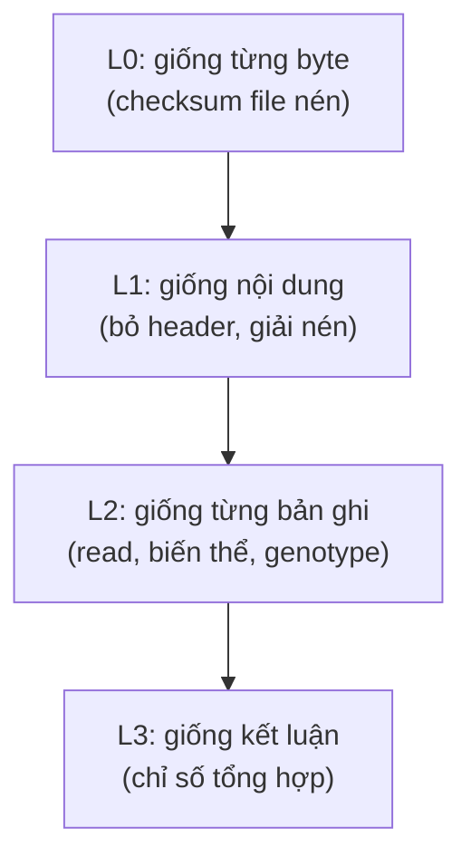
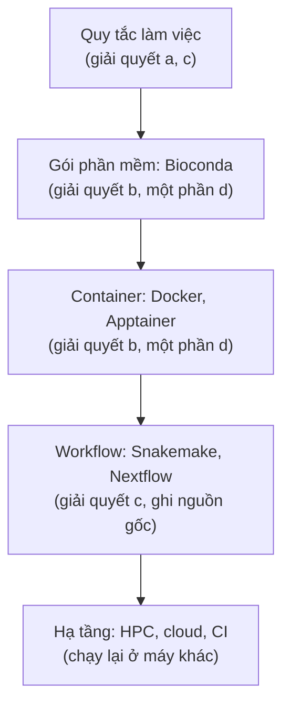

Tái lập tính toán (computational reproducibility) là khả năng người khác, hoặc chính bạn vài tháng sau, chạy lại cùng dữ liệu và cùng code mà ra cùng kết quả; trong bioinformatics, bộ công cụ cho việc này gồm Bioconda, container (Docker, Apptainer), workflow manager (Snakemake, Nextflow/nf-core) và hạ tầng HPC hoặc cloud. Trên thực tế việc này hỏng khá thường xuyên: trong hơn 9.000 file R công khai trên Harvard Dataverse, 74% gặp lỗi ngay lần chạy đầu (Trisovic et al., 2022), và trong 98 công cụ omics được thử cài, 28% không cài được (Mangul et al., 2019). Bài đề xuất một thang 4 mức để nói rõ "giống nhau" là giống đến đâu, chỉ ra mỗi lớp công cụ giải quyết nguồn sai lệch nào, rồi hướng dẫn thiết kế phép thử tái lập cho pipeline gọi biến thể fastp → BWA-MEM → SAMtools → bcftools. Bài dành cho sinh viên và người tự học bioinformatics sắp nộp đồ án, khoá luận hoặc dựng repo portfolio.

<div class="callout callout-note">
<p class="callout-title">Tóm tắt nhanh</p>

- "Tái lập được" có nhiều mức: L0 giống từng byte, L1 giống nội dung sau khi bỏ header, L2 giống từng bản ghi, L3 giống kết luận. Hãy nói rõ bạn đạt mức nào.
- Nguyên nhân thất bại hay gặp nhất là thiếu dữ liệu, thiếu mô tả và phần mềm không cài được, không phải hệ điều hành.
- Container giải quyết khâu cài đặt nhưng vẫn dùng chung nhân hệ điều hành và phần cứng của máy chủ; trên HPC dùng Apptainer vì Docker cần daemon quyền root.
- Một số bất định nằm trong thuật toán (số thread, batch, thứ tự read), nên ghim phiên bản và đặt seed vẫn chưa đủ.
- Repo portfolio tốt có một lệnh chạy toàn bộ, dữ liệu tải theo URL cố định kèm checksum, và CI chạy lại trên ít nhất hai hệ điều hành.

</div>

## 1. "Chạy lại được" nghĩa là gì?

Năm 2016, *Nature* công bố khảo sát với khoảng 1.500 nhà khoa học về chuyện không lặp lại được kết quả, và cụm từ "khủng hoảng tái lập" trở nên phổ biến từ đó (Baker, 2016). Khảo sát này chủ yếu nói về thí nghiệm, không riêng phân tích tính toán. Với phân tích dữ liệu, câu hỏi hẹp hơn và kiểm tra được: cùng dữ liệu, cùng code, có ra cùng kết quả không?

Học viện Quốc gia Hoa Kỳ (National Academies of Sciences, Engineering, and Medicine, 2019) tách hai khái niệm. *Reproducibility* (tái lập) là có kết quả nhất quán khi dùng cùng dữ liệu đầu vào, cùng các bước tính toán, phương pháp, code và điều kiện phân tích. *Replicability* (lặp lại) là có kết quả nhất quán giữa các nghiên cứu độc lập, mỗi nghiên cứu thu dữ liệu riêng. Các lĩnh vực khác nhau dùng hai từ này theo cách khác nhau, thậm chí ngược nhau (Goodman et al., 2016), nên khi đọc tài liệu bạn cần xem tác giả định nghĩa thế nào. Bài này chỉ bàn tái lập theo nghĩa của National Academies: tái lập tính toán.

Peng (2011) mô tả tái lập như một phổ. Khi không thể làm lại nghiên cứu độc lập, việc công bố code và dữ liệu để người khác chạy lại là tiêu chuẩn tối thiểu. Trong genomics, Baykal et al. (2024) đề xuất khái niệm *genomic reproducibility*: khả năng công cụ bioinformatics cho kết quả nhất quán giữa các technical replicate, tức các lần giải trình tự khác nhau từ cùng một mẫu. Khái niệm này nhắc rằng kể cả khi phần mềm và dữ liệu đã cố định, bản thân công cụ vẫn có thể phản ứng khác nhau với những khác biệt rất nhỏ giữa các lần giải trình tự.

Buffalo (2015) nhắc một điều thực tế: người cần tái lập phân tích thường chính là bạn, vài tháng sau, khi người hướng dẫn hỏi lại một con số hoặc khi bài báo bị yêu cầu sửa.

### Thang 4 mức

Câu "pipeline này tái lập được" thường không nói giống đến mức nào. Bài đề xuất một thang 4 mức. Đây là cách phân loại để làm việc, không phải định nghĩa có sẵn trong tài liệu.

| Mức | Giống nhau ở đâu | Cách kiểm tra ví dụ |
|---|---|---|
| L0 – byte | File nguyên trạng giống từng byte | SHA-256 của `sample.vcf.gz`, `sample.bam` |
| L1 – nội dung | Nội dung đã giải nén, bỏ header | `bcftools view -H`, `samtools view` (không `-h`) rồi tính SHA-256 |
| L2 – bản ghi | Từng read có cùng vị trí, MAPQ, CIGAR; từng biến thể có cùng genotype | Ghép theo tên read; `bcftools isec` |
| L3 – kết luận | Chỉ số tổng hợp và kết luận sinh học | `samtools flagstat`, số SNV/indel, Ti/Tv, precision/recall |



Đạt mức chặt hơn (L0) thì tự động đạt các mức lỏng hơn (L1–L3) theo chiều mũi tên, nhưng chiều ngược lại không đúng. L3 là điều người đọc bài báo quan tâm; L0 là điều một phép so checksum kiểm tra. Nhầm hai mức này dẫn đến hai sai lầm: kết luận "không tái lập được" chỉ vì checksum khác, hoặc kết luận "tái lập được" chỉ vì số biến thể tổng bằng nhau trong khi từng biến thể đã đổi.

<div class="callout callout-example">
<p class="callout-title">Một tình huống thường gặp</p>

Bạn và một bạn cùng nhóm chạy cùng pipeline trên cùng hai file FASTQ. File `sample.filt.vcf.gz` của hai người có SHA-256 khác nhau. Mở ra xem thì header của mỗi file ghi một dòng lệnh với đường dẫn thư mục riêng của từng người, còn 1.250 dòng biến thể bên dưới giống hệt nhau. Hai lần chạy khác ở L0 nhưng giống ở L1, và do đó giống ở L2, L3. Nếu chỉ dừng ở checksum, cả nhóm sẽ mất một buổi đi tìm "lỗi" không tồn tại.

</div>

Ngược lại cũng có thể xảy ra: hai lần chạy đều báo 1.250 biến thể (giống ở L3 về số lượng), nhưng 12 biến thể của lần này được thay bằng 12 biến thể khác ở lần kia. Con số tổng giống nhau che mất khác biệt ở L2. Vì vậy khi báo cáo, hãy ghi rõ cả mức đã kiểm tra lẫn công cụ dùng để so. (Các con số trong hai ví dụ này là minh hoạ, không phải kết quả đo.)

## 2. Vì sao phân tích tính toán khó chạy lại: năm nguồn sai lệch

Khi một phân tích không chạy lại được, phản xạ đầu tiên thường là đổ cho máy: "máy em là Mac", "server cài bản khác". Tài liệu thực nghiệm cho một bức tranh khác. Các nguyên nhân chia được thành năm nhóm, mỗi nhóm có ít nhất một nghiên cứu đo đạc cụ thể, và hệ điều hành chỉ là một phần của một nhóm.

**(a) Thiếu dữ liệu và mô tả.** Ioannidis et al. (2009) cho hai nhóm độc lập thử tái lập một bảng hoặc hình từ 18 bài phân tích microarray đăng trên *Nature Genetics* giai đoạn 2005–2006. Chỉ 2 phân tích tái lập được về nguyên tắc, 6 được một phần, 10 không được. Nguyên nhân chính là không có dữ liệu; các sai lệch còn lại chủ yếu do chú thích dữ liệu và mô tả cách xử lý không đầy đủ.

**(b) Phần mềm biến mất hoặc không cài được.** Mangul et al. (2019) xét 36.702 tài nguyên phần mềm omics công bố từ 2005 đến 2017: gần 28% không còn truy cập được qua URL ghi trong bài báo. Khi thử cài 98 công cụ, 51% dễ cài và 28% không cài được. Bioconda và BioContainers ra đời để xử lý đúng vấn đề này.

**(c) Code không chạy.** Trisovic et al. (2022) chạy lại hơn 9.000 file R trong kho Harvard Dataverse: 74% lỗi ở lần chạy đầu, và 56% vẫn lỗi sau khi được làm sạch code tự động. Notebook Jupyter cũng đã được khảo sát quy mô lớn (Pimentel et al., 2019); rủi ro ở mức notebook được bàn trong bài [phân tích dữ liệu bằng Python](/blog/introduction-to-data-analysis-using-python/).

**(d) Phiên bản và môi trường.** Gronenschild et al. (2012) đo thể tích não bằng FreeSurfer: đổi phiên bản phần mềm làm kết quả lệch trung bình 8,8%, còn đổi loại máy trạm hoặc phiên bản macOS gây lệch khoảng một nửa mức đó. Đây là lĩnh vực ảnh não, nhưng bài học chung: phiên bản phần mềm có thể quan trọng hơn hệ điều hành. Nhóm phát triển Nextflow cũng nhận xét rằng biến thiên nhỏ giữa các nền tảng tính toán gây bất ổn số và dẫn tới kết quả không tái lập (Di Tommaso et al., 2017).

**(e) Thứ tự dữ liệu và thuật toán.** Firtina và Alkan (2016) chỉ đảo thứ tự read trong file FASTQ, không đổi gì khác, và thấy một số read ở vùng lặp được map vào vị trí khác. Ngay cả khi alignment giống nhau, GATK HaplotypeCaller vẫn cho tập biến thể hơi khác. Loại bất định này không do seed ngẫu nhiên nên đặt seed không giải quyết được.

Ca của Kim et al. (2018) cho thấy các nguồn này cộng dồn ra sao. Nhóm tác giả có code và dữ liệu của một phương pháp đã công bố nhưng vẫn gặp khó khi tái lập, rồi viết lại từ MATLAB sang Python và đóng gói bằng Docker. Có code và dữ liệu là điều kiện cần, chưa phải điều kiện đủ.

Với một pipeline gọi biến thể của sinh viên, năm nhóm này hiện ra rất cụ thể. Nhóm (a) là khi README chỉ ghi "dữ liệu lấy từ SRA" mà không có mã run. Nhóm (b) là khi một công cụ chỉ có trên trang cá nhân của tác giả và trang đó đã đóng. Nhóm (c) là khi script dùng đường dẫn tuyệt đối `...` hoặc cần một bước sửa tay trong Excel giữa chừng. Nhóm (d) là khi file môi trường ghi `bcftools` không kèm số phiên bản. Nhóm (e) là khi chạy lại với số thread khác và một vài read ở vùng lặp đổi chỗ. Bảng 1 gom năm nhóm, bằng chứng và lớp công cụ tương ứng; mục 3 đi qua từng lớp.


*Hình 1. Tỷ lệ thất bại trong ba nghiên cứu đo khả năng chạy lại phân tích. Số liệu lấy từ tóm tắt của Ioannidis et al. (2009), Mangul et al. (2019) và Trisovic et al. (2022); ba nghiên cứu đo những thứ khác nhau nên không so sánh trực tiếp các cột với nhau.*

| Nguồn sai lệch | Bằng chứng | Lớp giải quyết | Chưa giải quyết |
|---|---|---|---|
| (a) Thiếu dữ liệu, mô tả | 10/18 phân tích microarray không tái lập được (Ioannidis et al., 2009) | Quy tắc: công khai dữ liệu, README, kho có DOI | Dữ liệu nhạy cảm không công khai được |
| (b) Phần mềm không cài được | 28% của 98 công cụ (Mangul et al., 2019) | Bioconda, BioContainers | Gói bị gỡ khỏi kênh sau vài năm |
| (c) Code không chạy | 74% file R lỗi lần đầu (Trisovic et al., 2022) | Workflow manager, CI | Lỗi logic chạy "thành công" vẫn sai |
| (d) Phiên bản, môi trường | Lệch 8,8% khi đổi phiên bản FreeSurfer (Gronenschild et al., 2012) | Ghim phiên bản, container | Khác kiến trúc CPU, nhân hệ điều hành |
| (e) Thứ tự dữ liệu, thuật toán | Đảo thứ tự read đổi vị trí map (Firtina & Alkan, 2016) | Tham số kiểm soát (ví dụ `-K` của BWA-MEM) | Công cụ không có tham số như vậy |

## 3. Bộ công cụ tái lập: mỗi lớp giải quyết điều gì

Grüning et al. (2018) đưa ra năm khuyến nghị cho tái lập tính toán thực tế trong khoa học sự sống: chọn công cụ phù hợp, cài bằng trình quản lý gói như Bioconda, đóng gói bằng container, dùng máy ảo khi cần lưu trữ lâu dài, và chạy qua nền tảng điều phối workflow. Phần này sắp xếp các công cụ theo đúng các lớp đó, thêm một lớp nền là quy tắc làm việc.



### 3.1. Quy tắc trước công cụ

Sandve et al. (2013) tóm lại thành 10 quy tắc: (1) với mọi kết quả, ghi lại nó được tạo ra thế nào; (2) tránh các bước sửa dữ liệu bằng tay; (3) lưu đúng phiên bản của mọi chương trình bên ngoài đã dùng; (4) đưa mọi script vào hệ thống quản lý phiên bản; (5) lưu kết quả trung gian, ở định dạng chuẩn nếu được; (6) với phân tích có yếu tố ngẫu nhiên, ghi lại seed; (7) lưu dữ liệu gốc dùng để vẽ mỗi hình; (8) tạo đầu ra phân tầng, từ tóm tắt đến chi tiết; (9) nối mỗi nhận định trong bài với kết quả gốc; (10) công khai script, lần chạy và kết quả.

Wilson et al. (2017) đưa ra bộ thực hành "đủ tốt" cho người không chuyên phần mềm. Noble (2009) đề xuất cách tổ chức dự án: một nhật ký làm việc (lab notebook) ghi theo thời gian, thư mục kết quả đặt tên theo ngày, và một script điều khiển chạy toàn bộ phân tích từ đầu. Buffalo (2015) thêm vài nguyên tắc cụ thể: coi dữ liệu thô là chỉ đọc; ghi README dạng văn bản thuần về nguồn gốc dữ liệu, ngày tải, phiên bản dữ liệu và phiên bản phần mềm; hình và số thống kê phải sinh ra từ script.

Cấu trúc thư mục sau gom các nguyên tắc đó vào một repo:

```text
du-an/
├── README.md            # câu hỏi, cách chạy lại, dữ liệu, phiên bản
├── config/config.yaml   # mọi tham số, không sửa tay trong code
├── data/                # dữ liệu thô, chỉ đọc; checksums.sha256
├── envs/                # file môi trường conda, ghim phiên bản
├── workflow/Snakefile   # các bước phân tích
├── scripts/             # script phụ (so sánh, vẽ hình)
├── results/             # kết quả sinh tự động
├── logs/  benchmarks/   # log và số đo thời gian, bộ nhớ
└── .github/workflows/   # CI chạy lại pipeline
```

### 3.2. Lớp gói phần mềm: conda và Bioconda

Conda cài phần mềm vào thư mục của người dùng, không cần quyền root, nên dùng được trên cluster dùng chung (Reiter et al., 2021). Bioconda là kênh conda chuyên cho khoa học sự sống (Grüning, Dale, et al., 2018). Ngày 11/11/2026, trang Bioconda ghi hỗ trợ bốn nền tảng linux-64, linux-aarch64, osx-64 và osx-arm64, với hơn 8.000 gói (Bioconda, n.d.).

Giới hạn: conda giải phụ thuộc lại mỗi lần tạo môi trường. File môi trường chỉ ghi `bwa` hoặc `bwa>=0.7` có thể cho hai môi trường khác nhau ở hai thời điểm. Hãy ghim phiên bản cụ thể cho mọi công cụ chính và lưu danh sách gói thực tế của môi trường đã chạy, ví dụ bằng `conda list --explicit > envs/bwa_samtools.osx-64.txt` cho từng nền tảng. File ghim phiên bản cho rule căn chỉnh có thể như sau:

```yaml
# envs/bwa_samtools.yaml
channels:
  - conda-forge
  - bioconda
dependencies:
  - bwa=0.7.19
  - samtools=1.21
```

Số phiên bản ở đây chỉ để minh hoạ cách ghim; tài liệu samtools và bcftools dẫn trong bài là bản hiện hành, mới hơn. Khi làm thật, chọn phiên bản đang có trên Bioconda và ghi đúng số đó vào file.

Hai lỗi hay gặp ở lớp này. Thứ nhất, một môi trường lớn chứa mọi công cụ: mỗi lần thêm một gói, conda có thể nâng hoặc hạ phiên bản các gói khác. Một môi trường nhỏ cho mỗi rule, như Snakemake hỗ trợ, tránh được việc này. Thứ hai, cài thêm gói bằng tay vào môi trường đang dùng mà không ghi lại; lần sau tạo môi trường từ file, gói đó biến mất. Cấu hình kênh (conda-forge ưu tiên, `channel_priority: strict`) được trình bày trong bài [nền tảng tính toán](/blog/nen-tang-tinh-toan/).

### 3.3. Lớp container: Docker, BioContainers, Apptainer

Docker đóng gói công cụ cùng các phụ thuộc thành một image chạy được ở máy khác (Boettiger, 2015). Nhưng container không có nghĩa "chạy giống nhau trên mọi máy". Container dùng chung nhân hệ điều hành của máy chủ và vẫn phụ thuộc phần cứng; vì vậy Grüning et al. (2018) đề xuất thêm máy ảo khi cần kết quả bền theo thời gian. Image còn phụ thuộc kiến trúc CPU: code trong container phải tương thích với kiến trúc của máy chủ, nên image `linux/amd64` không chạy được trên máy arm64 nếu không giả lập; image đa nền tảng (multi-platform) gói nhiều biến thể vào một image (Docker, n.d.-a).

BioContainers là khung cộng đồng chuẩn hoá container cho phần mềm sinh học; năm 2017 đã có hơn 2.000 container, dựa trên Docker và rkt, dùng được trên máy để bàn, cloud và HPC (da Veiga Leprevost et al., 2017). Hiện nay mỗi gói Bioconda có một BioContainer được tạo tự động trên Quay.io (Bioconda, n.d.). Cộng đồng cũng có khuyến nghị riêng về đóng gói (Gruening et al., 2019).

Vì sao HPC không dùng Docker? Kurtzer et al. (2017) chỉ ra mỗi container Docker được sinh ra từ một daemon chạy quyền root, điều không chấp nhận được trên máy dùng chung. Với Singularity, người không có quyền root trên máy chủ cũng không leo thang được thành root trong container. Dự án Singularity sau đó chuyển vào Linux Foundation và đổi tên thành Apptainer, theo thông báo ngày 30/11/2021 (Apptainer, 2021). Docker hiện có chế độ rootless nhưng cần cấu hình riêng (Docker, n.d.-c).

Trên HPC, cách làm phổ biến là kéo image BioContainers về thành file `.sif` của Apptainer rồi chạy công cụ bên trong, hoặc để Snakemake làm việc đó qua `--sdm apptainer`. Hai điểm cần để ý. Container chỉ thấy những thư mục được gắn (bind) vào, nên đường dẫn dữ liệu ngoài thư mục làm việc phải được khai báo. Và hãy ghi digest của image (chuỗi `sha256:...`) bên cạnh tag: tag là nhãn có thể bị gán lại, còn digest xác định đúng một image.

Viết Dockerfile tái lập được có 10 quy tắc riêng (Nüst et al., 2020). Bốn quy tắc đáng nhớ trong số đó: dựa trên image có sẵn với tag cụ thể; ghim phiên bản mọi gói; tránh tag `latest` vì nó là mục tiêu di động; build lại định kỳ để sớm biết khi có gì đổi.

```dockerfile
# Ví dụ khung: ghim tag image gốc và phiên bản gói
FROM python:3.12.7-slim
RUN pip install --no-cache-dir pandas==2.2.3 biopython==1.84
COPY gc_content.py /app/gc_content.py
ENTRYPOINT ["python", "/app/gc_content.py"]
```

### 3.4. Lớp workflow: Snakemake, Nextflow và nf-core

Snakemake là ngôn ngữ dựa trên Python, chạy được từ máy trạm tới cluster mà không phải sửa workflow, và tự suy ra thứ tự các bước từ tên file đầu vào và đầu ra có wildcard (Köster & Rahmann, 2012). Bài năm 2021 đặt mục tiêu ba tính chất: tái lập, thích nghi (sửa để trả lời câu hỏi mới) và minh bạch (người khác hiểu được để đánh giá phương pháp) (Mölder et al., 2021).

Một rule có đầu vào, đầu ra, môi trường phần mềm và lệnh:

```python
rule fastqc:
    input: "data/{sample}.fastq.gz"
    output: "qc/{sample}_fastqc.html"
    conda: "../envs/qc.yaml"          # file này ghim phiên bản FastQC
    threads: 2
    log: "logs/fastqc/{sample}.log"
    shell: "fastqc -t {threads} -o qc {input} 2> {log}"
```

Mỗi rule nên có `log:` riêng để khi một bước lỗi, bạn biết ngay bước nào và vì sao. Trước khi chạy thật, `snakemake -n` (dry-run) liệt kê các job sẽ chạy mà không thực thi gì, và `snakemake --dag | dot -Tpng > dag.png` vẽ sơ đồ phụ thuộc giữa các bước. Lỗi người mới hay gặp nhất là tên wildcard ở `output:` không khớp với `input:` của rule sau, khiến Snakemake báo không biết tạo file nào; dry-run phát hiện lỗi này trong vài giây.

Lệnh `snakemake --cores 8 --use-conda` vẫn dùng được trong Snakemake 9.27.1 (bản tài liệu được dẫn); cách viết mới là `--sdm conda` hoặc `--sdm apptainer` (Snakemake, n.d.-a). "Chỉ chạy lại phần thay đổi" cần hiểu đúng: mặc định Snakemake xét năm loại thay đổi là code, input, mtime, params và môi trường phần mềm. Chỉ thị `benchmark:` ghi thời gian, `max_rss`, `cpu_time` cho mỗi job, và `repeat()` để chạy lặp (Snakemake, n.d.-b).

Nextflow dùng mô hình dataflow và tích hợp container; bài giới thiệu năm 2017 trình bày nó như giải pháp cho bất ổn số giữa nền tảng (Di Tommaso et al., 2017). nf-core là khung cộng đồng cho pipeline Nextflow được kiểm duyệt (Ewels et al., 2020). Ngày 11/11/2026, trang nf-core liệt kê 160 pipeline; con số này gồm cả pipeline đã phát hành và đang phát triển (nf-core, n.d.-a).

Tài liệu nf-core/rnaseq 3.27.0 khuyên ghim phiên bản pipeline bằng `-r`, chỉ dùng Conda khi không còn cách nào khác, và không khuyến nghị iGenomes cho phân tích mới vì chú giải gen trong iGenomes rất cũ; nên đưa FASTA và GTF trực tiếp (nf-core, n.d.-b):

```bash
nextflow run nf-core/rnaseq -r 3.27.0 -profile docker \
    --input samplesheet.csv --outdir results \
    --fasta GRCh38.primary_assembly.genome.fa.gz \
    --gtf gencode.annotation.gtf.gz
# Thử trước với dữ liệu nhỏ có sẵn:
nextflow run nf-core/rnaseq -r 3.27.0 -profile test,docker --outdir test_out
```

| | Snakemake | Nextflow / nf-core |
|---|---|---|
| Ngôn ngữ | Mở rộng của Python | DSL riêng dựa trên Groovy |
| Khai báo phần mềm | `conda:`, `container:` theo rule | `conda`, `container` theo process; profile docker, singularity, apptainer |
| Chạy trên HPC, cloud | Không sửa workflow (Köster & Rahmann, 2012) | Tích hợp sẵn (Di Tommaso et al., 2017) |
| Pipeline cộng đồng | Snakemake workflow catalog | nf-core, 160 pipeline (11/11/2026) |
| Hợp với | Pipeline tự viết, người quen Python | Dùng lại pipeline chuẩn đã kiểm duyệt |

Wratten et al. (2021) so sánh các workflow manager phổ biến và nhận định chúng giúp tối ưu tài nguyên, quản lý phần mềm và phiên bản, chạy trên nhiều nền tảng; Leipzig (2017) tổng quan các framework pipeline. Reiter et al. (2021) khuyên người mới bắt đầu từ code đã chạy được, thử trên dữ liệu lấy mẫu nhỏ và kiểm tra kết quả từng bước. CWL, WDL và Galaxy là các lựa chọn khác.

### 3.5. Lớp hạ tầng: HPC và cloud

Trên HPC, SLURM là bộ lập lịch phổ biến (Yoo et al., 2003). Ba lệnh cơ bản: `sbatch job.sh` để nộp, `squeue -u $USER` để xem hàng đợi, `scancel <jobid>` để huỷ. Một script nộp job khai báo tài nguyên ở đầu file:

```bash
#!/bin/bash
#SBATCH --job-name=variant-call
#SBATCH --cpus-per-task=4
#SBATCH --mem=8G
#SBATCH --time=02:00:00
#SBATCH --output=logs/slurm-%j.out
snakemake --sdm apptainer --cores "$SLURM_CPUS_PER_TASK"
```

Cách này chạy cả pipeline trong một job. Với pipeline lớn, Snakemake có thể tự nộp từng rule thành một job SLURM riêng qua plugin executor và profile; tên tuỳ chọn thay đổi theo phiên bản, nên hãy đọc tài liệu của đúng bản bạn cài. Galaxy là nền tảng web cho phân tích dễ tiếp cận, tái lập và cộng tác (The Galaxy Community, 2024).

Để có "một máy khác" kiểm tra tái lập mà không cần HPC, GitHub Actions là cách ít tốn kém: runner chuẩn miễn phí cho repo công khai; `ubuntu-latest` có 4 CPU, 16 GB RAM, 14 GB SSD; có runner Linux arm64 và macOS (GitHub, n.d.).

Về tài nguyên, man page của bwa 0.7.19 ghi rằng đánh index genome người bằng thuật toán bwtsw cần 5 GB RAM (Li, n.d.). Với các bước khác, cách đáng tin nhất là đo bằng `benchmark:` trên dữ liệu của chính bạn, thay vì dùng các con số ước lượng không rõ nguồn.

## 4. Thiết kế phép thử tái lập cho pipeline gọi biến thể

Phần này chuyển các nguyên tắc trên thành một phép thử cụ thể cho pipeline gọi biến thể trong bài [NGS và genomics](/blog/giai-trinh-tu-the-he-moi-ngs-va-genomics/). Mục tiêu là trả lời bằng số: khi chạy lại trên các máy khác nhau, kết quả giống ở mức nào trong thang L0–L3, và yếu tố nào làm lệch nhiều nhất.

### 4.1. Pipeline và Snakefile

Các bước: fastp (Chen et al., 2018) → BWA-MEM (Li, 2013) → `samtools fixmate -m` → `sort` → `markdup` → `index` (Danecek et al., 2021) → `bcftools mpileup -a FORMAT/AD,FORMAT/DP | bcftools call -m -v` → `bcftools norm -m -any` → `bcftools filter -i 'QUAL>30 && INFO/DP>10'` → `bcftools stats`, `samtools flagstat` → MultiQC (Ewels et al., 2016).

Mỗi rule có `conda:` trỏ tới file môi trường ghim phiên bản, `container:` trỏ tới image BioContainers có tag đầy đủ, `threads:`, `log:` và `benchmark:`. Tham số nằm trong `config/config.yaml`. Rule căn chỉnh rút gọn:

```python
rule bwa_mem:
    input: r1="work/{s}.R1.trim.fq.gz", r2="work/{s}.R2.trim.fq.gz"
    output: "work/{s}.sorted.bam"
    params: rg=r"@RG\tID:{s}\tSM:{s}\tPL:ILLUMINA", K=config["bwa_K"]
    threads: config["threads"]
    conda: "../envs/bwa_samtools.yaml"
    container: config["images"]["bwa_samtools"]
    benchmark: repeat("benchmarks/bwa_mem/{s}.tsv", 3)
    shell:
        "bwa mem -t {threads} -K {params.K} -R '{params.rg}' {config[ref]} "
        "{input.r1} {input.r2} | samtools fixmate -m -u - - "
        "| samtools sort -o {output} -"
```

Giữ nguyên header gốc của BAM và VCF trong lần chạy chính, vì header ghi lại dòng lệnh và phiên bản, đúng tinh thần quy tắc 1 của Sandve et al. (2013).

### 4.2. Dữ liệu

Một bộ dữ liệu nhỏ đủ cho phép thử: kho nf-core/test-datasets, nhánh `modules`, có `test_1.fastq.gz` (16.013.759 byte) và `test_2.fastq.gz` (16.698.858 byte) trong `data/genomics/homo_sapiens/illumina/fastq/`, cùng tham chiếu `hg38.chr22.fasta` (51.326.778 byte). README của kho ghi read lấy từ dự án PRJEB39899 và chỉ giữ read map vào chr22 (nf-core, n.d.-c). Dự án này có mẫu khối u, nên chỉ dùng để đo tái lập kỹ thuật, không diễn giải sinh học.

Tải theo URL có commit hash cố định thay vì tên nhánh, ghi SHA-256 vào `data/checksums.sha256` và kiểm tra trước khi chạy (Reiter et al., 2021). Trước khi đưa bản sao dữ liệu vào repo, kiểm tra giấy phép của kho.

### 4.3. Môi trường

| Mã | Máy | Cách cài |
|---|---|---|
| E1 | Máy cá nhân (ví dụ macOS Intel) | conda (osx-64) |
| E2 | GitHub Actions `ubuntu-latest` (Linux x64) | conda (linux-64) |
| E3 | Cùng runner với E2 | Apptainer, image BioContainers cùng phiên bản |
| E4 | GitHub Actions `ubuntu-24.04-arm` (Linux arm64) | conda (linux-aarch64) |
| E5 | GitHub Actions `macos-latest` (macOS arm64) | conda (osx-arm64) |

So E2 với E3 tách riêng ảnh hưởng "conda hay container", và E3 cũng là cách chạy trên HPC. So E2 với E4 tách ảnh hưởng của kiến trúc CPU. Nếu một gói không có bản cho kiến trúc nào đó đúng phiên bản đã ghim, hãy ghi lại: đó chính là loại thất bại mà Mangul et al. (2019) đo. Docker Desktop chỉ hỗ trợ bản macOS hiện tại và hai bản trước (Docker, n.d.-b), nên máy Mac cũ có thể chỉ chạy được conda.

### 4.4. Các thử nghiệm và giả thuyết

| Mã | Làm gì | Giả thuyết | Cơ sở |
|---|---|---|---|
| R0 | Chạy một lần trên E1–E5, cùng config | Thân BAM, VCF giống hệt | Grüning et al. (2018) và Di Tommaso et al. (2017) |
| R1 | Chạy hai lần trong cùng môi trường | Giống hệt; nếu khác, trừ phần này khỏi mọi so sánh | — |
| R2 | `bwa mem -t 1` so với `-t 4`, có và không có `-K` | Không `-K` có thể lệch; có `-K` thì hết | Li (n.d.) |
| R3 | Xáo trộn cặp read với 5 seed | Read vùng lặp đổi vị trí | Firtina & Alkan (2016) |
| R4 | Đổi phiên bản bcftools | Lệch nhiều hơn đổi hệ điều hành | Gronenschild et al. (2012), gián tiếp |
| R5 | Chạy lại với `--no-PG`, `--no-version` | L0 khác do header; L1 giống | Tài liệu samtools, bcftools |
| R6 | Đổi ngưỡng lọc; sửa rule căn chỉnh | Chỉ chạy lại các rule bị ảnh hưởng | Tài liệu Snakemake |

Về R2: man page bwa 0.7.19 (Li, n.d.) ghi mặc định mỗi batch xử lý 10.000.000 base nhân với số thread, và đặt `-K` cố định số base mỗi batch bất kể số thread, giúp tái lập. Cơ chế cụ thể bên trong khiến kết quả phụ thuộc batch chưa được mô tả trong tài liệu đã đọc.

Về R1: lặp lại trong cùng môi trường nghe có vẻ thừa, nhưng đó là đường cơ sở. Nếu hai lần chạy trên cùng một máy đã khác nhau ở L2, mọi khác biệt giữa các máy phải được đọc sau khi trừ đi phần dao động này.

Về R3: khi xáo trộn read paired-end, R1 và R2 của cùng một phân tử phải giữ đúng cặp. Cách an toàn là gộp hai file thành dạng xen kẽ (interleaved) hoặc dùng cùng một seed cho cả hai file với một công cụ xáo trộn có hỗ trợ việc đó, rồi kiểm tra tên read ở hai file vẫn khớp theo từng dòng. Dùng 5 seed khác nhau và báo cáo trung vị cùng khoảng min–max số read đổi vị trí, vì một seed duy nhất có thể cho con số tình cờ.

Về R5: samtools thêm dòng `@PG` vào header trừ khi dùng `--no-PG`; bcftools thêm phiên bản và dòng lệnh vào header trừ khi dùng `--no-version` (Danecek et al., 2021; Samtools, n.d.; Bcftools, n.d.).

### 4.5. So sánh ở bốn mức

**L0 và L1.** Đoạn Python sau tự tạo hai file VCF nén có cùng bản ghi nhưng khác dòng header ghi lệnh và thời điểm, rồi so ở hai mức. Chỉ dùng thư viện chuẩn, chạy được trên cả macOS và Linux:

```python
import gzip, hashlib, io

# Hai "lần chạy" cho cùng các bản ghi VCF, chỉ khác dòng header ghi lệnh và thời điểm
body = (
    "chr22\t16050075\t.\tA\tG\t52.3\tPASS\tDP=14\tGT\t0/1\n"
    "chr22\t16050115\t.\tG\tA\t88.1\tPASS\tDP=21\tGT\t1/1\n"
    "chr22\t16050213\t.\tC\tT\t35.7\tPASS\tDP=12\tGT\t0/1\n"
)
def vcf(cmd_line):
    return ("##fileformat=VCFv4.2\n"
            f"##bcftools_callCommand={cmd_line}\n"
            "#CHROM\tPOS\tID\tREF\tALT\tQUAL\tFILTER\tINFO\tFORMAT\tS1\n" + body)

run_a = vcf("call -mv ./s.bcf; Date=Mon Nov  2 09:14:03 2026")
run_b = vcf("call -mv ./s.bcf; Date=Tue Nov  3 21:40:55 2026")

def gz(text, mtime):
    buf = io.BytesIO()
    with gzip.GzipFile(fileobj=buf, mode="wb", mtime=mtime) as f:
        f.write(text.encode())
    return buf.getvalue()

sha = lambda b: hashlib.sha256(b).hexdigest()[:12]
file_a, file_b = gz(run_a, 1793610843), gz(run_b, 1793742055)

def records(gz_bytes):
    """L1: giải nén, bỏ mọi dòng header bắt đầu bằng '#'."""
    text = gzip.decompress(gz_bytes).decode()
    return "".join(l + "\n" for l in text.splitlines() if not l.startswith("#"))

print("L0 (file nén nguyên trạng):", sha(file_a), sha(file_b), sha(file_a) == sha(file_b))
print("L1 (thân đã giải nén)     :", sha(records(file_a).encode()), sha(records(file_b).encode()),
      records(file_a) == records(file_b))
# Cùng nội dung, chỉ khác mtime trong header gzip
same_text = gz(run_a, 0) == gz(run_a, 1)
print("Cùng văn bản, khác mtime gzip -> byte giống nhau?", same_text)
```

```text
L0 (file nén nguyên trạng): 82871f576f62 4df0d94112b4 False
L1 (thân đã giải nén)     : 25f57d7719bb 25f57d7719bb True
Cùng văn bản, khác mtime gzip -> byte giống nhau? False
```

Dòng cuối cho thấy thêm một nguồn khác biệt ở L0: định dạng gzip có trường MTIME trong header (Deutsch, 1996), nên nén cùng một văn bản ở hai thời điểm có thể cho hai file khác byte.

**L2.** So từng biến thể bằng cách ghép theo khoá `CHROM, POS, REF, ALT`. Trong thực tế bạn có thể dùng `bcftools isec`; đoạn pandas dưới đây cho thấy logic:

```python
import io
import pandas as pd

# Bản ghi VCF (đã bỏ header) của hai lần chạy, ví dụ nhỏ tự tạo
run_a = """chr22\t16050075\tA\tG\t52.3\t0/1
chr22\t16050115\tG\tA\t88.1\t1/1
chr22\t16050213\tC\tT\t35.7\t0/1
chr22\t16050320\tT\tC\t41.0\t0/1"""
run_b = """chr22\t16050075\tA\tG\t52.3\t0/1
chr22\t16050115\tG\tA\t88.1\t0/1
chr22\t16050213\tC\tT\t35.9\t0/1
chr22\t16050402\tG\tT\t33.2\t0/1"""
cols = ["CHROM", "POS", "REF", "ALT", "QUAL", "GT"]
a = pd.read_csv(io.StringIO(run_a), sep="\t", names=cols)
b = pd.read_csv(io.StringIO(run_b), sep="\t", names=cols)

key = ["CHROM", "POS", "REF", "ALT"]
m = a.merge(b, on=key, how="outer", suffixes=("_a", "_b"), indicator=True)
both = m[m["_merge"] == "both"]
summary = {
    "chỉ có ở A": int((m["_merge"] == "left_only").sum()),
    "chỉ có ở B": int((m["_merge"] == "right_only").sum()),
    "chung vị trí": len(both),
    "chung nhưng khác GT": int((both["GT_a"] != both["GT_b"]).sum()),
    "chung nhưng khác QUAL": int((both["QUAL_a"] != both["QUAL_b"]).sum()),
}
print(summary)
```

```text
{'chỉ có ở A': 1, 'chỉ có ở B': 1, 'chung vị trí': 3, 'chung nhưng khác GT': 1, 'chung nhưng khác QUAL': 1}
```

Kết quả cho thấy ba loại khác biệt mà một phép đếm tổng không thấy được: một biến thể chỉ có ở mỗi bên (vị trí 16050320 và 16050402), một biến thể đổi genotype từ `1/1` sang `0/1`, và một biến thể chỉ lệch QUAL từ 35,7 lên 35,9. Hai lần chạy này cùng có 4 biến thể, tức "giống" nếu chỉ đếm, nhưng khác ở L2. Khác biệt QUAL nhỏ thường vô hại, trừ khi nó nằm sát ngưỡng lọc: một biến thể QUAL 29,9 ở lần này và 30,1 ở lần kia sẽ bị lọc ở một bên và giữ lại ở bên kia.

Với BAM, logic tương tự: ghép theo tên read và cờ R1/R2, rồi đếm read có vị trí, MAPQ hoặc CIGAR khác. Tỷ lệ read đổi vị trí là con số dễ so nhất giữa các thử nghiệm R2, R3, R4.

**L3.** Dùng `samtools flagstat`, số SNV và indel, tỷ lệ Ti/Tv từ `bcftools stats`. Nếu có bộ đáp án như GIAB (Zook et al., 2019), thêm precision và recall tính theo cách của GA4GH (Krusche et al., 2019).

### 4.6. Kiểm tra cơ chế chạy lại một phần của Snakemake

Giả thuyết R6 kiểm tra được ngay trên máy cá nhân mà không cần công cụ NGS, bằng một pipeline đồ chơi bốn bước mô phỏng cắt tỉa, căn chỉnh, gọi biến thể và lọc:

```python
configfile: "config/config.yaml"

rule all:
    input: "results/filtered.tsv"

rule trim:
    input: "data/reads.tsv"
    output: "work/trimmed.tsv"
    shell: "cut -f1,2 {input} > {output}"

rule align:
    input: "work/trimmed.tsv"
    output: "work/aligned.tsv"
    shell: "awk -v OFS='\\t' '{{print $1, NR*100}}' {input} > {output}"

rule call:
    input: "work/aligned.tsv"
    output: "work/calls.tsv"
    shell: "awk -v OFS='\\t' '{{print $1, $2, NR*15}}' {input} > {output}"

rule filter:
    input: "work/calls.tsv"
    output: "results/filtered.tsv"
    params: q=config["min_qual"]
    shell: "awk -v q={params.q} '$3 > q' {input} > {output}"
```

Chạy thử trên Snakemake 9.27.2 (mới hơn bản tài liệu 9.27.1 một bản vá) với `min_qual: 30`, rồi đổi thành `min_qual: 20` và chạy `snakemake -n`. Snakemake chỉ lên lịch 2 job, `filter` và `all`, với lý do "params have changed since last execution". Đưa ngưỡng về 30 và sửa lệnh của rule `align`: lần này 4 job được lên lịch, `align` với lý do "Code has changed since last execution", còn `call`, `filter`, `all` vì đầu vào được cập nhật. `trim` không chạy lại.

Hai điều rút ra. Thứ nhất, Snakemake theo dõi cả tham số và nội dung lệnh, không chỉ thời điểm sửa file: đổi một con số trong `config.yaml` là đủ để rule dùng con số đó chạy lại, và chỉ các rule phía sau nó. Với pipeline thật, điều này có nghĩa là thử nhiều ngưỡng lọc không bắt bạn căn chỉnh lại từ đầu. Thứ hai, chính Snakemake in gợi ý: nếu bạn chỉ sửa định dạng của lệnh và chắc chắn kết quả không đổi, có thể dùng `--rerun-triggers mtime` hoặc `--cleanup-metadata <file>` để bỏ qua. Dùng các tuỳ chọn này cần thận trọng, vì chúng tắt đúng cơ chế giúp kết quả khớp với code.

## 5. Thảo luận và giới hạn

**Checksum khác không có nghĩa kết quả khác.** Ví dụ ở mục 4.5 cho thấy hai file khác nhau ở L0 vẫn có thể giống hệt ở L1. Khuyến nghị: lưu checksum ở L0 để kiểm tra toàn vẹn file khi chuyển dữ liệu, và so nội dung ở L1 trở lên khi kiểm tra tái lập. Giữ header vì đó là thông tin nguồn gốc.

**Container bảo đảm đến đâu.** Container giải quyết nguồn sai lệch (b) và một phần (d). Nó không giải quyết thiếu dữ liệu (a), lỗi logic trong code (c), hay bất định trong thuật toán (e). Thêm nữa, container vẫn phụ thuộc nhân hệ điều hành và phần cứng (Grüning et al., 2018), và image hôm nay có thể không còn tải được sau vài năm.

**Kiến trúc CPU.** Máy Mac đời mới và nhiều máy chủ cloud dùng arm64. Chưa có nguồn nào trong các tài liệu đã đọc nói trước rằng fastp, BWA-MEM, SAMtools và bcftools cho kết quả giống hệt nhau giữa x86_64 và arm64. Đó là lý do phép thử nên có E4 và E5.

**Bất định nằm trong thuật toán.** Kết quả của Firtina và Alkan (2016) nhắc rằng ghim phiên bản là chưa đủ. Với mỗi công cụ, hãy tìm trong tài liệu các tham số kiểu `-K` của BWA-MEM và ghi chúng vào README.

**Phiên bản quan trọng hơn nền tảng?** Dữ liệu FreeSurfer gợi ý vậy (Gronenschild et al., 2012); Buffalo (2015) kể một trường hợp kết quả không khớp được truy ra một gói R vừa cập nhật trên server. Nếu R4 cho kết quả tương tự, thông điệp thực hành là: ghim phiên bản trước, lo container sau.

**Mở rộng.** GATK HaplotypeCaller cho tập biến thể hơi khác ngay cả với cùng alignment (Firtina & Alkan, 2016). Với machine learning, Heil et al. (2021) đề xuất chuẩn tái lập riêng (xem bài [machine learning trong sinh học](/blog/machine-learning-va-ai-trong-sinh-hoc/)).

**Khi kết quả lệch, tìm theo thứ tự nào.** Một trình tự hợp lý, đi từ rẻ đến đắt: kiểm tra checksum dữ liệu đầu vào; so danh sách gói thực tế của hai môi trường; so ở L1 từng file trung gian theo thứ tự pipeline để tìm bước đầu tiên bắt đầu khác; ở bước đó, xem số thread, tham số batch và thứ tự đầu vào. Thường thì bước khác đầu tiên chỉ ra nguyên nhân, còn các bước sau chỉ kế thừa khác biệt.

**Giới hạn của phép thử.** Dữ liệu nhỏ (chr22) chưa chứng minh điều tương tự với genome đầy đủ. Runner GitHub Actions là máy ảo dùng chung nên thời gian chạy chỉ để tham khảo. Lưu trữ dài hạn cần lưu cả image và dữ liệu ở kho có DOI theo nguyên tắc FAIR (Wilkinson et al., 2016).

## 6. Từ pipeline đến repo portfolio

Một repo chạy lại được là bằng chứng nhà tuyển dụng hoặc hội đồng kiểm tra được. README nên có 6 mục, mỗi mục gắn với một quy tắc của Sandve et al. (2013):

| Mục README | Quy tắc Sandve | File trong repo |
|---|---|---|
| (1) Câu hỏi và kết luận trong 3 câu | 9 – nối nhận định với kết quả | `README.md` |
| (2) Một hình quan trọng nhất | 7 – lưu dữ liệu gốc của hình | `results/`, `scripts/plot.py` |
| (3) Cách chạy lại: một lệnh, kèm badge CI | 1, 2 – ghi cách tạo kết quả, không thao tác tay | `workflow/Snakefile`, `.github/workflows/` |
| (4) Dữ liệu: nguồn, URL có commit, ngày tải, SHA-256 | 10 – công khai | `data/checksums.sha256` |
| (5) Phương pháp và bảng phiên bản | 3, 4 – ghi phiên bản, quản lý phiên bản | `envs/*.yaml` |
| (6) Giới hạn và hướng mở rộng | 8 – đầu ra phân tầng | `README.md` |

<div class="callout callout-example">
<p class="callout-title">Khung README</p>

**Câu hỏi.** Pipeline gọi biến thể cho kết quả giống nhau đến mức nào khi chạy trên Linux x64, Linux arm64 và macOS?
**Kết quả chính.** (ba câu, mỗi câu dẫn tới một file trong `results/`)
**Cách chạy lại.** `conda env create -f envs/snakemake.yaml` rồi `snakemake --sdm conda --cores 4`. Badge CI ở đầu trang.
**Dữ liệu.** Nguồn, mã truy cập, URL có commit hash, ngày tải, SHA-256 trong `data/checksums.sha256`.
**Phương pháp và phiên bản.** Bảng sinh tự động từ `envs/*.yaml`.
**Giới hạn.** Dữ liệu nhỏ, một bộ phiên bản; hướng mở rộng.

</div>

Snakemake tạo được báo cáo HTML nối kết quả với thông tin nguồn gốc (Mölder et al., 2021), dùng thay cho việc chép tay số liệu vào README. Phần diễn giải có thể viết bằng Quarto hoặc Jupyter. Khi phát hành, gắn một tag phiên bản cho repo và lưu bản đó ở một kho cấp DOI, để bài báo hay hồ sơ trỏ tới đúng phiên bản code đã tạo ra kết quả, không phải nhánh chính đã sửa nhiều lần sau đó.

Với một phép kiểm tra kỹ thuật như thế này, một bài blog giải thích cách làm và kết quả thường là đủ; preprint chỉ đáng cân nhắc khi kết quả có điều bất ngờ, chẳng hạn khác biệt lớn giữa hai kiến trúc CPU.

Năm câu hỏi phỏng vấn rút ra từ bài: Vì sao checksum khác mà kết quả vẫn giống? Vì sao không dùng Docker trên HPC? Tham số `-K` của BWA-MEM để làm gì? Snakemake quyết định chạy lại job nào thế nào? Vì sao phải ghim `-r` khi chạy nf-core?

Repo này là phần "tái lập" của dự án tổng hợp trong bài dự án tổng hợp và portfolio.

## 7. Kết luận và checklist

"Tái lập được" là một mức đo được chứ không phải một nhãn. Phần lớn thất bại đến từ dữ liệu, mô tả và phần mềm, nên ghim phiên bản và công khai dữ liệu đem lại nhiều nhất; container và workflow manager là lớp tiếp theo. Báo cáo rõ bạn đạt mức nào trong L0–L3.

Checklist 10 điểm:

1. Dữ liệu tải từ URL cố định, có checksum.
2. Mọi công cụ ghim phiên bản.
3. Container có tag đầy đủ, không `latest`.
4. Tham số nằm trong file config.
5. Tham số kiểm soát bất định (seed, `-K`) được đặt và ghi lại.
6. Một lệnh chạy toàn bộ.
7. CI chạy lại trên ít nhất hai hệ điều hành.
8. So kết quả ở mức L1 trở lên.
9. README theo 6 mục.
10. Bản phát hành lưu ở kho có DOI.

## Câu hỏi thường gặp

**Reproducibility và replicability khác nhau thế nào?** Reproducibility là cùng dữ liệu, cùng code ra cùng kết quả; replicability là nghiên cứu mới với dữ liệu mới ra kết quả nhất quán (National Academies of Sciences, Engineering, and Medicine, 2019).

**Nên học Snakemake hay Nextflow trước?** Nếu bạn quen Python và tự viết pipeline, Snakemake dễ bắt đầu. Nếu bạn cần chạy pipeline chuẩn đã có, nf-core là lựa chọn nhanh.

**Có Docker rồi thì có cần conda không?** Có. Image BioContainers được tạo từ gói Bioconda, và file môi trường conda là cách ghi phiên bản dễ đọc nhất.

**Checksum khác có phải pipeline không tái lập không?** Chưa chắc. Hãy so ở L1 (bỏ header, giải nén) trước khi kết luận.

**Vì sao cluster của trường không cho dùng Docker?** Vì Docker sinh container từ một daemon chạy quyền root, không an toàn trên máy dùng chung (Kurtzer et al., 2017). Apptainer chạy được image Docker mà không cần quyền đó.

**Máy 8 GB RAM có chạy được pipeline gọi biến thể không?** Với dữ liệu nhỏ như một nhiễm sắc thể, thường là được; đánh index cả genome người bằng bwtsw cần khoảng 5 GB RAM theo man page của bwa. Với dữ liệu thật, hãy đo bằng `benchmark:` thay vì đoán.

## Tài liệu tham khảo

Apptainer. (2021, November 30). *Community announcement*. https://apptainer.org/news/community-announcement-20211130/

Baker, M. (2016). 1,500 scientists lift the lid on reproducibility. *Nature, 533*(7604), 452–454. https://doi.org/10.1038/533452a

Baykal, P. I., Łabaj, P. P., Markowetz, F., Schriml, L. M., Stekhoven, D. J., Mangul, S., & Beerenwinkel, N. (2024). Genomic reproducibility in the bioinformatics era. *Genome Biology, 25*(1), 213. https://doi.org/10.1186/s13059-024-03343-2

Bcftools. (n.d.). *bcftools manual* (version 1.22). Retrieved November 11, 2026, from https://samtools.github.io/bcftools/bcftools.html

Bioconda. (n.d.). *Bioconda*. Retrieved November 11, 2026, from https://bioconda.github.io/

Boettiger, C. (2015). An introduction to Docker for reproducible research. *ACM SIGOPS Operating Systems Review, 49*(1), 71–79. https://doi.org/10.1145/2723872.2723882

Buffalo, V. (2015). *Bioinformatics data skills: Reproducible and robust research with open source tools*. O'Reilly Media.

Chen, S., Zhou, Y., Chen, Y., & Gu, J. (2018). fastp: An ultra-fast all-in-one FASTQ preprocessor. *Bioinformatics, 34*(17), i884–i890. https://doi.org/10.1093/bioinformatics/bty560

da Veiga Leprevost, F., Grüning, B. A., Alves Aflitos, S., Röst, H. L., Uszkoreit, J., Barsnes, H., Vaudel, M., Moreno, P., Gatto, L., Weber, J., Bai, M., Jimenez, R. C., Sachsenberg, T., Pfeuffer, J., Vera Alvarez, R., Griss, J., Nesvizhskii, A. I., & Perez-Riverol, Y. (2017). BioContainers: An open-source and community-driven framework for software standardization. *Bioinformatics, 33*(16), 2580–2582. https://doi.org/10.1093/bioinformatics/btx192

Danecek, P., Bonfield, J. K., Liddle, J., Marshall, J., Ohan, V., Pollard, M. O., Whitwham, A., Keane, T., McCarthy, S. A., Davies, R. M., & Li, H. (2021). Twelve years of SAMtools and BCFtools. *GigaScience, 10*(2), giab008. https://doi.org/10.1093/gigascience/giab008

Deutsch, P. (1996). *GZIP file format specification version 4.3* (RFC 1952). RFC Editor. https://doi.org/10.17487/RFC1952

Di Tommaso, P., Chatzou, M., Floden, E. W., Barja, P. P., Palumbo, E., & Notredame, C. (2017). Nextflow enables reproducible computational workflows. *Nature Biotechnology, 35*(4), 316–319. https://doi.org/10.1038/nbt.3820

Docker. (n.d.-a). *Multi-platform builds*. Retrieved November 28, 2026, from https://docs.docker.com/build/building/multi-platform/

Docker. (n.d.-b). *Install Docker Desktop on Mac*. Retrieved November 11, 2026, from https://docs.docker.com/desktop/setup/install/mac-install/

Docker. (n.d.-c). *Rootless mode*. Retrieved November 11, 2026, from https://docs.docker.com/engine/security/rootless/

Ewels, P., Magnusson, M., Lundin, S., & Käller, M. (2016). MultiQC: Summarize analysis results for multiple tools and samples in a single report. *Bioinformatics, 32*(19), 3047–3048. https://doi.org/10.1093/bioinformatics/btw354

Ewels, P. A., Peltzer, A., Fillinger, S., Patel, H., Alneberg, J., Wilm, A., Garcia, M. U., Di Tommaso, P., & Nahnsen, S. (2020). The nf-core framework for community-curated bioinformatics pipelines. *Nature Biotechnology, 38*(3), 276–278. https://doi.org/10.1038/s41587-020-0439-x

GitHub. (n.d.). *GitHub-hosted runners*. Retrieved November 11, 2026, from https://docs.github.com/en/actions/reference/runners/github-hosted-runners

Goodman, S. N., Fanelli, D., & Ioannidis, J. P. A. (2016). What does research reproducibility mean? *Science Translational Medicine, 8*(341), 341ps12. https://doi.org/10.1126/scitranslmed.aaf5027

Gronenschild, E. H. B. M., Habets, P., Jacobs, H. I. L., Mengelers, R., Rozendaal, N., van Os, J., & Marcelis, M. (2012). The effects of FreeSurfer version, workstation type, and Macintosh operating system version on anatomical volume and cortical thickness measurements. *PLoS ONE, 7*(6), e38234. https://doi.org/10.1371/journal.pone.0038234

Gruening, B., Sallou, O., Moreno, P., da Veiga Leprevost, F., Ménager, H., Søndergaard, D., Röst, H., Sachsenberg, T., O'Connor, B., Madeira, F., Dominguez Del Angel, V., Crusoe, M. R., Varma, S., Blankenberg, D., Jimenez, R. C., BioContainers Community, & Perez-Riverol, Y. (2019). Recommendations for the packaging and containerizing of bioinformatics software [version 2]. *F1000Research, 7*, 742. https://doi.org/10.12688/f1000research.15140.2

Grüning, B., Chilton, J., Köster, J., Dale, R., Soranzo, N., van den Beek, M., Goecks, J., Backofen, R., Nekrutenko, A., & Taylor, J. (2018). Practical computational reproducibility in the life sciences. *Cell Systems, 6*(6), 631–635. https://doi.org/10.1016/j.cels.2018.03.014

Grüning, B., Dale, R., Sjödin, A., Chapman, B. A., Rowe, J., Tomkins-Tinch, C. H., Valieris, R., Köster, J., & The Bioconda Team. (2018). Bioconda: Sustainable and comprehensive software distribution for the life sciences. *Nature Methods, 15*(7), 475–476. https://doi.org/10.1038/s41592-018-0046-7

Heil, B. J., Hoffman, M. M., Markowetz, F., Lee, S.-I., Greene, C. S., & Hicks, S. C. (2021). Reproducibility standards for machine learning in the life sciences. *Nature Methods, 18*(10), 1132–1135. https://doi.org/10.1038/s41592-021-01256-7

Ioannidis, J. P. A., Allison, D. B., Ball, C. A., Coulibaly, I., Cui, X., Culhane, A. C., Falchi, M., Furlanello, C., Game, L., Jurman, G., Mangion, J., Mehta, T., Nitzberg, M., Page, G. P., Petretto, E., & van Noort, V. (2009). Repeatability of published microarray gene expression analyses. *Nature Genetics, 41*(2), 149–155. https://doi.org/10.1038/ng.295

Kim, Y.-M., Poline, J.-B., & Dumas, G. (2018). Experimenting with reproducibility: A case study of robustness in bioinformatics. *GigaScience, 7*(7), giy077. https://doi.org/10.1093/gigascience/giy077

Köster, J., & Rahmann, S. (2012). Snakemake—a scalable bioinformatics workflow engine. *Bioinformatics, 28*(19), 2520–2522. https://doi.org/10.1093/bioinformatics/bts480

Krusche, P., Trigg, L., Boutros, P. C., Mason, C. E., De La Vega, F. M., Moore, B. L., Gonzalez-Porta, M., Eberle, M. A., Tezak, Z., Lababidi, S., Truty, R., Asimenos, G., Funke, B., Fleharty, M., Chapman, B. A., Salit, M., Zook, J. M., & the Global Alliance for Genomics and Health Benchmarking Team. (2019). Best practices for benchmarking germline small-variant calls in human genomes. *Nature Biotechnology, 37*(5), 555–560. https://doi.org/10.1038/s41587-019-0054-x

Kurtzer, G. M., Sochat, V., & Bauer, M. W. (2017). Singularity: Scientific containers for mobility of compute. *PLOS ONE, 12*(5), e0177459. https://doi.org/10.1371/journal.pone.0177459

Leipzig, J. (2017). A review of bioinformatic pipeline frameworks. *Briefings in Bioinformatics, 18*(3), 530–536. https://doi.org/10.1093/bib/bbw020

Li, H. (2013). *Aligning sequence reads, clone sequences and assembly contigs with BWA-MEM* (arXiv:1303.3997). arXiv. https://arxiv.org/abs/1303.3997

Li, H. (n.d.). *bwa(1) manual page* (version 0.7.19). Retrieved November 11, 2026, from https://github.com/lh3/bwa

Mangul, S., Mosqueiro, T., Abdill, R. J., Duong, D., Mitchell, K., Sarwal, V., Hill, B., Brito, J., Littman, R. J., Statz, B., Lam, A. K.-M., Dayama, G., Grieneisen, L., Martin, L. S., Flint, J., Eskin, E., & Blekhman, R. (2019). Challenges and recommendations to improve the installability and archival stability of omics computational tools. *PLOS Biology, 17*(6), e3000333. https://doi.org/10.1371/journal.pbio.3000333

Mölder, F., Jablonski, K. P., Letcher, B., Hall, M. B., Tomkins-Tinch, C. H., Sochat, V., Forster, J., Lee, S., Twardziok, S. O., Kanitz, A., Wilm, A., Holtgrewe, M., Rahmann, S., Nahnsen, S., & Köster, J. (2021). Sustainable data analysis with Snakemake [version 2]. *F1000Research, 10*, 33. https://doi.org/10.12688/f1000research.29032.2

National Academies of Sciences, Engineering, and Medicine. (2019). *Reproducibility and replicability in science*. The National Academies Press. https://doi.org/10.17226/25303

nf-core. (n.d.-a). *Pipelines*. Retrieved November 11, 2026, from https://nf-co.re/pipelines

nf-core. (n.d.-b). *nf-core/rnaseq: Usage* (version 3.27.0). Retrieved November 11, 2026, from https://nf-co.re/rnaseq/usage

nf-core. (n.d.-c). *nf-core/test-datasets* (branch modules). GitHub. Retrieved November 11, 2026, from https://github.com/nf-core/test-datasets/tree/modules

Noble, W. S. (2009). A quick guide to organizing computational biology projects. *PLoS Computational Biology, 5*(7), e1000424. https://doi.org/10.1371/journal.pcbi.1000424

Nüst, D., Sochat, V., Marwick, B., Eglen, S. J., Head, T., Hirst, T., & Evans, B. D. (2020). Ten simple rules for writing Dockerfiles for reproducible data science. *PLOS Computational Biology, 16*(11), e1008316. https://doi.org/10.1371/journal.pcbi.1008316

Peng, R. D. (2011). Reproducible research in computational science. *Science, 334*(6060), 1226–1227. https://doi.org/10.1126/science.1213847

Pimentel, J. F., Murta, L., Braganholo, V., & Freire, J. (2019). A large-scale study about quality and reproducibility of Jupyter notebooks. In *2019 IEEE/ACM 16th International Conference on Mining Software Repositories (MSR)* (pp. 507–517). IEEE. https://doi.org/10.1109/MSR.2019.00077

Reiter, T., Brooks, P. T., Irber, L., Joslin, S. E. K., Reid, C. M., Scott, C., Brown, C. T., & Pierce-Ward, N. T. (2021). Streamlining data-intensive biology with workflow systems. *GigaScience, 10*(1), giaa140. https://doi.org/10.1093/gigascience/giaa140

Samtools. (n.d.). *samtools(1) manual page* (version 1.25). Retrieved November 28, 2026, from https://www.htslib.org/doc/samtools.html

Sandve, G. K., Nekrutenko, A., Taylor, J., & Hovig, E. (2013). Ten simple rules for reproducible computational research. *PLoS Computational Biology, 9*(10), e1003285. https://doi.org/10.1371/journal.pcbi.1003285

Snakemake. (n.d.-a). *Command line interface* (version 9.27.1). Retrieved November 11, 2026, from https://snakemake.readthedocs.io/en/stable/executing/cli.html

Snakemake. (n.d.-b). *Rules* (version 9.27.1). Retrieved November 11, 2026, from https://snakemake.readthedocs.io/en/stable/snakefiles/rules.html

The Galaxy Community. (2024). The Galaxy platform for accessible, reproducible, and collaborative data analyses: 2024 update. *Nucleic Acids Research, 52*(W1), W83–W94. https://doi.org/10.1093/nar/gkae410

Trisovic, A., Lau, M. K., Pasquier, T., & Crosas, M. (2022). A large-scale study on research code quality and execution. *Scientific Data, 9*(1), 60. https://doi.org/10.1038/s41597-022-01143-6

Wilkinson, M. D., Dumontier, M., Aalbersberg, I. J., Appleton, G., Axton, M., Baak, A., Blomberg, N., Boiten, J.-W., da Silva Santos, L. B., Bourne, P. E., Bouwman, J., Brookes, A. J., Clark, T., Crosas, M., Dillo, I., Dumon, O., Edmunds, S., Evelo, C. T., Finkers, R., . . . Mons, B. (2016). The FAIR guiding principles for scientific data management and stewardship. *Scientific Data, 3*, 160018. https://doi.org/10.1038/sdata.2016.18

Wilson, G., Bryan, J., Cranston, K., Kitzes, J., Nederbragt, L., & Teal, T. K. (2017). Good enough practices in scientific computing. *PLOS Computational Biology, 13*(6), e1005510. https://doi.org/10.1371/journal.pcbi.1005510

Wratten, L., Wilm, A., & Göke, J. (2021). Reproducible, scalable, and shareable analysis pipelines with bioinformatics workflow managers. *Nature Methods, 18*(10), 1161–1168. https://doi.org/10.1038/s41592-021-01254-9

Yoo, A. B., Jette, M. A., & Grondona, M. (2003). SLURM: Simple Linux Utility for Resource Management. In D. Feitelson, L. Rudolph, & U. Schwiegelshohn (Eds.), *Job scheduling strategies for parallel processing* (Lecture Notes in Computer Science, Vol. 2862, pp. 44–60). Springer. https://doi.org/10.1007/10968987_3

Zook, J. M., McDaniel, J., Olson, N. D., Wagner, J., Parikh, H., Heaton, H., Irvine, S. A., Trigg, L., Truty, R., McLean, C. Y., De La Vega, F. M., Xiao, C., Sherry, S., & Salit, M. (2019). An open resource for accurately benchmarking small variant and reference calls. *Nature Biotechnology, 37*(5), 561–566. https://doi.org/10.1038/s41587-019-0074-6
