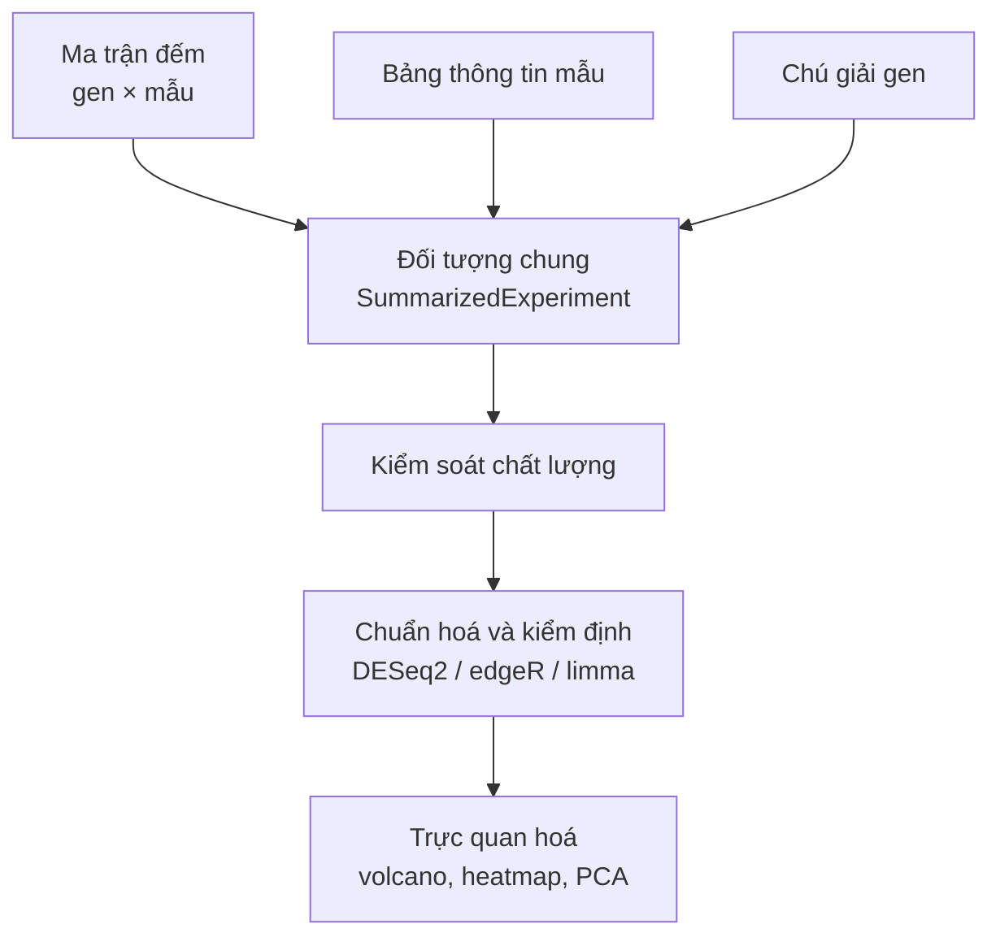

Năm 2002, Bioconductor phát hành bản đầu tiên với 15 package; bản 3.23 tháng 4/2026 có 2418 package phần mềm (Bioconductor, n.d.-a). Bài mở đầu series *R cho phân tích dữ liệu sinh học* trả lời một câu hỏi: vì sao một ngôn ngữ sinh ra cho thống kê và đồ hoạ lại trở thành nền tảng chính để phân tích RNA-seq, single-cell và dữ liệu epigenetics. Câu trả lời gồm ba lớp cộng lại: nền thống kê kế thừa từ ngôn ngữ S, hạ tầng cộng đồng CRAN và Bioconductor, và thói quen công bố phương pháp thống kê cùng với package. Cuối bài có phần bàn về giới hạn của R so với Python và script để bạn tự đếm lại quy mô hệ sinh thái.

## 1. Mở đầu: ba loại dữ liệu, một ngôn ngữ

RNA-seq, single-cell RNA-seq và epigenetics là ba loại dữ liệu thường được nhắc đầu tiên khi giới thiệu R cho người học sinh học. Một bên đo biểu hiện của hàng chục nghìn gen trong vài mẫu mô, một bên đo biểu hiện trong từng tế bào, một bên đo mức methyl hoá DNA tại hàng trăm nghìn vị trí CpG. Nhưng sau bước xử lý trình tự thô, cả ba quy về cùng một hình dạng: một **ma trận lớn** (gen × mẫu, gen × tế bào, CpG × mẫu) đi kèm bảng thông tin mẫu (sample metadata).

Với dữ liệu ở dạng đó, bài toán cốt lõi là **thống kê**: mô hình hoá dữ liệu đếm có rất ít replicate, kiểm định hàng chục nghìn giả thuyết cùng lúc, và trực quan hoá kết quả. Love et al. (2014) nêu đúng những khó khăn của dữ liệu đếm RNA-seq: ít replicate, giá trị rời rạc, khoảng động lớn và có điểm ngoại lai. Huber et al. (2015) đặt Bioconductor, một dự án xây trên R, vào trung tâm của phân tích dữ liệu thông lượng cao (high-throughput data) trong genomics.

Vậy vì sao công cụ quen thuộc nhất cho các bài toán này lại là một ngôn ngữ thống kê? Bài đi qua ba lớp: lịch sử (mục 2–3), hạ tầng cộng đồng (mục 4), phương pháp (mục 5), rồi bàn về giới hạn (mục 6). Bài là tổng quan khái niệm, không dạy cú pháp. Cú pháp, RStudio và notebook nằm ở bài 2 (→ RStudio và R notebook); cách cài package nằm ở bài 7 (→ Cài đặt package).

## 2. Từ S đến R: một ngôn ngữ cho phân tích dữ liệu

### 2.1. S ở Bell Laboratories

Muốn hiểu R, cần bắt đầu từ S. S là ngôn ngữ cho phân tích dữ liệu và đồ hoạ được phát triển ở Bell Laboratories; phiên bản mà R về sau tương thích phần lớn được Richard Becker, John Chambers và Allan Wilks mô tả trong cuốn *The New S Language* năm 1988 (Becker et al., 1988). Trang giới thiệu chính thức của R mô tả R là "một bản hiện thực khác" (a different implementation) của S: có những khác biệt quan trọng, nhưng phần lớn code viết cho S chạy được trong R mà không cần sửa (R Foundation, n.d.).

Điều R kế thừa từ S còn là **cách làm việc tương tác**: gõ lệnh, xem kết quả, đổi mô hình, vẽ lại hình. Kiểu làm việc khám phá này hợp với người làm sinh học, vốn phải thử nhiều cách chuẩn hoá và nhiều mô hình trước khi chọn phân tích cuối cùng.

### 2.2. R ở Đại học Auckland

R được Ross Ihaka và Robert Gentleman viết tại Khoa Thống kê, Đại học Auckland, New Zealand (Hornik & R Core Team, n.d.). Bài báo giới thiệu R chính thức là *R: A language for data analysis and graphics*, đăng trên *Journal of Computational and Graphical Statistics* năm 1996 (Ihaka & Gentleman, 1996). Theo R FAQ, thiết kế của R chịu ảnh hưởng mạnh từ hai ngôn ngữ: S của Becker, Chambers và Wilks, và Scheme của Sussman. Ngôn ngữ thu được trông rất giống S, nhưng phần cài đặt bên dưới và ngữ nghĩa (semantics) lại lấy từ Scheme (Hornik & R Core Team, n.d.). Nói cách khác, R mang "bề ngoài" của S để người dùng S chuyển sang dễ dàng, còn "bên trong" là một thiết kế mới.

Các mốc thời gian sau đều có thể kiểm tra trên nguồn công khai:

- **23/04/1997**: tệp mã nguồn R 0.49 có trong kho lưu trữ của CRAN (CRAN, n.d.-a).
- **Giữa năm 1997**: hình thành nhóm R Core Team, những người có quyền sửa kho mã nguồn của R (Hornik & R Core Team, n.d.).
- **29/02/2000**: tệp R 1.0.0 có trong kho CRAN (CRAN, n.d.-a). Đây là ngày của tệp trong kho lưu trữ, thường được dùng làm ngày phát hành bản 1.0.0.

Năm bắt đầu viết R thường được kể trong các bài trình bày về lịch sử R; các nguồn bài này đối chiếu được chỉ cho phép khẳng định R được giới thiệu trên tạp chí năm 1996 và có bản 1.0.0 năm 2000.

### 2.3. Phần mềm tự do, chạy trên nhiều hệ điều hành

R là **phần mềm tự do** (free software) theo giấy phép GNU General Public License, chạy trên các nền tảng UNIX (gồm Linux), Windows và macOS (R Foundation, n.d.). "Tự do" quan trọng hơn "miễn phí": GPL cho phép bất kỳ ai đọc, sửa và phân phối lại mã nguồn, nên một nhóm nhà thống kê sinh học có thể xây cả Bioconductor trên nền R mà không cần xin phép ai.


**Hình 1.** Các mốc chính từ S đến R và Bioconductor. Nguồn: Becker et al. (1988), Ihaka và Gentleman (1996), Hornik và R Core Team (n.d.), CRAN (n.d.-a), Gentleman et al. (2004), Huber et al. (2015), Bioconductor (n.d.-a).

## 3. Vì sao R hợp với dữ liệu sinh học: thống kê và đồ hoạ

### 3.1. Thống kê là phần lõi, không phải phần thêm

Trang giới thiệu của R liệt kê các kỹ thuật có sẵn: mô hình tuyến tính và phi tuyến (linear and nonlinear modelling), kiểm định thống kê (statistical tests), phân tích chuỗi thời gian (time-series analysis), phân loại (classification), phân cụm (clustering) (R Foundation, n.d.). Điểm đáng chú ý là chúng **nối được vào nhau**: một mô hình tuyến tính trong R là một đối tượng, từ đó lấy được hệ số, phần dư, ma trận thiết kế cho bước tiếp theo.

Phân tích biểu hiện gen khác biệt (differential expression) về bản chất là chạy một mô hình tuyến tính tổng quát cho từng gen với cùng một ma trận thiết kế, rồi hiệu chỉnh cho hàng chục nghìn kiểm định. Khi ngôn ngữ đã có sẵn cách viết công thức mô hình, người viết package sinh học chỉ cần tập trung vào phần mới: mô hình hoá phương sai của dữ liệu đếm, hay "mượn thông tin" giữa các gen (mục 5).

### 3.2. Đồ hoạ cho công bố

Thế mạnh thứ hai là đồ hoạ. Trang chính thức của R nhấn mạnh khả năng tạo hình đạt chất lượng công bố (publication-quality plots), kể cả ký hiệu và công thức toán học (R Foundation, n.d.). Cơ chế phía sau là hệ thống chú thích toán học (mathematical annotation) do Murrell và Ihaka (2000) mô tả: người dùng viết biểu thức gần giống cú pháp R, và R tự dựng chỉ số, chữ Hy Lạp, phân số trên trục và chú thích. Nhờ vậy nhãn như $\log_2$ fold change hay $-\log_{10}(p)$ hiện đúng ký hiệu.

Bước tiến lớn tiếp theo là ggplot2, package hiện thực một "ngữ pháp đồ hoạ" (grammar of graphics): hình được dựng từ các lớp như dữ liệu, ánh xạ thẩm mỹ, đối tượng hình học và hệ toạ độ (Wickham, 2016). ggplot2 sau đó trở thành một phần của tidyverse, tập hợp package có chung triết lý thiết kế cho khoa học dữ liệu (Wickham et al., 2019; → Giới thiệu tidyverse).

Cần nói chính xác: R **cho phép** tạo hình đạt chuẩn tạp chí, chứ không **bảo đảm** điều đó. Một volcano plot, heatmap hay biểu đồ PCA có thể rất rõ hoặc rất rối tuỳ cách chọn thang màu, nhãn và tỷ lệ (→ bài 9, Trực quan hoá dữ liệu).

## 4. Hạ tầng cộng đồng: CRAN và Bioconductor

"Mã nguồn mở, cộng đồng lớn" là câu thường gặp khi giới thiệu R. Mục này làm rõ nó bằng cơ chế của hai kho package chính và số package đếm tại một ngày xác định.

### 4.1. CRAN

CRAN (Comprehensive R Archive Network) là mạng lưới máy chủ lưu trữ và phân phối mã nguồn R, bản nhị phân, package đóng góp và tài liệu (Hornik, 2012). Lệnh `install.packages()` mặc định tải package từ CRAN, kho đa ngành chứa package cho mọi lĩnh vực.

### 4.2. Bioconductor

Bioconductor ra đời từ nhu cầu riêng của genomics. Gentleman et al. (2004) mô tả dự án như một sáng kiến cùng xây dựng phần mềm mở rộng được cho sinh học tính toán và tin sinh học, với ba mục tiêu: khuyến khích phát triển cộng tác và sử dụng rộng rãi phần mềm mới, giảm rào cản gia nhập nghiên cứu liên ngành, và giúp kết quả nghiên cứu có thể **tái lập từ xa** (remote reproducibility). Bản phát hành đầu tiên, Bioconductor 1.0, ra ngày 01/05/2002 với 15 package (Bioconductor, n.d.-a).

Huber et al. (2015) mô tả Bioconductor ở giai đoạn trưởng thành: dự án mã nguồn mở và phát triển mở (open-development) cho dữ liệu thông lượng cao, lúc đó gồm 934 package phối hợp được với nhau (interoperable), phải qua **duyệt chính thức ban đầu** và **kiểm thử tự động liên tục**. Ba đặc điểm khiến Bioconductor khác một kho package thông thường:

- **Chu kỳ phát hành hai lần mỗi năm.** Bảng phát hành cho thấy 49 bản từ 2002 đến 2026, thường vào khoảng tháng 4–5 và tháng 10–11, mỗi bản gắn với một phiên bản R cụ thể (Bioconductor, n.d.-a). Nhờ vậy, mọi package trong cùng một bản được kiểm thử cùng nhau.
- **Cấu trúc dữ liệu dùng chung.** Cộng đồng thống nhất một số lớp đối tượng (class) chung, như ExpressionSet thời microarray, rồi SummarizedExperiment và SingleCellExperiment (Huber et al., 2015; Amezquita et al., 2020), nên một đối tượng đi qua kiểm soát chất lượng, chuẩn hoá, kiểm định mà không phải đổi định dạng.
- **Tài liệu kèm package.** Mỗi package có vignette, tài liệu trộn văn bản và code chạy được trên dữ liệu mẫu.

Sơ đồ dưới đây minh hoạ ý tưởng cấu trúc dữ liệu dùng chung cho một phân tích RNA-seq.



**Hình 2.** Một đối tượng dữ liệu chung đi qua nhiều package trong Bioconductor (sơ đồ minh hoạ).

### 4.3. Quy mô hệ sinh thái bằng số

Để thay cụm từ "cộng đồng lớn" bằng con số, bài đếm số package trong hai kho vào ngày 19/11/2026. Với CRAN, cách đếm là đếm số dòng bắt đầu bằng `Package:` trong tệp chỉ mục `PACKAGES` của kho package đóng góp (CRAN, n.d.-b). Với Bioconductor, đếm tương tự trong tệp `VIEWS` của từng nhóm package ở bản 3.23 (Bioconductor, n.d.-b), và đối chiếu số package phần mềm với bảng phát hành (Bioconductor, n.d.-a). Script nằm ở Phụ lục.

**Bảng 1.** Số package trong CRAN và Bioconductor, đếm ngày 19/11/2026 (05:13 UTC)

| Kho                     | Nhóm package                | Số package | Cách đếm                                  |
| ----------------------- | --------------------------- | ---------: | ----------------------------------------- |
| CRAN                    | Package đóng góp            |     25 818 | Dòng `Package:` trong `src/contrib/PACKAGES` |
| Bioconductor 3.23       | Software                    |      2 418 | Dòng `Package:` trong `bioc/VIEWS`        |
| Bioconductor 3.23       | Experiment data             |        436 | `data/experiment/VIEWS`                   |
| Bioconductor 3.23       | Annotation                  |        928 | `data/annotation/VIEWS`                   |
| Bioconductor 3.23       | Workflow                    |         28 | `workflows/VIEWS`                         |

Ngoài package phần mềm, Bioconductor có package experiment data (bộ dữ liệu mẫu cho vignette và giảng dạy), annotation (ánh xạ giữa mã probe, mã gen, toạ độ genome) và workflow (hướng dẫn phân tích trọn vẹn).


**Hình 3.** Số package phần mềm Bioconductor qua 49 bản phát hành, từ bản 1.0 (01/05/2002) đến bản 3.23 (29/04/2026). Dữ liệu: bảng release announcements của Bioconductor, truy cập ngày 19/11/2026.

Đọc Hình 3, có thể thấy ba giai đoạn. Từ 05/2002 đến 10/2010, số package phần mềm tăng từ 15 lên 418, trung bình khoảng 48 package mỗi năm. Từ 04/2010 đến 10/2020, số package tăng từ 389 lên 1974, trung bình khoảng 150 package mỗi năm; đây cũng là giai đoạn RNA-seq rồi single-cell trở nên phổ biến, dù bảng số liệu tự nó không cho biết nguyên nhân của tốc độ tăng. Từ 04/2020 đến 04/2026, tốc độ chậm lại còn khoảng 86 package mỗi năm, từ 1903 lên 2418. Đây là tính toán đơn giản trên bảng phát hành; giai đoạn được chọn để minh hoạ, không phải kết quả của một mô hình xu hướng.

Bản 3.20 (30/10/2024) là bản duy nhất có số package phần mềm **giảm**: 2289 so với 2300 của bản 3.19. Thông báo phát hành giải thích: có 54 package mới, nhưng 65 package bị gỡ sau khi bị đánh dấu ngừng hỗ trợ (deprecated) từ bản 3.19 (Bioconductor, 2024). Kiểm thử liên tục có tác dụng thật: package không còn được duy trì sẽ bị loại.

<div class="callout callout-warning">
<p class="callout-title">Số package đo quy mô, không đo chất lượng hay mức sử dụng</p>

Số package không cho biết R "phổ biến hơn" ngôn ngữ khác hay package nào đáng tin. Số CRAN là ảnh chụp tại một thời điểm; muốn đo mức sử dụng cần số lượt tải hay số trích dẫn.

</div>

### 4.4. Package, vignette và nghiên cứu tái lập

Mục tiêu "tái lập từ xa" trong bài báo Bioconductor năm 2004 không phải khẩu hiệu. Ba năm sau, Gentleman và Temple Lang (2007) dành riêng một bài báo cho mối quan hệ giữa phân tích thống kê và nghiên cứu tái lập (reproducible research). Vignette của Bioconductor là một cách đưa tinh thần tái lập vào ngay từng package: người đọc có thể chạy lại từng dòng phân tích trên dữ liệu mẫu và so kết quả với tài liệu.

Có thể xem R Markdown và notebook ở bài 2 như sự tiếp nối của cùng tinh thần: tài liệu chứa cả lập luận lẫn code tạo ra kết quả. Đây là diễn giải của bài, không phải quan hệ lịch sử được nguồn nào khẳng định. Tái lập ở quy mô lớn hơn được bàn trong kế hoạch về quy trình tái lập.

## 5. Từ phương pháp đến package: RNA-seq, single-cell, epigenetics

Lớp thứ ba: các phương pháp thống kê được dùng nhiều nhất thường được công bố **cùng với** một package R/Bioconductor, nên bài báo có ngay công cụ để chạy và công cụ có ngay bài báo để trích dẫn. Cách chạy các package thuộc kế hoạch về RNA-seq và single-cell.

### 5.1. RNA-seq bulk

**limma** (viết tắt của *linear models for microarray data*) khởi đầu là package phân tích dữ liệu microarray. Ritchie et al. (2015) mô tả limma như một giải pháp tích hợp cho phân tích dữ liệu biểu hiện gen, có công cụ cho thiết kế thí nghiệm phức tạp và cho việc mượn thông tin (information borrowing) giữa các gen để khắc phục cỡ mẫu nhỏ; sau hơn một thập kỷ dùng cho microarray, limma được mở rộng để phân tích cả dữ liệu RNA-seq. Sự liên tục này có thể giải thích một phần vì sao cộng đồng chuyển từ microarray sang RNA-seq mà vẫn ở lại trong R: cùng một khung mô hình, cùng một cách viết ma trận thiết kế.

**edgeR** được Robinson et al. (2010) giới thiệu như một package Bioconductor để kiểm định biểu hiện khác biệt trên dữ liệu đếm có lặp lại. Package dùng mô hình Poisson quá phân tán (overdispersed Poisson) để tính cả biến thiên sinh học lẫn kỹ thuật, và dùng empirical Bayes để điều hoà mức quá phân tán giữa các transcript, giúp suy luận đáng tin hơn. Theo nhóm tác giả, phương pháp dùng được cả khi số replicate rất ít, miễn là ít nhất một điều kiện thí nghiệm có lặp lại.

**DESeq2** (Love et al., 2014) dùng ước lượng co rút (shrinkage estimation) cho cả dispersion và fold change. Mục đích là làm ước lượng ổn định và dễ diễn giải hơn, để phân tích tập trung vào **độ lớn** của khác biệt biểu hiện chứ không chỉ vào việc khác biệt có tồn tại hay không.

Ba package có chung một mô thức: phần mới nằm ở mô hình hoá phương sai và chia sẻ thông tin giữa các gen, phần còn lại dựa vào R và Bioconductor.

Ý "mượn thông tin" có thể hiểu thế này: với ba đến bốn replicate mỗi nhóm, ước lượng phương sai riêng của từng gen rất nhiễu, nên các phương pháp kéo ước lượng của từng gen về một giá trị chung, mức kéo tuỳ lượng thông tin của gen đó.

### 5.2. Single-cell RNA-seq

**Seurat** là bộ công cụ R cho dữ liệu single-cell. Bài báo năm 2015 của Satija et al. dùng dữ liệu biểu hiện đơn bào để tái dựng vị trí không gian của tế bào trong mô (Satija et al., 2015). Các phiên bản sau mở rộng sang dữ liệu đa phương thức (multimodal), kết hợp nhiều loại đo lường trên cùng một tế bào (Hao et al., 2021). Seurat v5 dùng kỹ thuật dictionary learning kết hợp với sketching để cải thiện khả năng mở rộng tính toán, và nhóm tác giả minh hoạ bằng việc hài hoà 8,6 triệu hồ sơ tế bào miễn dịch người (Hao et al., 2024).

Phía Bioconductor, Amezquita et al. (2020) trình bày cách tổ chức phân tích single-cell dựa trên các phương pháp tính toán hiện đại, hạ tầng dữ liệu chuẩn hoá và công cụ trực quan hoá tương tác, kèm một cuốn sách trực tuyến: *Orchestrating Single-Cell Analysis with Bioconductor* (OSCA). Trung tâm của hạ tầng này là lớp SingleCellExperiment, mở rộng SummarizedExperiment cho dữ liệu đơn bào, đúng theo nguyên tắc cấu trúc dữ liệu dùng chung ở mục 4.2.

### 5.3. Epigenetics

**minfi** là package Bioconductor phân tích dữ liệu microarray methylation DNA Infinium của Illumina (Aryee et al., 2014). **BSmooth** là phương pháp đi từ read giải trình tự bisulfite toàn genome (whole-genome bisulfite sequencing, WGBS) đến các vùng methyl hoá khác biệt (Hansen et al., 2012). Phần mềm cho dữ liệu WGBS trong Bioconductor hiện nay là package **bsseq**, với Kasper D. Hansen (tác giả đầu của BSmooth) là tác giả chính và người duy trì (Hansen & Hickey, 2026). **ChIPseeker** là package R/Bioconductor để chú giải, so sánh và trực quan hoá các peak từ thí nghiệm ChIP-seq (Yu et al., 2015). Các chủ đề epigenomics sâu hơn được bàn trong kế hoạch về epigenomics và đa omics.

**Bảng 2.** Một số package R/Bioconductor tiêu biểu theo loại dữ liệu

| Loại dữ liệu       | Package    | Năm công bố | Ý tưởng thống kê hoặc chức năng chính                          | Nguồn                  |
| ------------------ | ---------- | ----------- | -------------------------------------------------------------- | ---------------------- |
| Microarray, RNA-seq | limma      | 2015*       | Mô hình tuyến tính + mượn thông tin giữa các gen               | Ritchie et al. (2015)  |
| RNA-seq bulk       | edgeR      | 2010        | Poisson quá phân tán + empirical Bayes cho dispersion          | Robinson et al. (2010) |
| RNA-seq bulk       | DESeq2     | 2014        | Ước lượng co rút cho dispersion và fold change                 | Love et al. (2014)     |
| Single-cell        | Seurat     | 2015, 2021, 2024 | Tái dựng không gian; đa phương thức; dictionary learning, sketching | Satija et al. (2015); Hao et al. (2021, 2024) |
| Single-cell        | OSCA / SingleCellExperiment | 2020 | Hạ tầng dữ liệu chuẩn hoá, sách trực tuyến       | Amezquita et al. (2020) |
| Methylation array  | minfi      | 2014        | Phân tích microarray methylation Infinium                      | Aryee et al. (2014)    |
| WGBS               | BSmooth / bsseq | 2012   | Từ read bisulfite đến vùng methyl hoá khác biệt                | Hansen et al. (2012)   |
| ChIP-seq           | ChIPseeker | 2015        | Chú giải, so sánh, trực quan hoá peak                          | Yu et al. (2015)       |

\* Năm của bài tổng quan được trích; limma đã tồn tại từ thời microarray, trước năm 2015.

Bảng 2 không đầy đủ; "tiêu biểu" nghĩa là có bài báo phương pháp và package đang được duy trì, không phải xếp hạng.

## 6. Giới hạn của R và vị trí của Python

R không phải lựa chọn tốt nhất cho mọi việc trong tin sinh học; có ít nhất ba vùng mà công cụ khác thường được chọn.

**Dữ liệu single-cell rất lớn.** Scanpy là bộ công cụ Python có khả năng mở rộng cho phân tích biểu hiện gen đơn bào, gồm tiền xử lý, trực quan hoá, phân cụm, suy luận quỹ đạo (trajectory inference), kiểm định biểu hiện khác biệt; theo Wolf et al. (2018), bản hiện thực bằng Python xử lý hiệu quả bộ dữ liệu hơn một triệu tế bào. Cùng bài báo giới thiệu AnnData, lớp đối tượng cho ma trận dữ liệu có chú giải, đóng vai trò tương tự SingleCellExperiment bên R. Tuy vậy, khoảng cách này không cố định: Seurat v5 cũng nhắm tới dữ liệu hàng triệu tế bào (Hao et al., 2024). Lựa chọn giữa hai bên phụ thuộc nhiều vào hệ công cụ của nhóm hơn là vào một giới hạn tuyệt đối.

**Bộ nhớ và hiệu năng.** R FAQ giải thích rằng khi khởi động, R lấy một vùng bộ nhớ và tự quản lý việc lưu đối tượng trong đó (Hornik & R Core Team, n.d.); tài liệu chính thức nêu R giữ các đối tượng đang dùng trong bộ nhớ ảo (R Core Team, n.d.). Với ma trận hàng triệu tế bào, đây có thể là nút thắt. Có giải pháp như lưu dữ liệu trên đĩa hay chạy song song (package parallel có sẵn trong bản phân phối R), nhưng cần học thêm; bài không có nguồn bình duyệt so sánh hiệu năng để định lượng mức hạn chế.

**Xử lý dữ liệu thô và triển khai phần mềm.** Căn chỉnh read vào genome hay gọi biến thể thường do công cụ dòng lệnh chuyên dụng đảm nhận; R mạnh nhất ở phần thống kê sau khi đã có ma trận đếm. Nhiều công cụ học sâu mới chỉ có bản Python, và đóng gói phân tích thành dịch vụ cho người dùng cuối thường thuận hơn với Python. Đây là mô tả chung về thực hành, chưa được đo bằng khảo sát.

Kết luận thực dụng là **chọn công cụ theo bài toán**, không phải chọn phe:

| Bạn cần…                                                    | Gợi ý bắt đầu                               |
| ----------------------------------------------------------- | ------------------------------------------- |
| Phân tích biểu hiện khác biệt RNA-seq bulk theo phương pháp chuẩn | R với DESeq2, edgeR hoặc limma           |
| Phân tích methylation array, chú giải peak ChIP-seq          | R với minfi, ChIPseeker                    |
| Single-cell quy mô vừa, muốn dùng hệ Bioconductor hoặc Seurat | R với OSCA hoặc Seurat                    |
| Single-cell rất lớn, tích hợp với học sâu                    | Python với Scanpy và hệ AnnData            |
| Căn chỉnh read, gọi biến thể                                | Công cụ dòng lệnh chuyên dụng, quản lý bằng workflow |

Với sinh viên sinh học, học R trước giúp bạn chạy được các phương pháp thống kê chuẩn mà nhiều bài báo về RNA-seq và methylation công bố kèm package; học thêm Python mở ra dữ liệu rất lớn và machine learning. Hai ngôn ngữ bổ sung cho nhau nhiều hơn là cạnh tranh.

## 7. Kết luận và lộ trình series

R trở thành nền tảng phân tích dữ liệu sinh học nhờ ba lớp cộng lại: di sản của S, một ngôn ngữ cho phân tích dữ liệu tương tác được Ihaka và Gentleman hiện thực lại dưới dạng phần mềm tự do; hạ tầng CRAN và Bioconductor, với chu kỳ hai bản mỗi năm, duyệt package, kiểm thử liên tục và cấu trúc dữ liệu dùng chung, tăng từ 15 lên 2418 package phần mềm trong 24 năm; và thói quen công bố phương pháp cùng package, từ limma, edgeR, DESeq2 đến Seurat, minfi, ChIPseeker.

Giới hạn cũng rõ: dữ liệu cực lớn, học sâu và xử lý trình tự thô thường cần thêm công cụ khác. Các bài tiếp theo đi từ khái niệm sang thực hành:

- Bài 2: RStudio và R notebook (→ RStudio và R notebook)
- Bài 3: nhập và xuất dữ liệu (→ Nhập và xuất dữ liệu)
- Bài 4: data frame (→ Data frame)
- Bài 5: các kiểu dữ liệu cơ bản (→ Kiểu dữ liệu cơ bản)
- Bài 6: hàm (→ Hàm)
- Bài 7: cài đặt package (→ Cài đặt package)
- Bài 8: tidyverse (→ Giới thiệu tidyverse)
- Bài 9: trực quan hoá (→ Trực quan hoá dữ liệu)

Trước khi sang bài 2, hãy chạy lại script ở Phụ lục và so với Bảng 1: con số chắc chắn đã khác, và đó là lý do mọi số liệu về hệ sinh thái phần mềm phải đi kèm ngày đếm.

## Phụ lục: cách đếm package

Script R sau (chỉ dùng R cơ bản, đã chạy với R 4.4.3 ngày 19/11/2026, cho đúng các số ở Bảng 1) đếm package trong CRAN và bốn nhóm của Bioconductor 3.23.

```r
# Đếm package CRAN và Bioconductor; ghi lại thời điểm đếm
dem_package <- function(url) {
  dong <- readLines(url(url), warn = FALSE)
  sum(grepl("^Package:", dong))
}
bioc <- "https://bioconductor.org/packages/3.23/"
ket_qua <- data.frame(
  kho = c("CRAN", "Bioc software", "Bioc experiment data",
          "Bioc annotation", "Bioc workflow"),
  url = c("https://cran.r-project.org/src/contrib/PACKAGES",
          paste0(bioc, c("bioc", "data/experiment",
                         "data/annotation", "workflows"), "/VIEWS"))
)
ket_qua$so_package <- sapply(ket_qua$url, dem_package)
ket_qua$thoi_diem <- format(Sys.time(), "%Y-%m-%d %H:%M %Z", tz = "UTC")
print(ket_qua[, c("kho", "so_package", "thoi_diem")], row.names = FALSE)
```

Cách khác là `nrow(available.packages())`, nhưng theo mặc định hàm lọc bỏ package không hợp với phiên bản R, hệ điều hành, kiến trúc máy và bản trùng lặp. Cùng thời điểm, R 4.4.3 cho 25 630 package khi có lọc và 25 818 khi tắt lọc:

```r
nrow(available.packages(repos = "https://cloud.r-project.org"))   # có lọc
nrow(available.packages(repos = "https://cloud.r-project.org",
                        filters = list()))                        # không lọc
```

Số package phần mềm Bioconductor đếm từ `VIEWS` trùng với bảng phát hành cho bản 3.23 (2418); hai cách đếm có thể lệch nếu kho cập nhật giữa hai lần truy cập. Khi trích số liệu, ghi rõ ngày giờ, múi giờ, phiên bản R và cách đếm.

## Tài liệu tham khảo

Amezquita, R. A., Lun, A. T. L., Becht, E., Carey, V. J., Carpp, L. N., Geistlinger, L., Marini, F., Rue-Albrecht, K., Risso, D., Soneson, C., Waldron, L., Pagès, H., Smith, M. L., Huber, W., Morgan, M., Gottardo, R., & Hicks, S. C. (2020). Orchestrating single-cell analysis with Bioconductor. *Nature Methods, 17*(2), 137–145. https://doi.org/10.1038/s41592-019-0654-x

Aryee, M. J., Jaffe, A. E., Corrada-Bravo, H., Ladd-Acosta, C., Feinberg, A. P., Hansen, K. D., & Irizarry, R. A. (2014). Minfi: A flexible and comprehensive Bioconductor package for the analysis of Infinium DNA methylation microarrays. *Bioinformatics, 30*(10), 1363–1369. https://doi.org/10.1093/bioinformatics/btu049

Becker, R. A., Chambers, J. M., & Wilks, A. R. (1988). *The new S language: A programming environment for data analysis and graphics*. Wadsworth & Brooks/Cole.

Bioconductor. (2024, October 30). *Bioconductor 3.20 released*. https://bioconductor.org/news/bioc_3_20_release/

Bioconductor. (n.d.-a). *Bioconductor releases* [Release announcements table]. Truy cập ngày 19/11/2026, từ https://bioconductor.org/about/release-announcements/

Bioconductor. (n.d.-b). *VIEWS* [Package index files, release 3.23]. Truy cập ngày 19/11/2026, từ https://bioconductor.org/packages/3.23/bioc/VIEWS

CRAN. (n.d.-a). *Index of /src/base/R-0* và */src/base/R-1*. Truy cập ngày 12/11/2026, từ https://cran.r-project.org/src/base/R-1/

CRAN. (n.d.-b). *PACKAGES* [Index of contributed packages]. Truy cập ngày 19/11/2026, từ https://cran.r-project.org/src/contrib/PACKAGES

Gentleman, R. C., Carey, V. J., Bates, D. M., Bolstad, B., Dettling, M., Dudoit, S., Ellis, B., Gautier, L., Ge, Y., Gentry, J., Hornik, K., Hothorn, T., Huber, W., Iacus, S., Irizarry, R., Leisch, F., Li, C., Maechler, M., Rossini, A. J., … Zhang, J. (2004). Bioconductor: Open software development for computational biology and bioinformatics. *Genome Biology, 5*(10), R80. https://doi.org/10.1186/gb-2004-5-10-r80

Gentleman, R., & Temple Lang, D. (2007). Statistical analyses and reproducible research. *Journal of Computational and Graphical Statistics, 16*(1), 1–23. https://doi.org/10.1198/106186007X178663

Hansen, K. D., & Hickey, P. (2026). *bsseq: Analyze, manage and store whole-genome methylation data* (R package version 1.48.0) [Computer software]. Bioconductor. https://doi.org/10.18129/B9.bioc.bsseq

Hansen, K. D., Langmead, B., & Irizarry, R. A. (2012). BSmooth: From whole genome bisulfite sequencing reads to differentially methylated regions. *Genome Biology, 13*(10), R83. https://doi.org/10.1186/gb-2012-13-10-r83

Hao, Y., Hao, S., Andersen-Nissen, E., Mauck, W. M., Zheng, S., Butler, A., Lee, M. J., Wilk, A. J., Darby, C., Zager, M., Hoffman, P., Stoeckius, M., Papalexi, E., Mimitou, E. P., Jain, J., Srivastava, A., Stuart, T., Fleming, L. M., Yeung, B., … Satija, R. (2021). Integrated analysis of multimodal single-cell data. *Cell, 184*(13), 3573–3587.e29. https://doi.org/10.1016/j.cell.2021.04.048

Hao, Y., Stuart, T., Kowalski, M. H., Choudhary, S., Hoffman, P., Hartman, A., Srivastava, A., Molla, G., Madad, S., Fernandez-Granda, C., & Satija, R. (2024). Dictionary learning for integrative, multimodal and scalable single-cell analysis. *Nature Biotechnology, 42*(2), 293–304. https://doi.org/10.1038/s41587-023-01767-y

Hornik, K. (2012). The Comprehensive R Archive Network. *WIREs Computational Statistics, 4*(4), 394–398. https://doi.org/10.1002/wics.1212

Hornik, K., & R Core Team. (n.d.). *R FAQ: Frequently asked questions on R*. CRAN. Truy cập ngày 19/11/2026, từ https://cran.r-project.org/doc/FAQ/R-FAQ.html

Huber, W., Carey, V. J., Gentleman, R., Anders, S., Carlson, M., Carvalho, B. S., Bravo, H. C., Davis, S., Gatto, L., Girke, T., Gottardo, R., Hahne, F., Hansen, K. D., Irizarry, R. A., Lawrence, M., Love, M. I., MacDonald, J., Obenchain, V., Oleś, A. K., … Morgan, M. (2015). Orchestrating high-throughput genomic analysis with Bioconductor. *Nature Methods, 12*(2), 115–121. https://doi.org/10.1038/nmeth.3252

Ihaka, R., & Gentleman, R. (1996). R: A language for data analysis and graphics. *Journal of Computational and Graphical Statistics, 5*(3), 299–314. https://doi.org/10.1080/10618600.1996.10474713

Love, M. I., Huber, W., & Anders, S. (2014). Moderated estimation of fold change and dispersion for RNA-seq data with DESeq2. *Genome Biology, 15*(12), 550. https://doi.org/10.1186/s13059-014-0550-8

Murrell, P., & Ihaka, R. (2000). An approach to providing mathematical annotation in plots. *Journal of Computational and Graphical Statistics, 9*(3), 582–599. https://doi.org/10.1080/10618600.2000.10474900

R Core Team. (n.d.). *Memory limits in R* [R documentation, package base]. Truy cập ngày 19/11/2026, từ https://stat.ethz.ch/R-manual/R-devel/library/base/html/Memory-limits.html

R Foundation. (n.d.). *What is R?* Truy cập ngày 12/11/2026, từ https://www.r-project.org/about.html

Ritchie, M. E., Phipson, B., Wu, D., Hu, Y., Law, C. W., Shi, W., & Smyth, G. K. (2015). limma powers differential expression analyses for RNA-sequencing and microarray studies. *Nucleic Acids Research, 43*(7), e47. https://doi.org/10.1093/nar/gkv007

Robinson, M. D., McCarthy, D. J., & Smyth, G. K. (2010). edgeR: A Bioconductor package for differential expression analysis of digital gene expression data. *Bioinformatics, 26*(1), 139–140. https://doi.org/10.1093/bioinformatics/btp616

Satija, R., Farrell, J. A., Gennert, D., Schier, A. F., & Regev, A. (2015). Spatial reconstruction of single-cell gene expression data. *Nature Biotechnology, 33*(5), 495–502. https://doi.org/10.1038/nbt.3192

Wickham, H. (2016). *ggplot2: Elegant graphics for data analysis* (2nd ed.). Springer. https://doi.org/10.1007/978-3-319-24277-4

Wickham, H., Averick, M., Bryan, J., Chang, W., McGowan, L. D., François, R., Grolemund, G., Hayes, A., Henry, L., Hester, J., Kuhn, M., Pedersen, T. L., Miller, E., Bache, S. M., Müller, K., Ooms, J., Robinson, D., Seidel, D. P., Spinu, V., … Yutani, H. (2019). Welcome to the Tidyverse. *Journal of Open Source Software, 4*(43), 1686. https://doi.org/10.21105/joss.01686

Wolf, F. A., Angerer, P., & Theis, F. J. (2018). SCANPY: Large-scale single-cell gene expression data analysis. *Genome Biology, 19*(1), 15. https://doi.org/10.1186/s13059-017-1382-0

Yu, G., Wang, L.-G., & He, Q.-Y. (2015). ChIPseeker: An R/Bioconductor package for ChIP peak annotation, comparison and visualization. *Bioinformatics, 31*(14), 2382–2383. https://doi.org/10.1093/bioinformatics/btv145
