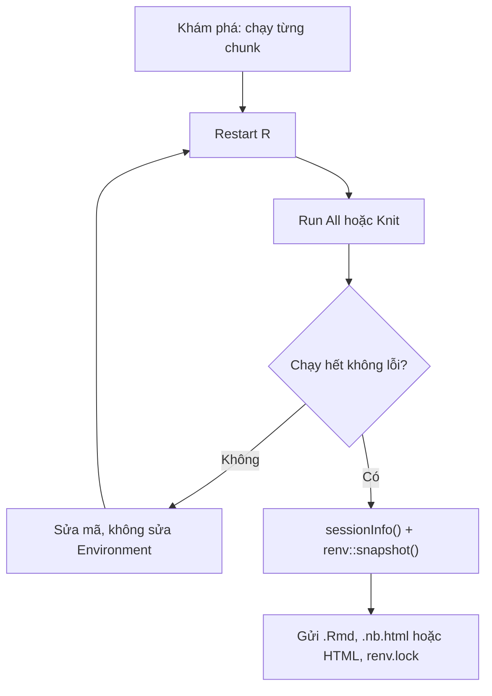

R Notebook là một tài liệu R Markdown (`output: html_notebook`) trong RStudio, trộn lời giải thích, mã R và kết quả vào cùng một file. Nó là một cách hiện thực ý tưởng lập trình văn học (literate programming) mà Knuth đề xuất năm 1984. Notebook gom cả phân tích vào một chỗ, nhưng tự nó không bảo đảm người khác chạy lại sẽ ra cùng kết quả: cùng `set.seed(42)`, lệnh `sample(1:100, 5)` cho `49 65 25 74 18` trên R từ bản 3.6.0 trở đi, nhưng cho `92 93 29 81 62` khi dùng cách lấy mẫu của R 3.5.0. Bài thứ hai của series *R cho phân tích dữ liệu sinh học* viết cho sinh viên sinh học mới mở RStudio, gồm giao diện, toán tử gán, ba định dạng notebook và một notebook tái lập tối thiểu trong 8 bước.

<div class="callout callout-note">
<p class="callout-title">Tóm tắt nhanh</p>

- R Notebook = R Markdown với `output: html_notebook`; lưu file sẽ sinh thêm `*.nb.html` chứa bản hiển thị và bản sao mã nguồn (Xie et al., 2018).
- `<-` dùng được ở mọi nơi; `=` chỉ gán ở cấp cao nhất hoặc trong khối `{ }`, còn trong lời gọi hàm nó là gán đối số (R Core Team, 2025a).
- Notebook chạy từng chunk theo thứ tự bạn bấm, nên trước khi gửi phải Restart R rồi chạy lại từ đầu, hoặc Knit.
- Tái lập cần thêm: seed, `sessionInfo()`, `renv.lock`, đường dẫn tương đối, không khôi phục `.RData`.
- Từ R 3.6.0, `sample()` đổi thuật toán mặc định; thiếu thông tin phiên bản, kết quả ngẫu nhiên không so lại được.

</div>

## 1. R Notebook là gì

Sách *R Markdown: The Definitive Guide* định nghĩa R Notebook là một tài liệu R Markdown có các khối mã (chunk) chạy độc lập và tương tác, kết quả hiện ngay dưới khối mã. Sách gọi thẳng nó là một cách hiện thực literate programming (Xie et al., 2018, mục 3.2). Về mặt file, notebook vẫn là `.Rmd`: phần đầu YAML khai báo `output: html_notebook`, phần thân là văn bản Markdown xen các chunk mã R.

Khác biệt đầu tiên nằm ở cách chạy. Với một tài liệu R Markdown thường, bấm *Knit* sẽ gửi toàn bộ mã đi chạy một lượt. Notebook thì gửi từng dòng, từng chunk vào lúc bạn bấm, nên bạn dừng được ở chỗ lỗi và sửa ngay (Xie et al., 2018). Khi lưu, RStudio sinh thêm một file `*.nb.html` tự chứa (self-contained). File này có bản hiển thị cùng toàn bộ kết quả hiện có của các chunk, và một bản sao file `.Rmd`. Người nhận mở `.nb.html` bằng trình duyệt là đọc được, rồi lấy lại mã nguồn từ chính file đó. Nút *Preview* của notebook **không chạy** chunk nào. Nó chỉ ghép văn bản với kết quả gần nhất mà bạn đã chạy.

Ý tưởng gốc thuộc về Donald Knuth. Trong bài *Literate Programming* năm 1984, Knuth đề nghị đổi thái độ với việc viết chương trình: thay vì coi việc chính là ra lệnh cho máy tính, hãy tập trung vào "explaining to human beings what we want a computer to do" (Knuth, 1984, tr. 97). R Notebook áp dụng ý này cho phân tích dữ liệu. Đoạn văn nói vì sao chọn phép kiểm định, chunk ngay dưới chạy phép kiểm định, kết quả nằm ngay dưới chunk.

Có một giới hạn bạn nên biết trước: notebook làm cho phân tích **dễ đọc và dễ kiểm tra**, nhưng không tự làm cho nó **chạy lại được**. Các mục sau đi lần lượt từ giao diện RStudio, qua cú pháp gán, đến những bước cụ thể để lấp khoảng cách đó.

## 2. RStudio trong 5 phút: bốn pane và vòng đời một đối tượng

RStudio chia màn hình thành bốn vùng (pane). Khi chưa mở file nào, **Console** chiếm cả cột trái. Khi mở một script hay `.Rmd`, **Source editor** xuất hiện ở trên bên trái và Console xuống dưới bên trái. Cột phải gồm **Environment/History** ở trên và **Files/Plots/Packages/Help/Viewer** ở dưới (Hình 1). Bố cục này đổi được trong phần tuỳ chỉnh, nên máy của bạn có thể khác đôi chút.


*Hình 1. Bố cục mặc định của RStudio khi đã mở một file. Sơ đồ vẽ lại, không phải ảnh chụp màn hình.*

Console là nơi R nhận lệnh. Dấu nhắc `>` nghĩa là R đang chờ. Dấu `+` nghĩa là lệnh trước chưa hoàn chỉnh, thường do thiếu dấu ngoặc đóng hoặc dấu nháy. Gặp `+` mà không biết thiếu gì thì bấm Esc để huỷ lệnh.

Gõ `a <- 1 + 1` rồi Enter, Console không in gì, nhưng Environment pane hiện một dòng mới: `a` có giá trị `2`. Pane này liệt kê các đối tượng đang có trong *Global Environment*, tức không gian làm việc của phiên R hiện tại. Nó tiện để kiểm tra nhanh, và cũng là nguồn rủi ro lớn nhất cho tính tái lập. Một đối tượng có trong Environment không có nghĩa là có trong mã của bạn. Nó có thể đến từ một lệnh gõ tay ở Console, từ một chunk đã xoá, hoặc từ phiên làm việc hôm trước.

Nguồn thứ ba, phiên làm việc hôm trước, là đáng lưu ý nhất. Theo mặc định, RStudio có thể lưu Global Environment vào file `.RData` khi thoát và nạp lại khi mở. Lúc đó Console in dòng `[Workspace loaded from ~/.RData]`, và mọi đối tượng cũ quay về như chưa từng mất. Trang trợ giúp `?Random` của R còn ghi rằng trạng thái bộ sinh số ngẫu nhiên cũng có thể được lấy từ phiên trước nếu workspace được khôi phục (R Core Team, 2025b). Kết quả hôm nay khi ấy phụ thuộc vào thứ bạn không nhìn thấy trong mã.

Cách sửa: mở **Tools → Global Options**, bỏ chọn *Restore .RData into workspace at startup* và đặt *Save workspace to .RData on exit* thành *Never*. Cũng có thể chạy `usethis::use_blank_slate()` (Wickham et al., 2023, chương 6). Sau đó tập thói quen khởi động lại R thường xuyên: Ctrl+Shift+F10 trên Windows/Linux, Cmd+Shift+0 trên macOS (Posit, 2024). Khởi động lại mà phân tích vẫn chạy được từ mã thì mã mới thật sự là "nguồn sự thật".

## 3. Toán tử gán `<-` và `=`: kiểm chứng bằng mã

Tài liệu nhập môn thường nói `<-` và `=` dùng thay nhau được. Câu đó chỉ đúng **ở cấp cao nhất**, tức khi bạn gõ trọn một lệnh như `x = 5` ở Console. Trang trợ giúp chính thức `?assignOps` viết rõ: `<-` dùng được ở mọi nơi, còn `=` chỉ được phép ở cấp cao nhất hoặc như một biểu thức con trong khối `{ }` (R Core Team, 2025a). R Language Definition bổ sung hai điểm. Thứ nhất, `=` khi dùng để gán có thứ tự ưu tiên thấp hơn `<-`. Thứ hai, các toán tử gán trái được nhóm từ phải sang trái (R Core Team, n.d., mục 10.4.2).

Bảng 1 tóm tắt năm trường hợp đã chạy trên R 4.4.3; mã đầy đủ nằm ngay dưới bảng.

**Bảng 1.** Năm trường hợp `<-` và `=` cho kết quả khác nhau (R 4.4.3)

| # | Lệnh | Kết quả | Giải thích |
|---|---|---|---|
| 1 | `median(x = 1:10)` rồi `exists("x")` | `FALSE` | `=` trong lời gọi hàm là gán đối số `x` của `median`, không tạo biến |
| 1 | `median(x <- 1:10)` rồi `exists("x")` | `TRUE` | `<-` tạo biến `x` trong Global Environment, rồi truyền giá trị vào hàm |
| 2 | `a2 = b2 <- 1` | `a2` = 1, `b2` = 1 | `<-` ưu tiên cao hơn nên chạy trước |
| 2 | `a <- b = 1` | Lỗi `object 'a' not found` | R hiểu thành `(a <- b) = 1` |
| 3 | `system.time(z2 = 1)` | Lỗi `unused argument (z2 = 1)` | `system.time` không có đối số tên `z2` |
| 3 | `system.time(z1 <- 1)` | chạy, tạo `z1` | gán nằm trong biểu thức được đo |
| 4 | `if (v = 3) 1` | Lỗi cú pháp `unexpected '='` | `=` không được phép trong điều kiện |
| 4 | `if ((v = 3)) "chay"` | chạy, `v` = 3 | ngoặc thêm tạo một biểu thức con |
| 5 | `quote(a <- 1)[[1]]` và `parse(text = "y1 = 1")[[1]][[1]]` | `` `<-` `` và `` `=` `` | hai toán tử khác nhau trong cây cú pháp |

```r
# 1. Trong lời gọi hàm
median(x = 1:10); exists("x")      # FALSE
median(x <- 1:10); exists("x")     # TRUE

# 2. Thứ tự ưu tiên
a2 = b2 <- 1; c(a2, b2)            # 1 1
# a <- b = 1                       # Error: object 'a' not found

# 3. Hàm không có đối số trùng tên
# system.time(z2 = 1)              # Error: unused argument (z2 = 1)
invisible(system.time(z1 <- 1)); exists("z1")   # TRUE

# 4. Trong điều kiện if
# if (v = 3) 1                     # Error: unexpected '='
if ((v = 3)) "chay"                # "chay"

# 5. Cây cú pháp
quote(a <- 1)[[1]]                 # `<-`
parse(text = "y1 = 1")[[1]][[1]]   # `=`
```

Bạn sẽ gặp thêm hai toán tử nữa trong mã của người khác. `->` gán sang phải (`5 -> w`), ít dùng vì khó đọc. `<<-` gán vào môi trường cha: dùng trong hàm thì nó tìm biến cùng tên ở các môi trường bên ngoài, không thấy thì tạo biến trong Global Environment (R Core Team, 2025a). Trong notebook, `<<-` là một cách tạo trạng thái ẩn, nên tránh.

Quy ước dễ theo nhất: dùng `<-` cho mọi phép gán, `=` cho đối số hàm. Nhìn qua là biết dòng nào tạo biến, dòng nào truyền tham số. RStudio có phím tắt chèn `<-` là Alt+- (Option+- trên macOS) (Posit, 2024).

## 4. Tạo và chạy một R Notebook

Có hai cách tạo notebook. Cách thứ nhất là chọn **File → New File → R Notebook**. Cách thứ hai là đổi dòng `output` trong YAML của một file `.Rmd` sẵn có thành `html_notebook` (Xie et al., 2018, mục 3.2.1). RStudio tạo sẵn một file mẫu có tiêu đề, một đoạn hướng dẫn và một chunk vẽ `plot(cars)`.

Một chunk bắt đầu bằng ba dấu backtick kèm `{r}` và kết thúc bằng ba dấu backtick. Ba phím tắt dùng nhiều nhất (Xie et al., 2018):

| Thao tác | Windows/Linux | macOS |
|---|---|---|
| Chèn chunk mới | Ctrl+Alt+I | Cmd+Option+I |
| Chạy chunk hiện tại | Ctrl+Shift+Enter | Cmd+Shift+Enter |
| Chạy dòng hoặc vùng chọn | Ctrl+Enter | Cmd+Enter |

Phím tắt có thể khác giữa các phiên bản RStudio. Danh sách đúng cho máy của bạn nằm trong **Tools → Keyboard Shortcuts Help**.

Kết quả của chunk hiện ngay dưới chunk trong cửa sổ soạn thảo, không nằm ở Plots hay Console. Theo mặc định, thư mục làm việc khi chạy chunk là thư mục chứa file `.Rmd`. Muốn xoá sạch trạng thái để chạy lại từ đầu, dùng lệnh *Restart R and Clear Output* (Xie et al., 2018).

## 5. R Notebook, R Markdown document và Quarto: chọn định dạng nào

Ba định dạng có cú pháp gần giống nhau. Chúng khác nhau ở cách chạy và ở thứ bạn nhận được ở cuối.

**Bảng 2.** So sánh ba định dạng

| Tiêu chí | R Notebook | R Markdown document | Quarto document |
|---|---|---|---|
| Đuôi file | `.Rmd` | `.Rmd` | `.qmd` |
| Khai báo | `output: html_notebook` | `output: html_document`, `pdf_document`… | `format: html`… |
| Cách chạy chính | từng chunk, tương tác; Preview không chạy mã | Knit: chạy lại toàn bộ trong một lượt | `quarto render` hoặc nút Render |
| File đầu ra | `*.nb.html` (kèm bản sao `.Rmd`) | HTML, PDF, Word… | HTML, PDF, Word, trang web… |
| Thứ tự thực thi | theo thứ tự bạn bấm, có thể lộn xộn | luôn từ trên xuống | luôn từ trên xuống |
| Ngôn ngữ | R (và vài engine khác) | R (và vài engine khác) | R, Python, Julia… |
| Công cụ cần | RStudio, rmarkdown | rmarkdown, pandoc | Quarto CLI (dựa trên Pandoc) |

Quarto là hệ xuất bản khoa học dựa trên Pandoc. Theo FAQ chính thức, cốt lõi của Quarto hoạt động giống R Markdown, nhưng gom các gói vốn tách rời vào một hệ thống và dùng được cho nhiều ngôn ngữ (Posit, n.d.).

Với sinh viên, cách chia việc hợp lý là: dùng notebook khi đang khám phá dữ liệu, vì chạy từng chunk và sửa ngay rất tiện. Trước khi nộp bài hay gửi cho người cùng nhóm, render lại từ đầu bằng Knit hoặc `quarto render`. Bước này buộc mã chạy theo đúng thứ tự trên trang trong một phiên mới, nên bắt được lỗi chỉ chạy được trên một máy.

## 6. Notebook tái lập tối thiểu: 8 bước

Sandve et al. (2013) đưa ra mười quy tắc cho nghiên cứu tính toán tái lập. Wilson et al. (2017) đưa ra các thực hành "đủ tốt" cho người làm khoa học không chuyên lập trình. Tám bước dưới đây lấy từ hai bộ quy tắc đó, rút gọn cho một notebook R.

**Bước 1. Mỗi dự án một thư mục.** Noble (2009) đề xuất tách dữ liệu, kết quả và tài liệu thành các thư mục con riêng. Một cấu trúc tối thiểu:

```text
thi-nghiem-nay-mam/
├── thi-nghiem-nay-mam.Rproj
├── data/            # dữ liệu gốc, chỉ đọc
├── results/         # bảng, hình do mã sinh ra
├── doc/
├── analysis.Rmd
└── renv.lock
```

**Bước 2. Đặt tên file có nghĩa.** Tên file nên chỉ gồm chữ, số, gạch dưới `_` và gạch ngang `-`, cộng dấu chấm trước phần mở rộng; không dùng dấu cách (Buffalo, 2015). Gạch chéo `/` là ký tự phân cách thư mục nên không bao giờ nằm trong tên file. Tên nên phản ánh nội dung, ví dụ `chieu-cao-cay-tuan-3.csv` thay vì `result1.csv` (Wilson et al., 2017).

**Bước 3. Dùng đường dẫn tương đối.** Mở dự án bằng file `.Rproj` (RStudio Project) rồi đọc dữ liệu bằng `read.csv("data/chieu_cao.csv")`, không dùng `setwd("bai-tap")`. Đường dẫn tuyệt đối chỉ đúng trên đúng một máy (Buffalo, 2015; Wickham et al., 2023).

**Bước 4. Đặt seed cho mọi bước ngẫu nhiên.** Gọi `set.seed()` trước mỗi bước dùng số ngẫu nhiên: mô phỏng, bootstrap, chia tập huấn luyện (Sandve et al., 2013, Rule 6).

**Bước 5. Ghi phiên bản phần mềm.** Chunk cuối gọi `sessionInfo()` (Sandve et al., 2013, Rule 3).

**Bước 6. Khoá phiên bản gói.** `renv::init()` tạo thư viện riêng cho dự án; `renv::snapshot()` ghi phiên bản từng gói vào `renv.lock`; người nhận chạy `renv::restore()` để cài đúng các phiên bản đó (Ushey & Wickham, 2026).

**Bước 7. Không khôi phục workspace.** Tắt `.RData` như ở mục 2.

**Bước 8. Chạy lại sạch.** Restart R, rồi Run All hoặc Knit. Bước này báo lỗi "object not found" nghĩa là có một đối tượng trước đây chỉ tồn tại trong Environment chứ không có trong mã. Sửa mã cho đến khi chạy lại sạch không lỗi.

Sơ đồ dưới đây là vòng làm việc hằng ngày với notebook. Bạn khám phá tự do, nhưng mọi kết quả đem đi dùng phải qua bước chạy lại sạch.



Người mới chỉ cần ba lệnh `renv`. `renv::init()` chạy một lần khi bắt đầu dự án; nó tạo thư mục `renv/` và file `renv.lock`. Mỗi khi cài thêm hay cập nhật gói, chạy `renv::snapshot()` để ghi lại. Người nhận dự án mở file `.Rproj` rồi chạy `renv::restore()`. `sessionInfo()` và `renv.lock` bổ sung cho nhau. `sessionInfo()` cho biết phiên bản R và hệ điều hành đã chạy. `renv.lock` cho biết chính xác phiên bản từng gói và giúp cài lại chúng.

Notebook tối thiểu áp dụng bước 4 và 5:

````markdown
---
title: "Notebook tái lập tối thiểu"
output: html_notebook
---

```{r setup}
set.seed(42)
```

```{r analysis}
x <- rnorm(5)
round(mean(x), 4)
```

```{r session-info}
sessionInfo()
```
````

Knit bằng `knitr::knit()` trên R 4.4.3, chunk `analysis` cho `0.4413`. Chunk cuối in phiên bản R (4.4.3), nền tảng, thư viện BLAS/LAPACK và locale.

**Bảng 3.** Checklist 8 bước và quy tắc tương ứng

| Bước | Việc làm | Căn cứ |
|---|---|---|
| 1 | Một dự án một thư mục, `data/` chỉ đọc | Noble (2009); Wilson et al. (2017) |
| 2 | Tên file không dấu cách, phản ánh nội dung | Buffalo (2015); Wilson et al. (2017) |
| 3 | Đường dẫn tương đối, RStudio Project | Buffalo (2015); Wickham et al. (2023) |
| 4 | `set.seed()` | Sandve et al. (2013), Rule 6 |
| 5 | `sessionInfo()` | Sandve et al. (2013), Rule 3 |
| 6 | `renv.lock` | Sandve et al. (2013), Rule 3 |
| 7 | Không khôi phục `.RData` | Wickham et al. (2023) |
| 8 | Restart R → Run All / Knit | Sandve et al. (2013), Rule 1 |

## 7. Ca minh hoạ: khi cùng seed cho hai kết luận

Hình dung một file bài tập `.Rmd` điển hình. Nó sinh dữ liệu giả cho hai nhóm cây, đối chứng và xử lý, rồi so chiều cao trung bình. File có `set.seed(42)` ở đầu, đúng thói quen tốt.

```r
make_data <- function() {
  set.seed(42)
  data.frame(
    nhom = sample(c("doi_chung", "xu_ly"), 20, replace = TRUE),
    chieu_cao = round(rnorm(20, mean = 15, sd = 3), 1)
  )
}
d_new <- make_data()                       # mặc định từ R 3.6.0
suppressWarnings(RNGversion("3.5.0"))
d_old <- make_data()                       # như R 3.5.0
RNGkind(sample.kind = "Rejection")         # trả về mặc định
identical(d_new$chieu_cao, d_old$chieu_cao)   # TRUE
sum(d_new$nhom != d_old$nhom)                 # 10
tapply(d_new$chieu_cao, d_new$nhom, mean)
tapply(d_old$chieu_cao, d_old$nhom, mean)
```

Kết quả trên R 4.4.3: cột chiều cao giống hệt nhau, nhưng 10 trong 20 nhãn nhóm khác nhau. Với mặc định hiện tại, nhóm đối chứng (n = 9) cao trung bình 15,17 cm, nhóm xử lý (n = 11) 13,94 cm. Với cách lấy mẫu của R 3.5.0, đối chứng (n = 7) 13,90 cm, xử lý (n = 13) 14,81 cm. Chiều so sánh đảo ngược (Hình 2).


*Hình 2. Dữ liệu mô phỏng: cùng `set.seed(42)`, chỉ đổi thuật toán `sample()`.*

Nguyên nhân nằm ở R 3.6.0. Từ phiên bản này, tham số `sample.kind` của bộ sinh số ngẫu nhiên đổi mặc định từ `"Rounding"` sang `"Rejection"`. Trang `?Random` ghi rằng cách cũ khiến `sample` không đều rõ rệt trên tập lớn và chỉ nên dùng để tái hiện kết quả cũ (R Core Team, 2025b). `rnorm()` không đổi nên cột chiều cao giữ nguyên. Đây là lỗi im lặng: không cảnh báo, không báo lỗi. Chỉ dòng `sessionInfo()` ở cuối file mới cho người đọc biết file đã chạy trên phiên bản nào.

File mẫu còn một thói quen hay gặp khác: `attach(mtcars)` để gõ `mpg` thay cho `mtcars$mpg`. Trang `?attach` giải thích rằng `attach` sao chép các cột vào một môi trường mới trên đường tìm kiếm (search path) và có thể gây nhầm lẫn (R Core Team, 2025c). Thử:

```r
mpg <- 0
attach(mtcars)      # The following object is masked _by_ .GlobalEnv: mpg
mean(mpg)           # 0, không phải 20.09
detach(mtcars)
with(mtcars, mean(mpg))   # 20.09062
```

Một biến `mpg` sót lại trong Global Environment đã che cột dữ liệu. Dùng `mtcars$mpg` hoặc `with()` thì tránh được rủi ro này.

## 8. Từ Knuth đến Quarto: lịch sử ngắn


*Hình 3. Các mốc chính từ literate programming đến Quarto.*

Hệ thống WEB của Knuth (1984) dùng một file nguồn cho hai việc. "Weaving the web" tạo ra tài liệu TeX mô tả chương trình. "Tangling the web" tạo ra chương trình Pascal chạy được. Cả hai sinh từ cùng một nguồn nên tài liệu và mã luôn khớp nhau.

R ra mắt trên *Journal of Computational and Graphical Statistics* năm 1996 như một ngôn ngữ cho phân tích dữ liệu và đồ hoạ (Ihaka & Gentleman, 1996). Năm 2002, Leisch giới thiệu Sweave, nhúng mã R vào LaTeX và gọi cách làm này là "literate data analysis" (Leisch, 2002). Năm 2007, Gentleman và Temple Lang đề xuất compendium: gói dữ liệu, mã và văn bản thành một đơn vị phân phối cho phân tích thống kê tái lập (Gentleman & Temple Lang, 2007). Peng (2011) mô tả tái lập như một phổ, một đầu là sao chép hoàn toàn độc lập, đầu kia là không tái lập được gì; một nghiên cứu đứng ở đâu tuỳ vào mã và dữ liệu được công bố tới mức nào.

knitr (Xie, 2015) và R Markdown (Xie et al., 2018) thay LaTeX bằng Markdown, dễ viết hơn nhiều. Quarto 1.0 được công bố năm 2022 như bản ổn định đầu tiên (Posit, n.d.).

Bên Python, Jupyter Notebook đi theo cùng ý tưởng. Pimentel et al. (2019) thu thập 1,4 triệu notebook Jupyter trên GitHub. Trong 863.878 lần chạy thử các notebook hợp lệ, chỉ 24,11% chạy không lỗi và 4,03% cho cùng kết quả. Con số này không có nghĩa notebook là công cụ tồi. Nó cho thấy định dạng notebook không thay được thói quen ghi phụ thuộc và chạy lại. Rule et al. (2019) rút ra mười quy tắc viết và chia sẻ notebook, trong đó có ghi lại các gói phụ thuộc (Record dependencies), dùng quản lý phiên bản (Use version control) và thiết kế notebook để người khác đọc, chạy và khám phá được. Phần lớn các quy tắc này trùng với tám bước ở mục 6, dù viết cho Python.

Nhìn cả dòng thời gian, công cụ thay đổi nhiều nhưng câu hỏi thì vẫn vậy: làm sao để văn bản, mã và kết quả không lệch nhau. WEB giải bằng cách sinh cả hai từ một nguồn. Sweave và knitr chạy lại mã mỗi lần dựng tài liệu. Notebook đổi một phần bảo đảm đó lấy sự tiện lợi khi khám phá. Hiểu chỗ đánh đổi này, bạn sẽ biết lúc nào dùng notebook và lúc nào nên Knit.

## 9. Bàn luận: notebook không phải là tái lập

Đặt notebook cạnh mười quy tắc của Sandve et al. (2013) sẽ thấy rõ nó giỏi việc gì. Notebook đáp ứng gần như tự động Rule 1, ghi lại cách mỗi kết quả được tạo ra, vì kết quả nằm ngay dưới đoạn mã sinh ra nó. Nó cũng đáp ứng Rule 9, gắn câu chữ với kết quả cụ thể: câu "nhóm xử lý cao hơn" nằm cách con số chứng minh nó vài dòng. So với cách làm cũ là chạy lệnh ở Console, chép số sang Word và dán hình bằng tay, đây là lợi thế thật. Buffalo (2015) khuyên mọi hình và số thống kê trong báo cáo nên là kết quả của script, không phải của thao tác tay. Notebook biến lời khuyên đó thành mặc định.

Nhưng notebook không tự đáp ứng Rule 3, lưu đúng phiên bản phần mềm đã dùng, và Rule 4, đưa mã vào hệ quản lý phiên bản như Git. Ca minh hoạ ở mục 7 cho thấy thiếu Rule 3 thì cùng một file có thể cho hai kết luận ngược nhau mà không ai được báo. Rule 4 nằm ngoài phạm vi bài này. Nguyên tắc của nó thì đơn giản: file `.Rmd` là văn bản thuần, nên lưu lịch sử của nó cũng dễ như lưu lịch sử một bản thảo.

Rủi ro riêng của notebook là trạng thái ẩn. Bạn chạy chunk 5, sửa chunk 2, chạy lại chunk 2 nhưng quên chunk 3 và 4. Kết quả trên màn hình lúc này không ứng với bất kỳ thứ tự đọc nào của file. Trong quy tắc "Build a pipeline", Rule et al. (2019) khuyên tập thói quen khởi động lại kernel và chạy lại mọi cell, và coi đó là phép thử cuối cho kết quả. Số liệu của Pimentel et al. (2019) cho thấy vì sao: ngay cả khi chạy được, rất ít notebook trên GitHub cho lại đúng kết quả đã lưu. Bước 8 ở mục 6 có mặt chính vì lý do này.

Notebook cũng có giới hạn về quy mô. Một file 40 chunk, mỗi chunk vài chục dòng, rất khó đọc và khó review. Wilson et al. (2017) khuyên tách các đoạn mã lặp lại thành hàm có tên rõ ràng. Với notebook, cách làm hợp lý là đưa hàm sang một file `.R` trong thư mục dự án, gọi `source("R/ham_phan_tich.R")` ở chunk đầu, và giữ notebook làm báo cáo gồm văn bản, lời gọi hàm và kết quả.

Với người làm sinh học, tái lập phân tích quan trọng không kém tái lập thí nghiệm ướt. Một thí nghiệm nảy mầm thiết kế cẩn thận, có đối chứng, có lặp lại, vẫn có thể ra kết luận sai ở khâu cuối nếu bảng số liệu bị phần mềm âm thầm biến đổi. Ziemann et al. (2016) cho thấy lỗi tên gene do bảng tính tự đổi sang ngày tháng phổ biến trong tài liệu khoa học đã công bố (xem thêm [bài về làm sạch dữ liệu](/blog/process-data-from-dirty-to-clean/)). Broman và Woo (2018) đưa ra các nguyên tắc tổ chức dữ liệu trong bảng tính để giảm loại lỗi này, chủ đề của bài 03 trong series.

## 10. Kết luận

R Notebook là cách nhanh nhất để giữ lời giải thích, mã và kết quả của một phân tích ở cùng một chỗ, đúng tinh thần literate programming từ Knuth (1984) tới Quarto. Tự nó, notebook không làm cho phân tích chạy lại được; tám bước ở mục 6 mới làm việc đó. Nếu chỉ có thời gian cho ba việc, hãy làm ngay hôm nay:

1. Tắt khôi phục và lưu `.RData` trong Global Options.
2. Thêm chunk `sessionInfo()` vào cuối mọi notebook.
3. Trước khi nộp hay gửi file, Restart R rồi chạy lại từ đầu, hoặc Knit.

Bài tiếp theo của series bàn chuyện nhập và xuất dữ liệu ([Importing and exporting data](/blog/importing-and-exporting-data/)): CSV, bảng tính và các lỗi định dạng hay gặp. `renv` sẽ được dùng tiếp ở bài về cài gói (Installing packages). Phần nền về kiểu dữ liệu nằm ở bài 05.

## Câu hỏi thường gặp

**R Notebook và R Markdown khác nhau ở đâu?** Cùng đuôi `.Rmd`, cùng cú pháp. Notebook (`html_notebook`) chạy từng chunk tương tác và lưu thành `.nb.html`. R Markdown document (`html_document`, `pdf_document`…) được Knit, tức chạy lại toàn bộ từ đầu trong một lượt.

**Có nên chuyển hẳn sang Quarto không?** Nếu bạn chỉ dùng R và mọi thứ đang chạy tốt thì chưa cần. Quarto đáng cân nhắc khi bạn cần trộn R với Python, hoặc làm sách, trang web, slide từ cùng một nguồn.

**Vì sao `set.seed()` giống nhau mà kết quả vẫn khác?** Vì kết quả ngẫu nhiên còn phụ thuộc thuật toán sinh số của phiên bản R. Từ R 3.6.0, `sample()` mặc định dùng `"Rejection"` thay cho `"Rounding"`. Hãy ghi `sessionInfo()`, và khi buộc phải tái hiện kết quả cũ thì dùng `RNGversion()` với phiên bản tương ứng.

**`=` có sai không?** Không sai khi gán ở cấp cao nhất. Vấn đề là `=` bên trong lời gọi hàm là gán đối số. Dùng `<-` cho mọi phép gán giúp mã dễ đọc hơn.

## Tài liệu tham khảo

Broman, K. W., & Woo, K. H. (2018). Data organization in spreadsheets. *The American Statistician, 72*(1), 2–10. https://doi.org/10.1080/00031305.2017.1375989

Buffalo, V. (2015). *Bioinformatics data skills: Reproducible and robust research with open source tools*. O'Reilly Media.

Gentleman, R., & Temple Lang, D. (2007). Statistical analyses and reproducible research. *Journal of Computational and Graphical Statistics, 16*(1), 1–23. https://doi.org/10.1198/106186007X178663

Ihaka, R., & Gentleman, R. (1996). R: A language for data analysis and graphics. *Journal of Computational and Graphical Statistics, 5*(3), 299–314. https://doi.org/10.1080/10618600.1996.10474713

Knuth, D. E. (1984). Literate programming. *The Computer Journal, 27*(2), 97–111. https://doi.org/10.1093/comjnl/27.2.97

Leisch, F. (2002). Sweave: Dynamic generation of statistical reports using literate data analysis. In *Compstat* (pp. 575–580). Physica-Verlag HD. https://doi.org/10.1007/978-3-642-57489-4_89

Noble, W. S. (2009). A quick guide to organizing computational biology projects. *PLoS Computational Biology, 5*(7), e1000424. https://doi.org/10.1371/journal.pcbi.1000424

Peng, R. D. (2011). Reproducible research in computational science. *Science, 334*(6060), 1226–1227. https://doi.org/10.1126/science.1213847

Pimentel, J. F., Murta, L., Braganholo, V., & Freire, J. (2019). A large-scale study about quality and reproducibility of Jupyter notebooks. In *2019 IEEE/ACM 16th International Conference on Mining Software Repositories (MSR)* (pp. 507–517). IEEE. https://doi.org/10.1109/MSR.2019.00077

Posit. (2024). *Keyboard shortcuts* (RStudio IDE User Guide, version 2024.04.1). https://docs.posit.co/ide/user/2024.04.1/ide/reference/shortcuts.html

Posit. (n.d.). *FAQ for R Markdown users*. Quarto. https://quarto.org/docs/faq/rmarkdown.html

R Core Team. (n.d.). *R language definition*. CRAN. https://cran.r-project.org/doc/manuals/r-release/R-lang.html

R Core Team. (2025a). *Assignment operators* (`?assignOps`), R version 4.4.3 [Tài liệu trợ giúp]. https://stat.ethz.ch/R-manual/R-devel/library/base/html/assignOps.html

R Core Team. (2025b). *Random number generation* (`?Random`), R version 4.4.3 [Tài liệu trợ giúp]. https://stat.ethz.ch/R-manual/R-devel/library/base/html/Random.html

R Core Team. (2025c). *Attach set of R objects to search path* (`?attach`), R version 4.4.3 [Tài liệu trợ giúp]. https://stat.ethz.ch/R-manual/R-devel/library/base/html/attach.html

Rule, A., Birmingham, A., Zuniga, C., Altintas, I., Huang, S.-C., Knight, R., Moshiri, N., Nguyen, M. H., Rosenthal, S. B., Pérez, F., & Rose, P. W. (2019). Ten simple rules for writing and sharing computational analyses in Jupyter Notebooks. *PLOS Computational Biology, 15*(7), e1007007. https://doi.org/10.1371/journal.pcbi.1007007

Sandve, G. K., Nekrutenko, A., Taylor, J., & Hovig, E. (2013). Ten simple rules for reproducible computational research. *PLoS Computational Biology, 9*(10), e1003285. https://doi.org/10.1371/journal.pcbi.1003285

Ushey, K., & Wickham, H. (2026). *renv: Project environments* (R package version 1.3.1) [Computer software]. CRAN. https://doi.org/10.32614/CRAN.package.renv

Wickham, H., Çetinkaya-Rundel, M., & Grolemund, G. (2023). *R for data science* (2nd ed.). O'Reilly Media. https://r4ds.hadley.nz/

Wilson, G., Bryan, J., Cranston, K., Kitzes, J., Nederbragt, L., & Teal, T. K. (2017). Good enough practices in scientific computing. *PLOS Computational Biology, 13*(6), e1005510. https://doi.org/10.1371/journal.pcbi.1005510

Xie, Y. (2015). *Dynamic documents with R and knitr* (2nd ed.). Chapman and Hall/CRC. https://doi.org/10.1201/9781315382487

Xie, Y., Allaire, J. J., & Grolemund, G. (2018). *R Markdown: The definitive guide*. Chapman and Hall/CRC. https://doi.org/10.1201/9781138359444

Ziemann, M., Eren, Y., & El-Osta, A. (2016). Gene name errors are widespread in the scientific literature. *Genome Biology, 17*(1), 177. https://doi.org/10.1186/s13059-016-1044-7
