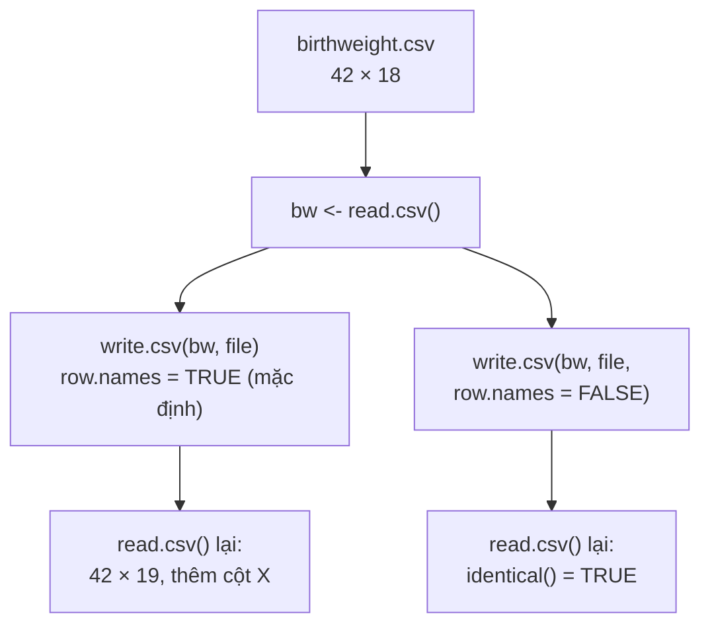
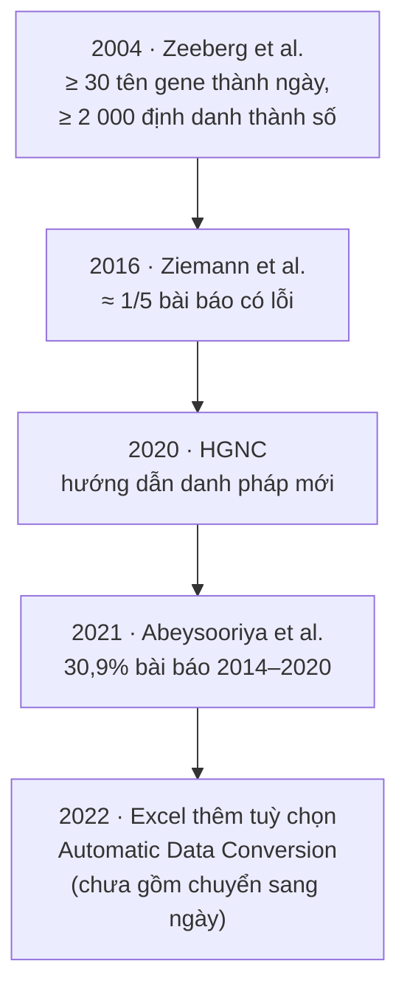

Trong R, `read.csv()` đọc một file CSV thành data frame, còn `write.csv()` ghi data frame ra file CSV; đây là hai lệnh mở đầu gần như mọi phân tích dữ liệu sinh học bằng R. Hai lệnh này có những mặc định dễ gây bất ngờ: `write.csv()` ghi thêm một cột tên hàng nên đọc lại sẽ thấy cột lạ tên `X`, và R gốc không có hàm `write.delim()` để ghi file tab. Ở phía bảng tính, Excel đổi tên gene như `SEPT2` hay `MARCH1` thành ngày tháng, và 30,9% bài báo có danh sách gene dạng Excel trên PubMed Central giai đoạn 2014–2020 mang lỗi này (Abeysooriya et al., 2021). Bài này hướng dẫn từng bước trên bộ dữ liệu cân nặng sơ sinh 42 hàng × 18 cột, kèm phép so sánh `read.csv`, `readr::read_csv` và `data.table::fread`, dành cho người mới học R trong sinh học.

<div class="callout callout-note">
<p class="callout-title">Tóm tắt nhanh</p>

- CSV là quy ước được mô tả trong RFC 4180 (2005), không phải chuẩn bắt buộc; R ghi CSV hơi khác RFC (xuống dòng LF, thêm cột tên hàng).
- Nhập: `read.csv()` rồi kiểm tra ngay bằng `dim()`, `str()`, `colSums(is.na())`.
- Xuất: luôn dùng `write.csv(x, file, row.names = FALSE)`; file tab thì dùng `write.table(x, file, sep = "\t", row.names = FALSE)`.
- Không mở danh sách gene bằng Excel rồi lưu đè: chuyển đổi sang ngày không đảo ngược được.
- Với bảng lớn, `data.table::fread()` nhanh hơn `read.csv()` hơn 10 lần trong phép đo của bài (file 210 000 hàng).

</div>

Đây là bài 3 của series *R cho phân tích dữ liệu sinh học*; mọi khối code đã chạy trên R 4.4.3 và cho cùng kết quả nếu bạn dùng cùng file.

## 1. CSV là gì: RFC 4180 và các biến thể

CSV (comma-separated values, giá trị ngăn cách bằng dấu phẩy) là file văn bản thuần, mỗi dòng là một hàng của bảng, các cột ngăn bằng dấu phẩy. Mô tả được dẫn nhiều nhất là RFC 4180 của Shafranovich (2005), văn bản đăng ký kiểu MIME `text/csv`. RFC 4180 thuộc loại Informational: nó ghi lại cách phần lớn phần mềm đang dùng CSV, không phải chuẩn mà mọi chương trình bắt buộc theo. Vì vậy hai file cùng đuôi `.csv` vẫn có thể khác nhau ở dấu phân cách, ký tự xuống dòng hay cách bao chuỗi.

Theo mục 2 của RFC 4180 (Shafranovich, 2005), một file CSV điển hình có các đặc điểm sau:

1. Mỗi bản ghi nằm trên một dòng, kết thúc bằng cặp ký tự CRLF (về đầu dòng và xuống dòng).
2. Dòng tiêu đề chứa tên cột là tuỳ chọn.
3. Các dòng nên có cùng số trường; khoảng trắng là một phần của trường, không bị bỏ đi.
4. Trường chứa dấu phẩy, dấu ngoặc kép hoặc ký tự xuống dòng nên được bao trong dấu ngoặc kép.
5. Nếu trường được bao ngoặc kép, dấu ngoặc kép bên trong phải viết đôi (`""`).

R ghi file theo đúng tinh thần quy tắc 4 và 5. Ví dụ sau có một mô tả chứa dấu phẩy và một mô tả chứa ngoặc kép:

```r
x <- data.frame(id = 1:2, note = c("đo lại, lần 2", 'mẫu "A"'))
write.csv(x, "vi_du.csv", row.names = FALSE)
cat(readLines("vi_du.csv"), sep = "\n")
```

```text
"id","note"
1,"đo lại, lần 2"
2,"mẫu ""A"""
```

Dấu phẩy trong "đo lại, lần 2" không làm hàng bị tách thành ba cột vì cả trường nằm trong ngoặc kép, và ngoặc kép quanh `A` được viết đôi. Đọc lại bằng `read.csv("vi_du.csv")` cho data frame giống hệt `x` (`identical()` trả `TRUE` trên R 4.4.3).

R lệch khỏi RFC, hoặc tự quyết thay bạn, ở ba chỗ. `write.table()` và `write.csv()` mặc định `eol = "\n"`, tức chỉ dùng LF chứ không dùng CRLF; file ghi trên macOS trong phép thử của bài không có ký tự CR nào. Mặc định `row.names = TRUE` khiến R ghi thêm tên hàng thành cột đầu (mục 3). Còn giá trị thiếu được ghi thành chữ `NA` (`na = "NA"`), trong khi RFC không nói gì về giá trị thiếu (R Core Team, 2025). Ở chiều đọc, `read.csv()` mặc định `header = TRUE`, `sep = ","` và `dec = "."`.

Ở nhiều nước, kể cả Việt Nam, dấu phẩy là dấu thập phân. Tài liệu của R mô tả `read.csv2()` là biến thể dành cho các nước dùng dấu phẩy thập phân và dấu chấm phẩy làm dấu ngăn cột, với mặc định `sep = ";"` và `dec = ","` (R Core Team, 2025). Đọc nhầm hàm không phải lúc nào cũng báo lỗi. Ví dụ dưới đây tạo một file nhỏ kiểu "dấu chấm phẩy, dấu phẩy thập phân" rồi đọc bằng hai hàm:

```r
writeLines(c("mau;nong_do", "A1;3,23", "A2;2,95"), "vn.csv")
str(read.csv("vn.csv"))
str(read.csv2("vn.csv"))
```

```text
'data.frame':	2 obs. of  1 variable:
 $ mau.nong_do: int  23 95
'data.frame':	2 obs. of  2 variables:
 $ mau    : chr  "A1" "A2"
 $ nong_do: num  3.23 2.95
```

`read.csv()` không dừng lại: nó cắt mỗi dòng tại dấu phẩy thập phân, biến phần đứng trước ("A1;3") thành tên hàng và trả về một cột số nguyên 23, 95 hoàn toàn vô nghĩa. `read.csv2()` đọc đúng hai cột, nồng độ 3,23 và 2,95. Khi nhận file từ người khác, hãy mở bằng trình soạn thảo văn bản để xem dấu ngăn cột, rồi kiểm tra bằng `str()`: không báo lỗi chưa có nghĩa là đúng.

File TSV (tab-separated values) theo cùng ý tưởng nhưng ngăn cột bằng ký tự tab. Tên gene và mã mẫu hiếm khi chứa tab, nên TSV ít cần bao ngoặc hơn CSV. Các định dạng chuyên ngành như FASTA, FASTQ hay VCF có quy tắc riêng, được bàn trong bài về định dạng dữ liệu sinh học.

## 2. Nhập dữ liệu bằng `read.csv()`

### 2.1. Thư mục làm việc: dùng dự án thay cho đường dẫn tuyệt đối

Khi gọi `read.csv("birthweight.csv")`, R tìm file trong thư mục làm việc (working directory) hiện tại. Cách quen thuộc là chạy `setwd()` với đường dẫn tuyệt đối, ví dụ `setwd("R_project")`, hoặc chọn *Session > Set Working Directory* trong RStudio. Script như vậy chạy trên máy bạn nhưng hỏng trên máy người khác. Bryan (2017) gọi đó là script không tự chứa, không mang đi được: ai nhận cũng phải sửa tay đường dẫn.

Cách thay thế được khuyên là làm việc theo dự án: mỗi phân tích nằm trong một thư mục riêng, đánh dấu bằng một RStudio Project (file `.Rproj`), và mọi đường dẫn viết tương đối từ thư mục gốc của dự án, có thể dùng hàm `here()` của gói here (Bryan, 2017). Wilson et al. (2017) cũng khuyên đặt mỗi dự án trong một thư mục, dữ liệu thô trong `data/` và kết quả trong `results/`. Cách tạo Project trong RStudio được trình bày ở [bài 2 về RStudio và R Notebook](/blog/rstudio-and-r-notebooks/).

### 2.2. Tải file và kiểm tra checksum

```r
dir.create("data", showWarnings = FALSE)
url <- paste0("https://raw.githubusercontent.com/ucdavis-bioinformatics-training/",
              "2022_February_Introduction_to_R_for_Bioinformatics/main/birthweight.csv")
download.file(url, file.path("data", "birthweight.csv"))
tools::md5sum(file.path("data", "birthweight.csv"))
```

```text
                   data/birthweight.csv
"bf579c7055ed0b040033028be20f573b"
```

Checksum (giá trị băm) là "dấu vân tay" của file: chỉ cần một byte đổi là giá trị đổi. Bản tải ngày 23/11/2026 có MD5 như trên và SHA-256 `6b3c2acca905a3ddd505474c44760a6a89b1a6e36ff72e4fbcb6358e49f894ac` (lệnh `shasum -a 256` trên macOS, `sha256sum` trên Linux). Nếu bạn ra giá trị khác, file trên máy chủ đã thay đổi và các con số bên dưới có thể không còn khớp.

### 2.3. `read.csv()` đoán kiểu cột như thế nào

```r
bw <- read.csv(file.path("data", "birthweight.csv"))
dim(bw)
table(sapply(bw, class))
```

```text
[1] 42 18

character   integer   logical   numeric
        3        13         1         1
```

`read.csv()` đọc toàn bộ file dưới dạng chữ rồi đoán kiểu cho từng cột: cột chỉ có số nguyên thành `integer`, cột có phần thập phân thành `numeric`, cột chỉ có `TRUE`/`FALSE` thành `logical`, còn lại là `character`. Trên birthweight, kết quả là 13 cột `integer`, một cột `numeric` (`birthweight`, kg), một cột `logical` và ba cột `character` (Bảng 1).

Từ R 4.0.0, `stringsAsFactors = FALSE` là mặc định, nên cột chữ giữ nguyên là chuỗi thay vì tự thành factor (R Core Team, 2025). Tài liệu viết trước năm 2020 thường mô tả hành vi cũ; muốn có factor, bạn chuyển rõ ràng bằng `factor()`.

Ô trống trong cột số thành `NA`; chỉ bốn biến của người cha có giá trị thiếu, 4–5 ô mỗi cột.

Cột `birth.date` lưu ngày dạng `1/25/1967` (tháng/ngày/năm) và được giữ là chuỗi. R không tự đổi chuỗi trông giống ngày thành ngày; muốn dùng làm ngày, bạn chuyển rõ ràng với định dạng khai báo, ví dụ `as.Date(bw$birth.date, format = "%m/%d/%Y")` (kiểu dữ liệu và chuyển kiểu được bàn ở bài về kiểu dữ liệu cơ bản). Đây là khác biệt cốt lõi so với bảng tính, nơi việc đổi thành ngày xảy ra ngay khi mở file (mục 5).

### 2.4. Kiểm tra ngay sau khi nhập

```r
str(bw[, 1:5])
colSums(is.na(bw))[colSums(is.na(bw)) > 0]
table(bw$smoker)
```

```text
'data.frame':	42 obs. of  5 variables:
 $ ID         : int  1107 697 1683 27 1522 569 365 808 1369 1023 ...
 $ birth.date : chr  "1/25/1967" "2/6/1967" "2/14/1967" "3/9/1967" ...
 $ location   : chr  "General" "Silver Hill" "Silver Hill" "Silver Hill" ...
 $ length     : int  52 48 53 53 50 50 52 48 49 52 ...
 $ birthweight: num  3.23 3.03 3.35 3.55 2.74 2.51 3.53 2.92 3.18 3 ...

      paternal.age  paternal.education paternal.cigarettes     paternal.height
                 4                   5                   5                   5

 no yes
 20  22
```

Bốn lệnh `dim()`, `str()`, `head()` và `colSums(is.na())` trả lời ba câu hỏi: đủ hàng và cột chưa, mỗi cột có đúng kiểu chưa, giá trị thiếu nằm ở đâu. Cột số mà `str()` báo `chr` thường là dấu hiệu có một ô chứa chữ (ví dụ "<0.1" hay "n/a"). Các hàm tóm tắt dữ liệu tiếp theo có trong bài tổng hợp dữ liệu trong R.

<div class="callout callout-warning">
<p class="callout-title">Ba lỗi hay gặp khi nhập</p>

- `cannot open the connection`: sai tên file hoặc sai thư mục làm việc; xem bằng `getwd()` và `list.files()`.
- Bảng chỉ có một cột hoặc số bị lệch: sai dấu ngăn cột (ví dụ `read.csv2()` ở mục 1).
- Cột số thành `character`: có ô chứa chữ; tìm bằng `x[is.na(suppressWarnings(as.numeric(x)))]` thay vì sửa tay file gốc.

</div>

**Bảng 1.** Từ điển dữ liệu birthweight theo `read.csv()` (R 4.4.3)

| Cột | Kiểu | Khoảng hoặc giá trị | `NA` |
|---|---|---|---|
| `ID` | integer | 27–1764, 42 giá trị khác nhau | 0 |
| `birth.date` | character | "1/25/1967", … (tháng/ngày/năm) | 0 |
| `location` | character | General 10, Memorial 13, Silver Hill 19 | 0 |
| `length` | integer | 43–58 | 0 |
| `birthweight` | numeric | 1,92–4,57 (kg) | 0 |
| `head.circumference` | integer | 30–39 | 0 |
| `weeks.gestation` | integer | 33–45 | 0 |
| `smoker` | character | "no" 20, "yes" 22 | 0 |
| `maternal.age` | integer | 18–41 | 0 |
| `maternal.cigarettes` | integer | 0–50 | 0 |
| `maternal.height` | integer | 149–181 | 0 |
| `maternal.prepregnant.weight` | integer | 45–78 | 0 |
| `paternal.age` | integer | 19–46 | 4 |
| `paternal.education` | integer | 10–16 | 5 |
| `paternal.cigarettes` | integer | 0–50 | 5 |
| `paternal.height` | integer | 169–194 | 5 |
| `low.birthweight` | integer | 0 hoặc 1 | 0 |
| `geriatric.pregnancy` | logical | TRUE/FALSE | 0 |

## 3. Xuất dữ liệu: `write.csv()`, cột `X` và file tab

### 3.1. Cột `X` từ đâu ra

```r
write.csv(bw, "new_birthweight.csv")
bw2 <- read.csv("new_birthweight.csv")
dim(bw2)
names(bw2)[1:3]
```

```text
[1] 42 19
[1] "X"          "ID"         "birth.date"
```

Lệnh `write.csv(bw, "new_birthweight.csv")` mặc định ghi tên hàng ("1", "2", …) thành cột đầu tiên với tiêu đề rỗng. Khi đọc lại, `read.csv()` thấy một cột không tên và đặt tên là `X`, nên bảng có 19 cột thay vì 18. Ghi rồi đọc vài lần như vậy, bảng sẽ có thêm `X`, `X.1`… Với pandas, cột này hiện dưới tên `Unnamed: 0`.

Sửa bằng một tham số:

```r
write.csv(bw, "new_birthweight.csv", row.names = FALSE)
identical(bw, read.csv("new_birthweight.csv"))
```

```text
[1] TRUE
```

`identical()` trả `TRUE` nghĩa là vòng ghi rồi đọc lại không đổi gì: cùng số cột, cùng kiểu, cùng giá trị, cùng `NA`.



### 3.2. Giá trị thiếu: `NA` hay ô trống

File gốc để trống ô thiếu, còn `write.csv()` ghi chữ `NA`. R đọc lại vẫn hiểu đúng, nhưng phần mềm khác có thể coi `NA` là chuỗi ký tự. Nếu file dành cho người dùng bảng tính, thêm `na = ""`:

```r
write.csv(bw, "birthweight_blank_na.csv", row.names = FALSE, na = "")
identical(bw, read.csv("birthweight_blank_na.csv"))
```

```text
[1] TRUE
```

### 3.3. Ghi file tab-delimited

Base R có `read.delim()` để đọc file tab, nhưng không có hàm ghi tương ứng tên `write.delim()`: `exists("write.delim")` trả `FALSE` trên R 4.4.3. Hàm cần dùng là `write.table()` với `sep = "\t"`:

```r
write.table(bw, "birthweight.tsv", sep = "\t", row.names = FALSE, quote = FALSE)
identical(bw, read.delim("birthweight.tsv"))
```

```text
[1] TRUE
```

`quote = FALSE` cho file gọn, dễ đọc bằng công cụ dòng lệnh, nhưng chỉ an toàn khi không trường nào chứa tab hoặc ký tự xuống dòng; nếu không chắc, để mặc định `quote = TRUE` như quy tắc ngoặc kép của RFC 4180. Data frame birthweight dùng để luyện tiếp trong [bài các thao tác với dữ liệu trong R](/blog/cac-thao-tac-voi-du-lieu-trong-r/).

### 3.4. Không ghi đè file thô

Buffalo (2015) khuyên coi dữ liệu thô là chỉ-đọc (read-only): chương trình đọc file gốc và ghi kết quả ra file mới, không sửa file gốc. Một quy ước đơn giản là ghi kết quả vào `results/` (Wilson et al., 2017), ví dụ `write.csv(bw, file.path("results", "birthweight_clean.csv"), row.names = FALSE)` sau khi đã tạo thư mục bằng `dir.create("results")`. Nếu lỡ ghi đè, checksum ở mục 2.2 cho biết file trong `data/` có còn là bản gốc hay không.

## 4. Bộ dữ liệu birthweight: nguồn gốc và giới hạn

Bộ dữ liệu ghi cân nặng sơ sinh và thói quen hút thuốc của mẹ, đủ để đặt những câu hỏi sinh học đơn giản về thuốc lá khi mang thai. Theo UC Davis Bioinformatics Core (2022), dữ liệu được chỉnh sửa nhẹ từ một bộ dữ liệu của Mathematics and Statistics Help (MASH), University of Sheffield, để minh hoạ thêm một số hàm; file được đưa lên GitHub ngày 29/01/2022.

File có 43 dòng (1 dòng tiêu đề, 42 hàng) và 18 cột: thông tin của trẻ, biến của mẹ, biến của cha và hai biến nhị phân (Bảng 1).

Bộ dữ liệu có ba giới hạn. Đây là dữ liệu dạy học đã được chỉnh sửa, chỉ dùng để luyện kỹ thuật, không dùng để kết luận về tác động thật của thuốc lá. Kho GitHub của UC Davis không khai báo giấy phép (kiểm tra ngày 23/11/2026), nên bài chỉ dẫn link tải, không đăng lại file. Ngoài ra, mô tả gốc trên trang của MASH hiện cần đăng nhập, nên chuỗi nguồn gốc ở đây dựa vào tài liệu của UC Davis.

## 5. Bằng chứng: khi bảng tính đổi tên gene

Thử đọc ba tên gene "nguy hiểm" bằng R:

```r
genes <- read.csv(text = "gene,log2FC\nSEPT2,1.8\nMARCH1,-0.9\nDEC1,2.4\n")
str(genes)
```

```text
'data.frame':	3 obs. of  2 variables:
 $ gene  : chr  "SEPT2" "MARCH1" "DEC1"
 $ log2FC: num  1.8 -0.9 2.4
```

R giữ nguyên ba tên là chuỗi. Mở cùng dữ liệu bằng Excel, cả ba có thể thành ngày: `SEPT2` thành 2 tháng 9, `MARCH1` thành 1 tháng 3, `DEC1` thành 1 tháng 12.

Zeeberg et al. (2004) mô tả có hệ thống lỗi này khi xử lý dữ liệu microarray. Theo nhóm, chuyển đổi sang ngày ảnh hưởng ít nhất 30 tên gene; chuyển đổi sang số thực ảnh hưởng ít nhất 2 000 định danh nếu tính cả định danh RIKEN (ví dụ chuỗi số có chữ E ở giữa bị hiểu là ký hiệu khoa học). Các chuyển đổi này không đảo ngược được: khi ô đã thành ngày, phần mềm không còn biết chuỗi gốc là gì.

Mười hai năm sau, Ziemann et al. (2016) quét file bổ sung của các tạp chí genomics hàng đầu và thấy khoảng một phần năm bài báo có danh sách gene trong file Excel mang lỗi chuyển đổi. Abeysooriya et al. (2021) quét lại file bổ sung trên PubMed Central giai đoạn 2014–2020: 30,9% (3 436/11 117) bài báo có lỗi, và tỉ lệ không giảm sau cảnh báo năm 2016. Một phần tỉ lệ cao hơn là do nhóm phát hiện thêm dạng ngày lưu bằng số ngày nội bộ (con số năm chữ số). Trong thử nghiệm của nhóm, Excel và Google Sheets đổi tên gene thành ngày ở cả ba cách nhập (mở file văn bản, dán, gõ tay), còn LibreOffice Calc và Gnumeric thì không (Abeysooriya et al., 2021).

Cộng đồng phản ứng từ hai phía. HGNC (HUGO Gene Nomenclature Committee, ủy ban danh pháp gene người) công bố hướng dẫn danh pháp mới năm 2020 (Bruford et al., 2020); theo Abeysooriya et al. (2021), HGNC đã đổi một số ký hiệu dễ bị chuyển đổi, ví dụ `SEPT1` thành `SEPTIN1` và `MARCH1` thành `MARCHF1`. Tin của *Nature* năm 2021 ghi nhận lỗi tự sửa của Excel vẫn gây khó cho genomics (Lewis, 2021). Về phía Microsoft, từ năm 2022 Excel có tuỳ chọn *Automatic Data Conversion* để tắt việc bỏ số 0 đầu, cắt số dài quá 15 chữ số và đổi chuỗi số quanh chữ "E" thành ký hiệu khoa học; bài giới thiệu ghi rõ việc kiểm soát chuyển đổi sang ngày "đang lên kế hoạch, chưa có" (Fifadra, 2022).



Gốc của lỗi là phần mềm đoán kiểu dữ liệu thay người dùng, nên cẩn thận hơn không đủ. Cách phòng phải nằm trong quy trình: nhập bằng script, khai báo kiểu khi cần, kiểm tra sau khi nhập và xuất.

Dù vậy, bạn vẫn sẽ nhận những file đã đi qua bảng tính của người khác. Trước khi phân tích, nên quét cột tên gene tìm hai dấu vết mà các nghiên cứu trên mô tả: chuỗi dạng "ngày-tháng viết tắt" và số nguyên năm chữ số (số ngày nội bộ của bảng tính). Ví dụ trên một vector mô phỏng:

```r
gene_col <- c("TP53", "2-Sep", "1-Mar", "44075", "MYC")
months <- "(Jan|Feb|Mar|Apr|May|Jun|Jul|Aug|Sep|Oct|Nov|Dec)"
suspect <- grepl(paste0("^[0-9]{1,2}-", months, "$"), gene_col) |
           grepl("^[0-9]{5}$", gene_col)
gene_col[suspect]
```

```text
[1] "2-Sep" "1-Mar" "44075"
```

Đoạn code chỉ gắn cờ, không sửa: "2-Sep" có thể từng là `SEPT2` hay `SEPTIN2`, và chỉ người giữ file gốc mới biết chắc. Cách sửa tin cậy là lấy lại danh sách từ nguồn trước khi qua bảng tính, hoặc nối lại bằng một cột ID ổn định như HGNC ID hay Ensembl ID. Nếu buộc phải mở file bằng bảng tính, LibreOffice Calc hoặc Gnumeric ít rủi ro hơn theo thử nghiệm nêu trên; dù dùng phần mềm nào, đừng lưu đè lên file gốc.

## 6. Thực hành tốt khi tổ chức và trao đổi dữ liệu bảng

Broman và Woo (2018) đưa ra một bộ nguyên tắc nhập dữ liệu trong bảng tính, từ ghi ngày dạng YYYY-MM-DD, mỗi ô một thứ, dữ liệu là một hình chữ nhật với một dòng tiêu đề, đến lưu thêm bản văn bản thuần. Bảng 2 chọn những nguyên tắc chạm trực tiếp tới việc nhập, xuất. Wickham (2014) gọi dạng bảng dễ phân tích là tidy data: mỗi biến một cột, mỗi quan sát một hàng (→ bài về data frame).

Khi gửi dữ liệu cho người phân tích, Ellis và Leek (2018) khuyên gửi đủ bốn thứ: dữ liệu thô, bảng tidy, codebook mô tả từng biến, và mô tả quy trình đi từ dữ liệu thô tới bảng tidy. Wilson et al. (2017) và Sandve et al. (2013) bổ sung: lưu dữ liệu thô, ghi lại mọi bước xử lý bằng code, quản lý phiên bản. Áp vào bài này, một dự án nhỏ có thể trông như sau:

```text
birthweight-project/
├── birthweight-project.Rproj
├── data/
│   └── birthweight.csv        # file thô, không sửa
├── scripts/
│   └── 01-import.R            # tải, kiểm checksum, đọc, kiểm tra
└── results/
    └── birthweight_clean.csv  # file xuất, row.names = FALSE
```

Người nhận chỉ cần mở file `.Rproj` và chạy `scripts/01-import.R`; mọi đường dẫn tương đối sẽ đúng mà không phải sửa dòng nào. Phần làm sạch dữ liệu sau bước nhập được trình bày kỹ ở [bài làm sạch dữ liệu](/blog/process-data-from-dirty-to-clean/), và cách tổ chức dự án lớn hơn với workflow, container ở bài quy trình tái lập.

**Bảng 2.** Checklist dữ liệu bảng cho phòng thí nghiệm

| Việc | Vì sao | Nguồn |
|---|---|---|
| Tên cột không khoảng trắng, không ký tự đặc biệt | R đổi khoảng trắng thành dấu chấm, dễ gõ nhầm | Broman & Woo (2018) |
| Ngày dạng `YYYY-MM-DD` | tránh nhầm tháng/ngày | Broman & Woo (2018) |
| Tên gene để dạng văn bản, kèm ID ổn định (HGNC ID, Ensembl ID) | bảng tính không đổi ID thành ngày | Abeysooriya et al. (2021); Bruford et al. (2020) |
| Mỗi ô một giá trị, đơn vị ghi ở tiêu đề | máy đọc được | Broman & Woo (2018) |
| File thô chỉ-đọc, kết quả ghi file mới | lần lại được | Buffalo (2015) |
| Nhập vào R bằng script, không chỉnh tay | tái lập được | Sandve et al. (2013) |
| Gửi kèm codebook và mô tả quy trình | người nhận hiểu dữ liệu | Ellis & Leek (2018) |

## 7. Thí nghiệm: `read.csv`, `read_csv` và `fread`

### 7.1. Phương pháp

Ngoài `read.csv()` của base R, hai hàm đọc phổ biến là `read_csv()` của gói readr (Wickham et al., 2026) và `fread()` của gói data.table (Barrett et al., 2026). Phép thử dùng R 4.4.3, readr 2.2.0 và data.table 1.18.4 trên một máy Intel Core i5-5350U (4 luồng logic, data.table dùng 2 luồng), macOS. Bước một so kiểu cột và lớp đối tượng trên file gốc 42 × 18. Bước hai đo tốc độ trên một file nhân bản: lặp mỗi hàng 5 000 lần thành 210 000 hàng, 16,9 MB, ghi bằng `write.csv(row.names = FALSE)`; mỗi hàm đọc 10 lần theo thứ tự ngẫu nhiên, lấy trung vị của `system.time()`.

### 7.2. Kết quả

```r
library(readr); library(data.table)
a <- read.csv("data/birthweight.csv")
b <- read_csv("data/birthweight.csv", show_col_types = FALSE)
d <- fread("data/birthweight.csv")
class(b$length); class(d$length)
```

```text
[1] "numeric"
[1] "integer"
```

**Bảng 3.** Khác biệt giữa ba hàm đọc trên birthweight.csv

| | `read.csv()` | `readr::read_csv()` | `data.table::fread()` |
|---|---|---|---|
| Lớp đối tượng | `data.frame` | `spec_tbl_df`, `tbl_df`, `tbl`, `data.frame` | `data.table`, `data.frame` |
| 13 cột số nguyên | integer | numeric (double) | integer |
| 5 cột còn lại | giống nhau | giống nhau | giống nhau |
| `NA` ở `paternal.age` | 4 | 4 | 4 |
| Trung vị thời gian, 210 000 hàng | 0,980 s | 0,379 s | 0,057 s |


*Hình 1. Thời gian đọc file CSV 210 000 hàng bằng ba hàm; cột là trung vị, điểm là từng lần đo (10 lần mỗi hàm). Dữ liệu đo ngày 23/11/2026 trên một máy.*

Có hai kết quả chính. Ba hàm cho cùng giá trị và cùng số `NA`, nhưng `read_csv()` đọc 13 cột số nguyên thành double: readr mặc định đoán mọi số là double (`guess_parser("52")` trả `"double"`). `fread()` nhanh hơn `read.csv()` khoảng 17 lần, `read_csv()` nhanh hơn khoảng 2,6 lần.

### 7.3. Bàn luận

Khác biệt integer/double hiếm khi đổi kết quả thống kê, nhưng làm `identical()` trả `FALSE` khi so hai bản đọc. Nếu cần kiểu cố định, khai báo khi đọc, ví dụ `read_csv(file, col_types = cols(length = col_integer()))`.

`fread()` còn tự dò dấu ngăn cột và dấu thập phân. Trên file `vn.csv` ở mục 1, `fread("vn.csv")` trả về đúng hai cột `mau` (chuỗi) và `nong_do` (số 3,23 và 2,95), trong khi `read.csv()` cho kết quả sai mà không báo lỗi. Đó vẫn là một lần đoán; với file quan trọng, hãy khai báo `sep` và `dec` rõ ràng.

Nếu cần chọn nhanh: bảng nhỏ và bài tập dùng `read.csv()`, không phải cài thêm gì; nếu cả phân tích theo hệ tidyverse (dplyr, ggplot2) thì dùng `read_csv()` để có tibble và thông báo kiểu cột; bảng lớn như ma trận đếm RNA-seq thì dùng `fread()`. Cả ba hàm đều có tham số khai báo kiểu cột (`colClasses` cho `read.csv()` và `fread()`, `col_types` cho `read_csv()`), và đó là cách chắc chắn nhất để hai lần đọc cho cùng một kết quả.

Phép đo chạy trên một máy, với file nhân bản có cấu trúc lặp lại, nên con số chỉ cho thấy thứ tự độ lớn chứ không phải benchmark tổng quát. Khi máy đang chạy nhiều tác vụ khác, cả ba hàm chậm hơn khoảng 3–6 lần (trung vị 4,09 s, 1,22 s và 0,32 s), nhưng thứ tự giữ nguyên: `fread()` vẫn nhanh hơn `read.csv()` khoảng 13 lần. Bảng thật nhiều cột chữ hơn có thể cho tỉ lệ khác. Cách tibble và data.table in, lọc dữ liệu được bàn ở bài về data frame.

## 8. Kết luận

Nhập và xuất là chỗ dữ liệu dễ đổi âm thầm nhất, vì phần mềm nào cũng đoán kiểu thay bạn. Bảng tính đổi tên gene thành ngày và không cho đảo ngược (Zeeberg et al., 2004; Abeysooriya et al., 2021). R giữ chuỗi là chuỗi và cho bạn khai báo lại kiểu cột. Cách phòng chắc nhất là một quy trình cố định; với dự án tiếp theo, bạn có thể làm đúng năm bước:

1. Để file thô trong `data/`, không sửa, và ghi lại checksum.
2. Nhập bằng script, đường dẫn tương đối trong một RStudio Project.
3. Kiểm tra ngay bằng `dim()`, `str()` và `colSums(is.na())`.
4. Xuất vào `results/` với `row.names = FALSE`.
5. Đọc lại file vừa ghi và so bằng `identical()`; một dòng này bắt được cả cột `X` lẫn lỗi dấu ngăn cột.

Bài tiếp theo của series đi vào cấu trúc của data frame vừa nhập (→ Data frames).

## Phụ lục: code tái lập

Script dưới đây tạo file nhân bản và đo thời gian đọc như mục 7; nó cần file `data/birthweight.csv` từ mục 2.2 và hai gói readr, data.table. Chạy `sessionInfo()` ở cuối để ghi lại phiên bản R và gói, vì kết quả về kiểu cột và tốc độ phụ thuộc phiên bản.

```r
library(readr); library(data.table)
bw  <- read.csv("data/birthweight.csv")
big <- bw[rep(seq_len(nrow(bw)), each = 5000), ]   # 210 000 hàng
write.csv(big, "big.csv", row.names = FALSE)

set.seed(1)
res <- data.frame()
for (i in 1:10) for (f in sample(c("read.csv", "read_csv", "fread"))) {
  t <- switch(f,
    read.csv = system.time(read.csv("big.csv"))[["elapsed"]],
    read_csv = system.time(read_csv("big.csv", show_col_types = FALSE,
                                    lazy = FALSE))[["elapsed"]],
    fread    = system.time(fread("big.csv"))[["elapsed"]])
  res <- rbind(res, data.frame(fun = f, run = i, sec = t))
}
aggregate(sec ~ fun, res, median)
sessionInfo()
```

**Bảng 4.** Mặc định của các hàm nhập, xuất trong base R (lấy bằng `args()`, R 4.4.3)

| Hàm | `sep` | `dec` | `header` | `row.names` khi ghi | `na` khi ghi |
|---|---|---|---|---|---|
| `read.csv()` | `","` | `"."` | `TRUE` | – | – |
| `read.csv2()` | `";"` | `","` | `TRUE` | – | – |
| `read.delim()` | `"\t"` | `"."` | `TRUE` | – | – |
| `write.csv()` | `","` (cố định) | `"."` | – | `TRUE` | `"NA"` |
| `write.table()` | `" "` | `"."` | – | `TRUE` | `"NA"` |

## Tài liệu tham khảo

Abeysooriya, M., Soria, M., Kasu, M. S., & Ziemann, M. (2021). Gene name errors: Lessons not learned. *PLOS Computational Biology, 17*(7), e1008984. https://doi.org/10.1371/journal.pcbi.1008984

Barrett, T., Dowle, M., Srinivasan, A., Gorecki, J., Chirico, M., Hocking, T., Schwendinger, B., & Krylov, I. (2026). *data.table: Extension of `data.frame`* (R package version 1.18.4) [Computer software]. https://r-datatable.com

Broman, K. W., & Woo, K. H. (2018). Data organization in spreadsheets. *The American Statistician, 72*(1), 2–10. https://doi.org/10.1080/00031305.2017.1375989

Bruford, E. A., Braschi, B., Denny, P., Jones, T. E. M., Seal, R. L., & Tweedie, S. (2020). Guidelines for human gene nomenclature. *Nature Genetics, 52*(8), 754–758. https://doi.org/10.1038/s41588-020-0669-3

Bryan, J. (2017, December 12). *Project-oriented workflow*. Tidyverse blog. https://www.tidyverse.org/blog/2017/12/workflow-vs-script/

Buffalo, V. (2015). *Bioinformatics data skills: Reproducible and robust research with open source tools*. O'Reilly Media.

Ellis, S. E., & Leek, J. T. (2018). How to share data for collaboration. *The American Statistician, 72*(1), 53–57. https://doi.org/10.1080/00031305.2017.1375987

Fifadra, C. (2022, July 5). *Control data conversions in Excel*. Microsoft 365 Insider Blog. https://techcommunity.microsoft.com/blog/microsoft365insiderblog/control-data-conversions-in-excel/4215348

Lewis, D. (2021, August 13). Autocorrect errors in Excel still creating genomics headache. *Nature*. https://doi.org/10.1038/d41586-021-02211-4

R Core Team. (2025). *R: A language and environment for statistical computing* (Version 4.4.3) [Computer software]. R Foundation for Statistical Computing. https://www.R-project.org/

Sandve, G. K., Nekrutenko, A., Taylor, J., & Hovig, E. (2013). Ten simple rules for reproducible computational research. *PLoS Computational Biology, 9*(10), e1003285. https://doi.org/10.1371/journal.pcbi.1003285

Shafranovich, Y. (2005). *Common format and MIME type for comma-separated values (CSV) files* (RFC 4180). Internet Engineering Task Force. https://doi.org/10.17487/RFC4180

UC Davis Bioinformatics Core. (2022). *Introduction to R for Bioinformatics* (February 2022 workshop materials) [GitHub repository]. https://github.com/ucdavis-bioinformatics-training/2022_February_Introduction_to_R_for_Bioinformatics

Wickham, H. (2014). Tidy data. *Journal of Statistical Software, 59*(10), 1–23. https://doi.org/10.18637/jss.v059.i10

Wickham, H., Hester, J., & Bryan, J. (2026). *readr: Read rectangular text data* (R package version 2.2.0) [Computer software]. https://readr.tidyverse.org

Wilson, G., Bryan, J., Cranston, K., Kitzes, J., Nederbragt, L., & Teal, T. K. (2017). Good enough practices in scientific computing. *PLOS Computational Biology, 13*(6), e1005510. https://doi.org/10.1371/journal.pcbi.1005510

Zeeberg, B. R., Riss, J., Kane, D. W., Bussey, K. J., Uchio, E., Linehan, W. M., Barrett, J. C., & Weinstein, J. N. (2004). Mistaken identifiers: Gene name errors can be introduced inadvertently when using Excel in bioinformatics. *BMC Bioinformatics, 5*, 80. https://doi.org/10.1186/1471-2105-5-80

Ziemann, M., Eren, Y., & El-Osta, A. (2016). Gene name errors are widespread in the scientific literature. *Genome Biology, 17*, 177. https://doi.org/10.1186/s13059-016-1044-7
