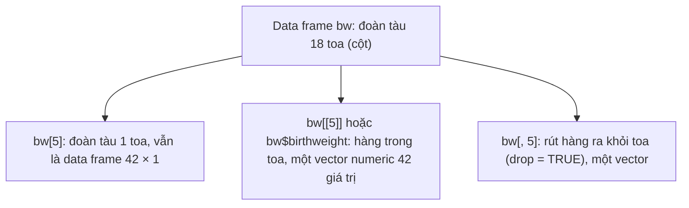
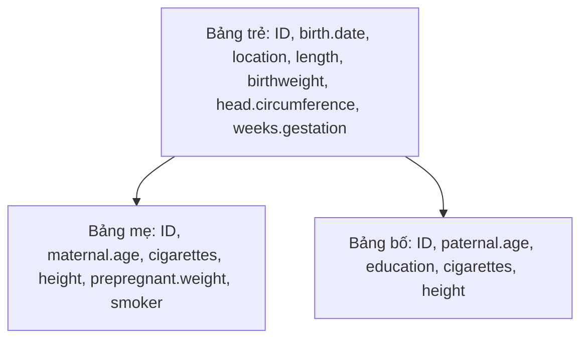

Data frame là cấu trúc bảng cơ bản của R: một list gồm các vector cùng độ dài, mỗi vector là một cột và mỗi cột có thể mang kiểu riêng (số, chuỗi, logic). Nhờ vậy, những biến khác kiểu nhưng đo trên cùng quan sát, như cân nặng, ngày sinh và tình trạng hút thuốc của mẹ ứng với từng trẻ sơ sinh, nằm chung trong một đối tượng. Bộ dữ liệu `birthweight` dùng trong bài là một data frame 42 × 18, vậy mà `bw$head` vẫn trả về một cột dù không có cột nào tên `head`, còn `bw[, 5]` trả về một vector chứ không phải một bảng. Bài thứ tư của series *R cho phân tích dữ liệu sinh học* dành cho sinh viên sinh học và y sinh mới học R: cấu trúc data frame, ba toán tử subset `$`, `[[`, `[`, nguyên tắc dữ liệu gọn (tidy data) và một vòng khám phá dữ liệu có output thật.

<div class="callout callout-note">
<p class="callout-title">Tóm tắt nhanh</p>

- Data frame là list các cột cùng độ dài: `typeof(bw)` cho `"list"`, `length(bw)` bằng số cột.
- `[` trả về cùng kiểu với đối tượng gốc (bảng vào, bảng ra); `[[` và `$` rút ra một cột. Riêng `bw[, j]` bỏ chiều khi chỉ còn một cột, trừ khi thêm `drop = FALSE`.
- `$` khớp một phần tên cột; lọc hàng bằng điều kiện logic trên cột có `NA` sinh ra những hàng toàn `NA`. Dùng `[[` trong hàm, dùng `which()` hoặc `subset()` khi lọc.
- Trong bộ `birthweight`, cột `low.birthweight` đánh dấu 6 trẻ nhẹ cân nhưng chỉ 3 trẻ dưới ngưỡng 2.500 g của WHO: hãy tính lại biến dẫn xuất từ biến gốc.

</div>

## 1. Data frame là gì: giải phẫu một bảng 42 trẻ sơ sinh

### 1.1. Bộ dữ liệu

Ví dụ trong bài dùng file `birthweight.csv` trong kho tài liệu "Introduction to R for Bioinformatics" của UC Davis Bioinformatics Core (2022). Theo nhóm tác giả, đây là bảng cân nặng sơ sinh của trẻ và thông tin của bố mẹ, chuyển thể từ một bộ dữ liệu của Mathematics and Statistics Help (MASH), University of Sheffield, có chỉnh sửa nhẹ để minh hoạ thêm một số hàm. Mỗi hàng là một trẻ sinh năm 1967 ở một trong ba bệnh viện. Cách tải file và kiểm tra checksum có trong [bài 03 về nhập và xuất dữ liệu](/blog/importing-and-exporting-data/); ở đây chỉ cần một dòng:

```r
bw <- read.csv("birthweight.csv")
```

Khung Environment của RStudio lúc này hiện `bw` kèm dòng "42 obs. of 18 variables": 42 quan sát (trẻ), 18 biến (cột). Ba cách lấy tập con `$`, `[[` và `[` trông na ná nhau nhưng trả về ba thứ khác nhau, và lý do nằm ở cấu trúc bên trong của data frame.

### 1.2. Data frame là list các vector cùng độ dài

Bốn hàm sau cho bạn biết gần như mọi điều cần biết về cấu trúc của `bw` (output chạy trong R 4.4.3):

```r
class(bw)    #> [1] "data.frame"
dim(bw)      #> [1] 42 18
typeof(bw)   #> [1] "list"
length(bw)   #> [1] 18
is.list(bw)  #> [1] TRUE
```

`dim()` cho 42 hàng và 18 cột. Dòng cần nhìn kỹ là `typeof()`: về mặt lưu trữ, data frame là một **list**, và `length()` của nó là số cột chứ không phải số ô. Mỗi phần tử của list là một vector dài đúng 42; lớp `"data.frame"` thêm vài thuộc tính để R xử lý list đó như một bảng:

```r
attributes(bw[1:2, 1:3])
#> $names
#> [1] "ID"         "birth.date" "location"
#> $row.names
#> [1] 1 2
#> $class
#> [1] "data.frame"
```

`names` là tên cột, `row.names` là tên hàng (mặc định là số thứ tự), `class` cho R biết dùng phương thức nào khi in hay subset. Từ đó có hai hệ quả:

- Vì là list, `bw[[5]]` và `bw$birthweight` là cùng một vector: `identical(bw[[5]], bw$birthweight)` cho `TRUE`.
- Vì có thuộc tính tên hàng và tên cột, R cho phép viết `bw[i, j]` như với ma trận, dù bên trong không có ma trận nào.

### 1.3. Mỗi cột một kiểu

Khác với ma trận, mỗi cột của data frame giữ kiểu riêng. `str(bw)` cho thấy 13 cột integer, 1 cột numeric (`birthweight`, đơn vị kg), 3 cột character (`birth.date`, `location`, `smoker`) và 1 cột logical (`geriatric.pregnancy`). Bảng 1 tóm tắt 18 cột cùng số giá trị thiếu.

**Bảng 1.** Các cột của bộ `birthweight` (kiểu theo `str()`, số `NA` theo `colSums(is.na(bw))`)

| Cột | Tên | Kiểu | Số `NA` | Ý nghĩa |
| --- | --- | --- | --- | --- |
| 1 | `ID` | integer | 0 | mã trẻ |
| 2 | `birth.date` | character | 0 | ngày sinh dạng M/D/YYYY |
| 3 | `location` | character | 0 | bệnh viện |
| 4 | `length` | integer | 0 | chiều dài (cm) |
| 5 | `birthweight` | numeric | 0 | cân nặng sơ sinh (kg) |
| 6 | `head.circumference` | integer | 0 | vòng đầu (cm) |
| 7 | `weeks.gestation` | integer | 0 | tuổi thai (tuần) |
| 8 | `smoker` | character | 0 | mẹ hút thuốc (`yes`/`no`) |
| 9–12 | `maternal.*` (age, cigarettes, height, prepregnant.weight) | integer | 0 | tuổi, số điếu/ngày, chiều cao, cân nặng trước mang thai của mẹ |
| 13 | `paternal.age` | integer | 4 | tuổi bố |
| 14–16 | `paternal.*` (education, cigarettes, height) | integer | 5 mỗi cột | số năm học, số điếu, chiều cao của bố |
| 17 | `low.birthweight` | integer | 0 | mã 0/1 nhẹ cân |
| 18 | `geriatric.pregnancy` | logical | 0 | mẹ từ 35 tuổi trở lên |

Chính việc cho phép kiểu khác nhau giữa các cột là lý do data frame tồn tại. Ép bảng này thành ma trận, mọi giá trị sẽ thành chuỗi vì ma trận chỉ giữ một kiểu:

```r
typeof(as.matrix(bw))   #> [1] "character"
as.matrix(bw)[1, 1:5]
#>          ID  birth.date    location      length birthweight
#>      "1107" "1/25/1967"   "General"        "52"      "3.23"
```

Dữ liệu hỗn hợp vì thế nên để ở data frame, còn ma trận dành cho dữ liệu cùng kiểu như bảng biểu hiện gen (→ các cấu trúc dữ liệu trong R). Kiểu dữ liệu và quy tắc ép kiểu (coercion) sẽ được bàn kỹ ở [bài 05](/blog/basic-data-types/).

## 2. Ba toán tử, ba ngữ nghĩa: `$`, `[[` và `[`

Nếu chỉ nhớ một câu cho cả mục này, hãy nhớ hình ảnh mà Wickham (2019, mục 4.3.1) mượn lại: nếu list là một đoàn tàu chở hàng, `x[[5]]` là hàng hoá trong toa số 5, còn `x[5]` là toa số 5, tức một đoàn tàu ngắn hơn. Với data frame, "toa" là cột.



*Sơ đồ minh hoạ ẩn dụ đoàn tàu theo Wickham (2019, mục 4.3.1), vẽ lại cho bộ `birthweight`.*

### 2.1. `[[`: rút ra một cột

`[[` nhận tên cột (chuỗi) hoặc số thứ tự cột và trả về nội dung của cột đó, tức một vector. Theo trang trợ giúp `[.data.frame`, `[[` mặc định khớp tên **chính xác** (`exact = TRUE`) (R Core Team, 2025):

```r
bw[["birthweight"]][1:3]            #> [1] 3.23 3.03 3.35
bw[[5]][1:3]                        #> [1] 3.23 3.03 3.35
bw[["head"]]                        #> NULL
head(bw[["head", exact = FALSE]])   #> [1] 36 35 33 37 33 35
```

Ưu điểm lớn nhất của `[[` là nhận được **biến** chứa tên cột. Đây là cách viết đúng khi bạn viết hàm hay vòng lặp đi qua nhiều cột:

```r
col <- "birthweight"
head(bw[[col]])   #> [1] 3.23 3.03 3.35 3.55 2.74 2.51
```

### 2.2. `$`: lối tắt tiện tay nhưng có bẫy

`bw$birthweight` gõ nhanh hơn `bw[["birthweight"]]` và RStudio gợi ý tên cột khi bạn gõ `$`. Tuy vậy `$` khác `[[` ở ba điểm, cả ba đều không sinh lỗi:

```r
head(bw$head)   #> [1] 36 35 33 37 33 35   (khớp một phần với head.circumference)
bw$birth        #> NULL                    (birth.date và birthweight cùng khớp)
col <- "birthweight"
bw$col          #> NULL                    (R tìm cột tên "col")
```

Thứ nhất, `$` khớp một phần (partial matching): `bw$head` trả về cột `head.circumference` vì đó là cột duy nhất có tên bắt đầu bằng `head` (R Core Team, 2025; Wickham, 2019). Thứ hai, khi tiền tố khớp nhiều cột, như `birth` khớp cả `birth.date` lẫn `birthweight`, kết quả là `NULL` chứ không phải thông báo lỗi. Thứ ba, `$` coi chữ đứng sau nó là tên cột theo nghĩa đen, nên `bw$col` đi tìm cột tên `col`. Một lỗi gõ sai tên cột vì thế có thể đi qua êm ả, rồi `mean(NULL)` cho `NA` kèm một cảnh báo ở dòng khác.

Wickham (2019, mục 4.3.2) gợi ý bật cảnh báo cho mọi lần khớp một phần:

```r
options(warnPartialMatchDollar = TRUE)
x <- bw$head
#> Warning message:
#> In bw$head : partial match of 'head' to 'head.circumference'
```

Quy tắc thực dụng: dùng `$` khi gõ ở console, dùng `[[` trong hàm, vòng lặp và script dùng lại.

### 2.3. `[`: lấy tập con cùng kiểu

`[` luôn cố trả về cùng kiểu với đối tượng gốc. Với **một** chỉ số, data frame được xử lý như list, nên `bw[5]` là data frame 42 × 1:

```r
class(bw[5])   #> [1] "data.frame"
dim(bw[5])     #> [1] 42  1
```

Với **hai** chỉ số, cú pháp là `bw[hàng, cột]`. Để trống một chỉ số nghĩa là lấy toàn bộ chiều đó: `bw[, 5]` là mọi hàng của cột 5, `bw[1, ]` là mọi cột của hàng 1. Cần phân biệt `bw[1, 5]` (hai đối số: hàng 1, cột 5) với `bw[c(1, 5)]` (một vector chỉ số: cột 1 và cột 5):

```r
bw[1, 5]               #> [1] 3.23
head(bw[c(1, 5)], 3)
#>     ID birthweight
#> 1 1107        3.23
#> 2  697        3.03
#> 3 1683        3.35
```

Chỉ số âm loại bỏ hàng hoặc cột. Cột 13–16 là bốn cột `paternal.*`, nên lệnh sau lấy 11 hàng và bỏ toàn bộ thông tin của bố:

```r
y <- bw[c(1, 3, 5:13), -c(13:16)]   # bỏ dữ liệu của bố (cột 13-16)
dim(y)                              #> [1] 11 14
```

Dùng tên cột, như `bw[, c("ID", "birthweight")]`, thì code dễ đọc hơn và không vỡ khi thứ tự cột thay đổi.

### 2.4. Bẫy `drop = TRUE`

Lỗi kiểu này không làm R dừng lại nên rất khó thấy. Trang trợ giúp `[.data.frame` ghi rằng khi dùng hai chỉ số, mặc định là bỏ chiều nếu chỉ còn **một cột**, nhưng không bỏ chiều nếu chỉ còn **một hàng** (R Core Team, 2025):

```r
class(bw[, 5])                #> [1] "numeric"
class(bw[, 5, drop = FALSE])  #> [1] "data.frame"
dim(bw[1, ])                  #> [1]  1 18   (một hàng vẫn là data frame)
```

Với hai cột trở lên, `bw[, c(4, 5)]` vẫn là data frame; chỉ khi còn đúng một cột thì kết quả mới đổi kiểu. Vấn đề lộ ra khi bạn viết hàm mà số cột do người gọi quyết định:

```r
g <- function(d, cols) ncol(d[, cols])
g(bw, c("length", "birthweight"))   #> [1] 2
g(bw, "length")                     #> NULL
```

Với một cột, `d[, cols]` thành vector, `ncol()` của vector là `NULL`, và không có thông báo lỗi nào. Thêm `drop = FALSE` vào mọi phép subset bên trong hàm là cách chắc chắn nhất để nhận về một data frame.

### 2.5. Lọc hàng bằng vector logic và bẫy `NA`

Thay vì số thứ tự, bạn có thể đưa vào `[` một vector logic. Vector 18 phần tử dưới đây (12 `TRUE`, 4 `FALSE`, 2 `TRUE`) chọn đúng các cột mà `-c(13:16)` chọn:

```r
keep <- c(rep(TRUE, 12), rep(FALSE, 4), rep(TRUE, 2))
identical(bw[keep], bw[-c(13:16)])   #> [1] TRUE
```

Thường gặp hơn là lọc **hàng** theo điều kiện: `bw$length < 50` tạo vector logic 42 phần tử, đặt vào vị trí hàng để lọc:

```r
dim(bw[bw$length < 50, c(1, 4:12, 17, 18)])   #> [1] 10 12
nrow(bw[bw$smoker == "yes" & bw$maternal.cigarettes > 20, ])   #> [1] 9
```

Có 10 trẻ dài dưới 50 cm, và 9 trẻ có mẹ hút thuốc hơn 20 điếu mỗi ngày. Toán tử `&` (và) và `|` (hoặc) cho phép kết hợp nhiều điều kiện.

Bẫy xuất hiện khi cột điều kiện có giá trị thiếu. `paternal.age` có 4 giá trị `NA`; so sánh `NA > 40` cho ra `NA`, và `[` biến mỗi `NA` trong vector chỉ số thành một hàng toàn `NA`:

```r
bw[bw$paternal.age > 40, c("ID", "paternal.age")]
#>       ID paternal.age
#> NA    NA           NA
#> 4     27           46
#> NA.1  NA           NA
#> NA.2  NA           NA
#> NA.3  NA           NA
#> 40   532           41
```

Kết quả có 6 hàng, trong đó 4 hàng "ma" mang tên `NA`, `NA.1`, `NA.2`, `NA.3`; đếm `nrow()` sau đó sẽ sai mà không có cảnh báo. Hai cách sửa cho cùng kết quả đúng là 2 người bố trên 40 tuổi:

```r
bw[which(bw$paternal.age > 40), c("ID", "paternal.age")]
subset(bw, paternal.age > 40, select = c(ID, paternal.age))
#>     ID paternal.age
#> 4   27           46
#> 40 532           41
```

`which()` chỉ giữ vị trí có giá trị `TRUE` và bỏ qua `NA`; `subset()` làm điều tương tự và cho viết tên cột không cần `bw$`, tiện khi làm việc tương tác.

### 2.6. Tổng hợp

Sau khi rút một cột ra thành vector, bạn tiếp tục dùng `[` với một chỉ số và không có dấu phẩy: `bw$length[1]` cho `52`, `bw$length[c(1, 2)]` cho `52 48`.

**Bảng 2.** Ba toán tử subset trên data frame (R 4.4.3)

| Cách viết | Đầu vào | Kết quả | Khớp tên | Khi điều kiện có `NA` |
| --- | --- | --- | --- | --- |
| `bw$x` | tên viết trực tiếp | vector | một phần (có thể bật cảnh báo) | không áp dụng |
| `bw[["x"]]`, `bw[[5]]` | chuỗi, số, biến | vector | chính xác (`exact = TRUE`) | không áp dụng |
| `bw[5]`, `bw[c("x", "y")]` | số, chuỗi, vector logic | data frame | chính xác | không áp dụng |
| `bw[i, j]` | hàng, cột | data frame; vector nếu còn 1 cột | chính xác | sinh hàng toàn `NA` |
| `bw[i, j, drop = FALSE]` | hàng, cột | luôn là data frame | chính xác | sinh hàng toàn `NA` |
| `subset(bw, cond, select)` | biểu thức | data frame | tên cột trần | bỏ hàng `NA` |

## 3. Khám phá dữ liệu: bốn câu hỏi có output thật

Ba toán tử ở mục 2 đủ để trả lời những câu hỏi mô tả đầu tiên. Mỗi câu dưới đây kèm lệnh, output và một điều cần để ý.

**Câu 1. Tuổi của bố trải từ bao nhiêu đến bao nhiêu?**

```r
range(bw$paternal.age)                #> [1] NA NA
range(bw$paternal.age, na.rm = TRUE)  #> [1] 19 46
sum(is.na(bw$paternal.age))           #> [1] 4
```

Lần chạy đầu trả về `NA NA` vì cột có 4 giá trị thiếu, và các hàm tóm tắt của R (`range()`, `mean()`, `max()`…) mặc định trả `NA` khi gặp `NA`. Thêm `na.rm = TRUE` cho khoảng 19–46 tuổi, tính trên 38 người bố có dữ liệu.

**Câu 2. Tuổi trung bình của mẹ là bao nhiêu?**

```r
mean(bw$maternal.age)   #> [1] 25.54762
```

Khoảng 25,55 tuổi. Cột này không có giá trị thiếu nên không cần `na.rm`.

**Câu 3. Người mẹ hút nhiều thuốc nhất bao nhiêu tuổi?**

```r
max(bw$maternal.cigarettes)   #> [1] 50
bw$maternal.age[bw$maternal.cigarettes == max(bw$maternal.cigarettes)]   #> [1] 37
bw[which.max(bw$maternal.cigarettes), c("ID", "maternal.age", "maternal.cigarettes")]
#>      ID maternal.age maternal.cigarettes
#> 12 1272           37                  50
```

Người mẹ hút 50 điếu mỗi ngày, 37 tuổi (trẻ ID 1272, hàng 12). Hai cách cùng đáp án vì chỉ một người mẹ hút 50 điếu, nhưng chúng không tương đương: subset logic trả về **mọi** giá trị bằng max, còn `which.max()` chỉ trả vị trí **đầu tiên** và âm thầm bỏ qua những người hoà.

**Câu 4. Cân nặng trước mang thai của mẹ trong nhóm con nhẹ cân cao hơn hay thấp hơn nhóm còn lại?**

```r
table(bw$low.birthweight)
#>  0  1
#> 36  6
tapply(bw$maternal.prepregnant.weight, bw$low.birthweight, mean)
#>        0        1
#> 58.52778 51.33333
```

Theo cột `low.birthweight`, 6 trẻ nhẹ cân có mẹ nặng trung bình 51,33 kg trước khi mang thai, **thấp hơn** 58,53 kg ở 36 trẻ còn lại. `tapply()` tính `mean` cho từng nhóm; subset logic `mean(bw$maternal.prepregnant.weight[bw$low.birthweight == 1])` cho cùng 51,33.

Nếu muốn đi thêm một bước, `t.test(maternal.prepregnant.weight ~ low.birthweight, data = bw)` (Welch) cho p ≈ 0,014 và `wilcox.test()` cho p ≈ 0,018. Hai con số này chỉ minh hoạ cú pháp `y ~ nhóm` với đối số `data =`: nhóm nhẹ cân chỉ có 6 trẻ, dữ liệu là dữ liệu dạy học đã chỉnh sửa, và mục 4 cho thấy chính định nghĩa nhóm cần xem lại. Suy luận thống kê sẽ được bàn ở các bài sau.

Cuối cùng, tổng quan biến kết quả:

```r
summary(bw$birthweight)
#>    Min. 1st Qu.  Median    Mean 3rd Qu.    Max.
#>   1.920   2.940   3.295   3.313   3.647   4.570
```

Cân nặng sơ sinh dao động từ 1,92 đến 4,57 kg, trung vị 3,295 kg, trung bình 3,313 kg (chính xác là 3,312857).

**Bảng 3.** Bốn câu hỏi khám phá và đáp án

| Câu hỏi | Lệnh chính | Output | Điều cần để ý |
| --- | --- | --- | --- |
| Khoảng tuổi của bố | `range(bw$paternal.age, na.rm = TRUE)` | 19–46 | 4 `NA`; thiếu `na.rm` thì ra `NA NA` |
| Tuổi mẹ trung bình | `mean(bw$maternal.age)` | 25,55 | không có `NA` |
| Tuổi người mẹ hút nhiều nhất | subset logic hoặc `which.max()` | 37 tuổi (50 điếu/ngày) | `which.max()` chỉ lấy vị trí đầu |
| Cân nặng trước mang thai, nhóm nhẹ cân so với còn lại | `tapply(..., bw$low.birthweight, mean)` | 51,33 so với 58,53 kg | n = 6; định nghĩa nhóm xem mục 4 |
| (Theo ngưỡng WHO) | `tapply(..., bw$birthweight < 2.5, mean)` | 51,33 so với 57,97 kg | n = 3 |

## 4. Một phát hiện nhỏ: `low.birthweight` không khớp ngưỡng WHO

Tổ chức Y tế Thế giới định nghĩa nhẹ cân sơ sinh (low birth weight) là cân nặng lúc sinh **dưới 2.500 g** (World Health Organization [WHO], n.d.). Cột `birthweight` tính bằng kg, nên phép so sánh tương ứng là `bw$birthweight < 2.5`. Đặt nó cạnh cột `low.birthweight` có sẵn:

```r
table(lbw = bw$low.birthweight, who = bw$birthweight < 2.5)
#>    who
#> lbw FALSE TRUE
#>   0    36    0
#>   1     3    3
sort(bw$birthweight[bw$low.birthweight == 1])
#> [1] 1.92 2.05 2.37 2.51 2.65 2.66
```

Trong 6 trẻ được mã hoá là nhẹ cân, chỉ 3 trẻ (1,92; 2,05; 2,37 kg) dưới ngưỡng WHO. Ba trẻ còn lại nặng 2,51; 2,65 và 2,66 kg. Trong khi đó, trẻ nhẹ nhất trong nhóm mã 0 nặng 2,74 kg. Nếu cột này được tạo từ một ngưỡng cân nặng thì ngưỡng đó phải nằm đâu đó giữa 2,66 và 2,74 kg, chứ không phải 2,5 kg như định nghĩa của WHO.

Có thể bộ dữ liệu gốc dùng định nghĩa khác, có thể đây là một phần của việc chỉnh sửa để dạy học, cũng có thể là lỗi mã hoá. Tài liệu đi kèm chỉ cho biết dữ liệu đã được "chỉnh sửa nhẹ" so với bản gốc (UC Davis Bioinformatics Core, 2022), nên bài này không kết luận nguyên nhân. Nếu phân tích trẻ nhẹ cân theo định nghĩa WHO, đừng dùng cột có sẵn.

Tính lại Câu 4 theo ngưỡng WHO: nhóm dưới 2,5 kg chỉ còn 3 trẻ, mẹ nặng trung bình 51,33 kg trước mang thai, so với 57,97 kg ở 39 trẻ còn lại; Welch t-test cho p ≈ 0,14. Chiều chênh lệch vẫn như cũ, nhưng với 3 trẻ thì không thể nói gì hơn một mô tả (Hình 2).


*Hình 2. Cân nặng trước mang thai của mẹ theo nhóm nhẹ cân, hai cách định nghĩa: theo cột `low.birthweight` có sẵn (trái) và theo ngưỡng WHO dưới 2,5 kg (phải). Mỗi chấm là một trẻ; hộp là khoảng tứ phân vị, vạch giữa là trung vị. Dữ liệu: `birthweight.csv` (UC Davis Bioinformatics Core, 2022), n = 42.*

Một biến dẫn xuất (derived variable) như `low.birthweight` là một kết luận được lưu dưới dạng dữ liệu. Khi quy tắc tạo ra nó không được ghi kèm, hãy tính lại từ biến gốc.

## 5. Dữ liệu gọn: bộ `birthweight` có "tidy" không?

Data frame là cách R hiện thực dữ liệu hình chữ nhật (rectangular data), tức bảng có hàng và cột; Bruce và Bruce (2017) gọi data frame của R và DataFrame của pandas là cấu trúc chữ nhật cơ bản của hai môi trường. Nhưng một bảng chữ nhật có thể sắp xếp theo nhiều cách. Dữ liệu gọn (tidy data) là quy ước về **cách tổ chức** dữ liệu bên trong cái chữ nhật đó. Wickham (2014) nêu ba nguyên tắc:

1. Mỗi biến là một cột.
2. Mỗi quan sát là một hàng.
3. Mỗi loại đơn vị quan sát (observational unit) là một bảng.

*R for Data Science* trình bày lại ý tưởng này trong chương "Data tidying" (Wickham et al., 2023). Áp vào `birthweight`:

**Nguyên tắc 1 và 2: đạt.** Mỗi hàng là một trẻ, mỗi cột là một biến đo trên trẻ hoặc bố mẹ của trẻ; không cột nào chứa hai biến, không biến nào bị rải thành nhiều cột.

**Nguyên tắc 3: không hoàn toàn.** Bảng trộn ba đơn vị quan sát: trẻ (cột 1–8), mẹ (cột 9–12) và bố (cột 13–16). Nếu có hai trẻ cùng bố mẹ, thông tin bố mẹ bị lặp, sửa một chỗ dễ quên chỗ kia. Thiết kế "chuẩn hoá" sẽ tách thành ba bảng nối bằng khoá:



*Sơ đồ minh hoạ: tách `birthweight` theo đơn vị quan sát, nối bằng `ID`. Bộ dữ liệu không có mã riêng cho mẹ và bố nên ở đây dùng tạm `ID` của trẻ.*

Với 42 trẻ độc lập, giữ một bảng là lựa chọn thực dụng chấp nhận được. Wickham (2014, mục 3.4) gắn nguyên tắc 3 với chuẩn hoá cơ sở dữ liệu và cũng ghi nhận rằng khi phân tích, các bảng thường phải gộp lại thành một.

**Biến dẫn xuất được lưu sẵn.** Ngoài `low.birthweight` (mục 4), cột `geriatric.pregnancy` cũng được tính từ cột khác. Lần này quy tắc khớp hoàn toàn với `maternal.age >= 35`:

```r
table(bw$geriatric.pregnancy, bw$maternal.age >= 35)
#>         FALSE TRUE
#>   FALSE    38    0
#>   TRUE      0    4
```

Cả 4 bà mẹ từ 35 tuổi được đánh dấu `TRUE`, 38 người còn lại `FALSE`. Hai cột dẫn xuất, một cột khớp quy tắc, một cột không. Không mở dữ liệu ra kiểm thì không biết cột đang dùng thuộc loại nào.

**Ngày tháng lưu dạng chuỗi.** `birth.date` có giá trị như `"1/25/1967"` theo thứ tự tháng/ngày/năm. Ở dạng chuỗi, R không sắp xếp hay tính khoảng cách giữa hai ngày được; tách và xử lý cột ngày này là một ví dụ trong [bài 06](/blog/functions/).

Phần lớn những vấn đề này nên được giải quyết từ lúc nhập liệu. Broman và Woo (2018) khuyên người làm khoa học: nhất quán trong mã hoá và tên cột, mỗi ô chỉ chứa một thứ, không dùng màu chữ hay màu nền làm dữ liệu, và không để công thức tính toán trong file dữ liệu thô. Bảng tính như vậy cho ra data frame gọn ngay sau `read.csv()`. Quy trình làm sạch dữ liệu có ghi chép được trình bày kỹ hơn trong [bài về làm sạch dữ liệu](/blog/process-data-from-dirty-to-clean/).

## 6. Data frame từ đâu ra: S, Chambers & Hastie và R

Data frame không phải phát minh của R. R ra đời như một ngôn ngữ cho phân tích dữ liệu và đồ hoạ (Ihaka & Gentleman, 1996), và trang giới thiệu chính thức của dự án R mô tả R là một hiện thực khác (a different implementation) của ngôn ngữ S, nhiều code viết cho S chạy được trên R mà không cần sửa (R Foundation, n.d.). Phiên bản "mới" của S được mô tả trong *The New S Language* (Becker et al., 1988).

Trang trợ giúp `?data.frame` của R dẫn đúng một nguồn: chương 3 "Data for models" do Chambers (1992) viết, trong cuốn *Statistical Models in S* (Chambers & Hastie, 1992). Tên chương gợi bối cảnh: mô hình thống kê cần một đối tượng gom các biến khác kiểu nhưng cùng số quan sát. Dấu vết đó còn trong đối số `data` của các hàm mô hình như `lm(formula, data, ...)` hay `t.test(y ~ nhóm, data = bw)` ở mục 3: công thức gọi tên cột, data frame cung cấp các cột.

Ý tưởng coi dữ liệu là các bảng thì có từ trước. Codd (1970) đặt nền cho mô hình quan hệ (relational model), trong đó dữ liệu được tổ chức thành các quan hệ, tức các bảng. Khi trình bày tidy data, Wickham (2014, mục 2.3) viết rằng ba nguyên tắc của ông chính là dạng chuẩn thứ ba (third normal form) của Codd, chỉ diễn đạt lại bằng ngôn ngữ của thống kê; nguồn ông dẫn cho ý này là cuốn sách năm 1990 của Codd (Codd, 1990), không phải bài báo năm 1970.

Cấu trúc này lan sang Python với pandas DataFrame (McKinney, 2010), và trong R được làm mới với tibble thuộc tidyverse (Wickham et al., 2019). Hình 1 đặt các mốc trên một trục thời gian.


*Hình 1. Các mốc chính từ mô hình quan hệ đến data frame hiện đại. Nguồn: Codd (1970); Becker et al. (1988); Chambers & Hastie (1992); Ihaka & Gentleman (1996); McKinney (2010); Wickham (2014); Wickham et al. (2019).*

## 7. data.frame, tibble và pandas: so sánh ngắn

Ba công cụ này dùng chung ý tưởng bảng nhưng khác nhau ở vài chỗ dễ nhầm.

**tibble** là data frame "phiên bản mới" trong tidyverse (Müller & Wickham, 2023). Nó vẫn là data frame (`class()` gồm `"tbl_df"`, `"tbl"`, `"data.frame"`) nhưng gỡ hai cái bẫy ở mục 2: không bỏ chiều (`tb[, 5]` vẫn là tibble 42 × 1) và `$` không khớp một phần mà trả `NULL` kèm cảnh báo (Wickham, 2019, mục 4.2.5 và 4.3.2).

```r
library(tibble)          # tibble 3.2.1
tb <- as_tibble(bw)
dim(tb[, 5])             #> [1] 42  1
tb$head
#> NULL
#> Warning message:
#> Unknown or uninitialised column: `head`.
```

**pandas** dùng ký hiệu gần như ngược với R. Trong pandas, `df["birthweight"]` (một cặp ngoặc) rút ra một cột thành `Series`, còn `df[["birthweight"]]` (hai cặp ngoặc, bên trong là một list tên cột) trả về một `DataFrame`. Người chuyển từ R sang dễ nhầm vì trong R, `[[` mới là toán tử rút cột.

```python
import pandas as pd                      # pandas 3.0.3
df = pd.read_csv("birthweight.csv")
type(df["birthweight"]).__name__         # 'Series'
df[["birthweight"]].shape                # (42, 1)
df.birthweight.mean()                    # 3.3128571428571427
df.loc[df.length < 50].shape             # (10, 18)
df["paternal.age"].mean()                # 28.763157894736842
df.loc[df["paternal.age"] > 40, ["ID", "paternal.age"]]   # 2 hàng: ID 27 và 532
```

Trung bình cân nặng 3,312857 kg và 10 trẻ dài dưới 50 cm khớp với R. Khác biệt lớn nằm ở giá trị thiếu. `mean()` của pandas mặc định `skipna=True` (pandas development team, n.d.), nên tuổi trung bình của bố ra 28,76 mà không cần khai báo gì, trong khi R trả `NA` cho tới khi có `na.rm = TRUE`. So sánh với `NaN` trong pandas cho `False`, nên phép lọc tuổi bố trên 40 trả về đúng 2 hàng, không có "hàng ma". Tiện hơn, nhưng 4 người bố thiếu dữ liệu biến mất khỏi kết quả mà không ai nhắc.

Về chỉ mục, data frame của R có `row.names` nhưng không hỗ trợ chỉ mục nhiều cấp, trong khi pandas có index, kể cả index nhiều cấp (Bruce & Bruce, 2017).

**Bảng 4.** Thao tác thường gặp ở ba công cụ

| Thao tác | data.frame (base R) | tibble | pandas |
| --- | --- | --- | --- |
| Lấy một cột thành vector/Series | `bw[["x"]]`, `bw$x` | `tb[["x"]]`, `tb$x` | `df["x"]` |
| Lấy một cột, giữ dạng bảng | `bw["x"]`, `bw[, "x", drop = FALSE]` | `tb[, "x"]` | `df[["x"]]` |
| Lọc hàng theo điều kiện | `bw[which(cond), ]`, `subset()` | như base R (hoặc `dplyr::filter()`) | `df.loc[cond]` |
| Loại cột | `bw[, -c(13:16)]` | như base R | `df.drop(columns=...)` |
| Khớp một phần tên với `$`/thuộc tính | có | không, cảnh báo | không |
| Trung bình khi có giá trị thiếu | `NA`, cần `na.rm = TRUE` | như base R | bỏ qua (`skipna=True`) |

Các thao tác với `dplyr` như `filter()` và `select()` sẽ được trình bày trong bài 08 về tidyverse.

## 8. Kết luận và checklist

Hiểu data frame là list các cột cùng độ dài thì phần còn lại dễ đoán: `[` lấy ra một list nhỏ hơn nên vẫn là data frame, `[[` và `$` lấy nội dung một phần tử nên là vector, còn `drop = TRUE` là ngoại lệ cho tiện khi gõ tay. Lỗi khó tìm nhất không làm R dừng lại mà trả về `NULL`, hàng `NA` hay một cột đã đổi kiểu rồi chạy tiếp. Sáu thói quen sau chặn được phần lớn chúng:

1. Sau khi nhập dữ liệu, chạy `dim()` và `str()` để kiểm tra số hàng, số cột và kiểu từng cột.
2. Trong hàm và script dùng lại, dùng `[[` thay cho `$`; bật `options(warnPartialMatchDollar = TRUE)` khi phát triển code.
3. Thêm `drop = FALSE` khi subset bằng `[i, j]` mà số cột kết quả có thể là một.
4. Khi lọc theo cột có `NA`, dùng `which()` hoặc `subset()`, và báo số giá trị thiếu.
5. Tính lại biến dẫn xuất (nhẹ cân, nhóm tuổi) từ biến gốc theo định nghĩa đã công bố, thay vì tin cột có sẵn.
6. Giữ dữ liệu gọn ngay từ bảng tính: mỗi biến một cột, mỗi quan sát một hàng, mỗi ô một giá trị.

[Bài 05](/blog/basic-data-types/) đi sâu vào kiểu dữ liệu, `NA` và ép kiểu, những thứ đã xuất hiện nhiều lần ở đây; [bài 06](/blog/functions/) dùng hàm và `apply` để trả lời câu hỏi về hút thuốc và cân nặng sơ sinh.

### Câu hỏi thường gặp

**Data frame khác ma trận thế nào?** Ma trận chỉ chứa một kiểu; data frame là list các cột, mỗi cột một kiểu (mục 1.3).

**Vì sao `bw[, 5]` ra vector còn `bw[5]` ra bảng?** `bw[5]` là subset kiểu list nên giữ data frame; `bw[, 5]` là subset kiểu ma trận với `drop = TRUE` mặc định. Thêm `drop = FALSE` để giữ bảng.

**Khi nào dùng `$`, khi nào dùng `[[`?** `$` tiện khi gõ ở console nhưng khớp một phần tên cột và không nhận biến chứa tên cột. Trong hàm, vòng lặp hay script dùng lại, hãy dùng `[[`, vì nó khớp tên chính xác và nhận được `bw[[col]]` (mục 2.2).

## Phụ lục: tái lập

File dữ liệu: `birthweight.csv` trong kho GitHub của UC Davis Bioinformatics Core (2022), 43 dòng (1 dòng tiêu đề, 42 hàng). Kho không khai báo giấy phép, nên bài chỉ dẫn link tải. SHA-256 của file đã dùng:

```
6b3c2acca905a3ddd505474c44760a6a89b1a6e36ff72e4fbcb6358e49f894ac
```

Môi trường chạy: macOS, R 4.4.3, tibble 3.2.1, Python 3.13 với pandas 3.0.3; chạy ngày 24/11/2026. Hình 2 vẽ bằng matplotlib từ cùng file dữ liệu.

## Tài liệu tham khảo

Becker, R. A., Chambers, J. M., & Wilks, A. R. (1988). *The new S language: A programming environment for data analysis and graphics*. Wadsworth & Brooks/Cole.

Broman, K. W., & Woo, K. H. (2018). Data organization in spreadsheets. *The American Statistician, 72*(1), 2–10. https://doi.org/10.1080/00031305.2017.1375989

Bruce, P., & Bruce, A. (2017). *Practical statistics for data scientists: 50 essential concepts*. O'Reilly Media.

Chambers, J. M. (1992). Data for models. In J. M. Chambers & T. J. Hastie (Eds.), *Statistical models in S* (chap. 3). Wadsworth & Brooks/Cole.

Chambers, J. M., & Hastie, T. J. (Eds.). (1992). *Statistical models in S*. Wadsworth & Brooks/Cole. (Tái bản: Routledge, 2017. https://doi.org/10.1201/9780203738535)

Codd, E. F. (1970). A relational model of data for large shared data banks. *Communications of the ACM, 13*(6), 377–387. https://doi.org/10.1145/362384.362685

Codd, E. F. (1990). *The relational model for database management: Version 2*. Addison-Wesley.

Ihaka, R., & Gentleman, R. (1996). R: A language for data analysis and graphics. *Journal of Computational and Graphical Statistics, 5*(3), 299–314. https://doi.org/10.1080/10618600.1996.10474713

McKinney, W. (2010). Data structures for statistical computing in Python. In *Proceedings of the 9th Python in Science Conference* (pp. 56–61). https://doi.org/10.25080/Majora-92bf1922-00a

Müller, K., & Wickham, H. (2023). *tibble: Simple data frames* (R package version 3.2.1). https://CRAN.R-project.org/package=tibble

pandas development team. (n.d.). *pandas.DataFrame.mean*. pandas documentation. Truy cập ngày 24/11/2026, từ https://pandas.pydata.org/docs/reference/api/pandas.DataFrame.mean.html

R Core Team. (2025). *R: A language and environment for statistical computing* (Version 4.4.3) [Computer software; trang trợ giúp `data.frame` và `Extract.data.frame`]. R Foundation for Statistical Computing. https://www.R-project.org/

R Foundation. (n.d.). *What is R?* Truy cập ngày 24/11/2026, từ https://www.r-project.org/about.html

UC Davis Bioinformatics Core. (2022). *Introduction to R for Bioinformatics* (February 2022 workshop materials) [GitHub repository]. https://github.com/ucdavis-bioinformatics-training/2022_February_Introduction_to_R_for_Bioinformatics

Wickham, H. (2014). Tidy data. *Journal of Statistical Software, 59*(10), 1–23. https://doi.org/10.18637/jss.v059.i10

Wickham, H. (2019). *Advanced R* (2nd ed.). Chapman and Hall/CRC. https://doi.org/10.1201/9781351201315

Wickham, H., Averick, M., Bryan, J., Chang, W., McGowan, L. D., François, R., Grolemund, G., Hayes, A., Henry, L., Hester, J., Kuhn, M., Pedersen, T. L., Miller, E., Bache, S. M., Müller, K., Ooms, J., Robinson, D., Seidel, D. P., Spinu, V., … Yutani, H. (2019). Welcome to the tidyverse. *Journal of Open Source Software, 4*(43), 1686. https://doi.org/10.21105/joss.01686

Wickham, H., Çetinkaya-Rundel, M., & Grolemund, G. (2023). *R for data science: Import, tidy, transform, visualize, and model data* (2nd ed.). O'Reilly Media. https://r4ds.hadley.nz/

World Health Organization. (n.d.). *Low birth weight* [Nutrition Landscape Information System]. https://www.who.int/data/nutrition/nlis/info/low-birth-weight
