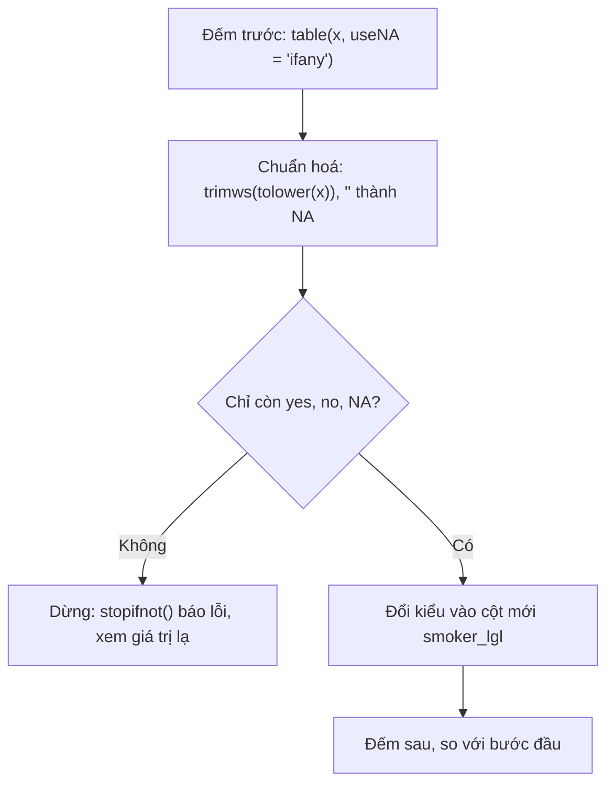

Trong R, mỗi vector thuộc một trong sáu kiểu atomic: logical, integer, double, complex, character, raw. Khi bạn trộn nhiều kiểu, R tự ép (coercion) mọi phần tử lên kiểu cao nhất theo thứ bậc `NULL < raw < logical < integer < double < complex < character < list < expression`. Luật này có trong tài liệu của R, nhưng nhiều hệ quả của nó xảy ra mà không kèm lỗi hay cảnh báo. `as.logical()` biến cả 42 giá trị "yes"/"no" của bộ dữ liệu birthweight thành `NA`; `lm()` lặng lẽ bỏ 4 trong 42 hàng có giá trị thiếu. Bài này chỉ cách kiểm tra kiểu bằng `typeof()`, `class()`, `mode()`, `storage.mode()`, cách đổi kiểu an toàn với dữ liệu bẩn, cách phân biệt `NA`, `NaN`, `NULL`, và lý do `0.1 + 0.2 == 0.3` trả `FALSE`. Người đọc chính là sinh viên và người làm sinh học, y sinh mới học R. Mọi ví dụ đã chạy trên R 4.4.3.

<div class="callout callout-note">
<p class="callout-title">Tóm tắt nhanh</p>

- Kiểm tra kiểu lưu trữ bằng `typeof()`; `class()` chỉ cho biết đối tượng được xử lý theo lớp nào (factor có `class` là factor nhưng `typeof` là integer).
- `as.logical()` với chuỗi chỉ hiểu `"T"`, `"TRUE"`, `"True"`, `"true"` và các dạng tương ứng của false; `"yes"`, `"0"`, `"1"` đều thành `NA` mà không có cảnh báo.
- `NA` là giá trị thiếu, `NaN` là kết quả không xác định của phép tính, `NULL` là đối tượng rỗng có độ dài 0.
- Mỗi lần một hàm bỏ hàng có `NA`, bạn đang làm phân tích ca đầy đủ; kết quả có thể lệch nếu dữ liệu không thiếu hoàn toàn ngẫu nhiên.
- So sánh số thực bằng `all.equal()`, không dùng `==`.

</div>

## 1. R không báo lỗi, nhưng kết quả đã sai

Bộ dữ liệu birthweight trong tài liệu workshop R của UC Davis Bioinformatics Core có ba cột về bản chất là câu hỏi có/không: mẹ có hút thuốc không (`smoker`), trẻ có nhẹ cân không (`low.birthweight`), thai phụ có lớn tuổi không (`geriatric.pregnancy`). Chỉ cột cuối được lưu dưới dạng logical. Cách tự nhiên nhất để đổi hai cột kia là gọi `as.logical()`:

```r
bw <- read.csv("birthweight.csv")
x <- as.logical(bw$smoker)
sum(is.na(x))
#> [1] 42
```

Cả 42 giá trị thành `NA`. Không lỗi, không cảnh báo. Nếu bạn không đếm `NA`, các bước sau vẫn chạy, và phải đến khi kết quả trông lạ mới có người quay lại tìm nguyên nhân. Cùng lệnh đó trên `low.birthweight` lại cho kết quả đúng.

Đây là kiểu lỗi âm thầm: phần mềm tự đổi kiểu dữ liệu và người dùng không biết. Ví dụ nổi tiếng nhất trong sinh học là Excel đổi tên gene thành ngày tháng hoặc số thực: dán DEC1 vào một ô, Excel hiển thị 1-DEC. Zeeberg et al. (2004) ghi nhận ít nhất 30 tên gene bị đổi thành ngày và hơn 2.000 định danh bị đổi thành số thực, và các thay đổi này không đảo ngược được. Ziemann et al. (2016) ước tính khoảng một phần năm số bài báo có danh sách gene trong file Excel bổ sung ở các tạp chí genomics hàng đầu bị ảnh hưởng; Abeysooriya et al. (2021) quét lại các bài trên PubMed Central giai đoạn 2014–2020 và thấy 30,9% (3.436/11.117 bài) vẫn mắc lỗi. Bài [Dữ liệu bẩn trong khoa học](/blog/process-data-from-dirty-to-clean/) đã phân tích kỹ trường hợp Excel; bài này xem cùng cơ chế bên trong R.

Các lỗi trong bài đều **không phải lỗi cú pháp**. Lỗi cú pháp làm script dừng và buộc bạn sửa. Lỗi kiểu dữ liệu để script chạy tiếp và trả ra một con số trông hợp lý, có thể là một trung bình hay một hệ số hồi quy. Muốn phòng, bạn cần biết R đổi kiểu theo luật nào và kiểm tra dữ liệu đúng ở những chỗ luật đó dễ gây bất ngờ. Mục 2–3 trình bày luật, mục 4 là case study cột `smoker`, mục 5–7 bàn về `NA`, `NaN`, `NULL` và số thực, mục 8 là checklist.

### Dữ liệu và môi trường

File `birthweight.csv` lấy từ tài liệu workshop *Introduction to R for Bioinformatics* của UC Davis Bioinformatics Core (2022). File có 42 hàng và 18 cột, mã SHA-256 bắt đầu bằng `6b3c2acc` và kết thúc bằng `49f894ac`. Bài chỉ dẫn link tới kho gốc chứ không phân phối lại file vì kho không khai báo giấy phép. Đây là dữ liệu dạy học đã được chỉnh sửa, nên không dùng để kết luận về tác động thật của thuốc lá. Mọi kết quả trong bài chạy trên R 4.4.3 (2025-02-28); hành vi có thể đổi giữa các phiên bản. Cách nhập file đã có ở bài [Nhập và xuất dữ liệu](/blog/importing-and-exporting-data/).

## 2. Hệ kiểu atomic: `typeof`, `class`, `mode`, `storage.mode`

### Sáu kiểu atomic

Theo *R Language Definition* (R Core Team, 2026), R có sáu kiểu vector atomic: logical, integer, double (còn gọi là real), complex, character và raw. Atomic nghĩa là mọi phần tử trong vector cùng một kiểu. R không có kiểu "số đơn": `4.2` là vector double độ dài 1. Vì vậy mọi điều nói về vector trong bài cũng đúng với một giá trị lẻ.

Chữ "numeric" hay gây nhầm. Nó không phải một kiểu lưu trữ mà là tên chung cho integer và double. `typeof(5)` là `"double"`, `typeof(5L)` là `"integer"`, nhưng `class(5)` lại là `"numeric"`. Trong dữ liệu sinh học, hầu hết cột số đọc từ CSV là double; integer chỉ xuất hiện khi mọi giá trị trong cột là số nguyên.

Các kiểu atomic là viên gạch cho cấu trúc lớn hơn. Wickham (2014) xếp năm cấu trúc dữ liệu cơ bản của R theo hai chiều: số chiều, và nội dung đồng nhất hay không.

| Số chiều | Đồng nhất (homogeneous) | Không đồng nhất (heterogeneous) |
| --- | --- | --- |
| 1 chiều | atomic vector | list |
| 2 chiều | matrix | data frame |
| n chiều | array | – |

Bài này chỉ bàn atomic vector. List và data frame có ở bài [Data frame](/blog/data-frames/). Mỗi cột của data frame là một atomic vector, nên mọi quy tắc về kiểu trong bài áp dụng cho từng cột: một ô chữ lẫn vào cột số là đủ để cả cột thành character.

### Bốn hàm, bốn câu hỏi

R có bốn hàm trả lời câu "đây là kiểu gì", nhưng mỗi hàm trả lời một câu hỏi khác nhau.

- `typeof()` cho biết kiểu lưu trữ nội bộ.
- `mode()` và `storage.mode()` trả về "chế độ" theo nghĩa của ngôn ngữ S trong Becker et al. (1988). R-lang ghi rằng `storage.mode()` chủ yếu dùng khi truyền dữ liệu sang mã C hoặc Fortran (R Core Team, 2026).
- `class()` trả về thuộc tính lớp dùng cho lập trình hướng đối tượng S3. Lớp quyết định hàm `print()`, `summary()` nào được gọi, không cho biết dữ liệu được lưu thế nào.

**Bảng 1.** Kết quả của bốn hàm trên 13 đối tượng (R 4.4.3)

| Đối tượng | `typeof` | `class` | `mode` | `storage.mode` |
| --- | --- | --- | --- | --- |
| `TRUE` | logical | logical | logical | logical |
| `1L` | integer | integer | numeric | integer |
| `4.2` | double | numeric | numeric | double |
| `1+2i` | complex | complex | complex | complex |
| `"a"` | character | character | character | character |
| `as.raw(255)` | raw | raw | raw | raw |
| `factor(c("no","yes"))` | integer | factor | numeric | integer |
| `as.Date("2026-11-24")` | double | Date | numeric | double |
| `matrix(1:4, 2)` | integer | matrix, array | numeric | integer |
| `list(1, "a")` | list | list | list | list |
| `data.frame(x = 1)` | list | data.frame | list | list |
| `NULL` | NULL | NULL | NULL | NULL |
| hàm `mean` | closure | function | function | function |

`mode` gộp integer và double thành numeric; `storage.mode` giữ hai kiểu riêng, đúng như bảng trong R-lang.

Bảng 1 cho thấy hai hiểu nhầm thường gặp. Thứ nhất, `class()` không cho biết kiểu dữ liệu: factor có lớp factor nhưng được lưu bằng integer, Date được lưu bằng double, data frame được lưu bằng list. Thứ hai, `storage.mode()` không luôn trùng `typeof()`: với hàm `mean`, `typeof` là closure còn `storage.mode` là function. Hai hàm này chỉ trùng nhau với vector atomic. Quy tắc thực hành: muốn biết dữ liệu được lưu thế nào thì dùng `typeof()`; muốn biết R sẽ xử lý nó ra sao thì dùng `class()`.

Lớp đáng để ý vì nó đổi kết quả của cùng một hàm. Với `f <- factor(c("no", "yes", "yes"))`, `summary(f)` đếm số lần mỗi mức xuất hiện (`no 1`, `yes 2`), còn `summary(as.integer(f))` tính trung bình 1,667 của các mã 1 và 2, một con số vô nghĩa về mặt sinh học. Dữ liệu bên dưới giống hệt nhau; chỉ lớp khác. Bạn có thể xem nhanh các lệnh kiểm tra kiểu trong [Bảng tra cứu lập trình và công cụ tin sinh](/blog/programming-bang-tra-cuu-lenh-r-sql-cong-cu-tin-sinh-va-hoa-chat/).

### Kiểm tra kiểu bằng hàm `is.*`

`is.atomic()` có vẻ tiện nhưng hành vi của nó đã đổi: từ R 4.4.0, `is.atomic(NULL)` trả `FALSE` (trước đó là `TRUE`). Wickham (2019) khuyên thận trọng với `is.vector()`, `is.atomic()` và `is.numeric()` vì chúng không kiểm tra đúng điều tên hàm gợi ý; ví dụ `is.numeric()` trả `TRUE` cho cả integer lẫn double. Nên dùng các hàm kiểm tra một kiểu cụ thể: `is.logical()`, `is.integer()`, `is.double()`, `is.character()`.

## 3. Coercion: thứ bậc, chiều đi và cái giá phải trả

### Coercion ngầm và coercion tường minh

Coercion (ép kiểu) là việc đổi một giá trị từ kiểu này sang kiểu khác. Coercion ngầm (implicit) xảy ra khi bạn trộn kiểu trong `c()`, trong phép toán hay phép so sánh, ví dụ `TRUE + 1` cho 2. Coercion tường minh (explicit) là khi bạn gọi hàm `as.logical()`, `as.integer()`, `as.numeric()`, `as.character()`.

### Thứ bậc theo `?c`

Trang trợ giúp `?c` của R ghi thứ bậc:

$$\texttt{NULL} < \texttt{raw} < \texttt{logical} < \texttt{integer} < \texttt{double} < \texttt{complex} < \texttt{character} < \texttt{list} < \texttt{expression}$$

Khi gộp các thành phần khác kiểu, kết quả nhận kiểu **cao nhất** trong số đó.

```r
typeof(c(TRUE, 1L))     #> "integer"
typeof(c(1L, 1.5))      #> "double"
typeof(c(1.5, 1i))      #> "complex"
typeof(c(1i, "a"))      #> "character"
typeof(c(1, list(2)))   #> "list"
```

`?c` viết từ thấp đến cao bằng dấu `<`, còn Wickham (2019) viết ngược lại bằng mũi tên: character → double → integer → logical. Hai cách cùng nói rằng chuỗi ký tự "thắng" mọi kiểu số và logical. Gặp một bảng thứ bậc lạ, bạn kiểm tra chiều bằng một phép thử: `typeof(c(TRUE, "a"))` cho `"character"`.


*Hình 1. Bậc thang coercion của `c()` theo `?c`. Ép lên luôn chạy; ép xuống bằng `as.*()` có thể ra `NA` hoặc mất thông tin.*

### Khi coercion làm mất thông tin

Ép lên (logical → integer → double → character) luôn chạy được vì kiểu cao hơn chứa được giá trị của kiểu thấp hơn. Ép xuống thì không chắc.

```r
as.integer(2.9)                         #> 2  (cắt phần thập phân, không làm tròn)
as.character(1/3)                       #> "0.333333333333333"
as.numeric(as.character(1/3)) == 1/3    #> FALSE
as.numeric("3,5")                       #> NA, kèm cảnh báo "NAs introduced by coercion"
as.integer(factor(c("10", "20", "10"))) #> 1 2 1  (mã mức, không phải giá trị)
c(1, "2", TRUE)                         #> "1" "2" "TRUE"
```

`as.integer()` cắt bỏ phần thập phân. `as.character()` giữ 15 chữ số có nghĩa, nên đổi ngược không còn bằng giá trị cũ. `"3,5"` là cách viết số thập phân với dấu phẩy, R không hiểu và trả `NA`; đây là trường hợp hiếm hoi R có cảnh báo. Factor lưu mã số của mức, nên muốn lấy giá trị phải đổi qua chuỗi trước: `as.numeric(as.character(f))` cho `10 20 10`. Dòng cuối biến cả `TRUE` thành chuỗi `"TRUE"`.

Cảnh báo "NAs introduced by coercion" là tín hiệu nên dừng lại, không nên tắt bằng `suppressWarnings()` rồi chạy tiếp. Để biết giá trị nào gây ra nó, so vị trí `NA` trước và sau khi đổi:

```r
x <- c("3,5", "4.1", "", "n/a", "2")
num <- suppressWarnings(as.numeric(x))
x[is.na(num) & !is.na(x) & x != ""]
#> "3,5" "n/a"
```

Hai giá trị cần xử lý theo hai cách khác nhau: `"n/a"` là mã thiếu, nên khai báo trong `na.strings` khi đọc file; `"3,5"` là số dùng dấu phẩy thập phân, nên đọc lại file bằng `read.csv(..., sep = ";", dec = ",")` hoặc thay dấu phẩy bằng `sub(",", ".", x, fixed = TRUE)` trước khi đổi.

## 4. Case study: cột `smoker` "yes/no" và cột `low.birthweight` 0/1

### Ba cột có/không

Chạy `table()` trên ba cột cho thấy chúng được lưu khác nhau. `smoker` là character với 20 giá trị `"no"` và 22 giá trị `"yes"`. `low.birthweight` là integer với 36 số 0 và 6 số 1. `geriatric.pregnancy` đã là logical với 38 FALSE và 4 TRUE.

### Vì sao `smoker` thành toàn `NA`

Trang `?as.logical` nêu luật: với chuỗi, chỉ `"T"`, `"TRUE"`, `"True"`, `"true"` được hiểu là TRUE và `"F"`, `"FALSE"`, `"False"`, `"false"` là FALSE; mọi chuỗi khác thành `NA`. Với số, 0 thành FALSE và mọi số khác 0 thành TRUE. Với factor, R dùng nhãn mức chứ không dùng mã số.

**Bảng 2.** Kết quả `as.logical()` theo loại đầu vào (R 4.4.3)

| Đầu vào | Kiểu | Kết quả |
| --- | --- | --- |
| `"TRUE"`, `"true"`, `"True"`, `"T"` | character | TRUE |
| `"FALSE"`, `"false"`, `"False"`, `"F"` | character | FALSE |
| `"yes"`, `"no"`, `"tRUE"` | character | NA |
| `"0"`, `"1"` | character | NA |
| `0` | integer/double | FALSE |
| `1`, `27`, `-3` | integer/double | TRUE |
| `factor(c("no", "yes"))` | factor | NA NA |
| `factor(c("TRUE", "FALSE"))` | factor | TRUE FALSE |

`low.birthweight` chuyển được vì `read.csv()` đã đọc nó thành integer, và 0/1 rơi vào luật số. Luật số cũng có mặt trái: `as.logical(bw$maternal.age)` cho 42 TRUE vì không bà mẹ nào 0 tuổi. R không biết cột nào "có nghĩa" là có/không. Cả 42 `NA` của `smoker` lẫn 42 TRUE của `maternal.age` đều xuất hiện im lặng, vì `as.logical()` đang làm đúng việc tài liệu mô tả. Kiểm tra là việc của người gọi hàm.

Bẫy ngược: nếu cột 0/1 bị đọc thành chuỗi, ví dụ vì có một ô chữ lẫn vào, thì `as.logical(c("0", "1"))` cho `NA NA`. Cách đúng là đổi sang số trước: `as.logical(as.integer(x))`.

Một lỗi âm thầm khác hay đi kèm: `bw$smoke` (thiếu chữ r) vẫn trả về cột `smoker` vì toán tử `$` khớp một phần tên, và R 4.4.3 không cảnh báo trừ khi bạn bật `options(warnPartialMatchDollar = TRUE)`. Chi tiết ở bài [Data frame](/blog/data-frames/).

### Đổi kiểu an toàn

Cách đổi đơn giản là so sánh với chuỗi:

```r
bw$smoker_lgl <- bw$smoker == "yes"
table(bw$smoker_lgl, useNA = "ifany")
#> FALSE  TRUE
#>    20    22
```

Với file này kết quả đúng. Có hai điểm nên làm khác cách ghi đè `bw$smoker <- bw$smoker == "yes"`. Thứ nhất, tạo cột mới (`smoker_lgl`) thay vì ghi đè cột gốc để còn đối chiếu. Thứ hai, dữ liệu thật thường bẩn hơn:

```r
d <- c("yes", "no", "Yes", " yes", NA, "")
d == "yes"                       #> TRUE FALSE FALSE FALSE NA FALSE
d %in% "yes"                     #> TRUE FALSE FALSE FALSE FALSE FALSE
trimws(tolower(d)) == "yes"      #> TRUE FALSE TRUE TRUE NA FALSE
```

`== "yes"` xếp `"Yes"` và `" yes"` vào nhóm không hút thuốc. `%in%` còn biến `NA` thành FALSE, tức là tự gán người thiếu thông tin vào nhóm không hút thuốc. Chuẩn hoá bằng `trimws(tolower())` xử lý được chữ hoa và khoảng trắng, và giữ `NA` là `NA`. Ô trống `""` vẫn thành FALSE; nếu ô trống nghĩa là thiếu thì phải đổi nó thành `NA` trước.

Quy trình đề xuất:

1. Đếm trước: `table(x, useNA = "ifany")`.
2. Chuẩn hoá: `trimws(tolower(x))`, đổi `""` thành `NA`.
3. Đổi kiểu vào cột mới.
4. Đếm sau và so với bước 1.
5. Dừng nếu có giá trị lạ: `stopifnot(all(x_chuan %in% c("yes", "no", NA)))`.



Gói các bước vào một hàm nhỏ giúp dùng lại cho mọi cột có/không:

```r
yesno_to_lgl <- function(x) {
  x <- trimws(tolower(x))
  x[x == ""] <- NA
  stopifnot(all(x %in% c("yes", "no", NA)))
  x == "yes"
}
yesno_to_lgl(c("yes", "no", "Yes", " yes", NA, ""))
#> TRUE FALSE TRUE TRUE NA NA
bw$smoker_lgl <- yesno_to_lgl(bw$smoker)
table(bw$smoker, bw$smoker_lgl, useNA = "ifany")
#>        FALSE TRUE
#>   no      20    0
#>   yes      0   22
```

Bảng chéo cuối cùng là bước kiểm tra đáng làm nhất: mỗi `"no"` thành FALSE, mỗi `"yes"` thành TRUE, không có ô nào lệch. Nếu dữ liệu có giá trị như `"nope"`, hàm dừng với lỗi thay vì lặng lẽ xếp nó vào một nhóm.

### `read.csv()` cũng đoán kiểu

`read.csv()` dùng `type.convert()` để đoán kiểu từng cột và nhận `T`/`F`, `TRUE`/`FALSE` là logical giống `as.logical()`. Một cột ký hiệu gene chỉ gồm `T` và `F` bị đọc thành logical:

```r
g <- read.csv(text = "gene,expr\nT,5.1\nF,3.2\n")
g$gene    #> TRUE FALSE
```

Thêm một dòng `SEPT2` thì cả cột giữ dạng chuỗi. Mã quốc gia `"NA"` của Namibia bị đọc thành giá trị thiếu, trừ khi đặt `na.strings = ""`. Đây là cơ chế của lỗi Excel (Zeeberg et al., 2004), chỉ khác phần mềm. Cách phòng là khai báo kiểu khi đọc: `colClasses = c(gene = "character")`.

## 5. `NA`, `NaN` và `NULL`

### Định nghĩa

Theo R-lang (R Core Team, 2026):

- `NA` (Not Available) là giá trị thiếu theo nghĩa thống kê: biến có giá trị nhưng không biết. `NA` mặc định có kiểu logical; R có thêm `NA_integer_`, `NA_real_`, `NA_complex_`, `NA_character_`. Kiểu raw không có `NA`.
- `NaN` (Not a Number) là kết quả không xác định của phép tính số, như `0/0`, chỉ có ở kiểu double và complex.
- `NULL` là đối tượng rỗng, độ dài 0.

**Bảng 3.** So sánh `NA`, `NaN`, `NULL` (R 4.4.3)

| | `NA` | `NaN` | `NULL` |
| --- | --- | --- | --- |
| `typeof` | logical (có bản cho từng kiểu) | double | NULL |
| `length` | 1 | 1 | 0 |
| `is.na()` | TRUE | TRUE | `logical(0)` |
| Kiểm tra riêng | `is.na()` | `is.nan()` | `is.null()` |
| Ví dụ sinh ra | ô trống khi đọc CSV | `0/0` | phần tử list không tồn tại |
| Trong `c(1, ?, 2)` | `1 NA 2` | `1 NaN 2` | `1 2` |

`is.na(NaN)` là TRUE nhưng `is.nan(NA)` là FALSE. Wickham (2019) gọi `NA` là "not applicable", còn tài liệu R gọi là "Not Available"; bài dùng cách gọi của R.

### `NA` lan truyền thế nào

Phép tính có `NA` thường ra `NA`, kể cả `NA == NA`. Ngoại lệ là khi kết quả giống nhau với mọi giá trị `NA` có thể nhận: `FALSE & NA` là FALSE, `TRUE | NA` là TRUE, `NA^0` là 1. Ngược lại `TRUE & NA` là `NA`. `NA_character_` cũng khác chuỗi `"NA"`: `is.na("NA")` là FALSE.

### `NA` trên bộ birthweight

**Bảng 4.** Số `NA` theo cột và cách các hàm xử lý `NA` mặc định

| Cột | Số `NA` |
| --- | --- |
| `paternal.age` | 4 |
| `paternal.education` | 5 |
| `paternal.cigarettes` | 5 |
| `paternal.height` | 5 |
| Hàng đầy đủ (`complete.cases`) | 35/42 |

| Hàm | Mặc định khi có `NA` |
| --- | --- |
| `mean()`, `sum()` | trả `NA`; thêm `na.rm = TRUE` để bỏ |
| `cor()` | trả `NA`; chọn `use = "complete.obs"` |
| `table()` | không đếm `NA`; thêm `useNA = "ifany"` |
| `lm()` | bỏ hàng có `NA` (`na.action = na.omit`), không báo |

```r
mean(bw$paternal.age)                  #> NA
mean(bw$paternal.age, na.rm = TRUE)    #> 28.76316
m <- lm(birthweight ~ paternal.age, data = bw)
nobs(m)                                #> 38
```

`lm()` chạy không báo gì nhưng chỉ dùng 38 hàng. Bảng kết quả `summary(m)` có in dòng "(4 observations deleted due to missingness)", nhưng dòng này dễ bị bỏ qua, và nhiều hàm vẽ hay xuất kết quả không in nó. `cor(bw$birthweight, bw$paternal.age)` trả `NA`; thêm `use = "complete.obs"` cho 0,16, cũng tính trên 38 cặp. Mỗi hàm có một mặc định riêng, nên số quan sát thực dùng phải được kiểm tra cho từng phân tích, không thể suy ra từ `nrow()`. Subset `bw[bw$paternal.education == 10, ]` trả 11 hàng, trong đó 5 hàng toàn `NA`; số người thật là 6 (xem bài [Data frame](/blog/data-frames/)).

### Mã thiếu dạng số

Một số bộ dữ liệu mã giá trị thiếu bằng `-99` hay `-999`. R đọc chúng như số bình thường: `mean(c(-99, 5, 6))` cho −29,33. Broman và Woo (2018) khuyên dùng một mã thiếu cố định cho toàn bộ dữ liệu và tránh mã số như `-999`. White et al. (2013) đánh giá ô trống là lựa chọn tương thích nhất với R, Python, SQL; `NA` và `NULL` chấp nhận được; nên tránh `-999`. Nếu nhận một file đã dùng `-99`, hãy khai báo `na.strings = c("", "NA", "-99")` khi đọc thay vì sửa sau.

### `NA` của R và `NULL` của SQL

`NULL` trong SQL gần với `NA` của R hơn là `NULL` của R: cả hai là giá trị chưa biết và làm phép so sánh ra "không xác định" (xem [SQL: SELECT và WHERE](/blog/select-and-where-truy-van-co-ban/)).

## 6. Ý nghĩa thống kê của `NA`

Khi `lm()` bỏ bốn hàng, đó không phải bước dọn dẹp trung tính mà là một giả định thống kê. Rubin (1976) đặt câu hỏi khi nào có thể bỏ qua quá trình gây thiếu dữ liệu khi suy luận. Theo phần tóm tắt của bài, điều kiện cốt lõi là dữ liệu thiếu ngẫu nhiên (missing at random); với suy luận dựa trên likelihood hay Bayes, cần thêm điều kiện tham số của cơ chế thiếu tách biệt (distinct) với tham số cần ước lượng. Ba loại dưới đây theo cách diễn đạt của Sterne et al. (2009), dễ áp dụng hơn cho nghiên cứu y sinh:

- **MCAR** (missing completely at random): không có khác biệt hệ thống giữa giá trị thiếu và giá trị quan sát được.
- **MAR** (missing at random): khác biệt hệ thống, nếu có, được giải thích bởi dữ liệu quan sát được.
- **MNAR** (missing not at random): khác biệt vẫn còn sau khi đã tính đến dữ liệu quan sát được.

Sterne et al. (2009) nhấn mạnh rằng phân tích ca đầy đủ có thể lệch khi dữ liệu là MAR mà không phải MCAR, và không thể phân biệt MAR với MNAR chỉ từ dữ liệu quan sát được.

Mô phỏng dưới đây minh hoạ điểm thứ nhất bằng dữ liệu giả lập, không phải dữ liệu birthweight. Mỗi lần chạy tạo 1.000 cặp cha mẹ; tuổi cha tương quan chặt với tuổi mẹ (hệ số tương quan khoảng 0,86). Tuổi cha bị xoá theo ba cơ chế: MCAR xoá ngẫu nhiên 20%; MAR xoá nhiều hơn ở các bà mẹ trẻ (tuổi mẹ luôn quan sát được); MNAR xoá nhiều hơn ở chính những người cha trẻ. Tỷ lệ thiếu trung bình khoảng 20–27%. Sau đó so trung bình tuổi cha tính trên ca đầy đủ với trung bình thật của cả 1.000 người.

```r
set.seed(2026)
one_run <- function(n = 1000) {
  maternal <- rnorm(n, mean = 27, sd = 5)
  paternal <- 2 + 1.0 * maternal + rnorm(n, sd = 3)
  p_mcar <- rep(0.2, n)
  p_mar  <- plogis(-1.4 - 0.25 * (maternal - 27))
  p_mnar <- plogis(-1.4 - 0.25 * (paternal - 29))
  cc_mean <- function(p) mean(paternal[runif(n) > p])
  c(MCAR = cc_mean(p_mcar), MAR = cc_mean(p_mar), MNAR = cc_mean(p_mnar)) - mean(paternal)
}
res <- t(replicate(1000, one_run()))
round(colMeans(res), 2)
#> MCAR  MAR MNAR
#> 0.00 1.26 1.68
```


*Hình 2. Sai lệch của trung bình ca đầy đủ trong 1.000 lần mô phỏng (dữ liệu mô phỏng, seed 2026).*

Với MCAR, trung bình ca đầy đủ không lệch; chỉ mất độ chính xác vì cỡ mẫu nhỏ đi. Với MAR, trung bình lệch lên khoảng 1,26 năm vì người cha trẻ (đi cùng bà mẹ trẻ) bị loại nhiều hơn. Với MNAR, lệch khoảng 1,68 năm. Khác biệt nằm ở chỗ: trong trường hợp MAR, thông tin để sửa sai lệch (tuổi mẹ) có sẵn trong dữ liệu, nên các phương pháp như multiple imputation có thể dùng nó (Sterne et al., 2009); trong trường hợp MNAR, thông tin đó nằm chính ở giá trị đã mất. Nhìn vào dữ liệu quan sát được, hai kịch bản này trông giống nhau, đúng như Sterne et al. (2009) cảnh báo.

Với birthweight, 4–5 người cha thiếu thông tin. Bài không khẳng định cơ chế. Thông tin về cha thiếu vì cha vắng mặt hay vì không được khai báo? Câu trả lời đổi cách hiểu con số `nobs() = 38`. Một cách kiểm tra đơn giản là so các biến của mẹ (tuổi, số điếu thuốc) giữa nhóm có và không có thông tin về cha. Khác biệt rõ cho thấy dữ liệu khó là MCAR; không có khác biệt cũng không chứng minh được MCAR, nhất là với cỡ mẫu 42.

Hướng xử lý: báo cáo số `NA` theo biến, nêu rõ phương pháp, cân nhắc multiple imputation với gói mice (van Buuren & Groothuis-Oudshoorn, 2011). Sách chuẩn là Little và Rubin (2019). Hàm `AVG` trong SQL bỏ qua `NULL` cũng là phân tích ca đầy đủ ([SQL: hàm tổng hợp](/blog/ham-tong-hop-aggregate/)).

## 7. Số thực IEEE 754: vì sao `0.1 + 0.2 == 0.3` là FALSE

Mọi số thực trong R là double theo chuẩn IEC 60559, tức IEEE 754, định dạng binary64 với độ chính xác 53 bit (trang `?double`); chuẩn hiện hành là IEEE 754-2019 (IEEE, 2019). R FAQ 7.31 giải thích chỉ số nguyên và phân số có mẫu là luỹ thừa của 2 mới được biểu diễn chính xác (Hornik & R Core Team, 2026).

```r
0.1 + 0.2 == 0.3                     #> FALSE
sprintf("%.20f", 0.1)                #> "0.10000000000000000555"
sqrt(2)^2 == 2                       #> FALSE
.Machine$double.eps                  #> 2.220446e-16
2^53 == 2^53 + 1                     #> TRUE
isTRUE(all.equal(0.1 + 0.2, 0.3))    #> TRUE
```

So sánh đúng là dùng `all.equal()` với sai số mặc định `.Machine$double.eps^0.5` (khoảng 1,5 × 10⁻⁸), bọc trong `isTRUE()`. Buffalo (2015) nêu cùng ý khi viết kiểm thử cho hàm cộng số thực.

### Integer và double

Integer lớn nhất là 2.147.483.647; cộng thêm `1L` ra `NA` kèm cảnh báo tràn số. Một triệu số integer chiếm 4.000.048 byte, một triệu số double 8.000.048 byte. Một số phép tính trên integer tự trả double: `5L / 2L` và `mean(1:10)` đều là double. Dữ liệu đếm lớn như số đọc (read count) cộng dồn qua nhiều mẫu có thể vượt giới hạn integer; giữ chúng ở dạng double tránh lỗi tràn số với cái giá là gấp đôi bộ nhớ, và double vẫn biểu diễn chính xác mọi số nguyên tới 2⁵³. Đọc thêm về số thực dấu phẩy động: Goldberg (1991).

## 8. Checklist kiểm tra kiểu dữ liệu trước khi phân tích

**Bảng 5.** Checklist

| Khi nào | Làm gì | Lệnh |
| --- | --- | --- |
| Đọc file | Khai báo kiểu và mã thiếu | `colClasses`, `na.strings` |
| Sau khi nhập | Xem kiểu và số `NA` | `str()`, `sapply(df, typeof)`, `colSums(is.na(df))` |
| Cột phân loại | Đếm trước và sau khi đổi | `table(x, useNA = "ifany")` |
| Đổi kiểu | Không ghi đè cột gốc | cột mới `*_lgl` |
| Factor sang số | Qua chuỗi trước | `as.numeric(as.character(f))` |
| So số thực | Dùng sai số | `isTRUE(all.equal(x, y))` |
| Chạy mô hình | Ghi số quan sát thực dùng | `nobs()`, `complete.cases()` |

## 9. Câu hỏi thường gặp

**`as.logical()` trả về toàn `NA`, phải làm gì?** Xem `typeof()` và `table(x, useNA = "ifany")`. Chuỗi "yes"/"no" thì chuẩn hoá rồi so sánh (mục 4); chuỗi `"0"`/`"1"` thì đổi sang integer trước.

**Có nên dùng `na.rm = TRUE` mọi lúc?** Không nên dùng theo thói quen. Con số nó cho là kết quả trên ca đầy đủ; hãy ghi lại bao nhiêu giá trị bị bỏ và nghĩ xem chúng thiếu vì sao (mục 6).

## 10. Kết luận

Luật kiểu của R được ghi rõ (R Core Team, 2025, 2026). Lỗi thường đến từ chỗ phần mềm đoán kiểu thay người dùng, dù đó là Excel, `read.csv()` hay một lệnh `as.*()` (Ziemann et al., 2016; Abeysooriya et al., 2021). Với bộ dữ liệu tiếp theo bạn mở, có thể làm ngay ba việc:

- Khai báo `colClasses` và `na.strings` khi đọc file, rồi chạy `sapply(df, typeof)` để xem R đã đọc thành gì.
- Đếm `table(x, useNA = "ifany")` trước và sau mỗi lần đổi kiểu, ghi kết quả vào cột mới.
- Ghi `nobs()` cạnh mọi mô hình. Con số 38 thay vì 42 là một quyết định thống kê (Sterne et al., 2009), nên cần được báo cáo và giải thích.

Bài tiếp theo, [Hàm trong R](/blog/functions/), viết lại các bước kiểm tra ở đây thành hàm và dùng cột `smoker_lgl` để so sánh cân nặng sơ sinh theo nhóm hút thuốc.

## Phụ lục: code tái lập

Script dưới đây tải dữ liệu, kiểm tra checksum, in kiểu và số `NA` của từng cột, rồi ghi thông tin phiên làm việc. Các khối code trong bài đều chạy tiếp được sau script này.

```r
url <- "https://raw.githubusercontent.com/ucdavis-bioinformatics-training/2022_February_Introduction_to_R_for_Bioinformatics/main/birthweight.csv"
download.file(url, "birthweight.csv", quiet = TRUE)
tools::md5sum("birthweight.csv")   # bf579c7055ed0b040033028be20f573b
# SHA-256 (macOS/Linux): 6b3c2acc…49f894ac
system2("shasum", c("-a", "256", "birthweight.csv"))
bw <- read.csv("birthweight.csv")
sapply(bw, typeof)
colSums(is.na(bw))
sessionInfo()
```

## Tài liệu tham khảo

Abeysooriya, M., Soria, M., Kasu, M. S., & Ziemann, M. (2021). Gene name errors: Lessons not learned. *PLOS Computational Biology, 17*(7), e1008984. https://doi.org/10.1371/journal.pcbi.1008984

Becker, R. A., Chambers, J. M., & Wilks, A. R. (1988). *The new S language: A programming environment for data analysis and graphics*. Wadsworth & Brooks/Cole.

Broman, K. W., & Woo, K. H. (2018). Data organization in spreadsheets. *The American Statistician, 72*(1), 2–10. https://doi.org/10.1080/00031305.2017.1375989

Buffalo, V. (2015). *Bioinformatics data skills: Reproducible and robust research with open source tools*. O'Reilly Media.

Goldberg, D. (1991). What every computer scientist should know about floating-point arithmetic. *ACM Computing Surveys, 23*(1), 5–48. https://doi.org/10.1145/103162.103163

Hornik, K., & R Core Team. (2026). *The R FAQ* (câu 7.31). https://CRAN.R-project.org/doc/manuals/R-FAQ.html

IEEE. (2019). *IEEE standard for floating-point arithmetic* (IEEE Std 754-2019). https://doi.org/10.1109/IEEESTD.2019.8766229

Little, R. J. A., & Rubin, D. B. (2019). *Statistical analysis with missing data* (3rd ed.). Wiley. https://doi.org/10.1002/9781119482260

R Core Team. (2025). *R: A language and environment for statistical computing* (Version 4.4.3). R Foundation for Statistical Computing. https://www.R-project.org/

R Core Team. (2026). *R language definition* (Version 4.6.2). R Foundation for Statistical Computing. https://cran.r-project.org/doc/manuals/r-release/R-lang.html

Rubin, D. B. (1976). Inference and missing data. *Biometrika, 63*(3), 581–592. https://doi.org/10.1093/biomet/63.3.581

Sterne, J. A. C., White, I. R., Carlin, J. B., Spratt, M., Royston, P., Kenward, M. G., Wood, A. M., & Carpenter, J. R. (2009). Multiple imputation for missing data in epidemiological and clinical research: Potential and pitfalls. *BMJ, 338*, b2393. https://doi.org/10.1136/bmj.b2393

UC Davis Bioinformatics Core. (2022). *Introduction to R for bioinformatics* [GitHub repository]. https://github.com/ucdavis-bioinformatics-training/2022_February_Introduction_to_R_for_Bioinformatics

van Buuren, S., & Groothuis-Oudshoorn, K. (2011). mice: Multivariate imputation by chained equations in R. *Journal of Statistical Software, 45*(3), 1–67. https://doi.org/10.18637/jss.v045.i03

White, E. P., Baldridge, E., Brym, Z. T., Locey, K. J., McGlinn, D. J., & Supp, S. R. (2013). Nine simple ways to make it easier to (re)use your data. *Ideas in Ecology and Evolution, 6*(2), 1–10. https://doi.org/10.4033/iee.2013.6b.6.f

Wickham, H. (2014). *Advanced R*. Chapman and Hall/CRC. https://doi.org/10.1201/b17487

Wickham, H. (2019). *Advanced R* (2nd ed.). Chapman and Hall/CRC. https://doi.org/10.1201/9781351201315

Zeeberg, B. R., Riss, J., Kane, D. W., Bussey, K. J., Uchio, E., Linehan, W. M., Barrett, J. C., & Weinstein, J. N. (2004). Mistaken identifiers: Gene name errors can be introduced inadvertently when using Excel in bioinformatics. *BMC Bioinformatics, 5*, 80. https://doi.org/10.1186/1471-2105-5-80

Ziemann, M., Eren, Y., & El-Osta, A. (2016). Gene name errors are widespread in the scientific literature. *Genome Biology, 17*, 177. https://doi.org/10.1186/s13059-016-1044-7
