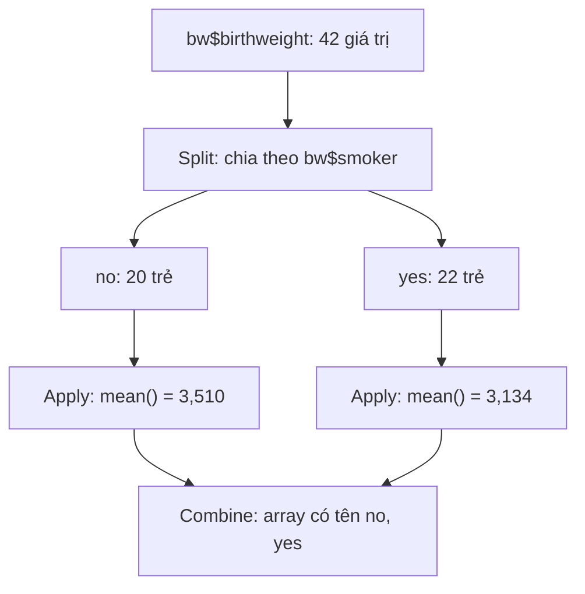

Hàm (function) trong R là một khối code có tên, nhận đối số và trả về một giá trị. Họ `apply` gồm `apply()`, `lapply()`, `sapply()`, `vapply()`, `tapply()` và `mapply()`: mỗi hàm áp một hàm khác lên từng phần tử hoặc từng nhóm của dữ liệu, và mỗi hàm trả về một kiểu đối tượng riêng. Bài này dùng chính các hàm đó để trả lời một câu hỏi sinh học trên bộ dữ liệu dạy học `birthweight` gồm 42 trẻ sơ sinh: trẻ có mẹ hút thuốc nhẹ hơn trung bình 0,375 kg (95% CI 0,016–0,735; Welch p = 0,041; Hedges g = 0,63). Khi đổi sang biến nhị phân "nhẹ cân", Fisher exact test cho p = 0,19 và khoảng tin cậy của odds ratio trải từ 0,53 đến 277: cùng chiều với meta-analysis trên 55 nghiên cứu cohort (OR 1,89) nhưng gần như không mang thông tin. Bài viết cho sinh viên sinh học và y sinh đang học R; mọi đoạn code đã chạy trên R 4.4.3.

<div class="callout callout-note">
<p class="callout-title">Tóm tắt nhanh</p>

- `sapply()` trả về vector, matrix hoặc list tuỳ kết quả từng lần gọi; trong hàm tự viết, dùng `vapply()` để cố định kiểu kết quả.
- `tapply()` gói chiến lược split-apply-combine trong một dòng.
- Hàm nhanh thường là hàm làm ít việc: `matrix(unlist(...))` nhanh hơn khoảng 17 lần so với gọi `strsplit()` ba lần trên 100.000 ngày sinh.
- Trên 42 trẻ, mẹ hút thuốc gắn với cân nặng thấp hơn 0,375 kg; odds ratio cho nhẹ cân là 5,39 (95% CI 0,53–277,5).
- Với 20 trẻ mỗi nhóm, power để phát hiện d = 0,5 chỉ khoảng 0,34: đọc effect size và khoảng tin cậy, đừng chỉ nhìn p < 0,05.

</div>

## 1. Hàm và họ apply trong R: định nghĩa và kiểu kết quả

### 1.1. Hàm, đối số và giá trị mặc định

Hàm được gọi bằng tên, đối số nằm trong ngoặc tròn, và `?tên_hàm` mở trang trợ giúp. Mục *Value* của trang đó cho biết hàm trả về đối tượng gì, và phần lớn lỗi khó hiểu với họ `apply` bắt nguồn từ chỗ này (R Core Team, 2025).

Nhiều đối số có giá trị mặc định, và kết quả phụ thuộc vào giá trị ấy:

- `t.test()` mặc định `var.equal = FALSE`, tức là làm Welch t-test, không giả định hai nhóm có cùng phương sai. Muốn Student t-test cổ điển thì phải ghi `var.equal = TRUE`.
- `chisq.test()` chấp nhận ba dạng đầu vào: một matrix (bảng chéo), hai vector (R tự lập bảng chéo), hoặc một vector duy nhất, khi đó R làm kiểm định goodness-of-fit chứ không phải kiểm định độc lập. Với bảng 2 × 2, hàm mặc định áp dụng hiệu chỉnh liên tục Yates (`correct = TRUE`).

Tự viết hàm trong R dùng từ khoá `function`. Giá trị của biểu thức cuối cùng trong thân hàm là giá trị trả về:

```r
cohen_d <- function(x, y) {
  nx <- length(x); ny <- length(y)
  sp <- sqrt(((nx - 1) * var(x) + (ny - 1) * var(y)) / (nx + ny - 2))  # SD gộp
  (mean(x) - mean(y)) / sp
}
hedges_g <- function(x, y) {
  N <- length(x) + length(y)
  cohen_d(x, y) * (1 - 3 / (4 * N - 9))   # hệ số hiệu chỉnh J cho mẫu nhỏ
}
```

Mỗi hàm làm một việc và tên nói đúng việc đó. Hàm sau gọi lại hàm trước, không chép lại công thức. Cách viết hàm bằng tiếng Việt có thêm ở Hàm và xử lý chuỗi và Rẽ nhánh và vòng lặp.

### 1.2. Họ apply: đầu vào và kết quả

Họ `apply` thay một vòng lặp bằng một lời gọi hàm. Mỗi thành viên nhận một loại đầu vào và trả về một loại kết quả riêng (Bảng 1).

**Bảng 1.** Họ apply trong base R (theo mục Value của trang trợ giúp; R Core Team, 2025)

| Hàm | Đầu vào | Áp hàm lên | Kết quả |
| --- | --- | --- | --- |
| `apply(X, MARGIN, FUN)` | matrix hoặc data frame (bị đổi thành matrix) | từng hàng (`1`) hoặc từng cột (`2`) | vector nếu `FUN` trả 1 giá trị; matrix nếu `FUN` trả n > 1 giá trị |
| `lapply(X, FUN)` | list hoặc vector | từng phần tử | luôn là list cùng độ dài với `X` |
| `sapply(X, FUN)` | list hoặc vector | từng phần tử | vector, matrix hoặc list, tuỳ kết quả có đơn giản hoá được không |
| `vapply(X, FUN, FUN.VALUE)` | list hoặc vector | từng phần tử | đúng kiểu và độ dài khai báo trong `FUN.VALUE`, nếu không thì báo lỗi |
| `tapply(X, INDEX, FUN)` | vector + một hay nhiều biến nhóm | từng nhóm con của `X` | array (thường một chiều, có tên nhóm) |
| `mapply(FUN, ...)` | nhiều vector hoặc list song song | từng bộ phần tử cùng vị trí | vector, matrix hoặc list (đơn giản hoá như `sapply`) |

Dòng đầu của bảng cho thấy `apply()` không phải lúc nào cũng trả về một vector. Trên ba cột số của bộ `birthweight`:

```r
bw  <- read.csv("birthweight.csv")
num <- bw[, c("length", "birthweight", "head.circumference")]
apply(num, 2, mean)    # mean trả 1 giá trị cho mỗi cột → vector
#>             length        birthweight head.circumference
#>          51.333333           3.312857          34.595238
apply(num, 2, range)   # range trả 2 giá trị → matrix 2 × 3
#>      length birthweight head.circumference
#> [1,]     43        1.92                 30
#> [2,]     58        4.57                 39
```

Data frame là một list các cột (xem [bài về data frame](/blog/data-frames/)), nên `sapply(num, sd)` cũng cho một vector. Còn `mapply()` ít khi cần cho phép tính đã vector hoá: hiệu chiều cao mẹ trừ bố chỉ là `bw$maternal.height - bw$paternal.height`.

### 1.3. `sapply()` trả về vector, matrix hay list?

Theo trang trợ giúp, `sapply()` trả về vector khi mọi lần gọi `FUN` cho một giá trị, matrix (mỗi cột ứng với một phần tử đầu vào) khi mọi lần cho cùng k > 1 giá trị, và list trong các trường hợp còn lại, kể cả khi đầu vào rỗng (R Core Team, 2025):

```r
parts <- strsplit(bw$birth.date, "/")     # list 42 phần tử, mỗi phần tử dài 3
class(sapply(parts, length))              # mỗi lần trả 1 số
#> [1] "integer"
dim(sapply(parts, identity))              # mỗi lần trả 3 chuỗi
#> [1]  3 42
sapply(1:3, seq_len)                      # độ dài 1, 2, 3: không đơn giản hoá được
#> [[1]]
#> [1] 1
#> [[2]]
#> [1] 1 2
#> [[3]]
#> [1] 1 2 3
class(sapply(list(), length))             # đầu vào rỗng
#> [1] "list"
```

Vì vậy cùng một dòng `sapply()` có thể trả vector với dữ liệu hôm nay và list với dữ liệu ngày mai. Code phía sau sẽ hỏng, nhưng hỏng ở một chỗ khác. `vapply()` chặn chuyện đó bằng khuôn kết quả `FUN.VALUE`:

```r
vapply(parts, length, integer(1))[1:3]
#> [1] 3 3 3
vapply(1:3, seq_len, integer(1))
#> Error in vapply(1:3, seq_len, integer(1)) : values must be length 1,
#>  but FUN(X[[2]]) result is length 2
```

Lỗi xuất hiện ngay tại dòng sai, kèm vị trí phần tử gây lỗi. Wickham (2019, mục 9.2.1) khuyên luôn dùng `vapply()` trong hàm tự viết; `lapply()` thì luôn trả list.

### 1.4. Split-apply-combine và `tapply()`

Nhiều câu hỏi phân tích có chung một dạng: chia dữ liệu thành nhóm, xử lý từng nhóm rồi ghép kết quả lại. Wickham (2011) gọi đó là chiến lược split-apply-combine. Câu hỏi trung tâm của bài (cân nặng trung bình theo tình trạng hút thuốc của mẹ) chỉ cần một dòng `tapply()`:

```r
tapply(bw$birthweight, bw$smoker, mean)
#>       no      yes
#> 3.509500 3.134091
```



*Sơ đồ 1. `tapply()` thực hiện ba bước split-apply-combine (Wickham, 2011) trên bộ `birthweight`.*

Kết quả là một array một chiều có tên nhóm, không phải data frame. Muốn nhiều thống kê cho mỗi nhóm, viết một hàm trả vector có tên rồi ghép bằng `do.call(rbind, ...)` (mục 4.3); bài về tidyverse sẽ làm lại việc này bằng `group_by()` và `summarise()`.

## 2. Câu hỏi sinh học: hút thuốc khi mang thai và nhẹ cân sơ sinh

Tổ chức Y tế Thế giới (WHO) định nghĩa nhẹ cân sơ sinh (low birth weight) là cân nặng khi sinh dưới 2.500 g. Trẻ nhẹ cân có thể do chậm tăng trưởng trong tử cung (intrauterine growth restriction), do sinh non, hoặc do cả hai (World Health Organization, n.d.). Vì có hai con đường này nên bài xét sinh non song song với hút thuốc. Nếu hút thuốc làm thai kỳ ngắn lại, một phần tác động của nó lên cân nặng sẽ đi qua tuổi thai.

Các tổng quan về hút thuốc khi mang thai cho kết quả khá nhất quán. Di et al. (2022) gộp 55 nghiên cứu cohort công bố từ 1986 đến 2020 và ước lượng odds ratio (OR) cho nhẹ cân ở trẻ có mẹ hút thuốc là 1,89 (95% CI 1,80–1,98), với quan hệ liều – đáp ứng theo số điếu mỗi ngày. Pereira et al. (2017) giới hạn ở các nghiên cứu tại châu Mỹ và thu được OR 2,00 (95% CI 1,77–2,26) từ 30 nghiên cứu trong meta-analysis, với dị biệt giữa các nghiên cứu ở mức I² = 66,3%. Tức là odds nhẹ cân ở trẻ có mẹ hút thuốc vào khoảng gấp đôi.

Bộ dữ liệu trong bài chỉ có 42 trẻ. Vậy một mẫu nhỏ như thế cho thấy được gì, và nên báo cáo thế nào để không đọc ra nhiều hơn những gì dữ liệu nói? R, một ngôn ngữ thiết kế cho phân tích dữ liệu và đồ hoạ (Ihaka & Gentleman, 1996), làm được cả phần làm sạch lẫn phần thống kê.

Câu hỏi trung tâm: trẻ có mẹ hút thuốc nhẹ hơn bao nhiêu, và có khớp y văn không. Ba câu hỏi phụ xét sinh non, tỉ lệ bố mẹ hút thuốc theo bệnh viện và chiều cao bố mẹ – con. Về R, bài so tốc độ giữa vòng `for`, họ `apply` và vector hoá.

## 3. Dữ liệu và phương pháp

### 3.1. Dữ liệu

File `birthweight.csv` lấy từ kho tài liệu *Introduction to R for Bioinformatics* của UC Davis Bioinformatics Core (2022). Theo nhóm tác giả, đây là bảng cân nặng sơ sinh và thông tin của bố mẹ, chuyển thể từ một bộ dữ liệu của Mathematics and Statistics Help (MASH), University of Sheffield, và đã được chỉnh nhẹ để minh hoạ thêm một số hàm. File có 42 hàng × 18 cột; mã SHA-256 bắt đầu bằng `6b3c2acc` và kết thúc bằng `49f894ac` (lệnh tải và kiểm tra ở phụ lục). Bảng 2 liệt kê các biến dùng trong bài.

**Bảng 2.** Biến dùng trong bài

| Biến | Kiểu | Ý nghĩa | `NA` |
| --- | --- | --- | --- |
| `birthweight` | numeric | cân nặng khi sinh (kg) | 0 |
| `smoker` | character | mẹ hút thuốc: `"yes"`/`"no"` | 0 |
| `maternal.cigarettes` | integer | số điếu mẹ hút mỗi ngày | 0 |
| `low.birthweight` | integer | mã nhẹ cân 0/1 có sẵn trong file | 0 |
| `weeks.gestation` | integer | tuổi thai (tuần) | 0 |
| `location` | character | bệnh viện: General, Memorial, Silver Hill | 0 |
| `paternal.cigarettes` | integer | số điếu bố hút mỗi ngày | 5 |
| `maternal.height`, `paternal.height` | integer | chiều cao mẹ, bố (cm) | 0; 5 |
| `length` | integer | chiều dài trẻ (cm) | 0 |
| `birth.date` | character | ngày sinh dạng `"tháng/ngày/năm"` | 0 |

Ba biến dẫn xuất được tính lại từ biến gốc: `preterm = weeks.gestation < 37`; `lbw_who = birthweight < 2.5` theo ngưỡng WHO; `father.smokes = paternal.cigarettes > 0` (giữ `NA` khi thiếu dữ liệu). Hai cột về việc mẹ hút thuốc khớp nhau hoàn toàn: 20 mẹ ghi `"no"` đều có 0 điếu, 22 mẹ ghi `"yes"` đều có từ 2 điếu trở lên.

### 3.2. Tách ngày sinh bằng hàm

Cột `birth.date` là chuỗi như `"1/25/1967"`. Muốn tính cân nặng theo tháng sinh, bạn cần ba cột số: tháng, ngày, năm. Bước đầu tiên là `strsplit()`:

```r
parts <- strsplit(bw$birth.date, "/")
class(parts); length(parts); parts[[1]]
#> [1] "list"
#> [1] 42
#> [1] "1"    "25"   "1967"
```

Kết quả là một list 42 phần tử, mỗi phần tử là một vector chuỗi dài 3. Trong khi đó, mỗi cột của data frame là một vector dài 42. `unlist()` làm phẳng list thành một vector 126 phần tử theo thứ tự tháng, ngày, năm của trẻ 1, rồi trẻ 2… Chỉ riêng `unlist()` thì chưa thành bảng, nhưng thêm `matrix(..., ncol = 3, byrow = TRUE)` là đủ để mỗi hàng là một trẻ:

```r
m <- matrix(as.integer(unlist(parts)), ncol = 3, byrow = TRUE,
            dimnames = list(NULL, c("month", "day", "year")))
head(m, 3)
#>      month day year
#> [1,]     1  25 1967
#> [2,]     2   6 1967
#> [3,]     2  14 1967
```

Cách này đúng khi mọi ngày đủ ba phần. Chỉ cần một ngày thiếu một phần là các giá trị lệch hàng, và R không cảnh báo gì. Hai cách viết hàm tổng quát hơn khác nhau ở số lần tách chuỗi:

```r
# Cách A: lặp qua 3 vị trí, mỗi vòng lại tách toàn bộ vector ngày sinh
split_A <- function(date_vector) {
  date_list <- lapply(1:3, function(i) {
    as.integer(sapply(strsplit(date_vector, split = "/"), `[[`, i))
  })
  names(date_list) <- c("month", "day", "year")
  as.data.frame(do.call(cbind, date_list))
}

# Cách B: tách một lần, lấy phần tử thứ i bằng vapply với kiểu cố định
split_date <- function(x, sep = "/") {
  parts <- strsplit(x, sep, fixed = TRUE)
  out <- lapply(1:3, function(i) as.integer(vapply(parts, `[[`, character(1), i)))
  names(out) <- c("month", "day", "year")
  as.data.frame(out)
}

identical(split_A(bw$birth.date), split_date(bw$birth.date))
#> [1] TRUE
```

Cách A gọi `strsplit()` ba lần trên cùng một vector và mỗi lần bỏ đi hai phần ba kết quả. Cách B chỉ tách một lần, dùng `fixed = TRUE` (coi `"/"` là ký tự thường, không phải biểu thức chính quy) và `vapply(..., character(1), ...)` để chắc mỗi lần lấy đúng một chuỗi. Cách thứ ba là `as.Date(x, format = "%m/%d/%Y")` rồi `format()`, cho kết quả `identical()` với hai cách trên và còn bắt được ngày không hợp lệ như 31/2, vì chúng thành `NA`.

Cuối cùng, `bw <- cbind(bw, split_date(bw$birth.date))` ghép ba cột mới vào bảng, cho data frame 42 × 21.

### 3.3. Phân tích thống kê

**So sánh cân nặng.** Welch t-test là phân tích chính, Student t-test để đối chiếu; Wilcoxon rank-sum với `conf.int = TRUE` cho ước lượng Hodges–Lehmann. Shapiro–Wilk chỉ dùng để mô tả, vì nó yếu ở n khoảng 20.

**Effect size.** Cohen's d dùng độ lệch chuẩn gộp; Hedges g nhân d với $J = 1 - \dfrac{3}{4N - 9}$, N là tổng số quan sát (Hedges, 1981; Lakens, 2013). Khoảng tin cậy 95% của d tính bằng bootstrap percentile, 5.000 lần (`set.seed(2026)`). Rank-biserial correlation $r = \dfrac{2W}{n_1 n_2} - 1$ bằng công thức hiệu đơn giản của Kerby (2014): tỉ lệ cặp thuận chiều trừ tỉ lệ cặp nghịch chiều; W tính cho nhóm mẹ không hút, nên r dương nghĩa là nhóm này nặng hơn. Lakens (2013) khuyến nghị báo cáo effect size kèm t-test để kết quả so sánh và gộp được giữa các nghiên cứu.

**Biến nhị phân.** Bảng 2 × 2 giữa `smoker` và `low.birthweight` có hai ô với tần số kỳ vọng 2,86 và 3,14, dưới ngưỡng 5 mà quy tắc thường được gán cho Cochran (1954) đặt ra cho kiểm định χ². `chisq.test()` cũng tự cảnh báo xấp xỉ có thể sai. Vì vậy Fisher exact test là kiểm định chính; `fisher.test()` cho OR ước lượng theo conditional maximum likelihood kèm khoảng tin cậy, khác một chút với OR mẫu tính tay $ad/bc$. Phân tích lặp lại với `lbw_who` (ngưỡng 2,5 kg).

**Các câu hỏi phụ và liều – đáp ứng.** Tương quan Pearson (`cor.test()`) cho tuổi thai – cân nặng và các cặp chiều cao; tương quan Spearman giữa số điếu mẹ hút và cân nặng.

**Mô hình nhạy.** `lm(birthweight ~ smoker + weeks.gestation)` cho biết khác biệt cân nặng còn lại bao nhiêu sau khi hiệu chỉnh tuổi thai. Mô hình này trả lời một câu hỏi khác với phép so sánh thô (mục 5.3).

**Power.** `power.t.test()` tính power của thiết kế 20 trẻ mỗi nhóm với d = 0,5; `power.prop.test()` tính cỡ mẫu cần để phân biệt nguy cơ nhẹ cân nền 10% với nguy cơ ứng với OR 1,89 của Di et al. (2022), tức khoảng 17,4%.

### 3.4. Benchmark và môi trường tính toán

Tốc độ đo bằng `system.time()`, trung vị 7 lần chạy, trên 42 ngày sinh gốc (gọi 1.000 lần) và 100.000 ngày lấy mẫu có hoàn lại (`set.seed(1)`). Sáu cách được so (Bảng 3), mọi cách cho cùng kết quả (`all.equal()` trả `TRUE`). Thêm hai phép so: vòng `for` mọc dần bằng `rbind()` với cấp phát trước (10.000 ngày), và trung bình theo 12 nhóm trên 10⁶ số bằng vòng `for`, `tapply()` và `rowsum()`.

Phân tích chạy trên R 4.4.3, macOS, chỉ dùng các gói base (`stats`, `utils`); không cài gói ngoài. Code tái lập, checksum và lệnh ghi `sessionInfo()` theo nguyên tắc của Sandve et al. (2013) nằm ở phụ lục.

## 4. Kết quả

### 4.1. Kết quả lập trình: ngày sinh, tháng sinh và tốc độ

Sau khi tách ngày sinh, đếm theo năm và theo tháng:

```r
d <- split_date(bw$birth.date)
table(d$year)
#> 1967 1968
#>   21   21
table(d$month)
#>  1  2  3  4  5  6  7  8  9 10 11 12
#>  4  5  3  4  1  6  4  2  4  4  1  4
```

Có 21 trẻ sinh năm 1967 và 21 trẻ sinh năm 1968. Mười dòng đầu của bảng đều là năm 1967, nên ai chỉ xem `head()` rất dễ tưởng cả bộ dữ liệu thuộc một năm. "Cân nặng trung bình theo tháng sinh" vì thế đang gộp hai năm khác nhau.

Gộp hai năm rồi mà mỗi tháng vẫn chỉ có 1 đến 6 trẻ. Tháng 5 và tháng 11 mỗi tháng có đúng 1 trẻ (2,92 kg và 3,41 kg). Một "trung bình" tính trên một trẻ chỉ là cân nặng của trẻ đó, nên hãy đặt `table()` cạnh `tapply()` trước khi so sánh nhóm.

Trên 100.000 ngày sinh (Bảng 3, Hình 1), `matrix(unlist())` nhanh nhất (0,066 giây), cách A với regex mặc định chậm nhất (1,10 giây), chênh khoảng 17 lần. Chỉ thêm `fixed = TRUE` đã kéo cách A xuống 0,29 giây. Tách một lần (cách B) còn 0,19 giây. Vòng `for` cấp phát trước (0,31 giây) ngang cách A dùng `fixed = TRUE`; `as.Date()` chậm (0,97 giây) vì phải đọc ngày theo lịch.

**Bảng 3.** Thời gian tách ngày sinh (trung vị 7 lần chạy, `system.time()`)

| Cách | 42 ngày, mỗi lần gọi (ms) | 100.000 ngày (giây) |
| --- | --- | --- |
| A: `strsplit()` 3 lần, regex mặc định | 0,64 | 1,10 |
| A: `strsplit()` 3 lần, `fixed = TRUE` | 0,24 | 0,29 |
| B: `strsplit()` 1 lần + `vapply()` | 0,42 | 0,19 |
| Vòng `for` cấp phát trước | 0,16 | 0,31 |
| `matrix(unlist())` | 0,07 | 0,066 |
| `as.Date()` + `format()` | 0,86 | 0,97 |


*Hình 1. Thời gian tách 100.000 ngày sinh theo sáu cách (thang log). Số đo trên một máy, nên đọc thứ hạng hơn là số tuyệt đối.*

Vòng `for` mọc dần bằng `rbind()` mất 0,61 giây cho 10.000 ngày, so với 0,035 giây khi cấp phát trước, chậm hơn khoảng 17 lần. Với trung bình theo 12 nhóm trên 10⁶ số: vòng `for` 0,074 giây, `tapply()` 0,053 giây, `rowsum()` 0,023 giây.

Với 42 dòng, mọi cách đều dưới 1 mili giây mỗi lần gọi, và cách B còn chậm hơn cách A dùng `fixed = TRUE`, nhiều khả năng vì chi phí cố định mỗi lần gọi (chưa đo riêng). Ở cỡ này, code dễ đọc và kiểu kết quả chắc chắn quan trọng hơn tốc độ.

### 4.2. Ba câu hỏi phụ

**Trẻ sinh non có nhẹ cân hơn không?** Có. Đây là liên hệ mạnh nhất trong bộ dữ liệu. Năm trẻ sinh trước 37 tuần (33 đến 35 tuần) nặng trung bình 2,44 kg, so với 3,43 kg ở 37 trẻ đủ tháng. Bốn trong năm trẻ sinh non mang mã nhẹ cân, so với 2 trong 37 trẻ đủ tháng. Tương quan giữa tuổi thai và cân nặng là r = 0,71 (95% CI 0,52–0,83; p = 1,5 × 10⁻⁷). Hình 2 cho thấy quan hệ gần tuyến tính, và các điểm của nhóm mẹ hút thuốc nằm thấp hơn ở cùng tuổi thai.


*Hình 2. Tuổi thai và cân nặng khi sinh của 42 trẻ, theo tình trạng hút thuốc của mẹ. Đường chấm: 37 tuần; đường gạch: 2,5 kg.*

**Tỉ lệ mẹ hút thuốc và bố hút thuốc ở mỗi bệnh viện.** Hai tỉ lệ được đặt cạnh nhau thay vì gộp thành một tỉ số. Biến bố hút thuốc suy ra từ `paternal.cigarettes > 0`, có 5 giá trị thiếu:

```r
tapply(bw$smoker == "yes", bw$location, mean)
#>     General    Memorial Silver Hill
#>   0.4000000   0.8461538   0.3684211
tapply(bw$paternal.cigarettes > 0, bw$location, mean, na.rm = TRUE)
#>     General    Memorial Silver Hill
#>   0.6250000   0.7500000   0.5882353
```

Tỉ lệ mẹ hút thuốc là 4/10 (40%) ở General, 11/13 (85%) ở Memorial và 7/19 (37%) ở Silver Hill; tỉ lệ bố hút thuốc là 5/8 (63%), 9/12 (75%) và 10/17 (59%). Trong một cặp vợ chồng, hút thuốc thường đi cùng nhau: 17 trong 21 mẹ hút thuốc có chồng hút, so với 7 trong 16 mẹ không hút (không tính 5 trường hợp thiếu dữ liệu). Memorial có tỉ lệ mẹ hút cao bất thường, nhưng với 10 đến 19 trẻ mỗi bệnh viện, con số chỉ để mô tả.

**Mẹ cao có bạn đời cao và con dài hơn không?** Ở 37 cặp đủ dữ liệu, chiều cao mẹ và bố tương quan r = 0,36 (95% CI 0,04–0,62; p = 0,027). Chiều cao mẹ tương quan với chiều dài trẻ r = 0,48 (95% CI 0,21–0,69; p = 0,001), còn chiều cao bố với chiều dài trẻ chỉ r = 0,26 (95% CI −0,07–0,54; p = 0,12). Dữ liệu gợi ý có kết đôi theo chiều cao (assortative mating) và liên hệ mẹ – con rõ hơn bố – con, nhưng 42 gia đình không đủ để tách phần di truyền khỏi môi trường trong tử cung.

### 4.3. Hút thuốc và cân nặng sơ sinh

Bảng thống kê mô tả được tạo bằng một hàm nhỏ, `tapply()` và `do.call(rbind, ...)`:

```r
desc <- function(x) c(n = length(x), mean = mean(x), sd = sd(x), median = median(x))
round(do.call(rbind, tapply(bw$birthweight, bw$smoker, desc)), 3)
#>      n  mean    sd median
#> no  20 3.510 0.518  3.385
#> yes 22 3.134 0.631  3.185
```

Hình 3 cho thấy hai phân phối chồng lên nhau nhiều, nhưng cả ba trẻ dưới 2,5 kg đều thuộc nhóm mẹ hút thuốc. Shapiro–Wilk cho p = 0,70 và 0,95, không có dấu hiệu lệch chuẩn rõ.


*Hình 3. Cân nặng khi sinh theo tình trạng hút thuốc của mẹ. Hộp: tứ phân vị; hình thoi: trung bình; đường gạch: ngưỡng nhẹ cân 2,5 kg của WHO.*

```r
t.test(birthweight ~ smoker, data = bw)               # Welch, mặc định
x <- bw$birthweight[bw$smoker == "no"]
y <- bw$birthweight[bw$smoker == "yes"]
c(d = cohen_d(x, y), g = hedges_g(x, y))
#>         d         g
#> 0.6467807 0.6345773
set.seed(2026)
boot_d <- replicate(5000, cohen_d(sample(x, replace = TRUE), sample(y, replace = TRUE)))
quantile(boot_d, c(0.025, 0.975))
#>       2.5%      97.5%
#> 0.08752519 1.31980453
```

**Bảng 4.** So sánh cân nặng khi sinh giữa trẻ có mẹ không hút và có hút thuốc

| Phép tính | Kết quả |
| --- | --- |
| Chênh lệch trung bình (không hút − hút) | 0,375 kg (95% CI 0,016–0,735) |
| Welch t-test | t = 2,11; df = 39,6; p = 0,041 |
| Student t-test | p = 0,043 |
| Wilcoxon rank-sum | W = 295; p = 0,061 |
| Dịch chuyển Hodges–Lehmann | 0,37 kg (95% CI −0,03–0,75) |
| Cohen's d / Hedges g | 0,65 / 0,63 |
| Bootstrap 95% CI của d | 0,09–1,32 |
| Rank-biserial r | 0,34 |

Mọi phép tính đều chỉ cùng một hướng: trẻ có mẹ hút thuốc nhẹ hơn khoảng 0,37–0,38 kg, effect size cỡ trung bình. Chỗ khác nhau là độ chắc chắn. Welch cho p = 0,041, Wilcoxon cho p = 0,061 với khoảng Hodges–Lehmann vượt qua 0, còn khoảng bootstrap của d trải từ 0,09 (gần như không khác) đến 1,32 (khác rất lớn). Dữ liệu tương thích với một hiệu ứng thật, nhưng không cho biết nó lớn đến đâu.

**Biến nhị phân.** Theo mã `low.birthweight` có sẵn trong file, 5/22 trẻ (22,7%) có mẹ hút thuốc là nhẹ cân, so với 1/20 trẻ (5,0%) có mẹ không hút.

```r
tab <- table(bw$smoker, bw$low.birthweight)
chisq.test(tab)$expected        # hai ô dưới 5
#>             0        1
#>   no  17.14286 2.857143
#>   yes 18.85714 3.142857
fisher.test(tab)
#> p-value = 0.187
#> 95 percent confidence interval:
#>    0.5262123 277.4965268
#> sample estimates:
#> odds ratio
#>   5.388501
```

`chisq.test()` với hiệu chỉnh Yates cho χ² = 1,44, p = 0,23; bỏ hiệu chỉnh thì p = 0,10, cả hai kèm cảnh báo "Chi-squared approximation may be incorrect". Fisher exact test cho p = 0,19 và OR 5,39 (95% CI 0,53–277,5). OR mẫu tính tay là (5 × 19)/(1 × 17) = 5,59; hệ số phi là 0,25. Nếu dùng ngưỡng WHO thay cho mã có sẵn, nhóm mẹ hút có 3/22 trẻ nhẹ cân, nhóm không hút có 0/20; Fisher p = 0,23, OR không xác định (vô cùng) và cận dưới khoảng tin cậy là 0,39.

**Liều – đáp ứng.** Trên cả 42 trẻ, tương quan Spearman giữa số điếu mẹ hút mỗi ngày và cân nặng là ρ = −0,20 (p = 0,19). Ở 22 mẹ hút thuốc, số điếu dao động từ 2 đến 50, trung vị 14,5.

**Hiệu chỉnh tuổi thai.** Nhóm mẹ hút có tuổi thai trung bình thấp hơn một chút (38,95 so với 39,45 tuần). Trong mô hình `lm(birthweight ~ smoker + weeks.gestation)`, hệ số của mẹ hút thuốc là −0,30 kg (SE 0,13; p = 0,024), còn mỗi tuần thai thêm ứng với 0,16 kg.

**Power.** Với 20 trẻ mỗi nhóm, power để phát hiện d = 0,5 ở mức α = 0,05 chỉ khoảng 0,34; cần khoảng 64 trẻ mỗi nhóm để đạt 80%. Để phân biệt nguy cơ nhẹ cân 10% với 17,4% (tương ứng OR 1,89), cần khoảng 342 trẻ mỗi nhóm.

```r
power.t.test(n = 20, delta = 0.5, sd = 1)$power
#> [1] 0.3377084
power.prop.test(p1 = 0.10, p2 = 0.1735537, power = 0.8)$n
#> [1] 341.4005
```

## 5. Bàn luận

### 5.1. So với y văn: cùng chiều, không đủ thông tin

Chiều của mọi kết quả khớp với hai meta-analysis: trẻ có mẹ hút thuốc nhẹ hơn, và tỉ lệ nhẹ cân cao hơn (Di et al., 2022; Pereira et al., 2017). OR mẫu khoảng 5,4 cao hơn nhiều so với OR gộp 1,89–2,00, nhưng khoảng tin cậy 0,53–277,5 chứa trọn cả hai giá trị gộp lẫn giá trị 1 (Hình 4). Ước lượng điểm dựa trên 6 ca nhẹ cân, trong đó nhóm mẹ không hút chỉ có 1 ca; chỉ cần ca đó đổi mã là OR thay đổi hoàn toàn.


*Hình 4. Odds ratio cho nhẹ cân sơ sinh ở trẻ có mẹ hút thuốc: hai meta-analysis (số liệu theo tóm tắt của Di et al., 2022 và Pereira et al., 2017) và bộ `birthweight` (Fisher exact test). Trục log; đường gạch: OR = 1.*

Có hai lý do để không tin con số 5,4. Thứ nhất, ước lượng OR ở mẫu nhỏ có xu hướng lệch xa giá trị 1: bằng mô phỏng, Nemes et al. (2009) cho thấy hồi quy logistic ước lượng quá cao OR khi cỡ mẫu nhỏ đến vừa, và độ lệch này có hệ thống, hướng ra xa giá trị null. OR của Fisher không phải OR logistic, nhưng cũng dựa trên cùng sáu ca ít ỏi, nên nhiều khả năng chịu cùng kiểu bất ổn. Thứ hai, Button et al. (2013) chỉ ra rằng nghiên cứu power thấp dễ bỏ sót hiệu ứng thật, và khi có kết quả "có ý nghĩa" thì effect size thường bị phóng đại. Hiệu ứng trên cân nặng liên tục trong bài (0,375 kg, p = 0,041) cũng có thể lớn hơn giá trị thật vì lý do này.

Di et al. (2022) ghi nhận quan hệ liều – đáp ứng; ở đây ρ = −0,20 có chiều âm nhưng không có ý nghĩa thống kê, phù hợp với power thấp hơn là mâu thuẫn với y văn.

### 5.2. Vì sao t-test "có ý nghĩa" còn Fisher thì không

Cùng một dữ liệu cân nặng cho p = 0,041 khi so trung bình và p = 0,19 khi so tỉ lệ nhẹ cân. Hai con số này không mâu thuẫn. Phép so trung bình dùng cả 42 giá trị cân nặng. Nhị phân hoá ở ngưỡng 2,5 kg biến mỗi trẻ thành 0 hoặc 1, và thông tin dồn vào 6 ca (hoặc 3 ca theo WHO); trẻ 2,51 kg và trẻ 4,5 kg trở thành như nhau. Biến liên tục giữ nhiều thông tin hơn nên kiểm định mạnh hơn.

Vì vậy nên báo cáo cả hai, kèm effect size và khoảng tin cậy. Tuyên bố của Hiệp hội Thống kê Hoa Kỳ (ASA) nêu rõ rằng p-value không đo độ lớn hay tầm quan trọng của hiệu ứng, và kết luận khoa học không nên chỉ dựa vào việc p-value vượt một ngưỡng (Wasserstein & Lazar, 2016). Theo tinh thần đó, p = 0,041 (Welch) và p = 0,061 (Wilcoxon) là hai cách đo gần nhau trên cùng một bằng chứng yếu, không phải hai kết luận trái ngược.

### 5.3. Tuổi thai: biến gây nhiễu hay biến trung gian?

Sau khi hiệu chỉnh tuổi thai, khác biệt còn −0,30 kg. Con số này trả lời một câu hỏi khác. Nếu hút thuốc rút ngắn thai kỳ, tuổi thai là biến trung gian (mediator) trên đường từ hút thuốc đến cân nặng, và hiệu chỉnh nó cho ra phần tác động không đi qua tuổi thai, không phải tác động toàn phần. Hernández-Díaz et al. (2006) phân tích một tình huống cùng cấu trúc: điều kiện hoá trên cân nặng sơ sinh, một biến chịu tác động của hút thuốc, có thể sinh ra liên hệ giả như "nghịch lý cân nặng sơ sinh". Áp lập luận ấy sang tuổi thai là suy luận của bài này, không phải kết quả của bài báo đó. Điều rút ra được: chọn biến hiệu chỉnh phải xuất phát từ câu hỏi nhân quả. Dữ liệu cũng thiếu các biến gây nhiễu như thu nhập, dinh dưỡng, số lần sinh, nên mọi kết quả ở đây chỉ là liên hệ.

### 5.4. Chất lượng dữ liệu

Cột `low.birthweight` đánh dấu 6 trẻ nhẹ cân, nhưng chỉ 3 trẻ dưới 2,5 kg; ba trẻ còn lại nặng 2,51–2,66 kg. Quy tắc mã hoá không được mô tả, nên bài báo cáo cả hai phiên bản. Khi có thể, hãy tính lại biến dẫn xuất từ biến gốc. Dữ liệu đã được chỉnh nhẹ để minh hoạ hàm (UC Davis Bioinformatics Core, 2022) và ngày sinh trải trên hai năm. Bộ này tốt để học R, không dùng được để kết luận dịch tễ.

### 5.5. Bài học lập trình

Vòng `for` cấp phát trước nhanh ngang các cách dùng `sapply()`, và trên máy đo, `tapply()` chỉ nhanh hơn vòng lặp tương ứng khoảng 28% (0,053 so với 0,074 giây). Wickham (2019, mục 9.1) viết rằng nhược điểm thật của vòng `for` không phải là chậm mà là quá linh hoạt: người đọc biết bạn đang lặp nhưng không biết bạn định làm gì với kết quả. Tên `vapply()` hay `tapply()` nói rõ ý đồ đó.

Những khác biệt lớn trong Bảng 3 khớp với ba nguyên tắc trong chương về hiệu năng của *Advanced R*:

- **Làm ít việc nhất có thể** (Wickham, 2019, mục 24.4): tách chuỗi một lần thay vì ba lần; dùng `fixed = TRUE` khi ký tự phân cách không phải regex.
- **Vector hoá** (mục 24.5): `unlist()`, `matrix()` và `rowsum()` xử lý cả vector trong một lời gọi, phần lặp nằm trong code C.
- **Tránh sao chép** (mục 24.6): mỗi lần `rbind()` hay `c()` nối thêm vào một đối tượng, R phải cấp phát chỗ mới và chép toàn bộ đối tượng cũ sang; vì thế vòng lặp mọc dần chậm hơn khoảng 17 lần ở 10.000 dòng, và khoảng cách tăng theo cỡ dữ liệu.

## 6. Kết luận

Trong 42 trẻ của bộ `birthweight`, mẹ hút thuốc gắn với cân nặng khi sinh thấp hơn khoảng 0,38 kg (Hedges g ≈ 0,63), cùng chiều với hai meta-analysis (Di et al., 2022; Pereira et al., 2017). Khoảng tin cậy của odds ratio cho nhẹ cân thì quá rộng để dùng. Khoảng cách giữa p = 0,041 và p = 0,19 trên cùng dữ liệu là lý do nên đọc effect size và khoảng tin cậy thay vì ngưỡng p (Wasserstein & Lazar, 2016). Những hàm nhỏ như `strsplit()`, `vapply()`, `tapply()` làm sạch được ngày sinh, và cũng chính chúng làm lộ ra giới hạn của dữ liệu: hai năm sinh trong một cột, hai tháng chỉ có một trẻ, một mã nhẹ cân không khớp ngưỡng WHO.

<div class="callout callout-example">
<p class="callout-title">Checklist khi viết hàm và so sánh hai nhóm trong R</p>

1. `sapply()` có thể trả vector, matrix hoặc list; kiểm tra bằng `class()` trước khi dùng kết quả.
2. Trong hàm tự viết, dùng `vapply()` với `FUN.VALUE` rõ ràng.
3. Tính một lần, dùng nhiều lần: đừng gọi lại `strsplit()` hay `read.csv()` trong vòng lặp.
4. Nếu dùng `for`, cấp phát trước kết quả; đừng nối dần bằng `rbind()` hay `c()`.
5. Khi bảng 2 × 2 có ô kỳ vọng dưới 5, dùng `fisher.test()`.
6. Luôn báo effect size và khoảng tin cậy cạnh p-value, và đặt `table()` cạnh mọi `tapply()`.

</div>

Bài tiếp theo của series nói về cài gói trong R, ví dụ `bench` để đo thời gian chính xác hơn; bài về tidyverse sẽ làm lại cùng phân tích bằng `group_by()` và `summarise()`. Ôn kiểm định và tương quan ở [kiểm định giả thiết thống kê](/blog/kiem-dinh-gia-thiet-thong-ke-trong-nghien-cuu-sinh-hoc/) và [tương quan và hồi quy](/blog/tuong-quan-va-hoi-quy/).

## Câu hỏi thường gặp

**`lapply()` và `sapply()` khác nhau thế nào?** Cả hai áp một hàm lên từng phần tử của list hay vector. `lapply()` luôn trả về list; `sapply()` cố đơn giản hoá kết quả thành vector hoặc matrix và chỉ trả list khi không đơn giản hoá được hoặc đầu vào rỗng.

**Khi nào nên dùng `vapply()`?** Trong mọi hàm hay script chạy lại nhiều lần, khi bạn biết trước mỗi lần gọi trả về gì (ví dụ `numeric(1)` hay `character(1)`). Sai khuôn thì R báo lỗi ngay tại dòng đó.

**Họ apply có nhanh hơn vòng `for` không?** Thường không đáng kể nếu vòng `for` có cấp phát trước (mục 5.5). Khác biệt lớn đến từ vector hoá và từ việc không tính lại những gì đã tính.

**Vì sao t-test có ý nghĩa mà Fisher exact test thì không?** Nhị phân hoá ở ngưỡng 2,5 kg bỏ đi phần lớn thông tin: t-test dùng cả 42 giá trị, Fisher chỉ còn 6 ca nhẹ cân (mục 5.2).

## Phụ lục: code tái lập

Script dưới đây tải dữ liệu, kiểm tra checksum, tách ngày sinh và ghi thông tin phiên làm việc. Các khối code trong bài chạy tiếp được sau script này (hàm `cohen_d()`, `hedges_g()` ở mục 1.1; `split_date()` ở mục 3.2).

```r
url <- "https://raw.githubusercontent.com/ucdavis-bioinformatics-training/2022_February_Introduction_to_R_for_Bioinformatics/main/birthweight.csv"
download.file(url, "birthweight.csv", quiet = TRUE)
tools::md5sum("birthweight.csv")   # bf579c7055ed0b040033028be20f573b
system2("shasum", c("-a", "256", "birthweight.csv"))   # 6b3c2acc…49f894ac (macOS/Linux)
bw <- read.csv("birthweight.csv")
bw$preterm       <- bw$weeks.gestation < 37
bw$lbw_who       <- bw$birthweight < 2.5
bw$father.smokes <- bw$paternal.cigarettes > 0
table(split_date(bw$birth.date)$year)
#> 1967 1968
#>   21   21
sessionInfo()
```

## Tài liệu tham khảo

Button, K. S., Ioannidis, J. P. A., Mokrysz, C., Nosek, B. A., Flint, J., Robinson, E. S. J., & Munafò, M. R. (2013). Power failure: Why small sample size undermines the reliability of neuroscience. *Nature Reviews Neuroscience, 14*(5), 365–376. https://doi.org/10.1038/nrn3475

Cochran, W. G. (1954). Some methods for strengthening the common χ² tests. *Biometrics, 10*(4), 417. https://doi.org/10.2307/3001616

Di, H.-K., Gan, Y., Lu, K., Wang, C., Zhu, Y., Meng, X., Xia, W.-Q., Xu, M.-Z., Feng, J., Tian, Q.-F., He, Y., Nie, Z.-Q., Liu, J.-A., Song, F.-J., & Lu, Z.-X. (2022). Maternal smoking status during pregnancy and low birth weight in offspring: Systematic review and meta-analysis of 55 cohort studies published from 1986 to 2020. *World Journal of Pediatrics, 18*(3), 176–185. https://doi.org/10.1007/s12519-021-00501-5

Hedges, L. V. (1981). Distribution theory for Glass's estimator of effect size and related estimators. *Journal of Educational Statistics, 6*(2), 107–128. https://doi.org/10.3102/10769986006002107

Hernández-Díaz, S., Schisterman, E. F., & Hernán, M. A. (2006). The birth weight "paradox" uncovered? *American Journal of Epidemiology, 164*(11), 1115–1120. https://doi.org/10.1093/aje/kwj275

Ihaka, R., & Gentleman, R. (1996). R: A language for data analysis and graphics. *Journal of Computational and Graphical Statistics, 5*(3), 299–314. https://doi.org/10.1080/10618600.1996.10474713

Kerby, D. S. (2014). The simple difference formula: An approach to teaching nonparametric correlation. *Comprehensive Psychology, 3*, Article 11.IT.3.1. https://doi.org/10.2466/11.IT.3.1

Lakens, D. (2013). Calculating and reporting effect sizes to facilitate cumulative science: A practical primer for t-tests and ANOVAs. *Frontiers in Psychology, 4*, 863. https://doi.org/10.3389/fpsyg.2013.00863

Nemes, S., Jonasson, J. M., Genell, A., & Steineck, G. (2009). Bias in odds ratios by logistic regression modelling and sample size. *BMC Medical Research Methodology, 9*, 56. https://doi.org/10.1186/1471-2288-9-56

Pereira, P. P. da S., Da Mata, F. A. F., Figueiredo, A. C. G., de Andrade, K. R. C., & Pereira, M. G. (2017). Maternal active smoking during pregnancy and low birth weight in the Americas: A systematic review and meta-analysis. *Nicotine & Tobacco Research, 19*(5), 497–505. https://doi.org/10.1093/ntr/ntw228

R Core Team. (2025). *R: A language and environment for statistical computing* (Version 4.4.3) [Computer software; trang trợ giúp `lapply`, `tapply`, `apply`, `mapply`, `chisq.test`, `fisher.test`, `t.test`]. R Foundation for Statistical Computing. https://www.R-project.org/

Sandve, G. K., Nekrutenko, A., Taylor, J., & Hovig, E. (2013). Ten simple rules for reproducible computational research. *PLoS Computational Biology, 9*(10), e1003285. https://doi.org/10.1371/journal.pcbi.1003285

UC Davis Bioinformatics Core. (2022). *Introduction to R for Bioinformatics* (February 2022 workshop materials) [GitHub repository]. https://github.com/ucdavis-bioinformatics-training/2022_February_Introduction_to_R_for_Bioinformatics

Wasserstein, R. L., & Lazar, N. A. (2016). The ASA statement on p-values: Context, process, and purpose. *The American Statistician, 70*(2), 129–133. https://doi.org/10.1080/00031305.2016.1154108

Wickham, H. (2011). The split-apply-combine strategy for data analysis. *Journal of Statistical Software, 40*(1). https://doi.org/10.18637/jss.v040.i01

Wickham, H. (2019). *Advanced R* (2nd ed.). Chapman and Hall/CRC. https://doi.org/10.1201/9781351201315 (bản trực tuyến: https://adv-r.hadley.nz/)

World Health Organization. (n.d.). *Low birth weight* [Nutrition Landscape Information System]. https://www.who.int/data/nutrition/nlis/info/low-birth-weight
