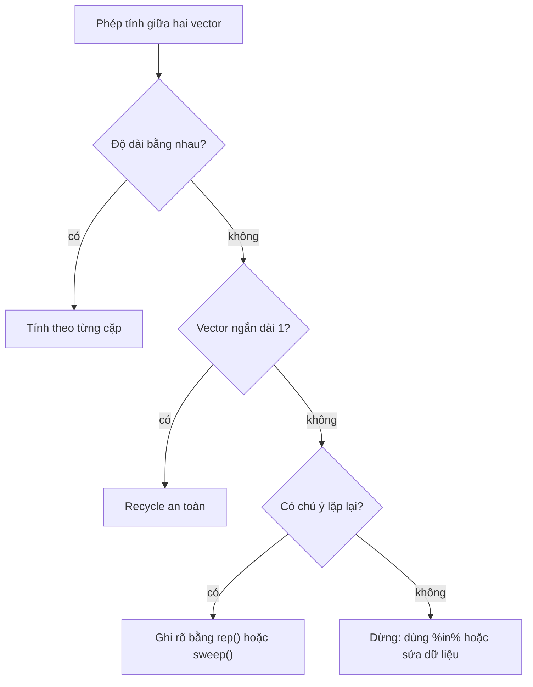

Trong R, phép tính trên cả một vector là cách viết tự nhiên. Nó cũng thường nhanh hơn vòng lặp, từ khoảng chục đến vài trăm lần tuỳ cách viết vòng lặp. Đi kèm là quy tắc recycling: vector ngắn tự lặp lại cho bằng vector dài. Khi độ dài chia hết cho nhau, R không báo gì, kể cả khi kết quả sai. Bài này đi qua ngữ nghĩa chỉ số, vector hoá và recycling theo đặc tả của R, so với broadcasting của NumPy, rồi đo tốc độ bốn cách viết cùng một phép tính bằng một script base R bạn có thể chạy lại.

## 1. Mở đầu: một phép lọc sai không có cảnh báo

Một thí nghiệm có sáu mẫu, chia vào hai nhóm A và B. Cột nhóm được lưu thành vector `group`. Bạn muốn lấy chỉ số các mẫu thuộc nhóm A hoặc B, và viết theo trực giác:

```r
group <- c("A", "B", "A", "B", "B", "A")
which(group == c("A", "B"))
#> [1] 1 2 3 4
which(group %in% c("A", "B"))
#> [1] 1 2 3 4 5 6
```

Dòng đầu trả về bốn mẫu, dòng sau trả về cả sáu. R không báo lỗi, cũng không in cảnh báo. Nguyên nhân nằm ở cách `==` làm việc: nó so **từng cặp phần tử**. Vế phải chỉ dài 2, nên R lặp `c("A", "B")` thành `A B A B A B` rồi mới so (R Core Team, n.d.-b, mục 3.3.1).

**Bảng 0.** Phép so sánh từng cặp sau khi R lặp lại vector ngắn

| Vị trí | `group` | Vế phải sau recycling | `==` |
| --- | --- | --- | --- |
| 1 | A | A | TRUE |
| 2 | B | B | TRUE |
| 3 | A | A | TRUE |
| 4 | B | B | TRUE |
| 5 | B | A | FALSE |
| 6 | A | B | FALSE |

Điều bạn muốn hỏi là "phần tử này có nằm trong tập {A, B} không", và đó là việc của `%in%`. `==` trả lời một câu khác: "phần tử thứ i có bằng phần tử thứ i của vế phải không". Vì 6 chia hết cho 2, đặc tả của R không yêu cầu cảnh báo, nên lỗi đi thẳng vào bước phân tích sau. Nếu bước đó là tính trung bình biểu hiện hay chạy kiểm định giữa hai nhóm, hai mẫu bị bỏ sót sẽ làm lệch kết quả. Trên console không có dòng chữ đỏ nào nhắc bạn quay lại. Với 7 mẫu thay vì 6, cùng dòng lệnh sẽ in cảnh báo. Cùng một lỗi viết code, có lúc lộ ra, có lúc không, tuỳ số mẫu trong thí nghiệm.

Ví dụ nhỏ này chạm vào cả ba câu hỏi của bài. Vector hoá là gì, ngoài câu "không cần vòng lặp"? Nó nhanh hơn vòng lặp bao nhiêu khi đo trên một máy cụ thể? Và khi nào quy tắc đi kèm, recycling, làm sai kết quả mà không ai hay?

## 2. Bối cảnh: R là ngôn ngữ vector từ gốc

R do Ross Ihaka và Robert Gentleman viết tại Đại học Auckland (R Core Team, n.d.-a). Theo Ihaka (1998), bản nhị phân đầu tiên được đưa lên Statlib và công bố trên danh sách thư s-news vào tháng 8/1993. Mã nguồn được phát hành theo giấy phép GNU vào tháng 6/1995. Bài báo mô tả ngôn ngữ ra năm 1996 (Ihaka & Gentleman, 1996).

R mô phỏng cú pháp của S, ngôn ngữ thống kê phát triển ở Bell Labs (Becker et al., 1988; Ihaka, 1998). Phần ngữ nghĩa và cài đặt bên dưới thì chịu ảnh hưởng của Scheme, theo R FAQ (R Core Team, n.d.-a).

Người ta hay giới thiệu R bằng câu "mọi thứ trong R đều là vector". Chambers (2014) nói chính xác hơn: mọi thứ tồn tại trong R là một **đối tượng**. Hàm, môi trường và `NULL` là đối tượng, nhưng không phải vector atomic. Điều đúng và dùng được là R không có kiểu "số vô hướng": `42` là một vector numeric độ dài 1. Vì thế `x * 2` không phải trường hợp đặc biệt. Đó chính là recycling một vector độ dài 1 lên độ dài của `x`.

Trong sinh học, R có chỗ đứng lớn nhờ hệ sinh thái gói. Trang chỉ mục CRAN ghi nhận 25.704 package vào ngày 12/11/2026 (CRAN, 2026); con số này đổi hằng ngày. Bioconductor là kho riêng cho phân tích dữ liệu hệ gen và thông lượng cao (Gentleman et al., 2004; Huber et al., 2015). R và Bioconductor được giới thiệu kỹ hơn ở [bài mở đầu của series](/blog/introduction/).

## 3. Ngữ nghĩa chỉ số

Trước khi bàn về vector hoá, cần biết R lấy phần tử ra khỏi vector thế nào. Chỉ số cũng là một vector, và cũng tuân theo recycling. Mục 3.4.1 của *R Language Definition* liệt kê các kiểu chỉ số (R Core Team, n.d.-b).

```r
score <- c(8, 7, 9, 6, 10)
score[1]            #> 8
score[length(score)] #> 10
score[10]           #> NA
score[-1]           #> 7 9 6 10
score[-10]          #> 8 7 9 6 10
score[0]            #> numeric(0)
score[c(-1, 2)]     #> Error: only 0's may be mixed with negative subscripts
score[c(TRUE, FALSE)] #> 8 9 10
```

**Chỉ số dương** bắt đầu từ 1. Chỉ số vượt độ dài không gây lỗi mà trả `NA`. **Chỉ số âm** loại phần tử khỏi kết quả, và không được trộn với chỉ số dương. Chỉ số âm vượt độ dài thì bị bỏ qua, không báo gì (từ R 2.6.0). **Chỉ số 0** trả về vector rỗng. **Chỉ số logic** giữ các vị trí `TRUE`. Nếu ngắn hơn vector, nó được recycle, và không có cảnh báo ngay cả khi độ dài không chia hết (ở đây 5 không chia hết cho 2). Nếu dài hơn, kết quả có thêm `NA`.

Với **chỉ số theo tên**, `[` so khớp chính xác: `score["s"]` trả `NA` khi không có tên `s`. `$` trên list khớp một phần theo mặc định, còn `[[` khớp một phần khi đặt `exact = FALSE` (R Core Team, n.d.-b). Phần áp dụng cho data frame có trong [bài về data frame](/blog/data-frames/).

**Bảng 1.** Các loại chỉ số, kết quả và phản hồi của R (R 4.4.3)

| Loại | Ví dụ với `score <- c(8, 7, 9, 6, 10)` | Kết quả | R báo gì |
| --- | --- | --- | --- |
| Dương | `score[2]` | 7 | – |
| Dương vượt độ dài | `score[10]` | NA | không |
| Âm | `score[-1]` | 7 9 6 10 | – |
| Âm vượt độ dài | `score[-10]` | cả 5 phần tử | không |
| Trộn dương và âm | `score[c(-1, 2)]` | – | lỗi |
| Không | `score[0]` | `numeric(0)` | không |
| Logic ngắn | `score[c(TRUE, FALSE)]` | 8 9 10 | không |
| Logic dài | `score[c(TRUE, FALSE, TRUE, FALSE, TRUE, TRUE)]` | 8 9 10 NA | không |
| Tên không tồn tại | `score["s"]` | NA | không |

Nếu bạn đến từ Python, có hai chỗ dễ vấp. Trong Python, `x[-1]` là phần tử cuối; trong R, `score[-1]` là mọi phần tử **trừ** phần tử đầu. Python báo `IndexError` khi chỉ số vượt độ dài, còn R trả `NA`. Thói quen "chỉ số sai thì chương trình dừng" không mang sang R được: một vòng lặp chạy quá một bước sẽ lặng lẽ thêm `NA` vào kết quả.

Chỉ số logic còn một bẫy khi dữ liệu có giá trị thiếu. So sánh với `NA` cho ra `NA`. Một chỉ số logic là `NA` không bị bỏ qua mà sinh ra một phần tử `NA` trong kết quả:

```r
y <- c(8, NA, 9, 6, 10)
y[y >= 8]                  #> 8 NA 9 10
y[which(y >= 8)]           #> 8 9 10
y[!is.na(y) & y >= 8]      #> 8 9 10
```

`which()` chỉ trả về vị trí của các `TRUE`, nên tự loại `NA`. Khi lọc một bảng số liệu lâm sàng có ô trống, khác biệt này quyết định bạn có kéo theo những dòng toàn `NA` vào bước sau hay không.

## 4. Vector hoá: cách nghĩ trên cả đối tượng

Phép toán số học, phép so sánh và nhiều hàm như `sqrt()`, `log()`, `ifelse()` trong R áp dụng theo từng phần tử. Wickham (2019, mục 24.5) mô tả vector hoá là giải bài toán bằng cách nghĩ về cả đối tượng, chứ không chỉ là bỏ vòng lặp.

```r
price    <- c(100, 200, 300)
quantity <- c(2, 1, 3)
price * quantity
#> [1] 200 200 900
```

Mỗi phần tử của `price` nhân với phần tử cùng vị trí của `quantity`: 100 × 2 = 200, 200 × 1 = 200, 300 × 3 = 900. Không có biến đếm, không phải khởi tạo trước vector kết quả, không có chỉ số `i` để lỡ tay viết thành `i + 1`. Dòng code đọc như công thức trên giấy: doanh thu bằng giá nhân số lượng.

Cách nghĩ này có lợi nhất khi công thức có nhiều bước. Biến đổi $\log_2(x + 1)$ trên cả bảng biểu hiện chỉ là `log2(x + 1)`. Viết bằng vòng lặp thì cần hai vòng lồng nhau, và mỗi chỉ số là một chỗ có thể sai.

<div class="callout callout-note">
<p class="callout-title">Vector hoá không có nghĩa là không có vòng lặp</p>

Máy tính vẫn phải đi qua từng phần tử. Khác ở chỗ vòng lặp nằm trong mã C đã biên dịch của R, thay vì trong code R được thông dịch từng dòng. Mục 7 đo khác biệt đó.

</div>

Vector logic còn dùng để đếm. Trong `sum()`, `TRUE` tính là 1 và `FALSE` là 0. Vậy `sum(x >= 8)` đếm số phần tử đạt ngưỡng, còn `mean(x >= 8)` cho tỉ lệ.

```r
score <- c(8, 7, 9, 6, 10)
sum(score >= 8)    #> 3
mean(score >= 8)   #> 0.6

y <- c(8, NA, 9, 6, 10)
sum(y >= 8)                 #> NA
sum(y >= 8, na.rm = TRUE)   #> 3
mean(y >= 8, na.rm = TRUE)  #> 0.75
```

Trong dữ liệu sinh học, chuẩn hoá CPM (counts per million) là ví dụ vector hoá điển hình: chia số đọc của mỗi gene cho tổng số đọc của mẫu rồi nhân 10⁶, $\text{CPM}_i = c_i / \sum_j c_j \times 10^6$.

```r
counts <- c(geneA = 120, geneB = 30, geneC = 850, geneD = 0)
counts / sum(counts) * 1e6
#>  geneA  geneB  geneC  geneD
#> 120000  30000 850000      0

lfc <- c(2.3, -0.4, -1.8, 0.9, 1.2, -2.6)   # log2 fold change
sum(abs(lfc) >= 1)    #> 4
ifelse(lfc > 0, "up", "down")
#> "up" "down" "down" "up" "up" "down"
```

`abs(lfc) >= 1` tạo một vector logic độ dài 6. `sum()` đếm được 4 gene có mức thay đổi ít nhất hai lần theo một chiều nào đó. `ifelse()` gắn nhãn "up" hoặc "down" cho cả sáu gene trong một lệnh.

Toán tử logic có hai họ. `&` và `|` làm việc theo từng phần tử. `&&` và `||` chỉ nhận giá trị độ dài 1 và dùng trong `if`. Từ R 4.3.0, đưa vector dài hơn 1 vào `&&` hoặc `||` là lỗi, với thông báo dạng `'length = 2' in coercion to 'logical(1)'` (R Core Team, 2023). Lọc dữ liệu theo hai điều kiện thì dùng `&`: `lfc[abs(lfc) >= 1 & lfc > 0]`.

Khi tạo vector bằng `c()`, các phần tử bị ép về cùng một kiểu: `c(1, TRUE)` cho `1 1`, `c(TRUE, "a")` cho `"TRUE" "a"`. Thứ bậc ép kiểu và cách `NA` lan truyền nằm ở [bài về kiểu dữ liệu](/blog/basic-data-types/).

## 5. Recycling: im lặng, cảnh báo hay lỗi

Mục 3.3.1 của *R Language Definition* nêu quy tắc gồm ba ý (R Core Team, n.d.-b). Khi hai vector khác độ dài tham gia một phép toán theo phần tử, vector ngắn được lặp lại tới độ dài vector dài. Nếu độ dài vector dài không phải bội số của vector ngắn, R vẫn tính nhưng in cảnh báo. Phép toán có một vector độ dài 0 cho kết quả độ dài 0.


*Hình 1. Recycling khi cộng vector 1:6 với `c(10, 20)` (trên) và với 1:4 (dưới). Chỉ trường hợp dưới có cảnh báo.*

```r
Sys.setenv(LANGUAGE = "en")   # thông báo bằng tiếng Anh để dễ tra cứu

1:6 + c(10, 20)
#> [1] 11 22 13 24 15 26
1:6 + 1:4
#> [1] 2 4 6 8 6 8
#> Warning message:
#> longer object length is not a multiple of shorter object length
numeric(0) + 1:3
#> numeric(0)
```

Nếu R của bạn in thông báo bằng ngôn ngữ khác, dòng `Sys.setenv(LANGUAGE = "en")` cho bạn đúng chuỗi gốc để tìm trên mạng.

Recycling trước hết là một tính năng có chủ đích. Mỗi lần bạn viết `x * 2`, `x - mean(x)` hay `counts / sum(counts)`, R đang recycle một vector độ dài 1, và nhờ vậy code R mới ngắn. Rủi ro dồn vào một nhóm nhỏ: vector ngắn dài hơn 1, và độ dài vector dài lại là bội số của nó. Cảnh báo "longer object length is not a multiple of shorter object length" chỉ bắt được một phần các trường hợp nhầm; phần còn lại chạy qua không để lại dấu vết. Bảng 2 gom các tình huống đã chạy thử.

**Bảng 2.** Recycling trong R 4.4.3: im lặng, cảnh báo hay lỗi

| Biểu thức | Kết quả | Phản hồi |
| --- | --- | --- |
| `1:6 * 2` | 2 4 6 8 10 12 | im lặng (cố ý) |
| `1:6 + c(10, 20)` | 11 22 13 24 15 26 | im lặng |
| `group == c("A", "B")` | T T T T F F | im lặng, kết quả sai ý |
| `(1:5)[c(TRUE, FALSE)]` | 1 3 5 | im lặng dù 5 không chia hết cho 2 |
| `1:6 + 1:4` | 2 4 6 8 6 8 | cảnh báo |
| `1:5 + c(10, 20)` | 11 22 13 24 15 | cảnh báo |
| `numeric(0) + 1:3` | `numeric(0)` | im lặng |
| `d$b <- 1:2` (data frame 6 hàng) | 1 2 1 2 1 2 | im lặng |
| `d$b <- 1:4` (data frame 6 hàng) | – | lỗi: replacement has 4 rows, data has 6 |
| `tibble(a = 1:6, b = 1:2)` | – | lỗi: only values of size one are recycled |

Tidyverse dùng quy tắc chặt hơn: chỉ vector độ dài 1 được recycle, các độ dài khác phải bằng nhau (Wickham et al., 2026).

```r
tibble::tibble(a = 1:6, b = 1:2)
#> Error: Tibble columns must have compatible sizes.
#> • Size 6: Existing data.
#> • Size 2: Column `b`.
#> ℹ Only values of size one are recycled.
```

Data frame của base R đứng giữa hai cách làm này. Gán `1:2` vào một cột của data frame 6 hàng thì R lặp lại im lặng; gán `1:4` thì báo lỗi. Tibble chặn cả hai. Kết quả trên chạy với tibble 3.2.1 và vctrs 0.6.5; trang FAQ của vctrs dẫn ở trên là bản trực tuyến hiện hành, quy tắc recycling mô tả ở đó vẫn như vậy.

### 5.1. Ví dụ sinh học: chia ma trận cho tổng cột

Trong phân tích dữ liệu hệ gen, lỗi recycling nguy hiểm nhất thường đến từ ma trận. Ma trận trong R thực chất là một vector có thuộc tính `dim`, phần tử xếp theo cột. Khi chia ma trận đếm (gene × mẫu) cho `colSums()`, vector tổng cột được recycle **dọc theo cột**, chứ không áp cho từng cột như bạn định:

```r
m <- matrix(c(10, 30, 60, 100, 300, 600), nrow = 3)   # 3 gene x 2 mẫu
colSums(m)                   #> 100 1000
colSums(m / colSums(m))      #> 0.73 3.70   (sai, không cảnh báo)
colSums(t(t(m) / colSums(m)))           #> 1 1
colSums(sweep(m, 2, colSums(m), "/"))   #> 1 1
```

Ma trận có 6 phần tử, vector tổng cột có 2 phần tử, 6 chia hết cho 2, nên R im lặng. Với dữ liệu thật, số phần tử của ma trận luôn bằng số gene nhân số mẫu, tức luôn chia hết cho số mẫu. Phép chia sai này vì thế **không bao giờ** sinh cảnh báo. Cách kiểm tra rẻ nhất: xem tổng mỗi cột sau chuẩn hoá có bằng 1 (hoặc 10⁶ với CPM) không. `sweep(m, 2, ...)` ghi rõ chiều áp dụng (2 là theo cột), nên dễ đọc hơn mẹo chuyển vị hai lần.

### 5.2. Vector rỗng lây lan

Ý thứ ba của quy tắc (phép toán với vector độ dài 0 cho kết quả độ dài 0) sinh ra loại lỗi khó lần ngược. Giả sử một bước lọc trước đó không giữ lại gene nào. Mọi phép tính sau trên kết quả đều trả `numeric(0)` hoặc `logical(0)`, và lỗi chỉ lộ ra vài bước sau, khi `if()` nhận một điều kiện rỗng. Vài hàm tóm tắt còn trả giá trị đặc biệt: `max(numeric(0))` cho `-Inf` kèm cảnh báo, nên một ngưỡng tính bằng `max()` trên tập rỗng sẽ giữ lại mọi phần tử. Gọi `length()` ngay sau mỗi bước lọc quan trọng là cách phòng đơn giản nhất.

## 6. So sánh với broadcasting của NumPy

NumPy là thư viện mảng nền tảng của Python khoa học (Harris et al., 2020; van der Walt et al., 2011). Cơ chế tương ứng với recycling là broadcasting. NumPy so khớp hình dạng từ chiều cuối, và hai kích thước tương thích khi bằng nhau hoặc một bên bằng 1 (NumPy Developers, n.d.).

```python
import numpy as np
a = np.arange(1, 7)
a + np.array([10, 20])
# ValueError: operands could not be broadcast together with shapes (6,) (2,)
a + np.array([10])
# array([11, 12, 13, 14, 15, 16])
```

**Bảng 3.** Ba quy ước khi hai vector khác độ dài

| Tình huống | R base | tidyverse/vctrs | NumPy |
| --- | --- | --- | --- |
| Độ dài 1 với độ dài n | recycle | recycle | broadcast |
| n chia hết cho m (m > 1) | recycle, im lặng | lỗi | lỗi |
| n không chia hết cho m | recycle, cảnh báo | lỗi | lỗi |
| Độ dài 0 với độ dài 1 | kết quả độ dài 0 | kết quả độ dài 0 | kết quả độ dài 0 |
| Độ dài 0 với độ dài n > 1 | kết quả độ dài 0 | lỗi | lỗi |

Đọc theo cột, NumPy gần vctrs hơn là gần R base. Hai bên chỉ cho "kéo dài" một kích thước bằng 1; mọi khác biệt khác là lỗi. R base cho lặp bất kỳ vector nào và chỉ nhắc khi không chia hết. Với người chuyển từ Python, điều này có nghĩa là phép tính NumPy chặn ngay thì R vẫn có thể chạy và trả kết quả.

Broadcasting mạnh hơn recycling ở chỗ nó làm việc theo **chiều**. Trong NumPy, cộng mảng (2, 3) với mảng (2, 1) sẽ kéo mảng thứ hai theo chiều cột, đúng ý "mỗi hàng cộng một hằng số riêng":

```python
np.arange(6).reshape(2, 3) + np.array([[10], [20]])
# array([[10, 11, 12],
#        [23, 24, 25]])
```

R base không có khái niệm này cho ma trận. Phép toán giữa ma trận và vector luôn đi theo thứ tự lưu trữ (theo cột), như ví dụ ở mục 5.1. Muốn áp dụng theo hàng hay theo cột, bạn chọn hàm có tham số chiều rõ ràng như `sweep()`, hoặc dùng `colSums()`, `rowMeans()` và các hàm cùng họ. Kết quả NumPy trong mục này chạy với NumPy 2.4.6.

## 7. Benchmark: vòng lặp và vector hoá

### 7.1. Thiết kế

Phần này đo thẳng lời khuyên "tránh vòng lặp trong R". Tác vụ được chọn đơn giản có chủ ý: nhân đôi vector `runif(n)`, với n từ 10³ đến 10⁷. Phép nhân rẻ đến mức thời gian đo được chủ yếu là chi phí của cách viết code.

Bốn cách cài được so sánh:

1. **`for` nối dần**: bắt đầu từ vector rỗng, gán `out[i]` vượt độ dài ở mỗi bước.
2. **`for` cấp phát trước**: tạo sẵn `numeric(n)` rồi điền vào.
3. **`sapply()`**: gọi một hàm R vô danh cho từng phần tử.
4. **Vector hoá**: `x * 2`.

Trước khi đo, script dùng `identical()` kiểm tra cả bốn cách cho kết quả giống hệt. So tốc độ của hai đoạn code ra kết quả khác nhau thì vô nghĩa. Mỗi cấu hình chạy 50 lần với n ≤ 10⁵, 20 lần với n = 10⁶ và 5 lần với n = 10⁷ (ở mức này `sapply()` mất hơn 13 giây mỗi lần). Thời gian đo bằng hiệu `Sys.time()` quanh mỗi lần gọi. Bài báo cáo trung vị và khoảng tứ phân vị (IQR) thay vì trung bình, vì thời gian chạy thường lệch phải do thu gom bộ nhớ (garbage collection) và các tiến trình khác trên máy.

Máy chạy: macOS 12.7.6, Intel Core i5-5350U 1,8 GHz, RAM 8 GB, R 4.4.3, BLAS và LAPACK mặc định của R, JIT mức 3 (`compiler::enableJIT(-1)` trả 3). Ngày chạy: 19/11/2026. Script dưới đây là phần lõi; bản đầy đủ lặp qua mọi n và ghi kết quả ra CSV.

```r
f_grow     <- function(x) { out <- c(); for (i in seq_along(x)) out[i] <- x[i] * 2; out }
f_prealloc <- function(x) { out <- numeric(length(x)); for (i in seq_along(x)) out[i] <- x[i] * 2; out }
f_sapply   <- function(x) sapply(x, function(v) v * 2)
f_vector   <- function(x) x * 2

time_it <- function(f, x, reps) {
  vapply(seq_len(reps), function(r) {
    t0 <- Sys.time(); f(x); as.numeric(difftime(Sys.time(), t0, units = "secs"))
  }, numeric(1))
}

set.seed(2026)
x <- runif(1e6)
stopifnot(identical(f_grow(x), f_vector(x)), identical(f_sapply(x), f_vector(x)))
t <- time_it(f_prealloc, x, 20)
c(median = median(t), quantile(t, c(0.25, 0.75)))
```

### 7.2. Kết quả


*Hình 2. Thời gian chạy theo n (hai trục log). Điểm là trung vị, thanh là IQR.*

**Bảng 4.** Trung vị thời gian (giây) và số lần chậm hơn so với `x * 2`

| n | `x * 2` | `for` cấp phát trước | `for` nối dần | `sapply()` |
| --- | --- | --- | --- | --- |
| 10³ | 6,9 × 10⁻⁶ | 8,9 × 10⁻⁵ (×13) | 4,4 × 10⁻⁴ (×64) | 7,3 × 10⁻⁴ (×106) |
| 10⁴ | 5,1 × 10⁻⁵ | 8,5 × 10⁻⁴ (×17) | 3,7 × 10⁻³ (×72) | 8,2 × 10⁻³ (×160) |
| 10⁵ | 4,5 × 10⁻⁴ | 8,5 × 10⁻³ (×19) | 0,043 (×95) | 0,117 (×263) |
| 10⁶ | 0,0021 | 0,083 (×41) | 0,446 (×217) | 1,28 (×626) |
| 10⁷ | 0,018 | 1,18 (×68) | 4,48 (×256) | 13,5 (×773) |

Vector hoá nhanh nhất ở mọi n, và cả bốn cách đều tăng xấp xỉ tuyến tính theo n. Khoảng cách thì không cố định. Vòng lặp cấp phát trước chậm hơn 13 lần ở n = 10³, nhưng tới 68 lần ở n = 10⁷. Cách viết vòng lặp cũng tạo khác biệt: nối dần chậm hơn cấp phát trước từ 3,8 (n = 10⁷) đến 5,4 lần (n = 10⁶), và `sapply()` còn chậm hơn cả nối dần.

Xét giá trị tuyệt đối, vòng lặp cấp phát trước xử lý một triệu phần tử trong khoảng 0,08 giây. Với một vector 20.000 gene, mọi cách trong bảng đều xong trong chưa tới một phần mười giây. Ở cỡ một bảng biểu hiện, lý do chính để vector hoá là code ngắn và ít lỗi. Tốc độ chỉ thành vấn đề khi dữ liệu lên hàng triệu phần tử, hoặc khi phép tính lặp lại nhiều lần như trong mô phỏng hay bootstrap.

IQR của `x * 2` ở n = 10⁶ và 10⁷ rộng bất thường (0,0019–0,0084 giây ở n = 10⁶). Mỗi lần gọi phải cấp phát một vector kết quả 8 MB hoặc 80 MB. Nhiều khả năng những lần chạy chậm trùng với lúc R thu gom bộ nhớ; trung vị ít bị các lần đó kéo theo.

Hai phép đo bổ sung giúp giải thích kết quả. Phép thứ nhất là một lượt đo riêng cho JIT. Tắt JIT bằng `compiler::enableJIT(0)` rồi định nghĩa lại hàm cấp phát trước, trung vị ở n = 10⁶ là 0,89 giây, so với 0,088 giây khi bật JIT trong cùng lượt đo, tức chậm hơn khoảng 10 lần. Chạy lại trong một tiến trình R riêng với biến môi trường `R_ENABLE_JIT=0` (hàm không được biên dịch sang byte-code) cho kết quả cùng cỡ: 0,91 so với 0,085 giây. Phép thứ hai là một tác vụ sinh học: chuẩn hoá CPM trên ma trận đếm giả lập 20.000 gene × 12 mẫu (`rpois`, λ = 50, `set.seed(2026)`). Hai vòng lặp lồng nhau mất 0,058 giây, `sweep()` mất 0,0044 giây và `t(t(m) / colSums(m))` mất 0,0043 giây (20 lần chạy mỗi cách; ba cách cho cùng kết quả theo `all.equal()`). Vòng lặp chậm hơn khoảng 13 lần, nhưng vẫn chỉ tốn vài phần trăm giây.

### 7.3. Vì sao có khoảng cách đó

Phép `x * 2` vẫn đi qua từng phần tử, nhưng vòng lặp ấy nằm trong mã C đã biên dịch. Vòng lặp `for` trong R thì phải thông dịch từng lượt: tìm biến, kiểm tra kiểu, gọi hàm `*` và hàm gán. Morandat et al. (2012) đánh giá R 2.12.1 và thấy trình thông dịch chậm hơn C và Python nhiều lần, trừ những chương trình đẩy phần lớn công việc xuống các hàm viết bằng C. Số liệu đó đã cũ, chỉ nên đọc như bối cảnh.

Từ R 3.4.0, trình biên dịch byte-code JIT được bật mặc định ở mức 3: hàm được biên dịch ở lần dùng đầu hoặc thứ hai, vòng lặp ở cấp cao nhất được biên dịch trước khi chạy (R Core Team, 2017). Trên máy chạy thử, các phép đo tắt JIT ở trên cho thấy cơ chế này rút khoảng cách đi chừng 10 lần. Những lời khuyên viết trước 2017 kiểu "vòng lặp trong R cực chậm" vì thế cần đọc trong bối cảnh phiên bản R lúc đó.

Nối dần chậm vì vector phải được cấp phát lại và sao chép mỗi khi lớn lên (Wickham, 2019, mục 24.6). *The R Inferno* gọi đây là "growing objects" và dành riêng vòng thứ hai trong số các lỗi hay gặp cho nó (Burns, 2012). Cũng từ R 3.4.0, gán vào vị trí vượt độ dài sẽ cấp phát dư một phần nhỏ, nên nối dần đỡ tốn hơn trước. Dù vậy, ghi chú phát hành vẫn coi cấp phát trước là cách nên dùng (R Core Team, 2017). Kết quả đo khớp với điều đó: nối dần vẫn chậm hơn cấp phát trước từ 3,8 đến 5,4 lần.

`sapply()` chậm nhất vì nó gọi một hàm R cho mỗi phần tử, rồi còn gom kết quả lại thành vector. Họ `apply` giúp code gọn hơn vòng lặp, nhưng không phải vector hoá theo nghĩa của mục 4. Chi tiết có trong [bài về hàm trong R](/blog/functions/); cú pháp vòng lặp có trong bài về rẽ nhánh và vòng lặp.

<div class="callout callout-warning">
<p class="callout-title">Giới hạn của phép đo</p>

Benchmark chạy trên một máy, một phiên bản R, với một phép tính rất rẻ. Con số tuyệt đối không khái quát được; chỉ thứ tự và độ lớn tương đối của các tỉ lệ là có ý nghĩa. Các gói chuyên dụng như `bench` (Hester & Vaughan, 2025) hay `microbenchmark` (Mersmann, 2024) đo chính xác hơn `Sys.time()`; `bench::mark()` còn kiểm tra kết quả và báo lượng bộ nhớ cấp phát.

</div>

## 8. Thực hành tốt: viết code vector hoá an toàn

Từ các mục trên rút ra được năm thói quen. Thứ nhất, khi so một vector với **nhiều giá trị**, dùng `%in%`. Để `==` cho so sánh từng cặp cùng độ dài, hoặc so với một giá trị duy nhất.

Thứ hai, kiểm tra độ dài trước khi tính, đừng trông vào cảnh báo. Một dòng `stopifnot(length(a) == length(b))` biến lỗi im lặng thành lỗi dừng chương trình, với thông báo `length(a) == length(b) is not TRUE`. Với ma trận, kiểm tra kết quả bằng một tính chất đã biết, như tổng cột sau chuẩn hoá.

Thứ ba, trong pipeline chạy tự động, cân nhắc đặt `options(warn = 2)` để mọi cảnh báo thành lỗi. Khi đó `1:6 + 1:4` dừng lại với thông báo `(converted from warning) longer object length is not a multiple of shorter object length`. Dòng cảnh báo không còn trôi mất giữa hàng trăm dòng log.

Thứ tư, dùng `seq_along(x)` thay cho `1:length(x)` trong vòng lặp. Khi `x` rỗng, `1:length(x)` là `1:0`, tức vector `1 0`, và vòng lặp vẫn chạy hai lượt. `seq_along(x)` trả `integer(0)`, vòng lặp không chạy lượt nào.

Thứ năm, khi buộc phải dùng vòng lặp (chẳng hạn mỗi bước phụ thuộc kết quả bước trước), hãy cấp phát trước vector kết quả.

Sơ đồ dưới đây gom cách quyết định khi gặp một phép tính giữa hai vector.



Lời khuyên "ghi rõ bằng `rep()`" có lý do. `x + rep(c(10, 20), times = 3)` cho cùng kết quả với `x + c(10, 20)`, nhưng người đọc code thấy ngay ý định lặp lại.

## 9. Kết luận

Viết phép tính trên cả vector giúp code gần với công thức và bớt chỗ sai chỉ số. Trên máy chạy thử, cách viết đó nhanh hơn vòng lặp cấp phát trước 13 đến 68 lần, và nhanh hơn `sapply()` hàng trăm lần. Recycling là thứ làm cách viết ấy khả thi, nhưng nó im lặng khi độ dài chia hết, kể cả khi kết quả sai, như phép `==` ở mục 1 hay phép chia ma trận cho `colSums()` ở mục 5.1. NumPy và tidyverse chọn quy tắc chặt hơn: chỉ kéo dài kích thước bằng 1.

Việc nên làm tiếp: mở script đang dùng, tìm các chỗ `==` so với một vector nhiều phần tử và các phép chia ma trận cho `colSums()`, rồi thêm một dòng kiểm tra độ dài hoặc tổng cột. Muốn biết vòng lặp trên máy của bạn chậm cỡ nào, chạy lại script ở mục 7 với phiên bản R bạn đang dùng. Phần ép kiểu trong `c()` và cách `NA` lan truyền được viết riêng trong [[05 - Basic data types|bài về kiểu dữ liệu, ép kiểu và `NA`]].

## Tài liệu tham khảo

Becker, R. A., Chambers, J. M., & Wilks, A. R. (1988). *The new S language: A programming environment for data analysis and graphics*. Wadsworth & Brooks/Cole.

Burns, P. (2012). *The R inferno*. Lulu Press. https://www.burns-stat.com/pages/Tutor/R_inferno.pdf

Chambers, J. M. (2014). Object-oriented programming, functional programming and R. *Statistical Science, 29*(2), 167–180. https://doi.org/10.1214/13-STS452

CRAN. (2026). *Contributed packages*. Truy cập ngày 12/11/2026, từ https://cran.r-project.org/web/packages/index.html

Gentleman, R. C., Carey, V. J., Bates, D. M., Bolstad, B., Dettling, M., Dudoit, S., … Zhang, J. (2004). Bioconductor: Open software development for computational biology and bioinformatics. *Genome Biology, 5*(10), R80. https://doi.org/10.1186/gb-2004-5-10-r80

Harris, C. R., Millman, K. J., van der Walt, S. J., Gommers, R., Virtanen, P., Cournapeau, D., … Oliphant, T. E. (2020). Array programming with NumPy. *Nature, 585*(7825), 357–362. https://doi.org/10.1038/s41586-020-2649-2

Hester, J., & Vaughan, D. (2025). *bench: High precision timing of R expressions* (R package version 1.1.4). https://cran.r-project.org/package=bench

Huber, W., Carey, V. J., Gentleman, R., Anders, S., Carlson, M., Carvalho, B. S., … Morgan, M. (2015). Orchestrating high-throughput genomic analysis with Bioconductor. *Nature Methods, 12*(2), 115–121. https://doi.org/10.1038/nmeth.3252

Ihaka, R. (1998). *R: Past and future history* [Bài trình bày tại hội nghị Interface '98]. https://cran.r-project.org/doc/html/interface98-paper/paper.html

Ihaka, R., & Gentleman, R. (1996). R: A language for data analysis and graphics. *Journal of Computational and Graphical Statistics, 5*(3), 299–314. https://doi.org/10.1080/10618600.1996.10474713

Mersmann, O. (2024). *microbenchmark: Accurate timing functions* (R package version 1.5.0). https://cran.r-project.org/package=microbenchmark

Morandat, F., Hill, B., Osvald, L., & Vitek, J. (2012). Evaluating the design of the R language. In *ECOOP 2012 – Object-Oriented Programming* (Lecture Notes in Computer Science, pp. 104–131). Springer. https://doi.org/10.1007/978-3-642-31057-7_6

NumPy Developers. (n.d.). *Broadcasting*. NumPy user guide. https://numpy.org/doc/stable/user/basics.broadcasting.html

R Core Team. (n.d.-a). *R FAQ: Frequently asked questions on R*. https://cran.r-project.org/doc/FAQ/R-FAQ.html

R Core Team. (n.d.-b). *R language definition*. https://cran.r-project.org/doc/manuals/r-release/R-lang.html

R Core Team. (2017). *CHANGES IN R 3.4.0*. In *R NEWS 3.x*. https://cran.r-project.org/doc/manuals/r-release/NEWS.3.html

R Core Team. (2023). *CHANGES IN R 4.3.0*. In *R NEWS*. https://cran.r-project.org/doc/manuals/r-release/NEWS.html

van der Walt, S., Colbert, S. C., & Varoquaux, G. (2011). The NumPy array: A structure for efficient numerical computation. *Computing in Science & Engineering, 13*(2), 22–30. https://doi.org/10.1109/MCSE.2011.37

Wickham, H. (2019). *Advanced R* (2nd ed.). Chapman and Hall/CRC. https://adv-r.hadley.nz/

Wickham, H., Henry, L., & Vaughan, D. (2026). *FAQ – How does recycling work in vctrs and the tidyverse?* In *vctrs: Vector helpers* (R package version 0.7.3). https://vctrs.r-lib.org/reference/theory-faq-recycling.html
