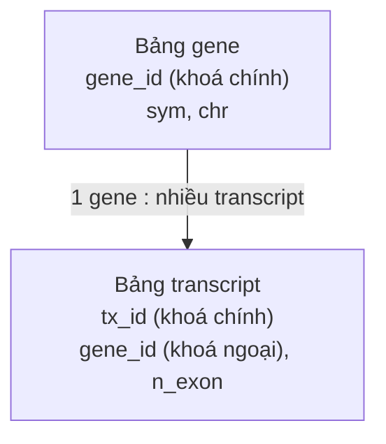

SQL (Structured Query Language) là ngôn ngữ khai báo dùng để định nghĩa, truy vấn và cập nhật dữ liệu trong cơ sở dữ liệu quan hệ, dựa trên mô hình quan hệ mà E. F. Codd công bố năm 1970 (Codd, 1970). Ngôn ngữ ra đời ở IBM với tên SEQUEL, được chuẩn hoá quốc tế thành ISO 9075:1987, và bản chuẩn hiện hành là ISO/IEC 9075:2023 (International Organization for Standardization [ISO], 1987, 2023). Dù vậy, tài liệu PostgreSQL 18 chỉ tự đánh giá đạt ít nhất 170 trên 177 tính năng bắt buộc của Core SQL:2023 và ghi rằng chưa hệ quản trị nào tuyên bố tuân thủ đầy đủ (PostgreSQL Global Development Group, n.d.-a). Bài này dành cho người học sinh học và tin sinh học: kể lại SQL đến từ đâu, chuẩn gồm những mốc nào, và chạy thử các truy vấn trên SQLite 3.45.3 để thấy câu nào đổi nghĩa khi chuyển sang hệ khác.

<div class="callout callout-note">
<p class="callout-title">Tóm tắt nhanh</p>

- SQL là ngôn ngữ cho **mô hình quan hệ** (Codd, 1970): bạn nói muốn lấy dữ liệu gì, hệ quản trị tự tìm cách lấy.
- Chuẩn đầu tiên của ISO là ISO 9075:1987; bản hiện hành là ISO/IEC 9075:2023, có phần truy vấn đồ thị SQL/PGQ và kiểu JSON.
- Chuẩn là đích hội tụ chứ không phải mô tả thực tế: `LIMIT`, `TOP` và `FETCH FIRST` cùng làm một việc, nhưng mỗi hệ chỉ nhận một phần trong số đó.
- Lỗi đáng sợ nhất với dữ liệu sinh học là lỗi **âm thầm**: chuỗi trong ngoặc kép, so sánh hoa thường, `= NULL`, kiểu dữ liệu linh hoạt.

</div>

## 1. SQL là gì: ngôn ngữ cho mô hình quan hệ

Định nghĩa "SQL là ngôn ngữ để truy cập và thao tác cơ sở dữ liệu" đúng nhưng thiếu ý chính: SQL là ngôn ngữ cho một **mô hình dữ liệu cụ thể**, mô hình quan hệ (relational model). Thứ tự nhân quả là: Codd đưa ra lý thuyết; hệ quản trị cơ sở dữ liệu quan hệ (relational database management system, RDBMS) là phần mềm hiện thực lý thuyết đó; SQL là ngôn ngữ để làm việc với RDBMS.

Bài báo của Codd (1970) trên *Communications of the ACM* đặt vấn đề từ phía người dùng. Ở các hệ thống thời đó, chương trình phải biết dữ liệu được lưu theo thứ tự nào, có chỉ mục nào và đi theo đường truy cập nào; chỉ cần đổi cách lưu là chương trình hỏng. Codd đề xuất tách hai tầng: người dùng nhìn dữ liệu dưới dạng các **quan hệ** (relation), tức các bảng, còn cách sắp xếp vật lý là việc của hệ thống. Mỗi dòng là một **tuple**, mỗi cột là một **thuộc tính** (attribute), và mỗi bảng có **khoá** (key) để xác định duy nhất từng dòng. Trên nền đó, các phép toán quan hệ như chọn dòng, chiếu cột và nối bảng cho phép diễn đạt câu hỏi mà không cần nói dữ liệu nằm ở đâu (Codd, 1970).

Vì vậy SQL là ngôn ngữ **khai báo** (declarative). Bạn viết `SELECT sym FROM gene WHERE chr = '17'` để nói *muốn gì*; hệ quản trị quyết định *làm thế nào*: quét cả bảng hay dùng chỉ mục, đọc theo thứ tự nào.

Dữ liệu sinh học vốn đã có dạng quan hệ. Một gene có nhiều bản phiên mã (transcript). Thay vì chép tên và vị trí gene vào từng dòng transcript, bạn tách thành hai bảng và nối chúng bằng khoá ngoại (foreign key):



Câu hỏi "gene nào có nhiều transcript nhất" khi đó là một phép nối và một phép đếm (→ [JOIN](/blog/join-ket-hop-nhieu-bang/)).

Mô hình quan hệ cũng sống dai hơn nhiều mô hình cạnh tranh. Stonebraker và Pavlo (2024) điểm lại các mô hình dữ liệu xuất hiện qua nhiều thập niên và kết luận rằng nhiều ý tưởng được giới thiệu như "thay thế" cho SQL rốt cuộc lại được SQL và mô hình quan hệ hấp thụ. Vì thế một ngôn ngữ từ thập niên 1970 vẫn là kỹ năng nền của người làm dữ liệu.

## 2. Một truy vấn, bốn hệ: phương ngữ khác nhau ở đâu

Có chuẩn ISO không có nghĩa là mọi hệ quản trị nói cùng một thứ tiếng. Đoạn code dưới tạo một bảng gene ba dòng trong SQLite và chạy sáu truy vấn. Bảng cố ý có hai cách viết của cùng một ký hiệu: `TP53` là ký hiệu gene người, viết hoa toàn bộ; còn theo quy ước của cá ngựa vằn (zebrafish), tên gene viết thường, ví dụ gene sonic hedgehog là *shha* ở zebrafish, *SHH* ở người và *Shh* ở chuột (ZFIN, n.d.).

```python
import sqlite3
con = sqlite3.connect(":memory:")
con.executescript("""
CREATE TABLE gene (gene_id INTEGER PRIMARY KEY, sym TEXT, chr TEXT);
INSERT INTO gene VALUES (1, 'TP53', '17'), (2, 'BRCA1', '17'), (3, 'tp53', NULL);
""")
queries = [
    "SELECT sym FROM gene WHERE sym LIKE 'tp53'",      # LIKE và hoa thường
    "SELECT sym FROM gene WHERE chr = NULL",           # so sánh với NULL
    "SELECT sym FROM gene WHERE chr IS NULL",
    'SELECT sym FROM gene WHERE sym = "TP53"',         # chuỗi trong ngoặc kép
    'SELECT sym FROM gene WHERE "symbol" = "symbol"',  # tên cột gõ sai
    "SELECT TOP 2 sym FROM gene",                      # cú pháp SQL Server
]
print("SQLite", sqlite3.sqlite_version)
for q in queries:
    try:
        print(q, "->", [r[0] for r in con.execute(q)])
    except sqlite3.OperationalError as e:
        print(q, "-> LỖI:", e)
```

Kết quả với Python 3 kèm SQLite 3.45.3, chạy ngày 20/11/2026:

```text
SELECT sym FROM gene WHERE sym LIKE 'tp53' -> ['TP53', 'tp53']
SELECT sym FROM gene WHERE chr = NULL -> []
SELECT sym FROM gene WHERE chr IS NULL -> ['tp53']
SELECT sym FROM gene WHERE sym = "TP53" -> ['TP53']
SELECT sym FROM gene WHERE "symbol" = "symbol" -> ['TP53', 'BRCA1', 'tp53']
SELECT TOP 2 sym FROM gene -> LỖI: near "2": syntax error
```

Sáu dòng kết quả chia thành hai loại khác biệt, và mức nguy hiểm của chúng chênh nhau xa.

**Khác biệt cú pháp** là loại dễ chịu: hệ báo lỗi ngay. `TOP 2` là cú pháp của SQL Server (Microsoft, n.d.); SQLite không hiểu và dừng lại. Bạn mất vài phút sửa, không mất kết quả.

**Khác biệt ngữ nghĩa âm thầm** là loại nguy hiểm: câu lệnh chạy, trả về kết quả, nhưng kết quả mang nghĩa khác với điều bạn nghĩ.

- `LIKE 'tp53'` trả về cả `TP53` lẫn `tp53`, vì theo mặc định LIKE của SQLite không phân biệt hoa thường với ký tự ASCII (SQLite, n.d.-b). Với bảng gồm nhiều loài, một phép lọc tưởng là "chỉ gene zebrafish" đã gộp luôn gene người.
- `chr = NULL` trả về 0 dòng dù có một dòng thiếu nhiễm sắc thể. NULL không "bằng" bất cứ thứ gì, kể cả NULL; phải viết `IS NULL`. Tài liệu PostgreSQL ghi rõ: đừng viết `expression = NULL`, vì NULL không bằng NULL (PostgreSQL Global Development Group, n.d.-d) (→ [SELECT & WHERE](/blog/select-and-where-truy-van-co-ban/)).
- `sym = "TP53"` chạy được, nhưng chỉ vì một quirk: chuẩn SQL dùng ngoặc kép cho **định danh** (tên bảng, tên cột) và nháy đơn cho **chuỗi**; SQLite chỉ coi `"TP53"` là chuỗi khi không tìm thấy cột nào tên như vậy, để tương thích với phần mềm cũ (SQLite, n.d.-a).
- Dòng thứ năm cho thấy hậu quả của quirk đó: gõ sai tên cột thành `"symbol"`, SQLite không báo lỗi mà coi cả hai vế là chuỗi `'symbol'`, điều kiện luôn đúng, và cả ba dòng được trả về.

SQLite còn hai đặc điểm khác dễ gây bất ngờ cho người quen PostgreSQL. Thứ nhất là **kiểu dữ liệu linh hoạt** (flexible typing): một cột khai báo `INTEGER` vẫn nhận giá trị `'1,2 kb'` và lưu nó dưới dạng chuỗi, không báo lỗi; trong khi đó biểu thức `1 = '1'` trả về 0 (sai), vì số và chuỗi là hai giá trị khác nhau (SQLite, n.d.-a). Khai báo bảng với từ khoá `STRICT` thì lệnh chèn đó bị từ chối với thông báo `cannot store TEXT value in INTEGER column`. Thứ hai, **khoá ngoại tắt theo mặc định**: trên SQLite 3.45.3, một transcript trỏ tới `gene_id = 99` không tồn tại vẫn được chèn bình thường; chỉ sau `PRAGMA foreign_keys = ON` hệ mới báo `FOREIGN KEY constraint failed`. Với bảng gene và transcript, điều này có nghĩa là bạn có thể có transcript "mồ côi" mà không hề hay biết.

Bảng dưới đặt các khác biệt này cạnh nhau. Cột SQLite là kết quả chạy thật; các cột còn lại ghi theo tài liệu chính thức của từng hệ, ô không có tài liệu ghi "chưa kiểm".

| Tính năng | SQLite 3.45.3 (chạy thật) | PostgreSQL (tài liệu) | MySQL 8.4 (tài liệu, chế độ mặc định) | SQL Server (tài liệu) | Chuẩn |
|---|---|---|---|---|---|
| Giới hạn số dòng | `LIMIT` chạy; `TOP`, `FETCH FIRST` lỗi cú pháp | `LIMIT` và `FETCH FIRST` | `LIMIT` | `TOP`; `OFFSET … FETCH` trong `ORDER BY` | `FETCH FIRST` (SQL:2008) |
| `"…"` | định danh; thành chuỗi nếu không khớp tên cột | luôn là định danh | chuỗi; thành định danh khi bật `ANSI_QUOTES` | chưa kiểm | định danh |
| Tên không đặt trong ngoặc | chưa kiểm | gập về chữ thường | chưa kiểm | chưa kiểm | gập về chữ hoa |
| `\|\|` | nối chuỗi | chưa kiểm | phép OR; nối chuỗi khi bật `PIPES_AS_CONCAT` | chưa kiểm | chưa kiểm |
| `x = NULL` | 0 dòng | không bao giờ đúng | chưa kiểm | chưa kiểm | dùng `IS NULL` |
| `<>` và `!=` | cả hai chạy | `<>` là chuẩn, `!=` là bí danh | chưa kiểm | chưa kiểm | `<>` |

*Bảng 2. Một số khác biệt phương ngữ. Các điểm mới chỉ kiểm trên SQLite (`LIKE` và hoa thường, khoá ngoại, sai kiểu khi chèn, `FULL OUTER JOIN`) được nêu trong phần chữ, không đưa vào bảng. Nguồn: chạy thật trên SQLite 3.45.3 ngày 20/11/2026; SQLite (n.d.-a); PostgreSQL Global Development Group (n.d.-b, n.d.-c, n.d.-d); MySQL (n.d.); Microsoft (n.d.).*

Hai dòng trong bảng cần đọc kỹ hơn. Ở MySQL, theo chế độ mặc định của bản 8.4, ngoặc kép là chuỗi và `||` là phép OR logic; chỉ khi bật `ANSI_QUOTES` và `PIPES_AS_CONCAT` thì hai ký hiệu này mới mang nghĩa như chuẩn (MySQL, n.d.). Một câu `SELECT sym || '_' || chr` viết theo thói quen PostgreSQL, chạy trên MySQL mặc định, sẽ cho ra kết quả của phép logic chứ không phải chuỗi nối. Còn ở PostgreSQL, tên không đặt trong ngoặc được gập về chữ thường, trong khi chuẩn quy định gập về chữ hoa; tài liệu PostgreSQL thừa nhận điểm này không tương thích với chuẩn và khuyên luôn đặt một tên trong ngoặc hoặc không bao giờ đặt (PostgreSQL Global Development Group, n.d.-b).

Phiên bản cũng quan trọng không kém tên hệ. `FULL OUTER JOIN` chỉ có trong SQLite từ bản 3.39.0, phát hành ngày 25/6/2022 (SQLite, 2022); một máy còn chạy SQLite 3.37 sẽ báo lỗi với đúng câu lệnh đó. Tương tự, từ bản 3.41.0 công cụ dòng lệnh của SQLite tắt chế độ chấp nhận chuỗi trong ngoặc kép, nên câu `sym = "TP53"` chạy được trong Python nhưng có thể báo lỗi trong terminal (SQLite, n.d.-a).

Từ đó có năm thói quen giúp tránh phần lớn các bẫy trên khi viết SQL cho dữ liệu sinh học:

1. Dùng nháy đơn cho chuỗi, ngoặc kép chỉ cho tên cột đặc biệt.
2. Dùng `<>`, `IS NULL`, `IS NOT NULL` theo chuẩn.
3. Khi cần so sánh hoa thường chính xác, dùng `=` hoặc kiểm tra cấu hình `LIKE` của hệ đang dùng.
4. Ghi rõ tên hệ quản trị, phiên bản và chế độ cấu hình trong phần Methods.
5. Trong SQLite, dùng bảng `STRICT` khi muốn hệ từ chối giá trị sai kiểu (SQLite, n.d.-a).

## 3. Từ SEQUEL đến SQL

Mô hình của Codd là toán học; để người dùng làm việc được với nó cần một ngôn ngữ. Ở phòng thí nghiệm IBM tại San Jose, Donald Chamberlin và Raymond Boyce thiết kế SEQUEL (Structured English Query Language) và trình bày tại workshop ACM SIGFIDET, tiền thân của SIGMOD (Chamberlin & Boyce, 1974). Về năm, các tài liệu không thống nhất: bài thường được dẫn với năm 1974, còn bản ghi DOI của kỷ yếu trên Crossref ghi năm 1976; nên đọc là "trình bày giữa thập niên 1970" nếu cần chắc chắn.

SEQUEL dùng từ khoá tiếng Anh như `SELECT`, `FROM`, `WHERE` để cả lập trình viên lẫn người dùng không chuyên đều đọc được (Chamberlin & Boyce, 1974). Nhìn lại sau gần bốn mươi năm, Chamberlin (2012) viết rằng nhóm muốn một ngôn ngữ cho những người không được đào tạo về toán hay lập trình. Vì vậy một câu SQL đơn giản đọc gần như câu tiếng Anh.

Tên SEQUEL về sau được rút thành SQL. Các bản tổng thuật lịch sử phổ biến giải thích việc đổi tên bằng một tranh chấp nhãn hiệu, nhưng chi tiết này chưa được đối chiếu với văn bản gốc của người trong cuộc, nên chỉ nên xem là giai thoại.

Thứ còn lại đến nay từ giai đoạn này là lựa chọn thiết kế. Bài của Codd (1970) diễn đạt các phép toán quan hệ bằng ký hiệu toán học; SEQUEL đặt những phép toán đó vào các khối từ khoá tiếng Anh có cấu trúc. Nhờ vậy, câu hỏi "lấy ký hiệu của các gene nằm trên nhiễm sắc thể 17" gần như được dịch từng chữ thành `SELECT sym FROM gene WHERE chr = '17'`. Cái giá là ngôn ngữ trông dễ hơn thực tế, như các ví dụ `NULL` và ngoặc kép ở mục 2 đã cho thấy.

<div class="callout callout-warning">
<p class="callout-title">Giới hạn của phần lịch sử</p>

Nhiều chi tiết về giai đoạn 1970–1980 đến từ hồi ký và bài tổng kết của chính những người tham gia dự án (Chamberlin, 2012; Chamberlin et al., 1981). Đây là nguồn trong cuộc: giàu chi tiết nhưng có thể thiên về góc nhìn của IBM. Các mốc năm trong bài được đối chiếu với bản ghi DOI của bài báo gốc khi có thể.

</div>

## 4. Từ nguyên mẫu đến sản phẩm: System R và INGRES

Ngôn ngữ khai báo chỉ có ích khi chạy đủ nhanh. Giữa thập niên 1970, hai dự án biến mô hình quan hệ thành hệ thống thật.

**System R** là nguyên mẫu RDBMS của IBM, được mô tả trên *ACM Transactions on Database Systems* năm 1976 (Astrahan et al., 1976). Năm 1981, nhóm dự án công bố bài tổng kết lịch sử và đánh giá System R. Theo bài này, mục tiêu của dự án là chứng minh rằng ưu điểm dễ dùng của mô hình quan hệ có thể đi cùng đầy đủ chức năng và hiệu năng cao mà môi trường sản xuất hằng ngày đòi hỏi (Chamberlin et al., 1981). Với người phân tích dữ liệu, thành phần đáng biết ở đây là **bộ tối ưu hoá truy vấn** (query optimizer): phần mềm tự chọn đường truy cập và kế hoạch thực thi, người viết truy vấn không phải làm việc đó. Bài tổng kết dành một phần để đánh giá chính thành phần này (Chamberlin et al., 1981).

**INGRES** ra đời ở Đại học California, Berkeley. Bài của Stonebraker và cộng sự (1976) mô tả một hệ quan hệ đa người dùng, cung cấp hai ngôn ngữ con dữ liệu phi thủ tục và chạy trên hệ điều hành UNIX.


*Hình 1. Các mốc chính của SQL, 1970–2023. Nguồn: Codd (1970); Chamberlin & Boyce (1974); Astrahan et al. (1976); Stonebraker et al. (1976); ISO (1987, 2023); Eisenberg & Melton (1999); Eisenberg et al. (2004); PostgreSQL Global Development Group (n.d.-c); Kulkarni & Michels (2012); Michels et al. (2018); Eisentraut (2023). Mốc ANSI 1986 theo nguồn thứ cấp.*

## 5. Chuẩn hoá: từ ANSI 1986 đến ISO/IEC 9075:2023

Khi nhiều công ty cùng bán sản phẩm dùng SQL, cần một văn bản chung. Chuẩn SQL đầu tiên của Viện Tiêu chuẩn Quốc gia Mỹ (ANSI) thường được ghi là năm 1986; mốc này đến từ nguồn thứ cấp và chưa được đối chiếu với văn bản gốc. Chuẩn quốc tế đầu tiên là **ISO 9075:1987**, bản 1, phát hành tháng 6/1987; bản này đã bị rút ngày 19/4/1989 và được thay bằng ISO/IEC 9075:1989, rồi ISO/IEC 9075:1992 (ISO, 1987).

Từ đó chuẩn lớn dần qua các bản. Bảng 1 chỉ ghi những tính năng có ý nghĩa trực tiếp với phân tích dữ liệu.

| Bản chuẩn | Tính năng đáng chú ý | Nguồn |
|---|---|---|
| SQL:1999 (từng gọi là SQL3) | truy vấn đệ quy (recursive query), trigger, phần hướng đối tượng | Eisenberg & Melton (1999) |
| SQL:2003 | mệnh đề `WINDOW` và các hàm OLAP (trước đó là phần sửa đổi của SQL:1999), lệnh `MERGE`, sequence generator, kiểu XML | Eisenberg et al. (2004) |
| SQL:2008 | `OFFSET … FETCH FIRST` để giới hạn số dòng | PostgreSQL Global Development Group (n.d.-c) |
| SQL:2011 | bảng có chiều thời gian (temporal tables) | Kulkarni & Michels (2012) |
| SQL:2016 | JSON, row pattern recognition, polymorphic table functions | Michels et al. (2018) |
| SQL:2023 | Part 16 SQL/PGQ (truy vấn đồ thị thuộc tính), kiểu dữ liệu `JSON`, `ANY_VALUE()`, `GREATEST`/`LEAST` | Eisentraut (2023); ISO (2023) |

*Bảng 1. Các bản chuẩn SQL và tính năng chính cho phân tích dữ liệu.*

Truy vấn đệ quy của SQL:1999 giải quyết bài toán mà SQL trước đó không làm được, như duyệt cây phân cấp (bill of materials, theo ví dụ của Eisenberg & Melton, 1999); trong sinh học, cây phân loại hay hệ thuật ngữ phân cấp của Gene Ontology là dạng dữ liệu tương tự (→ [CTE & Set Operations](/blog/cte-and-set-operations/)). Hàm cửa sổ (window function) cho phép tính thứ hạng, tổng tích luỹ hay trung bình trượt mà không gộp mất dòng (→ [Window Functions](/blog/window-functions/)). Hai tính năng này đều chạy trên SQLite 3.45.3: `ROW_NUMBER() OVER (PARTITION BY gene_id ORDER BY n_exon DESC)` và `WITH RECURSIVE`.

Bản hiện hành, ISO/IEC 9075-1:2023, là bản thứ 6 của Part 1 (Framework), phát hành tháng 6/2023 (ISO, 2023). Chuẩn không phải một văn bản mà gồm nhiều phần (Framework, Foundation…), và định nghĩa một tập tính năng bắt buộc gọi là **Core SQL**, cộng nhiều tính năng tuỳ chọn. Khi tài liệu PostgreSQL 18 ghi đạt ít nhất 170 trên 177 tính năng bắt buộc của Core SQL:2023 và chưa hệ nào tuyên bố tuân thủ đầy đủ (PostgreSQL Global Development Group, n.d.-a), con số đó cho thấy khoảng cách giữa chuẩn và sản phẩm ngay cả ở hệ được coi là bám chuẩn.

Một giới hạn cần biết: văn bản chuẩn ISO/IEC 9075 là tài liệu trả phí. Phần tính năng ở trên dựa vào các bài tổng quan do thành viên ban soạn chuẩn viết trên *SIGMOD Record* và trang danh mục của ISO, không trích trực tiếp văn bản chuẩn.

## 6. Ví dụ sinh học: từ bộ lọc Excel đến SQL

Tư duy khai báo của SQL không xa lạ với người đã dùng Excel. Advanced Filter của Excel nhận một vùng điều kiện (criteria range): điều kiện cùng hàng là AND, khác hàng là OR. Mệnh đề `WHERE` diễn đạt đúng điều đó bằng chữ.

Ví dụ dưới dùng bảng đặc điểm sinh học của 25 cá thể cá lành canh *Coilia grayii*, đã được làm sạch và công bố dạng CSV trong bài [truy vấn dữ liệu sinh học bằng Excel, SQL và R](/blog/phan-tich-co-so-du-lieu/). Bảng có chiều dài L (cm), khối lượng toàn thân W (g), khối lượng bỏ nội tạng Wo (g), độ chín sinh dục Msex, tuổi Age dạng chuỗi ("0+" … "5+") và các cột khác. Để chạy đoạn code dưới, chép khối CSV trong bài đó thành file `coilia_raw.csv` đặt cùng thư mục.

```python
import sqlite3, pandas as pd
df = pd.read_csv("coilia_raw.csv")      # 25 cá thể, dấu chấm thập phân
con = sqlite3.connect(":memory:")
df.to_sql("fish", con, index=False)
q = {
  "L > 21 hoặc tuổi 5+": "SELECT fish FROM fish WHERE l_cm > 21 OR age = '5+'",
  "Msex là 3 hoặc 4":    "SELECT COUNT(*) FROM fish WHERE msex IN (3, 4)",
  "W lớn nhất, 19 ≤ L < 21": "SELECT MAX(w_g) FROM fish WHERE l_cm >= 19 AND l_cm < 21",
  "Wo > W":              "SELECT fish, w_g, wo_g FROM fish WHERE wo_g > w_g",
}
for k, s in q.items():
    print(k, "->", con.execute(s).fetchall())
```

```text
L > 21 hoặc tuổi 5+ -> [(7,), (8,), (11,), (12,), (14,), (15,), (22,)]
Msex là 3 hoặc 4 -> [(11,)]
W lớn nhất, 19 ≤ L < 21 -> [(37.4,)]
Wo > W -> [(18, 31.4, 38.8)]
```

| Câu hỏi | Excel | SQL | Kết quả |
|---|---|---|---|
| L > 21 hoặc tuổi 5+ | Advanced Filter, hai điều kiện ở hai hàng | `WHERE l_cm > 21 OR age = '5+'` | 7 cá: số 7, 8, 11, 12, 14, 15, 22 |
| Msex bằng 3 hoặc 4 | Advanced Filter, hai hàng | `WHERE msex IN (3, 4)` | 11 cá |
| W lớn nhất khi 19 ≤ L < 21 | `DMAX` | `MAX(w_g)` + `WHERE` | 37,4 g |

*Bảng 3. Ba phép lọc kiểu Excel viết bằng SQL trên 25 cá* C. grayii. *Kết quả từ SQLite 3.45.3, kiểm lại bằng pandas.*

Lỗi hay gặp nhất khi chuyển từ vùng điều kiện sang `WHERE` là nhầm AND với OR. Nếu viết `l_cm > 21 AND age = '5+'`, kết quả chỉ còn 2 cá (số 8 và 15) thay vì 7: hai điều kiện phải cùng đúng, giống như đặt chúng trên cùng một hàng của vùng điều kiện.

Ví dụ này còn cho thấy hai điều ngoài cú pháp. Thứ nhất, số liệu nhập với dấu phẩy thập phân ("19,4") phải đổi sang dấu chấm trước khi nạp. Nếu không, cột chiều dài thành chuỗi và `l_cm > 21` so chữ chứ không so số: với cột dạng "21,0", "21,5"…, truy vấn không báo lỗi mà trả về 7 cá, gồm cả ba cá dài đúng 21,0 cm (số 7, 14, 17), vì chuỗi "21,0" dài hơn và do đó "lớn hơn" chuỗi "21"; đáp án đúng theo giá trị số là 4 cá (số 8, 11, 12, 15). Lỗi âm thầm của mục 2, lần này trên dữ liệu thật. Thứ hai, truy vấn cuối cho thấy cá số 18 có khối lượng bỏ nội tạng 38,8 g lớn hơn khối lượng toàn thân 31,4 g, điều không thể xảy ra về mặt sinh học và nhiều khả năng là lỗi nhập liệu. SQL có công cụ để chặn lỗi này từ đầu: ràng buộc `CHECK` (→ SQL – Database).

```sql
CREATE TABLE fish2 (
  fish INTEGER PRIMARY KEY,
  w_g  REAL NOT NULL,
  wo_g REAL,
  CHECK (wo_g <= w_g)
);
```

Khi nạp 25 dòng vào bảng này trên SQLite 3.45.3, 24 dòng vào được, riêng cá số 18 bị từ chối với thông báo `CHECK constraint failed: wo_g <= w_g`.

## 7. SQL trong hạ tầng tin sinh học

Người học sinh học cần SQL vì nhiều cơ sở dữ liệu lớn của ngành được xây trên mô hình quan hệ. Cơ sở dữ liệu của UCSC Genome Browser được thiết kế để phục vụ truy vấn tương tác của trình duyệt hệ gen (Karolchik et al., 2003). Ensembl lưu dữ liệu trong nhiều cơ sở dữ liệu MySQL và cung cấp thư viện phần mềm che bớt schema phức tạp; chương trình dùng thư viện này ít bị ảnh hưởng khi schema thay đổi hơn so với SQL viết tay (Stabenau et al., 2004). SQL viết tay linh hoạt hơn; API bền hơn qua các phiên bản. Chado, schema do FlyBase và dự án GMOD phát triển, là schema quan hệ mô-đun dựa trên ontology, được dùng lại cho nhiều cơ sở dữ liệu sinh vật mô hình (Mungall et al., 2007).

Ở quy mô cá nhân, SQLite là lựa chọn phổ biến: cơ sở dữ liệu nhúng chạy ngay trong tiến trình của chương trình, nằm gọn trong một file, và theo nhóm phát triển là engine cơ sở dữ liệu được triển khai rộng rãi nhất (Gaffney et al., 2022). Buffalo (2015) dành một phần của *Bioinformatics Data Skills* để giới thiệu cơ sở dữ liệu quan hệ qua SQLite cho người làm tin sinh học (→ Định dạng dữ liệu và cơ sở dữ liệu sinh học).

## 8. Kết luận và lộ trình

Việc nên làm ngay sau bài này rất cụ thể. Mở hệ quản trị bạn đang dùng, chạy `SELECT sqlite_version();` (SQLite) hoặc `SELECT version();` (PostgreSQL, MySQL) và ghi phiên bản vào phần Methods. Chạy lại sáu truy vấn ở mục 2 trên chính hệ đó để biết nó xử lý ngoặc kép, `NULL` và `LIKE` ra sao. Với bảng dữ liệu thật, thêm ràng buộc `CHECK` hoặc dùng bảng `STRICT` trước khi nạp, để lỗi như cá số 18 bị chặn ở cửa thay vì lọt vào kết quả.

Chuẩn ISO/IEC 9075 là đích hội tụ, không phải bản mô tả hệ nào cả. Câu truy vấn đúng ở hệ này có thể báo lỗi ở hệ khác, hoặc tệ hơn là chạy êm và cho kết quả khác.

Các bài tiếp theo của series đi vào từng nhóm cú pháp:

- Dữ liệu và cơ sở dữ liệu quan hệ (→ [Dữ liệu & Database](/blog/gioi-thieu-du-lieu-and-database/)).
- SELECT, WHERE, NULL và logic ba giá trị (→ [SELECT & WHERE](/blog/select-and-where-truy-van-co-ban/)).
- ORDER BY và tìm kiếm (→ [Sắp xếp & Tìm kiếm](/blog/sap-xep-and-tim-kiem/)).
- Hàm tổng hợp, GROUP BY và HAVING (→ Aggregate, GROUP BY & HAVING).
- JOIN, subquery, CASE WHEN (→ [JOIN](/blog/join-ket-hop-nhieu-bang/), [Subquery & CASE WHEN](/blog/subquery-and-case-when/), [Kết hợp kỹ năng](/blog/ket-hop-tat-ca-ky-nang/)).
- Window function, CTE đệ quy và ứng dụng (→ [Window Functions](/blog/window-functions/), [CTE & Set Operations](/blog/cte-and-set-operations/), [Ứng dụng thực chiến](/blog/ung-dung-thuc-chien/)).

## Câu hỏi thường gặp

**Chuẩn SQL mới nhất là bản nào?** ISO/IEC 9075:2023; Part 1 (Framework) bản thứ 6 phát hành tháng 6/2023 (ISO, 2023).

**Dùng nháy đơn hay ngoặc kép cho chuỗi?** Nháy đơn. Theo chuẩn, ngoặc kép dành cho định danh. Thư viện SQLite (ví dụ gọi qua Python) và MySQL ở chế độ mặc định vẫn nhận chuỗi trong ngoặc kép; công cụ dòng lệnh của SQLite từ bản 3.41.0 và PostgreSQL thì không (SQLite, n.d.-a; MySQL, n.d.; PostgreSQL Global Development Group, n.d.-b).

**Giới hạn số dòng: `LIMIT`, `TOP` hay `FETCH FIRST`?** Tuỳ hệ. SQLite và MySQL dùng `LIMIT`; PostgreSQL nhận cả `LIMIT` lẫn `FETCH FIRST` của chuẩn SQL:2008; SQL Server dùng `TOP` hoặc `OFFSET … FETCH` sau `ORDER BY` (Bảng 2; Microsoft, n.d.; PostgreSQL Global Development Group, n.d.-c). Khi code phải chạy trên nhiều hệ, `FETCH FIRST` gần chuẩn nhất nhưng SQLite 3.45.3 không nhận.

## Tài liệu tham khảo

Astrahan, M. M., Blasgen, M. W., Chamberlin, D. D., Eswaran, K. P., Gray, J. N., Griffiths, P. P., King, W. F., Lorie, R. A., McJones, P. R., Mehl, J. W., Putzolu, G. R., Traiger, I. L., Wade, B. W., & Watson, V. (1976). System R: Relational approach to database management. *ACM Transactions on Database Systems, 1*(2), 97–137. https://doi.org/10.1145/320455.320457

Buffalo, V. (2015). *Bioinformatics data skills: Reproducible and robust research with open source tools*. O'Reilly Media.

Chamberlin, D. D. (2012). Early history of SQL. *IEEE Annals of the History of Computing, 34*(4), 78–82. https://doi.org/10.1109/MAHC.2012.61

Chamberlin, D. D., Astrahan, M. M., Blasgen, M. W., Gray, J. N., King, W. F., Lindsay, B. G., Lorie, R., Mehl, J. W., Price, T. G., Putzolu, F., Selinger, P. G., Schkolnick, M., Slutz, D. R., Traiger, I. L., Wade, B. W., & Yost, R. A. (1981). A history and evaluation of System R. *Communications of the ACM, 24*(10), 632–646. https://doi.org/10.1145/358769.358784

Chamberlin, D. D., & Boyce, R. F. (1974). SEQUEL: A structured English query language. In *Proceedings of the ACM SIGFIDET (now SIGMOD) workshop on Data description, access and control* (pp. 249–264). ACM. https://doi.org/10.1145/800296.811515 (bản ghi Crossref ghi năm kỷ yếu là 1976)

Codd, E. F. (1970). A relational model of data for large shared data banks. *Communications of the ACM, 13*(6), 377–387. https://doi.org/10.1145/362384.362685

Eisenberg, A., & Melton, J. (1999). SQL:1999, formerly known as SQL3. *ACM SIGMOD Record, 28*(1), 131–138. https://doi.org/10.1145/309844.310075

Eisenberg, A., Melton, J., Kulkarni, K., Michels, J.-E., & Zemke, F. (2004). SQL:2003 has been published. *ACM SIGMOD Record, 33*(1), 119–126. https://doi.org/10.1145/974121.974142

Eisentraut, P. (2023, April 4). *SQL:2023 is finished: Here is what's new*. https://peter.eisentraut.org/blog/2023/04/04/sql-2023-is-finished-here-is-whats-new

Gaffney, K. P., Prammer, M., Brasfield, L., Hipp, D. R., Kennedy, D., & Patel, J. M. (2022). SQLite: Past, present, and future. *Proceedings of the VLDB Endowment, 15*(12), 3535–3547. https://doi.org/10.14778/3554821.3554842

International Organization for Standardization. (1987). *Information processing systems — Database language — SQL* (ISO Standard No. 9075:1987, đã rút). https://www.iso.org/standard/16661.html

International Organization for Standardization. (2023). *Information technology — Database languages SQL — Part 1: Framework (SQL/Framework)* (ISO/IEC Standard No. 9075-1:2023). https://www.iso.org/standard/76583.html

Karolchik, D., Baertsch, R., Diekhans, M., Furey, T. S., Hinrichs, A., Lu, Y. T., Roskin, K. M., Schwartz, M., Sugnet, C. W., Thomas, D. J., Weber, R. J., Haussler, D., & Kent, W. J. (2003). The UCSC Genome Browser Database. *Nucleic Acids Research, 31*(1), 51–54. https://doi.org/10.1093/nar/gkg129

Kulkarni, K., & Michels, J.-E. (2012). Temporal features in SQL:2011. *ACM SIGMOD Record, 41*(3), 34–43. https://doi.org/10.1145/2380776.2380786

Michels, J., Hare, K., Kulkarni, K., Zuzarte, C., Liu, Z. H., Hammerschmidt, B., & Zemke, F. (2018). The new and improved SQL:2016 standard. *ACM SIGMOD Record, 47*(2), 51–60. https://doi.org/10.1145/3299887.3299897

Microsoft. (n.d.). *TOP (Transact-SQL)*. Microsoft Learn. Truy cập ngày 20/11/2026, từ https://learn.microsoft.com/en-us/sql/t-sql/queries/top-transact-sql

Mungall, C. J., Emmert, D. B., & The FlyBase Consortium. (2007). A Chado case study: An ontology-based modular schema for representing genome-associated biological information. *Bioinformatics, 23*(13), i337–i346. https://doi.org/10.1093/bioinformatics/btm189

MySQL. (n.d.). *Server SQL modes*. MySQL 8.4 Reference Manual. Truy cập ngày 20/11/2026, từ https://dev.mysql.com/doc/refman/8.4/en/sql-mode.html

PostgreSQL Global Development Group. (n.d.-a). *Appendix D. SQL conformance*. PostgreSQL 18 Documentation. Truy cập ngày 12/11/2026, từ https://www.postgresql.org/docs/18/features.html

PostgreSQL Global Development Group. (n.d.-b). *Lexical structure*. PostgreSQL Documentation. Truy cập ngày 20/11/2026, từ https://www.postgresql.org/docs/current/sql-syntax-lexical.html

PostgreSQL Global Development Group. (n.d.-c). *SELECT*. PostgreSQL Documentation. Truy cập ngày 20/11/2026, từ https://www.postgresql.org/docs/current/sql-select.html

PostgreSQL Global Development Group. (n.d.-d). *Comparison functions and operators*. PostgreSQL Documentation. Truy cập ngày 20/11/2026, từ https://www.postgresql.org/docs/current/functions-comparison.html

SQLite. (n.d.-a). *Quirks, caveats, and gotchas in SQLite*. Truy cập ngày 12/11/2026, từ https://www.sqlite.org/quirks.html

SQLite. (n.d.-b). *SQL language expressions*. Truy cập ngày 12/11/2026, từ https://www.sqlite.org/lang_expr.html

SQLite. (2022). *Release 3.39.0 on 2022-06-25*. https://www.sqlite.org/releaselog/3_39_0.html

Stabenau, A., McVicker, G., Melsopp, C., Proctor, G., Clamp, M., & Birney, E. (2004). The Ensembl core software libraries. *Genome Research, 14*(5), 929–933. https://doi.org/10.1101/gr.1857204

Stonebraker, M., Held, G., Wong, E., & Kreps, P. (1976). The design and implementation of INGRES. *ACM Transactions on Database Systems, 1*(3), 189–222. https://doi.org/10.1145/320473.320476

Stonebraker, M., & Pavlo, A. (2024). What goes around comes around... and around... *ACM SIGMOD Record, 53*(2), 21–37. https://doi.org/10.1145/3685980.3685984

ZFIN. (n.d.). *ZFIN zebrafish nomenclature conventions*. Zebrafish Information Network. Truy cập ngày 20/11/2026, từ https://zfin.atlassian.net/wiki/spaces/general/pages/1818394635/ZFIN+Zebrafish+Nomenclature+Conventions
