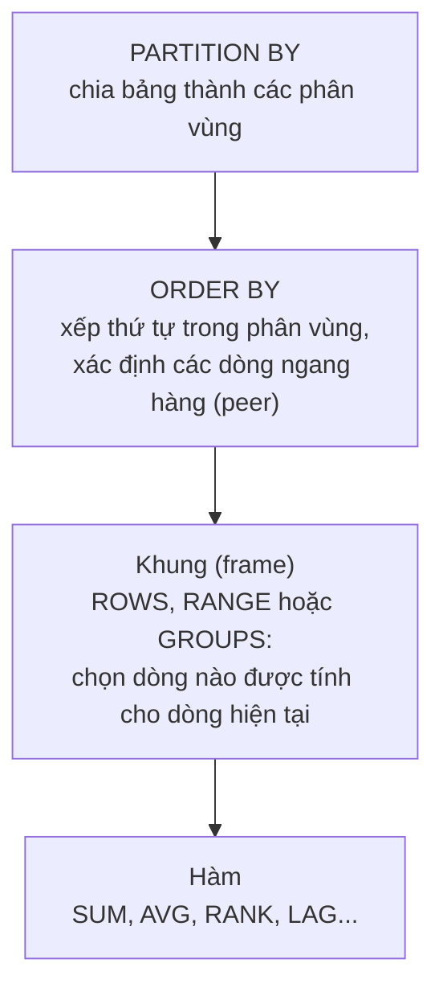

Window function (hàm cửa sổ) trong SQL tính một giá trị cho mỗi dòng từ một tập dòng liên quan nhưng không gộp dòng như `GROUP BY`: bảng 25 con cá vẫn trả về 25 dòng, mỗi dòng thêm một cột hạng, tổng tích luỹ hay trung bình trượt. Mỗi biểu thức `OVER (...)` có ba phần: `PARTITION BY` chia nhóm, `ORDER BY` xếp thứ tự, và khung (frame) chọn những dòng nào được đưa vào phép tính. Chi tiết dễ sai nhất là khung mặc định: khi có `ORDER BY` mà không ghi khung, SQLite, PostgreSQL 18, MySQL 8.4 và SQL Server đều dùng `RANGE BETWEEN UNBOUNDED PRECEDING AND CURRENT ROW`, nên hai đơn hàng cùng ngày làm tổng tích luỹ đi 100 → 180 → 180 chứ không phải 100 → 150 → 180. Bài viết cho người học sinh học và tin sinh học. Mọi truy vấn đã chạy thật trên SQLite 3.45.3; phần hạng trùng được đối chiếu thêm bằng R 4.4.3.

<div class="callout callout-note">
<p class="callout-title">Tóm tắt nhanh</p>

- Window function giữ nguyên số dòng và thêm cột; `GROUP BY` gộp dòng.
- `ROW_NUMBER`, `RANK`, `DENSE_RANK` chỉ khác nhau khi có giá trị trùng; `ROW_NUMBER` cần cột phá hoà để kết quả ổn định.
- Khung mặc định là `RANGE`, không phải `ROWS`: `ROWS` đếm dòng, `RANGE` đo khoảng cách giá trị, `GROUPS` đếm nhóm giá trị bằng nhau.
- Với độ phủ gen có khoảng trống, `RANGE` cho cửa sổ đúng theo bp; hạng trung bình cho Wilcoxon tính được bằng một dòng SQL.

</div>

## 1. Window function là gì: giữ dòng, thêm cột

Lấy một câu hỏi sinh học đơn giản: trong bảng đo 25 cá *Coilia grayii*, mỗi con dài hơn hay ngắn hơn trung bình của nhóm giới tính của nó bao nhiêu? `GROUP BY sex` trả lời được nửa đầu (trung bình mỗi nhóm) nhưng trả về hai dòng, và cột chiều dài của từng con biến mất (→ GROUP BY & HAVING). Window function trả lời cả hai trong một biểu thức.

```sql
SELECT fish, sex, l_cm,
       AVG(l_cm) OVER (PARTITION BY sex)           AS tb_nhom,
       l_cm - AVG(l_cm) OVER (PARTITION BY sex)    AS lech
FROM fish;
```

Mỗi dòng giữ nguyên, và `AVG(...) OVER (PARTITION BY sex)` cho mọi con cùng giới tính một giá trị trung bình chung: 18,69 cm cho 13 con có `sex = 0` và 20,09 cm cho 12 con có `sex = 1`. Cá số 11 dài 22,3 cm nên cột `lech` của nó là +2,21 cm; cá số 3 dài 17,7 cm, lệch −2,39 cm. `OVER ()` để trống nghĩa là cả bảng là một cửa sổ.

| | `GROUP BY` | Window function |
|---|---|---|
| Số dòng kết quả | Giảm, mỗi nhóm một dòng | Giữ nguyên |
| Cột chi tiết | Mất, trừ cột nhóm | Giữ |
| Câu hỏi điển hình | Tổng, trung bình của từng nhóm | So sánh từng cá thể với nhóm của nó; hạng; tích luỹ; trượt |

*Bảng 1. GROUP BY và window function.*

Bảng *C. grayii* dùng xuyên suốt bài là bảng 25 cá thể đã được làm sạch và công bố dạng CSV trong bài [truy vấn dữ liệu sinh học bằng Excel, SQL và R](/blog/phan-tich-co-so-du-lieu/); ở đây chỉ cần bốn cột `fish`, `l_cm`, `sex`, `age`. Bảng có nhiều con cùng chiều dài, đúng tình huống làm các hàm xếp hạng và các loại khung cho kết quả khác nhau: 19,5 cm (2 con), 20,6 cm (2 con) và 21,0 cm (3 con).

## 2. Giải phẫu một biểu thức OVER(...)

Một window function được định nghĩa bởi ba lớp, đọc từ ngoài vào trong:



**Phân vùng.** `PARTITION BY` chia tập dòng thành các nhóm độc lập; hàm không bao giờ nhìn sang phân vùng khác. Không có `PARTITION BY` thì cả kết quả truy vấn là một phân vùng.

**Thứ tự và dòng ngang hàng.** `ORDER BY` bên trong `OVER` xếp các dòng trong phân vùng. Nó cũng sinh ra một khái niệm quan trọng: các dòng có cùng giá trị sắp xếp được gọi là dòng ngang hàng (peer) của nhau (SQLite, n.d.; PostgreSQL Global Development Group, n.d.). Peer quyết định kết quả của `RANK` và của khung `RANGE`.

**Khung.** Với mỗi dòng, khung là tập con của phân vùng mà hàm tổng hợp được tính trên đó. Có ba đơn vị đo khung: `ROWS` (số dòng), `RANGE` (khoảng giá trị của cột sắp xếp) và `GROUPS` (số nhóm peer). Hàm xếp hạng và `LAG`/`LEAD` không dùng khung.

**Thứ tự thực thi.** Window function được tính sau `WHERE`, `GROUP BY` và `HAVING`, và trước `ORDER BY` cuối cùng của truy vấn (Leis et al., 2015). Vì `WHERE` chạy trước, cửa sổ chỉ nhìn thấy những dòng còn lại sau khi lọc. Chạy lại truy vấn ở mục 1 với `WHERE fish IN (1, 2, 3, 11, 25)`, trung bình của nhóm `sex = 0` không còn là 18,69 cm mà là 16,93 cm, tức trung bình của ba con 1, 2 và 25 còn lại trong nhóm. Muốn so với trung bình cả mẫu rồi mới lọc thì tính window function trong một CTE trước. Hệ quả thứ hai: bạn không thể lọc bằng kết quả window function trong `WHERE` của cùng truy vấn (phải bọc thêm một lớp subquery hoặc CTE), nhưng có thể đặt window function lên kết quả đã gộp, ví dụ `LAG(SUM(total_amount)) OVER (ORDER BY thang)` sau `GROUP BY thang`.

**Đặt tên cửa sổ.** Khi nhiều hàm dùng chung một cửa sổ, mệnh đề `WINDOW` giúp truy vấn ngắn và tránh sai lệch giữa các bản chép (SQLite, n.d.):

```sql
SELECT fish, l_cm,
       ROW_NUMBER() OVER w AS rn,
       RANK()       OVER w AS rk
FROM fish
WINDOW w AS (PARTITION BY sex ORDER BY l_cm DESC);
```

## 3. Xếp hạng: ROW_NUMBER, RANK, DENSE_RANK và hạng trùng

Ba hàm xếp hạng chỉ khác nhau khi có giá trị trùng. Ví dụ bốn mức lương 35, 25, 25, 20 (triệu đồng), xếp giảm dần:

```sql
SELECT ten, salary,
       ROW_NUMBER()   OVER w AS rn,
       RANK()         OVER w AS rk,
       DENSE_RANK()   OVER w AS drk,
       PERCENT_RANK() OVER w AS pr,
       CUME_DIST()    OVER w AS cd
FROM luong
WINDOW w AS (ORDER BY salary DESC);
```

| Lương | `ROW_NUMBER` | `RANK` | `DENSE_RANK` | `PERCENT_RANK` | `CUME_DIST` |
|---|---|---|---|---|---|
| 35 | 1 | 1 | 1 | 0 | 0,25 |
| 25 | 2 | 2 | 2 | 0,333 | 0,75 |
| 25 | 3 | 2 | 2 | 0,333 | 0,75 |
| 20 | 4 | 4 | 3 | 1 | 1 |

*Bảng 2. Kết quả trên SQLite 3.45.3.*

`ROW_NUMBER` luôn cho số khác nhau. `RANK` cho các dòng trùng cùng hạng rồi bỏ qua số hạng đã "dùng" (2, 2, rồi 4). `DENSE_RANK` không bỏ (2, 2, rồi 3). `PERCENT_RANK` bằng (rank − 1)/(n − 1): với hai người lương 25, (2 − 1)/(4 − 1) = 0,333. `CUME_DIST` là tỷ lệ dòng đứng trước hoặc ngang hàng với dòng hiện tại: ba trên bốn dòng có lương từ 25 trở lên, nên 0,75.

| Câu hỏi | Hàm nên dùng |
|---|---|
| Cần đúng k dòng mỗi nhóm, kể cả khi có đồng hạng (lấy mẫu, phân trang, khử trùng lặp) | `ROW_NUMBER` + cột phá hoà |
| Giữ mọi cá thể đồng hạng, hạng phản ánh "bao nhiêu cá thể đứng trước" | `RANK` |
| Đếm số mức giá trị khác nhau (mức 1, mức 2…) | `DENSE_RANK` |
| Hạng dùng cho thống kê phi tham số | hạng trung bình (mục 8) |
| Vị trí tương đối từ 0 đến 1 | `PERCENT_RANK`, `CUME_DIST` |

*Bảng 3. Chọn hàm xếp hạng theo câu hỏi.*

### Tính tất định và cột phá hoà

Hai người cùng lương 25 nhận `ROW_NUMBER` 2 và 3, nhưng ai là 2 thì truy vấn không quy định. Khi khoá sắp xếp có giá trị trùng, `ROW_NUMBER` không tất định: kết quả có thể đổi giữa hai lần chạy hoặc giữa hai hệ quản trị (Leis et al., 2015; Zemke, 2012). Cách sửa là thêm một cột phá hoà (tie-breaker) duy nhất vào `ORDER BY`, ví dụ `ORDER BY salary DESC, id` (→ Sắp xếp & Tìm kiếm). Với dữ liệu sinh học, cột phá hoà nên là mã định danh ổn định như mã mẫu, mã cá thể hay Ensembl ID, không phải số thứ tự dòng tự sinh khi nhập file, vì số đó đổi mỗi lần nạp lại.

### ORDER BY có bắt buộc không?

Về ý nghĩa thì có: hạng không có thứ tự là vô nghĩa. Về cú pháp thì tuỳ hệ. SQLite chạy được `RANK() OVER ()` và trả 1 cho mọi dòng, vì khi không có `ORDER BY` mọi dòng đều là peer; `ROW_NUMBER() OVER ()` trả 1, 2, 3, 4 theo thứ tự đọc bảng. SQL Server thì ghi rõ mệnh đề `ORDER BY` là bắt buộc với `RANK`, và hàm này không nhận mệnh đề `ROWS`/`RANGE` (Microsoft, n.d.-b). Vì vậy một truy vấn quên `ORDER BY` có thể báo lỗi ở hệ này và âm thầm trả toàn số 1 ở hệ khác. Một "top 10 gene" mà mọi gene đều hạng 1 sẽ trả về cả bảng.

### Ví dụ: xếp hạng cá theo chiều dài trong từng giới tính

```sql
SELECT sex, fish, l_cm,
       ROW_NUMBER() OVER (PARTITION BY sex ORDER BY l_cm DESC, fish) AS rn,
       RANK()       OVER w AS rk,
       DENSE_RANK() OVER w AS drk
FROM fish
WINDOW w AS (PARTITION BY sex ORDER BY l_cm DESC);
```

| Cá | L (cm) | `ROW_NUMBER` | `RANK` | `DENSE_RANK` |
|---|---|---|---|---|
| 12 | 21,1 | 3 | 3 | 3 |
| 7 | 21,0 | 4 | 4 | 4 |
| 17 | 21,0 | 5 | 4 | 4 |
| 22 | 20,2 | 6 | 6 | 5 |
| 18 | 20,1 | 7 | 7 | 6 |
| 16 | 19,5 | 8 | 8 | 7 |
| 20 | 19,5 | 9 | 8 | 7 |

*Bảng 4. Cá có `sex = 1`, hạng 3 đến 9 trong 12 con, xếp theo chiều dài giảm dần (SQLite 3.45.3).*

Cá 7 và 17 cùng dài 21,0 cm: `ROW_NUMBER` cho 4 và 5 (theo số hiệu cá), `RANK` và `DENSE_RANK` cùng cho 4. Từ con kế tiếp, cá 22 dài 20,2 cm, hai hàm tách nhau: `RANK` nhảy lên 6 vì đã có năm con đứng trước, `DENSE_RANK` chỉ lên 5 vì mới có bốn mức chiều dài. Cặp 19,5 cm (cá 16 và 20) lặp lại đúng mẫu đó.

<div class="callout callout-warning">
<p class="callout-title">Cột phá hoà đặt sai chỗ</p>

Cột phá hoà `fish` chỉ nên nằm trong cửa sổ của `ROW_NUMBER`. Nếu thêm `fish` vào cửa sổ chung `w`, cá 7 và 17 không còn là peer, và `RANK` cho chúng 4 và 5, giống hệt `ROW_NUMBER`. Truy vấn vẫn chạy, chỉ mất thông tin đồng hạng.

</div>

### Lấy top-k mỗi nhóm

Câu hỏi "4 con dài nhất của mỗi giới tính" là một ứng dụng quen thuộc của hàm xếp hạng. Vì không thể lọc window function trong `WHERE`, bạn bọc trong CTE (→ CTE & Set Operations):

```sql
WITH h AS (
  SELECT sex, fish, l_cm,
         RANK() OVER (PARTITION BY sex ORDER BY l_cm DESC) AS rk
  FROM fish
)
SELECT * FROM h WHERE rk <= 4;
```

Với `sex = 1`, điều kiện `rk <= 4` trả 5 con vì cá 7 và 17 đồng hạng 4; nhóm `sex = 0` cũng trả 5 con vì cá 13 và 19 cùng dài 20,6 cm; nếu dùng `ROW_NUMBER` thì chỉ còn 4 con và một trong hai bị loại theo cột phá hoà.

## 4. LAG và LEAD: so sánh với dòng trước, dòng sau

`LAG(cột, n, mặc_định)` lấy giá trị ở n dòng trước trong cùng phân vùng, `LEAD` lấy ở n dòng sau. Ví dụ quen thuộc là tăng trưởng doanh thu so với tháng trước:

```sql
SELECT thang, doanh_thu, dt_truoc,
       ROUND((doanh_thu - dt_truoc) * 100.0 / NULLIF(dt_truoc, 0), 1) AS tang_truong_pct
FROM (
  SELECT strftime('%Y-%m', order_date) AS thang,
         SUM(total_amount) AS doanh_thu,
         LAG(SUM(total_amount)) OVER (ORDER BY strftime('%Y-%m', order_date)) AS dt_truoc
  FROM orders
  WHERE status = 'Completed'
  GROUP BY thang
);
```

Trên một bảng đơn hàng nhỏ (tháng 1: 150; tháng 2: 0; tháng 3: không có đơn; tháng 4: 80), truy vấn trả:

| Tháng | Doanh thu | Tháng trước (`LAG`) | Tăng trưởng (%) |
|---|---|---|---|
| 2026-01 | 150 | NULL | NULL |
| 2026-02 | 0 | 150 | −100,0 |
| 2026-04 | 80 | 0 | NULL |

*Bảng 5. Tăng trưởng so với dòng trước, SQLite 3.45.3.*

Truy vấn này có bốn chỗ dễ vấp. Thứ nhất, `strftime` là hàm của SQLite; PostgreSQL dùng `date_trunc` hoặc `to_char`. Thứ hai, tham số mặc định chỉ thay cho giá trị nằm ngoài biên phân vùng. Trên bảng (10, NULL, 30), `LAG(v, 1, 0)` trả 0 ở dòng đầu, 10 ở dòng hai, nhưng ở dòng ba vẫn trả NULL vì giá trị thật của dòng trước là NULL. Thứ ba, tháng trước có doanh thu 0 làm phép chia hỏng; SQLite trả NULL cho phép chia cho 0, còn hệ khác có thể báo lỗi, nên `NULLIF(dt_truoc, 0)` là cách viết an toàn trên mọi hệ.

Chỗ thứ tư khó thấy hơn: `LAG` lấy dòng trước, không phải tháng trước. Trong Bảng 5, tháng 3 không có đơn hàng nào nên không có dòng, và dòng tháng 4 bị so với tháng 2. Với số ca bệnh theo tuần, tuần không có ca nào cũng thường vắng mặt trong bảng tổng hợp. Cách sửa là sinh lịch đủ tháng bằng CTE đệ quy rồi nối trái:

```sql
WITH RECURSIVE lich(thang) AS (
  SELECT '2026-01'
  UNION ALL
  SELECT strftime('%Y-%m', thang || '-01', '+1 month') FROM lich WHERE thang < '2026-04'
),
dt AS (
  SELECT strftime('%Y-%m', order_date) AS thang, SUM(total_amount) AS doanh_thu
  FROM orders WHERE status = 'Completed' GROUP BY thang
)
SELECT l.thang, COALESCE(dt.doanh_thu, 0) AS doanh_thu,
       LAG(COALESCE(dt.doanh_thu, 0)) OVER (ORDER BY l.thang) AS dt_truoc
FROM lich l LEFT JOIN dt ON dt.thang = l.thang;
```

Kết quả có đủ bốn tháng, tháng 3 nhận doanh thu 0, và tháng 4 giờ được so với tháng 3. Bảng có nhiều nhóm (nhiều trạm quan trắc) thì cần thêm `PARTITION BY` trong `LAG`.

Trong dữ liệu hệ gen, `LAG` cho khoảng cách giữa hai biến thể liên tiếp trên cùng nhiễm sắc thể: `pos - LAG(pos) OVER (PARTITION BY chrom ORDER BY pos)`. `PARTITION BY chrom` đảm bảo biến thể đầu tiên của chr2 nhận NULL thay vì bị trừ cho biến thể cuối của chr1.

## 5. Khung: ROWS, RANGE, GROUPS và khung mặc định

Khung là phần dễ sai nhất vì thường không được viết ra.

### Ba đơn vị đo khung

- `ROWS BETWEEN 1 PRECEDING AND CURRENT ROW`: dòng ngay trước và dòng hiện tại, đếm theo vị trí vật lý.
- `RANGE BETWEEN 1 PRECEDING AND CURRENT ROW`: mọi dòng có giá trị sắp xếp trong đoạn [x − 1, x], tính cả mọi peer của dòng hiện tại.
- `GROUPS BETWEEN 1 PRECEDING AND CURRENT ROW`: nhóm peer hiện tại và một nhóm peer trước đó (SQLite, n.d.; Oracle, n.d.).


*Hình 1. Khung của dòng 5 (x = 5) theo ba đơn vị trên dãy x = 1, 2, 2, 3, 5, 5. Ô xanh là dòng nằm trong khung; vạch xám trên đầu đánh dấu nhóm peer. Khung được lấy trực tiếp từ SQLite bằng `json_group_array`.*

Trong Hình 1, cùng một mệnh đề "1 PRECEDING AND CURRENT ROW" cho ba khung khác nhau. `ROWS` lấy dòng 4 và 5 nhưng bỏ dòng 6, dù dòng 6 có cùng giá trị x = 5. `RANGE` lấy các dòng có x trong [4, 5], tức dòng 5 và 6; dòng 4 (x = 3) nằm ngoài khoảng. `GROUPS` lấy nhóm peer hiện tại {5, 6} và nhóm peer liền trước {4}.

### Khung mặc định là RANGE

Khi `OVER` có `ORDER BY` mà không ghi khung, khung mặc định là `RANGE BETWEEN UNBOUNDED PRECEDING AND CURRENT ROW`. Bốn hệ phổ biến ghi giống nhau:

| Hệ | Khung mặc định khi có `ORDER BY` | Ghi chú | Nguồn |
|---|---|---|---|
| SQLite | `RANGE BETWEEN UNBOUNDED PRECEDING AND CURRENT ROW` | Không có `ORDER BY`: cả phân vùng | SQLite (n.d.) |
| PostgreSQL 18 | `RANGE UNBOUNDED PRECEDING` (cùng nghĩa) | | PostgreSQL Global Development Group (n.d.) |
| MySQL 8.4 | `RANGE BETWEEN UNBOUNDED PRECEDING AND CURRENT ROW` | Không có `ORDER BY`: cả phân vùng | Oracle (n.d.) |
| SQL Server | `RANGE BETWEEN UNBOUNDED PRECEDING AND CURRENT ROW` | Hàm xếp hạng không nhận `ROWS`/`RANGE` | Microsoft (n.d.-a, n.d.-b) |

*Bảng 6. Khung mặc định theo tài liệu chính thức, truy cập 12/11/2026 và 20/11/2026.*

Với khung `RANGE`, các dòng ngang hàng luôn nhận cùng kết quả, nên kết quả không phụ thuộc thứ tự vật lý; cái giá là tổng tích luỹ không tăng đều từng dòng khi có giá trị trùng.

### Thí nghiệm 1: running total với hai đơn hàng cùng ngày

Bốn đơn hàng: 100 ngày 01/01, 50 và 30 cùng ngày 02/01, 20 ngày 03/01.

```sql
SELECT id, d, amount,
  SUM(amount) OVER (ORDER BY d) AS mac_dinh,
  SUM(amount) OVER (ORDER BY d ROWS  BETWEEN UNBOUNDED PRECEDING AND CURRENT ROW) AS rows_,
  SUM(amount) OVER (ORDER BY d, id ROWS BETWEEN UNBOUNDED PRECEDING AND CURRENT ROW) AS rows_id,
  SUM(amount) OVER (ORDER BY d GROUPS BETWEEN 1 PRECEDING AND CURRENT ROW) AS groups_
FROM don ORDER BY d, id;
```

| id | Ngày | Số tiền | Mặc định (= `RANGE`) | `ROWS` | `ROWS` + `id` | `GROUPS` 1 |
|---|---|---|---|---|---|---|
| 1 | 01/01 | 100 | 100 | 100 | 100 | 100 |
| 2 | 02/01 | 50 | **180** | **150** | 150 | 180 |
| 3 | 02/01 | 30 | 180 | 180 | 180 | 180 |
| 4 | 03/01 | 20 | 200 | 200 | 200 | 100 |

*Bảng 7. Kết quả trên SQLite 3.45.3 (Python) và SQLite 3.37.0 (CLI macOS), hai bản cho cùng kết quả.*

Cột mặc định trùng hoàn toàn với `RANGE` ghi tường minh (không in ở đây). Ở hai đơn ngày 02/01, `RANGE` cộng cả hai cùng lúc (180, 180) vì chúng là peer; `ROWS` cộng từng đơn (150, 180), nhưng đơn nào được cộng trước phụ thuộc thứ tự vật lý, đúng như Zemke (2012) lưu ý rằng `ROWS` có thể cắt ngang một nhóm peer. Thêm `id` vào `ORDER BY` thì `ROWS` mới tất định.

Cả hai đều có thể đúng. Mặc định là "tổng đến hết ngày"; `ROWS` với cột phá hoà là "tổng đến hết đơn hàng". Câu hỏi "đến cuối ngày 02/01 đã bán bao nhiêu" cần `RANGE`; câu hỏi "đơn thứ mấy làm doanh thu vượt 150" cần `ROWS` với cột phá hoà. Đếm tích luỹ cá thể theo ngày thu mẫu cũng vậy: các con cùng mẻ lưới có cùng ngày, nên đường mặc định nhảy bậc theo mẻ.

### Thí nghiệm 2: "3 dòng gần nhất" không phải "3 ngày gần nhất"

Bốn ngày đo 01, 02, 05, 06 với giá trị 1, NULL, 3, 5.

```sql
SELECT d, v,
  AVG(v) OVER (ORDER BY d ROWS BETWEEN 2 PRECEDING AND CURRENT ROW) AS ma3_rows,
  AVG(v) OVER (ORDER BY julianday(d) RANGE BETWEEN 2 PRECEDING AND CURRENT ROW) AS ma3_range
FROM ngay;
```

Ở ngày 05, `ROWS` lấy ba dòng (01, 02, 05), bỏ NULL và chia cho 2: kết quả 2,0. `RANGE` lấy các ngày trong [03, 05], chỉ có chính ngày 05: kết quả 3,0. `RANGE` với offset số cần cột sắp xếp là số, nên ngày được đổi sang `julianday(d)`. `AVG` bỏ NULL nên mẫu số thực tế có thể nhỏ hơn 3 (→ Hàm tổng hợp); muốn biết mỗi trung bình dựa trên bao nhiêu giá trị, thêm cột `COUNT(v) OVER (...)` cùng khung. SQLite cũng chỉ cho `RANGE` có offset đi với đúng một biểu thức trong `ORDER BY`; thêm cột thứ hai sẽ báo lỗi.

### GROUPS

`GROUPS BETWEEN 1 PRECEDING AND CURRENT ROW` trên bảng đơn hàng cho tổng của ngày hiện tại và ngày có đơn liền trước: 100, 180, 180, 100. Đây là cách viết "trượt theo số ngày có dữ liệu" mà không cần gộp theo ngày trước.

## 6. Ứng dụng 1: trung bình trượt độ phủ theo toạ độ gen

Độ phủ đọc (read depth) theo từng vị trí được tính từ file BAM bằng các công cụ như samtools (Li et al., 2009), BEDTools (Quinlan & Hall, 2010) hay mosdepth (Pedersen & Quinlan, 2018). Lưu ý rằng `samtools depth` mặc định không in các vị trí có độ phủ 0; phải thêm `-a` để in tất cả (Samtools, n.d.). Vậy bảng `(chrom, pos, depth)` nạp vào SQLite thường có khoảng trống.

Bảng nhỏ tự tạo dưới có chr1 ở vị trí 100, 101, 102, 105, 106 và chr2 ở 100, 101:

```sql
SELECT chrom, pos, depth,
  AVG(depth) OVER (PARTITION BY chrom ORDER BY pos ROWS  BETWEEN 2 PRECEDING AND CURRENT ROW) AS ma_rows,
  AVG(depth) OVER (PARTITION BY chrom ORDER BY pos RANGE BETWEEN 2 PRECEDING AND CURRENT ROW) AS ma_range,
  AVG(depth) OVER (PARTITION BY chrom ORDER BY pos RANGE BETWEEN 2 PRECEDING AND 2 FOLLOWING) AS ma_c5
FROM cov;
```

| chrom | pos | depth | `ROWS` 3 dòng | `RANGE` 3 bp |
|---|---|---|---|---|
| chr1 | 100 | 10 | 10,00 | 10,00 |
| chr1 | 101 | 12 | 11,00 | 11,00 |
| chr1 | 102 | 14 | 12,00 | 12,00 |
| chr1 | 105 | 30 | **18,67** | **30,00** |
| chr1 | 106 | 32 | 25,33 | 31,00 |
| chr2 | 100 | 5 | 5,00 | 5,00 |
| chr2 | 101 | 7 | 6,00 | 6,00 |

*Bảng 8. Trung bình trượt độ phủ, SQLite 3.45.3.*

Ở vị trí 105, `ROWS` trộn hai vị trí 101 và 102 cách 3–4 bp; `RANGE` chỉ giữ những vị trí thật sự nằm trong 3 bp. `PARTITION BY chrom` ngăn cửa sổ tràn từ chr1 sang chr2. Nếu bảng đã đủ mọi vị trí kể cả độ phủ 0 (ví dụ xuất bằng `samtools depth -a`), hai khung cho cùng kết quả. Cột `ma_c5` (cửa sổ trung tâm ±2 bp, không in) ở vị trí 105 là 31,0; cửa sổ này tự thu hẹp ở biên.


*Hình 2. Dữ liệu mô phỏng: độ phủ quanh 30 ở đoạn 1–80 bp, quanh 12 ở đoạn 121–200 bp, vùng 81–120 bp có độ phủ 0 nên không có trong bảng. Đường liền: trung bình 10 dòng; đường đứt: trung bình 10 bp.*

Ngay sau vùng trống trong Hình 2, ở vị trí 121, trung bình 10 dòng là 28,0 vì chín dòng trước đó thuộc đoạn 72–80 bp có độ phủ cao, trong khi trung bình 10 bp là 9,0, đúng với độ phủ thật quanh đó. Đường `ROWS` cần đến vị trí 130 mới bắt kịp đường `RANGE`. Nếu bạn dùng trung bình trượt để gọi vùng mất đoạn hay vùng độ phủ thấp, `ROWS` sẽ làm ranh giới vùng lệch đi vài chục bp.

<div class="callout callout-note">
<p class="callout-title">Giới hạn</p>

Với bảng độ phủ cả hệ gen, hàng trăm triệu vị trí, SQL không thay được samtools, BEDTools hay mosdepth. SQL hợp với bảng đã tóm tắt; tương tự, GEMINI nạp biến thể và chú giải hệ gen vào một cơ sở dữ liệu thống nhất để người dùng truy vấn (Paila et al., 2013) (→ NGS và genomics).

</div>

## 7. Ứng dụng 2: xếp hạng gene và tính TPM trong từng mẫu

Bảng biểu hiện gene ở dạng dài `(sample, gene, len_kb, count)` là đầu vào tự nhiên cho window function (→ Transcriptomics). TPM (transcripts per million) cần chia mỗi gene cho tổng của mẫu, đúng việc của một aggregate window không có `ORDER BY`:

```sql
WITH rpk AS (
  SELECT sample, gene, count, count / len_kb AS rpk FROM expr
)
SELECT sample, gene, count,
       ROUND(rpk / SUM(rpk) OVER (PARTITION BY sample) * 1e6) AS tpm,
       RANK()       OVER (PARTITION BY sample ORDER BY rpk DESC)   AS hang_tpm,
       DENSE_RANK() OVER (PARTITION BY sample ORDER BY count DESC) AS hang_count
FROM rpk;
```

Dữ liệu dưới là mô phỏng, hai mẫu và năm gene, đủ nhỏ để kiểm tra bằng tay:

| Mẫu | Gene | Dài (kb) | Count | TPM | Hạng TPM (`RANK`) | Hạng count (`DENSE_RANK`) |
|---|---|---|---|---|---|---|
| S1 | geneB | 1,0 | 400 | 571 429 | 1 | 1 |
| S1 | geneA | 2,0 | 400 | 285 714 | 2 | 1 |
| S1 | geneC | 4,0 | 400 | 142 857 | 3 | 1 |
| S1 | geneD | 1,5 | 0 | 0 | 4 | 2 |
| S1 | geneE | 0,5 | 0 | 0 | 4 | 2 |
| S2 | geneA | 2,0 | 900 | 529 412 | 1 | 1 |
| S2 | geneC | 4,0 | 800 | 235 294 | 2 | 2 |
| S2 | geneB | 1,0 | 100 | 117 647 | 3 | 3 |
| S2 | geneE | 0,5 | 50 | 117 647 | 3 | 4 |
| S2 | geneD | 1,5 | 0 | 0 | 5 | 5 |

*Bảng 9. TPM và hạng trong từng mẫu, dữ liệu mô phỏng, SQLite 3.45.3.*

Trong mẫu S1, ba gene cùng 400 read nhưng dài 1, 2 và 4 kb, nên TPM xếp chúng 1, 2, 3 trong khi hạng theo count là 1, 1, 1. Ngược lại, trong S2, geneB (100 read, 1 kb) và geneE (50 read, 0,5 kb) có cùng TPM nên đồng hạng 3, dù count khác nhau. Kiểm tra nhanh: tổng TPM mỗi mẫu phải bằng 1 000 000.

Gene không có read là nguồn hạng trùng lớn nhất trong dữ liệu RNA-seq thật, vì một mẫu thường có hàng nghìn gene count bằng 0. Khi hạng đi tiếp vào kiểm định, dùng hạng trung bình (mục 8).

Wagner, Kin và Lynch (2012) chỉ ra RPKM không nhất quán giữa các mẫu và đề xuất TPM. Xếp hạng trong một mẫu không cần chuẩn hoá giữa mẫu, nhưng so sánh giữa mẫu thì cần đơn vị nhất quán, nên bước chuẩn hoá đi trước bước xếp hạng.

## 8. Hạng trùng trong SQL và trong kiểm định Wilcoxon

Kiểm định tổng hạng của Wilcoxon (1945) và kiểm định U của Mann và Whitney (1947) làm việc trên thứ hạng. Hàm `rank()` của R có tham số `ties.method`, mặc định `"average"` (hạng trung bình), và lựa chọn `"min"` được mô tả là kiểu xếp hạng trong thể thao (R Core Team, n.d.). `RANK()` của SQL tương ứng `"min"`. Hạng trung bình (midrank) tính bằng:

```sql
SELECT fish, l_cm,
       RANK() OVER (ORDER BY l_cm)
         + (COUNT(*) OVER (PARTITION BY l_cm) - 1) / 2.0 AS midrank
FROM fish;
```

Trên 25 cá, cột này trùng với `rank()` của R 4.4.3 ở cả 25 dòng. Cộng midrank theo giới tính rồi trừ n(n + 1)/2, truy vấn dưới cho U = 48 với nhóm `sex = 0` (13 con) và U = 108 với nhóm `sex = 1` (12 con); 48 + 108 = 13 × 12. R báo W của nhóm đứng trước: `wilcox.test(l_cm ~ sex)` cho W = 48, còn `wilcox.test(l_cm[sex == 1], l_cm[sex == 0])` cho W = 108. Hai số khớp nhau, nghĩa là `wilcox.test()` dùng hạng trung bình khi có giá trị trùng và SQL tái lập được thống kê đó bằng window function:

```sql
WITH h AS (
  SELECT sex,
         RANK() OVER (ORDER BY l_cm)
           + (COUNT(*) OVER (PARTITION BY l_cm) - 1) / 2.0 AS midrank
  FROM fish
)
SELECT sex, COUNT(*) AS n, SUM(midrank) AS tong_hang,
       SUM(midrank) - COUNT(*) * (COUNT(*) + 1) / 2.0 AS U
FROM h GROUP BY sex;
```

Công thức midrank đúng vì `RANK()` trả hạng nhỏ nhất của nhóm trùng, và một nhóm k giá trị trùng chiếm các hạng từ r đến r + k − 1, trung bình là r + (k − 1)/2. Với ba con dài 21,0 cm, `RANK()` theo thứ tự tăng là 19, k = 3, midrank là 20, đúng giá trị R in ra.

p-value thì để phần mềm thống kê tính. Khi có giá trị trùng, R dùng xấp xỉ chuẩn và in cảnh báo; ở đây p ≈ 0,11. Con số chỉ minh hoạ kỹ thuật: 25 cá thể dạy học không đủ để kết luận về khác biệt giữa hai giới (→ [Kiểm định giả thiết thống kê](/blog/kiem-dinh-gia-thiet-thong-ke-trong-nghien-cuu-sinh-hoc/)).

## 9. Hiệu năng và nguồn gốc

Trước khi có window function, running total thường được viết bằng subquery tương quan: với mỗi dòng, cộng lại mọi dòng đứng trước nó. Hai cách cho cùng kết quả, nhưng thời gian chạy khác xa nhau. Đo một lần trên một máy macOS với SQLite 3.45.3 (số đo phụ thuộc máy, chỉ nên đọc tỷ lệ): với 2 000 dòng, window function mất 3,0 ms, subquery mất 144,9 ms; với 8 000 dòng, 12,2 ms so với 2 333,3 ms. Khi số dòng tăng bốn lần, thời gian window function tăng khoảng bốn lần, còn subquery tăng khoảng mười sáu lần. Leis et al. (2015) giải thích: cách ngây thơ là O(n²); thuật toán tích luỹ đạt O(n) với khung mặc định; segment tree cho khung bất kỳ O(log n) mỗi dòng. Cao et al. (2012) tối ưu thứ tự nhiều window function trong cùng truy vấn, tránh sắp xếp lại nhiều lần cho các cửa sổ chung phân vùng và thứ tự.

Window function vào chuẩn qua bản bổ sung OLAP năm 2000 cho SQL:1999, được gộp vào SQL:2003 (Eisenberg et al., 2004; Zemke, 2012). SQL:2011 bổ sung `GROUPS`, `NTILE`, `LAG`, `LEAD`, `FIRST_VALUE`, `LAST_VALUE`, `NTH_VALUE` (Zemke, 2012). SQLite hỗ trợ window function từ 3.25.0 (15/9/2018) và `GROUPS`, `EXCLUDE`, `RANGE` có offset từ 3.28.0 (16/4/2019) (SQLite, n.d.). Bản SQLite cũ hơn 3.25.0 sẽ báo lỗi cú pháp với `OVER`; `SELECT sqlite_version();` cho biết bản đang dùng.

## 10. Kết luận và checklist

Phần hay bị bỏ qua nhất trong một biểu thức `OVER (...)` là phần không được viết ra: khung mặc định `RANGE`. Trước khi chạy một truy vấn có `OVER`, hãy tự hỏi sáu câu:

1. Phân vùng là gì; cửa sổ có tràn sang nhiễm sắc thể hay mẫu khác không?
2. Thứ tự là gì, có cần không?
3. Cột sắp xếp có giá trị trùng không?
4. Cần `ROWS`, `RANGE` hay `GROUPS`, và đã ghi khung tường minh chưa?
5. Đã có cột phá hoà ổn định chưa?
6. NULL và khoảng trống (tháng không có đơn, vị trí độ phủ 0) xử lý thế nào?

Bài sau trong series: CTE và `WITH RECURSIVE` (→ CTE & Set Operations), RFM và cohort (→ Ứng dụng thực chiến).

## Câu hỏi thường gặp

**Vì sao tổng tích luỹ có hai dòng liền nhau bằng nhau?** Vì cột trong `ORDER BY` có giá trị trùng và khung mặc định là `RANGE`, cộng mọi dòng ngang hàng cùng lúc. Viết `ROWS BETWEEN UNBOUNDED PRECEDING AND CURRENT ROW` và thêm cột phá hoà nếu muốn cộng từng dòng.

**SQLite hỗ trợ window function từ phiên bản nào?** Từ 3.25.0 (2018); `GROUPS`, `EXCLUDE` và `RANGE` có offset từ 3.28.0 (2019) (SQLite, n.d.).

## Tài liệu tham khảo

Cao, Y., Chan, C.-Y., Li, J., & Tan, K.-L. (2012). Optimization of analytic window functions. *Proceedings of the VLDB Endowment, 5*(11), 1244–1255. https://doi.org/10.14778/2350229.2350243

Eisenberg, A., Melton, J., Kulkarni, K., Michels, J.-E., & Zemke, F. (2004). SQL:2003 has been published. *ACM SIGMOD Record, 33*(1), 119–126. https://doi.org/10.1145/974121.974142

Leis, V., Kundhikanjana, K., Kemper, A., & Neumann, T. (2015). Efficient processing of window functions in analytical SQL queries. *Proceedings of the VLDB Endowment, 8*(10), 1058–1069. https://doi.org/10.14778/2794367.2794375

Li, H., Handsaker, B., Wysoker, A., Fennell, T., Ruan, J., Homer, N., Marth, G., Abecasis, G., Durbin, R., & 1000 Genome Project Data Processing Subgroup. (2009). The Sequence Alignment/Map format and SAMtools. *Bioinformatics, 25*(16), 2078–2079. https://doi.org/10.1093/bioinformatics/btp352

Mann, H. B., & Whitney, D. R. (1947). On a test of whether one of two random variables is stochastically larger than the other. *The Annals of Mathematical Statistics, 18*(1), 50–60. https://doi.org/10.1214/aoms/1177730491

Microsoft. (n.d.-a). *SELECT – OVER clause (Transact-SQL)*. Truy cập ngày 12/11/2026, từ https://learn.microsoft.com/en-us/sql/t-sql/queries/select-over-clause-transact-sql

Microsoft. (n.d.-b). *RANK (Transact-SQL)*. Truy cập ngày 20/11/2026, từ https://learn.microsoft.com/en-us/sql/t-sql/functions/rank-transact-sql

Oracle. (n.d.). *MySQL 8.4 reference manual: 14.20.3 Window function frame specification*. Truy cập ngày 12/11/2026, từ https://dev.mysql.com/doc/refman/8.4/en/window-functions-frames.html

Paila, U., Chapman, B. A., Kirchner, R., & Quinlan, A. R. (2013). GEMINI: Integrative exploration of genetic variation and genome annotations. *PLoS Computational Biology, 9*(7), e1003153. https://doi.org/10.1371/journal.pcbi.1003153

Pedersen, B. S., & Quinlan, A. R. (2018). Mosdepth: Quick coverage calculation for genomes and exomes. *Bioinformatics, 34*(5), 867–868. https://doi.org/10.1093/bioinformatics/btx699

PostgreSQL Global Development Group. (n.d.). *PostgreSQL 18 documentation: 4.2. Value expressions (4.2.8 Window function calls)*. Truy cập ngày 12/11/2026, từ https://www.postgresql.org/docs/current/sql-expressions.html

Quinlan, A. R., & Hall, I. M. (2010). BEDTools: A flexible suite of utilities for comparing genomic features. *Bioinformatics, 26*(6), 841–842. https://doi.org/10.1093/bioinformatics/btq033

R Core Team. (n.d.). *rank: Sample ranks* (R documentation, package base). Truy cập ngày 12/11/2026, từ https://stat.ethz.ch/R-manual/R-devel/library/base/html/rank.html

Samtools. (n.d.). *samtools-depth(1) manual page*. Truy cập ngày 20/11/2026, từ https://www.htslib.org/doc/samtools-depth.html

SQLite. (n.d.). *Window functions*. Truy cập ngày 12/11/2026, từ https://www.sqlite.org/windowfunctions.html

Wagner, G. P., Kin, K., & Lynch, V. J. (2012). Measurement of mRNA abundance using RNA-seq data: RPKM measure is inconsistent among samples. *Theory in Biosciences, 131*(4), 281–285. https://doi.org/10.1007/s12064-012-0162-3

Wilcoxon, F. (1945). Individual comparisons by ranking methods. *Biometrics Bulletin, 1*(6), 80–83. https://doi.org/10.2307/3001968

Zemke, F. (2012). What's new in SQL:2011. *ACM SIGMOD Record, 41*(1), 67–73. https://doi.org/10.1145/2206869.2206883
