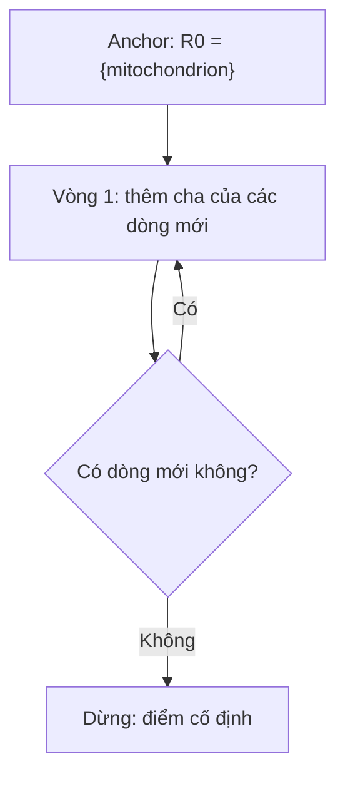
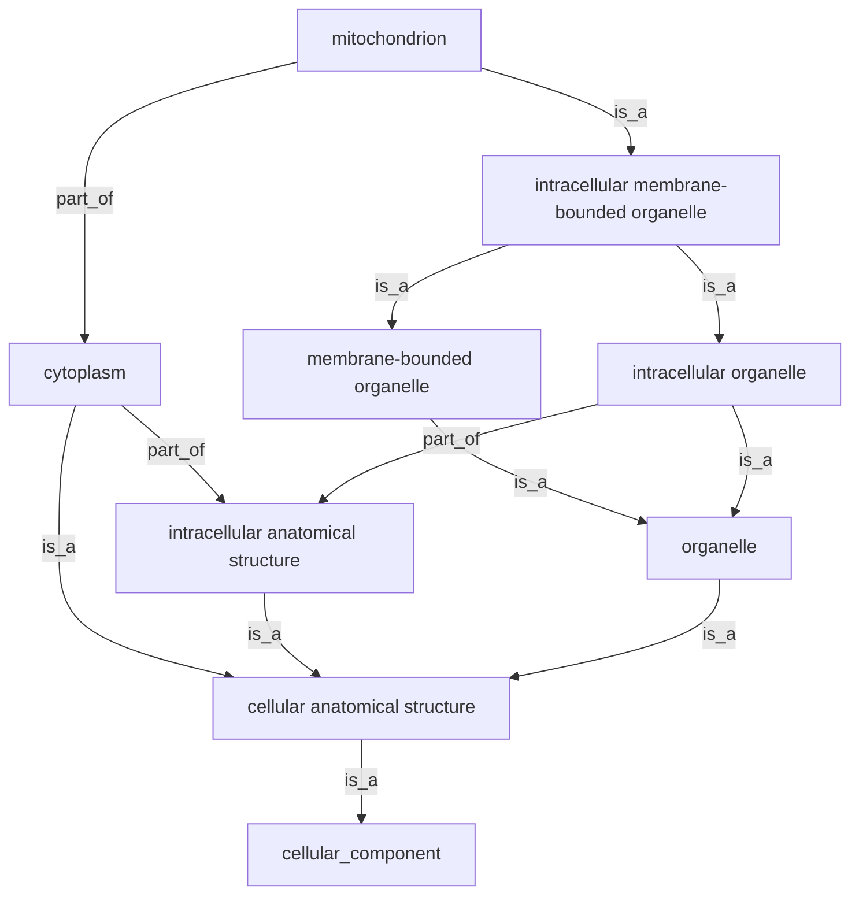

CTE (Common Table Expression, biểu thức bảng chung) là một truy vấn con được đặt tên bằng mệnh đề `WITH` và chỉ tồn tại trong một câu lệnh SQL; `WITH RECURSIVE` cho phép CTE tự gọi lại chính nó để duyệt dữ liệu phân cấp không biết trước độ sâu. Nhờ đó, câu hỏi "term Gene Ontology này thuộc những term tổng quát nào" hay "lineage đầy đủ của một tax_id" được trả lời ngay trong SQL. Trên bản go-basic.obo phát hành 2026-07-26, term *mitochondrion* có 8 tổ tiên qua `is_a` và `part_of`, nhưng truy vấn viết bằng `UNION ALL` trả về 19 dòng vì mỗi đường đi lên gốc sinh một dòng. Bài dành cho sinh viên sinh học và người làm tin sinh học đã biết `SELECT`, `JOIN`, subquery; mọi truy vấn đã chạy trên SQLite 3.45.3.

<div class="callout callout-note">
<p class="callout-title">Tóm tắt nhanh</p>

- CTE giúp tổ chức truy vấn, không hứa hẹn tốc độ: PostgreSQL từ bản 12 tự gộp CTE dùng một lần vào truy vấn cha.
- `UNION ALL` chỉ nối; `UNION` nối rồi khử trùng bằng cây B tạm, chậm hơn 12–49 lần trên 1 triệu dòng mô phỏng.
- `WITH RECURSIVE` lặp bước đệ quy trên các dòng mới đến khi không còn dòng mới (điểm cố định).
- Gene Ontology là DAG: nhiều cha sinh dòng trùng, còn chu trình thật mới làm truy vấn chạy mãi.

</div>

## 1. Câu hỏi sinh học nào cần đến đệ quy

Một gen cá ngựa vằn được chú giải vào term *mitochondrion* (GO:0005739). Khi phân tích làm giàu đếm số gen thuộc *organelle*, gen đó phải được tính, dù chú giải không hề ghi *organelle*. Lý do: *mitochondrion* `is_a` *intracellular membrane-bounded organelle*, term này lại `is_a` *intracellular organelle*, rồi *organelle*, và cứ thế lên term gốc *cellular_component*. Chú giải ở term cụ thể đúng cho mọi term tổng quát phía trên theo `is_a` và `part_of`. Tệp go-basic được lọc để không có chu trình và không có quan hệ vắt qua ba nhánh ontology, nên lan truyền chú giải lên trên là an toàn (Gene Ontology Consortium, n.d.-a).

Phân loại học có câu hỏi cùng dạng. NCBI Taxonomy cung cấp tên và vị trí phân loại cho mọi sinh vật có trình tự trong các cơ sở dữ liệu INSDC (Federhen, 2012; Schoch et al., 2020); muốn biết *Danio rerio* (tax_id 7955) thuộc bộ, lớp, ngành nào, bạn đi từ loài lên chi, họ, bộ và tiếp tục đến gốc.

Khó khăn chung là độ sâu không biết trước. Một `JOIN` bảng quan hệ với chính nó cho cha, hai `JOIN` cho ông, nhưng lineage của *Danio rerio* từ *cellular organisms* xuống loài dài 29 bậc và mỗi term GO nằm ở một độ sâu khác. Thứ cần là một phép lặp: lấy cha của tập hiện có, thêm vào kết quả, lặp đến khi không còn ai mới. `WITH RECURSIVE` là phép lặp đó viết bằng SQL.

## 2. CTE thường: đặt tên cho một bước truy vấn

### 2.1. Cú pháp

CTE khai báo bằng `WITH tên AS (truy vấn)`, sau đó phần `SELECT` chính dùng `tên` như một bảng. Ví dụ quen thuộc trong phân tích kinh doanh là tính doanh thu theo tháng rồi lọc tháng vượt ngưỡng:

```sql
WITH doanh_thu_thang AS (
    SELECT strftime('%Y-%m', order_date) AS thang,
           SUM(total_amount) AS doanh_thu
    FROM orders
    WHERE status = 'Completed'
    GROUP BY thang
)
SELECT thang, doanh_thu
FROM doanh_thu_thang
WHERE doanh_thu > 50000000;
```

Một câu lệnh có thể khai báo nhiều CTE, cách nhau bằng dấu phẩy, và CTE sau được dùng CTE trước. Với dữ liệu sinh học, bảng `annot(gene, go_id)` chứa chú giải trực tiếp; truy vấn dưới đây đếm số gen của mỗi term rồi giữ những term có ít nhất hai gen:

```sql
WITH so_gen AS (
    SELECT go_id, COUNT(DISTINCT gene) AS n_gene
    FROM annot
    GROUP BY go_id
),
term_lon AS (
    SELECT go_id, n_gene FROM so_gen WHERE n_gene >= 2
)
SELECT go_id, n_gene FROM term_lon ORDER BY n_gene DESC;
```

### 2.2. CTE, subquery, view và bảng tạm

Subquery trong `FROM` làm được việc tương tự nhưng không có tên: cần kết quả đó hai lần thì phải chép đoạn truy vấn hai lần, còn CTE gọi bằng tên bao nhiêu lần cũng được trong cùng câu lệnh. View được lưu trong schema và dùng qua nhiều câu lệnh; bảng tạm chứa dữ liệu thật suốt phiên làm việc. Cách subquery hoạt động có ở [bài Subquery và CASE WHEN](/blog/subquery-and-case-when/).

**Bảng 1.** Bốn cách đặt tên cho một kết quả trung gian

| Cách | Phạm vi tồn tại | Gọi lại bằng tên | Có thể bị gộp vào truy vấn cha |
| --- | --- | --- | --- |
| Subquery trong `FROM` | Một chỗ trong câu lệnh | Không, phải chép lại | Có |
| CTE (`WITH`) | Một câu lệnh | Có, trong câu lệnh đó | Có, tuỳ hệ và phiên bản |
| View | Lâu dài, trong schema | Có, ở mọi câu lệnh | Có |
| Bảng tạm | Một phiên kết nối | Có, trong phiên | Không, dữ liệu đã được ghi ra |

### 2.3. Được tính một lần hay gộp vào truy vấn cha

Một hiểu nhầm phổ biến là CTE luôn được tính trước thành bảng tạm nên dùng CTE sẽ nhanh hơn. Thực tế, tính trước (materialize) hay gộp vào truy vấn cha (inline) do bộ tối ưu hoá quyết định. Trước PostgreSQL 12, CTE luôn được tính trước. Từ bản 12, CTE không đệ quy, không có tác dụng phụ và chỉ được tham chiếu một lần sẽ được gộp vào truy vấn cha; CTE tham chiếu nhiều lần thì mặc định tính riêng một lần, và có thể ép bằng `MATERIALIZED` hoặc `NOT MATERIALIZED` (PostgreSQL Global Development Group, n.d.-a, n.d.-c). SQLite nhận hai từ khoá này từ bản 3.35.0 nhưng chỉ coi là gợi ý, và khuyên không dùng nếu không có lý do thuyết phục (SQLite, n.d.-c).

Muốn biết chắc thì đọc kế hoạch thực thi. Trên SQLite 3.45.3, `EXPLAIN QUERY PLAN` cho `so_gen` dùng một lần và cho bản viết bằng subquery ra cùng kế hoạch `CO-ROUTINE`: kết quả được sinh dần cho truy vấn ngoài, không ghi ra bảng. Khi CTE được dùng hai lần, kế hoạch đổi thành `MATERIALIZE`. Nhanh hay chậm do bộ tối ưu hoá quyết định, nên hãy so kế hoạch và đo thời gian trên dữ liệu của bạn.

```sql
EXPLAIN QUERY PLAN
WITH so_gen AS (
    SELECT go_id, COUNT(DISTINCT gene) AS n_gene
    FROM annot GROUP BY go_id
)
SELECT go_id FROM so_gen
WHERE n_gene = (SELECT MAX(n_gene) FROM so_gen);
-- MATERIALIZE so_gen
--   SCAN annot
--   USE TEMP B-TREE FOR GROUP BY
--   USE TEMP B-TREE FOR count(DISTINCT)
-- SCAN so_gen
-- SCALAR SUBQUERY 2
--   SEARCH so_gen
```

## 3. Phép toán tập hợp: set, bag và thứ tự ưu tiên

### 3.1. Bốn toán tử và điều kiện tương thích

SQL có bốn phép toán tập hợp (set operation) ghép kết quả của hai câu `SELECT`: `UNION` lấy hợp, `INTERSECT` lấy giao, `EXCEPT` lấy phần chỉ có ở vế trái, `UNION ALL` nối hai kết quả và giữ dòng trùng. Hai vế phải "tương thích hợp" (union compatible): cùng số cột, các cột tương ứng có kiểu tương thích, không nhất thiết giống hệt (PostgreSQL Global Development Group, n.d.-d).

SQLite còn lỏng hơn vì dùng kiểu động: `SELECT 1 UNION SELECT 'abc'` chạy bình thường. Bẫy nằm ở chỗ `SELECT 1 UNION SELECT '1'` trả về hai dòng, vì số nguyên 1 và chuỗi `'1'` là hai giá trị khác nhau. Nếu một bảng lưu gene ID dạng số, bảng kia dạng chữ, `UNION` không khử được trùng và `INTERSECT` trả về rỗng mà không báo lỗi; hãy `CAST` cả hai vế về cùng kiểu trước khi ghép.

### 3.2. Set và bag

Bảng trong SQL là đa tập (bag, multiset): một dòng có thể xuất hiện nhiều lần. `UNION`, `INTERSECT`, `EXCEPT` không có `ALL` thì khử trùng như `DISTINCT` và trả về tập (set); bản có `ALL` giữ số lần xuất hiện (PostgreSQL Global Development Group, n.d.-d). PostgreSQL có đủ `INTERSECT ALL` và `EXCEPT ALL`; ngữ pháp SQLite chỉ có `UNION`, `UNION ALL`, `INTERSECT`, `EXCEPT` (SQLite, n.d.-a). Với hệ khác, hãy tra tài liệu của chính hệ đó.

Ví dụ sinh học: hai thí nghiệm RNA-seq cho hai danh sách gen biểu hiện khác biệt (DE), lưu trong `de_a` và `de_b`. Danh sách A vô tình có *pax6a* hai lần, danh sách B có một dòng `NULL` do lỗi nhập.

```sql
CREATE TABLE de_a(gene TEXT);
CREATE TABLE de_b(gene TEXT);
INSERT INTO de_a VALUES ('tp53'), ('myca'), ('sox2'), ('pax6a'), ('pax6a');
INSERT INTO de_b VALUES ('tp53'), ('pax6a'), ('nkx2.5'), (NULL);

-- Gen DE ở cả hai thí nghiệm: pax6a, tp53
SELECT gene FROM de_a INTERSECT SELECT gene FROM de_b ORDER BY gene;

-- Gen chỉ DE ở thí nghiệm A: myca, sox2
SELECT gene FROM de_a EXCEPT SELECT gene FROM de_b ORDER BY gene;

-- Đếm dòng: UNION ALL trả 9, UNION trả 6 (kể cả dòng NULL)
SELECT COUNT(*) FROM (SELECT gene FROM de_a UNION ALL SELECT gene FROM de_b);
SELECT COUNT(*) FROM (SELECT gene FROM de_a UNION SELECT gene FROM de_b);
```

Câu hỏi "có bao nhiêu gen DE ở ít nhất một thí nghiệm" cần `UNION`; câu hỏi "tổng số lượt gen được gọi DE" cần `UNION ALL`. Chọn sai thì con số đếm sai, chậm hơn chỉ là chuyện phụ.

### 3.3. EXCEPT, NOT EXISTS và cái bẫy NOT IN

"Gen chỉ có ở A" còn viết được bằng `NOT EXISTS` hoặc `NOT IN`. Hai cách đầu cho cùng kết quả, cách thứ ba thì không:

```sql
-- myca, sox2
SELECT DISTINCT gene FROM de_a a
WHERE NOT EXISTS (SELECT 1 FROM de_b b WHERE b.gene = a.gene);

-- Rỗng! Vì de_b chứa NULL
SELECT DISTINCT gene FROM de_a
WHERE gene NOT IN (SELECT gene FROM de_b);
```

Với `NOT IN`, phép so `'myca' <> NULL` cho kết quả không xác định (unknown), nên điều kiện không bao giờ đúng. `EXCEPT` coi hai `NULL` là trùng khi khử trùng, còn `NOT EXISTS` so từng cặp bằng `=`, nên cả hai không bị dòng `NULL` làm hỏng.

### 3.4. Thứ tự ưu tiên khác nhau giữa các hệ

Khi một câu có ba vế trở lên mà không có ngoặc, thứ tự ghép quyết định kết quả. Trong PostgreSQL, `INTERSECT` gắn chặt hơn `UNION` và `EXCEPT`, còn `UNION` và `EXCEPT` kết hợp từ trái sang phải (PostgreSQL Global Development Group, n.d.-d). SQLite thì nhóm mọi toán tử từ trái sang phải: `A op B op C` được hiểu là `(A op B) op C` (SQLite, n.d.-a). Ví dụ với A = {1, 2, 3}, B = {3, 4}, C = {4}:

```sql
WITH a(x) AS (VALUES (1), (2), (3)),
     b(x) AS (VALUES (3), (4)),
     c(x) AS (VALUES (4))
SELECT x FROM a
UNION
SELECT x FROM b
INTERSECT
SELECT x FROM c;
-- SQLite 3.45.3 trả về: 4
```

SQLite tính (A ∪ B) ∩ C = {4}; theo quy tắc của PostgreSQL, cùng câu đó là A ∪ (B ∩ C) = {1, 2, 3, 4}. Cách an toàn cho mọi hệ là bọc vế cần tính trước vào subquery: `SELECT x FROM a UNION SELECT * FROM (SELECT x FROM b INTERSECT SELECT x FROM c)` trả về {1, 2, 3, 4} trên SQLite.

## 4. Benchmark: UNION tốn hơn UNION ALL bao nhiêu

### 4.1. Vì sao khử trùng tốn kém

`UNION` là `UNION ALL` cộng một bước khử trùng: hệ quản trị phải đưa toàn bộ kết quả qua sắp xếp rồi bỏ dòng liền nhau giống nhau, hoặc băm (hash) từng dòng. Bitton và DeWitt (1983) phân tích chi phí khử trùng trên tệp lớn và đề xuất một biến thể merge-sort; Graefe (1993) chỉ ra tính đối ngẫu giữa cách làm dựa trên sắp xếp và dựa trên băm cho các phép so khớp tập hợp. `UNION ALL` chỉ đọc hết vế trái rồi đọc tiếp vế phải.

Trên SQLite, `EXPLAIN QUERY PLAN` cho hai bảng `de_a`, `de_b` hiện `UNION USING TEMP B-TREE`, `INTERSECT USING TEMP B-TREE` và `EXCEPT USING TEMP B-TREE`, còn `UNION ALL` không có cây B tạm (temporary B-tree) nào.

### 4.2. Thiết kế thí nghiệm

Thí nghiệm dưới đây dùng dữ liệu mô phỏng, không phải dữ liệu sinh học thật:

1. Hai bảng `a(id)` và `b(id)`, mỗi bảng một nửa tổng số dòng (10³, 10⁴, 10⁵, 10⁶); id trong mỗi bảng không lặp; seed cố định 2026.
2. Tỷ lệ trùng giữa hai bảng: 0 %, 50 % hoặc 90 % số dòng của `b`.
3. Truy vấn đo là `SELECT COUNT(*), SUM(id)` trên kết quả ghép; cột `SUM(id)` buộc SQLite đọc từng dòng, vì chỉ `COUNT(*)` thì SQLite có thể đếm mà không đọc hết dữ liệu.
4. Mỗi cấu hình chạy 6 lần (4 lần với 10⁶ dòng), bỏ lần đầu, lấy trung vị.
5. SQLite 3.45.3 qua `sqlite3` của Python 3.13, cơ sở dữ liệu trong bộ nhớ, một máy cá nhân, ngày 20/11/2026.

```sql
-- Hai biến thể được đo, với <op> là UNION hoặc UNION ALL
SELECT COUNT(*), SUM(id)
FROM (SELECT id FROM a UNION ALL SELECT id FROM b);

SELECT COUNT(*), SUM(id)
FROM (SELECT id FROM a UNION SELECT id FROM b);
```

### 4.3. Kết quả


*Hình 1. Thời gian chạy (trung vị) của UNION và UNION ALL theo tổng số dòng và tỷ lệ trùng, trục log–log. Dữ liệu mô phỏng, SQLite 3.45.3, một máy cá nhân.*

**Bảng 2.** Thời gian trung vị (ms) và số dòng trả về

| Tổng số dòng | Trùng | UNION ALL (ms) | UNION (ms) | UNION / UNION ALL | Dòng UNION trả về |
| --- | --- | --- | --- | --- | --- |
| 10³ | 0 % | 0,09 | 0,77 | 9× | 1 000 |
| 10³ | 90 % | 0,09 | 0,29 | 3× | 550 |
| 10⁵ | 0 % | 9,7 | 90 | 9× | 100 000 |
| 10⁵ | 90 % | 10,0 | 66 | 7× | 55 000 |
| 10⁶ | 0 % | 105 | 4 844 | 46× | 1 000 000 |
| 10⁶ | 50 % | 98 | 4 826 | 49× | 750 000 |
| 10⁶ | 90 % | 225 | 2 794 | 12× | 550 000 |

Có ba xu hướng. Thời gian `UNION ALL` tăng gần tuyến tính theo số dòng, vì nó chỉ đọc dữ liệu. Khoảng cách giữa hai toán tử giãn ra khi dữ liệu lớn: 2–9 lần ở 10³ dòng, 12–49 lần ở 10⁶ dòng. Tỷ lệ trùng cao lại làm `UNION` *nhanh hơn*, vì cây B tạm chỉ chứa các giá trị khác nhau. Điểm `UNION ALL` 225 ms ở 10⁶ dòng, 90 % trùng cao bất thường so với hai cấu hình cùng cỡ, nhiều khả năng là nhiễu; mỗi điểm chỉ có ba lần đo hợp lệ.

Bảng trên chỉ minh hoạ xu hướng trên một máy, không phải so sánh giữa các hệ quản trị; PostgreSQL có thể chọn băm thay cho sắp xếp. Quy tắc thực hành: hai vế chắc chắn không trùng (mẫu của lô sequencing 2024 và lô 2025) thì dùng `UNION ALL`; cần mỗi giá trị một lần thì dùng `UNION`.

## 5. Nền lý thuyết: bao đóng bắc cầu và điểm cố định

### 5.1. Giới hạn của đại số quan hệ

Mô hình quan hệ của Codd (1970) xây truy vấn từ các phép toán chọn, chiếu, nối, hợp, hiệu; mỗi biểu thức như vậy chỉ đi được một số bước cố định trên dữ liệu. Bao đóng bắc cầu (transitive closure) của quan hệ cha–con, tức tập mọi cặp (tổ tiên, hậu duệ), cần số bước phụ thuộc độ sâu dữ liệu nên không viết được bằng một biểu thức cố định. Kết quả này đã được biết trong logic bậc nhất; Aho và Ullman (1979) chỉ ra giới hạn đó cho ngôn ngữ truy vấn cơ sở dữ liệu và đề xuất bổ sung toán tử điểm cố định (fixpoint).

### 5.2. Điểm cố định nhỏ nhất

Gọi $E$ là bảng cạnh (con, cha) và $R_0$ là tập khởi đầu (anchor), ví dụ chỉ chứa term *mitochondrion*. Mỗi vòng lặp thêm vào kết quả các cha của những dòng vừa tìm được:

$$
R_{i+1} = R_i \cup \{\, p \mid (c, p) \in E,\ c \in R_i \,\}
$$

Vì dữ liệu hữu hạn và mỗi vòng chỉ thêm chứ không bớt, chuỗi $R_0 \subseteq R_1 \subseteq R_2 \subseteq \dots$ phải dừng tại một vòng $k$ mà $R_{k+1} = R_k$. Tập $R_k$ đó là **điểm cố định nhỏ nhất** (least fixpoint): tập nhỏ nhất chứa anchor và đóng với bước đệ quy. `WITH RECURSIVE` trong SQL tính đúng tập này.



### 5.3. Naive và semi-naive

Cách tính ngây thơ (naive) áp dụng bước đệ quy lên toàn bộ $R_i$ mỗi vòng, nên cha đã tìm được bị tìm lại mãi. Cách bán ngây thơ (semi-naive) chỉ áp dụng lên phần **mới** của vòng trước, $\Delta_i = R_i \setminus R_{i-1}$. Bancilhon và Ramakrishnan (1986) so sánh các chiến lược này trong bài tổng quan về xử lý truy vấn đệ quy; Abiteboul và cộng sự (1995) trình bày chúng một cách hình thức.

PostgreSQL hiện thực ý tưởng semi-naive bằng một "working table" chỉ chứa dòng sinh ra ở vòng trước; với `UNION`, dòng trùng với kết quả đã có bị loại trước vòng sau (PostgreSQL Global Development Group, n.d.-a). SQLite dùng hàng đợi: lấy từng dòng ra, đưa vào kết quả, chạy bước đệ quy như thể đó là dòng duy nhất, rồi đưa dòng mới vào hàng đợi; với `UNION`, dòng chỉ vào hàng đợi nếu chưa từng vào. Không có `ORDER BY` trong phần đệ quy thì hàng đợi vào trước ra trước, tức duyệt theo chiều rộng; `ORDER BY` có thể biến nó thành duyệt theo chiều sâu (SQLite, n.d.-c).

### 5.4. Từ chuẩn đến phần mềm

Theo các tài liệu tổng quan, CTE đệ quy vào chuẩn SQL ở phiên bản SQL:1999 (xem Eisenberg & Melton, 1999, về bối cảnh SQL:1999); văn bản chuẩn ISO là tài liệu trả phí nên mốc này dựa trên nguồn thứ cấp. SQLite thêm CTE và `WITH` ở bản 3.8.3 (2014-02-03) và cho phép nhiều câu `SELECT` đệ quy từ bản 3.34.0 (2020-12-01) (SQLite, n.d.-b). Cả PostgreSQL và SQLite chấp nhận `UNION` hoặc `UNION ALL` giữa anchor và phần đệ quy (PostgreSQL Global Development Group, n.d.-a; SQLite, n.d.-c); lựa chọn này thay đổi cả kết quả lẫn khả năng dừng.

## 6. Ứng dụng 1: truy vấn Gene Ontology trong SQLite

### 6.1. GO là DAG, không phải cây

Gene Ontology ra đời năm 2000 như bộ từ vựng có cấu trúc để mô tả chức năng gen thống nhất giữa các loài (Ashburner et al., 2000) và nay là knowledgebase gồm ontology, chú giải và mô hình GO-CAM (Gene Ontology Consortium et al., 2023). Mọi term, trừ term gốc của mỗi nhánh, có quan hệ `is_a` tới ít nhất một term khác, và một term có thể có nhiều cha qua các quan hệ khác nhau (Gene Ontology Consortium, n.d.-b). GO vì vậy là đồ thị có hướng không chu trình (directed acyclic graph, DAG), khác cây quản lý nhân viên trong sách SQL nơi mỗi người có đúng một quản lý.

### 6.2. Nạp go-basic.obo vào hai bảng

Tệp go-basic.obo tải ngày 20/11/2026 ghi `data-version: releases/2026-07-26`. Một script Python ngắn đọc từng khối `[Term]` và tách các dòng `id`, `name`, `namespace`, `is_obsolete`, `is_a` và `relationship` vào hai bảng:

```sql
CREATE TABLE term(go_id TEXT PRIMARY KEY, name TEXT, namespace TEXT, is_obsolete INT);
CREATE TABLE edge(child TEXT, parent TEXT, relation TEXT);
```

Bản phát hành này có 48 340 term (10 248 term đã lỗi thời) và 71 496 cạnh: 57 456 `is_a`, 6 270 `part_of`, 2 820 `regulates`, 2 475 `positively_regulates` và 2 475 `negatively_regulates`. Các con số đổi theo bản phát hành, nên kết quả GO cần ghi kèm `data-version`.

### 6.3. Truy vấn tổ tiên và hậu duệ

Truy vấn tổ tiên đi từ term lên gốc theo `is_a` và `part_of`. Anchor là chính term đó với `depth = 0`; bước đệ quy nối `edge` với kết quả hiện có theo cột `child` và lấy `parent`:

```sql
WITH RECURSIVE anc(go_id, depth) AS (
    SELECT 'GO:0005739', 0
    UNION ALL
    SELECT e.parent, a.depth + 1
    FROM edge e
    JOIN anc a ON e.child = a.go_id
    WHERE e.relation IN ('is_a', 'part_of')
)
SELECT a.go_id, t.name, MIN(a.depth) AS min_depth, COUNT(*) AS n_paths
FROM anc a JOIN term t ON t.go_id = a.go_id
GROUP BY a.go_id
ORDER BY min_depth, a.go_id;
```

Kết quả có 9 term (*mitochondrion* và 8 tổ tiên) nhưng 19 dòng trước khi gộp: *cellular_component* và *cellular anatomical structure* mỗi term xuất hiện 5 lần, vì có 5 đường khác nhau đi lên tới chúng. Sơ đồ dưới vẽ đúng các cạnh truy vấn tìm thấy.



Đổi `UNION ALL` thành `UNION` (và bỏ cột `depth`, vì `UNION` so cả dòng) thì mỗi term chỉ xuất hiện một lần:

```sql
WITH RECURSIVE anc(go_id) AS (
    SELECT 'GO:0005739'
    UNION
    SELECT e.parent
    FROM edge e
    JOIN anc a ON e.child = a.go_id
    WHERE e.relation IN ('is_a', 'part_of')
)
SELECT COUNT(*) FROM anc;   -- 9
```

Truy vấn hậu duệ chỉ cần đảo chiều nối: `JOIN d ON e.parent = d.go_id` và lấy `e.child`. Với *mitochondrion*, tập hậu duệ qua `is_a` và `part_of` (tính cả chính nó) có 71 term.

**Bảng 3.** Số dòng của truy vấn tổ tiên (`is_a` + `part_of`, tính cả term xuất phát), go-basic 2026-07-26

| Term | UNION | UNION ALL |
| --- | --- | --- |
| GO:0005739 mitochondrion | 9 | 19 |
| GO:0007507 heart development | 10 | 21 |
| GO:0006915 apoptotic process | 5 | 5 |
| GO:0016301 kinase activity | 5 | 5 |
| GO:0061283 specification of mesonephric distal tubule identity | 63 | 4 779 |

*Apoptotic process* và *kinase activity* có tổ tiên xếp thành chuỗi thẳng nên hai cách cho cùng số dòng. Ở đầu kia, trong các term chưa lỗi thời, *specification of mesonephric distal tubule identity* có nhiều đường đi lên gốc nhất: 63 term nhưng 4 779 dòng với `UNION ALL`. Số đường đi có thể tăng theo cấp số nhân khi các nhánh hợp rồi tách, nên trên DAG sâu và rậm, `UNION ALL` làm truy vấn phình to.

Câu hỏi quyết định toán tử: "gen này thuộc những term nào" cần **tập** term, tức `UNION`; "có bao nhiêu đường đi lên gốc" cần `UNION ALL`, hoặc đếm bằng quy hoạch động ngoài SQL khi số đường lớn.

### 6.4. Kiểm tra kết quả và index

Tập tổ tiên của bốn term đầu trong Bảng 3 được tính lại bằng một hàm duyệt đồ thị Python trên cùng bảng `edge` và khớp với SQL. Không term chưa lỗi thời nào tự quay về chính nó qua `is_a` và `part_of`, đúng với mô tả go-basic (Gene Ontology Consortium, n.d.-a). GOATOOLS cũng có sẵn hàm lấy tổ tiên trong Python để đối chiếu (Klopfenstein et al., 2018).

Index quyết định tốc độ. Không có index, mỗi vòng đệ quy quét cả bảng 71 496 cạnh: tổ tiên của *apoptotic process* mất khoảng 53 ms, hậu duệ của *mitochondrion* khoảng 123 ms. Có index trên `edge(child)` và `edge(parent)`, hai con số còn 0,04 ms và 0,18 ms; kế hoạch thực thi hiện `SEARCH e USING INDEX ix_parent (parent=?)` trong bước đệ quy.

```sql
CREATE INDEX ix_child  ON edge(child);
CREATE INDEX ix_parent ON edge(parent);
```

## 7. Ứng dụng 2: lineage trong NCBI Taxonomy

NCBI Taxonomy là ví dụ đối lập: một cây thật, mỗi node đúng một cha. Tệp `nodes.dmp` trong taxdump có mỗi dòng gồm `tax_id`, `parent tax_id`, `rank` và nhiều cột khác, phân tách bằng `\t|\t` (National Center for Biotechnology Information [NCBI], n.d.). Bản thân NCBI Taxonomy đã chuyển từ một cơ sở dữ liệu SQL duy nhất sang nhiều cơ sở dữ liệu liên kết để phục vụ biên tập (Schoch et al., 2020); với người dùng, taxdump vẫn là cách gọn nhất để có cả cây trong cơ sở dữ liệu của riêng bạn.

Sau khi nạp `nodes.dmp` vào bảng `tax_node(tax_id, parent_tax_id, rank)` và tên khoa học từ `names.dmp` vào `tax_name(tax_id, name)`, lineage của *Danio rerio* là một truy vấn đi lên:

```sql
WITH RECURSIVE lineage(tax_id, depth) AS (
    SELECT 7955, 0
    UNION ALL
    SELECT n.parent_tax_id, l.depth + 1
    FROM tax_node n
    JOIN lineage l ON n.tax_id = l.tax_id
    WHERE n.tax_id <> n.parent_tax_id      -- phòng khi gốc tự trỏ
)
SELECT l.depth, l.tax_id, nm.name, n.rank
FROM lineage l
JOIN tax_node n  ON n.tax_id = l.tax_id
JOIN tax_name nm ON nm.tax_id = l.tax_id
WHERE n.rank IN ('domain', 'kingdom', 'phylum', 'class', 'order', 'family', 'genus', 'species')
ORDER BY l.depth DESC;
```

Điều kiện `n.tax_id <> n.parent_tax_id` là lưới an toàn cho node gốc (tax_id 1, *root*). Hãy xem dòng của tax_id 1 trong bản `nodes.dmp` bạn tải về: nếu cha của gốc được ghi là chính nó, thiếu điều kiện này thì bước đệ quy tìm thấy cha của gốc là gốc, rồi lại là gốc, và với `UNION ALL` truy vấn không dừng. Đó là một chu trình độ dài 1, đúng loại vấn đề của mục 8; nếu gốc không tự trỏ, điều kiện này vô hại.

**Bảng 4.** Lineage của *Danio rerio* theo tám bậc chính (domain, kingdom, phylum, class, order, family, genus, species), theo bản ghi NCBI Taxonomy truy vấn ngày 20/11/2026

| Bậc (rank) | tax_id | Tên |
| --- | --- | --- |
| domain | 2759 | Eukaryota |
| kingdom | 33208 | Metazoa |
| phylum | 7711 | Chordata |
| class | 186623 | Actinopteri |
| order | 7952 | Cypriniformes |
| family | 2743709 | Danionidae |
| genus | 7954 | Danio |
| species | 7955 | Danio rerio |

Lineage đầy đủ có 29 bậc, nhiều bậc là `clade` như Opisthokonta hay Vertebrata; lọc lấy tám bậc chính theo `rank` cho bảng gọn như trên. Đảo chiều nối (`ON n.parent_tax_id = l.tax_id`) cho mọi hậu duệ của một chi hay họ, thêm `WHERE rank = 'species'` để đếm loài. Cây không có node nhiều cha nên `UNION ALL` không sinh dòng trùng và không cần trả chi phí `UNION`. TaxonKit là công cụ dòng lệnh chuyên dụng để đối chiếu lineage hàng loạt (Shen & Ren, 2021).

## 8. Chu trình và bốn cách chặn

### 8.1. Nhiều cha khác với chu trình

Hai hiện tượng sau hay bị nhầm là một. **Nhiều cha** (DAG) làm một node được đến bằng nhiều đường, nên `UNION ALL` sinh dòng trùng, nhưng truy vấn vẫn dừng vì mọi đường đều kết thúc ở gốc. **Chu trình** (cycle) là khi đi theo cạnh lại quay về node xuất phát; với `UNION ALL` truy vấn không bao giờ dừng. "Mỗi node chỉ có một cha" vì vậy không phải điều kiện chống vòng lặp: GO có rất nhiều node nhiều cha mà không có chu trình, còn một cây chỉ cần một cạnh trỏ ngược là có.

Đồ thị đồ chơi dưới đây minh hoạ cả hai. Bảng `g(child, parent)` có các cạnh B→A, C→A, D→B, D→C, E→D; node D có hai cha.

```sql
CREATE TABLE g(child TEXT, parent TEXT);
INSERT INTO g VALUES ('B','A'), ('C','A'), ('D','B'), ('D','C'), ('E','D');

WITH RECURSIVE anc(node) AS (
    SELECT 'E'
    UNION ALL
    SELECT g.parent FROM g JOIN anc ON g.child = anc.node
)
SELECT node, COUNT(*) FROM anc GROUP BY node ORDER BY node;
-- A 2, B 1, C 1, D 1, E 1: dừng, nhưng A xuất hiện hai lần
```

Thêm cạnh A→E là tạo ra chu trình E→D→B→A→E. Cùng truy vấn với `UNION ALL` bây giờ chạy mãi. Có bốn cách chặn.

```sql
INSERT INTO g VALUES ('A','E');   -- tạo chu trình E → D → B → A → E
```

### 8.2. Kỹ thuật 1: UNION

Với `UNION`, dòng trùng với kết quả đã có bị loại, nên khi mọi node đã được thăm thì không còn dòng mới và vòng lặp dừng (PostgreSQL Global Development Group, n.d.-a). Tài liệu SQLite dùng đúng cách này trong ví dụ duyệt đồ thị để tránh vòng lặp vô hạn (SQLite, n.d.-c). Hạn chế: `UNION` so cả dòng, nên khi có cột `depth`, dòng (A, 3) và (A, 7) khác nhau và chu trình không còn bị chặn. Trên đồ thị có cạnh A→E, truy vấn `UNION` trả về đủ 5 node rồi dừng:

```sql
WITH RECURSIVE anc(node) AS (
    SELECT 'E'
    UNION
    SELECT g.parent FROM g JOIN anc ON g.child = anc.node
)
SELECT node FROM anc ORDER BY node;   -- A, B, C, D, E
```

### 8.3. Kỹ thuật 2: giới hạn độ sâu

Thêm cột `depth` và điều kiện dừng là cách chặn cứng:

```sql
WITH RECURSIVE anc(node, depth) AS (
    SELECT 'E', 0
    UNION ALL
    SELECT g.parent, anc.depth + 1
    FROM g JOIN anc ON g.child = anc.node
    WHERE anc.depth < 20
)
SELECT COUNT(*), MAX(depth) FROM anc;   -- 218 dòng, depth tối đa 20
```

Truy vấn dừng nhưng trả 218 dòng (tính cả anchor) cho đồ thị 5 node: mỗi vòng qua chu trình lại sinh dòng mới, và vì D có hai cha nên số đường nhân đôi sau mỗi vòng. Giới hạn độ sâu là lưới an toàn khi biết độ sâu tối đa hợp lý, không phải cách xử lý chu trình. SQLite còn có `LIMIT` trong CTE đệ quy: nó giới hạn số dòng được thêm vào kết quả và luôn làm đệ quy dừng; tài liệu SQLite khuyên đặt `LIMIT` khi biết cận trên (SQLite, n.d.-c).

### 8.4. Kỹ thuật 3: cột đường đi

Cách chính xác hơn là ghi lại đường đi và dừng khi gặp node đã có trong đường đi. Trong SQLite, đường đi lưu thành chuỗi có dấu phân cách và kiểm tra bằng `instr`:

```sql
WITH RECURSIVE anc(node, path, is_cycle) AS (
    SELECT 'E', '/E/', 0
    UNION ALL
    SELECT g.parent,
           anc.path || g.parent || '/',
           instr(anc.path, '/' || g.parent || '/') > 0
    FROM g JOIN anc ON g.child = anc.node
    WHERE anc.is_cycle = 0
)
SELECT node, path, is_cycle FROM anc;
```

Truy vấn trả 8 dòng và đánh dấu đúng hai dòng `is_cycle = 1`, đường đi `/E/D/B/A/E/` và `/E/D/C/A/E/`: hai cách quay về E qua hai cha của D. Dấu `/` ở hai đầu giúp `instr` không nhầm node "A" với một phần tên "AB". Cách này giữ được `depth` và chỉ ra chu trình nằm ở đâu, đổi lại mỗi dòng mang một chuỗi dài dần.

### 8.5. Kỹ thuật 4: mệnh đề CYCLE và SEARCH

PostgreSQL 14 (phát hành 2021-09-30) thêm hai mệnh đề chuẩn cho CTE đệ quy: `SEARCH DEPTH FIRST` / `SEARCH BREADTH FIRST` quy định thứ tự duyệt, và `CYCLE` tự phát hiện chu trình (PostgreSQL Global Development Group, n.d.-a, n.d.-b). Viết `CYCLE node SET is_cycle USING path` sau định nghĩa CTE, PostgreSQL tự duy trì cột đường đi và cột đánh dấu như kỹ thuật 3. SQLite 3.45.3 báo lỗi cú pháp với `CYCLE`, và tài liệu `WITH` của SQLite không mô tả mệnh đề này; thứ tự duyệt trên SQLite điều khiển bằng `ORDER BY` (SQLite, n.d.-c).

**Bảng 5.** Bốn cách chặn chu trình trong CTE đệ quy

| Kỹ thuật | Dừng khi có chu trình | Giữ cột depth/path | Kết quả | Hệ hỗ trợ |
| --- | --- | --- | --- | --- |
| `UNION` | Có, nếu không có depth/path | Không | Mỗi node một lần | PostgreSQL, SQLite |
| `depth < N` hoặc `LIMIT` | Có | Có | Phình theo số đường | Mọi hệ (`LIMIT`: SQLite) |
| Cột đường đi | Có | Có | Chính xác, chỉ ra chu trình | Mọi hệ |
| `CYCLE` | Có | Có | Như cột đường đi | PostgreSQL ≥ 14 |

Trước khi chạy truy vấn đệ quy trên dữ liệu mới, hãy chạy kỹ thuật 3 với `WHERE is_cycle = 1` để biết dữ liệu có chu trình không. Dữ liệu đã bảo đảm không chu trình như go-basic thì `UNION` là đủ; dữ liệu tự nhập hoặc gộp nhiều nguồn nên có cả cột đường đi lẫn giới hạn độ sâu.

## 9. Kết luận và checklist

CTE, phép toán tập hợp và `WITH RECURSIVE` gặp nhau ở một câu hỏi: kết quả bạn cần là tập hay đa tập. `UNION` trả lời bằng tập và trả giá bằng cây B tạm; `UNION ALL` trả lời bằng đa tập gần như miễn phí. Trong truy vấn đệ quy, lựa chọn đó quyết định 9 hay 19 dòng cho *mitochondrion*, và quyết định truy vấn có dừng khi dữ liệu có chu trình.

Sáu điều nên kiểm:

1. Đọc kế hoạch thực thi trước khi tin CTE làm truy vấn nhanh hơn.
2. Dùng `UNION ALL` khi hai vế không thể trùng; `UNION` khi cần mỗi giá trị một lần.
3. Xác định dữ liệu là cây (NCBI Taxonomy) hay DAG (Gene Ontology).
4. Trong CTE đệ quy, chọn `UNION` cho tập node, `UNION ALL` cho số đường đi.
5. Luôn chống chu trình (`UNION`, cột đường đi, `CYCLE`) kèm giới hạn độ sâu hoặc `LIMIT`; chặn trường hợp gốc tự trỏ.
6. Ghi phiên bản dữ liệu và phần mềm cạnh mọi con số.

Kết quả truy vấn đệ quy là một bảng như mọi bảng khác, nên bước tiếp theo tự nhiên là xếp hạng hay tính tích luỹ trên nó bằng [window function](/blog/window-functions/), hoặc kết hợp CTE với window function trong [bài Ứng dụng thực chiến](/blog/ung-dung-thuc-chien/).

## Tài liệu tham khảo

Abiteboul, S., Hull, R., & Vianu, V. (1995). *Foundations of databases*. Addison-Wesley.

Aho, A. V., & Ullman, J. D. (1979). Universality of data retrieval languages. In *Proceedings of the 6th ACM SIGACT-SIGPLAN Symposium on Principles of Programming Languages* (pp. 110–119). ACM. https://doi.org/10.1145/567752.567763

Ashburner, M., Ball, C. A., Blake, J. A., Botstein, D., Butler, H., Cherry, J. M., Davis, A. P., Dolinski, K., Dwight, S. S., Eppig, J. T., Harris, M. A., Hill, D. P., Issel-Tarver, L., Kasarskis, A., Lewis, S., Matese, J. C., Richardson, J. E., Ringwald, M., Rubin, G. M., & Sherlock, G. (2000). Gene Ontology: Tool for the unification of biology. *Nature Genetics, 25*(1), 25–29. https://doi.org/10.1038/75556

Bancilhon, F., & Ramakrishnan, R. (1986). An amateur's introduction to recursive query processing strategies. In *Proceedings of the 1986 ACM SIGMOD International Conference on Management of Data* (pp. 16–52). ACM. https://doi.org/10.1145/16894.16859

Bitton, D., & DeWitt, D. J. (1983). Duplicate record elimination in large data files. *ACM Transactions on Database Systems, 8*(2), 255–265. https://doi.org/10.1145/319983.319987

Codd, E. F. (1970). A relational model of data for large shared data banks. *Communications of the ACM, 13*(6), 377–387. https://doi.org/10.1145/362384.362685

Eisenberg, A., & Melton, J. (1999). SQL:1999, formerly known as SQL3. *ACM SIGMOD Record, 28*(1), 131–138. https://doi.org/10.1145/309844.310075

Federhen, S. (2012). The NCBI Taxonomy database. *Nucleic Acids Research, 40*(D1), D136–D143. https://doi.org/10.1093/nar/gkr1178

Gene Ontology Consortium. (n.d.-a). *Download the ontology*. Retrieved November 12, 2026, from https://geneontology.org/docs/download-ontology/

Gene Ontology Consortium. (n.d.-b). *Relations in the Gene Ontology*. Retrieved November 12, 2026, from https://geneontology.org/docs/ontology-relations/

Gene Ontology Consortium, Aleksander, S. A., Balhoff, J., Carbon, S., Cherry, J. M., Drabkin, H. J., Ebert, D., Feuermann, M., et al. (2023). The Gene Ontology knowledgebase in 2023. *Genetics, 224*(1), iyad031. https://doi.org/10.1093/genetics/iyad031

Graefe, G. (1993). Query evaluation techniques for large databases. *ACM Computing Surveys, 25*(2), 73–169. https://doi.org/10.1145/152610.152611

Klopfenstein, D. V., Zhang, L., Pedersen, B. S., Ramírez, F., Warwick Vesztrocy, A., Naldi, A., Mungall, C. J., Yunes, J. M., et al. (2018). GOATOOLS: A Python library for Gene Ontology analyses. *Scientific Reports, 8*(1), 10872. https://doi.org/10.1038/s41598-018-28948-z

National Center for Biotechnology Information. (n.d.). *taxdump_readme.txt*. Retrieved November 12, 2026, from https://ftp.ncbi.nlm.nih.gov/pub/taxonomy/taxdump_readme.txt

PostgreSQL Global Development Group. (n.d.-a). *7.8. WITH queries (Common Table Expressions)*. PostgreSQL 18 documentation. Retrieved November 12, 2026, from https://www.postgresql.org/docs/current/queries-with.html

PostgreSQL Global Development Group. (n.d.-b). *Release 14*. PostgreSQL documentation. Retrieved November 12, 2026, from https://www.postgresql.org/docs/14/release-14.html

PostgreSQL Global Development Group. (n.d.-c). *Release 12*. PostgreSQL documentation. Retrieved November 12, 2026, from https://www.postgresql.org/docs/12/release-12.html

PostgreSQL Global Development Group. (n.d.-d). *7.4. Combining queries (UNION, INTERSECT, EXCEPT)*. PostgreSQL 18 documentation. Retrieved November 12, 2026, from https://www.postgresql.org/docs/current/queries-union.html

Schoch, C. L., Ciufo, S., Domrachev, M., Hotton, C. L., Kannan, S., Khovanskaya, R., Leipe, D., Mcveigh, R., et al. (2020). NCBI Taxonomy: A comprehensive update on curation, resources and tools. *Database, 2020*, baaa062. https://doi.org/10.1093/database/baaa062

Shen, W., & Ren, H. (2021). TaxonKit: A practical and efficient NCBI taxonomy toolkit. *Journal of Genetics and Genomics, 48*(9), 844–850. https://doi.org/10.1016/j.jgg.2021.03.006

SQLite. (n.d.-a). *SELECT*. Retrieved November 12, 2026, from https://www.sqlite.org/lang_select.html

SQLite. (n.d.-b). *Release history of SQLite*. Retrieved November 12, 2026, from https://www.sqlite.org/changes.html

SQLite. (n.d.-c). *The WITH clause*. Retrieved November 20, 2026, from https://www.sqlite.org/lang_with.html
