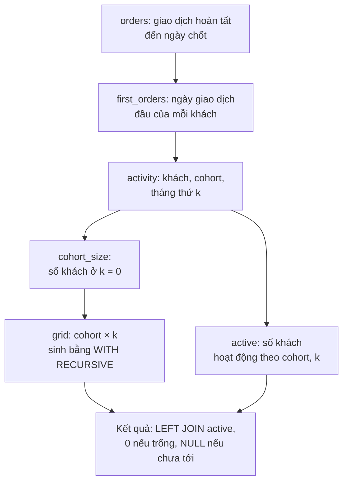

RFM (Recency, Frequency, Monetary) tóm tắt hành vi của mỗi người bằng ba con số: lần gần nhất cách ngày chốt dữ liệu bao lâu, bao nhiêu lần, tổng giá trị bao nhiêu; cohort analysis theo dõi các nhóm có cùng thời điểm bắt đầu qua từng tháng để đo retention. Cả hai viết được bằng SQL với CTE và window function. Chỗ dễ sai có bốn: khoá nhóm, ngày tham chiếu, giá trị bằng nhau ở ranh giới nhóm và mẫu số retention. Trên dữ liệu giả lập 211 khách, trung bình retention tháng thứ 6 là 0,306 nếu chỉ tính cohort đã quan sát được, nhưng chỉ còn 0,153 nếu coi ô chưa quan sát là 0; Kaplan–Meier viết bằng SQL cho đúng kết quả của thư viện thống kê. Bài dành cho sinh viên sinh học, y sinh và người làm dữ liệu y tế đã biết `GROUP BY`, CTE, window function, với ví dụ thật là 748 người hiến máu trong bộ dữ liệu công khai của UCI.

<div class="callout callout-note">
<p class="callout-title">Tóm tắt nhanh</p>

- Nhóm theo `id`, không theo tên; Recency là số ngày đến một ngày chốt cố định.
- `NTILE(5)` chia theo số dòng, nên hai giá trị bằng nhau có thể nhận hai điểm khác nhau.
- Retention tháng thứ k = số người còn hoạt động ở tháng k / kích thước cohort ở tháng 0.
- Ô không ai hoạt động hiện 0; ô chưa tới thời điểm quan sát là `NULL`.
- Cohort càng mới càng bị kiểm duyệt phải (right censoring); so sánh công bằng thì dùng Kaplan–Meier.

</div>

## 1. RFM và cohort analysis là gì: hai câu hỏi về cùng một nhóm người

Một trung tâm truyền máu muốn biết ai mới hiến gần đây, ai hiến thường xuyên, ai đã hiến nhiều nhất. Đó là ba thành phần của RFM: **Recency** là khoảng thời gian từ lần giao dịch cuối đến một mốc tham chiếu, **Frequency** là số lần giao dịch, **Monetary** là tổng giá trị. Trong bán lẻ, giao dịch là đơn hàng; với người hiến máu, giao dịch là một lần hiến và giá trị là thể tích máu. Bộ Blood Transfusion Service Center ở mục 7 ghi đúng ba đại lượng này cho 748 người (Yeh, 2008; Yeh et al., 2009).

Câu hỏi thứ hai nhìn theo thời gian: trong những người hiến lần đầu vào tháng 1, bao nhiêu người quay lại sau 3, 6, 12 tháng? Nhóm có chung thời điểm bắt đầu gọi là **cohort** (đoàn hệ), và tỉ lệ người trong nhóm còn hoạt động sau k tháng là **retention**. RFM giống tấm ảnh chụp tại ngày chốt; cohort analysis giống đoạn phim.

Đây cũng là câu hỏi của phân tích sống còn (survival analysis) trong dịch tễ học, với cùng khó khăn: mỗi người được theo dõi trong thời gian khác nhau, và người vào nhóm muộn chưa kịp có kết cục khi dữ liệu được chốt.

Về kỹ thuật, bài dùng lại window function ([bài Window function](/blog/window-functions/)) và CTE, kể cả `WITH RECURSIVE` ([bài CTE và phép toán tập hợp](/blog/cte-and-set-operations/)). Mọi truy vấn đã chạy trên SQLite 3.45.3. Nếu bạn dùng PostgreSQL, các khác biệt nằm ở mục 5.5.

## 2. Tính R, F, M bằng SQL cho đúng

Bộ dữ liệu đồ chơi dưới đây có 5 khách và 10 đơn, đủ nhỏ để kiểm tra bằng mắt. Khách 1 và 2 cố ý trùng tên, khách 4 có một đơn bị huỷ.

```sql
CREATE TABLE customers (id INTEGER PRIMARY KEY, full_name TEXT);
INSERT INTO customers VALUES
  (1, 'Nguyen Van An'), (2, 'Nguyen Van An'), (3, 'Tran Thi Binh'),
  (4, 'Le Van Cuong'),  (5, 'Pham Thi Dung');

CREATE TABLE orders (id INTEGER PRIMARY KEY, customer_id INTEGER,
                     order_date TEXT, total_amount REAL, status TEXT);
INSERT INTO orders VALUES
  (1, 1, '2026-01-05', 100, 'Completed'), (2, 1, '2026-03-20',  50, 'Completed'),
  (3, 2, '2026-02-11', 500, 'Completed'), (4, 3, '2026-01-15',  80, 'Completed'),
  (5, 3, '2026-02-02', 120, 'Completed'), (6, 3, '2026-04-28',  60, 'Completed'),
  (7, 4, '2026-02-07', 300, 'Cancelled'), (8, 4, '2026-03-03',  90, 'Completed'),
  (9, 5, '2026-01-25',  40, 'Completed'), (10, 5, '2026-06-10', 70, 'Completed');
```

### 2.1. Nhóm theo khoá chính, không theo tên

Nếu `GROUP BY full_name`, hai người khác nhau cùng tên bị gộp làm một: kết quả là một dòng "Nguyen Van An" với 3 đơn và tổng 650, trong khi đó là hai hồ sơ rất khác nhau (Bảng 1).

**Bảng 1.** Cùng dữ liệu, hai cách nhóm (SQLite 3.45.3, chỉ đơn `Completed`)

| Cách nhóm | Dòng "Nguyen Van An" | Số đơn | Tổng giá trị |
|---|---|---|---|
| `GROUP BY full_name` | 1 dòng | 3 | 650 |
| `GROUP BY k.id` | khách 1 | 2 | 150 |
| | khách 2 | 1 | 500 |

Trong dữ liệu y tế, tên trùng rất phổ biến, nên mọi phép nhóm phải dựa trên mã định danh (mã khách, mã người hiến, mã bệnh nhân); tên chỉ để hiển thị.

### 2.2. Recency tính đến một ngày chốt cố định

`MAX(order_date)` mới là ngày giao dịch cuối. Recency là khoảng cách từ ngày đó đến **ngày tham chiếu**, thường là ngày chốt dữ liệu; trong SQLite, hiệu hai giá trị `julianday()` cho ra số ngày. Hãy truyền ngày tham chiếu vào như tham số (`:ref_date`) thay vì dùng `'now'`, nếu không cùng một truy vấn chạy hai lần sẽ cho hai kết quả và phân tích không tái lập được.

### 2.3. Chấm điểm 1–5 bằng NTILE

`NTILE(N)` chia các dòng, theo thứ tự trong `ORDER BY`, thành N nhóm có số dòng chênh nhau nhiều nhất là một; nếu không chia hết, các nhóm đầu nhận thêm một dòng (SQLite, n.d.). Với F và M, giá trị lớn là tốt nên sắp `ASC` để người cao nhất được 5. Với Recency phải sắp `DESC`, vì số ngày càng nhỏ càng mới. Quên đảo chiều là cả bảng phân khúc bị lật ngược.

```sql
WITH rfm_raw AS (
    SELECT k.id AS customer_id,
           k.full_name,
           CAST(julianday(:ref_date) - julianday(MAX(d.order_date)) AS INTEGER) AS recency_days,
           COUNT(d.id)         AS frequency,
           SUM(d.total_amount) AS monetary
    FROM customers AS k
    JOIN orders    AS d ON d.customer_id = k.id
    WHERE d.status = 'Completed'
    GROUP BY k.id, k.full_name
),
rfm_score AS (
    SELECT *,
           NTILE(5) OVER (ORDER BY recency_days DESC, customer_id) AS r_score,  -- gần nhất = 5
           NTILE(5) OVER (ORDER BY frequency ASC,  customer_id) AS f_score,
           NTILE(5) OVER (ORDER BY monetary ASC,   customer_id) AS m_score
    FROM rfm_raw
)
SELECT customer_id, full_name, recency_days, frequency, monetary,
       r_score, f_score, m_score,
       CASE                                   -- ngưỡng minh hoạ, tuỳ bài toán
           WHEN r_score >= 4 AND f_score >= 4 THEN 'Champions'
           WHEN r_score <= 2 AND f_score >= 4 THEN 'At risk'
           WHEN r_score >= 4 AND f_score <= 2 THEN 'New / Promising'
           ELSE 'Others'
       END AS segment
FROM rfm_score
ORDER BY customer_id;
```

Với `:ref_date = '2026-06-30'`, khách 5 có Recency 20 ngày và `r_score = 5`, khách 2 có Recency 139 ngày và `r_score = 1`; khách 3 và khách 5 rơi vào nhóm "Champions". Tên phân khúc và ngưỡng trong `CASE` chỉ để minh hoạ. Không có bộ ngưỡng chuẩn nào; mỗi tổ chức tự định nghĩa, và nên ghi rõ trong báo cáo.

### 2.4. Giá trị bằng nhau ở ranh giới nhóm

Vì `NTILE` chia theo **số dòng** chứ không theo giá trị, hai dòng bằng nhau vẫn có thể bị cắt sang hai nhóm. Với dãy 10, 10, 10, 20, 30, 30, 40, `NTILE(5)` cho điểm 1, 1, 2, 2, 3, 4, 5: ba giá trị 10 nhận hai điểm khác nhau, hai giá trị 30 cũng vậy. Ngay trong bộ đồ chơi, khách 2 và khách 4 cùng có một đơn nhưng nhận `f_score` 1 và 2, chỉ vì `customer_id` khác nhau.

Có hai cách xử lý. Cách thứ nhất là thêm cột phá hoà tất định như `customer_id` ở trên: điểm không "công bằng" hơn, nhưng chạy lại luôn cho cùng kết quả, còn nếu thiếu cột này thì thứ tự giữa các dòng bằng nhau do hệ quản trị tự chọn. Cách thứ hai là chấm theo giá trị bằng `PERCENT_RANK()`, chấp nhận nhóm không đều.

```sql
SELECT x,
       NTILE(5) OVER (ORDER BY x, id)                                   AS ntile_score,
       MIN(5, 1 + CAST(5 * PERCENT_RANK() OVER (ORDER BY x) AS INTEGER)) AS value_score
FROM v;          -- v(id, x) chứa 10, 10, 10, 20, 30, 30, 40
```

Cột `value_score` cho 1, 1, 1, 3, 4, 4, 5: giá trị bằng nhau có cùng điểm, đổi lại nhóm 1 có ba người còn nhóm 2 không có ai. Đây là lựa chọn giữa "nhóm đều" và "điểm nhất quán". Hyndman và Fan (1996) cho thấy ngay phân vị mẫu cũng có nhiều định nghĩa khác nhau giữa các phần mềm thống kê, nên khi so điểm RFM giữa hai công cụ, hãy kiểm tra cách mỗi công cụ cắt nhóm.

### 2.5. Frequency dồn ở giá trị 1 và bộ lọc trạng thái

Trong nhiều bộ giao dịch, rất nhiều người chỉ có một lần. Khi đó hai, ba nhóm đầu của ngũ phân vị F toàn người có F = 1 và chỉ khác nhau nhờ cột phá hoà. Ngưỡng cố định (1, 2, 3–5, 6–10, trên 10 lần) viết bằng `CASE WHEN` dễ diễn giải hơn; mục 7 cho thấy điều này trên dữ liệu thật.

Điều kiện `status = 'Completed'` cũng là một quyết định định nghĩa: đơn huỷ, đơn hoàn tiền hay lần hiến bị loại có tính là giao dịch không? Lựa chọn này thay đổi F, M và cả ngày giao dịch đầu tiên, tức cohort của một người (mục 5), nên cần ghi vào phần phương pháp.

## 3. RFM có nền lý thuyết: từ marketing trực tiếp đến mô hình xác suất

Cách chấm điểm theo nhóm gắn với marketing trực tiếp, khi doanh nghiệp phải chọn ai nhận thư hay catalog trong mỗi đợt gửi; cuốn *Strategic Database Marketing* của Hughes (1994) góp phần phổ biến nó cho người làm cơ sở dữ liệu khách hàng.

Bult và Wansbeek (1995) mô hình hoá việc chọn người nhận thư như bài toán tối đa hoá lợi nhuận kỳ vọng, với lời giải cân bằng chi phí biên và lợi nhuận biên của việc gửi thêm.

Schmittlein, Morrison và Colombo (1987) đề xuất mô hình Pareto/NBD để trả lời "khách nào còn hoạt động và họ sẽ mua bao nhiêu"; mô hình dựa trên số lần và thời điểm các giao dịch trước đó để tính xác suất một người vẫn còn là khách. Frequency và Recency vì thế là đầu vào của mô hình. Fader, Hardie và Lee (2005a) đề xuất BG/NBD, dễ ước lượng hơn nhiều (làm được trong Excel) mà cho kết quả rất giống Pareto/NBD. Cũng nhóm này (Fader et al., 2005b) nối RFM với giá trị vòng đời khách hàng (customer lifetime value, CLV) qua **iso-value curves**, những đường gom các khách có lịch sử mua khác nhau nhưng giá trị tương lai tương tự. Nhóm tác giả dùng Pareto/NBD cho dòng giao dịch và mô hình gamma-gamma cho giá trị mỗi giao dịch, trên dữ liệu của trang nhạc CDNOW. Hai người khác điểm RFM vì vậy vẫn có thể đáng giá như nhau. Điểm 1–5 là bản tóm tắt thô, tiện tính bằng SQL, không phải phép đo giá trị.

**Bảng 2.** Điểm RFM 1–5 so với mô hình xác suất

| Tiêu chí | Điểm RFM 1–5 | Pareto/NBD, BG/NBD |
|---|---|---|
| Đầu vào | R, F, M tại ngày chốt | Số lần, thời điểm giao dịch cuối, thời gian quan sát |
| Đầu ra | Thứ hạng tương đối | Xác suất còn hoạt động, số giao dịch kỳ vọng |
| Giả định | Không nêu rõ | Nêu rõ quá trình mua và rời đi |
| Tính bằng SQL | Dễ (`NTILE`, `CASE`) | Cần phần mềm ước lượng tham số |

RFM cũng thường là đầu vào cho phân cụm khi muốn tìm phân khúc từ dữ liệu (Data Mining); với CLV, bài tổng quan của Gupta và cộng sự (2006) là điểm xuất phát tốt.

## 4. Cohort: khái niệm mượn từ nhân khẩu học và dịch tễ học

Trong nhân khẩu học, cohort là nhóm người có chung một đặc điểm trong cùng khoảng thời gian, điển hình là **cohort sinh** (Indira Gandhi National Open University [IGNOU], n.d.-a). **Bảng sống thế hệ** (cohort life table) theo dõi một cohort sinh có thật, còn **bảng sống hiện thời** (current life table) áp tỉ suất tử vong theo tuổi của một năm lên một cohort giả định (IGNOU, n.d.-a). Ma trận retention là một bảng sống thế hệ thu nhỏ: mỗi hàng là một cohort có thật.

Frost (1939/1995) phân tích tử vong do lao theo cohort sinh qua các thập niên liên tiếp. Ryder (1965) bàn về cohort như một khái niệm để nghiên cứu thay đổi xã hội, đưa cách nhìn này ra ngoài y học. Trong dịch tễ học hiện đại, **nghiên cứu đoàn hệ** (cohort study) chọn một nhóm chưa có kết cục rồi theo dõi tiến về sau để so sánh tỉ lệ mắc; khi mỗi người được theo dõi trong thời gian khác nhau, mẫu số là **person-time**, tổng thời gian theo dõi, thay vì số người (IGNOU, n.d.-b).

Các khái niệm của hai lĩnh vực khớp nhau gần như một-một (Bảng 3), nên những vấn đề dịch tễ học đã gặp, như thời gian theo dõi không đều, mất dấu, kiểm duyệt, cũng xuất hiện trong phân tích khách hàng.

**Bảng 3.** Ánh xạ thuật ngữ giữa cohort analysis và dịch tễ học

| Cohort analysis | Dịch tễ học |
|---|---|
| Tháng giao dịch đầu tiên | Thời điểm vào nghiên cứu |
| Quay lại, hoặc rời đi | Sự kiện (kết cục) |
| Ngày chốt dữ liệu | Kết thúc theo dõi |
| Tháng thứ k kể từ lần đầu | Thời gian theo dõi |
| Cohort mới chưa đủ tháng | Quan sát bị kiểm duyệt phải |

## 5. Dựng ma trận retention bằng SQL

### 5.1. Gắn nhãn cohort bằng window function

`MIN(order_date) OVER (PARTITION BY customer_id)` trả về ngày giao dịch đầu tiên của mỗi khách trên mọi dòng của khách đó, không cần `GROUP BY` rồi `JOIN` ngược.

```sql
SELECT customer_id,
       order_date,
       strftime('%Y-%m', MIN(order_date) OVER (PARTITION BY customer_id)) AS cohort_month
FROM orders
WHERE status = 'Completed';
```

Vì `WHERE` chạy trước window function, bộ lọc quyết định "lần đầu" là gì. Khách 4 có đơn đầu ngày 7/2/2026 nhưng bị huỷ, nên với `status = 'Completed'` khách 4 thuộc cohort 2026-03. Bài này định nghĩa cohort theo **giao dịch hoàn tất đầu tiên**.

### 5.2. Tuổi cohort và mẫu số

Nhóm theo tháng lịch thì mỗi cohort bắt đầu ở một cột khác nhau. Cần đổi sang **tuổi cohort**, tháng thứ k kể từ lần đầu:

$$k = (12 \cdot \text{năm}_{\text{giao dịch}} + \text{tháng}_{\text{giao dịch}}) - (12 \cdot \text{năm}_{\text{đầu}} + \text{tháng}_{\text{đầu}})$$

Tháng đầu có k = 0; giao dịch tháng 3/2026 của cohort 2026-01 có k = 2. Retention tháng thứ k là số người có ít nhất một giao dịch ở tháng k chia cho số người của cohort ở tháng 0, và mẫu số này nên tính riêng trong CTE `cohort_size`. Con số này là **tỉ lệ còn hoạt động trong tháng k**, không phải tỉ lệ "chưa rời đi": một người có thể nghỉ tháng 2 rồi quay lại tháng 3, nên đường retention có thể đi lên.

### 5.3. Giữ ô bằng 0, đặt NULL cho ô chưa quan sát

`GROUP BY` chỉ sinh dòng cho tổ hợp có dữ liệu. Trong bộ đồ chơi, cohort 2026-01 gồm khách 1, 3, 5, và ở tháng thứ 4 (tháng 5/2026) không ai giao dịch; truy vấn đếm trực tiếp trả về các tháng 01 đến 04 rồi nhảy sang 06, dòng tháng 5 biến mất thay vì hiện 0. Cách sửa là sinh trước **lưới** mọi cặp (cohort, k) bằng `WITH RECURSIVE`, `LEFT JOIN` số liệu vào và `COALESCE` thành 0. Nhưng không phải ô trống nào cũng là 0: cohort 2026-02 chỉ có 4 tháng theo dõi tính đến ngày chốt 30/6/2026, nên tháng thứ 5 của nó **chưa xảy ra** và phải là `NULL`.



```sql
WITH RECURSIVE
first_orders AS (
    SELECT customer_id,
           order_date,
           MIN(order_date) OVER (PARTITION BY customer_id) AS first_date
    FROM orders
    WHERE status = 'Completed'
      AND order_date <= :cutoff_date
),
activity AS (
    SELECT DISTINCT
           customer_id,
           strftime('%Y-%m', first_date) AS cohort_month,
           (CAST(strftime('%Y', order_date) AS INTEGER) * 12 + CAST(strftime('%m', order_date) AS INTEGER))
         - (CAST(strftime('%Y', first_date) AS INTEGER) * 12 + CAST(strftime('%m', first_date) AS INTEGER))
             AS month_index
    FROM first_orders
),
cohort_size AS (
    SELECT cohort_month, COUNT(DISTINCT customer_id) AS n_customers
    FROM activity
    WHERE month_index = 0
    GROUP BY cohort_month
),
k(month_index) AS (
    SELECT 0
    UNION ALL
    SELECT month_index + 1 FROM k WHERE month_index < :max_k
),
grid AS (
    SELECT c.cohort_month, k.month_index, c.n_customers,
           -- số tháng theo dõi được của cohort tính đến tháng chốt
           (CAST(strftime('%Y', :cutoff_date) AS INTEGER) * 12 + CAST(strftime('%m', :cutoff_date) AS INTEGER))
         - (CAST(substr(c.cohort_month, 1, 4) AS INTEGER) * 12 + CAST(substr(c.cohort_month, 6, 2) AS INTEGER))
             AS max_observed_k
    FROM cohort_size AS c
    CROSS JOIN k
),
active AS (
    SELECT cohort_month, month_index, COUNT(DISTINCT customer_id) AS n_active
    FROM activity
    GROUP BY cohort_month, month_index
)
SELECT g.cohort_month,
       g.month_index,
       g.n_customers,
       CASE WHEN g.month_index > g.max_observed_k THEN NULL
            ELSE COALESCE(a.n_active, 0) END AS n_active,
       CASE WHEN g.month_index > g.max_observed_k THEN NULL
            ELSE ROUND(1.0 * COALESCE(a.n_active, 0) / g.n_customers, 3) END AS retention
FROM grid AS g
LEFT JOIN active AS a
       ON a.cohort_month = g.cohort_month
      AND a.month_index  = g.month_index
ORDER BY g.cohort_month, g.month_index;
```

Trên bộ đồ chơi với `:cutoff_date = '2026-06-30'` và `:max_k = 5`, cohort 2026-01 có đủ sáu dòng với tháng thứ 4 bằng 0; cohort 2026-02 có tháng thứ 5 là `NULL`; cohort 2026-03 có tháng thứ 4 và 5 là `NULL`. Phép nhân `1.0 *` cần thiết vì SQLite chia hai số nguyên ra số nguyên. Nếu ngày chốt rơi giữa tháng, tháng chốt chỉ được quan sát một phần; chốt vào cuối tháng tránh được một ô cuối hàng thấp giả tạo. SQLite không có `PIVOT`, nhưng `MAX(CASE ...)` chuyển kết quả dạng dài thành ma trận:

```sql
-- retention_long: bảng lưu kết quả truy vấn trên
SELECT cohort_month,
       MAX(n_customers)                                  AS n,
       MAX(CASE WHEN month_index = 1 THEN retention END) AS m1,
       MAX(CASE WHEN month_index = 3 THEN retention END) AS m3,
       MAX(CASE WHEN month_index = 6 THEN retention END) AS m6
FROM retention_long
GROUP BY cohort_month
ORDER BY cohort_month;
```

### 5.4. Ma trận trên dữ liệu giả lập

Để có ma trận đủ lớn, bài dùng dữ liệu **giả lập**: 211 khách trong 12 cohort từ tháng 1 đến tháng 12/2025 (14–20 khách mỗi cohort). Sau tháng đầu, mỗi tháng một khách có xác suất 0,15 rời đi hẳn; nếu chưa rời đi, khách giao dịch trong tháng với xác suất 0,7. Dữ liệu chốt ngày 31/12/2025.


*Hình 1. Ma trận retention từ dữ liệu giả lập 211 khách, chốt 31/12/2025. Ô xám là ô chưa quan sát (`NULL`).*

Hình tam giác là đặc trưng của mọi ma trận cohort: cohort 2025-01 có 12 tháng theo dõi, cohort 2025-12 chỉ có tháng 0. Retention tháng thứ 1 dao động từ 0,29 (2025-05) đến 0,73 (2025-03) dù mọi khách sinh ra từ cùng một cơ chế; với cohort 15–20 người, mỗi người chiếm 5–7 điểm phần trăm.

### 5.5. Khác biệt khi chuyển sang PostgreSQL

| Việc | SQLite | PostgreSQL |
|---|---|---|
| Lấy tháng | `strftime('%Y-%m', d)` | `date_trunc('month', d)` |
| Số ngày giữa hai ngày | `julianday(a) - julianday(b)` | `a::date - b::date` |
| Khoảng cách năm/tháng/ngày | tự tính | `age(a, b)` |
| Sinh dãy k | `WITH RECURSIVE` | `generate_series(0, 11)` |
| Logarit, chia nhóm | `ln()`, `NTILE(n)` | `ln()`, `ntile(n)` |

Các hàm này có trong tài liệu chính thức của PostgreSQL (PostgreSQL Global Development Group, n.d.-a, n.d.-b, n.d.-c, n.d.-d). Bảng chỉ ánh xạ tên hàm; các truy vấn trong bài chưa chạy thử trên PostgreSQL.

## 6. Giới hạn: kiểm duyệt phải và Kaplan–Meier

### 6.1. Kiểm duyệt và chỗ sai khi lấy trung bình cột

Một quan sát bị **kiểm duyệt** (censored) khi sự kiện chưa được ghi nhận vì nghiên cứu đã kết thúc, người đó rút lui hoặc bị mất dấu; **kiểm duyệt phải**, khi chỉ biết thời gian đến sự kiện lớn hơn một giá trị nào đó, là loại phổ biến nhất (IGNOU, n.d.-c; Leung et al., 1997). Một giáo trình phân tích sống còn minh hoạ bằng cohort 500 bệnh nhân nhồi máu cơ tim đã xuất viện, theo dõi tới 15 năm: tỉ lệ thô trên cả cohort bỏ qua việc mỗi người được theo dõi trong thời gian khác nhau và việc mất dấu (IGNOU, n.d.-c). Trong ma trận retention, mọi cohort đều bị ngày chốt cắt, nhưng cohort càng mới bị cắt càng sớm.

Báo cáo thường cần một con số "retention tháng thứ 6" chung. Lấy trung bình cột của Hình 1 có hai cách, cho kết quả rất khác nhau (Bảng 4).

**Bảng 4.** Trung bình retention theo cột (dữ liệu giả lập, 12 cohort, chốt 31/12/2025)

| Tháng thứ k | Số cohort đã quan sát | Trung bình, bỏ ô `NULL` | Trung bình, coi `NULL` là 0 |
|---|---|---|---|
| 3 | 9 | 0,429 | 0,322 |
| 6 | 6 | 0,306 | 0,153 |
| 9 | 3 | 0,178 | 0,045 |

Coi ô chưa quan sát là 0 nghĩa là giả định khách của cohort mới đã bỏ đi hết, chỉ vì họ chưa kịp tới tháng đó; ở tháng thứ 6, con số bị chia đôi. `AVG()` tự bỏ `NULL` nhưng tính cả số 0, nên ô chưa quan sát phải là `NULL` ngay từ truy vấn. Ngay cả cách bỏ `NULL` cũng có giới hạn: ở k = 9 chỉ còn 3 cohort cũ nhất đóng góp.

### 6.2. Từ "còn hoạt động" sang "chưa rời đi"

Phân tích sống còn cần một sự kiện **hấp thụ**, đã xảy ra thì không quay lại, như tử vong. Muốn áp dụng cho khách hàng hay người hiến máu, bạn phải định nghĩa **rời đi** (churn) bằng một quy tắc, ví dụ "không giao dịch trong 3 tháng liên tiếp"; thời gian sống là số tháng từ lần đầu đến lần giao dịch cuối.

Quy tắc này tạo ra kiểm duyệt ở cuối dữ liệu. Với ngày chốt 31/12/2025, người giao dịch lần cuối vào tháng 11/2025 chưa thể xếp là đã rời đi. Họ bị kiểm duyệt, và câu hỏi là kiểm duyệt **tại thời điểm nào**. Lần giao dịch cuối không phải mốc đúng: nếu kiểm duyệt ở đó, những người có thời gian sống thật đúng bằng mốc ấy nhưng chưa đủ 3 tháng để xác nhận sẽ nằm trong tập rủi ro mà không bao giờ được tính là sự kiện, làm ước lượng lệch lên. Mốc đúng là thời điểm cuối cùng quy tắc còn kiểm tra được: số tháng theo dõi trừ 3. Các cohort có dưới 3 tháng theo dõi (10, 11 và 12/2025, tổng 57 khách) không đóng góp thông tin về rời đi.

### 6.3. Ước lượng Kaplan–Meier bằng SQL

Kaplan và Meier (1958) đề xuất ước lượng tích (product-limit estimator) cho hàm sống khi dữ liệu không đầy đủ:

$$\hat S(t) = \prod_{t_i \le t} \left(1 - \frac{d_i}{n_i}\right)$$

trong đó $d_i$ là số sự kiện tại mốc $t_i$ và $n_i$ là số người còn rủi ro (at risk) tại mốc đó. Người bị kiểm duyệt vẫn nằm trong $n_i$ cho đến lúc bị kiểm duyệt rồi rời tập rủi ro mà không bị tính là sự kiện, nên thông tin "người này ở lại ít nhất đến đây" không bị vứt đi (Clark et al., 2003). Công thức chỉ gồm đếm và nhân dồn, và tích được đổi thành tổng logarit, $\prod (1 - d_i/n_i) = \exp \sum \ln(1 - d_i/n_i)$, để viết bằng window function.

```sql
WITH
orders_ok AS (
    SELECT customer_id,
           CAST(strftime('%Y', order_date) AS INTEGER) * 12
         + CAST(strftime('%m', order_date) AS INTEGER) AS m
    FROM orders
    WHERE status = 'Completed'
      AND order_date <= :cutoff_date
),
life AS (
    SELECT customer_id, last_k, horizon,
           CASE WHEN horizon - last_k >= :inactive_months
                THEN 1 ELSE 0 END AS churned,                    -- 1 = sự kiện, 0 = kiểm duyệt
           CASE WHEN horizon - last_k >= :inactive_months
                THEN last_k                                      -- rời đi sau tháng mua cuối
                ELSE horizon - :inactive_months                  -- mốc cuối còn kiểm tra được
           END AS t
    FROM (
        SELECT customer_id,
               MAX(m) - MIN(m) AS last_k,                        -- tháng thứ của lần mua cuối
               (CAST(strftime('%Y', :cutoff_date) AS INTEGER) * 12
              + CAST(strftime('%m', :cutoff_date) AS INTEGER)) - MIN(m) AS horizon
        FROM orders_ok
        GROUP BY customer_id
    )
),
by_t AS (
    SELECT t, SUM(churned) AS d, COUNT(*) AS c
    FROM life
    WHERE t >= 0
    GROUP BY t
),
risk AS (
    SELECT t, d, c,
           SUM(c) OVER (ORDER BY t DESC) AS n_risk              -- số người có T >= t
    FROM by_t
)
SELECT t, n_risk, d,
       CASE WHEN MAX(d = n_risk) OVER w = 1 THEN 0.0             -- mọi người còn rủi ro đều rời đi
            ELSE ROUND(EXP(SUM(LN(CASE WHEN d < n_risk
                                       THEN 1.0 - 1.0 * d / n_risk END)) OVER w), 4)
       END AS km_survival
FROM risk
WINDOW w AS (ORDER BY t ROWS UNBOUNDED PRECEDING)
ORDER BY t;
```

`SUM(c) OVER (ORDER BY t DESC)` cộng dồn từ mốc lớn nhất xuống, nên cho đúng số người có thời gian quan sát từ t trở lên. Khi mọi người còn rủi ro đều có sự kiện ($d_i = n_i$), $\ln 0$ không xác định; `CASE` bên trong trả `NULL` để `SUM` bỏ qua, `CASE` bên ngoài đặt hàm sống bằng 0. `LN` và `EXP` có trong SQLite khi bản dựng bật hàm toán học, như bản 3.45.3 đi kèm Python dùng ở đây.

Trên dữ liệu giả lập, truy vấn cho 8 mốc có sự kiện, từ $\hat S(0) = 0{,}7922$ (154 người rủi ro, 32 sự kiện) đến $\hat S(7) = 0{,}2819$, trùng tới bốn chữ số thập phân ở mọi mốc với `SurvfuncRight` của statsmodels trên cùng bảng thời gian và sự kiện.

### 6.4. Kaplan–Meier gần giá trị đúng, tỉ lệ thô thì không

Vì dữ liệu là giả lập, có thể biết giá trị đúng: chạy tiếp quá trình sinh dữ liệu nhiều tháng sau ngày chốt để mọi khách đều có lần giao dịch cuối, rồi tính tỉ lệ người có thời gian sống lớn hơn t.


*Hình 2. Cùng dữ liệu giả lập: giá trị đúng (theo dõi đủ), Kaplan–Meier từ dữ liệu chốt 31/12/2025, và tỉ lệ thô coi lần giao dịch cuối đã thấy là kết thúc.*

**Bảng 5.** Tỉ lệ chưa rời đi, $P(T > t)$

| t (tháng) | Giá trị đúng | Kaplan–Meier (SQL) | Thô |
|---|---|---|---|
| 1 | 0,678 | 0,659 | 0,540 |
| 3 | 0,507 | 0,508 | 0,308 |
| 6 | 0,313 | 0,333 | 0,137 |

Đường thô coi mọi người như đã rời đi sau lần giao dịch cuối nhìn thấy, kể cả người chỉ chưa được theo dõi đủ lâu: ở tháng thứ 3 nó cho 0,308, trong khi giá trị đúng là 0,507 và Kaplan–Meier cho 0,508. Ở mốc 6 và 7, tập rủi ro chỉ còn 23 rồi 13 người nên ước lượng lệch vài điểm phần trăm; sau mốc 8 đường dừng vì không còn đủ người được theo dõi.

Kaplan–Meier giả định kiểm duyệt không liên quan đến khả năng xảy ra sự kiện. Kiểm duyệt do ngày chốt thường thoả điều này; mất dấu vì người hiến chuyển nơi ở thì chưa chắc (Leung et al., 1997). Quy tắc "3 tháng" cũng có thể xếp nhầm người nghỉ tạm vào nhóm đã rời đi, nên độ dài cửa sổ nên chọn theo nhịp giao dịch thực tế.

### 6.5. Đi xa hơn

Kaplan–Meier mô tả những gì đã quan sát, chưa dự báo. Với khách theo hợp đồng hay thuê bao, Fader và Hardie (2007) đề xuất mô hình xác suất **shifted-beta-geometric (sBG)** để dự báo retention thay cho các mô hình hồi quy "curve-fitting", chạy được trong Excel. Khi cần so sánh nhiều nhóm có điều chỉnh theo biến khác, công cụ tiêu chuẩn là hồi quy Cox (Cox, 1972). Cả hai nằm ngoài phạm vi bài này.

## 7. Ví dụ y sinh: RFM cho 748 người hiến máu

### 7.1. Bộ dữ liệu và chỗ M trùng F

Bộ **Blood Transfusion Service Center** do Yeh (2008) công bố trên UCI Machine Learning Repository theo giấy phép CC BY 4.0, lấy từ cơ sở dữ liệu người hiến của Trung tâm Truyền máu thành phố Tân Trúc (Hsin-Chu), Đài Loan. Bộ gồm 748 người với Recency (tháng từ lần hiến cuối), Frequency (số lần hiến), Monetary (tổng thể tích máu, c.c.), Time (tháng từ lần hiến đầu) và biến nhị phân cho biết có hiến vào tháng 3/2007 không; 178 người (23,8%) có hiến. Bài báo giới thiệu bộ dữ liệu dùng một phiên bản mở rộng của RFM gọi là RFMTC để dự báo khả năng hiến tiếp (Yeh et al., 2009).

Kiểm tra đầu tiên nên làm là tương quan giữa F và M. Ở đây cả 748 dòng có Monetary đúng bằng 250 × Frequency, hệ số tương quan bằng 1: M trùng hoàn toàn với F, RFM thật ra là RF. Cộng điểm F và M là đếm Frequency hai lần; đưa cả hai vào hồi quy là cộng tuyến hoàn toàn.

Còn 192 người có Recency bằng Time, tức lần hiến đầu và cuối rơi vào cùng một tháng theo dữ liệu. Trong đó 158 người có Frequency = 1, cũng là toàn bộ những người chỉ hiến một lần; 34 người còn lại có Frequency lớn hơn 1. Dữ liệu không cho biết lý do, nên chỉ nên ghi nhận như một đặc điểm.

### 7.2. Chấm điểm và đối chiếu với lần hiến tháng 3/2007

Sau khi nạp CSV vào bảng `donors` (thêm cột `id` theo thứ tự dòng), truy vấn giống mục 2.3, chỉ khác Recency đã ở dạng tháng; đổi `r_score` thành `f_score` để có nửa còn lại của Bảng 6.

```sql
WITH scored AS (
    SELECT id, recency_m, frequency, monetary, time_m, donated_mar2007,
           NTILE(5) OVER (ORDER BY recency_m DESC, id) AS r_score,   -- hiến gần nhất = 5
           NTILE(5) OVER (ORDER BY frequency ASC,  id) AS f_score
    FROM donors
)
SELECT r_score AS score,
       COUNT(*)                                  AS n,
       MIN(recency_m) || '–' || MAX(recency_m)   AS recency_range,
       ROUND(100.0 * AVG(donated_mar2007), 1)    AS pct_donated
FROM scored
GROUP BY r_score
ORDER BY r_score;
```

**Bảng 6.** Tỉ lệ hiến máu tháng 3/2007 theo điểm R và điểm F (`NTILE(5)`, n = 748)

| Điểm | Recency (tháng) | % hiến theo R | Frequency (lần) | % hiến theo F |
|---|---|---|---|---|
| 1 | 16–74 | 8,0 | 1 | 13,3 |
| 2 | 11–16 | 12,7 | 1–3 | 19,3 |
| 3 | 4–11 | 29,3 | 3–5 | 19,3 |
| 4 | 2–4 | 38,3 | 5–8 | 32,2 |
| 5 | 0–2 | 30,9 | 8–50 | 34,9 |

Theo điểm F, tỉ lệ hiến tăng từ 13,3% lên 34,9%. Theo điểm R, tỉ lệ tăng từ 8,0% lên 38,3% ở điểm 4 rồi giảm còn 30,9% ở điểm 5: quan hệ không đơn điệu, nên đừng mặc định "điểm 5 là tốt nhất" trước khi kiểm tra trên dữ liệu của bạn. Dữ liệu không đủ để giải thích chỗ giảm này.

Bảng 6 cũng cho thấy vấn đề ở mục 2.4 trên dữ liệu thật. Recency chỉ có 31 giá trị khác nhau cho 748 người, nên ranh giới nhóm buộc phải cắt ngang giá trị trùng: trong 173 người có Recency = 2 tháng, 135 người nhận điểm 5 và 38 người nhận điểm 4, chỉ do thứ tự dòng. 158 người hiến một lần cũng bị chia thành 150 người điểm F = 1 và 8 người điểm 2. Ngưỡng cố định cho Frequency cho bức tranh sạch hơn: tỉ lệ hiến là 12,7% ở nhóm 1 lần (158 người), 17,0% ở nhóm 2 lần (112), 22,3% ở nhóm 3–5 lần (211), 32,9% ở nhóm 6–10 lần (164) và 36,9% ở nhóm trên 10 lần (103), tăng đều và không ai bị xếp nhóm theo thứ tự dòng.

### 7.3. Đạo đức dữ liệu

Bộ UCI đã ẩn danh và công khai. Với dữ liệu người hiến, bệnh nhân tái khám hay mẫu biobank thật, các truy vấn chạy y hệt, nhưng việc truy cập và phân tích cần phê duyệt đạo đức và tuân thủ quy định bảo mật của nơi lưu trữ.

## 8. Checklist và kết luận

1. Nhóm theo mã định danh (`id`), tên chỉ để hiển thị.
2. Recency tính đến một ngày chốt cố định, truyền vào như tham số.
3. `NTILE` luôn có cột phá hoà tất định; cân nhắc `PERCENT_RANK` hoặc ngưỡng cố định khi nhiều giá trị trùng.
4. Kiểm tra tương quan F–M trước khi dùng cả hai.
5. Mẫu số retention là kích thước cohort ở tháng 0, tính trong CTE riêng.
6. Dùng tuổi cohort (tháng thứ k), không dùng tháng lịch.
7. Ô không ai hoạt động hiện 0; ô chưa quan sát là `NULL`.
8. Không lấy trung bình thô giữa cohort mới và cũ; cần một con số chung thì định nghĩa rời đi, dùng Kaplan–Meier và đối chiếu với thư viện thống kê.

RFM là tấm ảnh chụp, đủ dùng để xếp ưu tiên nhưng chỉ đúng tại ngày chốt. Cohort analysis là đoạn phim, và phim nào cũng bị cắt ở ngày chốt; cohort mới bị cắt sớm nhất. Dịch tễ học đã có công cụ cho đúng vấn đề này từ ước lượng của Kaplan và Meier (1958) và hồi quy Cox (Cox, 1972). Việc nên làm tiếp là chạy lại các truy vấn trên với dữ liệu của bạn, đặt ngày chốt cố định, rồi so đường Kaplan–Meier với bảng retention thô. Muốn đọc thêm, bắt đầu với Fader và cộng sự (2005b), Fader và Hardie (2007), Clark và cộng sự (2003); về chỉ số retention trong công cụ phân tích web, xem Marketing Analytics.

## Câu hỏi thường gặp

**RFM có cần đủ ba chỉ số không?** Không bắt buộc. Nếu M gần như tỉ lệ với F, như ở bộ hiến máu, M không thêm thông tin; có lĩnh vực lại thêm biến khác, như Time trong RFMTC (Yeh et al., 2009).

**Retention và churn khác nhau thế nào?** Retention trong ma trận cohort là tỉ lệ còn hoạt động ở tháng k và có thể tăng lại. Churn là sự kiện rời đi theo quy tắc bạn tự định nghĩa; khi đó $1 - \hat S(t)$ là tỉ lệ đã rời đi tính đến tháng t.

**Kaplan–Meier có tính hoàn toàn bằng SQL được không?** Được, nếu hệ quản trị có window function cùng `LN` và `EXP`. Phần khó nằm ở định nghĩa rời đi và mốc kiểm duyệt (mục 6.2), không ở công thức. Truy vấn ở mục 6.3 cho kết quả trùng `SurvfuncRight` của statsmodels; khoảng tin cậy và phép so sánh giữa các nhóm thì nên giao cho thư viện thống kê.

## Phụ lục: Gap Analysis

So sánh mục tiêu với thực tế có hai bẫy: chia cho 0 khi mục tiêu bằng 0 và phép chia số nguyên. `NULLIF(target_amount, 0)` biến mẫu số 0 thành `NULL`, còn `* 100.0` buộc dùng số thực.

```sql
SELECT month, target_amount, actual_amount,
       actual_amount - target_amount AS gap,
       ROUND(actual_amount * 100.0 / NULLIF(target_amount, 0), 1) AS attainment_pct
FROM sales_targets
WHERE department = 'Sales'
ORDER BY month;
```

Trên ba dòng thử (mục tiêu 1.000, 1.200 và 0; thực tế 920, 1.310 và 150), truy vấn trả về 92,0%, 109,2% và `NULL`.

## Tài liệu tham khảo

Bult, J. R., & Wansbeek, T. (1995). Optimal selection for direct mail. *Marketing Science, 14*(4), 378–394. https://doi.org/10.1287/mksc.14.4.378

Clark, T. G., Bradburn, M. J., Love, S. B., & Altman, D. G. (2003). Survival analysis part I: Basic concepts and first analyses. *British Journal of Cancer, 89*(2), 232–238. https://doi.org/10.1038/sj.bjc.6601118

Cox, D. R. (1972). Regression models and life-tables. *Journal of the Royal Statistical Society: Series B (Methodological), 34*(2), 187–202. https://doi.org/10.1111/j.2517-6161.1972.tb00899.x

Fader, P. S., & Hardie, B. G. S. (2007). How to project customer retention. *Journal of Interactive Marketing, 21*(1), 76–90. https://doi.org/10.1002/dir.20074

Fader, P. S., Hardie, B. G. S., & Lee, K. L. (2005a). "Counting your customers" the easy way: An alternative to the Pareto/NBD model. *Marketing Science, 24*(2), 275–284. https://doi.org/10.1287/mksc.1040.0098

Fader, P. S., Hardie, B. G. S., & Lee, K. L. (2005b). RFM and CLV: Using iso-value curves for customer base analysis. *Journal of Marketing Research, 42*(4), 415–430. https://doi.org/10.1509/jmkr.2005.42.4.415

Frost, W. H. (1995). The age selection of mortality from tuberculosis in successive decades. *American Journal of Epidemiology, 141*(1), 4–9. https://doi.org/10.1093/oxfordjournals.aje.a117343 (Original work published 1939)

Gupta, S., Hanssens, D., Hardie, B., Kahn, W., Kumar, V., Lin, N., Ravishanker, N., & Sriram, S. (2006). Modeling customer lifetime value. *Journal of Service Research, 9*(2), 139–155. https://doi.org/10.1177/1094670506293810

Hughes, A. M. (1994). *Strategic database marketing*. Probus Publishing. https://openlibrary.org/isbn/1557385513

Hyndman, R. J., & Fan, Y. (1996). Sample quantiles in statistical packages. *The American Statistician, 50*(4), 361–365. https://doi.org/10.1080/00031305.1996.10473566

Indira Gandhi National Open University. (n.d.-a). *MSTE-003 Bio-statistics-I, Block 1: Vital statistics* (Unit 2; Unit 3: Life tables). IGNOU. https://egyankosh.ac.in/handle/123456789/85320

Indira Gandhi National Open University. (n.d.-b). *MSTE-003 Bio-statistics-I, Block 3: Epidemiology* (Unit 10; Unit 11: Design, conduct and analysis of epidemiological studies). IGNOU. https://egyankosh.ac.in/handle/123456789/85320

Indira Gandhi National Open University. (n.d.-c). *MSTE-004 Biostatistics-II, Block 4: Survival analysis* (Units 14–15). IGNOU. https://egyankosh.ac.in/handle/123456789/88168

Kaplan, E. L., & Meier, P. (1958). Nonparametric estimation from incomplete observations. *Journal of the American Statistical Association, 53*(282), 457–481. https://doi.org/10.1080/01621459.1958.10501452

Leung, K.-M., Elashoff, R. M., & Afifi, A. A. (1997). Censoring issues in survival analysis. *Annual Review of Public Health, 18*, 83–104. https://doi.org/10.1146/annurev.publhealth.18.1.83

PostgreSQL Global Development Group. (n.d.-a). *Date/time functions and operators*. PostgreSQL documentation. Retrieved November 24, 2026, from https://www.postgresql.org/docs/current/functions-datetime.html

PostgreSQL Global Development Group. (n.d.-b). *Mathematical functions and operators*. PostgreSQL documentation. Retrieved November 24, 2026, from https://www.postgresql.org/docs/current/functions-math.html

PostgreSQL Global Development Group. (n.d.-c). *Set returning functions*. PostgreSQL documentation. Retrieved November 24, 2026, from https://www.postgresql.org/docs/current/functions-srf.html

PostgreSQL Global Development Group. (n.d.-d). *Window functions*. PostgreSQL documentation. Retrieved November 24, 2026, from https://www.postgresql.org/docs/current/functions-window.html

Ryder, N. B. (1965). The cohort as a concept in the study of social change. *American Sociological Review, 30*(6), 843–861. https://doi.org/10.2307/2090964

Schmittlein, D. C., Morrison, D. G., & Colombo, R. (1987). Counting your customers: Who are they and what will they do next? *Management Science, 33*(1), 1–24. https://doi.org/10.1287/mnsc.33.1.1

SQLite. (n.d.). *Window functions*. Retrieved November 24, 2026, from https://www.sqlite.org/windowfunctions.html

Yeh, I.-C. (2008). *Blood transfusion service center* [Dataset]. UCI Machine Learning Repository. https://doi.org/10.24432/C5GS39

Yeh, I.-C., Yang, K.-J., & Ting, T.-M. (2009). Knowledge discovery on RFM model using Bernoulli sequence. *Expert Systems with Applications, 36*(3), 5866–5871. https://doi.org/10.1016/j.eswa.2008.07.018
