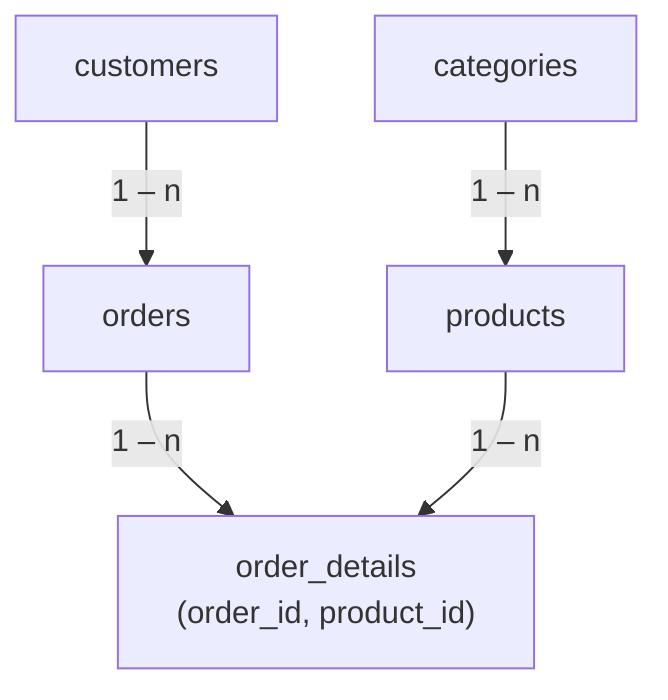
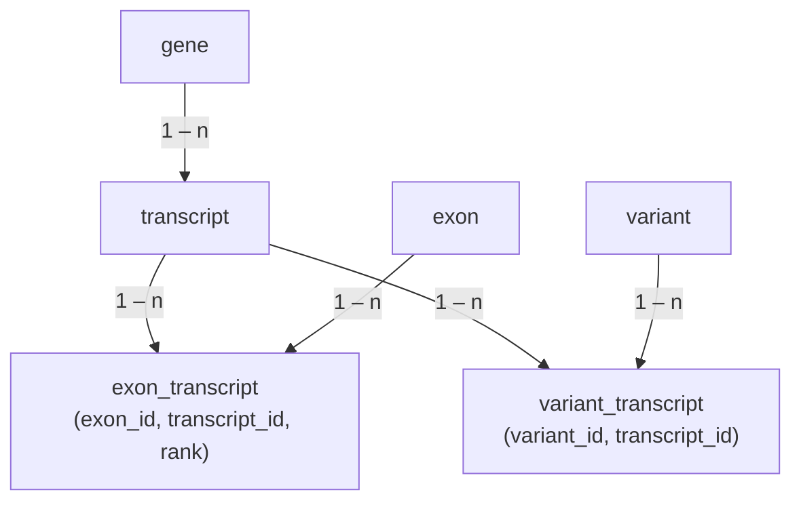

Năm 2020, ủy ban danh pháp gene người (HGNC) đổi tên SEPT1 thành SEPTIN1 và MARCH1 thành MARCHF1, không vì phát hiện sinh học mới mà vì bảng tính cứ tự biến các ký hiệu này thành ngày tháng (Bruford et al., 2020). Bài này giải thích database là gì, đối chiếu những nhận định quen thuộc về "Excel và database" với tài liệu chính thức, và dùng lỗi tên gene để chỉ ra khác biệt cốt lõi: cơ sở dữ liệu quan hệ buộc bạn khai báo **schema** trước khi nhập dữ liệu. Bài cũng nói rõ khi nào database không cứu được dữ liệu và khi nào bảng tính vẫn đủ dùng, kèm code SQLite chạy được.

## 1. Mở đầu: một gene đổi tên vì phần mềm

Trong nhiều phòng thí nghiệm, thông tin mẫu nằm trong một file, kết quả qPCR trong file khác, danh sách gene biểu hiện khác biệt xuất từ R rồi mở bằng Excel để lọc. Rắc rối đến khi file nặng dần, nhiều người cùng sửa, và các sheet phải tra chéo bằng VLOOKUP.

Câu hỏi "bảng tính hay database?" thường được trả lời bằng bốn ý: Excel chỉ chứa khoảng một triệu dòng còn database chứa hàng tỷ dòng, database nhanh nhờ index, Excel khó cho nhiều người dùng, VLOOKUP yếu hơn JOIN. Các ý này đúng một phần, nhưng bỏ sót điều quan trọng nhất: một ô bảng tính không biết cột của nó chứa ký hiệu gene, nên phần mềm đoán kiểu theo nội dung, và `SEPT2` trông giống ngày 2 tháng 9. Lợi thế thật của cơ sở dữ liệu quan hệ nằm ở **schema có kiểu dữ liệu, khoá và ràng buộc** theo mô hình của Codd (1970). Đây là bài thứ hai của series *SQL cho dữ liệu sinh học và phân tích*, sau bài về lịch sử SQL.

## 2. Database là gì: bảng, dòng, cột và schema

Cơ sở dữ liệu (database) là tập dữ liệu có tổ chức, được một hệ quản trị cơ sở dữ liệu (database management system, DBMS) lưu trữ và phục vụ truy vấn. Loại phổ biến nhất là **cơ sở dữ liệu quan hệ** (relational database), dựa trên bài báo năm 1970 của E. F. Codd. Ý tưởng then chốt của Codd là tách cách người dùng nhìn dữ liệu khỏi cách máy tổ chức dữ liệu bên trong: người dùng chỉ thấy các bảng, và chương trình không phải viết lại khi cách lưu trữ thay đổi (Codd, 1970).

Dữ liệu nằm trong các **bảng** (table, trong lý thuyết gọi là relation). Mỗi **cột** (column, attribute) là một loại thông tin, như `symbol` hay `salary`; mỗi **dòng** (row, tuple hay bản ghi) là một đối tượng cụ thể, như một gene hay một nhân viên. Khác biệt với một sheet Excel nằm ở **schema**: bản khai báo tên cột, **kiểu dữ liệu** của từng cột, **khoá chính** (primary key) định danh mỗi dòng, **khoá ngoại** (foreign key) nối sang bảng khác, và các **ràng buộc** (constraint) như `NOT NULL` hay `CHECK`. Schema có trước dữ liệu; mỗi giá trị nhập vào phải hợp với nó.


*Hình 1. Các thành phần của bảng `gene`: tên bảng, cột, dòng, khoá chính và kiểu dữ liệu khai báo trong schema. Dữ liệu minh hoạ.*

**SQL** (Structured Query Language) là ngôn ngữ khai báo để làm việc với cơ sở dữ liệu quan hệ: bạn mô tả kết quả muốn có, DBMS tự quyết định cách lấy. Với bảng `employees` gồm các cột `id`, `full_name`, `department` và `salary`, câu sau lấy tên và lương của mọi nhân viên:

```sql
SELECT full_name, salary FROM employees;
```

<div class="callout callout-warning">
<p class="callout-title">SQL không phân biệt hoa thường, nhưng chỉ với từ khoá</p>

`SELECT` và `select` là một, và mỗi câu lệnh nên kết thúc bằng dấu `;`. **Giá trị chuỗi** thì khác: trong SQLite, `WHERE symbol = 'TP53'` chỉ khớp đúng `TP53`, còn `WHERE symbol LIKE 'tp53'` khớp cả `TP53` lẫn `tp53` (thử với SQLite 3.45.3); DBMS khác xử lý tuỳ collation. Điều này quan trọng vì ký hiệu gene người viết hoa toàn bộ (TP53), còn gene chuột chỉ viết hoa chữ đầu (Trp53).

</div>

Trong bảng tính, một cột có thể chứa số, chữ và ngày lẫn lộn; định dạng ô chỉ là gợi ý hiển thị. Schema biến nguyên tắc "mỗi cột một biến" trong [bài chuẩn bị dữ liệu](/blog/prepare-data-for-exploration/) thành luật máy kiểm tra được (xem thêm SQL – Database).

## 3. Bảng tính và database: đối chiếu với tài liệu chính thức

**Dung lượng.** Trang thông số của Microsoft ghi một **worksheet** tối đa 1.048.576 dòng và 16.384 cột, còn số sheet trong workbook bị giới hạn bởi bộ nhớ (Microsoft, n.d.-a): "khoảng một triệu dòng" là giới hạn của một sheet, không phải của file. "Hàng tỷ dòng" thì mơ hồ, vì tuỳ DBMS và phần cứng. SQLite về lý thuyết cho 2^64 dòng mỗi bảng nhưng bị chặn bởi kích thước file tối đa khoảng 281 TB, ước tính lý tưởng khoảng 2e+13 dòng (SQLite, n.d.-c); PostgreSQL 18 giới hạn một bảng ở 32 TB với kích thước khối mặc định (PostgreSQL Global Development Group, n.d.). Cả hai vượt xa nhu cầu của phần lớn phòng thí nghiệm, nên dung lượng hiếm khi là lý do chính để chuyển sang database.

**Tốc độ.** Khi tìm theo rowid hoặc một index, SQLite dùng tìm kiếm nhị phân, thời gian tăng theo log N; không có index phù hợp thì quét toàn bảng, thời gian tăng theo N (SQLite, n.d.-d). "Nhanh nhờ index" chỉ đúng khi index phù hợp với điều kiện truy vấn đã được tạo.

**Nhiều người dùng.** Shared Workbook (Legacy) của Excel cho tối đa 256 người mở cùng lúc (Microsoft, n.d.-a). SQLite cho không giới hạn người đọc nhưng chỉ **một người ghi tại một thời điểm**, và tài liệu của nó khuyên dùng DBMS client/server khi nhiều người cần ghi đồng thời (SQLite, n.d.-a).

**Liên kết.** VLOOKUP tra theo **cột đầu tiên** của vùng và mặc định khớp gần đúng nếu bỏ trống tham số cuối (Microsoft, n.d.-b), nên với mã mẫu hay ID gene có thể trả về dòng của mẫu khác mà không báo lỗi. JOIN dựa trên khoá: nối nhiều bảng, xử lý quan hệ nhiều–nhiều qua bảng nối, giữ dòng không khớp bằng outer join, và nhờ khoá ngoại, ngăn bản ghi trỏ tới đối tượng không tồn tại (Codd, 1970; SQLite, n.d.-e).

**Bảng 1.** Bảng tính và cơ sở dữ liệu quan hệ: nhận định thường gặp và thực tế theo tài liệu

| Tiêu chí | Nhận định thường gặp | Theo tài liệu | Nguồn |
| --- | --- | --- | --- |
| Dung lượng | Excel ~1 triệu dòng; database hàng tỷ | 1.048.576 dòng **mỗi worksheet**; SQLite ~2e+13 dòng; PostgreSQL 32 TB/bảng | Microsoft (n.d.-a); SQLite (n.d.-c); PostgreSQL Global Development Group (n.d.) |
| Tốc độ | Database nhanh nhờ index | log N **khi có index phù hợp** | SQLite (n.d.-d) |
| Nhiều người dùng | Excel khó; database sẵn | Shared Workbook 256 người; SQLite một người ghi | Microsoft (n.d.-a); SQLite (n.d.-a) |
| Liên kết | VLOOKUP yếu hơn JOIN | VLOOKUP theo cột đầu, mặc định gần đúng; JOIN theo khoá | Microsoft (n.d.-b); Codd (1970) |
| Kiểu dữ liệu | ít được nhắc | Bảng tính đoán theo ô; database khai báo trong schema | Abeysooriya et al. (2021); SQLite (n.d.-b) |
| Ràng buộc | ít được nhắc | Data validation tuỳ chọn; `NOT NULL`, `CHECK`, `FOREIGN KEY` | SQLite (n.d.-b, n.d.-e) |

Hai dòng cuối mới là nơi hai công cụ khác nhau về bản chất. Bảng tính cũng có hàm database riêng như Advanced Filter, DMAX (xem [phân tích cơ sở dữ liệu trên Excel](/blog/phan-tich-co-so-du-lieu/)); cách đặt câu hỏi trước khi chọn công cụ có ở [bài đặt câu hỏi](/blog/ask-questions-to-make-data-driven-decisions/).

## 4. Bài học từ lỗi tên gene

### 4.1. Dòng thời gian

Năm 2004, Zeeberg và cộng sự phát hiện khi xử lý dữ liệu microarray rằng Excel chuyển ít nhất 30 tên gene thành ngày (như DEC1 thành 1-DEC) và, nếu tính cả mã RIKEN, ít nhất 2.000 định danh thành số dấu phẩy động (như `2310009E13` bị hiểu là 2310009 × 10¹³). Cả hai kiểu chuyển đổi **không đảo ngược được** (Zeeberg et al., 2004).

Ziemann, Eren và El-Osta (2016) đo mức lan rộng: nhóm quét 35.175 file Excel bổ sung của 18 tạp chí và xác nhận lỗi ở 987 file thuộc 704 bài báo; 19,6% bài có danh sách gene dạng Excel bị ảnh hưởng, với ví dụ điển hình `SEPT2` thành `2-Sep` và `MARCH1` thành `1-Mar`.

Sau đó lỗi không giảm. Abeysooriya và cộng sự (2021) quét PubMed Central giai đoạn 2014–2020 bằng công cụ bắt được cả dạng ngày lưu nội bộ (số năm chữ số): 30,9% (3.436/11.117) bài có danh sách gene trong file Excel chứa lỗi, và tỷ lệ vẫn tăng sau 2016. Trong thử nghiệm nhập liệu của nhóm, Excel và Google Sheets chuyển tên gene thành ngày ở cả ba cách nhập, còn LibreOffice và Gnumeric thì không.

Cộng đồng danh pháp đã phản ứng theo cách hiếm thấy: hướng dẫn danh pháp gene người năm 2020 của HGNC ghi rằng mọi ký hiệu bị Excel tự chuyển thành ngày đã được đổi, ví dụ SEPT1 thành SEPTIN1, MARCH1 thành MARCHF1 (Bruford et al., 2020). Abeysooriya et al. (2021) lưu ý việc đổi tên ở người và chuột không giải quyết hết, vì ký hiệu gene của nhiều loài khác vẫn có thể bị đổi, và máy tính cài ngôn ngữ khác vẫn có thể bị ảnh hưởng.


*Hình 2. Bốn mốc chính của vấn đề lỗi tên gene do bảng tính, 2004–2021. Số liệu từ Zeeberg et al. (2004), Ziemann et al. (2016), Bruford et al. (2020) và Abeysooriya et al. (2021).*

Các con số này chỉ phản ánh những tạp chí và giai đoạn được quét, không phải mọi lĩnh vực.

### 4.2. Gốc rễ: suy luận kiểu dữ liệu khi không có schema

Lỗi này không phải lỗi gõ phím mà là hành vi mặc định: ô không có kiểu khai báo trước thì phần mềm phải đoán, và chuỗi giống ngày thành ngày. Cảnh báo trên tạp chí không đổi được hành vi mặc định trên hàng triệu máy.

Về sau Microsoft thêm nhóm tuỳ chọn *Automatic Data Conversion* cho Excel trong Microsoft 365 và Excel 2024 (Windows và Mac), cho phép tắt việc bỏ số 0 đứng đầu, cắt số dài, đổi chuỗi có chữ "E" thành số khoa học và đổi chuỗi chữ–số liền nhau thành ngày (Microsoft, n.d.-c). Tuỳ chọn cuối có giới hạn: theo trang hướng dẫn, chỉ chuỗi liền như `JAN1` được giữ nguyên, còn `JAN 1` hay `JAN-1` vẫn có thể thành ngày. Đây vẫn là cài đặt trên từng máy, không đi theo dữ liệu.

Cách đọc file an toàn trong R có ở bài nhập và xuất dữ liệu trong R và Basic data types; xử lý khi lỗi đã xảy ra có ở [bài làm sạch dữ liệu](/blog/process-data-from-dirty-to-clean/).

## 5. Database ngăn lỗi bằng cách nào, và khi nào không ngăn được

### 5.1. Kiểu dữ liệu khai báo, và một phản ví dụ

Thử nghiệm sau dùng SQLite, DBMS nhúng có sẵn trong Python. Năm giá trị dễ bị bảng tính đổi được chèn vào ba cột khai báo khác nhau (`TEXT`, `NUMERIC`, không khai báo kiểu) và vào một bảng `STRICT`:

```python
import sqlite3
con = sqlite3.connect(":memory:")
con.execute("CREATE TABLE t (s_text TEXT, s_num NUMERIC, s_none)")
con.execute("CREATE TABLE t_strict (s TEXT) STRICT")
for v in ["SEPT2", "MARCH1", "1-Mar", "2310009E13", "00123"]:
    con.execute("INSERT INTO t VALUES (?, ?, ?)", (v, v, v))
    con.execute("INSERT INTO t_strict VALUES (?)", (v,))
for row in con.execute("SELECT s_text, typeof(s_text), s_num, typeof(s_num), "
                       "s_none, typeof(s_none) FROM t"):
    print(row)
```

**Bảng 2.** Giá trị lưu được và kiểu lưu trữ (`typeof`) theo cách khai báo cột, SQLite 3.45.3

| Giá trị chèn | Cột `TEXT` | Cột `NUMERIC` | Không khai báo kiểu | `STRICT`, cột `TEXT` |
| --- | --- | --- | --- | --- |
| `SEPT2` | `SEPT2` (text) | `SEPT2` (text) | `SEPT2` (text) | `SEPT2` (text) |
| `MARCH1` | `MARCH1` (text) | `MARCH1` (text) | `MARCH1` (text) | `MARCH1` (text) |
| `1-Mar` | `1-Mar` (text) | `1-Mar` (text) | `1-Mar` (text) | `1-Mar` (text) |
| `2310009E13` | `2310009E13` (text) | `2.310009e+19` (**real**) | `2310009E13` (text) | `2310009E13` (text) |
| `00123` | `00123` (text) | `123` (**integer**) | `00123` (text) | `00123` (text) |

SQLite không bao giờ đổi chuỗi thành ngày, vì nó không đoán ngày từ văn bản. Nhưng ở cột `NUMERIC`, mã RIKEN thành số thực và mã mẫu `00123` mất số 0 đứng đầu, đúng như trong bảng tính. Nguyên nhân là *type affinity*: văn bản "trông như số" chèn vào cột có affinity NUMERIC được chuyển sang INTEGER hoặc REAL (SQLite, n.d.-b). Database chỉ bảo vệ dữ liệu khi schema đúng; khai báo sai kiểu cho cột ID thì lỗi vẫn xảy ra.

### 5.2. Bảng STRICT: từ chối thay vì âm thầm chấp nhận

Mặc định SQLite dùng kiểu linh hoạt: cột `INTEGER` vẫn nhận chuỗi. Từ phiên bản 3.37.0 (2021), bảng khai báo `STRICT` bắt buộc đúng kiểu và báo lỗi khi sai (SQLite, n.d.-b):

```python
con.execute("CREATE TABLE expr (gene TEXT NOT NULL, tpm INTEGER) STRICT")
con.execute("INSERT INTO expr VALUES ('TP53', 'cao')")
# sqlite3.IntegrityError: cannot store TEXT value in INTEGER column expr.tpm
```

Một lỗi rõ ràng lúc nhập luôn rẻ hơn một giá trị sai nằm im đến lúc phân tích.

### 5.3. Khoá ngoại và ràng buộc CHECK

Khoá ngoại ngăn bản ghi "mồ côi", như transcript trỏ tới gene không có trong bảng `gene`. Có một bẫy: trong SQLite, kiểm tra khoá ngoại **mặc định tắt** và phải bật cho từng kết nối bằng `PRAGMA foreign_keys = ON` (SQLite, n.d.-e). Đoạn sau chạy bằng công cụ dòng lệnh `sqlite3`:

```sql
CREATE TABLE gene (
  gene_id TEXT PRIMARY KEY,
  symbol  TEXT NOT NULL
) STRICT;
CREATE TABLE transcript (
  transcript_id TEXT PRIMARY KEY,
  gene_id       TEXT NOT NULL REFERENCES gene(gene_id)
) STRICT;
INSERT INTO gene VALUES ('G1', 'SEPTIN2'), ('G2', 'MARCHF1');
INSERT INTO transcript VALUES ('T1', 'G1');
-- Khoá ngoại đang tắt: bản ghi mồ côi vẫn được nhận
INSERT INTO transcript VALUES ('T9', 'G99');
-- Bật kiểm tra rồi thử lại
PRAGMA foreign_keys = ON;
INSERT INTO transcript VALUES ('T10', 'G99');
-- Error: FOREIGN KEY constraint failed
```

Ràng buộc `CHECK` biến kiến thức chuyên môn thành luật. Trong bảng đo cá, khối lượng cá bỏ nội tạng (Wo) không thể lớn hơn khối lượng toàn thân (W). Với dữ liệu mô phỏng dưới đây, dòng thứ hai bị từ chối ngay lúc nhập:

```sql
CREATE TABLE fish (
  fish_id INTEGER PRIMARY KEY,
  W  REAL NOT NULL CHECK (W > 0),   -- khối lượng toàn thân (g)
  Wo REAL NOT NULL CHECK (Wo > 0),  -- khối lượng bỏ nội tạng (g)
  CHECK (Wo <= W)
) STRICT;
INSERT INTO fish VALUES (1, 30.2, 25.1);
INSERT INTO fish VALUES (2, 32.0, 36.5);
-- Error: CHECK constraint failed: Wo <= W
```

### 5.4. Đường đi của dữ liệu

Không ràng buộc nào cứu được dữ liệu đã hỏng trước khi vào database. Nếu bảng gene được mở và lưu lại bằng Excel rồi mới nạp vào SQLite, `2-Sep` sẽ được lưu đúng nguyên dạng chuỗi `2-Sep`: chính xác và vô dụng. Vì vậy nên nạp thẳng từ file văn bản do pipeline xuất ra (CSV, TSV), phù hợp với khuyến nghị lưu dữ liệu dạng văn bản thuần của Broman và Woo (2018).

## 6. Database sinh học thật chạy trên RDBMS

Nhiều tài nguyên lớn của tin sinh học chạy trên hệ quản trị cơ sở dữ liệu quan hệ (RDBMS) và cho phép truy vấn trực tiếp. Theo trang tài liệu Ensembl (bản lưu trữ tháng 6/2026), **Ensembl** có máy chủ MySQL công khai `ensembldb.ensembl.org` cùng các mirror MariaDB, đăng nhập bằng user `anonymous` (Ensembl, n.d.-a); database core có các bảng nền tảng `gene`, `transcript`, `exon`, `exon_transcript`, `translation` (Ensembl, n.d.-b). Thư viện truy cập database này được mô tả từ 2004 (Stabenau et al., 2004) và Ensembl vẫn cập nhật định kỳ (Dyer et al., 2025). **UCSC Genome Browser** dùng MariaDB, mở hai máy chủ công khai đồng bộ hằng tuần với website (UCSC Genome Browser, n.d.; Karolchik et al., 2003; Perez et al., 2025).

**GEMINI** nạp biến thể và kiểu gen từ VCF vào SQLite; các tác giả chọn cơ sở dữ liệu quan hệ vì sức biểu đạt của SQL, và chọn SQLite vì cả database là **một file duy nhất**, dễ chia sẻ (Paila et al., 2013), đặc điểm mà nhóm phát triển SQLite cũng nhấn mạnh (Gaffney et al., 2022). **Chado** của cộng đồng FlyBase là schema quan hệ dạng module cho thông tin gắn với genome (Mungall et al., 2007).

**Bảng 3.** Một số tài nguyên tin sinh học dùng cơ sở dữ liệu quan hệ

| Tài nguyên | DBMS | Cách truy cập | Nguồn |
| --- | --- | --- | --- |
| Ensembl | MySQL, mirror MariaDB | Máy chủ công khai, user `anonymous` | Ensembl (n.d.-a, n.d.-b) |
| UCSC Genome Browser | MariaDB | `genome-mysql.gi.ucsc.edu`, `genome-euro-mysql.soe.ucsc.edu` | UCSC Genome Browser (n.d.) |
| GEMINI | SQLite | Một file database tạo từ VCF | Paila et al. (2013) |
| Chado (FlyBase) | Schema dạng module | Cài đặt theo dự án | Mungall et al. (2007) |

Học `SELECT`, `WHERE` và `JOIN` vì vậy là học cách hỏi trực tiếp những kho dữ liệu này. Tổng quan về định dạng và cơ sở dữ liệu sinh học có ở bài định dạng dữ liệu.

## 7. Từ database cửa hàng đến database gene: hai sơ đồ quan hệ

Ví dụ kinh điển khi học SQL là database cửa hàng online, và cấu trúc của nó trùng khớp đáng ngạc nhiên với cách Ensembl tổ chức gene.

**Sơ đồ A** là database cửa hàng ở dạng đầy đủ. Mỗi danh mục có nhiều sản phẩm, mỗi khách hàng có nhiều đơn hàng. Một đơn có nhiều sản phẩm và một sản phẩm nằm trong nhiều đơn: quan hệ nhiều–nhiều, cần một **bảng nối** (`order_details`) chứa cặp `order_id`, `product_id`.



**Sơ đồ B** là schema gene – transcript – variant rút gọn. Một gene có nhiều transcript; một transcript gồm nhiều exon và một exon có thể dùng chung cho nhiều transcript, nên Ensembl đặt bảng nối `exon_transcript` (Ensembl, n.d.-b). Nhánh biến thể gợi ý từ cách GEMINI gắn biến thể với annotation (Paila et al., 2013); tên `variant_transcript` là tên đặt cho bài này, không phải bảng của Ensembl hay GEMINI.



`orders` – `order_details` – `products` có cùng hình dạng với `transcript` – `exon_transcript` – `exon`: hiểu một cái là hiểu cái kia. Câu SQL sau chạy trên phiên bản thu nhỏ của sơ đồ B và hỏi: exon nào được nhiều transcript của cùng một gene dùng chung?

```sql
SELECT g.symbol, et.exon_id, COUNT(*) AS n_transcript
FROM gene g
JOIN transcript t       ON t.gene_id = g.gene_id
JOIN exon_transcript et ON et.transcript_id = t.transcript_id
GROUP BY g.symbol, et.exon_id
ORDER BY et.exon_id;
-- SEPTIN2 | E1 | 2
-- SEPTIN2 | E2 | 1
-- SEPTIN2 | E3 | 1
```

Hai database còn giống nhau ở giá trị trống: khách hàng chưa có email hay sản phẩm chưa cập nhật tồn kho được lưu là `NULL`, cũng như annotation chưa có hay giá trị đo bị thiếu. `NULL` không bằng 0 và không bằng chuỗi rỗng; nó sẽ được bàn ở các bài sau. Để luyện JOIN, xem [JOIN](/blog/join-ket-hop-nhieu-bang/) và bài tổng hợp.

## 8. Khi nào bảng tính vẫn đủ, khi nào cần database

Kết luận không phải "bỏ Excel". Broman và Woo (2018) nêu các nguyên tắc tổ chức bảng tính: nhất quán, ngày dạng YYYY-MM-DD, mỗi ô một giá trị, dữ liệu hình chữ nhật, có từ điển dữ liệu (data dictionary), không tính toán trong file thô, không dùng màu làm dữ liệu, dùng data validation và lưu bản dạng văn bản. Với dữ liệu nhỏ, một bảng, một người nhập, bảng tính tổ chức như vậy là hợp lý; chính hai tác giả ghi nhận dữ liệu phức tạp có thể cần một database thực thụ. **Tidy data** của Wickham (2014), mỗi biến một cột, mỗi quan sát một dòng, mỗi loại đơn vị quan sát một bảng, là cầu nối giữa bảng tính gọn gàng và bảng quan hệ. Ngược lại, không phải dữ liệu genomics nào cũng nên vào RDBMS: file nén có chỉ mục như **tabix** lấy nhanh một vùng genome (Li, 2011), còn **BioMart** phục vụ truy vấn liên kết nhiều nguồn (Kasprzyk, 2011).

<div class="callout callout-note">
<p class="callout-title">Năm câu hỏi trước khi chọn công cụ</p>

1. Có **nhiều bảng liên kết** không (mẫu – lần đo – kết quả, gene – transcript – biến thể)?
2. Có **nhiều người cùng ghi** không?
3. Có **ID dễ bị tự chuyển đổi** (ký hiệu gene, mã có số 0 đứng đầu hay chữ E) không?
4. Một bảng có thể **vượt 1.048.576 dòng** không?
5. Có cần **truy vấn tái lập** khi dữ liệu cập nhật không?

Một hai câu "có" thì bảng tính tổ chức tốt kèm file văn bản có thể vẫn đủ. Từ ba câu trở lên, theo quy tắc thô, SQLite đáng công học.

</div>

## 9. Kết luận

Những nhận định quen thuộc về Excel và database có hạt nhân đúng nhưng đặt trọng tâm sai chỗ. Khác biệt cốt lõi là **schema**: database buộc bạn nói trước mỗi cột chứa gì, bảng tính đoán sau. Hai thập kỷ lỗi tên gene cho thấy cái giá của việc để phần mềm đoán, đến mức chính tên gene phải đổi. Database cũng không vạn năng: cột khai báo sai kiểu vẫn làm hỏng ID, khoá ngoại của SQLite phải tự bật, và dữ liệu đã qua bảng tính thì hỏng từ trước. Học SQL, vì vậy, trước hết là học cách khai báo cấu trúc cho dữ liệu sinh học.

Bạn có thể thử ngay: chuyển một bảng mẫu đang quản lý bằng Excel sang SQLite với bảng `STRICT` và vài ràng buộc `CHECK`, hoặc kết nối thử máy chủ công khai của UCSC hay Ensembl. Bài sau của series đi vào SELECT và WHERE.

## Tài liệu tham khảo

Abeysooriya, M., Soria, M., Kasu, M. S., & Ziemann, M. (2021). Gene name errors: Lessons not learned. *PLOS Computational Biology, 17*(7), e1008984. https://doi.org/10.1371/journal.pcbi.1008984

Broman, K. W., & Woo, K. H. (2018). Data organization in spreadsheets. *The American Statistician, 72*(1), 2–10. https://doi.org/10.1080/00031305.2017.1375989

Bruford, E. A., Braschi, B., Denny, P., Jones, T. E. M., Seal, R. L., & Tweedie, S. (2020). Guidelines for human gene nomenclature. *Nature Genetics, 52*(8), 754–758. https://doi.org/10.1038/s41588-020-0669-3

Codd, E. F. (1970). A relational model of data for large shared data banks. *Communications of the ACM, 13*(6), 377–387. https://doi.org/10.1145/362384.362685

Dyer, S. C., Austine-Orimoloye, O., Azov, A. G., Barba, M., Barnes, I., Barrera-Enriquez, V. P., Becker, A., Bennett, R., Beracochea, M., Berry, A., Bhai, J., Bhurji, S. K., Boddu, S., Branco Lins, P. R., Brooks, L., Ramaraju, S. B., Campbell, L. I., Martinez, M. C., Charkhchi, M., … Yates, A. D. (2025). Ensembl 2025. *Nucleic Acids Research, 53*(D1), D948–D957. https://doi.org/10.1093/nar/gkae1071

Ensembl. (n.d.-a). *Public MySQL server*. Truy cập ngày 12 tháng 11 năm 2026, từ https://jun2026.archive.ensembl.org/info/data/mysql.html

Ensembl. (n.d.-b). *Schema documentation (core database)*. Truy cập ngày 12 tháng 11 năm 2026, từ https://jun2026.archive.ensembl.org/info/docs/api/core/core_schema.html

Gaffney, K. P., Prammer, M., Brasfield, L., Hipp, D. R., Kennedy, D., & Patel, J. M. (2022). SQLite: Past, present, and future. *Proceedings of the VLDB Endowment, 15*(12), 3535–3547. https://doi.org/10.14778/3554821.3554842

Karolchik, D., Baertsch, R., Diekhans, M., Furey, T. S., Hinrichs, A., Lu, Y. T., Roskin, K. M., Schwartz, M., Sugnet, C. W., Thomas, D. J., Weber, R. J., Haussler, D., & Kent, W. J. (2003). The UCSC Genome Browser Database. *Nucleic Acids Research, 31*(1), 51–54. https://doi.org/10.1093/nar/gkg129

Kasprzyk, A. (2011). BioMart: Driving a paradigm change in biological data management. *Database, 2011*, bar049. https://doi.org/10.1093/database/bar049

Li, H. (2011). Tabix: Fast retrieval of sequence features from generic TAB-delimited files. *Bioinformatics, 27*(5), 718–719. https://doi.org/10.1093/bioinformatics/btq671

Microsoft. (n.d.-a). *Excel specifications and limits*. Microsoft Support. Truy cập ngày 12 tháng 11 năm 2026, từ https://support.microsoft.com/en-us/office/excel-specifications-and-limits-1672b34d-7043-467e-8e27-269d656771c3

Microsoft. (n.d.-b). *VLOOKUP function*. Microsoft Support. Truy cập ngày 12 tháng 11 năm 2026, từ https://support.microsoft.com/en-us/office/vlookup-function-0bbc8083-26fe-4963-8ab8-93a18ad188a1

Microsoft. (n.d.-c). *Set automatic data conversions*. Microsoft Support. Truy cập ngày 19 tháng 11 năm 2026, từ https://support.microsoft.com/office/33d1d872-9926-4ef3-9364-492444d0c7ea

Mungall, C. J., Emmert, D. B., & The FlyBase Consortium. (2007). A Chado case study: An ontology-based modular schema for representing genome-associated biological information. *Bioinformatics, 23*(13), i337–i346. https://doi.org/10.1093/bioinformatics/btm189

Paila, U., Chapman, B. A., Kirchner, R., & Quinlan, A. R. (2013). GEMINI: Integrative exploration of genetic variation and genome annotations. *PLOS Computational Biology, 9*(7), e1003153. https://doi.org/10.1371/journal.pcbi.1003153

Perez, G., Barber, G. P., Benet-Pages, A., Casper, J., Clawson, H., Diekhans, M., Fischer, C., Gonzalez, J. N., Hinrichs, A. S., Lee, C. M., Nassar, L. R., Raney, B. J., Speir, M. L., van Baren, M. J., Vaske, C. J., Haussler, D., Kent, W. J., & Haeussler, M. (2025). The UCSC Genome Browser database: 2025 update. *Nucleic Acids Research, 53*(D1), D1243–D1249. https://doi.org/10.1093/nar/gkae974

PostgreSQL Global Development Group. (n.d.). *Appendix K. PostgreSQL limits* (PostgreSQL 18 documentation). Truy cập ngày 19 tháng 11 năm 2026, từ https://www.postgresql.org/docs/current/limits.html

SQLite. (n.d.-a). *Appropriate uses for SQLite*. Truy cập ngày 12 tháng 11 năm 2026, từ https://www.sqlite.org/whentouse.html

SQLite. (n.d.-b). *Datatypes in SQLite version 3* và *STRICT tables*. Truy cập ngày 12 tháng 11 năm 2026, từ https://www.sqlite.org/datatype3.html và https://www.sqlite.org/stricttables.html

SQLite. (n.d.-c). *Implementation limits for SQLite*. Truy cập ngày 12 tháng 11 năm 2026, từ https://www.sqlite.org/limits.html

SQLite. (n.d.-d). *Query planning*. Truy cập ngày 12 tháng 11 năm 2026, từ https://www.sqlite.org/queryplanner.html

SQLite. (n.d.-e). *SQLite foreign key support*. Truy cập ngày 12 tháng 11 năm 2026, từ https://www.sqlite.org/foreignkeys.html

Stabenau, A., McVicker, G., Melsopp, C., Proctor, G., Clamp, M., & Birney, E. (2004). The Ensembl core software libraries. *Genome Research, 14*(5), 929–933. https://doi.org/10.1101/gr.1857204

UCSC Genome Browser. (n.d.). *Downloading data using MariaDB (MySQL)*. Truy cập ngày 12 tháng 11 năm 2026, từ https://genome.ucsc.edu/goldenPath/help/mysql.html

Wickham, H. (2014). Tidy data. *Journal of Statistical Software, 59*(10). https://doi.org/10.18637/jss.v059.i10

Zeeberg, B. R., Riss, J., Kane, D. W., Bussey, K. J., Uchio, E., Linehan, W. M., Barrett, J. C., & Weinstein, J. N. (2004). Mistaken identifiers: Gene name errors can be introduced inadvertently when using Excel in bioinformatics. *BMC Bioinformatics, 5*, 80. https://doi.org/10.1186/1471-2105-5-80

Ziemann, M., Eren, Y., & El-Osta, A. (2016). Gene name errors are widespread in the scientific literature. *Genome Biology, 17*, 177. https://doi.org/10.1186/s13059-016-1044-7
