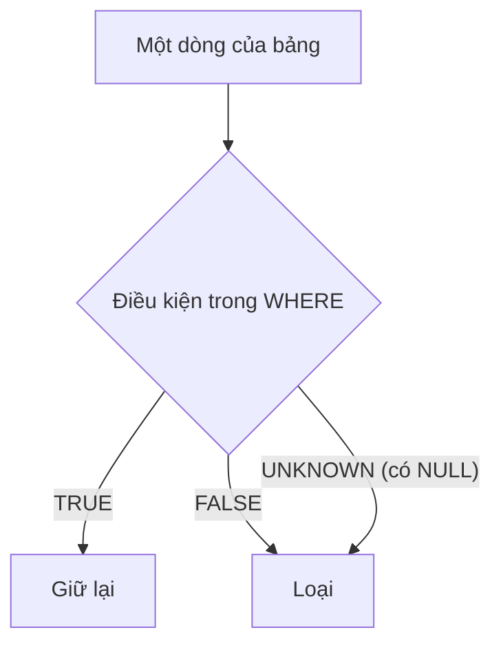

Trong SQL, `SELECT` chọn cột, `WHERE` chọn dòng, và `WHERE` chỉ giữ những dòng mà điều kiện cho kết quả TRUE. Mọi phép so sánh với NULL, kể cả `NULL = NULL`, đều cho ra UNKNOWN, nên `WHERE x = NULL` luôn trả về 0 dòng và muốn tìm ô thiếu bạn phải viết `IS NULL`. Hệ quả đáng sợ hơn: trên một bảng biến thể mô phỏng 6 dòng chạy bằng SQLite 3.45.3, lọc "Pathogenic" được 2 dòng, lọc "không Pathogenic" cũng được 2, còn 2 dòng thiếu chú giải biến mất khỏi cả hai, và `NOT IN` với một danh sách có NULL trả về 0 dòng. Bài này viết cho sinh viên sinh học và người hay lọc bảng biến thể, bảng mẫu có nhiều ô trống. Phần cuối có checklist sáu bước để dùng trước mỗi lần lọc.

<div class="callout callout-note">
<p class="callout-title">Tóm tắt nhanh</p>

- NULL nghĩa là "chưa biết", không phải 0 hay chuỗi rỗng.
- So sánh bất cứ thứ gì với NULL cho ra UNKNOWN; `WHERE` loại cả FALSE lẫn UNKNOWN.
- Dòng NULL không nằm trong "A" cũng không nằm trong "không A"; `NOT IN (…, NULL)` trả 0 dòng.
- Tìm ô thiếu bằng `IS NULL`; so sánh có tính NULL bằng `IS DISTINCT FROM` (PostgreSQL) hoặc `IS NOT` (SQLite).
- Kiểm tra tổng: số dòng "A" + "không A" + "NULL" phải bằng tổng số dòng.

</div>

## 1. SELECT và WHERE làm gì

Một câu truy vấn cơ bản có ba phần: `SELECT` nói lấy cột nào, `FROM` nói lấy từ bảng nào, `WHERE` nói giữ dòng nào. `SELECT *` lấy mọi cột; liệt kê tên cột thì kết quả có đúng các cột đó theo đúng thứ tự bạn viết. Trong `SELECT` bạn cũng có thể tính toán trên dữ liệu, đặt tên cho cột kết quả bằng `AS` và làm tròn bằng `ROUND`.

```sql
SELECT gene,
       consequence,
       ROUND(alt_reads * 1.0 / depth, 2) AS vaf,
       af AS "tần số allele"
FROM variant
WHERE clin_sig = 'Pathogenic';
```

Có hai loại dấu nháy với vai trò khác nhau. Nháy đơn bao một **giá trị** chuỗi (`'Pathogenic'`), còn ngoặc kép bao một **tên** (định danh), cần khi tên cột có dấu cách hay dấu tiếng Việt như `"tần số allele"` (PostgreSQL Global Development Group, n.d.-d). Viết nhầm `WHERE clin_sig = "Pathogenic"` thì PostgreSQL sẽ đi tìm một cột tên Pathogenic. SQLite thì dễ dãi hơn: nếu không có cột nào tên như vậy, nó lặng lẽ coi chuỗi trong ngoặc kép là giá trị để tương thích ngược, và chính tài liệu SQLite gọi đây là một "misfeature" (SQLite, n.d.-d). Truy vấn vẫn chạy, nhưng đừng dựa vào điều đó.

`WHERE` nhận một biểu thức điều kiện và đánh giá nó trên từng dòng. Các toán tử thường dùng nằm trong bảng dưới. Cột cuối là phần dễ bị bỏ qua nhất.

| Toán tử | Ý nghĩa | Ví dụ | Khi một vế là NULL |
|---|---|---|---|
| `=`, `<>` (hoặc `!=`) | bằng, khác | `clin_sig = 'Benign'` | UNKNOWN |
| `<`, `>`, `<=`, `>=` | so sánh thứ tự | `af < 0.01` | UNKNOWN |
| `BETWEEN a AND b` | trong đoạn [a, b] | `af BETWEEN 0 AND 1` | UNKNOWN |
| `IN (…)` | thuộc danh sách | `gene IN ('TP53','KRAS')` | UNKNOWN (nếu không khớp phần tử nào) |
| `LIKE` | khớp mẫu, `%` và `_` | `gene LIKE 'BRCA%'` | UNKNOWN |
| `IS NULL`, `IS NOT NULL` | kiểm tra thiếu | `af IS NULL` | luôn TRUE hoặc FALSE |
| `AND`, `OR`, `NOT` | kết hợp điều kiện | `af < 0.01 AND depth >= 20` | theo bảng chân trị ở mục 2 |

Cả bài xoay quanh cột đó. Gặp NULL, các toán tử so sánh, `BETWEEN`, `IN` và `LIKE` không trả lời "có" hay "không" mà trả lời "không biết". `IN` có một ngoại lệ: trong SQLite, `1 IN (1, NULL)` cho 1 (TRUE) vì đã khớp phần tử đầu, còn `1 IN (2, NULL)` cho NULL vì không thể loại trừ khả năng NULL kia là 1.

<div class="callout callout-note">
<p class="callout-title">Người dùng R</p>

Nếu bạn đã quen `NA` trong R, NULL của SQL hành xử theo cùng tinh thần: giá trị thiếu lan qua phép so sánh, và phải kiểm tra bằng hàm hoặc toán tử riêng thay vì `==` (→ Các kiểu dữ liệu cơ bản trong R).

</div>

## 2. Logic ba giá trị: bảng chân trị và quy tắc của WHERE

### 2.1. So sánh với NULL cho ra UNKNOWN

SQL không dùng logic hai giá trị đúng/sai mà dùng ba giá trị: TRUE, FALSE và UNKNOWN. SQLite biểu diễn TRUE là 1, FALSE là 0 và UNKNOWN là NULL, nên bạn có thể xem trực tiếp:

```sql
SELECT NULL = NULL, NULL <> NULL, 1 = NULL, NULL IS NULL;
-- SQLite 3.45.3:  NULL | NULL | NULL | 1
```

`NULL = NULL` không phải TRUE. Nếu hai ô đều "chưa biết" thì không ai nói được chúng bằng nhau: hai bệnh nhân cùng thiếu số đo huyết áp không vì thế mà có cùng huyết áp. Tài liệu PostgreSQL nói thẳng điều này: không viết `expression = NULL` vì NULL không "bằng" NULL; NULL đại diện cho một giá trị chưa biết, và không thể biết hai giá trị chưa biết có bằng nhau hay không (PostgreSQL Global Development Group, n.d.-a).

### 2.2. Bảng chân trị

Khi điều kiện kết hợp bằng `AND`, `OR`, `NOT`, UNKNOWN lan theo quy tắc sau. Bảng 1 dựng từ kết quả chạy SQLite, khớp với mô tả trong tài liệu SQLite: `AND` cho FALSE nếu một vế FALSE, `OR` cho TRUE nếu một vế TRUE, các trường hợp còn lại có UNKNOWN thì ra UNKNOWN (SQLite, n.d.-a).

**Bảng 1.** Bảng chân trị ba giá trị (T = TRUE, F = FALSE, U = UNKNOWN)

| p | q | p AND q | p OR q | NOT p |
|---|---|---|---|---|
| T | U | U | T | F |
| F | U | F | U | T |
| U | U | U | U | U |

Đọc bảng theo trực giác: `FALSE AND (chưa biết)` chắc chắn sai dù vế kia là gì; `TRUE OR (chưa biết)` chắc chắn đúng. Còn `NOT (chưa biết)` vẫn là chưa biết.

### 2.3. WHERE chỉ giữ TRUE

Quy tắc của `WHERE` đơn giản: dòng nào có điều kiện TRUE thì giữ, FALSE hoặc UNKNOWN thì loại. Ở bước lọc, UNKNOWN bị đối xử như FALSE. Nhưng nó **không phải** FALSE: đưa qua `NOT`, FALSE thành TRUE còn UNKNOWN vẫn là UNKNOWN. Đó là lý do một dòng có thể rơi khỏi cả "A" lẫn "không A".



*Hình 1. Đường đi của một dòng qua `WHERE`: chỉ TRUE được giữ.*

### 2.4. Cách viết đúng: IS NULL, IS DISTINCT FROM và IS

Muốn tìm ô thiếu, dùng `IS NULL` hoặc `IS NOT NULL`; hai toán tử này luôn trả TRUE hoặc FALSE. PostgreSQL còn có tham số `transform_null_equals`: khi bật, nó tự đổi `x = NULL` thành `x IS NULL` để tương thích với các ứng dụng cũ viết sai (PostgreSQL Global Development Group, n.d.-a).

Khi cần so sánh hai giá trị mà vẫn coi NULL là một giá trị so sánh được, PostgreSQL có `IS DISTINCT FROM` và `IS NOT DISTINCT FROM` (PostgreSQL Global Development Group, n.d.-a). SQLite có `IS` và `IS NOT`, hoạt động như `=` và `!=` nhưng xử lý được NULL (SQLite, n.d.-a); trong thử nghiệm với SQLite 3.45.3, cách viết `IS DISTINCT FROM` cũng chạy và cho cùng kết quả.

```sql
-- PostgreSQL
SELECT * FROM variant WHERE clin_sig IS DISTINCT FROM 'Pathogenic';
-- SQLite
SELECT * FROM variant WHERE clin_sig IS NOT 'Pathogenic';
```

Chuẩn SQL không hoàn toàn rõ ràng về NULL. Nhóm phát triển SQLite ghi rằng mô tả trong chuẩn về cách xử lý NULL còn mơ hồ, nên họ chọn hành vi bằng cách thử trên các hệ khác (SQLite, n.d.-b). Một ví dụ: các NULL được coi là khác nhau trong cột `UNIQUE` (nhiều dòng cùng NULL vẫn hợp lệ) nhưng lại được coi là giống nhau trong `SELECT DISTINCT` (SQLite, n.d.-b).

## 3. Thí nghiệm 1: lọc bảng biến thể có chú giải bị thiếu

### 3.1. Bối cảnh và dữ liệu

Bảng biến thể trong tin sinh học thường có các cột chú giải như ý nghĩa lâm sàng, kiểu được tổng hợp trong ClinVar (Landrum et al., 2018), và hệ quả của biến thể lên gene, kiểu do Ensembl Variant Effect Predictor sinh ra (McLaren et al., 2016). Biến thể chưa được diễn giải thường để trống cột ý nghĩa lâm sàng. Biến thể chưa có trong dữ liệu quần thể thường để trống cột tần số allele.

Thí nghiệm dùng một bảng **mô phỏng** 6 dòng (không phải dữ liệu ClinVar thật), chạy bằng SQLite, hệ quản trị cơ sở dữ liệu nhúng được dùng rất rộng rãi (Gaffney et al., 2022), qua module `sqlite3` của Python. Bảng có 2 dòng thiếu `clin_sig`, 2 dòng thiếu `af`, 1 dòng thiếu `gene`, 1 dòng thiếu `consequence` và 1 dòng `depth = 0`.

```python
import sqlite3

con = sqlite3.connect(":memory:")
con.executescript("""
CREATE TABLE variant (
  id INTEGER PRIMARY KEY, gene TEXT, consequence TEXT, clin_sig TEXT,
  af REAL, depth INTEGER, alt_reads INTEGER);
INSERT INTO variant VALUES
 (1, 'TP53',  'missense_variant',   'Pathogenic', 0.0004, 50,  25),
 (2, 'KRAS',  'missense_variant',   'Pathogenic', NULL,   100, 48),
 (3, 'tp53',  'synonymous_variant', NULL,         0.002,  40,  12),
 (4, 'BRCA1', NULL,                 'Benign',     0.21,   60,  30),
 (5, 'EGFR',  'synonymous_variant', 'Benign',     0.035,  0,   0),
 (6, NULL,    'intron_variant',     NULL,         NULL,   80,  20);
""")

def n(where):
    return con.execute(f"SELECT COUNT(*) FROM variant WHERE {where}").fetchone()[0]

print(n("clin_sig = NULL"), n("clin_sig IS NULL"))   # 0 2
```

### 3.2. Kết quả

**Bảng 2.** Số dòng trả về trên bảng 6 dòng (SQLite 3.45.3, chạy ngày 22/11/2026)

| Điều kiện `WHERE` | Số dòng trả về | Số dòng người viết thường muốn |
|---|---|---|
| `clin_sig = NULL` | 0 | 2 |
| `clin_sig IS NULL` | 2 | 2 |
| `clin_sig = 'Pathogenic'` | 2 | 2 |
| `clin_sig <> 'Pathogenic'` | 2 | 4 |
| `NOT (clin_sig = 'Pathogenic')` | 2 | 4 |
| `clin_sig <> 'Pathogenic' OR clin_sig IS NULL` | 4 | 4 |
| `clin_sig IS NOT 'Pathogenic'` | 4 | 4 |
| `COALESCE(clin_sig, 'not_provided') <> 'Pathogenic'` | 4 | 4 |
| `af < 0.01` | 2 | – |
| `af >= 0.01` | 2 | – |
| `af BETWEEN 0 AND 1` | 4 | – |
| `gene IN ('TP53', 'KRAS', NULL)` | 2 | 2 |
| `gene NOT IN ('TP53', 'KRAS')` | 3 | 4 |
| `gene NOT IN ('TP53', 'KRAS', NULL)` | 0 | 4 |

`<>` và `NOT` cho cùng 2 dòng, nên "Pathogenic" cộng "không Pathogenic" chỉ được 4 trên 6. Cột tần số cũng vậy: `af < 0.01` và `af >= 0.01` mỗi bên 2 dòng. Hai biến thể chưa có tần số không phải "hiếm", cũng không phải "phổ biến", và rơi khỏi cả `BETWEEN 0 AND 1`. Dòng cuối của bảng là trường hợp nặng nhất: thêm một NULL vào danh sách `NOT IN` là kết quả về 0.


*Hình 2. Số dòng thoả điều kiện, thoả điều kiện phủ định và không thuộc cả hai, trên bảng biến thể mô phỏng (6 dòng) và bảng cá mô phỏng ở mục 4 (8 dòng). Đếm bằng SQLite 3.45.3.*

### 3.3. Vì sao NOT IN với NULL trả về 0 dòng

`x NOT IN ('TP53', 'KRAS', NULL)` tương đương `x <> 'TP53' AND x <> 'KRAS' AND x <> NULL`. Vế cuối luôn là UNKNOWN. Theo Bảng 1, `TRUE AND UNKNOWN` là UNKNOWN, còn `FALSE AND UNKNOWN` là FALSE, nên không dòng nào đạt TRUE. Ngược lại, `IN` tương đương một chuỗi `OR`, và `TRUE OR UNKNOWN` là TRUE, nên NULL trong danh sách không gây hại cho `IN`. Bẫy này nguy hiểm nhất khi danh sách là một subquery lấy từ bảng khác có ô trống (→ Subquery & CASE WHEN).

### 3.4. Quy tắc kiểm tra tổng

Với mọi điều kiện P trên một bảng, mỗi dòng rơi vào đúng một trong ba nhóm: P là TRUE, P là FALSE, hoặc P là UNKNOWN. Vì vậy:

$$N_{P} + N_{\text{NOT } P} + N_{P \text{ IS UNKNOWN}} = N_{\text{tổng}}$$

```sql
SELECT SUM(clin_sig = 'Pathogenic')              AS a,
       SUM(NOT (clin_sig = 'Pathogenic'))        AS not_a,
       SUM((clin_sig = 'Pathogenic') IS NULL)    AS unknown,
       COUNT(*)                                  AS total
FROM variant;
-- 2 | 2 | 2 | 6
```

Nếu `a + not_a` nhỏ hơn `total`, bảng có NULL ở cột liên quan tới điều kiện. Câu kiểm tra này tận dụng chính cách SQLite biểu diễn TRUE là 1: `SUM` của một điều kiện là số dòng có điều kiện TRUE, và `SUM` tự bỏ qua NULL.

Trong phân tích biến thể, bộ lọc "bỏ biến thể Benign" viết bằng `clin_sig <> 'Benign'` sẽ bỏ luôn các biến thể chưa có chú giải. Nếu mục tiêu là giữ lại biến thể chưa rõ ý nghĩa để xem xét tiếp, kết quả đó sai về mặt khoa học, và SQL không đưa ra cảnh báo nào.

## 4. Thí nghiệm 2: ô trống trong CSV là NULL hay chuỗi rỗng

Dữ liệu sinh học thường đi vào cơ sở dữ liệu từ file CSV hoặc bảng tính. Câu hỏi thực tế: ô trống có trở thành NULL không? Thí nghiệm dùng một file CSV **mô phỏng** 8 cá thể cá với cột `maturity` (giai đoạn thành thục sinh dục, 1–4), trong đó cá thể 1 để trống.

```text
fish,length_cm,sex,maturity
1,18.2,F,
2,20.5,F,3
3,17.9,M,2
4,21.3,F,4
5,19.0,M,3
6,16.4,M,1
7,22.1,F,4
8,18.8,F,2
```

Cách (a), nạp bằng lệnh `.import` của SQLite CLI 3.37.0 vào bảng đã khai báo `maturity INTEGER`:

```sql
CREATE TABLE fish (fish INTEGER, length_cm REAL, sex TEXT, maturity INTEGER);
.import --csv --skip 1 fish.csv fish
SELECT typeof(maturity) FROM fish WHERE fish = 1;     -- text
SELECT COUNT(*) FROM fish WHERE maturity IS NULL;     -- 0
SELECT COUNT(*) FROM fish WHERE maturity = '';        -- 1
```

Cách (b), đọc bằng pandas rồi ghi vào SQLite:

```python
import sqlite3
import pandas as pd

df = pd.read_csv("fish.csv")          # ô trống -> NaN
con = sqlite3.connect(":memory:")
df.to_sql("fish", con, index=False)   # NaN -> NULL
print(con.execute("SELECT typeof(maturity) FROM fish WHERE fish = 1").fetchone())  # ('null',)
```

**Bảng 3.** Cùng một file CSV, hai cách nạp

| Truy vấn | (a) SQLite CLI 3.37.0 | (b) pandas 3.0.3 + sqlite3 |
|---|---|---|
| `typeof(maturity)` của cá thể 1 | text (chuỗi rỗng) | null |
| `maturity IS NULL` | 0 | 1 |
| `maturity = ''` | 1 | 0 |
| `maturity IN (3, 4)` | 4 | 4 |
| `maturity NOT IN (3, 4)` | 4 | 3 |

Với cách (a), không dòng nào biến mất, nhưng cá thể chưa có số liệu lại được đếm vào nhóm "không phải giai đoạn 3 hoặc 4", như thể đã biết nó ở giai đoạn 1 hoặc 2. Với cách (b), cá thể đó rơi khỏi cả hai nhóm, đúng cơ chế ở mục 2. Không cách nào tự động đúng. Cái bạn cần là biết dữ liệu đang ở trạng thái nào, và chạy `typeof()` trên vài dòng có ô trống ngay sau khi nạp là đủ. Thí nghiệm này chỉ dùng SQLite CLI bản 3.37.0; bản khác hoặc lệnh nạp của hệ khác có thể xử lý ô trống theo cách khác, nên hãy kiểm tra lại trên công cụ bạn dùng. Cũng để ý rằng cột đã khai báo `INTEGER` vẫn nhận chuỗi rỗng ở cách (a). Trong SQLite, kiểu khai báo của cột chỉ là "affinity", một gợi ý chứ không phải ràng buộc: chuỗi không đọc được thành số thì được lưu nguyên dạng TEXT (SQLite, n.d.-e).

Cũng cần quyết định ô trống mang nghĩa gì trước khi nạp. Codd (1986) phân biệt thông tin thiếu "applicable" (giá trị có tồn tại nhưng chưa biết) với "inapplicable" (thuộc tính không áp dụng cho đối tượng). Một con cá non chưa có tuyến sinh dục phát triển thuộc loại thứ hai; một con quên ghi số liệu thuộc loại thứ nhất. SQL chỉ có một NULL cho cả hai.

## 5. Ba bẫy khác: AND/OR, hoa thường, chia số

### 5.1. Thứ tự ưu tiên của AND và OR

Trong cả SQLite và PostgreSQL, `NOT` được ưu tiên hơn `AND`, và `AND` được ưu tiên hơn `OR` (SQLite, n.d.-a; PostgreSQL Global Development Group, n.d.-d).

```sql
-- Không ngoặc: missense, HOẶC (synonymous VÀ hiếm)  -> 3 dòng (id 1, 2, 3)
SELECT id FROM variant
WHERE consequence = 'missense_variant'
   OR consequence = 'synonymous_variant' AND af < 0.01;

-- Có ngoặc: (missense HOẶC synonymous) VÀ hiếm      -> 2 dòng (id 1, 3)
SELECT id FROM variant
WHERE (consequence = 'missense_variant' OR consequence = 'synonymous_variant')
  AND af < 0.01;
```

Biến thể id 2 thiếu `af` vẫn lọt vào câu không ngoặc vì `TRUE OR UNKNOWN` là TRUE. Có ngoặc thì vế `af < 0.01` là UNKNOWN và `TRUE AND UNKNOWN` là UNKNOWN, nên nó bị loại.

### 5.2. Hoa thường với = và LIKE

Trong SQLite, `'a' = 'A'` cho 0: so sánh bằng phân biệt hoa thường. `LIKE` thì khác: mặc định SQLite **không** phân biệt hoa thường với ký tự ASCII nhưng phân biệt với ký tự ngoài ASCII (SQLite, n.d.-a). Trên bảng biến thể, `gene = 'tp53'` trả 1 dòng còn `gene LIKE 'tp53'` trả 2 (`TP53` và `tp53`); `'ă' LIKE 'Ă'` cho 0. `PRAGMA case_sensitive_like = ON` làm `LIKE` phân biệt hoa thường (trả 1 dòng), nhưng tài liệu SQLite ghi pragma này đã bị loại bỏ dần (deprecated) và chỉ giữ để tương thích ngược, nên không nên dựa vào nó (SQLite, n.d.-c).

PostgreSQL đi theo hướng ngược lại: `LIKE` phân biệt hoa thường, và muốn so khớp không phân biệt thì dùng `ILIKE`, một phần mở rộng không thuộc chuẩn SQL (PostgreSQL Global Development Group, n.d.-b). Ở các hệ khác, việc so sánh chuỗi có phân biệt hoa thường hay không còn tuỳ collation; hãy kiểm tra tài liệu của hệ bạn dùng.

### 5.3. Chia số nguyên và chia cho 0

Chia hai số nguyên cho kết quả nguyên, cắt phần lẻ về phía 0, ở cả SQLite và PostgreSQL (SQLite, n.d.-a; PostgreSQL Global Development Group, n.d.-c): `7/2` ra 3, `-7/2` ra −3, còn `7/2.0` ra 3.5. Với bảng biến thể, `alt_reads/depth` (hai cột INTEGER) cho 0 ở 5 dòng và NULL ở dòng `depth = 0`. Nhân với `1.0` trước khi chia thì ra 0.5, 0.48, 0.3, 0.5, NULL và 0.25.

Chia cho 0 trong SQLite không báo lỗi: `1/0` và `1.0/0` đều trả về NULL. Dòng `depth = 0` vì thế có VAF là NULL, một nguồn NULL "do tính toán" chứ không do dữ liệu gốc. PostgreSQL có mã lỗi riêng `22012 division_by_zero` trong danh mục lỗi (PostgreSQL Global Development Group, n.d.-e), nên đừng trông chờ nó lặng lẽ trả NULL như SQLite; hãy chạy thử trên phiên bản bạn dùng.

## 6. NULL đến từ đâu

Mô hình quan hệ của Codd (1970) là nền móng của SQL (→ [Lịch sử SQL](/blog/tutorial-biology-2/)), và vấn đề ô không có giá trị xuất hiện rất sớm sau đó. Grant (1977) đã bàn về giá trị null trong cơ sở dữ liệu quan hệ. Codd (1979) mở rộng mô hình quan hệ để nắm bắt thêm ngữ nghĩa của dữ liệu, với các quy tắc chèn, cập nhật, xoá và phép toán đại số mới. Cùng thời gian đó, Lipski (1979) và Imieliński và Lipski (1984) xây nền lý thuyết cho cơ sở dữ liệu có thông tin không đầy đủ (incomplete information): khi một ô thiếu, truy vấn nên trả lời gì?

Cách chia "applicable" và "inapplicable" của Codd (1986), đã nhắc ở mục 4, rất thực tế với dữ liệu sinh học: tuổi thai của một mẫu từ người không mang thai không phải là "chưa biết", mà là "không có". SQL trong thực tế chỉ có một NULL cho mọi nghĩa: chưa đo, không áp dụng, đo hỏng, quên nhập. Muốn phân biệt, người thiết kế bảng phải tự thêm, ví dụ một cột lý do thiếu.

## 7. SQL có cho câu trả lời "chắc chắn"?

Lý thuyết dữ liệu không đầy đủ dùng khái niệm câu trả lời chắc chắn (certain answers): những dòng đúng với **mọi** cách điền giá trị thiếu. Libkin (2016) chỉ ra rằng kết quả SQL tính bằng logic ba giá trị và câu trả lời chắc chắn có thể khác nhau hoàn toàn. Bài tổng quan của cùng tác giả ở hội nghị PODS năm 2014 đặt câu hỏi cách xử lý dữ liệu thiếu đã sai ở đâu và sửa thế nào (Libkin, 2014).

Guagliardo và Libkin (2017) xây dựng ngữ nghĩa hình thức cho phần SQL cơ bản (SELECT–FROM–WHERE, subquery, phép toán trên tập có lặp, NULL), kiểm chứng nó bằng nhiều truy vấn sinh ngẫu nhiên, và chứng minh logic ba giá trị không tăng sức biểu đạt của phần SQL đó: mọi truy vấn trong phạm vi này đều viết lại được bằng logic hai giá trị. Về phía người dùng, khảo sát của Toussaint et al. (2022) ghi nhận NULL phổ biến trong cơ sở dữ liệu thực tế, còn các tính năng xử lý NULL của SQL gây nhiều vấn đề cho người dùng. Tranh luận về NULL cũng không mới: Rubinson (2007) viết hẳn một bài phản biện lại phê bình của C. J. Date về NULL và logic ba giá trị.

Bài học thực dụng: kết quả `WHERE` trên bảng có NULL là sản phẩm của một quy ước, không phải câu trả lời "đúng" duy nhất, nên bạn phải chủ động quyết định khi quy ước đó không hợp với câu hỏi khoa học.

## 8. Checklist lọc dữ liệu có giá trị thiếu

Sáu bước dưới đây gom các kết quả trên thành quy trình dùng trước mỗi lần lọc.

1. **Đếm NULL từng cột.** `COUNT(*)` đếm mọi dòng, `COUNT(col)` bỏ qua NULL, nên hiệu của chúng là số ô thiếu. Trên bảng biến thể, `SELECT COUNT(*) - COUNT(gene), COUNT(*) - COUNT(consequence), COUNT(*) - COUNT(clin_sig), COUNT(*) - COUNT(af) FROM variant;` cho 1, 1, 2, 2.
2. **Tìm mã thiếu không phải NULL.** Ô thiếu có thể là chuỗi rỗng (như Thí nghiệm 2), `'NA'`, `'.'` hay `'not_provided'`. Tìm bằng `WHERE clin_sig IN ('', 'NA', '.', 'not_provided')` và đổi về NULL một lần, có ghi chép.
3. **Khi lọc "khác" hoặc "không thuộc", quyết định dòng NULL đi đâu.** Muốn giữ thì viết rõ `OR col IS NULL`, hoặc dùng `IS DISTINCT FROM` (PostgreSQL) hay `IS NOT` (SQLite). Trên bảng biến thể, `clin_sig <> 'Benign'` trả 2 dòng, `clin_sig IS NOT 'Benign'` trả 4.
4. **Tránh `NOT IN` khi danh sách có thể chứa NULL.** Dùng `NOT EXISTS` với subquery, cách này giữ được dòng không khớp kể cả khi danh sách có NULL; chi tiết ở bài Subquery & CASE WHEN.
5. **Dùng `COALESCE` chỉ khi giá trị thay thế có nghĩa khoa học.** Thay NULL của `clin_sig` bằng `'not_provided'` là hợp lý; thay NULL của `af` bằng 0 thì sai, vì biến thể chưa có dữ liệu quần thể không phải biến thể có tần số 0.
6. **Kiểm tra tổng và báo cáo.** Chạy truy vấn kiểm tra ở mục 3.4 cho mỗi điều kiện quan trọng. Trong phần Methods, ghi cách nạp dữ liệu, cách mã hoá giá trị thiếu và số dòng bị loại vì NULL ở mỗi bước lọc.

Bước 6 nối SQL với thống kê. Loại dòng NULL khỏi phân tích chính là phân tích ca đầy đủ (complete-case analysis), và nó chỉ không gây sai lệch dưới những điều kiện nhất định về cơ chế gây ra dữ liệu thiếu; Rubin (1976) nêu các điều kiện để có thể bỏ qua cơ chế đó khi suy luận. Phần này sẽ được bàn kỹ hơn cùng các hàm tổng hợp như `AVG`, vốn cũng bỏ qua NULL (→ Hàm tổng hợp).

<div class="callout callout-example">
<p class="callout-title">Gắn nhãn thay vì để NULL tự biến mất</p>

Khi cần chia nhóm, `CASE` giúp đặt dòng thiếu vào một nhóm có tên thay vì để nó rơi khỏi kết quả:
```sql
SELECT id, gene,
       CASE WHEN af IS NULL THEN 'chưa có'
            WHEN af < 0.01  THEN 'hiếm'
            ELSE 'phổ biến' END AS nhom_tan_so
FROM variant;
```
Trên bảng biến thể, câu này cho 2 dòng "hiếm", 2 dòng "phổ biến" và 2 dòng "chưa có": đủ 6 dòng.

</div>

## 9. Câu hỏi thường gặp

**Vì sao `WHERE x = NULL` không trả về dòng nào?** Vì `x = NULL` luôn cho UNKNOWN, kể cả khi x là NULL, và `WHERE` chỉ giữ dòng có điều kiện TRUE. Dùng `x IS NULL`.

**NULL có phải 0 hay chuỗi rỗng?** Không. NULL là "chưa biết". Số 0 và chuỗi rỗng là giá trị đã biết, so sánh được bằng `=`. Như Thí nghiệm 2 cho thấy, cùng một ô trống trong CSV có thể thành NULL hoặc chuỗi rỗng tuỳ cách nạp.

**`<>` có bỏ qua NULL không?** Có. `col <> 'A'` cho UNKNOWN ở dòng NULL nên dòng đó bị loại. Muốn giữ, thêm `OR col IS NULL`.

**Vì sao `NOT IN` trả về rỗng?** Vì danh sách hoặc subquery có ít nhất một NULL, khiến mọi dòng nhận UNKNOWN hoặc FALSE (mục 3.3).

## 10. Kết luận

Lỗi do NULL không kèm thông báo nào. Nó chỉ lộ ra khi bạn đếm. Việc nên làm ngay với bảng đang dùng: chạy câu đếm NULL ở bước 1 của checklist, rồi chạy câu kiểm tra tổng ở mục 3.4 cho bộ lọc quan trọng nhất. Nếu `a + not_a` thiếu so với `total`, viết lại điều kiện với `IS NULL`, `IS DISTINCT FROM` (PostgreSQL) hoặc `IS NOT` (SQLite), và ghi số dòng bị loại vào phần Methods.

Bài tiếp theo xem NULL đứng ở đâu khi sắp xếp (→ Sắp xếp & Tìm kiếm), và bài sau đó xem các hàm tổng hợp như `COUNT` và `AVG` đối xử với NULL ra sao (→ Hàm tổng hợp).

## Tài liệu tham khảo

Codd, E. F. (1970). A relational model of data for large shared data banks. *Communications of the ACM, 13*(6), 377–387. https://doi.org/10.1145/362384.362685

Codd, E. F. (1979). Extending the database relational model to capture more meaning. *ACM Transactions on Database Systems, 4*(4), 397–434. https://doi.org/10.1145/320107.320109

Codd, E. F. (1986). Missing information (applicable and inapplicable) in relational databases. *ACM SIGMOD Record, 15*(4), 53. https://doi.org/10.1145/16301.16303

Gaffney, K. P., Prammer, M., Brasfield, L., Hipp, D. R., Kennedy, D., & Patel, J. M. (2022). SQLite: Past, present, and future. *Proceedings of the VLDB Endowment, 15*(12), 3535–3547. https://doi.org/10.14778/3554821.3554842

Grant, J. (1977). Null values in a relational data base. *Information Processing Letters, 6*(5), 156–157. https://doi.org/10.1016/0020-0190(77)90013-8

Guagliardo, P., & Libkin, L. (2017). A formal semantics of SQL queries, its validation, and applications. *Proceedings of the VLDB Endowment, 11*(1), 27–39. https://doi.org/10.14778/3151113.3151116

Imieliński, T., & Lipski, W. (1984). Incomplete information in relational databases. *Journal of the ACM, 31*(4), 761–791. https://doi.org/10.1145/1634.1886

Landrum, M. J., Lee, J. M., Benson, M., Brown, G. R., Chao, C., Chitipiralla, S., Gu, B., Hart, J., Hoffman, D., Jang, W., Karapetyan, K., Katz, K., Liu, C., Maddipatla, Z., Malheiro, A., McDaniel, K., Ovetsky, M., Riley, G., Zhou, G., … Maglott, D. R. (2018). ClinVar: Improving access to variant interpretations and supporting evidence. *Nucleic Acids Research, 46*(D1), D1062–D1067. https://doi.org/10.1093/nar/gkx1153

Libkin, L. (2014). Incomplete data: What went wrong, and how to fix it. In *Proceedings of the 33rd ACM SIGMOD-SIGACT-SIGART Symposium on Principles of Database Systems* (pp. 1–13). ACM. https://doi.org/10.1145/2594538.2594561

Libkin, L. (2016). SQL's three-valued logic and certain answers. *ACM Transactions on Database Systems, 41*(1), 1–28. https://doi.org/10.1145/2877206

Lipski, W. (1979). On semantic issues connected with incomplete information databases. *ACM Transactions on Database Systems, 4*(3), 262–296. https://doi.org/10.1145/320083.320088

McLaren, W., Gil, L., Hunt, S. E., Riat, H. S., Ritchie, G. R. S., Thormann, A., Flicek, P., & Cunningham, F. (2016). The Ensembl Variant Effect Predictor. *Genome Biology, 17*(1), 122. https://doi.org/10.1186/s13059-016-0974-4

PostgreSQL Global Development Group. (n.d.-a). *9.2. Comparison functions and operators*. Tài liệu PostgreSQL 18. Truy cập ngày 12/11/2026, từ https://www.postgresql.org/docs/current/functions-comparison.html

PostgreSQL Global Development Group. (n.d.-b). *9.7. Pattern matching*. Tài liệu PostgreSQL 18. Truy cập ngày 12/11/2026, từ https://www.postgresql.org/docs/current/functions-matching.html

PostgreSQL Global Development Group. (n.d.-c). *9.3. Mathematical functions and operators*. Tài liệu PostgreSQL 18. Truy cập ngày 12/11/2026, từ https://www.postgresql.org/docs/current/functions-math.html

PostgreSQL Global Development Group. (n.d.-d). *4.1. Lexical structure*. Tài liệu PostgreSQL 18. Truy cập ngày 12/11/2026, từ https://www.postgresql.org/docs/current/sql-syntax-lexical.html

PostgreSQL Global Development Group. (n.d.-e). *Appendix A. PostgreSQL error codes*. Tài liệu PostgreSQL 18. Truy cập ngày 22/11/2026, từ https://www.postgresql.org/docs/current/errcodes-appendix.html

Rubin, D. B. (1976). Inference and missing data. *Biometrika, 63*(3), 581–592. https://doi.org/10.1093/biomet/63.3.581

Rubinson, C. (2007). Nulls, three-valued logic, and ambiguity in SQL: Critiquing Date's critique. *ACM SIGMOD Record, 36*(4), 13–17. https://doi.org/10.1145/1361348.1361350

SQLite. (n.d.-a). *SQL language expressions*. Truy cập ngày 12/11/2026, từ https://www.sqlite.org/lang_expr.html

SQLite. (n.d.-b). *NULL handling in SQLite versus other database engines*. Truy cập ngày 12/11/2026, từ https://www.sqlite.org/nulls.html

SQLite. (n.d.-c). *PRAGMA statements: case_sensitive_like*. Truy cập ngày 12/11/2026, từ https://www.sqlite.org/pragma.html#pragma_case_sensitive_like

SQLite. (n.d.-d). *Quirks, caveats, and gotchas in SQLite*. Truy cập ngày 22/11/2026, từ https://www.sqlite.org/quirks.html

SQLite. (n.d.-e). *Datatypes in SQLite*. Truy cập ngày 22/11/2026, từ https://www.sqlite.org/datatype3.html

Toussaint, E., Guagliardo, P., Libkin, L., & Sequeda, J. (2022). Troubles with nulls, views from the users. *Proceedings of the VLDB Endowment, 15*(11), 2613–2625. https://doi.org/10.14778/3551793.3551818
