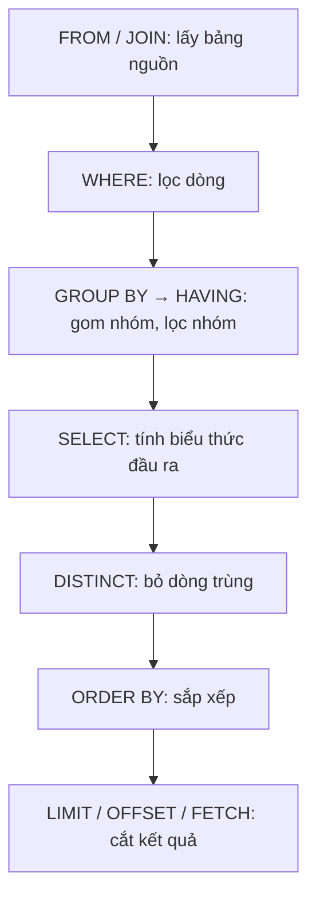

Một truy vấn SQL chỉ có thứ tự khi bạn viết `ORDER BY`, và thứ tự đó chỉ cố định khi khoá sắp xếp không có giá trị trùng. Trên một bảng 6 gene có ba gene cùng `padj = 0.001`, câu `ORDER BY padj LIMIT 2` trả về (C, D), nhưng chỉ cần thêm một index thì cùng câu lệnh, cùng dữ liệu trả về (F, D) (thử trên SQLite 3.45.3). Vị trí của NULL cũng không thống nhất: SQLite và MySQL đặt NULL lên đầu khi sắp tăng, PostgreSQL đặt xuống cuối. Bài này dành cho sinh viên sinh học và người làm tin sinh học cần "Top N gene", phân trang bảng biến thể hay danh sách xếp hạng chạy lại ra đúng kết quả; cuối bài có checklist bảy dòng.

<div class="callout callout-note">
<p class="callout-title">Tóm tắt nhanh</p>

- Không có `ORDER BY` thì không có thứ tự nào được đảm bảo.
- Khoá `ORDER BY` có giá trị trùng thì thứ tự giữa các dòng trùng vẫn do hệ quản trị quyết định; thêm cột phá hoà, thường là khoá chính.
- NULL đứng đầu khi `ASC` trong SQLite và MySQL, đứng cuối trong PostgreSQL. Viết rõ `NULLS LAST` hoặc `ORDER BY (x IS NULL), x`.
- "Top N" khi có giá trị trùng là một quyết định phương pháp: giữ đúng N dòng hay giữ cả nhóm hoà.
- Phân trang bảng lớn bằng keyset (`WHERE id > ?`) thay cho `OFFSET` sâu.

</div>

Bảng 1 là thí nghiệm mở đầu, trên sáu gene mô phỏng với cột `padj` là p-value đã hiệu chỉnh.

**Bảng 1.** Cùng truy vấn `SELECT gene, padj FROM de ORDER BY padj LIMIT 2`, cùng dữ liệu, SQLite 3.45.3

| Trạng thái bảng | Kế hoạch thực thi | Kết quả |
| --- | --- | --- |
| Không có index | quét bảng, sắp bằng B-tree tạm | C, D |
| Có index `(padj, gene DESC)` | quét theo index | F, D |

```sql
CREATE TABLE de (gene TEXT PRIMARY KEY, log2fc REAL, padj REAL);
INSERT INTO de VALUES
 ('A', 1.2, 0.020), ('B', -0.8, 0.300), ('C', 2.1, 0.001),
 ('D', -1.7, 0.001), ('E', 0.4, 0.040), ('F', 1.5, 0.001);

SELECT gene, padj FROM de ORDER BY padj LIMIT 2;   -- C, D
CREATE INDEX idx_padj ON de(padj, gene DESC);
SELECT gene, padj FROM de ORDER BY padj LIMIT 2;   -- F, D
```

Kết quả nào đúng? Cả hai. Tài liệu SQLite ghi rõ thứ tự giữa các dòng có cùng giá trị khoá sắp xếp là không xác định (SQLite, n.d.-b). Index `(padj, gene DESC)` được chọn để hiện tượng lộ rõ, và không phải index nào cũng đảo kết quả. Điều cần nhớ là mọi thay đổi trong kế hoạch thực thi đều có thể đổi thứ tự giữa các dòng hoà. Ở đây index khiến hệ quản trị đọc dữ liệu theo đường khác, nên gặp ba gene hoà theo thứ tự khác.

## 1. ORDER BY là gì và vì sao SQL không có thứ tự mặc định

`ORDER BY` là mệnh đề sắp xếp kết quả của câu `SELECT` theo một hay nhiều biểu thức. Nó cần thiết vì mô hình quan hệ (relational model): Codd (1970) định nghĩa quan hệ là một tập hợp các bộ (tuple), và thứ tự các dòng không mang thông tin. Date (2015) dùng chính mô hình này làm nền cho cách viết SQL chính xác. Muốn đọc bảng theo thứ tự nào thì phải nói ra.

Tài liệu chính thức nói đúng như vậy. SQLite ghi rằng câu `SELECT` trả nhiều dòng mà không có `ORDER BY` thì thứ tự là không xác định (undefined) (SQLite, n.d.-b). PostgreSQL ghi rằng khi không sắp xếp, thứ tự thực tế phụ thuộc kiểu quét, kiểu join và vị trí dữ liệu trên đĩa, và không được dựa vào nó (The PostgreSQL Global Development Group [PGDG], n.d.-b). Thứ tự bạn thấy khi chạy thử chỉ là sản phẩm phụ của kế hoạch thực thi.

Thứ tự xử lý logic của câu `SELECT` khác thứ tự bạn gõ:



PostgreSQL ghi rằng biểu thức đầu ra được tính trước khi áp dụng `DISTINCT`, `ORDER BY` và `LIMIT` (PGDG, n.d.-d), nên `ORDER BY` dùng được alias đặt trong `SELECT`. `ORDER BY` là **bước sắp xếp cuối cùng** nhưng chưa phải mệnh đề cuối: sau nó còn `LIMIT`, `OFFSET`, và trong PostgreSQL còn `FETCH`, `FOR UPDATE` (PGDG, n.d.-d). `LIMIT` cắt kết quả sau khi sắp, nên thứ tự không xác định thì phần bị cắt cũng không xác định.

## 2. Cú pháp ORDER BY và các bẫy nhỏ

`ASC` (mặc định) sắp tăng, `DESC` sắp giảm, mỗi khoá có hướng riêng. Với nhiều khoá, dòng được sắp theo khoá trái nhất; chỉ khi khoá đó hoà mới xét khoá tiếp theo (SQLite, n.d.-b). Với bảng số đo cá, `ORDER BY L DESC, fish_id` xếp cá dài nhất lên đầu, cá cùng chiều dài thì theo mã. Đây là Sort nhiều cấp trong Excel ([phân tích cơ sở dữ liệu trên Excel](/blog/phan-tich-co-so-du-lieu/)), chỉ khác là các cấp được ghi lại trong câu lệnh.

Bẫy thứ nhất là sắp theo số thứ tự cột. `ORDER BY 2` nghĩa là sắp theo cột thứ hai trong `SELECT`. SQLite và PostgreSQL chấp nhận cách viết này (SQLite, n.d.-b; PGDG, n.d.-b), nhưng MySQL 8.4 đánh dấu nó là lỗi thời (deprecated) vì cú pháp này đã bị loại khỏi chuẩn SQL (Oracle, n.d.-c). Thêm một cột vào đầu `SELECT` là truy vấn lặng lẽ sắp theo cột khác. Trong mã lưu lâu dài, hãy dùng tên cột hoặc alias.

Bẫy thứ hai là collation, tức quy tắc so sánh chuỗi. Mặc định SQLite dùng BINARY, so từng byte bằng `memcmp()`; NOCASE chỉ gộp hoa/thường của chữ cái ASCII (SQLite, n.d.-a). Tên tiếng Việt có dấu cho thấy hệ quả ngay (Bảng 2).

**Bảng 2.** Sáu tên sắp tăng dần trong SQLite 3.45.3

| Cách sắp | Kết quả |
| --- | --- |
| `ORDER BY name` (BINARY) | Bình, Zung, anh, ba, Ánh, Đức |
| `ORDER BY name COLLATE NOCASE` | anh, ba, Bình, Zung, Ánh, Đức |

Theo BINARY, chữ hoa ASCII đứng trước chữ thường, còn "Ánh", "Đức" xếp sau "Zung" vì ký tự có dấu mã hoá UTF-8 bằng byte lớn hơn mọi chữ ASCII. NOCASE không sửa được chữ có dấu; sắp đúng tiếng Việt cần collation hiểu Unicode. MySQL có vấn đề ngược lại: chuỗi thường được so sánh không phân biệt hoa/thường, nên thứ tự giữa các chuỗi chỉ khác nhau ở chữ hoa/thường là không xác định (Oracle, n.d.-d).

Phần tìm kiếm theo mẫu chuỗi bằng `LIKE` đã có trong bài [SELECT và WHERE](/blog/select-and-where-truy-van-co-ban/); bài này tập trung vào thứ tự.

## 3. NULL đứng ở đâu? So sánh SQLite, MySQL, PostgreSQL

NULL là giá trị "chưa biết", nên khi sắp xếp, hệ quản trị phải tự chọn chỗ cho nó. Theo Winand (n.d.-a), chuẩn SQL để vị trí của NULL cho nhà sản xuất quyết định, và từ SQL:2003 có thêm `NULLS FIRST`/`NULLS LAST` để người viết chỉ định rõ. Ba hệ quản trị phổ biến chọn khác nhau (Bảng 3).

**Bảng 3.** Vị trí mặc định của NULL khi sắp xếp, theo tài liệu chính thức

| Hệ quản trị | `ASC` | `DESC` | `NULLS FIRST/LAST` | Nguồn |
| --- | --- | --- | --- | --- |
| SQLite | đầu (NULL nhỏ hơn mọi giá trị) | cuối | có, từ 3.30.0 (04/10/2019) | SQLite (n.d.-b, 2019) |
| MySQL 8.4 | đầu | cuối | không có trong cú pháp | Oracle (n.d.-b, n.d.-c) |
| PostgreSQL 18 | cuối (NULL như lớn hơn mọi giá trị) | đầu | có | PGDG (n.d.-b) |

PostgreSQL sắp NULL như thể lớn hơn mọi giá trị khác, nên mặc định là `NULLS LAST` khi `ASC` và `NULLS FIRST` khi `DESC` (PGDG, n.d.-b). MySQL 8.4 đưa NULL lên trước khi `ASC` và xuống sau khi `DESC` (Oracle, n.d.-b), và cú pháp `ORDER BY` trong trang `SELECT` chỉ có `ASC`, `DESC` (Oracle, n.d.-c). Các truy vấn trong bài chỉ được chạy trên SQLite; dòng MySQL và PostgreSQL dựa trên tài liệu.

Trong sinh học, hệ quả thấy ngay. Trong bảng kết quả biểu hiện vi sai, một số gene có `padj` trống, chẳng hạn vì bị lọc do số đọc quá thấp. Thêm gene G như vậy vào bảng mô phỏng rồi hỏi "ba gene có padj nhỏ nhất":

```sql
INSERT INTO de VALUES ('G', 3.0, NULL);

SELECT gene, padj FROM de ORDER BY padj, gene LIMIT 3;
-- SQLite: G (NULL), C, D  → gene không có kết quả kiểm định đứng đầu

SELECT gene, padj FROM de ORDER BY padj NULLS LAST, gene LIMIT 3;
-- SQLite ≥ 3.30, PostgreSQL: C, D, F

SELECT gene, padj FROM de ORDER BY (padj IS NULL), padj, gene LIMIT 3;
-- Không cần NULLS LAST: C, D, F

SELECT gene, padj FROM de
ORDER BY CASE WHEN padj IS NULL THEN 1 ELSE 0 END, padj, gene LIMIT 3;
-- Dạng CASE: C, D, F
```

Trong SQLite và MySQL, nếu không viết gì thêm, gene G đứng đầu danh sách "có ý nghĩa nhất" dù không hề có kết quả kiểm định; trong PostgreSQL, cùng câu lệnh đẩy G xuống cuối. Ví dụ dựng sẵn này cho thấy vì sao cùng một script có thể cho danh sách khác khi chuyển giữa PostgreSQL và SQLite.

Hai cách viết cuối là cách di động (portable): `(padj IS NULL)` cho 0 với dòng có giá trị và 1 với NULL, nên mọi NULL bị đẩy xuống cuối; dạng `CASE` làm cùng việc đó (Winand, n.d.-a). Quy tắc thực hành: cột sắp xếp có thể chứa NULL thì viết vị trí của NULL ra. Về NULL và logic ba giá trị, xem thêm bài [SELECT và WHERE](/blog/select-and-where-truy-van-co-ban/).

## 4. Giá trị trùng và Top N: LIMIT, WITH TIES và RANK

Thí nghiệm ở đầu bài không riêng gì SQLite. SQLite ghi rằng thứ tự của hai dòng có mọi biểu thức `ORDER BY` bằng nhau là không xác định (SQLite, n.d.-b). MySQL ghi rằng với các dòng hoà, máy chủ được tự do trả theo thứ tự bất kỳ, có thể khác nhau tuỳ kế hoạch thực thi, và vì `LIMIT` ảnh hưởng đến kế hoạch nên cùng một câu có và không có `LIMIT` có thể cho thứ tự khác nhau (Oracle, n.d.-a).

Số đo sinh học thường trùng vì chỉ đo đến 0,1 cm. Bảng dưới mô phỏng 12 con cá: ba con (5, 7, 10) cùng dài 21,0 cm, hai con (11, 12) cùng dài 22,0 cm; cột `Msex` (giai đoạn chín muồi sinh dục) của cá 1 bị trống, dùng ở mục 6.

```sql
CREATE TABLE fish (fish_id INTEGER PRIMARY KEY, L REAL, Msex TEXT);
INSERT INTO fish VALUES
 (1, 18.2, NULL), (2, 19.5, 'II'), (3, 20.4, 'III'), (4, 17.8, 'II'),
 (5, 21.0, 'IV'), (6, 22.6, 'IV'), (7, 21.0, 'III'), (8, 23.1, 'V'),
 (9, 19.9, 'III'), (10, 21.0, 'IV'), (11, 22.0, 'IV'), (12, 22.0, 'V');
```


*Hình 1. Chiều dài 12 cá mô phỏng, xếp giảm dần. Ba cá 21,0 cm (cam) nằm đúng ở ranh giới Top 5: chỉ còn một chỗ cho ba con.*

"5 cá dài nhất" không có một đáp án duy nhất: bốn con đầu chắc chắn (8, 6, 11, 12), chỗ thứ năm thuộc về một trong ba con 21,0 cm. Bảng 4 so sánh các cách viết trên cùng dữ liệu.

**Bảng 4.** "Top 5 cá dài nhất" theo các cách viết (SQLite 3.45.3)

| Cách viết | Kết quả (`fish_id`) | Số dòng | Tất định? |
| --- | --- | --- | --- |
| `ORDER BY L DESC LIMIT 5`, không index | 8, 6, 11, 12, 5 | 5 | không |
| Cùng câu, sau `CREATE INDEX idx_L ON fish(L)` | 8, 6, 12, 11, 10 | 5 | không |
| `ORDER BY L DESC, fish_id LIMIT 5` | 8, 6, 11, 12, 5 | 5 | có |
| Giữ cả nhóm hoà ở ranh giới (`WITH TIES`) | 8, 6, 11, 12, 5, 7, 10 | 7 | có |
| `RANK() … <= 5` | 8, 6, 11, 12, 5, 7, 10 | 7 | có |
| `DENSE_RANK() … <= 5` | 8, 6, 11, 12, 5, 7, 10, 3 | 8 | có |

Hai dòng đầu là cùng một câu lệnh: có index, cả con thứ năm lẫn thứ tự cặp 11, 12 đều đổi. Ba cách viết tất định ứng với ba câu hỏi khác nhau:

```sql
-- 1. Đúng 5 dòng, phá hoà bằng khoá chính
SELECT fish_id, L FROM fish ORDER BY L DESC, fish_id LIMIT 5;

-- 2. Giữ cả nhóm hoà ở ranh giới (tương đương FETCH FIRST 5 ROWS WITH TIES)
SELECT fish_id, L FROM fish
WHERE L >= (SELECT L FROM fish ORDER BY L DESC LIMIT 1 OFFSET 4)
ORDER BY L DESC, fish_id;

-- 3. Lọc theo hạng bằng window function
SELECT fish_id, L, rnk FROM (
  SELECT fish_id, L, RANK() OVER (ORDER BY L DESC) AS rnk FROM fish
) WHERE rnk <= 5
ORDER BY rnk, fish_id;
```

Cách 1 trả lời "đúng năm con, theo quy tắc ai cũng lặp lại được". Cột phá hoà (tie-breaker) không cần ý nghĩa sinh học, chỉ cần duy nhất. Cái cần có là một quy tắc viết thành lời: "chiều dài bằng nhau thì chọn mã nhỏ hơn".

Cách 2 trả lời "những con nào thuộc nhóm năm chiều dài lớn nhất", tức giữ cả nhóm hoà. PostgreSQL có cú pháp chuẩn `FETCH FIRST 5 ROWS WITH TIES`, thuộc dạng `OFFSET … FETCH` của SQL:2008 (PGDG, n.d.-d); `WITH TIES` có từ PostgreSQL 13, phát hành 24/9/2020 (PGDG, 2020). SQLite chưa có cú pháp này, nên truy vấn trên lấy chiều dài của con thứ năm (`LIMIT 1 OFFSET 4`) rồi giữ mọi con dài ít nhất chừng đó.

Cách 3 dùng hàm xếp hạng. `RANK()` cho các con hoà cùng hạng rồi bỏ qua hạng kế tiếp (hai con 22,0 cm cùng hạng 3, ba con 21,0 cm cùng hạng 5), nên lọc `<= 5` cho đúng kết quả của `WITH TIES`. `DENSE_RANK()` không bỏ hạng: ba con 21,0 cm thành hạng 4, cá 3 (20,4 cm) thành hạng 5, nên kết quả có 8 con. Chi tiết có trong bài [window function](/blog/window-functions/).

Đây là chuyện tái lập. Trong mười quy tắc của Sandve và cộng sự (2013) cho nghiên cứu tính toán tái lập được có Rule 1 (với mỗi kết quả, ghi lại nó được tạo ra như thế nào), Rule 3 (lưu đúng phiên bản của mọi chương trình bên ngoài) và Rule 6 (ghi lại seed khi phân tích có yếu tố ngẫu nhiên). Thứ tự của các dòng hoà giống một yếu tố ngẫu nhiên không có seed. Nó đổi khi index, dữ liệu hay phiên bản đổi, và không ghi lại được, nên chỉ còn cách loại bỏ nó bằng cột phá hoà hoặc quy tắc giữ nhóm hoà. Wilson và cộng sự (2017) gom các thực hành "đủ tốt" về dữ liệu và mã; Peng (2011) xem tính tái lập là chuẩn tối thiểu của khoa học tính toán. Một danh sách "top gene" đổi theo kế hoạch truy vấn không đạt chuẩn đó, dù từng con số đều đúng.

## 5. Phân trang: OFFSET và keyset pagination

Phân trang (pagination) quen thuộc dùng `LIMIT` và `OFFSET`: `OFFSET M` nghĩa là **bỏ qua M dòng đầu**, nên `OFFSET 0` không bỏ dòng nào và trang 3 với 20 dòng mỗi trang là `LIMIT 20 OFFSET 40`. Trong SQLite, `OFFSET` âm được xử lý như 0, và cách viết rút gọn `LIMIT 2, 3` nghĩa là bỏ 2 dòng rồi lấy 3: số đầu tiên là `OFFSET`, ngược với trực giác (SQLite, n.d.-b).

```sql
-- Bảng t có id 1..8
SELECT id FROM t ORDER BY id LIMIT 3 OFFSET 2;   -- 3, 4, 5
SELECT id FROM t ORDER BY id LIMIT 2, 3;         -- 3, 4, 5 (OFFSET trước, LIMIT sau)
SELECT id FROM t ORDER BY id LIMIT 3 OFFSET -5;  -- 1, 2, 3
```

Mọi truy vấn phân trang phải có `ORDER BY` với khoá duy nhất. PostgreSQL giải thích rằng dùng các giá trị `LIMIT`/`OFFSET` khác nhau để lấy từng phần của một kết quả sẽ cho kết quả không nhất quán nếu không ép thứ tự bằng `ORDER BY`, và nhấn mạnh đây không phải lỗi mà là hệ quả tự nhiên (PGDG, n.d.-c).

Có `ORDER BY` rồi, `OFFSET` vẫn còn hai vấn đề. Thứ nhất, các dòng bị bỏ qua vẫn phải được tính trong máy chủ, nên `OFFSET` lớn có thể chậm (PGDG, n.d.-c). Thứ hai, dữ liệu "trôi" giữa các trang khi bảng thay đổi. Keyset pagination, mà Winand gọi là seek method, giải quyết cả hai: thay vì đếm và bỏ M dòng, bạn nhớ khoá của dòng cuối trang trước và lọc thẳng từ đó (Winand, 2014, n.d.-b).

```sql
-- Trang đầu
SELECT * FROM variants ORDER BY id LIMIT 20;
-- Trang sau: :last_id là id của dòng cuối trang trước
SELECT * FROM variants WHERE id > :last_id ORDER BY id LIMIT 20;
```

Thí nghiệm trôi trang: bảng 10 mẫu, mẫu mới nhất trước, mỗi trang 3 dòng; giữa lúc lấy trang 1 và trang 2, mẫu S11 được thêm vào.

```python
import sqlite3
con = sqlite3.connect(":memory:"); c = con.cursor()
c.execute("CREATE TABLE samples (sample_id INTEGER PRIMARY KEY, label TEXT)")
c.executemany("INSERT INTO samples VALUES (?, ?)", [(i, f"S{i:02d}") for i in range(1, 11)])
p1 = c.execute("SELECT label FROM samples ORDER BY sample_id DESC LIMIT 3").fetchall()
c.execute("INSERT INTO samples VALUES (11, 'S11')")   # mẫu mới đến giữa hai lần lấy trang
p2_offset = c.execute("SELECT label FROM samples ORDER BY sample_id DESC LIMIT 3 OFFSET 3").fetchall()
p2_keyset = c.execute("SELECT label FROM samples WHERE sample_id < 8 ORDER BY sample_id DESC LIMIT 3").fetchall()
print([r[0] for r in p1])          # ['S10', 'S09', 'S08']
print([r[0] for r in p2_offset])   # ['S08', 'S07', 'S06']  ← S08 lặp lại
print([r[0] for r in p2_keyset])   # ['S07', 'S06', 'S05']
```

Với `OFFSET`, S11 chen lên đầu đẩy mọi dòng xuống một bậc, nên S08 xuất hiện ở cả hai trang; nếu một dòng bị xoá thì sẽ có dòng bị bỏ sót. Keyset không bị ảnh hưởng vì trang 2 được định nghĩa bằng giá trị khoá ("mẫu có mã nhỏ hơn 8"), không bằng vị trí.

Về tốc độ, thí nghiệm dùng bảng `variants` mô phỏng 1 triệu dòng với khoá chính số nguyên, đo thời gian lấy một trang 20 dòng ở các vị trí khác nhau, mỗi điểm 30 lần (SQLite 3.45.3 in-memory, Python 3.13.2, CPU Intel Core i5-5350U, 23/11/2026). Ở trang đầu, hai cách gần như bằng nhau (trung vị 0,029 ms và 0,027 ms). Khi bỏ qua 900.000 dòng, `OFFSET` mất trung vị 12,97 ms, còn keyset vẫn 0,028 ms (Hình 2). `EXPLAIN QUERY PLAN` cho thấy keyset là một lần tìm trên khoá chính, không duyệt các dòng phía trước.


*Hình 2. Thời gian lấy một trang 20 dòng theo vị trí trang, bảng 1 triệu dòng, trục tung thang log. Trung vị 30 lần chạy, vạch lỗi là khoảng tứ phân vị. Kết quả từ một máy, chỉ để so sánh tương đối.*

Con số tuyệt đối phụ thuộc phần cứng và phiên bản; điều ổn định là hình dạng: thời gian của `OFFSET` tăng gần tuyến tính theo số dòng bị bỏ, còn keyset gần như phẳng khi có index trên khoá. Keyset cũng có giới hạn: không nhảy thẳng đến trang thứ k được mà phải đi tuần tự (Winand, 2014), và cần khoá sắp xếp duy nhất; sắp theo cột có giá trị trùng thì phải thêm cột phá hoà vào cả `ORDER BY` lẫn `WHERE`. Với dữ liệu hệ gen, khoá tự nhiên là toạ độ ghép. Nếu `chrom` là chuỗi, ghép thẳng `(chrom, start)` sẽ đi theo thứ tự từ điển, chr10 trước chr2 (Bảng 5 ở mục 7). Nên dùng số `rank` từ bảng tra ở mục 7 làm khoá đầu: `WHERE (rank, start) > (:last_rank, :last_start)` đi cùng `ORDER BY rank, start`. Cách viết này cần hệ quản trị hỗ trợ so sánh bộ giá trị (row value); SQLite có hỗ trợ.

## 6. DISTINCT: NULL, COUNT(DISTINCT) và thứ tự

`DISTINCT` bỏ các dòng trùng và chạy trước `ORDER BY`. Với NULL, SQLite so sánh các dòng bằng `IS DISTINCT FROM`, nên hai NULL được coi là bằng nhau và chỉ giữ một (SQLite, n.d.-b). PostgreSQL cũng coi các NULL là bằng nhau khi xét `DISTINCT` (PGDG, n.d.-a), và MySQL ghi rằng với `DISTINCT`, `GROUP BY` và `ORDER BY`, mọi NULL đều được coi là bằng nhau (Oracle, n.d.-b).

Hàm tổng hợp lại xử lý khác. Trên bảng cá ở mục 4, cột `Msex` có 11 giá trị và một ô trống:

```sql
SELECT DISTINCT Msex FROM fish;
-- NULL, II, III, IV, V  → 5 dòng

SELECT COUNT(DISTINCT Msex), COUNT(Msex), COUNT(*) FROM fish;
-- 4, 11, 12

SELECT DISTINCT Msex FROM fish ORDER BY Msex NULLS LAST;
-- II, III, IV, V, NULL
```

`SELECT DISTINCT` cho 5 dòng, có NULL, nhưng `COUNT(DISTINCT Msex)` cho 4, vì hàm tổng hợp bỏ NULL trước khi đếm. Khi báo cáo số nhóm, hãy nói rõ có tính nhóm "chưa xác định" hay không. Cơ chế này được bàn kỹ hơn trong bài [hàm tổng hợp](/blog/ham-tong-hop-aggregate/).

Hai lưu ý nữa. Thứ nhất, `DISTINCT` không sắp xếp. Kết quả `SELECT DISTINCT` ở trên tình cờ trông như đã được sắp, nhưng đó là sản phẩm phụ của cách hệ quản trị loại trùng, và không có `ORDER BY` thì thứ tự vẫn không xác định (SQLite, n.d.-b). Thứ hai, `DISTINCT` trên nhiều cột gộp các dòng giống nhau ở **mọi** cột được chọn. Hai dòng số đo giống hệt nhau có thể là nhập trùng hoặc hai cá thể thật có số đo trùng; `DISTINCT` không phân biệt được, nên đừng dùng nó để "làm sạch" dữ liệu trước khi kiểm tra nguồn.

## 7. Quy ước sắp xếp trong tin sinh học

UCSC Genome Browser yêu cầu tệp BED đầu vào của bigBed phải được sắp theo trường chrom rồi chromStart, và gợi ý lệnh `sort -k1,1 -k2,2n` (UCSC Genome Browser, n.d.). `-k1,1` sắp cột nhiễm sắc thể theo chuỗi, `-k2,2n` sắp vị trí bắt đầu theo số: đó đúng là một `ORDER BY chrom, chromStart` với hai cách so sánh khác nhau cho hai khoá. BEDTools, bộ công cụ phổ biến để so sánh các đặc trưng hệ gen (Quinlan & Hall, 2010), có lệnh `bedtools sort`; mặc định nó sắp theo nhiễm sắc thể rồi vị trí bắt đầu, và tuỳ chọn `-g` quy định thứ tự nhiễm sắc thể bằng một tệp liệt kê tên (Quinlan, n.d.). Tabix, công cụ truy xuất nhanh các đặc trưng chồng lên một vùng hệ gen, đánh chỉ mục các tệp phân cách bằng TAB đã sắp theo vị trí như GFF, BED, SAM (Li, 2011). Giống keyset ở mục 5, tệp đã sắp cho phép nhảy thẳng đến vùng cần đọc.

Trong SQL, vấn đề nảy sinh khi tên nhiễm sắc thể là chuỗi (Bảng 5).

**Bảng 5.** Sáu vùng trên các nhiễm sắc thể, sắp theo ba cách (SQLite 3.45.3)

| Cách sắp | Thứ tự nhiễm sắc thể |
| --- | --- |
| `ORDER BY chrom, start` (chuỗi) | chr1, chr1, chr10, chr11, chr2, chrX |
| `ORDER BY CAST(SUBSTR(chrom, 4) AS INTEGER), start` | chrX, chr1, chr1, chr2, chr10, chr11 |
| Nối với bảng tra `chrom_order`, `ORDER BY rank, start` | chr1, chr1, chr2, chr10, chr11, chrX |

Sắp theo chuỗi cho thứ tự từ điển, nên chr10 và chr11 đứng trước chr2. "Sửa nhanh" bằng `CAST` lại sinh lỗi mới: "X" không phải số, SQLite chuyển thành 0, và chrX nhảy lên đầu. Cách bền vững là một bảng tra (lookup table) gán số thứ tự cho từng nhiễm sắc thể, đúng ý tưởng của tuỳ chọn `-g`:

```sql
CREATE TABLE peaks (chrom TEXT, start INTEGER);
INSERT INTO peaks VALUES ('chr2', 500), ('chr10', 300), ('chr1', 900),
                         ('chrX', 100), ('chr1', 200), ('chr11', 50);
CREATE TABLE chrom_order (chrom TEXT PRIMARY KEY, rank INTEGER);
INSERT INTO chrom_order VALUES ('chr1', 1), ('chr2', 2), ('chr10', 10),
                               ('chr11', 11), ('chrX', 23);

SELECT p.chrom, p.start
FROM peaks AS p JOIN chrom_order AS o USING (chrom)
ORDER BY o.rank, p.start;
```

Bảng tra buộc mọi tên nhiễm sắc thể phải được khai báo, nên tên lạ (ví dụ "1" thay vì "chr1") lộ ra khi join thay vì lặng lẽ nằm sai chỗ. Vì join bên trong loại các dòng có tên không có trong bảng tra, hãy đếm số dòng trước và sau join.

## 8. Checklist và kết luận

Bảy quy tắc để rà một script trước khi đưa kết quả vào báo cáo:

1. Có `LIMIT`, `OFFSET` hay `FETCH` thì phải có `ORDER BY`.
2. Khoá `ORDER BY` phải xác định duy nhất một dòng; nếu không, thêm cột phá hoà, thường là khoá chính.
3. Cột sắp xếp có thể chứa NULL thì viết rõ vị trí của NULL (`NULLS FIRST/LAST`, hoặc `(x IS NULL)` khi hệ quản trị không hỗ trợ).
4. "Top N" có giá trị trùng: quyết định giữ đúng N dòng hay giữ cả nhóm hoà (`WITH TIES`, `RANK()`), và ghi quyết định đó vào phần phương pháp.
5. Bảng lớn hoặc bảng đang được ghi thêm: phân trang bằng keyset, không dùng `OFFSET` sâu.
6. Không dùng số thứ tự cột (`ORDER BY 2`) trong mã lưu lâu dài.
7. Ghi tên và phiên bản hệ quản trị cùng truy vấn, theo tinh thần Rule 3 của Sandve và cộng sự (2013).

Điểm chung của bảy quy tắc: thứ tự kết quả là một quyết định, không phải thứ có sẵn. Thứ tự nào không được viết ra thì hệ quản trị chọn thay bạn, và có thể đổi bất cứ lúc nào. Trong phân tích sinh học, nơi danh sách "20 gene có ý nghĩa nhất" hay "5 cá thể lớn nhất" có thể đi thẳng vào bảng kết quả của bài báo, viết `ORDER BY` đầy đủ cũng quan trọng như ghi cỡ mẫu hay ngưỡng p. Một phép thử nhanh trước khi nộp bảng: thêm hoặc bỏ một index rồi chạy lại truy vấn; danh sách đổi nghĩa là còn thiếu cột phá hoà. Bài tiếp theo trong series bàn về [hàm tổng hợp](/blog/ham-tong-hop-aggregate/).

## Tài liệu tham khảo

Codd, E. F. (1970). A relational model of data for large shared data banks. *Communications of the ACM, 13*(6), 377–387. https://doi.org/10.1145/362384.362685

Date, C. J. (2015). *SQL and relational theory: How to write accurate SQL code* (3rd ed.). O'Reilly Media.

Li, H. (2011). Tabix: Fast retrieval of sequence features from generic TAB-delimited files. *Bioinformatics, 27*(5), 718–719. https://doi.org/10.1093/bioinformatics/btq671

Oracle. (n.d.-a). *MySQL 8.4 reference manual: LIMIT query optimization*. Truy cập 12/11/2026, từ https://dev.mysql.com/doc/refman/8.4/en/limit-optimization.html

Oracle. (n.d.-b). *MySQL 8.4 reference manual: Problems with NULL values*. Truy cập 12/11/2026, từ https://dev.mysql.com/doc/refman/8.4/en/problems-with-null.html

Oracle. (n.d.-c). *MySQL 8.4 reference manual: SELECT statement*. Truy cập 12/11/2026, từ https://dev.mysql.com/doc/refman/8.4/en/select.html

Oracle. (n.d.-d). *MySQL 8.4 reference manual: Sorting rows*. Truy cập 12/11/2026, từ https://dev.mysql.com/doc/refman/8.4/en/sorting-rows.html

Peng, R. D. (2011). Reproducible research in computational science. *Science, 334*(6060), 1226–1227. https://doi.org/10.1126/science.1213847

Quinlan, A. R. (n.d.). *sort* (bedtools documentation). Truy cập 23/11/2026, từ https://bedtools.readthedocs.io/en/latest/content/tools/sort.html

Quinlan, A. R., & Hall, I. M. (2010). BEDTools: A flexible suite of utilities for comparing genomic features. *Bioinformatics, 26*(6), 841–842. https://doi.org/10.1093/bioinformatics/btq033

Sandve, G. K., Nekrutenko, A., Taylor, J., & Hovig, E. (2013). Ten simple rules for reproducible computational research. *PLoS Computational Biology, 9*(10), e1003285. https://doi.org/10.1371/journal.pcbi.1003285

SQLite. (n.d.-a). *Datatypes in SQLite* (mục 7, Collating sequences). Truy cập 12/11/2026, từ https://www.sqlite.org/datatype3.html

SQLite. (n.d.-b). *The SELECT statement*. Truy cập 12/11/2026, từ https://www.sqlite.org/lang_select.html

SQLite. (2019). *Release 3.30.0 (2019-10-04)*. Truy cập 12/11/2026, từ https://www.sqlite.org/releaselog/3_30_0.html

The PostgreSQL Global Development Group. (n.d.-a). *PostgreSQL 18 documentation: 7.3. Select lists*. Truy cập 12/11/2026, từ https://www.postgresql.org/docs/current/queries-select-lists.html

The PostgreSQL Global Development Group. (n.d.-b). *PostgreSQL 18 documentation: 7.5. Sorting rows (ORDER BY)*. Truy cập 12/11/2026, từ https://www.postgresql.org/docs/current/queries-order.html

The PostgreSQL Global Development Group. (n.d.-c). *PostgreSQL 18 documentation: 7.6. LIMIT and OFFSET*. Truy cập 12/11/2026, từ https://www.postgresql.org/docs/current/queries-limit.html

The PostgreSQL Global Development Group. (n.d.-d). *PostgreSQL 18 documentation: SELECT*. Truy cập 12/11/2026, từ https://www.postgresql.org/docs/current/sql-select.html

The PostgreSQL Global Development Group. (2020). *PostgreSQL 13 release notes*. Truy cập 12/11/2026, từ https://www.postgresql.org/docs/release/13.0/

UCSC Genome Browser. (n.d.). *bigBed track format*. Truy cập 12/11/2026, từ https://genome.ucsc.edu/goldenPath/help/bigBed.html

Wilson, G., Bryan, J., Cranston, K., Kitzes, J., Nederbragt, L., & Teal, T. K. (2017). Good enough practices in scientific computing. *PLOS Computational Biology, 13*(6), e1005510. https://doi.org/10.1371/journal.pcbi.1005510

Winand, M. (2014). *We need tool support for keyset pagination*. Use The Index, Luke. Truy cập 12/11/2026, từ https://use-the-index-luke.com/no-offset

Winand, M. (n.d.-a). *Null in SQL*. Modern SQL. Truy cập 12/11/2026, từ https://modern-sql.com/concept/null

Winand, M. (n.d.-b). *Paging through results*. Use The Index, Luke. Truy cập 12/11/2026, từ https://use-the-index-luke.com/sql/partial-results/fetch-next-page
