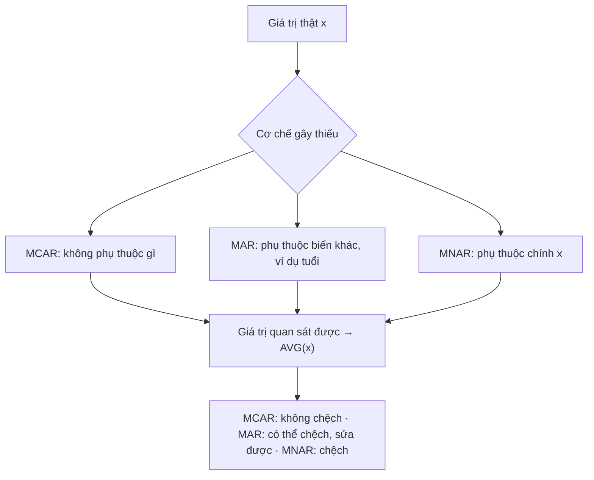

Hàm tổng hợp `AVG` trong SQL tính trung bình chỉ trên các dòng có giá trị: nó chia tổng cho `COUNT(cột)` chứ không cho `COUNT(*)`, nên mọi ô NULL bị loại khỏi phép tính. Về thống kê, đó là phân tích ca đầy đủ (complete-case analysis): kết quả không chệch khi dữ liệu thiếu hoàn toàn ngẫu nhiên (MCAR), nhưng có thể lệch khi việc thiếu phụ thuộc biến khác (MAR) hoặc phụ thuộc chính giá trị bị thiếu (MNAR). Trên 99 giá trị calcium huyết thanh, cho mất các giá trị thấp theo kiểu MNAR làm `AVG` lệch trung bình +2,48 mg/L qua 2.000 lần lặp, còn mất ngẫu nhiên 30% chỉ lệch +0,01 mg/L. Bài dành cho sinh viên sinh học, y sinh và người làm dữ liệu xét nghiệm, gồm bảng hành vi của bảy hàm tổng hợp trên SQLite và PostgreSQL, bốn bẫy kỹ thuật và năm truy vấn kiểm tra chạy được.

<div class="callout callout-note">
<p class="callout-title">Tóm tắt nhanh</p>

- `COUNT(*)` đếm mọi dòng; `COUNT(x)`, `SUM(x)`, `AVG(x)`, `MIN(x)`, `MAX(x)` bỏ qua NULL.
- `AVG(x)` = `SUM(x) / COUNT(x)`: một phân tích ca đầy đủ, chỉ an toàn khi dữ liệu thiếu hoàn toàn ngẫu nhiên.
- SQLite không báo lỗi khi `AVG` gặp chuỗi như `'NA'` hay `' '`: chuỗi đó được tính là 0.
- `SUM` của nhóm không có giá trị trả về NULL, không phải 0; `MIN`/`MAX` trên ngày chỉ đúng khi ngày lưu dạng `YYYY-MM-DD`.
- Trước mọi con số trung bình, báo cáo `COUNT(*)`, `COUNT(x)` và hiệu của chúng.

</div>

## 1. Hai con số AVG cho cùng một cột

Bộ số liệu luyện tập gồm 100 kết quả calcium huyết thanh (mg/L) đã được chép đầy đủ trong bài [đặc trưng thống kê mẫu](/blog/3-dac-trung-thong-ke-cua-mot-mau-va-uoc-luong-tham-so-cua-tong-the/). Trong bảng tính, một cột phụ "calcium > 100 mg/L" giữ lại giá trị khi đạt điều kiện; ô không đạt không để trống mà chứa một dấu cách, kiểu kết quả của công thức `IF(…; giá_trị; " ")`. Nhìn bằng mắt, ô đó trống.

Nạp cột này vào SQLite dưới dạng TEXT rồi tính trung bình, kết quả là 65,85 mg/L và `COUNT` báo 100 dòng có giá trị. Đổi dấu cách thành NULL bằng `NULLIF` rồi tính lại, kết quả là 109,76 mg/L trên 60 dòng (Bảng 1). Không ai sửa số liệu; chỉ khác cách ghi ô "trống".

```sql
-- Bảng ca(id INTEGER, ca REAL, over100 TEXT); ô không đạt chứa ' '
SELECT COUNT(over100) AS n, ROUND(AVG(over100), 2) AS tb
FROM ca;                                   -- 100 | 65.85

SELECT COUNT(NULLIF(over100, ' ')) AS n,
       ROUND(AVG(NULLIF(over100, ' ')), 2) AS tb
FROM ca;                                   -- 60 | 109.76
```

**Bảng 1.** Hai kết quả `AVG` trên cùng cột "calcium > 100 mg/L" (SQLite 3.45.3)

| Cách ghi ô không đạt | `COUNT(cột)` | `AVG(cột)` (mg/L) |
|---|---|---|
| Dấu cách `' '` (TEXT) | 100 | 65,85 |
| NULL (sau `NULLIF`) | 60 | 109,76 |

Ví dụ này đặt ra hai câu hỏi. Máy hiểu "thiếu" thế nào: dấu cách không phải NULL, và SQLite tính chuỗi không giống số là 0 (SQLite, n.d.-a); mục 5 bàn chuyện mã hoá này. Và kể cả khi máy bỏ qua NULL đúng cách, trung bình của phần còn lại có phải trung bình bạn cần không; mục 3 và 4 bàn chuyện thống kê.

## 2. Bảy hàm tổng hợp xử lý NULL thế nào

Hàm tổng hợp (aggregate function) nhận nhiều dòng và trả về một giá trị. Năm hàm `COUNT`, `SUM`, `AVG`, `MIN`, `MAX`, với ba dạng của `COUNT`, cho bảy cách gọi, tóm tắt ở Bảng 2.

`COUNT(*)` đếm mọi dòng của nhóm, kể cả dòng mà mọi cột đều NULL. `COUNT(x)` chỉ đếm dòng có `x` khác NULL. `COUNT(DISTINCT x)` đếm số giá trị khác nhau và cũng bỏ qua NULL, nên một cột có các giá trị `A`, `B`, NULL cho `COUNT(DISTINCT x)` = 2 (PostgreSQL Global Development Group, n.d.-b; SQLite, n.d.-a). Hiệu `COUNT(*) - COUNT(x)` vì vậy chính là số ô NULL của cột `x`, và đây là con số đầu tiên bạn nên nhìn trước mọi phép tính trung bình. Lý do hàm tổng hợp bỏ qua NULL nằm ở cách SQL hiểu NULL: một giá trị "không biết", không phải số 0 hay chuỗi rỗng, kéo theo logic ba giá trị đã bàn ở bài [NULL và logic ba giá trị](/blog/select-and-where-truy-van-co-ban/) (xem phân tích hình thức của Libkin, 2016).

`SUM(x)` và `AVG(x)` chỉ tính trên giá trị khác NULL; SQLite định nghĩa `avg()` bằng `total()/count()` (SQLite, n.d.-a), và PostgreSQL ghi rằng phần lớn hàm tổng hợp bỏ qua đầu vào NULL (PostgreSQL Global Development Group, n.d.-b).

Khi nhóm không có giá trị nào (bảng rỗng, `WHERE` lọc hết, hoặc cột toàn NULL), `COUNT` trả về 0 còn `SUM`, `AVG`, `MIN`, `MAX` trả về NULL. SQLite giải thích `sum()` trả NULL vì chuẩn SQL yêu cầu, và thêm hàm `total()` không theo chuẩn, trả về 0.0 (SQLite, n.d.-a). PostgreSQL ghi rằng trừ `count`, hàm tổng hợp trả NULL khi không có dòng nào, và gợi ý dùng `coalesce` khi cần số 0 (PostgreSQL Global Development Group, n.d.-a).

`MIN(x)` và `MAX(x)` trả về giá trị sẽ đứng đầu và cuối nếu bạn sắp cột bằng `ORDER BY`, bỏ qua NULL (SQLite, n.d.-a). Kết quả vì thế phụ thuộc cách hệ thống so sánh giá trị (xem bài [về ORDER BY](/blog/sap-xep-and-tim-kiem/) và mục 5.4).

Về kiểu kết quả, `AVG` của SQLite luôn trả số thực khi có ít nhất một giá trị (SQLite, n.d.-a), còn `avg` của PostgreSQL trên cột `integer` trả kiểu `numeric` (PostgreSQL Global Development Group, n.d.-a). Khác biệt lớn nhất nằm ở kiểu đầu vào. PostgreSQL định nghĩa `avg` và `sum` cho các kiểu số (và `interval`), nên cột văn bản không khớp chữ ký hàm nào (PostgreSQL Global Development Group, n.d.-a). SQLite thì không báo lỗi: chuỗi và BLOB không giống số được tính là 0 (SQLite, n.d.-a). Con số 65,85 ở mục 1 bắt nguồn từ đây.

**Bảng 2.** Hành vi của hàm tổng hợp với NULL theo tài liệu (cột PostgreSQL theo tài liệu, chưa chạy thử)

| Hàm | Với NULL | Nhóm không có giá trị | SQLite | PostgreSQL 18 |
|---|---|---|---|---|
| `COUNT(*)` | đếm cả dòng NULL | 0 | như chuẩn | như chuẩn |
| `COUNT(x)` | bỏ qua | 0 | như chuẩn | như chuẩn |
| `COUNT(DISTINCT x)` | bỏ qua | 0 | như chuẩn | như chuẩn |
| `SUM(x)` | bỏ qua | NULL | có thêm `TOTAL(x)` trả 0.0 | dùng `coalesce(sum(x), 0)` |
| `AVG(x)` | bỏ qua | NULL | = `total()/count()`, luôn số thực; chuỗi không giống số tính là 0 | chỉ nhận kiểu số, `interval`; `avg(integer)` → `numeric` |
| `MIN(x)`, `MAX(x)` | bỏ qua | NULL | giá trị đầu/cuối theo `ORDER BY` | bỏ qua NULL |

## 3. AVG bỏ qua NULL là phân tích ca đầy đủ

Gọi $R_i = 1$ nếu dòng $i$ có giá trị $x_i$ và $R_i = 0$ nếu $x_i$ là NULL. Khi đó

$$\texttt{AVG}(x) = \frac{\sum_i R_i x_i}{\sum_i R_i}.$$

Đây là trung bình của những ca có quan sát, tức phân tích ca đầy đủ cho một biến. Trong R, `mean(x, na.rm = TRUE)` làm đúng phép tính này (xem [thao tác với dữ liệu thiếu trong R](/blog/cac-thao-tac-voi-du-lieu-trong-r/)). SQL không có tham số `na.rm`: bỏ qua NULL là mặc định, không cần bạn chọn.

Mỗi lần viết `AVG(x)` trên một cột có ô trống, bạn đã ngầm chọn một phương pháp xử lý dữ liệu thiếu. Câu hỏi là phương pháp đó có hợp lệ với dữ liệu của bạn không. Rubin (1976) đưa ra điều kiện để có thể bỏ qua quá trình sinh ra dữ liệu thiếu khi suy luận: với suy luận dựa trên phân phối mẫu, dữ liệu phải thiếu ngẫu nhiên (missing at random) và dữ liệu quan sát được phải "quan sát ngẫu nhiên"; với suy luận likelihood hoặc Bayes, cần dữ liệu thiếu ngẫu nhiên và tham số của quá trình gây thiếu tách biệt với tham số cần ước lượng. Ba nhãn dùng phổ biến hiện nay (Little & Rubin, 2019; Schafer & Graham, 2002):

- **MCAR** (missing completely at random, thiếu hoàn toàn ngẫu nhiên): xác suất thiếu không phụ thuộc gì cả. Ví dụ: ống mẫu vỡ khi vận chuyển, không liên quan đến người bệnh.
- **MAR** (missing at random, thiếu ngẫu nhiên): xác suất thiếu phụ thuộc biến khác có trong bảng. Ví dụ: người trẻ ít được chỉ định xét nghiệm glucose hơn, nên thiếu phụ thuộc tuổi.
- **MNAR** (missing not at random, thiếu không ngẫu nhiên): xác suất thiếu phụ thuộc chính giá trị bị thiếu. Ví dụ: nồng độ dưới ngưỡng phát hiện (limit of detection) nên không ghi được số.

Dữ liệu đo nồng độ có những ví dụ MNAR rõ ràng. Trong proteomics định lượng không đánh dấu (label-free), giá trị thiếu có nhiều bản chất khác nhau (Lazar et al., 2016); peptide có nồng độ dưới ngưỡng phát hiện là giá trị bị kiểm duyệt (censored), và bỏ qua chúng sẽ ước lượng quá cao mức biểu hiện (Karpievitch et al., 2012). Trong vệ sinh lao động, việc ước lượng nồng độ trung bình khi có mẫu không phát hiện được là một bài toán phương pháp riêng (Hornung & Reed, 1990).

Phân loại này nói về cơ chế, không phải về một cột dữ liệu. Không truy vấn nào nhìn vào cột NULL mà biết được nó là MCAR hay MNAR; cơ chế thiếu là giả định cần lập luận từ cách dữ liệu được thu thập (Schafer & Graham, 2002). Cùng một cột glucose có 30% ô trống có thể là MCAR nếu máy phân tích hỏng ngẫu nhiên vài ngày, là MAR nếu bác sĩ ít chỉ định xét nghiệm cho người trẻ, và là MNAR nếu phòng xét nghiệm không ghi kết quả dưới ngưỡng đo. Muốn biết là trường hợp nào, bạn phải hỏi người thu mẫu, đọc quy trình, xem nhật ký thiết bị; SQL chỉ giúp đếm và so sánh (Hình 1).



**Hình 1.** Ba cơ chế thiếu và ảnh hưởng tới `AVG`.

## 4. Thí nghiệm: AVG dưới MCAR, MAR và MNAR

Để thấy độ chệch bằng số, bài chạy hai thí nghiệm bằng module `sqlite3` của Python (SQLite 3.45.3), seed 2026. Mọi tham số do tác giả chọn để minh hoạ.

### 4.1. Thí nghiệm A: glucose mô phỏng

Bộ dữ liệu mô phỏng 1.000 người, tuổi từ 20 đến 80, glucose lúc đói theo phân phối chuẩn với trung bình $5{,}0 + 0{,}02 \times (\text{tuổi} - 50)$ mmol/L và độ lệch chuẩn 1,0. Từ cột glucose đầy đủ, tạo ba cột có ô thiếu: MCAR (mỗi giá trị mất với xác suất 0,3), MAR (mất với xác suất 0,5 nếu tuổi dưới 40, 0,15 nếu từ 40 trở lên) và MNAR (giá trị dưới 4,5 mmol/L mất với xác suất 0,7).

**Bảng 3.** Kết quả thí nghiệm A (glucose, mmol/L)

| Cột | `COUNT` | `AVG` một lần chạy | Độ chệch trung bình qua 2.000 lần lặp |
|---|---|---|---|
| Đầy đủ | 1.000 | 4,946 | — |
| MCAR | 685 | 4,940 | 0,000 |
| MAR | 727 | 5,024 | +0,064 |
| MAR, phân tầng theo nhóm tuổi | 727 | 4,962 | 0,000 |
| MNAR | 777 | 5,285 | +0,342 |

MCAR làm mất 315 giá trị nhưng trung bình gần như không đổi. MAR làm mất nhiều người trẻ, mà người trẻ có glucose thấp hơn trong mô phỏng, nên `AVG` bị đẩy lên. Vì biến gây thiếu (tuổi) có trong bảng, bạn sửa được bằng phân tầng: tính trung bình trong từng nhóm tuổi rồi lấy trung bình có trọng số theo số người của nhóm.

```sql
WITH s AS (
  SELECT CASE WHEN age < 40 THEN 'duoi_40' ELSE 'tu_40' END AS nhom,
         COUNT(*)    AS n_nhom,     -- số người của nhóm, kể cả người thiếu
         AVG(g_mar)  AS tb_nhom     -- trung bình của người có số đo
  FROM p
  GROUP BY nhom
)
SELECT ROUND(SUM(n_nhom * tb_nhom) / SUM(n_nhom), 3) AS tb_phan_tang
FROM s;                                    -- 4.962
```

MNAR thì khác. 223 giá trị bị mất, phần lớn là giá trị thấp, nên `AVG` lệch +0,342 mmol/L trung bình. Áp cùng câu lệnh phân tầng theo tuổi cho cột MNAR cho 5,265, gần như không sửa được gì, vì nguyên nhân thiếu không nằm ở tuổi.

### 4.2. Thí nghiệm B: calcium thật, cơ chế thiếu mô phỏng

Thí nghiệm B dùng 99 giá trị calcium của mục 1 (bỏ giá trị 6,0 mg/L, xem mục 6), trung bình thật 102,97 mg/L. Lặp 2.000 lần: mỗi lần tạo một cột MCAR (mất 30%) và một cột MNAR (giá trị dưới 95 mg/L mất với xác suất 0,7), rồi tính `AVG` bằng SQLite.

<div class="callout callout-warning">
<p class="callout-title">Ngưỡng 95 mg/L là giả định</p>

Ngưỡng này do tác giả chọn để tạo cơ chế MNAR, không phải ngưỡng phát hiện thật của xét nghiệm calcium. Cơ chế thiếu ở đây là mô phỏng áp lên số liệu luyện tập, không phải dữ liệu thiếu thật.

</div>

Trung bình của 2.000 giá trị `AVG` là 102,97 mg/L với MCAR (chệch +0,01; trung bình 69 giá trị còn lại mỗi lần) và 105,45 mg/L với MNAR (chệch +2,48 mg/L; trung bình 84 giá trị còn lại). Hình 2 cho thấy hai phân phối gần như tách rời.


**Hình 2.** Phân phối 2.000 giá trị `AVG(calcium)` dưới MCAR và MNAR; vạch đứt là trung bình thật của 99 giá trị. Dữ liệu: số liệu luyện tập calcium huyết thanh, cơ chế thiếu mô phỏng, seed 2026.

### 4.3. Đọc kết quả

MCAR chỉ làm mất độ chính xác: ít giá trị hơn thì `AVG` dao động rộng hơn quanh trung bình thật (độ lệch chuẩn của 2.000 giá trị `AVG` trong thí nghiệm B là 0,70 mg/L), nhưng không lệch về phía nào. Cái giá chỉ là khoảng tin cậy rộng hơn.

MAR làm lệch, nhưng sửa được khi biến gây thiếu có trong bảng. Perkins et al. (2018) cho thấy điều tương tự trên dữ liệu dịch tễ có thiếu theo cơ chế đã biết: khi dữ liệu MAR, phương pháp ngây thơ tạo ra một hiệu ứng giả, còn multiple imputation đưa ước lượng về gần giá trị thật hơn. Phân tầng trong SQL là phiên bản thô của cùng ý tưởng, chỉ làm được khi biến gây thiếu được ghi đầy đủ.

MNAR lệch theo hướng đoán được: thiếu giá trị thấp thì trung bình bị đẩy lên, thiếu giá trị cao thì bị kéo xuống. Phân tầng theo biến khác không sửa được, vì nguyên nhân thiếu nằm trong chính giá trị bạn không thấy. Trong Hình 2, phân phối MNAR còn hẹp hơn phân phối MCAR, vì mỗi lần lặp giữ lại nhiều giá trị hơn (84 so với 69). Một con số `AVG` trông "ổn định" vẫn có thể sai một cách ổn định.

Bảng 3 chỉ là một lần chạy (ở lần đó MCAR lệch −0,006 mmol/L, MAR lệch +0,078); độ chệch của từng cơ chế phải đọc ở cột 2.000 lần lặp. Với dữ liệu thật, mức chệch tuỳ cơ chế và tỉ lệ thiếu thật.

## 5. Bốn bẫy kỹ thuật không liên quan cơ chế thiếu

Khác với sai lệch do cơ chế thiếu ở mục 3–4, bốn bẫy dưới đây là sai số do mã hoá: cách lưu trữ hoặc cách viết truy vấn khiến hàm tổng hợp tính sai. Loại lỗi này sửa được hoàn toàn bằng làm sạch dữ liệu.

### 5.1. SUM trên nhóm toàn NULL trả về NULL, không phải 0

```sql
-- Bảng t có 3 dòng, cột x đều NULL
SELECT SUM(x), TOTAL(x), AVG(x), COUNT(x), COUNT(*),
       COALESCE(SUM(x), 0)
FROM t;          -- NULL | 0.0 | NULL | 0 | 3 | 0
```

Khi bạn cộng dồn số ca bệnh theo tuần hay số read theo mẫu, một tổng NULL sẽ lan sang mọi phép tính dùng nó. NULL cộng 5 vẫn là NULL.

Có hai cách sửa. `COALESCE(SUM(x), 0)` chạy trên cả SQLite và PostgreSQL; `TOTAL(x)` ngắn hơn nhưng chỉ có ở SQLite. Trước khi sửa, hãy hỏi 0 có đúng nghĩa không. Một tuần không ghi nhận ca bệnh nào thì tổng bằng 0 là đúng. Một mẫu chưa được giải trình tự thì số read là "không có dữ liệu", và NULL mới là câu trả lời trung thực; đổi thành 0 sẽ biến mẫu đó thành một mẫu "không biểu hiện gì".

### 5.2. Chuỗi bị tính là 0

```sql
-- Cột v kiểu TEXT gồm '5.2', 'NA', '6.0'
SELECT ROUND(AVG(v), 2), COUNT(v) FROM s;                              -- 3.73 | 3
SELECT ROUND(AVG(NULLIF(v, 'NA')), 2), COUNT(NULLIF(v, 'NA')) FROM s;  -- 5.6 | 2
```

`'NA'` được tính là 0, nên trung bình là (5,2 + 0 + 6,0) / 3 = 3,73 thay vì 5,6, và `COUNT` vẫn báo 3 giá trị. Đây đúng là cơ chế của con số 65,85 ở mục 1: 40 dấu cách bị tính là 40 số 0.

Bảng tính sinh học hay ghi ô thiếu bằng `NA` (thói quen từ R, xem [kiểu dữ liệu và NA trong R](/blog/basic-data-types/)), `-`, `n.d.` (not detected), ô trống hoặc dấu cách. Khi nạp vào SQLite mà không khai báo kiểu cột, các mã này nằm lại dưới dạng TEXT. Hàm `typeof(x)` cho biết kiểu lưu của từng giá trị; một cột "số" mà có dòng `text` là dấu hiệu cần kiểm tra. Cách sửa gọn nhất là chuẩn hoá mọi mã thiếu thành NULL trong một bước:

```sql
SELECT ROUND(AVG(CASE WHEN TRIM(v) IN ('NA', '', '-', 'n.d.') THEN NULL
                      ELSE CAST(v AS REAL) END), 2) AS tb
FROM s;                                    -- 5.6
```

Riêng `n.d.` không phải "không biết" mà là "dưới ngưỡng phát hiện", một giá trị MNAR điển hình: đổi thành NULL sửa được lỗi mã hoá, nhưng `AVG` vẫn chệch lên như mục 4.

### 5.3. Mẫu số sai: chia cho COUNT(*)

<div class="callout callout-example">
<p class="callout-title">Bảng 25 cá *Coilia grayii*</p>

Bảng đặc điểm sinh học 25 cá lành canh *Coilia grayii* có cột độ chín sinh dục `msex`. Cá thể số 1 (tuổi 1+) để trống ô này; chưa rõ lý do, có thể vì độ chín sinh dục ở cá non khó xác định, nhưng đó chỉ là giả thuyết. Bảng này cũng được dùng trong bài [phân tích cơ sở dữ liệu trên Excel](/blog/phan-tich-co-so-du-lieu/).

</div>

```sql
SELECT COUNT(*), COUNT(msex),
       ROUND(AVG(msex), 2),                    -- 2.75
       ROUND(SUM(msex) * 1.0 / COUNT(*), 2)    -- 2.64
FROM fish;                                     -- 25 | 24 | 2.75 | 2.64
```

Tổng độ chín của 24 cá có số liệu là 66. `AVG` chia cho 24 được 2,75; công thức tự viết chia cho 25 được 2,64. Chia cho `COUNT(*)` tương đương điền 0 vào ô thiếu, tức một kiểu imputation không ai chủ ý chọn. Lỗi này hay xuất hiện khi `SUM(x)` và `COUNT(*)` đứng cạnh nhau trong một câu `SELECT`: đúng khi cần "tổng" và "số dòng", sai khi đem chia cho nhau.

Độ chín sinh dục là biến thứ bậc (giai đoạn 1, 2, 3…), nên trung bình của nó chỉ để minh hoạ phép tính; với biến thứ bậc, trung vị hoặc bảng tần số phù hợp hơn.

### 5.4. MIN và MAX trên ngày và chuỗi

SQLite không có kiểu ngày riêng; ngày được lưu dạng TEXT theo ISO 8601 (`YYYY-MM-DD HH:MM:SS`), số thực (ngày Julian) hoặc số nguyên (Unix time) (SQLite, n.d.-b, n.d.-c). `MIN` và `MAX` so sánh theo thứ tự `ORDER BY`, nên với cột TEXT, chúng so sánh chuỗi từng ký tự từ trái sang phải.

```sql
-- dmy: '20/12/2023', '05/01/2024', '15/03/2024'; iso: cùng ba ngày dạng YYYY-MM-DD
SELECT MIN(dmy), MAX(dmy), MIN(iso), MAX(iso) FROM d;
-- 05/01/2024 | 20/12/2023 | 2023-12-20 | 2024-03-15
```

Với dạng `DD/MM/YYYY`, cả `MIN` lẫn `MAX` đều sai vì chuỗi được so theo ngày trước, năm sau cùng; dạng `YYYY-MM-DD` đặt năm trước nên thứ tự chuỗi trùng thứ tự thời gian. Nếu dữ liệu đã lỡ lưu `DD/MM/YYYY`, bạn có thể đổi tạm khi truy vấn:

```sql
SELECT MIN(substr(dmy, 7, 4) || '-' || substr(dmy, 4, 2) || '-' || substr(dmy, 1, 2)) AS som_nhat,
       MAX(substr(dmy, 7, 4) || '-' || substr(dmy, 4, 2) || '-' || substr(dmy, 1, 2)) AS muon_nhat
FROM d;                                    -- 2023-12-20 | 2024-03-15
```

Số lưu dạng chuỗi cũng vậy: tuổi cá ghi `'2+'`, `'5+'`, `'10+'` cho `MIN` = `'10+'` và `MAX` = `'5+'`, vì ký tự `'1'` đứng trước `'2'`. Bảng 25 cá ở mục 5.3 chỉ có tuổi 0+ đến 5+ nên chưa lộ lỗi. `CAST(age AS INTEGER)` đọc phần số ở đầu chuỗi và cho `MIN` = 2, `MAX` = 10.

Với văn bản, "A→Z" cũng không đơn giản. Ba tên `'acetes'`, `'Copepoda'`, `'Ếch'` cho `MIN` = `'Copepoda'`, vì collation mặc định của SQLite là BINARY, so sánh từng byte bằng `memcmp()` (SQLite, n.d.-b), và chữ hoa có mã nhỏ hơn chữ thường. Thêm `COLLATE NOCASE` thì `MIN` thành `'acetes'`, còn `'Ếch'` vẫn đứng cuối; thứ tự chữ cái tiếng Việt cần collation riêng.

**Bảng 4.** Bốn bẫy kỹ thuật: triệu chứng, cách phát hiện, cách sửa

| Bẫy | Triệu chứng | Truy vấn phát hiện | Cách sửa |
|---|---|---|---|
| `SUM` trên nhóm toàn NULL | tổng là NULL, phép tính sau cũng NULL | `COUNT(x) = 0` trong nhóm | `COALESCE(SUM(x), 0)` hoặc `TOTAL(x)`, chỉ khi 0 đúng nghĩa |
| Chuỗi tính là 0 | `AVG` thấp bất thường, `COUNT(x)` bằng `COUNT(*)` | `typeof(x)`; đếm `'NA'`, `' '`, `'-'` | `NULLIF`, `CASE WHEN`, khai báo kiểu khi nạp |
| Mẫu số `COUNT(*)` | trung bình tự tính nhỏ hơn `AVG(x)` | so `COUNT(*)` với `COUNT(x)` | dùng `AVG(x)`, hoặc ghi rõ cách xử lý ô thiếu |
| Ngày, số dạng chuỗi trong `MIN`/`MAX` | ngày "sớm nhất" không sớm nhất | xem vài giá trị đầu khi `ORDER BY` | lưu `YYYY-MM-DD`; `CAST`; `COLLATE` |

## 6. Năm truy vấn kiểm tra trước khi tin một con số

Mục 3 và mục 5 gom lại thành năm bước, bốn bước đầu là truy vấn SQL:

1. **Đo mức thiếu**: `COUNT(*)`, `COUNT(x)`, hiệu và tỉ lệ thiếu cho từng cột quan trọng.
2. **Tìm giá trị thiếu trá hình**: đếm `'NA'`, `''`, `' '`, `'-'`, `'n.d.'` và các số 0 bất thường.
3. **Dùng MIN/MAX làm kiểm tra chất lượng**: cực trị là nơi lỗi nhập liệu hay lộ ra nhất.
4. **So sánh nhóm có và không có giá trị**: trung bình các biến khác theo `x IS NULL`.
5. **Quyết định cách xử lý**: dựa trên mức thiếu và cơ chế thiếu hợp lý nhất.

```sql
-- 1. Mức thiếu của một cột
SELECT COUNT(*) AS n_dong, COUNT(msex) AS n_co,
       COUNT(*) - COUNT(msex) AS n_thieu,
       ROUND(100.0 * (COUNT(*) - COUNT(msex)) / COUNT(*), 1) AS pct_thieu
FROM fish;                                 -- 25 | 24 | 1 | 4.0

-- 2. Giá trị thiếu trá hình trong cột TEXT
SELECT SUM(CASE WHEN TRIM(v) IN ('NA', '', '-', 'n.d.') THEN 1 ELSE 0 END) AS n_tra_hinh,
       SUM(v IS NULL) AS n_null
FROM s;                                    -- 1 | 0

-- 3. Cực trị
SELECT MIN(ca), MAX(ca), COUNT(*) FROM ca; -- 6.0 | 130.2 | 100

-- 4. Việc thiếu có đi kèm tuổi khác không?
SELECT g_mar IS NULL AS thieu, COUNT(*) AS n, ROUND(AVG(age), 1) AS tuoi_tb
FROM p
GROUP BY thieu;                            -- 0 | 727 | 53.0  /  1 | 273 | 40.7
```

Bước 3 trên bộ calcium cho `MIN` = 6,0 mg/L, trong khi 99 giá trị còn lại nằm trong khoảng 79,9–130,2 mg/L. Bỏ giá trị này, trung bình đổi từ 102,00 thành 102,97 mg/L và độ lệch chuẩn mẫu từ 14,39 xuống 10,68. Chỉ nguồn số liệu mới nói được đó là lỗi nhập hay một đơn vị khác; truy vấn chỉ phát hiện, còn sửa số cần đối chiếu nguồn và ghi lại theo quy trình [làm sạch dữ liệu có ghi chép](/blog/process-data-from-dirty-to-clean/).

Bước 4 trên thí nghiệm A cho thấy người thiếu glucose ở cột MAR có tuổi trung bình 40,7, người có số đo 53,0; ở cột MCAR, hai nhóm có tuổi gần như bằng nhau (49,4 và 49,7). Khác biệt rõ là dấu hiệu việc thiếu phụ thuộc tuổi. Nhưng hai nhóm giống nhau không chứng minh được MCAR, và dữ liệu quan sát được không thể phân biệt MAR với MNAR (Schafer & Graham, 2002).

Bước 5 là chỗ SQL dừng lại. Nếu MCAR hợp lý, báo cáo `AVG` kèm `COUNT(x)` và `COUNT(*)`. Sterne et al. (2009) khuyến nghị mọi phân tích có thể bị ảnh hưởng bởi dữ liệu thiếu báo cáo số giá trị thiếu của từng biến quan tâm, hoặc số ca đầy đủ cho từng phần của phân tích. Nếu nghi MAR và biết biến gây thiếu, phân tầng như mục 4.1 hoặc chuyển sang multiple imputation trong R, ví dụ gói `mice` (van Buuren & Groothuis-Oudshoorn, 2011) theo hướng dẫn thực hành của White et al. (2011). Nếu nghi MNAR, như kết quả dưới ngưỡng phát hiện, hãy phân tích độ nhạy với vài giả định khác nhau và nói rõ giới hạn.

Multiple imputation cũng không phải lúc nào cũng tốt hơn phân tích ca đầy đủ. White và Carlin (2010) so sánh độ chệch và hiệu quả của hai cách khi biến giải thích bị thiếu; Hughes et al. (2019) chỉ ra rằng với hầu hết mô hình hồi quy, phân tích ca đầy đủ không chệch khi khả năng một ca đầy đủ không phụ thuộc biến kết cục sau khi đã tính đến các biến giải thích, kể cả một số tình huống MNAR, trong khi multiple imputation giả định MAR thì có thể chệch. Bartlett et al. (2015) có kết quả tương tự cho tỉ số chênh trong hồi quy logistic. Điểm chung: chọn phương pháp theo lý do thiếu, không theo thói quen.

## 7. Câu hỏi thường gặp

**`AVG` có tính ô NULL không?** Không. `AVG(x)` chia tổng các giá trị khác NULL cho số giá trị khác NULL, tức `SUM(x) / COUNT(x)`. Nếu muốn coi ô thiếu là 0, bạn phải viết rõ `AVG(COALESCE(x, 0))`, và chỉ nên làm khi 0 thật sự là giá trị đúng.

**Bỏ dòng thiếu có làm sai trung bình không?** Không, nếu dữ liệu thiếu hoàn toàn ngẫu nhiên; có, nếu việc thiếu liên quan đến biến khác hoặc đến chính giá trị bị thiếu.

**SQL có làm multiple imputation được không?** Không có sẵn; SQL hợp với việc đo mức thiếu và phân tầng đơn giản, còn imputation nên làm trong R hoặc Python.

## Kết luận

`AVG` bỏ qua NULL là một giả định thống kê đã được viết sẵn vào ngôn ngữ truy vấn. Giả định đó đúng khi dữ liệu thiếu hoàn toàn ngẫu nhiên và sai một cách có hệ thống khi giá trị thấp hoặc cao hay vắng mặt. Không câu lệnh nào tự cho biết dữ liệu của bạn đang ở trường hợp nào. Bên cạnh đó là lớp lỗi mã hoá, dễ sửa hơn nhưng phải được kiểm tra trước.

Trước khi chép một con số trung bình vào báo cáo, hãy hỏi ba câu. Thiếu bao nhiêu: `COUNT(*) - COUNT(x)`. Thiếu được ghi thế nào: NULL thật hay chuỗi trá hình. Vì sao thiếu: câu hỏi này không trả lời được bằng SQL, mà bằng hiểu biết về cách dữ liệu được tạo ra.

Mức thiếu thường khác nhau giữa các nhóm, như hai nhóm tuổi trong thí nghiệm MAR. Bài tiếp theo về GROUP BY và HAVING đưa `COUNT(x)` vào từng nhóm để thấy nhóm nào bị đại diện kém.

## Tài liệu tham khảo

Bartlett, J. W., Harel, O., & Carpenter, J. R. (2015). Asymptotically unbiased estimation of exposure odds ratios in complete records logistic regression. *American Journal of Epidemiology, 182*(8), 730–736. https://doi.org/10.1093/aje/kwv114

Hornung, R. W., & Reed, L. D. (1990). Estimation of average concentration in the presence of nondetectable values. *Applied Occupational and Environmental Hygiene, 5*(1), 46–51. https://doi.org/10.1080/1047322X.1990.10389587

Hughes, R. A., Heron, J., Sterne, J. A. C., & Tilling, K. (2019). Accounting for missing data in statistical analyses: Multiple imputation is not always the answer. *International Journal of Epidemiology, 48*(4), 1294–1304. https://doi.org/10.1093/ije/dyz032

Karpievitch, Y. V., Dabney, A. R., & Smith, R. D. (2012). Normalization and missing value imputation for label-free LC-MS analysis. *BMC Bioinformatics, 13*(Suppl 16), S5. https://doi.org/10.1186/1471-2105-13-S16-S5

Lazar, C., Gatto, L., Ferro, M., Bruley, C., & Burger, T. (2016). Accounting for the multiple natures of missing values in label-free quantitative proteomics data sets to compare imputation strategies. *Journal of Proteome Research, 15*(4), 1116–1125. https://doi.org/10.1021/acs.jproteome.5b00981

Libkin, L. (2016). SQL's three-valued logic and certain answers. *ACM Transactions on Database Systems, 41*(1), 1–28. https://doi.org/10.1145/2877206

Little, R. J. A., & Rubin, D. B. (2019). *Statistical analysis with missing data* (3rd ed.). Wiley. https://doi.org/10.1002/9781119482260

Perkins, N. J., Cole, S. R., Harel, O., Tchetgen Tchetgen, E. J., Sun, B., Mitchell, E. M., & Schisterman, E. F. (2018). Principled approaches to missing data in epidemiologic studies. *American Journal of Epidemiology, 187*(3), 568–575. https://doi.org/10.1093/aje/kwx348

PostgreSQL Global Development Group. (n.d.-a). *9.21. Aggregate functions*. PostgreSQL 18 documentation. Truy cập ngày 24/11/2026, từ https://www.postgresql.org/docs/18/functions-aggregate.html

PostgreSQL Global Development Group. (n.d.-b). *4.2. Value expressions*. PostgreSQL 18 documentation. Truy cập ngày 24/11/2026, từ https://www.postgresql.org/docs/18/sql-expressions.html

Rubin, D. B. (1976). Inference and missing data. *Biometrika, 63*(3), 581–592. https://doi.org/10.1093/biomet/63.3.581

Schafer, J. L., & Graham, J. W. (2002). Missing data: Our view of the state of the art. *Psychological Methods, 7*(2), 147–177. https://doi.org/10.1037/1082-989X.7.2.147

SQLite. (n.d.-a). *Built-in aggregate functions*. Truy cập ngày 24/11/2026, từ https://www.sqlite.org/lang_aggfunc.html

SQLite. (n.d.-b). *Datatypes in SQLite*. Truy cập ngày 24/11/2026, từ https://www.sqlite.org/datatype3.html

SQLite. (n.d.-c). *Date and time functions*. Truy cập ngày 24/11/2026, từ https://www.sqlite.org/lang_datefunc.html

Sterne, J. A. C., White, I. R., Carlin, J. B., Spratt, M., Royston, P., Kenward, M. G., Wood, A. M., & Carpenter, J. R. (2009). Multiple imputation for missing data in epidemiological and clinical research: Potential and pitfalls. *BMJ, 338*, b2393. https://doi.org/10.1136/bmj.b2393

van Buuren, S., & Groothuis-Oudshoorn, K. (2011). mice: Multivariate imputation by chained equations in R. *Journal of Statistical Software, 45*(3), 1–67. https://doi.org/10.18637/jss.v045.i03

White, I. R., & Carlin, J. B. (2010). Bias and efficiency of multiple imputation compared with complete-case analysis for missing covariate values. *Statistics in Medicine, 29*(28), 2920–2931. https://doi.org/10.1002/sim.3944

White, I. R., Royston, P., & Wood, A. M. (2011). Multiple imputation using chained equations: Issues and guidance for practice. *Statistics in Medicine, 30*(4), 377–399. https://doi.org/10.1002/sim.4067
