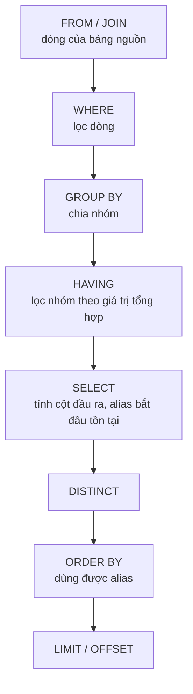
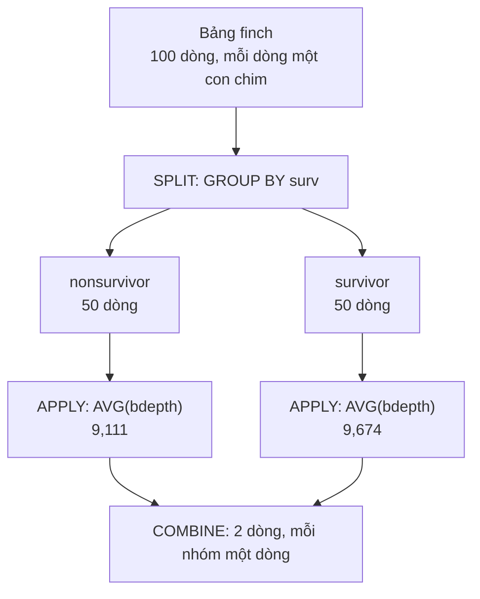

`GROUP BY` chia các dòng của một bảng thành nhóm theo giá trị của khoá nhóm, tính hàm tổng hợp cho từng nhóm và trả về đúng một dòng cho mỗi nhóm; `HAVING` lọc các nhóm sau khi tổng hợp, còn `WHERE` lọc dòng trước khi nhóm. Theo tài liệu PostgreSQL và SQL Server, câu `SELECT` được xử lý logic theo thứ tự FROM → WHERE → GROUP BY → HAVING → SELECT → DISTINCT → ORDER BY → LIMIT, khác hẳn thứ tự viết. Trên bộ dữ liệu 100 chim sẻ *Geospiza fortis*, một câu `GROUP BY` cho độ sâu mỏ trung bình 9,111 mm ở nhóm chết trong hạn hán và 9,674 mm ở nhóm sống sót. Bài dành cho sinh viên sinh học và người mới làm tin sinh học đã biết `SELECT`, `WHERE`, hàm tổng hợp, kèm thí nghiệm trên SQLite và cách làm tương đương trong R.

<div class="callout callout-note">
<p class="callout-title">Tóm tắt nhanh</p>

- `WHERE` lọc dòng trước khi nhóm; `HAVING` lọc nhóm sau khi tính hàm tổng hợp; `FILTER` chỉ lọc đầu vào của một hàm.
- Thứ tự xử lý logic: FROM → WHERE → GROUP BY → HAVING → SELECT → ORDER BY → LIMIT. Alias của SELECT chưa tồn tại ở WHERE theo chuẩn.
- SQLite dễ dãi hơn chuẩn: cho alias trong WHERE và cột không nhóm ("bare column"); chưa có ROLLUP.
- Trong R, `tapply`, `aggregate` và `dplyr` xử lý NA khác nhau; luôn ghi rõ cách xử lý giá trị thiếu.
- `HAVING COUNT(*) >= k` là một quyết định về cỡ mẫu, cần nêu trong phần phương pháp.

</div>

## 1. GROUP BY làm gì: từ một dòng mỗi cá thể đến một dòng mỗi nhóm

Bảng dữ liệu sinh học thường có một dòng cho mỗi con chim, con cá hay mẫu RNA-seq, còn câu hỏi khoa học lại hỏi về nhóm: chim sống sót có mỏ sâu hơn chim chết không. Hàm tổng hợp như `COUNT`, `AVG`, `SUM` (→ [Hàm tổng hợp](/blog/ham-tong-hop-aggregate/)) trả lời một nửa câu hỏi. Dùng riêng, chúng gộp **cả bảng** thành đúng một dòng, kể cả khi bảng rỗng (SQLite, n.d.-d):

```sql
SELECT COUNT(*), AVG(bdepth) FROM finch;                   -- 100 | 9.3924
SELECT COUNT(*), AVG(bdepth) FROM finch WHERE mass > 100;  -- 0   | NULL
```

`GROUP BY` thêm bước chia nhóm. Mỗi dòng được gán vào một nhóm theo giá trị của biểu thức nhóm; các dòng có cùng giá trị vào cùng một nhóm, và hàm tổng hợp được tính riêng trong từng nhóm (SQLite, n.d.-d). Bảng `finch` dưới đây là bộ dữ liệu giáo dục của HHMI BioInteractive (2021), trích từ dữ liệu của Peter và Rosemary Grant: 100 con chim sẻ đất trung bình đo trên đảo Daphne Major, 50 con chết trong hạn hán 1977 và 50 con sống sót (→ Chọn lọc tự nhiên ở chim sẻ Darwin).

```sql
SELECT surv,
       COUNT(*)              AS n,
       ROUND(AVG(mass), 3)   AS mean_mass_g,
       ROUND(AVG(bdepth), 3) AS mean_bdepth_mm
FROM finch
GROUP BY surv
ORDER BY surv;
```

**Bảng 1.** Khối lượng và độ sâu mỏ trung bình theo nhóm sống sót (SQLite 3.45.3)

| surv | n | mean_mass_g | mean_bdepth_mm |
| --- | --- | --- | --- |
| nonsurvivor | 50 | 15,713 | 9,111 |
| survivor | 50 | 16,994 | 9,674 |

Khoá nhóm có thể là một **biểu thức**, không chỉ là tên cột. `GROUP BY strftime('%Y-%m', ngay_lay_mau)` gom mẫu theo tháng; `GROUP BY CAST(l_cm AS INTEGER)` gom cá theo khoảng chiều dài 1 cm, tức là một bảng tần số giống công cụ Histogram của Excel (→ [Phân tích cơ sở dữ liệu trên Excel](/blog/phan-tich-co-so-du-lieu/)). Với 25 cá *Coilia grayii*, câu sau cho 8 khoảng từ 15 đến 22 cm, đông nhất là khoảng 21 cm với 6 cá:

```sql
SELECT CAST(l_cm AS INTEGER) AS l_bin, COUNT(*) AS n
FROM coilia
GROUP BY l_bin
ORDER BY l_bin;
```

Khoá nhóm cũng có thể gồm nhiều cột: `GROUP BY surv, sex` tạo một nhóm cho mỗi tổ hợp giá trị **có mặt** trong dữ liệu. Tổ hợp không có dòng nào thì không xuất hiện. Với khoá nhóm, các giá trị NULL được coi là bằng nhau và gom chung một nhóm (SQLite, n.d.-d), khác với phép so sánh `=` thông thường (→ [NULL và logic ba giá trị](/blog/select-and-where-truy-van-co-ban/)).

Một câu `GROUP BY` không có hàm tổng hợp, như `SELECT surv FROM finch GROUP BY surv`, cho cùng kết quả với `SELECT DISTINCT surv FROM finch`. Khi chỉ cần danh sách giá trị không trùng, `DISTINCT` nói rõ ý định hơn.

`GROUP BY` **không hứa hẹn thứ tự** của kết quả. Tài liệu PostgreSQL ghi rằng khi không có `ORDER BY`, các dòng ra theo thứ tự nào hệ thống thấy nhanh nhất (PostgreSQL Global Development Group, n.d.-c). Muốn bảng in ra có thứ tự thì phải viết `ORDER BY` (→ [Sắp xếp và tìm kiếm](/blog/sap-xep-and-tim-kiem/)).

## 2. Thứ tự xử lý logic của câu SELECT

Câu `SELECT` được **viết** theo thứ tự SELECT → FROM → WHERE → GROUP BY → HAVING → ORDER BY → LIMIT, nhưng được **xử lý logic** theo thứ tự khác. Tài liệu PostgreSQL 18 liệt kê các bước: `WITH`, `FROM`, `WHERE`, `GROUP BY` và `HAVING`, danh sách `SELECT`, `DISTINCT`, `UNION`/`INTERSECT`/`EXCEPT`, `ORDER BY`, rồi `LIMIT`/`OFFSET` (PostgreSQL Global Development Group, n.d.-c). SQL Server gọi đây là thứ tự "binding": FROM, ON, JOIN, WHERE, GROUP BY, WITH CUBE/ROLLUP, HAVING, SELECT, DISTINCT, ORDER BY, TOP (Microsoft, 2026).

**Bảng 2.** Thứ tự viết và thứ tự xử lý logic

| Bước | Thứ tự viết | Thứ tự xử lý logic | Ở bước này có gì |
| --- | --- | --- | --- |
| 1 | SELECT | FROM (và JOIN) | các dòng của bảng nguồn |
| 2 | FROM | WHERE | dòng đã lọc, chưa có nhóm |
| 3 | WHERE | GROUP BY | các nhóm |
| 4 | GROUP BY | HAVING | giá trị tổng hợp của từng nhóm |
| 5 | HAVING | SELECT | cột đầu ra và alias |
| 6 | ORDER BY | DISTINCT | dòng đầu ra không trùng |
| 7 | LIMIT | ORDER BY, rồi LIMIT | thứ tự và số dòng trả về |

Cụm "thứ tự xử lý logic" (logical processing order) chính xác hơn "thứ tự thực thi". Danh sách này là quy tắc về **phạm vi tên**: ở mỗi bước, tên nào đã tồn tại và tên nào chưa. Nó không phải lịch chạy của máy.



### Đọc một câu theo thứ tự logic

Câu dưới đây chạy trên bảng 25 cá *C. grayii*. Đọc nó theo thứ tự logic, từng bước một:

```sql
SELECT main_food, COUNT(*) AS n, ROUND(AVG(l_cm), 2) AS mean_l
FROM coilia
WHERE l_cm >= 17
GROUP BY main_food
HAVING COUNT(*) >= 3
ORDER BY mean_l DESC
LIMIT 2;
-- Acetes   | 6 | 21.18
-- Copepoda | 6 | 19.07
```

FROM lấy 25 dòng. WHERE bỏ ba cá ngắn hơn 17 cm, còn 22 dòng. GROUP BY chia 22 dòng thành sáu nhóm thức ăn: Copepoda, Cladocera và Acetes mỗi nhóm 6 cá, Polychaeta 2, Mysis và Amphipoda mỗi nhóm 1. HAVING giữ ba nhóm có ít nhất 3 cá. SELECT tính `n` và `mean_l` cho ba nhóm đó. ORDER BY sắp theo `mean_l` giảm dần, và chỉ ở bước này alias `mean_l` mới dùng được. LIMIT cắt lấy hai dòng đầu. Copepoda có 9 cá trên cả bảng nhưng ở đây chỉ còn 6, vì ba cá bị WHERE loại đều ăn Copepoda; trung bình cũng đổi từ 18,00 lên 19,07 cm.

### Hệ quả 1: hàm tổng hợp không đặt được trong WHERE

`WHERE` quyết định dòng nào được đưa vào tổng hợp, nên nó không thể dùng kết quả của chính phép tổng hợp đó (PostgreSQL Global Development Group, n.d.-a). SQLite báo lỗi ngay:

```sql
SELECT tissue FROM expr WHERE AVG(tpm) > 1000;
-- Error: misuse of aggregate function AVG()
```

Điều kiện trên giá trị tổng hợp phải đặt ở `HAVING`.

### Hệ quả 2: alias chưa tồn tại ở WHERE

Alias được đặt ở bước SELECT, tức là sau WHERE, GROUP BY và HAVING. PostgreSQL ghi rõ: tên cột đầu ra dùng được trong `ORDER BY` và `GROUP BY`, nhưng không dùng được trong `WHERE` hay `HAVING`, ở đó phải viết lại biểu thức (PostgreSQL Global Development Group, n.d.-c). SQL Server nói rõ hơn: vì `WHERE`, `GROUP BY` và `HAVING` được bind trước `SELECT`, alias đặt ở `SELECT` không dùng được trong ba mệnh đề đó, chỉ dùng được ở `ORDER BY` (Microsoft, 2026). Alias trong `GROUP BY` là phần mở rộng so với SQL-92 (PostgreSQL Global Development Group, n.d.-c); MySQL cho dùng alias trong cả `GROUP BY` và `HAVING` (Oracle, n.d.-b).

SQLite dễ dãi hơn: alias dùng được cả trong `WHERE`, tính năng có từ bản 2.2.4 (SQLite, n.d.-c). Đây là phần mở rộng riêng, không phải hành vi chuẩn. Câu dưới chạy trên SQLite nhưng theo tài liệu sẽ bị PostgreSQL từ chối; nếu truy vấn cần chạy được ở nhiều nơi, hãy viết lại biểu thức `tpm * 2 > 50000` trong `WHERE`:

```sql
SELECT sample, gene, tpm * 2 AS tpm2
FROM expr
WHERE tpm2 > 50000;   -- SQLite: 3 dòng
```

### Hệ quả 3: logic không phải vật lý

SQL Server lưu ý rằng thứ tự thực tế có thể khác danh sách binding (Microsoft, 2026). Bộ tối ưu hoá được tự do sắp xếp lại các bước, miễn kết quả không đổi (Chaudhuri, 1998). Ví dụ, từ bản 3.19.0 SQLite tự chuyển điều kiện trong `HAVING` chỉ dùng cột nhóm sang `WHERE` để lọc sớm (SQLite, n.d.-c). Thứ tự logic là mô hình để **suy luận** về kết quả; kế hoạch thực thi (`EXPLAIN`) là công cụ để **tối ưu** tốc độ.

## 3. WHERE, HAVING và FILTER: lọc dòng, lọc nhóm, lọc đầu vào

`WHERE` chọn dòng trước khi nhóm, `HAVING` chọn nhóm sau khi tính tổng hợp (PostgreSQL Global Development Group, n.d.-a). Điều kiện không cần hàm tổng hợp nên đặt ở `WHERE`. PostgreSQL ghi rằng cách này hiệu quả hơn, vì dòng bị loại sớm không phải đi qua bước nhóm (PostgreSQL Global Development Group, n.d.-a).

`HAVING` không bắt buộc phải có `GROUP BY`. Khi thiếu `GROUP BY`, PostgreSQL coi mọi dòng được chọn là một nhóm, và truy vấn trả về một dòng nếu điều kiện đúng, không dòng nào nếu sai (PostgreSQL Global Development Group, n.d.-c). SQLite chỉ cho phép điều này từ bản 3.39.0 (SQLite, n.d.-c). Trên SQLite CLI 3.37.0 đi kèm macOS, câu dưới báo "a GROUP BY clause is required before HAVING"; trên SQLite 3.45.3 đi kèm Python nó trả về 10:

```sql
SELECT COUNT(*) AS n FROM expr HAVING COUNT(*) > 5;
```

`FILTER` lọc ở mức thứ ba: chỉ lọc đầu vào của một hàm tổng hợp, các hàm khác trong cùng dòng vẫn thấy mọi dòng của nhóm (PostgreSQL Global Development Group, n.d.-a). SQLite cũng hỗ trợ cú pháp này (SQLite, n.d.-a). Ví dụ đếm chim đực và chim cái trong cùng một dòng cho mỗi nhóm sống sót:

```sql
SELECT surv,
       COUNT(*)                               AS n,
       COUNT(*) FILTER (WHERE sex = 'male')   AS n_male,
       COUNT(*) FILTER (WHERE sex = 'female') AS n_female,
       ROUND(AVG(bdepth), 3)                  AS mean_bdepth
FROM finch
GROUP BY surv
ORDER BY surv;
-- nonsurvivor | 50 | 20 | 10 | 9.111
-- survivor    | 50 | 27 |  9 | 9.674
```

Nếu dùng `WHERE sex = 'male'` thì cả `n` và `mean_bdepth` chỉ còn tính trên chim đực.

**Bảng 3.** Ba vị trí lọc

| | WHERE | HAVING | FILTER |
| --- | --- | --- | --- |
| Lọc cái gì | dòng | nhóm | đầu vào của một hàm tổng hợp |
| Thời điểm | trước GROUP BY | sau khi tính tổng hợp | trong lúc tính hàm đó |
| Dùng hàm tổng hợp trong điều kiện | không | có | không |
| Ví dụ | `WHERE mass IS NOT NULL` | `HAVING COUNT(*) >= 10` | `COUNT(*) FILTER (WHERE sex = 'male')` |

Bộ lọc `WHERE cot IS NOT NULL` trước khi tổng hợp thường thừa với `SUM` và `AVG`, vì hai hàm này vốn bỏ qua NULL (SQLite, n.d.-a). Nó chỉ làm thay đổi `COUNT(*)`. Trên bảng `expr` giả lập ở mục 6, mô Liver có 4 dòng nhưng chỉ 3 giá trị TPM: `COUNT(*)` = 4, `COUNT(tpm)` = 3, và `AVG(tpm)` = 13.833,83 dù có hay không có bộ lọc.

Trong SQLite còn một điểm cần biết: nếu `HAVING` chứa biểu thức không tổng hợp trên cột không nhóm, biểu thức đó được tính trên một dòng chọn tuỳ ý của nhóm (SQLite, n.d.-d). Đó là thêm một lý do để đặt điều kiện thường ở `WHERE`.

<div class="callout callout-warning">
<p class="callout-title">Lỗi hay gặp khi lọc</p>

- `HAVING sex = 'male'` khi nhóm theo `surv`: SQLite vẫn chạy nhưng xét điều kiện trên một dòng tuỳ ý của nhóm. Đặt ở `WHERE`.
- `HAVING n_measured >= 3` (alias): chạy trên SQLite và MySQL, không chạy trên PostgreSQL. Viết `HAVING COUNT(tpm) >= 3`.

</div>

## 4. Nền tảng: đại số quan hệ và chiến lược split-apply-combine

Mô hình quan hệ của Codd (1970) coi bảng là một quan hệ, tức là một tập các bộ giá trị. Đại số quan hệ ban đầu có chọn, chiếu, kết nối, nhưng chưa có phép nhóm và hàm tổng hợp. Klug (1982) xét đại số quan hệ và phép tính quan hệ có thêm hàm tổng hợp, và chỉ ra rằng hai ngôn ngữ vẫn tương đương. Hệ quả thực hành: kết quả của `GROUP BY` lại là một quan hệ, nên có thể dùng làm đầu vào cho truy vấn khác qua subquery hoặc CTE (→ [CTE và phép toán tập hợp](/blog/cte-and-set-operations/)).

Wickham (2011) gọi tên mô thức chung là **chiến lược split-apply-combine**: chia bài toán lớn thành các mảnh, xử lý từng mảnh độc lập, rồi ghép kết quả lại. Ánh xạ sang SQL: split là `GROUP BY`, apply là hàm tổng hợp, combine là bảng kết quả mỗi nhóm một dòng.



MapReduce cũng theo khuôn này: map phát ra cặp khoá–giá trị, hệ thống gom theo khoá, reduce gộp từng nhóm (Dean & Ghemawat, 2008).

`GROUP BY` chỉ dễ khi dữ liệu ở dạng tidy, mỗi biến một cột, mỗi quan sát một dòng (Wickham, 2014). Ma trận biểu hiện dạng "gene × mẫu" (mỗi mẫu một cột) phải chuyển sang dạng dài `(sample, tissue, gene, tpm)` thì mới nhóm theo mô được (→ [Data frame và tidy data](/blog/data-frames/)).

## 5. Cột không nhóm: chuẩn, phụ thuộc hàm và "bare column"

Quy tắc quen thuộc: mọi cột trong `SELECT` phải nằm trong `GROUP BY` hoặc trong một hàm tổng hợp. Lý do là tính xác định: cột không nhóm có thể mang nhiều giá trị trong một nhóm, và hệ quản trị không biết trả giá trị nào.

PostgreSQL áp quy tắc này, với một ngoại lệ: cột không nhóm được phép nếu nó **phụ thuộc hàm** (functional dependency) vào các cột nhóm. PostgreSQL chỉ nhận ra phụ thuộc hàm khi khoá chính của bảng nằm trong `GROUP BY` (PostgreSQL Global Development Group, n.d.-c). Ví dụ `GROUP BY band` với `band` là khoá chính cho phép chọn thêm `sex`, vì mỗi `band` chỉ có một giới tính.

MySQL 8.4 bật chế độ `ONLY_FULL_GROUP_BY` mặc định và cũng tự nhận ra phụ thuộc hàm. Khi biết chắc một cột chỉ có một giá trị trong nhóm mà MySQL không tự suy ra được, có thể bọc cột trong `ANY_VALUE()`. Nếu tắt chế độ này, server được chọn giá trị bất kỳ trong nhóm (Oracle, n.d.-b).

SQLite **không kiểm tra** quy tắc (SQLite, n.d.-b). Cột không nhóm, gọi là "bare column", nhận giá trị từ một dòng tuỳ ý của nhóm. Trên bảng `expr`:

```sql
SELECT tissue, gene, AVG(tpm) AS mean_tpm
FROM expr
GROUP BY tissue;
-- Liver     | ALB | 13833.83
-- Pancreas  | INS | 24166.67
-- Pituitary | GH1 | 20500.2
```

Câu chạy, không cảnh báo. Mô Pancreas có hai gene, nhưng cột `gene` chỉ hiện INS trong khi `mean_tpm` tính trên cả INS và PRSS1; người đọc dễ hiểu nhầm "INS ở tuỵ có TPM trung bình 24.166". PostgreSQL sẽ từ chối câu này.

Ngoại lệ có chủ đích: khi truy vấn có đúng một `min()` hoặc `max()`, cột bare lấy từ dòng chứa giá trị cực trị; nếu có nhiều dòng hoà cực trị thì vẫn chọn tuỳ ý (SQLite, n.d.-b, n.d.-d).

```sql
SELECT surv, band, MAX(bdepth) AS max_bdepth
FROM finch
GROUP BY surv;
-- nonsurvivor |  283 | 11.2
-- survivor    | 1019 | 11.21
```

Kết quả này đúng vì không có hoà, nhưng không chạy được trên PostgreSQL. Cách viết chạy được ở mọi nơi là window function `ROW_NUMBER()`, đánh số các dòng trong từng nhóm rồi lấy dòng số 1 (→ [Window function](/blog/window-functions/)). Cột `band` thứ hai trong `ORDER BY` là cột phá hoà, để kết quả xác định ngay cả khi hai con có cùng độ sâu mỏ:

```sql
SELECT surv, band, bdepth
FROM (
  SELECT surv, band, bdepth,
         ROW_NUMBER() OVER (PARTITION BY surv ORDER BY bdepth DESC, band) AS rn
  FROM finch
)
WHERE rn = 1
ORDER BY surv;
-- nonsurvivor |  283 | 11.2
-- survivor    | 1019 | 11.21
```

Hai công cụ khác nhau ở đầu ra. `GROUP BY` gộp mỗi nhóm thành một dòng. Window function cũng tính trên nhóm nhưng giữ nguyên mọi dòng.

## 6. Thí nghiệm: cùng một câu SQL, nhiều hệ quản trị

Bảng thử `expr(sample, tissue, gene, tpm)` là dữ liệu **giả lập** 10 dòng, có hai giá trị NULL. Các số TPM chỉ để minh hoạ, không lấy từ GTEx hay nghiên cứu nào:

```sql
CREATE TABLE expr (sample TEXT, tissue TEXT, gene TEXT, tpm REAL);
INSERT INTO expr VALUES
 ('S1','Liver','ALB',18500),     ('S1','Liver','INS',1.5),
 ('S2','Liver','ALB',23000),     ('S2','Liver','INS',NULL),
 ('S3','Pancreas','INS',15200),  ('S3','Pancreas','PRSS1',30500),
 ('S4','Pancreas','INS',NULL),   ('S4','Pancreas','PRSS1',26800),
 ('S5','Pituitary','GH1',41000), ('S5','Pituitary','INS',0.4);
```

Mười truy vấn được chạy thật trên SQLite 3.45.3 (module `sqlite3` của Python) và SQLite 3.37.0 (CLI đi kèm macOS) ngày 25/11/2026. Cột PostgreSQL và MySQL ghi theo tài liệu chính thức, chưa chạy thật.

**Bảng 4.** Mười truy vấn × hệ quản trị (✅ chạy, ❌ lỗi, ⚠️ chạy nhưng kết quả không xác định)

| # | Truy vấn | SQLite 3.37.0 | SQLite 3.45.3 | PostgreSQL 18 (tài liệu) | MySQL 8.4 (tài liệu) |
| --- | --- | --- | --- | --- | --- |
| 1 | alias trong WHERE | ✅ | ✅ | ❌ | – |
| 2 | alias trong GROUP BY | ✅ | ✅ | ✅ | ✅ |
| 3 | alias trong HAVING | ✅ | ✅ | ❌ | ✅ |
| 4 | alias trùng tên cột đầu vào trong GROUP BY | nhóm theo cột đầu vào | nhóm theo cột đầu vào | nhóm theo cột đầu vào | – |
| 5 | HAVING không GROUP BY | ❌ | ✅ | ✅ | – |
| 6 | cột không nhóm | ⚠️ | ⚠️ | ❌ (trừ phụ thuộc hàm) | ❌ khi bật ONLY_FULL_GROUP_BY |
| 7 | hàm tổng hợp trong WHERE | ❌ | ❌ | ❌ | ❌ |
| 8 | `COUNT(*) FILTER (WHERE …)` | ✅ | ✅ | ✅ | – |
| 9 | `GROUP BY ROLLUP(…)` | ❌ | ❌ | ✅ | ✅ |
| 10 | `GROUPING SETS` | ❌ | ❌ | ✅ | – |

Nguồn cột PostgreSQL: PostgreSQL Global Development Group (n.d.-a, n.d.-b, n.d.-c). Cột MySQL: Oracle (n.d.-a, n.d.-b). Dấu – nghĩa là trang tài liệu đã đọc không đề cập. Truy vấn 7 lỗi ở mọi nơi vì cùng lý do logic.

Kết quả dễ gây bất ngờ nhất nằm ở truy vấn 4:

```sql
SELECT substr(tissue, 1, 1) AS tissue, COUNT(*) AS n
FROM expr
GROUP BY tissue
ORDER BY 1;
-- L | 4
-- P | 4
-- P | 2
```

Hai dòng "P" cho thấy `GROUP BY tissue` nhóm theo **cột đầu vào** (ba mô), không theo alias (hai chữ cái). PostgreSQL ghi đúng quy tắc này: khi tên mơ hồ, `GROUP BY` hiểu là cột đầu vào, còn `ORDER BY` hiểu là cột đầu ra (PostgreSQL Global Development Group, n.d.-c). Cả hai bản SQLite thử nghiệm đều cho kết quả như vậy. Cách tránh đơn giản: không đặt alias trùng tên cột.

Bảng 4 có hai loại khác biệt. Loại đầu nằm **giữa các hệ quản trị**: truy vấn viết thử trên SQLite có thể hỏng khi chuyển sang PostgreSQL. Loại sau nằm **giữa các phiên bản** của cùng một hệ: SQLite 3.37.0 và 3.45.3 cho kết quả khác nhau ở truy vấn 5. Muốn biết máy đang chạy bản nào, gõ `SELECT sqlite_version();`.

## 7. Tương đương trong R: tapply, aggregate và dplyr

R có ít nhất ba cách làm split-apply-combine:

- `tapply(x, group, FUN)` làm việc trên vector (→ Hàm và họ apply trong R).
- `aggregate()` có hai dạng. Dạng công thức `aggregate(y ~ g, data, FUN)` dùng mặc định `na.action = na.omit`, tức là chỉ xét các dòng đầy đủ; dạng data frame `aggregate(x, by, FUN)` bỏ các dòng có NA trong biến nhóm (R Core Team, n.d.).
- `dplyr::group_by() |> summarise()` trả về một dòng cho mỗi tổ hợp biến nhóm (Wickham et al., n.d.); dplyr thuộc hệ sinh thái tidyverse (Wickham et al., 2019).

Chạy trên cùng bảng `expr` với R 4.4.3 và dplyr 1.2.1:

```r
library(dplyr)
d <- data.frame(
  sample = c("S1","S1","S2","S2","S3","S3","S4","S4","S5","S5"),
  tissue = c("Liver","Liver","Liver","Liver","Pancreas","Pancreas",
             "Pancreas","Pancreas","Pituitary","Pituitary"),
  gene   = c("ALB","INS","ALB","INS","INS","PRSS1","INS","PRSS1","GH1","INS"),
  tpm    = c(18500, 1.5, 23000, NA, 15200, 30500, NA, 26800, 41000, 0.4)
)
tapply(d$tpm, d$tissue, mean)                       # NA ở Liver, Pancreas
tapply(d$tpm, d$tissue, mean, na.rm = TRUE)         # 13833.83 24166.67 20500.20
aggregate(tpm ~ tissue, data = d, FUN = mean)       # bỏ dòng thiếu
aggregate(d$tpm, by = list(tissue = d$tissue), FUN = mean)  # NA
d |> group_by(tissue) |> summarise(mean_tpm = mean(tpm))    # NA
```

**Bảng 5.** Cùng câu hỏi "TPM trung bình theo mô": SQL và năm cách trong R

| Cách | Liver | Pancreas | Pituitary |
| --- | --- | --- | --- |
| SQL `AVG(tpm) … GROUP BY tissue` | 13.833,83 | 24.166,67 | 20.500,2 |
| `tapply(…, mean)` | NA | NA | 20.500,2 |
| `tapply(…, mean, na.rm = TRUE)` | 13.833,83 | 24.166,67 | 20.500,2 |
| `aggregate(tpm ~ tissue, …)` | 13.833,83 | 24.166,67 | 20.500,2 |
| `aggregate(d$tpm, by = …)` | NA | NA | 20.500,2 |
| `summarise(mean(tpm))` | NA | NA | 20.500,2 |

Cùng một câu hỏi mà có hai kiểu đáp án: đủ số cho cả ba mô, hoặc NA ở Liver và Pancreas. SQL bỏ NULL một cách im lặng (SQLite, n.d.-a). Hàm `mean()` của R thì mặc định trả NA khi gặp giá trị thiếu.

Tương ứng với các mệnh đề SQL: `filter()` trước `summarise()` giống `WHERE`, `filter()` sau `summarise()` giống `HAVING`:

```r
d |>
  group_by(tissue) |>
  summarise(n = n(), n_tpm = sum(!is.na(tpm)),
            mean_tpm = mean(tpm, na.rm = TRUE)) |>
  filter(n_tpm >= 3)          # giữ Liver và Pancreas
```

Khi nhóm theo nhiều biến, `summarise()` mặc định `.groups = "drop_last"`: bỏ cấp nhóm cuối, giữ các cấp còn lại, và in thông báo (Wickham et al., n.d.). Kết quả vẫn còn nhóm theo `tissue`, nên một `mutate()` tiếp theo sẽ tính trong từng mô. Muốn bỏ hết nhóm, ghi rõ `.groups = "drop"`.

Excel cũng làm cùng việc: trường Rows của PivotTable là `GROUP BY`, ô Values là hàm tổng hợp, bộ lọc của PivotTable hay Advanced Filter là `WHERE` (→ [Phân tích cơ sở dữ liệu trên Excel](/blog/phan-tich-co-so-du-lieu/)).

## 8. Khái quát hoá: ROLLUP, CUBE và GROUPING SETS

Bảng tổng phụ quen thuộc với ai đã dùng PivotTable: dòng tổng của từng nhóm và dòng tổng chung. Gray và cộng sự (1997) chỉ ra rằng `GROUP BY` chuẩn chỉ cho tổng hợp không chiều hoặc một chiều, và đề xuất toán tử **data cube** khái quát hoá `GROUP BY`, bảng chéo (cross-tab) và tổng phụ (sub-total); điểm quan trọng là cube vẫn là một quan hệ. Bản hội nghị ICDE 1996 trình bày cùng ý tưởng (Gray et al., 1996).

Trong SQL hiện đại, `ROLLUP(a, b, c)` tương đương `GROUPING SETS ((a, b, c), (a, b), (a), ())`, còn `CUBE(a, b, c)` tạo mọi tập con của ba cột. Ở dòng tổng phụ, cột không tham gia nhóm hiện NULL (PostgreSQL Global Development Group, n.d.-b). NULL này dễ lẫn với NULL thật trong dữ liệu, nên dùng hàm `GROUPING()` để phân biệt (PostgreSQL Global Development Group, n.d.-b; Oracle, n.d.-a). MySQL 8.4 hỗ trợ `WITH ROLLUP`, `ROLLUP()` và `GROUPING()` (Oracle, n.d.-a).

SQLite chưa có các toán tử này. Có thể giả lập bằng `UNION ALL` của nhiều câu `GROUP BY`:

```sql
SELECT surv, sex, n, mean_bdepth FROM (
  SELECT 0 AS lvl, surv, sex, COUNT(*) AS n, ROUND(AVG(bdepth), 3) AS mean_bdepth
  FROM finch GROUP BY surv, sex
  UNION ALL
  SELECT 1, surv, '(tất cả)', COUNT(*), ROUND(AVG(bdepth), 3)
  FROM finch GROUP BY surv
  UNION ALL
  SELECT 2, '(tất cả)', '(tất cả)', COUNT(*), ROUND(AVG(bdepth), 3)
  FROM finch
) ORDER BY lvl = 2, surv, lvl, sex;
```

**Bảng 6.** Độ sâu mỏ theo sống sót × giới tính, có tổng phụ

| surv | sex | n | mean_bdepth (mm) |
| --- | --- | --- | --- |
| nonsurvivor | female | 10 | 8,930 |
| nonsurvivor | male | 20 | 9,165 |
| nonsurvivor | unknown | 20 | 9,147 |
| nonsurvivor | (tất cả) | 50 | 9,111 |
| survivor | female | 9 | 9,583 |
| survivor | male | 27 | 9,991 |
| survivor | unknown | 14 | 9,121 |
| survivor | (tất cả) | 50 | 9,674 |
| (tất cả) | (tất cả) | 100 | 9,392 |

Trung bình **không cộng dồn**. Trung bình của nhóm sống sót là 9,674 mm, trong khi trung bình cộng ba trung bình con (9,583; 9,991; 9,121) chỉ là 9,565 mm, vì ba nhóm có 9, 27 và 14 con. Dòng tổng phụ phải tính lại từ dữ liệu gốc.

## 9. Ứng dụng sinh học

### 9a. Chim sẻ Daphne Major

Boag và Grant (1981) mô tả chọn lọc tự nhiên mạnh trong một quần thể chim sẻ Darwin ở Galápagos: sự sống sót qua đợt khô hạn không ngẫu nhiên, chim lớn, nhất là con đực mỏ lớn, sống sót tốt nhất. Bảng 1 cho thấy xu hướng đó trên bộ 100 con; Bảng 6 cho thấy cỡ nhóm không đều khi chia thêm theo giới tính: 10 cái, 20 đực, 20 "unknown" ở nhóm chết; 9 cái, 27 đực, 14 "unknown" ở nhóm sống sót.

```sql
SELECT surv, sex, COUNT(*) AS n, ROUND(AVG(bdepth), 3) AS mean_bdepth
FROM finch
GROUP BY surv, sex
HAVING COUNT(*) >= 10
ORDER BY surv, sex;
```

Ngưỡng 10 loại nhóm cái sống sót (n = 9). Ngưỡng là một quyết định khoa học, không phải chi tiết cú pháp: quá thấp thì trung bình nhóm nhỏ dao động mạnh, quá cao thì mất nhóm có ý nghĩa sinh học. Hãy chọn ngưỡng trước khi nhìn kết quả, nêu nó trong phần phương pháp và báo cáo cả nhóm bị loại.

Phần này chỉ dùng thống kê mô tả để minh hoạ kỹ thuật; kiểm định sự khác biệt giữa hai nhóm là việc của bài chim sẻ Darwin.


**Hình 1.** Độ sâu mỏ của 100 chim sẻ *G. fortis* theo nhóm sống sót × giới tính. Gạch đen là trung bình nhóm; dấu × xám là nhóm bị loại bởi `HAVING COUNT(*) >= 10`. Dữ liệu: HHMI BioInteractive (2021).

"unknown" là một giá trị thật, chim chưa xác định được giới tính, không phải NULL. Nó được nhóm riêng như một nhóm bình thường. Đổi nó thành NULL sẽ làm mờ ý nghĩa đó.

### 9b. Cá *Coilia grayii*

Bảng 25 cá *Coilia grayii* (→ [Phân tích cơ sở dữ liệu trên Excel](/blog/phan-tich-co-so-du-lieu/)) nhóm theo thức ăn chính: Copepoda 9 cá, chiều dài trung bình 18,00 cm; Cladocera 6 cá, 18,52 cm; Acetes 6 cá, 21,18 cm; Polychaeta 2 cá; Amphipoda và Mysis mỗi loại 1 cá. `HAVING COUNT(*) >= 3` giữ ba nhóm đầu.

Nhóm theo tuổi: nhóm 1+ chỉ có 1 cá, và ô độ chín sinh dục của cá đó trống, nên `COUNT(*)` = 1 còn `COUNT(msex)` = 0. Tuổi lưu dạng chuỗi "0+", "1+": sắp xếp theo chuỗi tình cờ đúng ở đây, nhưng "10+" sẽ đứng trước "2+" (→ [Kiểu dữ liệu](/blog/basic-data-types/)).

### 9c. Biểu hiện gene theo mô

Với dữ liệu biểu hiện đa mô như GTEx (The GTEx Consortium, 2020) ở dạng dài, câu tổng hợp tự nhiên là `GROUP BY tissue, gene`. Phân bố TPM thường lệch phải; khi đó trung vị ít bị vài giá trị cực đoan kéo đi hơn trung bình. SQLite CLI có `median()` từ bản 3.47.0; từ 3.51.0 extension percentile được đưa vào bản amalgamation nhưng tắt mặc định (SQLite, n.d.-c). Ma trận biểu hiện lớn nên để cho các cấu trúc của Bioconductor (Huber et al., 2015); SQL hợp với bảng mô tả mẫu và bảng kết quả.

## 10. Checklist cho truy vấn tổng hợp có thể tái lập

1. Mọi cột trong `SELECT` nằm trong `GROUP BY` hoặc trong hàm tổng hợp, để truy vấn chạy được trên PostgreSQL (PostgreSQL Global Development Group, n.d.-c).
2. Điều kiện trên dòng đặt ở `WHERE`; chỉ điều kiện trên hàm tổng hợp đặt ở `HAVING` (PostgreSQL Global Development Group, n.d.-a).
3. Ghi rõ cách xử lý NULL/NA: `COUNT(*)` khác `COUNT(cot)`, `na.rm` trong R, `na.action` trong `aggregate` (SQLite, n.d.-a; R Core Team, n.d.).
4. Báo cáo `COUNT(*)` cạnh mọi trung bình; nêu và biện minh ngưỡng `HAVING`.
5. Luôn có `ORDER BY` khi trình bày; khi dùng `LIMIT`, thêm cột phá hoà để kết quả không đổi giữa các lần chạy.
6. Ghi phiên bản hệ quản trị và gói R, lưu script cùng dữ liệu (Sandve et al., 2013).

## 11. Kết luận

`GROUP BY` là cách SQL làm split-apply-combine, cùng khuôn với `tapply`, `aggregate`, `dplyr` và PivotTable. Khi một truy vấn tổng hợp báo lỗi hoặc cho số lạ, hãy đọc nó theo thứ tự xử lý logic ở mục 2: phần lớn lỗi nằm ở chỗ một tên được dùng trước bước nó ra đời, như hàm tổng hợp trong `WHERE` hay alias trong `HAVING`. Các hệ quản trị, kể cả hai bản SQLite trong Bảng 4, khác nhau đúng ở những chi tiết này. Vì vậy, trước khi đưa bảng tổng hợp vào báo cáo, hãy rà lại checklist ở mục 10 và ghi kèm kết quả của `SELECT sqlite_version();` hoặc phiên bản hệ quản trị đang dùng.

Bài tiếp theo trong series nối nhiều bảng bằng JOIN (→ [JOIN](/blog/join-ket-hop-nhieu-bang/)), rồi tới window function, công cụ tính trên nhóm mà không gộp dòng.

## Tài liệu tham khảo

Boag, P. T., & Grant, P. R. (1981). Intense natural selection in a population of Darwin's finches (Geospizinae) in the Galápagos. *Science, 214*(4516), 82–85. https://doi.org/10.1126/science.214.4516.82

Chaudhuri, S. (1998). An overview of query optimization in relational systems. In *Proceedings of the Seventeenth ACM SIGACT-SIGMOD-SIGART Symposium on Principles of Database Systems* (pp. 34–43). ACM. https://doi.org/10.1145/275487.275492

Codd, E. F. (1970). A relational model of data for large shared data banks. *Communications of the ACM, 13*(6), 377–387. https://doi.org/10.1145/362384.362685

Dean, J., & Ghemawat, S. (2008). MapReduce: Simplified data processing on large clusters. *Communications of the ACM, 51*(1), 107–113. https://doi.org/10.1145/1327452.1327492

Gray, J., Bosworth, A., Layman, A., & Pirahesh, H. (1996). Data cube: A relational aggregation operator generalizing GROUP-BY, CROSS-TAB, and SUB-TOTALS. In *Proceedings of the Twelfth International Conference on Data Engineering* (pp. 152–159). IEEE. https://doi.org/10.1109/ICDE.1996.492099

Gray, J., Chaudhuri, S., Bosworth, A., Layman, A., Reichart, D., Venkatrao, M., Pellow, F., & Pirahesh, H. (1997). Data cube: A relational aggregation operator generalizing group-by, cross-tab, and sub-totals. *Data Mining and Knowledge Discovery, 1*(1), 29–53. https://doi.org/10.1023/A:1009726021843

HHMI BioInteractive. (2021). *Evolution in action: Data analysis* [Student handout, version 2]. Howard Hughes Medical Institute. https://www.biointeractive.org/classroom-resources/evolution-action-data-analysis

Huber, W., Carey, V. J., Gentleman, R., Anders, S., Carlson, M., Carvalho, B. S., Bravo, H. C., Davis, S., Gatto, L., Girke, T., Gottardo, R., Hahne, F., Hansen, K. D., Irizarry, R. A., Lawrence, M., Love, M. I., MacDonald, J., Obenchain, V., Oleś, A. K., … Morgan, M. (2015). Orchestrating high-throughput genomic analysis with Bioconductor. *Nature Methods, 12*(2), 115–121. https://doi.org/10.1038/nmeth.3252

Klug, A. (1982). Equivalence of relational algebra and relational calculus query languages having aggregate functions. *Journal of the ACM, 29*(3), 699–717. https://doi.org/10.1145/322326.322332

Microsoft. (2026). *SELECT (Transact-SQL)*. Microsoft Learn. Truy cập ngày 12/11/2026, từ https://learn.microsoft.com/en-us/sql/t-sql/queries/select-transact-sql

Oracle. (n.d.-a). *MySQL 8.4 reference manual: 14.19.2 GROUP BY modifiers*. Truy cập ngày 12/11/2026, từ https://dev.mysql.com/doc/refman/8.4/en/group-by-modifiers.html

Oracle. (n.d.-b). *MySQL 8.4 reference manual: 14.19.3 MySQL handling of GROUP BY*. Truy cập ngày 12/11/2026, từ https://dev.mysql.com/doc/refman/8.4/en/group-by-handling.html

PostgreSQL Global Development Group. (n.d.-a). *2.7. Aggregate functions*. PostgreSQL 18 documentation. Truy cập ngày 12/11/2026, từ https://www.postgresql.org/docs/current/tutorial-agg.html

PostgreSQL Global Development Group. (n.d.-b). *7.2. Table expressions*. PostgreSQL 18 documentation. Truy cập ngày 12/11/2026, từ https://www.postgresql.org/docs/current/queries-table-expressions.html

PostgreSQL Global Development Group. (n.d.-c). *SELECT*. PostgreSQL 18 documentation. Truy cập ngày 25/11/2026, từ https://www.postgresql.org/docs/current/sql-select.html

R Core Team. (n.d.). *aggregate: Compute summary statistics of data subsets*. R documentation, package stats. Truy cập ngày 12/11/2026, từ https://stat.ethz.ch/R-manual/R-devel/library/stats/html/aggregate.html

Sandve, G. K., Nekrutenko, A., Taylor, J., & Hovig, E. (2013). Ten simple rules for reproducible computational research. *PLoS Computational Biology, 9*(10), e1003285. https://doi.org/10.1371/journal.pcbi.1003285

SQLite. (n.d.-a). *Built-in aggregate functions*. Truy cập ngày 12/11/2026, từ https://www.sqlite.org/lang_aggfunc.html

SQLite. (n.d.-b). *Quirks, caveats, and gotchas in SQLite*. Truy cập ngày 12/11/2026, từ https://www.sqlite.org/quirks.html

SQLite. (n.d.-c). *Release history*. Truy cập ngày 25/11/2026, từ https://www.sqlite.org/changes.html

SQLite. (n.d.-d). *The SELECT statement*. Truy cập ngày 12/11/2026, từ https://www.sqlite.org/lang_select.html

The GTEx Consortium. (2020). The GTEx Consortium atlas of genetic regulatory effects across human tissues. *Science, 369*(6509), 1318–1330. https://doi.org/10.1126/science.aaz1776

Wickham, H. (2011). The split-apply-combine strategy for data analysis. *Journal of Statistical Software, 40*(1), 1–29. https://doi.org/10.18637/jss.v040.i01

Wickham, H. (2014). Tidy data. *Journal of Statistical Software, 59*(10). https://doi.org/10.18637/jss.v059.i10

Wickham, H., Averick, M., Bryan, J., Chang, W., McGowan, L. D., François, R., Grolemund, G., Hayes, A., Henry, L., Hester, J., Kuhn, M., Pedersen, T. L., Miller, E., Bache, S. M., Müller, K., Ooms, J., Robinson, D., Seidel, D. P., Spinu, V., … Yutani, H. (2019). Welcome to the tidyverse. *Journal of Open Source Software, 4*(43), 1686. https://doi.org/10.21105/joss.01686

Wickham, H., François, R., Henry, L., Müller, K., & Vaughan, D. (n.d.). *summarise(): Summarise each group down to one row*. dplyr 1.2.1 reference. Truy cập ngày 12/11/2026, từ https://dplyr.tidyverse.org/reference/summarise.html
