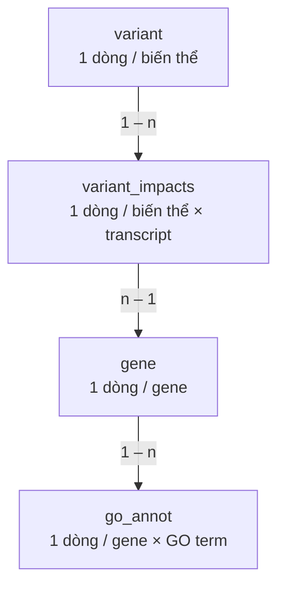
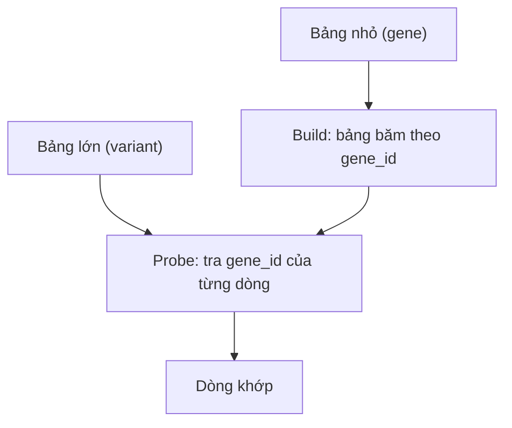
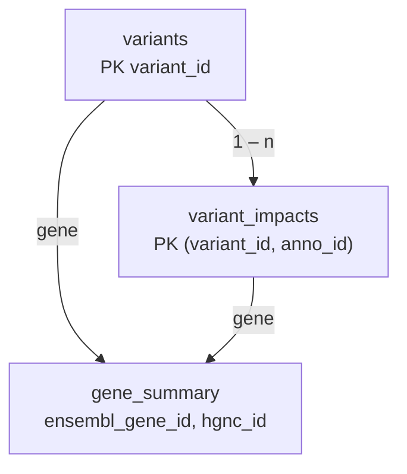

JOIN là phép kết hợp các dòng của nhiều bảng theo một điều kiện. Đây cũng là chỗ trong SQL dễ cho ra con số sai mà không hề báo lỗi. Bài này giải thích JOIN ở ba tầng: vì sao dữ liệu bị tách thành nhiều bảng, mỗi loại JOIN trả về tập dòng nào, và bộ máy cơ sở dữ liệu thực sự nối hai bảng ra sao. Phần thực hành dùng SQLite trên dữ liệu biến thể và chú giải gene mô phỏng, kèm một case theo lược đồ GEMINI và checklist để bạn kiểm tra kết quả trước khi tin.

## 1. Mở đầu: một con số sai không báo lỗi

Giả sử bạn có ba bảng: biến thể (`variant`, mỗi dòng có `gene_id` và điểm chất lượng `qual`), gene (`gene`) và chú giải Gene Ontology (`go_annot`, mỗi gene không có hoặc có vài GO term). Câu hỏi: tổng QUAL của các biến thể nằm trong gene có ít nhất một chú giải GO là bao nhiêu? Cách viết tự nhiên nhất là nối cả ba bảng rồi `SUM(v.qual)`. Trên bộ dữ liệu mô phỏng 200 000 biến thể ở mục 5, câu đó trả về 29 448 785,6. Con số đúng là 8 437 067,6. Truy vấn không lỗi, không cảnh báo; nó chỉ cộng mỗi biến thể nhiều lần, mỗi lần cho một GO term của gene.

Dữ liệu sinh học hầu như không bao giờ nằm gọn trong một bảng. Biến thể đến từ file VCF (Danecek et al., 2011); hệ quả trên từng transcript đến từ công cụ chú giải như VEP (McLaren et al., 2016) hay ANNOVAR (Wang et al., 2010); tên và định danh gene đến từ HGNC (Seal et al., 2023); chức năng đến từ GO (Gene Ontology Consortium, 2023). Tích hợp các nguồn này là chủ đề lâu năm của tin sinh học (Stein, 2002; Goble & Stevens, 2008), và những hệ thống như Ensembl BioMart ra đời để nối dữ liệu qua nhiều loài (Kinsella et al., 2011). Ở quy mô một dự án, bước nối thường là một câu JOIN do chính người phân tích viết.


*Hình 1. Bốn bảng thường gặp khi chú giải biến thể và bội số quan hệ (cardinality) giữa chúng. Mỗi mũi tên "1 – n" là một chỗ số dòng có thể tăng.*

Bài này nối tiếp bài [vì sao dữ liệu sinh học cần cơ sở dữ liệu quan hệ](/blog/gioi-thieu-du-lieu-and-database/) và trả lời ba câu hỏi: mỗi loại JOIN trả về những dòng nào (mục 2–3), bộ máy nối hai bảng bằng cách nào và làm sao biết truy vấn đủ nhanh (mục 4–5), vì sao số dòng sau JOIN thay đổi và làm sao để con số cuối đúng (mục 6–8). Mọi truy vấn đã chạy trên SQLite; số liệu lấy từ dữ liệu mô phỏng.

## 2. Vì sao dữ liệu nằm ở nhiều bảng

Mô hình quan hệ (relational model) do Codd (1970) đề xuất tổ chức dữ liệu thành các quan hệ, tức các bảng có cột xác định, và tách cách dữ liệu được lưu khỏi cách người dùng truy vấn. Mỗi bảng có một khoá chính (primary key) xác định duy nhất từng dòng; một bảng tham chiếu bảng khác qua khoá ngoại (foreign key), tức cột chứa giá trị khoá chính của bảng kia. JOIN là phép dựng lại thông tin đã bị tách ra theo các khoá đó.

Lý do tách là chuẩn hoá (normalization). Kent (1983) trình bày năm dạng chuẩn ở mức dễ hiểu; ý chung là mỗi sự kiện chỉ nên được ghi ở một chỗ. Xét bảng phẳng sau:

| var_id | gene_id | symbol | qual |
| --- | --- | --- | --- |
| 1 | ENSG00000141510 | TP53 | 50 |
| 2 | ENSG00000141510 | TP53 | 30 |
| 3 | ENSG00000135679 | MDM2 | 80 |

Ký hiệu `TP53` lặp lại ở mọi biến thể của gene. Sự lặp này gây ba loại bất thường quen thuộc. Bất thường khi sửa: tên gene được cập nhật thì phải sửa mọi dòng, sót một dòng là dữ liệu tự mâu thuẫn, cùng một `gene_id` mang hai ký hiệu. Bất thường khi chèn: không thể ghi một gene chưa có biến thể nào, vì mỗi dòng phải là một biến thể. Bất thường khi xoá: xoá biến thể cuối cùng của MDM2 là mất luôn thông tin rằng `ENSG00000135679` là MDM2. Tách thành bảng `gene(gene_id, symbol)` và bảng `variant(var_id, gene_id, qual)` thì tên gene chỉ còn ở một chỗ, gene có thể tồn tại không cần biến thể, và `variant.gene_id` trở thành khoá ngoại trỏ về `gene`.

```sql
PRAGMA foreign_keys = ON;
CREATE TABLE gene(gene_id TEXT PRIMARY KEY, symbol TEXT NOT NULL, family TEXT);
CREATE TABLE variant(var_id INTEGER PRIMARY KEY,
  gene_id TEXT REFERENCES gene(gene_id), qual REAL NOT NULL);
INSERT INTO gene VALUES ('ENSG00000141510','TP53','p53'),
  ('ENSG00000135679','MDM2',NULL), ('ENSG00000078900','TP73','p53'),
  ('ENSG00000073282','TP63','p53');
INSERT INTO variant VALUES (1,'ENSG00000141510',50),
  (2,'ENSG00000141510',30), (3,'ENSG00000135679',80);
-- Dòng sau bị từ chối: FOREIGN KEY constraint failed
INSERT INTO variant VALUES (4,'ENSG99999999999',10);

SELECT v.var_id, g.symbol, v.qual
FROM variant v
JOIN gene g ON g.gene_id = v.gene_id;
```

Dòng `PRAGMA` đầu tiên quan trọng: trong SQLite, ràng buộc khoá ngoại mặc định tắt và phải bật cho từng kết nối (SQLite, n.d.-c). Không bật thì dòng thứ tư vẫn được chèn và chỉ lộ ra khi JOIN làm mất nó.

Chuẩn hoá có giá: dữ liệu sạch khi lưu thì tốn công nối khi đọc. Đôi khi thiết kế tốt là cố ý không chuẩn hoá. GEMINI, công cụ nạp VCF vào SQLite để khám phá biến thể, không lưu genotype thành một bảng riêng với mỗi dòng là một cặp biến thể–mẫu, vì một triệu biến thể nhân 1 000 mẫu sẽ thành một tỷ dòng; genotype được nén thành mảng trong bảng biến thể (Paila et al., 2013). Đây là đánh đổi có chủ đích: truy vấn theo genotype phải giải nén trong phần mềm thay vì dùng JOIN, đổi lại file cơ sở dữ liệu nhỏ và nhanh. Điều cần biết là dữ liệu đang ở dạng nào và mỗi JOIN sẽ nhân hay giữ số dòng.

## 3. Ngữ nghĩa của JOIN

Tài liệu SQLite mô tả mọi phép nối dựa trên tích Descartes (Cartesian product) của hai bảng: mọi cặp dòng trái–phải, rồi giữ lại cặp thoả điều kiện (SQLite, n.d.-e). Nối "theo cột chung" chỉ là trường hợp phổ biến nhất, gọi là equi-join. Điều kiện có thể là bất đẳng thức (theta-join), ví dụ nối biến thể với vùng gene khi `v.pos BETWEEN g.start AND g.end`. `NATURAL JOIN` tự nối theo mọi cột trùng tên, còn `USING (gene_id)` nối theo cột được chỉ định (PostgreSQL Global Development Group, n.d.-b). `NATURAL JOIN` nên tránh trong mã phân tích: chỉ cần ai đó thêm một cột `chrom` vào cả hai bảng là điều kiện nối âm thầm thay đổi.

Nếu bạn quen R, `dplyr::inner_join()`, `left_join()`, `full_join()` và `merge()` giữ dòng theo cùng logic; bài tổng hợp dữ liệu trong R dùng chúng trên data frame. Phần nhân dòng ở mục 6 áp dụng y hệt. Phần NULL thì khác: mặc định dplyr coi hai giá trị `NA` là khớp nhau, giống `merge()` (tham số `na_matches = "na"`), còn SQL thì không (Wickham et al., n.d.).

Bảng dưới chạy trên ví dụ nhỏ: 5 biến thể (101–105, trong đó 104 có `gene_id` NULL và 105 trỏ tới gene 9 không tồn tại) và 3 gene (TP53, BRCA2, CFTR; CFTR không có biến thể nào).

```sql
-- Chạy trên một cơ sở dữ liệu mới, tách khỏi ví dụ ở mục 2
CREATE TABLE variant(var_id INTEGER PRIMARY KEY, gene_id INTEGER, qual REAL);
CREATE TABLE gene(gene_id INTEGER PRIMARY KEY, symbol TEXT NOT NULL);
CREATE TABLE impact(var_id INTEGER NOT NULL, transcript TEXT NOT NULL,
  impact TEXT NOT NULL);
INSERT INTO gene VALUES (1,'TP53'), (2,'BRCA2'), (3,'CFTR');
INSERT INTO variant VALUES (101,1,50.0), (102,1,30.0), (103,2,80.0),
  (104,NULL,20.0), (105,9,40.0);
INSERT INTO impact VALUES (101,'T1','HIGH'), (101,'T2','MODERATE'),
  (102,'T1','LOW'), (103,'T3','MODERATE');
```

| Loại JOIN | Giữ dòng nào | Kết quả trên ví dụ |
| --- | --- | --- |
| `INNER JOIN` | Chỉ cặp khớp | 3 dòng (101, 102, 103) |
| `LEFT JOIN` | Mọi dòng bảng trái; cột phải NULL khi không khớp | 5 dòng |
| `RIGHT JOIN` | Mọi dòng bảng phải | 4 dòng (thêm CFTR với `var_id` NULL) |
| `FULL OUTER JOIN` | Mọi dòng của cả hai bên | 6 dòng |
| `CROSS JOIN` | Mọi cặp, không điều kiện | 15 dòng (5 × 3) |
| Self-join | Bảng nối với chính nó | Cặp gene cùng họ |

INNER JOIN bỏ 104, 105 (không khớp gene nào) và CFTR (không biến thể nào trỏ tới); LEFT JOIN giữ 104, 105 với `symbol` NULL; RIGHT JOIN giữ CFTR; FULL OUTER JOIN giữ cả ba. Biến thể 104 không khớp gene nào, kể cả khi bảng gene (giả sử) có một dòng với `gene_id` NULL, vì trong SQL `NULL = NULL` không đúng mà là NULL. Hệ quả thực tế: biến thể liên gene (intergenic) thường có `gene_id` rỗng, và INNER JOIN với bảng gene sẽ lặng lẽ loại toàn bộ nhóm này khỏi phân tích.

Self-join cần alias vì cùng một bảng xuất hiện hai lần. Ví dụ, với bảng `gene` ở mục 2 (có cột `family`), tìm các cặp gene cùng họ p53:

```sql
SELECT a.symbol AS gene_a, b.symbol AS gene_b
FROM gene a
JOIN gene b ON a.family = b.family AND a.gene_id < b.gene_id;
```

Ngoài trường hợp này, alias không bắt buộc về cú pháp; nó chỉ giúp câu lệnh dễ đọc. Số bảng trong một phép nối cũng có giới hạn: SQLite không nối quá 64 bảng (SQLite, n.d.-d).

`RIGHT JOIN` và `FULL OUTER JOIN` có trong SQLite từ bản 3.39.0, phát hành ngày 25/6/2022 (SQLite, 2022). Bản cũ hơn báo lỗi:

```sql
SELECT v.var_id, g.symbol
FROM variant v
RIGHT JOIN gene g ON v.gene_id = g.gene_id;
-- SQLite 3.37.0: RIGHT and FULL OUTER JOINs are not currently supported
-- SQLite 3.54.0: 4 dòng, dòng cuối là |CFTR
```

Kiểm tra phiên bản bằng `SELECT sqlite_version();`. Với bản cũ, đổi `RIGHT JOIN` thành `LEFT JOIN` và đảo vị trí hai bảng.

### Điều kiện đặt ở ON hay WHERE

Với INNER JOIN, đặt điều kiện ở `ON` hay `WHERE` cho cùng kết quả. Với outer join thì khác: điều kiện ở `ON` được xét khi nối, còn `WHERE` lọc sau khi nối (PostgreSQL Global Development Group, n.d.-b). Dùng bảng `impact` ở trên (4 dòng chú giải cho biến thể 101–103) và so hai truy vấn:

```sql
-- (1) Điều kiện ở ON: giữ mọi biến thể, chỉ gắn chú giải HIGH
SELECT v.var_id, i.transcript, i.impact
FROM variant v
LEFT JOIN impact i ON i.var_id = v.var_id AND i.impact = 'HIGH';

-- (2) Điều kiện ở WHERE: lọc sau khi nối, các dòng NULL bị loại
SELECT v.var_id, i.transcript, i.impact
FROM variant v
LEFT JOIN impact i ON i.var_id = v.var_id
WHERE i.impact = 'HIGH';
```

| Truy vấn | Số dòng | Ý nghĩa |
| --- | --- | --- |
| (1) ON | 5 | Mọi biến thể; chỉ 101 có chú giải HIGH |
| (2) WHERE | 1 | Chỉ biến thể có chú giải HIGH |

Truy vấn (2) thực chất là INNER JOIN. SQLite nhận ra điều này và hạ LEFT JOIN thành JOIN thường khi `WHERE` buộc cột bảng phải khác NULL (SQLite, n.d.-f); kế hoạch thực thi của (2) bắt đầu bằng `SCAN i`, tức đã đổi thứ tự hai bảng. Cả hai truy vấn đều đúng, nhưng trả lời hai câu hỏi khác nhau. Truy vấn (1) hỏi "liệt kê mọi biến thể, kèm chú giải HIGH nếu có"; truy vấn (2) hỏi "biến thể nào có chú giải HIGH". Viết (2) khi bạn cần (1) thì báo cáo thiếu hẳn các biến thể chưa được chú giải mà không có dòng NULL nào để nhắc. Quy tắc dễ nhớ: với LEFT JOIN, điều kiện trên bảng phải đặt ở `ON`, điều kiện trên bảng trái đặt ở `WHERE`.

## 4. Bên trong bộ máy: nested loop, sort-merge, hash join

Câu lệnh JOIN chỉ nói bạn muốn **kết quả gì**; còn **làm thế nào** do bộ máy cơ sở dữ liệu quyết định. Các tài liệu tổng quan về xử lý phép nối phân biệt vài họ thuật toán chính (Mishra & Eich, 1992; Graefe, 1993). Mô tả dưới đây ở mức trực giác, đủ để đọc kế hoạch thực thi ở mục 5; chi phí chính xác phụ thuộc vào bộ nhớ, cách lưu trên đĩa và kích thước từng bảng.

**Nested loop** duyệt từng dòng bảng ngoài, với mỗi dòng duyệt toàn bộ bảng trong; số phép so sánh xấp xỉ tích số dòng. **Index nested loop** thay vòng trong bằng tra index trên khoá nối: index dạng B-tree cho phép nhảy thẳng tới các dòng có `gene_id` cần tìm thay vì đọc cả bảng, nên mỗi dòng ngoài chỉ tốn vài bước tra. **Sort-merge** sắp xếp hai bảng theo khoá rồi đi song song. **Hash join** dựng bảng băm từ bảng nhỏ hơn (build) rồi duyệt bảng kia và tra (probe); Shapiro (1986) phân tích các thuật toán nối trong bối cảnh bộ nhớ chính lớn.


*Hình 2. Hash join: dựng bảng băm từ bảng nhỏ, rồi dò từng dòng của bảng lớn.*

| Thuật toán | Cần gì | Bộ nhớ | Hợp với |
| --- | --- | --- | --- |
| Nested loop | Không | Thấp | Bảng rất nhỏ, điều kiện bất kỳ |
| Index nested loop | Index trên khoá bảng trong | Thấp | Bảng ngoài nhỏ, có index |
| Sort-merge | Sắp xếp được theo khoá | Trung bình | Dữ liệu đã có thứ tự |
| Hash join | Điều kiện bằng | Bảng băm | Equi-join không có index |

Với ba bảng trở lên còn thêm một quyết định nữa: thứ tự nối. Nối `variant` với `go_annot` trước rồi mới lọc theo `gene` có thể tạo ra một kết quả trung gian lớn gấp nhiều lần so với đi từ `gene`. Chọn thuật toán và thứ tự nối là việc của bộ tối ưu hoá truy vấn (query optimizer). Cách tiếp cận dựa trên chi phí bắt nguồn từ System R (Selinger et al., 1979). Chất lượng của nó phụ thuộc vào ước lượng số dòng; Leis et al. (2015) cho thấy các bộ ước lượng cardinality trong các hệ quản trị dùng thực tế, cả mã nguồn mở lẫn thương mại, thường xuyên sai lớn, và sai số này ảnh hưởng tới hiệu năng nhiều hơn mô hình chi phí.

SQLite thực hiện mọi phép nối bằng nested loop, và với outer join thì không đổi thứ tự bảng tự do như với inner join (SQLite, n.d.-f). Khi khoá nối không có index, SQLite có thể dựng tạm một automatic index cho truy vấn đó; tài liệu SQLite coi cách này gần với hash join, chỉ khác là dùng B-tree thay bảng băm (SQLite, n.d.-f). Như vậy SQLite không có toán tử hash join riêng nhưng vẫn tránh được nested loop thuần trong phần lớn trường hợp. PostgreSQL thì có đủ ba chiến lược nested loop, merge join và hash join (PostgreSQL Global Development Group, n.d.-a). `EXPLAIN` của nó ghi tên chiến lược ở từng nút trong kế hoạch, còn `EXPLAIN ANALYZE` chạy thật truy vấn và báo số dòng, thời gian thực của từng nút (PostgreSQL Global Development Group, n.d.-c). Mục 5 đọc kế hoạch thực thi theo cách tương tự trên SQLite.

## 5. Thí nghiệm: EXPLAIN QUERY PLAN khi có và không có index

Dữ liệu mô phỏng: `gene` 20 000 dòng, `variant` 200 000 dòng với `gene_id` ngẫu nhiên trong 20 500 giá trị (khoảng 2,5 % không có trong `gene`), `go_annot` 0–6 GO term mỗi gene; seed 42; SQLite 3.45.3 qua Python. Truy vấn:

```sql
SELECT g.symbol, COUNT(*) AS n_rows, SUM(v.qual) AS total_qual
FROM variant v
JOIN gene g ON v.gene_id = g.gene_id
JOIN go_annot a ON a.gene_id = g.gene_id
GROUP BY g.gene_id;
```

Ba điều kiện: (a) không index, automatic index bật (mặc định); (b) không index, `PRAGMA automatic_index = OFF`; (c) có index trên `variant(gene_id)` và `go_annot(gene_id)`, đã chạy `ANALYZE`. Thêm `EXPLAIN QUERY PLAN` trước truy vấn để xem kế hoạch; `SCAN` là quét toàn bảng, `SEARCH` là chỉ truy cập một phần nhờ index (SQLite, n.d.-b).

| Điều kiện | Kế hoạch (nguyên văn) | Trung vị 7 lần |
| --- | --- | --- |
| (a) | `SCAN g` → `BLOOM FILTER ON v` → `SEARCH v USING AUTOMATIC COVERING INDEX` → `BLOOM FILTER ON a` → `SEARCH a USING AUTOMATIC COVERING INDEX` | 0,59 s |
| (b) | `SCAN v` → `SCAN a` → `SEARCH g USING INTEGER PRIMARY KEY` → `USE TEMP B-TREE FOR GROUP BY` | không đo ở cỡ này |
| (c) | `SCAN g` → `SEARCH v USING INDEX ix_var_gene` → `SEARCH a USING COVERING INDEX ix_annot_gene` | 0,27 s |

Cả (a) và (c) trả về 17 194 nhóm. Đọc kế hoạch từ trên xuống như đọc các vòng lặp lồng nhau: dòng đầu là vòng ngoài cùng.

Ở (a), SQLite tự chọn đi từ `gene` (bảng nhỏ nhất), rồi với mỗi gene tra `variant` và `go_annot` qua hai automatic index dựng tạm. `BLOOM FILTER` là một bộ lọc xác suất cho phép bỏ nhanh những khoá chắc chắn không có ở bảng kia trước khi tra index. Ở (c), kế hoạch giống (a) về thứ tự nhưng dùng index có sẵn, nên không mất thời gian dựng index tạm mỗi lần chạy; thời gian giảm từ 0,59 xuống 0,27 giây. `COVERING` nghĩa là index chứa đủ cột cần dùng, không phải đọc lại bảng gốc; `ix_var_gene` thiếu `qual` nên không phải covering index.

Ở (b), khi cấm automatic index, kế hoạch là hai `SCAN` lồng nhau: mỗi dòng `variant` kéo theo một lần quét toàn bộ `go_annot`. Ở cỡ 200 000 biến thể, đó là khoảng 12 tỷ cặp, nên điều kiện này chỉ đo ở dữ liệu nhỏ hơn. Hình 3 đo cả ba điều kiện ở nhiều cỡ dữ liệu (số gene bằng một phần mười số biến thể), mỗi điểm là trung vị 5 lần chạy.


*Hình 3. Thời gian truy vấn ba bảng theo cỡ dữ liệu. Điều kiện (b) chỉ đo tới 20 000 biến thể.*

Với 20 000 biến thể, (b) mất 6,18 giây, (a) 0,033 giây, (c) 0,022 giây. Thời gian (b) tăng khoảng bốn lần mỗi khi dữ liệu gấp đôi (1,60 giây ở 10 000 biến thể, 6,18 giây ở 20 000), đúng kiểu tăng theo tích số dòng: cả hai bảng cùng gấp đôi thì số cặp gấp bốn. Hai đường (a) và (c) tăng gần tuyến tính, và (c) luôn nhanh hơn (a) vì không phải dựng index tạm. Automatic index là lưới an toàn tốt, nhưng với bảng được truy vấn nhiều lần, index trên cột khoá ngoại vẫn đáng tạo vì chi phí dựng index tạm bị trả lại ở mỗi lần chạy.

<div class="callout callout-warning">
<p class="callout-title">Giới hạn của thí nghiệm</p>

Thời gian đo trên một máy cá nhân, một phiên bản SQLite (3.45.3), dữ liệu trong bộ nhớ (`:memory:`). Các con số chỉ minh hoạ xu hướng giữa ba điều kiện, không dùng để so SQLite với hệ quản trị khác. Phiên bản SQLite khác có thể chọn kế hoạch khác cho cùng truy vấn; luôn ghi phiên bản kèm kết quả.

</div>

## 6. Bẫy nhân dòng ở quan hệ một–nhiều

Khi một dòng bảng trái khớp k dòng bảng phải, nó xuất hiện k lần trong kết quả. Với `SUM` và `COUNT`, mỗi lần xuất hiện đều được cộng.

| Cách viết | Số dòng trước tổng hợp | SUM(qual) |
| --- | --- | --- |
| Nối `variant`–`gene` (không lọc GO) | 195 048 | 9 822 974,0 |
| Nối thẳng thêm `go_annot` | 584 698 | 29 448 785,6 |
| `EXISTS` | 167 568 | 8 437 067,6 |
| Tổng hợp `go_annot` trước rồi nối | 167 568 | 8 437 067,6 |
| `COUNT(DISTINCT v.var_id)` sau nối thẳng | 167 568 biến thể | không áp dụng |

Số đúng là 8 437 067,6 từ 167 568 biến thể. Nối thẳng cho con số gấp 3,49 lần, xấp xỉ số GO term trung bình của gene tính theo từng biến thể. Dữ liệu mô phỏng cho mỗi gene 0–6 GO term, trung bình 3,00 trên tất cả gene. Con số 3,49 lớn hơn 3,00 vì các gene không có GO term (2 803 trong 20 000 gene) đã bị INNER JOIN loại trước; trong nhóm còn lại, mỗi biến thể trung bình bị nhân với 3,49. Nếu so với tổng QUAL của mọi biến thể có gene (9 822 974,0), tỷ lệ là 3,00, nhưng đó là phép so sai mẫu số: hai con số trả lời hai câu hỏi khác nhau.

Truy vấn chạy nhanh và con số trông hợp lý. Nếu không có sẵn con số đúng để so, bạn sẽ chẳng có lý do gì để nghi.


*Hình 4. Cùng một câu hỏi cho bốn con số tuỳ cách nối.*

```sql
-- Cách 1: chỉ cần lọc, dùng EXISTS
SELECT SUM(v.qual)
FROM variant v
WHERE EXISTS (SELECT 1 FROM go_annot a WHERE a.gene_id = v.gene_id);

-- Cách 2: tổng hợp bảng con trước, mỗi gene còn một dòng
SELECT SUM(v.qual)
FROM variant v
JOIN (SELECT gene_id, COUNT(*) AS n_go
      FROM go_annot GROUP BY gene_id) a ON a.gene_id = v.gene_id;

-- Cách 3: chỉ dùng cho phép đếm
SELECT COUNT(DISTINCT v.var_id)
FROM variant v JOIN go_annot a ON a.gene_id = v.gene_id;
```

`COUNT(DISTINCT …)` sửa được phép đếm nhưng không sửa được `SUM`, vì `SUM(DISTINCT qual)` gộp hai biến thể khác nhau có cùng QUAL. Cách 1 hợp khi bảng phải chỉ dùng để lọc. Cách 2 hợp khi bạn cần cả thông tin từ bảng phải, ví dụ số GO term của gene, vì sau `GROUP BY gene_id` bảng con chỉ còn một dòng mỗi gene và quan hệ trở thành một–một. Bài GROUP BY và HAVING và hàm tổng hợp nói kỹ hơn về bước tổng hợp này.

Bẫy này không riêng gì dữ liệu sinh học. Một truy vấn doanh thu theo danh mục, nối `order_details` → `products` → `categories` → `orders`, cho kết quả đúng vì mỗi dòng chi tiết đơn hàng chỉ khớp đúng một sản phẩm, một danh mục, một đơn hàng: mọi bước nối đều đi từ phía "nhiều" sang phía "một". Thêm một bảng `reviews` (mỗi sản phẩm nhiều đánh giá) vào cùng truy vấn, doanh thu của mỗi sản phẩm sẽ bị nhân với số đánh giá của nó. Quy tắc chung: nối từ phía "nhiều" sang phía "một" thì an toàn; nối sang phía "nhiều" thì số dòng tăng.

Vì vậy, trước khi tổng hợp, hãy đếm dòng trước và sau mỗi JOIN, và kiểm tra khoá phía "một" có thật sự duy nhất:

```sql
SELECT gene_id, COUNT(*) FROM gene GROUP BY gene_id HAVING COUNT(*) > 1;
```

## 7. Anti-join: tìm dữ liệu "không có"

Câu hỏi "biến thể nào không thuộc gene đã biết" có ba cách viết:

```sql
-- (1) LEFT JOIN … IS NULL
SELECT v.var_id FROM variant v
LEFT JOIN gene g ON v.gene_id = g.gene_id
WHERE g.gene_id IS NULL;

-- (2) NOT EXISTS
SELECT v.var_id FROM variant v
WHERE NOT EXISTS (SELECT 1 FROM gene g WHERE g.gene_id = v.gene_id);

-- (3) NOT IN
SELECT v.var_id FROM variant v
WHERE v.gene_id NOT IN (SELECT gene_id FROM gene);
```

| Cách | Số dòng | Trung vị 7 lần | Kế hoạch |
| --- | --- | --- | --- |
| LEFT JOIN … IS NULL | 4 952 | 0,018 s | `SEARCH g USING INTEGER PRIMARY KEY … LEFT-JOIN` |
| NOT EXISTS | 4 952 | 0,050 s | `CORRELATED SCALAR SUBQUERY` |
| NOT IN | 4 952 | 0,017 s | `USING ROWID SEARCH ON TABLE gene FOR IN-OPERATOR` |

Mẫu LEFT JOIN chỉ đúng khi cột kiểm tra `IS NULL` là cột không bao giờ NULL ở bảng phải, thường là khoá chính. NOT IN thì nguy hiểm khi danh sách con có NULL: một giá trị không có trong danh sách mà danh sách chứa NULL thì `NOT IN` trả về NULL chứ không phải đúng (SQLite, n.d.-a). Trên ví dụ nhỏ ở mục 3 (biến thể 104 có `gene_id` NULL), "gene nào chưa có biến thể" bằng `NOT IN` trả về 0 dòng, bằng `NOT EXISTS` trả về 1 dòng (CFTR):

```sql
SELECT COUNT(*) FROM gene g
WHERE g.gene_id NOT IN (SELECT gene_id FROM variant);          -- 0
SELECT COUNT(*) FROM gene g
WHERE NOT EXISTS (SELECT 1 FROM variant v
                  WHERE v.gene_id = g.gene_id);                -- 1
```

Trong thí nghiệm lớn, ba cách cho cùng 4 952 dòng chỉ vì `gene.gene_id` là khoá chính, không bao giờ NULL. Với dữ liệu sinh học, cột khoá ngoại có NULL là chuyện thường (biến thể liên gene), nên `NOT IN` trên cột đó là rủi ro. `NOT EXISTS` an toàn về ngữ nghĩa trong mọi trường hợp; ở thí nghiệm này nó chậm hơn khoảng ba lần vì SQLite chạy subquery tương quan cho từng dòng, nhưng 0,05 giây cho 200 000 dòng vẫn đủ nhanh cho phần lớn phân tích. Chi tiết về subquery và NULL nằm ở bài subquery và CASE WHEN.

## 8. Case sinh học: lược đồ GEMINI

GEMINI nạp VCF đã chú giải vào một cơ sở dữ liệu SQLite; tác giả chọn SQL vì sức biểu đạt và SQLite vì cả cơ sở dữ liệu là một file dễ chia sẻ (Paila et al., 2013). Lược đồ (GEMINI, n.d.) có bảng `variants` (mỗi biến thể một dòng, cột `gene`, `impact` mô tả transcript bị ảnh hưởng nặng nhất), bảng `variant_impacts` với khoá chính gồm `variant_id` và `anno_id`, mỗi transcript một dòng, và hai bảng gene `gene_summary`, `gene_detailed` xây trên Ensembl 75, có cột `ensembl_gene_id`, `hgnc_id`, `is_hgnc`, `in_cosmic_census`.


*Hình 5. Lược đồ GEMINI rút gọn: ba bảng dùng trong truy vấn mẫu, vẽ lại theo tài liệu lược đồ (GEMINI, n.d.).*

Quan hệ `variants` → `variant_impacts` là một–nhiều, vì một biến thể nằm trên nhiều transcript của cùng gene. Đây là nguồn nhân dòng của mục 6 trong một lược đồ thật. Thiết kế của GEMINI xử lý một phần vấn đề bằng cách chép thông tin của transcript bị ảnh hưởng nặng nhất vào bảng `variants`, nhờ vậy nhiều truy vấn không cần JOIN. Nhưng một biến thể có thể là missense trên transcript này mà hệ quả nặng nhất lại nằm ở transcript khác (ví dụ phá vị trí cắt nối); muốn tìm "missense trên bất kỳ transcript nào" thì phải đi qua `variant_impacts`.

Truy vấn mẫu: biến thể missense hiếm (`max_aaf_all < 0.01`) trong gene thuộc COSMIC Cancer Gene Census. Bản dưới đây chạy trên dữ liệu đồ chơi 4 biến thể, 7 dòng impact, với tên cột theo tài liệu lược đồ nhưng chỉ giữ các cột cần thiết; giá trị cột `impact_so` dùng tên thuật ngữ Sequence Ontology và có thể khác tuỳ công cụ chú giải.

```sql
-- Nối thẳng: 5 dòng cho 2 biến thể
SELECT v.variant_id, v.gene, i.transcript
FROM variants v
JOIN variant_impacts i ON i.variant_id = v.variant_id
JOIN gene_summary g ON g.gene = i.gene
WHERE i.impact_so = 'missense_variant'
  AND v.max_aaf_all < 0.01
  AND g.in_cosmic_census = 1;

-- Lọc bằng EXISTS: 2 dòng, mỗi biến thể một dòng
SELECT v.variant_id, v.gene, v.max_aaf_all
FROM variants v
JOIN gene_summary g ON g.gene = v.gene
WHERE v.max_aaf_all < 0.01
  AND g.in_cosmic_census = 1
  AND EXISTS (SELECT 1 FROM variant_impacts i
              WHERE i.variant_id = v.variant_id
                AND i.impact_so = 'missense_variant');
```

Truy vấn thứ nhất trả về 5 dòng cho 2 biến thể vì biến thể TP53 nằm trên ba transcript và biến thể BRCA2 trên hai. Đếm hay cộng tiếp trên kết quả này sẽ sai như ở mục 6. Truy vấn thứ hai dùng `variant_impacts` chỉ để lọc, nên mỗi biến thể còn một dòng.

Khoá nối trong ví dụ là cột `gene`, tức ký hiệu gene, và đó là điểm yếu. Ký hiệu gene dễ hỏng khi đi qua bảng tính: Excel mặc định đổi một số tên gene thành ngày tháng hoặc số, và Ziemann et al. (2016) ghi nhận khoảng một phần năm số bài báo có danh sách gene dạng Excel bị lỗi này. Ký hiệu gene cũng được HGNC duy trì và cập nhật theo hướng dẫn đặt tên (Bruford et al., 2020; Seal et al., 2023), nên hai nguồn chú giải ở hai thời điểm có thể dùng hai ký hiệu khác nhau cho cùng một gene. Khi nối dữ liệu từ nhiều nguồn, hãy ưu tiên `ensembl_gene_id` hoặc HGNC ID, ghi phiên bản chú giải (GEMINI dùng Ensembl 75), và kiểm tra khoá có duy nhất trong bảng gene trước khi nối:

```sql
SELECT gene, COUNT(*) FROM gene_summary
GROUP BY gene HAVING COUNT(*) > 1;
```

GEMINI không phải trường hợp riêng. VEP (McLaren et al., 2016) và ANNOVAR (Wang et al., 2010) chú giải biến thể theo transcript và theo gene, nên một biến thể thường gắn với nhiều chú giải. Bước nối kết quả chú giải với bảng gene, ClinVar hay GO thường do người phân tích tự viết; Buffalo (2015) dành một chương cho SQLite và JOIN trong quy trình tin sinh học. Bài định dạng dữ liệu và cơ sở dữ liệu sinh học giới thiệu các nguồn chú giải này.

Một lưu ý về công cụ: README của kho mã GEMINI cho biết công cụ này phần lớn đã được slivar thay thế và khuyên người dùng chuyển sang slivar (arq5x, n.d.). Ở đây GEMINI chỉ là ví dụ về thiết kế lược đồ, không phải khuyến nghị dùng cho dự án mới.

## 9. Kết luận và checklist JOIN cho dữ liệu sinh học

"Ghép hai bảng theo cột chung" đủ cho ví dụ đầu tiên, nhưng với dữ liệu thật bạn cần nhớ thêm ba điều. JOIN trả về tập các cặp dòng, nên số dòng là kết quả cần kiểm tra. NULL không khớp với gì, nên dòng thiếu khoá biến mất khỏi INNER JOIN, và điều kiện đặt sai chỗ biến LEFT JOIN thành INNER JOIN. Hiệu năng do index và bộ tối ưu hoá quyết định nhiều hơn do cách viết, và `EXPLAIN QUERY PLAN` cho bạn xem thay vì đoán.

Checklist trước khi tin một con số sau JOIN:

1. **Vẽ cardinality** từng cặp bảng: một–một, một–nhiều hay nhiều–nhiều. Mỗi bước nối sang phía "nhiều" là một chỗ số dòng tăng.
2. **Chọn khoá ổn định**: Ensembl ID hoặc HGNC ID thay vì ký hiệu gene; kiểm tra khoá phía "một" là duy nhất bằng `GROUP BY … HAVING COUNT(*) > 1`.
3. **Chọn INNER hay OUTER theo câu hỏi**: cần giữ biến thể chưa có chú giải thì dùng LEFT JOIN.
4. **Đặt điều kiện bảng phải ở `ON`** khi dùng outer join, trừ khi bạn thật sự muốn lọc bỏ dòng không khớp.
5. **Đếm dòng trước và sau mỗi JOIN**; nếu cần tổng hợp, tổng hợp bảng con trước hoặc dùng `EXISTS`.
6. **Đọc `EXPLAIN QUERY PLAN`**: thấy hai `SCAN` lồng nhau trên bảng lớn thì tạo index trên cột khoá ngoại.
7. **Ghi phiên bản** SQLite (`SELECT sqlite_version();`) và phiên bản chú giải kèm kết quả.

Các bài tiếp theo của series mở rộng hai hướng đã chạm tới ở đây: subquery và CASE WHEN cho `EXISTS`, `NOT IN` và NULL; [CTE và phép toán tập hợp](/blog/cte-and-set-operations/) cho cách chia một truy vấn nhiều JOIN thành các bước có tên, dễ kiểm tra số dòng từng bước.

## Tài liệu tham khảo

arq5x. (n.d.). *gemini* [README]. GitHub. Truy cập ngày 12/11/2026, từ https://github.com/arq5x/gemini

Bruford, E. A., Braschi, B., Denny, P., Jones, T. E. M., Seal, R. L., & Tweedie, S. (2020). Guidelines for human gene nomenclature. *Nature Genetics, 52*(8), 754–758. https://doi.org/10.1038/s41588-020-0669-3

Buffalo, V. (2015). *Bioinformatics data skills: Reproducible and robust research with open source tools*. O'Reilly Media.

Codd, E. F. (1970). A relational model of data for large shared data banks. *Communications of the ACM, 13*(6), 377–387. https://doi.org/10.1145/362384.362685

Danecek, P., Auton, A., Abecasis, G., Albers, C. A., Banks, E., DePristo, M. A., Handsaker, R. E., Lunter, G., Marth, G. T., Sherry, S. T., McVean, G., Durbin, R., & 1000 Genomes Project Analysis Group. (2011). The variant call format and VCFtools. *Bioinformatics, 27*(15), 2156–2158. https://doi.org/10.1093/bioinformatics/btr330

GEMINI. (n.d.). *The GEMINI database schema*. Truy cập ngày 19/11/2026, từ https://gemini.readthedocs.io/en/latest/content/database_schema.html

Gene Ontology Consortium. (2023). The Gene Ontology knowledgebase in 2023. *Genetics, 224*(1), iyad031. https://doi.org/10.1093/genetics/iyad031

Goble, C., & Stevens, R. (2008). State of the nation in data integration for bioinformatics. *Journal of Biomedical Informatics, 41*(5), 687–693. https://doi.org/10.1016/j.jbi.2008.01.008

Graefe, G. (1993). Query evaluation techniques for large databases. *ACM Computing Surveys, 25*(2), 73–169. https://doi.org/10.1145/152610.152611

Kent, W. (1983). A simple guide to five normal forms in relational database theory. *Communications of the ACM, 26*(2), 120–125. https://doi.org/10.1145/358024.358054

Kinsella, R. J., Kähäri, A., Haider, S., Zamora, J., Proctor, G., Spudich, G., Almeida-King, J., Staines, D., Derwent, P., Kerhornou, A., Kersey, P., & Flicek, P. (2011). Ensembl BioMarts: A hub for data retrieval across taxonomic space. *Database, 2011*, bar030. https://doi.org/10.1093/database/bar030

Leis, V., Gubichev, A., Mirchev, A., Boncz, P., Kemper, A., & Neumann, T. (2015). How good are query optimizers, really? *Proceedings of the VLDB Endowment, 9*(3), 204–215. https://doi.org/10.14778/2850583.2850594

McLaren, W., Gil, L., Hunt, S. E., Riat, H. S., Ritchie, G. R. S., Thormann, A., Flicek, P., & Cunningham, F. (2016). The Ensembl Variant Effect Predictor. *Genome Biology, 17*(1), 122. https://doi.org/10.1186/s13059-016-0974-4

Mishra, P., & Eich, M. H. (1992). Join processing in relational databases. *ACM Computing Surveys, 24*(1), 63–113. https://doi.org/10.1145/128762.128764

Paila, U., Chapman, B. A., Kirchner, R., & Quinlan, A. R. (2013). GEMINI: Integrative exploration of genetic variation and genome annotations. *PLoS Computational Biology, 9*(7), e1003153. https://doi.org/10.1371/journal.pcbi.1003153

PostgreSQL Global Development Group. (n.d.-a). *51.5. Planner/Optimizer*. PostgreSQL 18 documentation. Truy cập ngày 19/11/2026, từ https://www.postgresql.org/docs/current/planner-optimizer.html

PostgreSQL Global Development Group. (n.d.-b). *7.2. Table expressions*. PostgreSQL 18 documentation. Truy cập ngày 12/11/2026, từ https://www.postgresql.org/docs/current/queries-table-expressions.html

PostgreSQL Global Development Group. (n.d.-c). *14.1. Using EXPLAIN*. PostgreSQL 18 documentation. Truy cập ngày 19/11/2026, từ https://www.postgresql.org/docs/current/using-explain.html

Seal, R. L., Braschi, B., Gray, K., Jones, T. E. M., Tweedie, S., Haim-Vilmovsky, L., & Bruford, E. A. (2023). Genenames.org: The HGNC resources in 2023. *Nucleic Acids Research, 51*(D1), D1003–D1009. https://doi.org/10.1093/nar/gkac888

Selinger, P. G., Astrahan, M. M., Chamberlin, D. D., Lorie, R. A., & Price, T. G. (1979). Access path selection in a relational database management system. In *Proceedings of the 1979 ACM SIGMOD International Conference on Management of Data* (pp. 23–34). ACM. https://doi.org/10.1145/582095.582099

Shapiro, L. D. (1986). Join processing in database systems with large main memories. *ACM Transactions on Database Systems, 11*(3), 239–264. https://doi.org/10.1145/6314.6315

SQLite. (2022). *Release 3.39.0 on 2022-06-25*. Truy cập ngày 12/11/2026, từ https://www.sqlite.org/releaselog/3_39_0.html

SQLite. (n.d.-a). *SQL language expressions*. Truy cập ngày 12/11/2026, từ https://www.sqlite.org/lang_expr.html

SQLite. (n.d.-b). *EXPLAIN QUERY PLAN*. Truy cập ngày 12/11/2026, từ https://www.sqlite.org/eqp.html

SQLite. (n.d.-c). *SQLite foreign key support*. Truy cập ngày 12/11/2026, từ https://www.sqlite.org/foreignkeys.html

SQLite. (n.d.-d). *Limits in SQLite*. Truy cập ngày 12/11/2026, từ https://www.sqlite.org/limits.html

SQLite. (n.d.-e). *SELECT*. Truy cập ngày 12/11/2026, từ https://www.sqlite.org/lang_select.html

SQLite. (n.d.-f). *The SQLite query optimizer overview*. Truy cập ngày 12/11/2026, từ https://www.sqlite.org/optoverview.html

Stein, L. (2002). Creating a bioinformatics nation. *Nature, 417*(6885), 119–120. https://doi.org/10.1038/417119a

Wang, K., Li, M., & Hakonarson, H. (2010). ANNOVAR: Functional annotation of genetic variants from high-throughput sequencing data. *Nucleic Acids Research, 38*(16), e164. https://doi.org/10.1093/nar/gkq603

Wickham, H., François, R., Henry, L., Müller, K., & Vaughan, D. (n.d.). *Mutating joins* [dplyr reference]. Truy cập ngày 19/11/2026, từ https://dplyr.tidyverse.org/reference/mutate-joins.html

Ziemann, M., Eren, Y., & El-Osta, A. (2016). Gene name errors are widespread in the scientific literature. *Genome Biology, 17*(1), 177. https://doi.org/10.1186/s13059-016-1044-7
