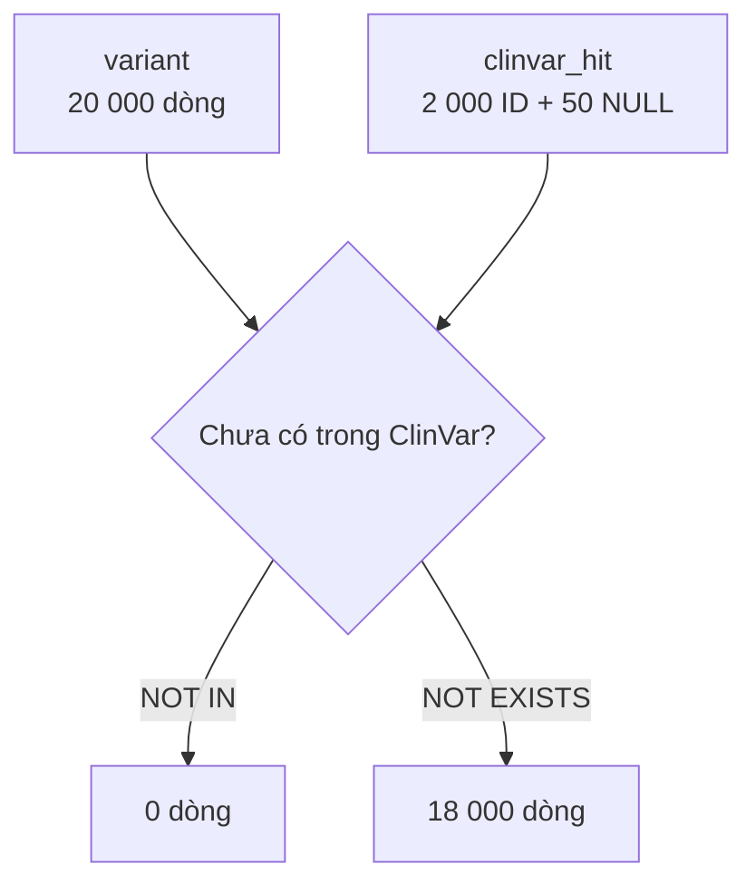
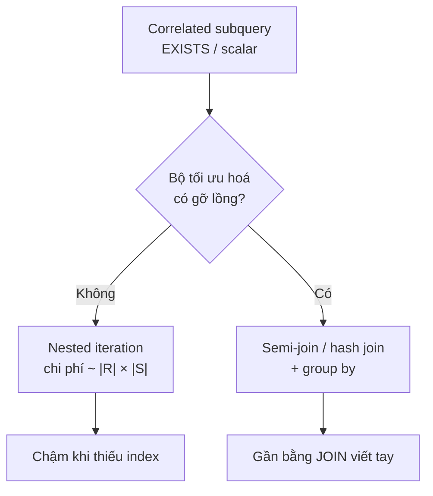

Subquery (truy vấn con) là một câu `SELECT` đặt bên trong một câu SQL khác; `IN`, `EXISTS` và `CASE WHEN` là ba cách dùng thường gặp nhất để lọc và phân nhóm dữ liệu. Với dữ liệu sinh học có ô trống, chỉ một giá trị NULL trong danh sách con cũng làm `NOT IN` trả về 0 dòng: trên 20 000 biến thể mô phỏng, `NOT IN` cho 0 còn `NOT EXISTS` cho 18 000. Quy tắc quen thuộc "EXISTS nhanh hơn IN" cũng không đúng chung. Không có index, SQLite 3.45.3 chạy EXISTS mất 2,18 giây còn IN chỉ mất 0,0074 giây; SQLite 3.54.0 và DuckDB 2.0.1 thì đưa EXISTS về khoảng 0,003 giây. Bài dành cho người đã biết `SELECT`, `WHERE`, `JOIN` và `GROUP BY`; mọi truy vấn đã chạy trên SQLite và DuckDB.

<div class="callout callout-note">
<p class="callout-title">Tóm tắt nhanh</p>

- Chọn `IN` hay `EXISTS` trước hết là chuyện đúng sai khi có NULL, sau đó mới là tốc độ.
- `x NOT IN (…)` không bao giờ đúng nếu danh sách con chứa NULL; dùng `NOT EXISTS` hoặc lọc `IS NOT NULL`.
- Tốc độ phụ thuộc bộ tối ưu hoá, index và phiên bản, không phụ thuộc cú pháp: hãy đọc `EXPLAIN QUERY PLAN`.
- Trong `CASE`, điều kiện đúng đầu tiên thắng; NULL rơi vào `ELSE` nếu không có nhánh `IS NULL`.

</div>

## 1. Một truy vấn đúng cú pháp trả về 0 dòng

Giả sử bạn có bảng `variant` chứa biến thể của một mẫu exome và bảng `clinvar_hit` chứa những biến thể đã có trong ClinVar, cơ sở dữ liệu công khai về diễn giải lâm sàng của biến thể (Landrum et al., 2018). Một số dòng của `clinvar_hit` chưa map được về `variant_id` nên cột này là NULL. Câu hỏi "biến thể nào chưa từng được báo cáo?" viết bằng `NOT IN` trông rất tự nhiên:

```sql
SELECT COUNT(*) FROM variant
WHERE variant_id NOT IN (SELECT variant_id FROM clinvar_hit);      -- 0

SELECT COUNT(*) FROM variant v
WHERE NOT EXISTS (SELECT 1 FROM clinvar_hit c
                  WHERE c.variant_id = v.variant_id);              -- 18000
```

Trên dữ liệu mô phỏng ở mục 5 (20 000 biến thể, 2 000 dòng ClinVar hợp lệ và 50 dòng NULL), câu thứ nhất trả về 0, câu thứ hai trả về 18 000. Không có lỗi hay cảnh báo nào. Ở cỡ 200 000 biến thể, con số là 0 so với 180 000.


*Hình 1. Cùng một câu hỏi, hai cách viết, hai kết quả. Năm mươi giá trị NULL trong bảng con đủ làm `NOT IN` trả về rỗng.*

Mục 2–3 giải thích vì sao, mục 4–5 bàn chuyện tốc độ, mục 6–7 chuyển sang `CASE WHEN`.

## 2. Subquery là gì: scalar, danh sách và correlated

Subquery là một câu `SELECT` nằm trong ngoặc, đặt ở `WHERE`, `FROM`, `SELECT` hoặc `HAVING` của câu truy vấn ngoài. Cách phân loại hữu ích nhất dựa vào hai điều: subquery trả về bao nhiêu giá trị, và nó có tham chiếu cột của truy vấn ngoài hay không.

**Scalar subquery** trả về đúng một giá trị và dùng được với `=`, `>`, `<`. Ví dụ: biến thể có tần số allele (allele frequency, AF) cao hơn AF trung bình của toàn bộ dữ liệu:

```sql
SELECT variant_id, af FROM variant
WHERE af > (SELECT AVG(af) FROM variant);
```

Nếu subquery lỡ trả về nhiều dòng, các hệ xử lý khác nhau. DuckDB 2.0.1 báo lỗi "More than one row returned by a subquery used as an expression". SQLite 3.54.0 không báo gì, chỉ lặng lẽ lấy dòng đầu tiên nó gặp. Dòng nào là "đầu tiên" thì không được bảo đảm nếu thiếu `ORDER BY`. Với bảng `t` chứa 1, 2, 3, biểu thức `2 > (SELECT x FROM t)` cho 1 (đúng) trong lần chạy thử, vì 2 chỉ được so với 1.

**Subquery dạng danh sách** trả về một cột nhiều dòng và đi với `IN`, `ANY` hoặc `ALL`. `x IN (SELECT …)` hỏi x có bằng ít nhất một phần tử của danh sách không; `x > ALL (SELECT …)` hỏi x có lớn hơn mọi phần tử không. SQLite không hỗ trợ `ANY` và `ALL`: SQLite 3.54.0 báo lỗi cú pháp ở `5 > ALL (SELECT 1)`, nên trên SQLite bạn viết lại bằng `MAX` hoặc `MIN`, chẳng hạn `af > (SELECT MAX(af) FROM …)`. DuckDB 2.0.1 thì chạy được, và cho thấy `ALL` cũng gặp bẫy NULL: `5 > ALL` trên danh sách (1, NULL) trả về NULL chứ không phải TRUE, vì không thể khẳng định 5 lớn hơn một giá trị chưa biết. Bản viết bằng `MAX` không có bẫy này vì `MAX` bỏ qua NULL, nhưng đổi lại nó cũng âm thầm bỏ qua dữ liệu thiếu.

**Correlated subquery** (truy vấn con tương quan) tham chiếu cột của truy vấn ngoài, nên về mặt khái niệm nó được tính lại cho từng dòng ngoài. Ví dụ "biến thể có AF cao hơn AF trung bình của chính gene đó":

```sql
SELECT v.variant_id, v.gene_id, v.af FROM variant v
WHERE v.af > (SELECT AVG(v2.af) FROM variant v2
              WHERE v2.gene_id = v.gene_id);
```

Correlated subquery khác với subquery thường ở chỗ không thể chạy riêng: tách phần trong ngoặc ra chạy độc lập, SQLite báo không có cột `v.gene_id`, vì `v` chỉ tồn tại ở truy vấn ngoài. Đó cũng là cách nhanh nhất để biết một subquery có tương quan hay không.

Câu "truy vấn bên trong chạy trước" chỉ đúng với subquery không tương quan, và kể cả khi đó, bộ tối ưu hoá vẫn có quyền viết lại toàn bộ câu thành phép join (Kim, 1982). Kim phân biệt năm loại lồng cơ bản và cho thấy từng loại có thể biến đổi thành một truy vấn tương đương không lồng.

| Loại | Trả về | Đi với | Ví dụ sinh học |
| --- | --- | --- | --- |
| Scalar | 1 giá trị | `=`, `>`, `<` | AF > AF trung bình toàn bộ |
| Danh sách | 1 cột, n dòng | `IN`, `ANY`, `ALL` | biến thể có ID nằm trong ClinVar |
| Correlated scalar | 1 giá trị mỗi dòng ngoài | `=`, `>`, `<` | AF > AF trung bình của cùng gene |
| `EXISTS` | TRUE/FALSE | `WHERE`, `CASE` | gene có ít nhất một biến thể gây bệnh |
| Bảng dẫn xuất | bảng | `FROM`, `JOIN` | bảng AF trung bình theo gene |

*Bảng 1. Các loại subquery theo giá trị trả về và cách dùng.*

Dòng cuối của Bảng 1, bảng dẫn xuất (derived table), là subquery trong `FROM`. Nó chính là cách viết tay bản gỡ lồng ở mục 5: tính AF trung bình theo gene một lần thành bảng tạm thời, rồi nối với `variant`. Khi bảng dẫn xuất được dùng nhiều lần, đặt tên cho nó bằng `WITH` sẽ dễ đọc hơn; đó là chủ đề của [bài CTE và phép toán tập hợp](/blog/cte-and-set-operations/).

## 3. Ngữ nghĩa NULL: IN, EXISTS, NOT IN, NOT EXISTS

SQL dùng logic ba giá trị: một điều kiện có thể TRUE, FALSE hoặc UNKNOWN. Giá trị null để biểu diễn thông tin thiếu được Codd (1979) trình bày trong bản mở rộng mô hình quan hệ của ông. Mệnh đề `WHERE` chỉ giữ những dòng có điều kiện TRUE; UNKNOWN bị loại như FALSE.

`x IN (s1, s2, s3)` tương đương `x = s1 OR x = s2 OR x = s3`. `x NOT IN (s1, s2, s3)` tương đương `x <> s1 AND x <> s2 AND x <> s3`. Nếu một `si` là NULL thì `x <> si` là UNKNOWN, và một chuỗi AND có một vế UNKNOWN không bao giờ TRUE được. Tài liệu PostgreSQL ghi rõ: nếu không có giá trị bằng và danh sách con có ít nhất một dòng null, kết quả của `NOT IN` là null chứ không phải true; nếu vế trái là null, kết quả cũng là null (PostgreSQL Global Development Group, n.d.-c).

`EXISTS` chỉ hỏi "subquery có trả về dòng nào không", không so sánh giá trị, nên luôn cho TRUE hoặc FALSE. Vì vậy `NOT EXISTS` không bị bẫy.

| Biểu thức | Kết quả | Vì sao |
| --- | --- | --- |
| `1 IN (1, NULL)` | 1 (TRUE) | có một phần tử bằng |
| `1 IN (2, NULL)` | NULL | không có phần tử bằng, nhưng có NULL |
| `1 NOT IN (2, NULL)` | NULL | `1 <> NULL` là UNKNOWN |
| `NULL NOT IN (2, 3)` | NULL | vế trái NULL |
| `NULL = NULL` | NULL | so sánh với NULL luôn UNKNOWN |
| `NULL IS NULL` | 1 (TRUE) | `IS` kiểm tra NULL trực tiếp |
| `EXISTS (SELECT NULL)` | 1 (TRUE) | có một dòng, dù giá trị là NULL |

*Bảng 2. Chân trị khi có NULL, đã chạy trên SQLite 3.54.0; `1 NOT IN (2, NULL)` cũng cho NULL trên DuckDB 2.0.1.*

NULL ở **vế trái** gây lỗi theo chiều ngược lại. Lấy bảng mẫu sáu dòng, trong đó mẫu S3 chưa ghi mô:

```sql
CREATE TABLE sample(sample_id TEXT, tissue TEXT);
INSERT INTO sample VALUES ('S1','liver'), ('S2','kidney'), ('S3',NULL),
                          ('S4','brain'), ('S5','liver'), ('S6','heart');
SELECT sample_id FROM sample WHERE tissue IN ('liver','kidney');     -- S1, S2, S5
SELECT sample_id FROM sample WHERE tissue NOT IN ('liver','kidney'); -- S4, S6
```

Ba cộng hai bằng năm, trong khi bảng có sáu dòng. S3 không thuộc nhóm nào vì cả hai điều kiện đều UNKNOWN. Khi bạn chia dữ liệu thành "thuộc" và "không thuộc" rồi cộng lại để đối chiếu, tổng thiếu đúng bằng số dòng NULL ở cột đang lọc.

Trong dữ liệu sinh học, NULL ở cột khoá xuất hiện thường hơn người ta nghĩ: ID không map được sau khi đổi phiên bản genome tham chiếu, bản ghi bị gộp hay rút khỏi cơ sở dữ liệu nguồn, hoặc một bước nạp dữ liệu để trống cột không bắt buộc. Trước khi viết anti-join, nên kiểm một lần:

```sql
SELECT COUNT(*), COUNT(variant_id), COUNT(*) - COUNT(variant_id) AS n_null
FROM clinvar_hit;                                   -- 2050, 2000, 50
```

`COUNT(*)` đếm mọi dòng, `COUNT(cột)` chỉ đếm dòng có giá trị, nên hiệu của chúng là số NULL. Những bước kiểm tra như vậy thuộc về quá trình [làm sạch dữ liệu](/blog/process-data-from-dirty-to-clean/) và nên chạy trước mọi phân tích.

Ngữ nghĩa này từng làm khó cả người viết bộ máy: SQLite chỉ xử lý NULL trong `IN` và `NOT IN` đúng theo chuẩn từ bản 3.6.0 beta (2008-07-16), và ghi chú phát hành gọi đó là thay đổi có thể không tương thích ngược (SQLite, n.d.-b). Ở tầng lý thuyết, Libkin (2016) chỉ ra rằng khi có NULL, kết quả SQL trả về có thể khác hẳn tập "câu trả lời chắc chắn" (certain answers); Guagliardo và Libkin (2017) xây dựng ngữ nghĩa hình thức cho truy vấn SQL có subquery và NULL.

Có ba cách viết đúng cho anti-join, tức câu hỏi "có ở A nhưng không có ở B":

```sql
-- (1) NOT EXISTS
SELECT COUNT(*) FROM variant v
WHERE NOT EXISTS (SELECT 1 FROM clinvar_hit c WHERE c.variant_id = v.variant_id);
-- (2) NOT IN có lọc NULL
SELECT COUNT(*) FROM variant
WHERE variant_id NOT IN (SELECT variant_id FROM clinvar_hit WHERE variant_id IS NOT NULL);
-- (3) LEFT JOIN … IS NULL
SELECT COUNT(*) FROM variant v
LEFT JOIN (SELECT DISTINCT variant_id FROM clinvar_hit) c ON c.variant_id = v.variant_id
WHERE c.variant_id IS NULL;
```

Cả ba cho 18 000 dòng trên dữ liệu mô phỏng. Mẫu `LEFT JOIN` được phân tích kỹ trong [bài JOIN](/blog/join-ket-hop-nhieu-bang/), còn `EXCEPT` là cách thứ tư, trình bày trong [bài CTE và phép toán tập hợp](/blog/cte-and-set-operations/).

## 4. Bộ tối ưu hoá gỡ lồng truy vấn như thế nào

Cách đánh giá ngây thơ một correlated subquery là **nested iteration** (lặp lồng): với mỗi dòng của bảng ngoài R, quét bảng trong S để tính subquery. Không có index, chi phí cỡ |R| × |S|. Với 20 000 biến thể và 2 050 dòng ClinVar, đó là khoảng 41 triệu phép so sánh.

Gỡ lồng nghĩa là viết lại subquery thành một phép join có cùng kết quả. Với `EXISTS`, phép join đó là **semi-join**: giữ mỗi dòng của R nếu có ít nhất một dòng khớp ở S, không nhân dòng khi có nhiều dòng khớp. `NOT EXISTS` tương ứng với **anti-join**: giữ dòng của R khi không có dòng khớp nào. Khi đã là join, bộ máy có thể dựng bảng băm trên S một lần rồi dò từng dòng của R, chi phí cỡ |R| + |S| thay vì |R| × |S|.

Kim (1982) đề xuất biến truy vấn lồng thành join tương đương (unnesting, gỡ lồng) để bộ tối ưu hoá chọn được thuật toán join tốt nhất theo mô hình chi phí, theo hướng Selinger et al. (1979) đặt nền cho việc chọn đường truy cập. Biến đổi này không đơn giản. Ganski và Wong (1987) xem lại thuật toán của Kim, mô tả một lỗi lớn đã được biết và một lỗi mới, kèm cách sửa. Lỗi hay được nhắc đến nhất thường gọi là **COUNT bug**: khi subquery chứa `COUNT`, phép join thông thường làm mất những dòng ngoài không có dòng nào khớp, tức những dòng lẽ ra có số đếm bằng 0.

Ví dụ: "gene nào có ít hơn hai biến thể?"

```sql
-- Correlated: đúng
SELECT COUNT(*) FROM gene g
WHERE (SELECT COUNT(*) FROM variant v WHERE v.gene_id = g.gene_id) < 2;     -- 14747
-- Gỡ lồng ngây thơ bằng JOIN + GROUP BY: mất gene không có biến thể
SELECT COUNT(*) FROM (SELECT g.gene_id FROM gene g JOIN variant v ON v.gene_id = g.gene_id
                      GROUP BY g.gene_id HAVING COUNT(*) < 2);              -- 7442
-- Sửa bằng LEFT JOIN và đếm cột của bảng phải
SELECT COUNT(*) FROM (SELECT g.gene_id FROM gene g LEFT JOIN variant v ON v.gene_id = g.gene_id
                      GROUP BY g.gene_id HAVING COUNT(v.variant_id) < 2);   -- 14747
```

Hiệu 14 747 − 7 442 = 7 305 đúng bằng số gene không có biến thể nào trong dữ liệu mô phỏng.

Sau Kim, các nhóm nghiên cứu mở rộng gỡ lồng cho lượng từ như `EXISTS` và `ALL` (Dayal, 1983) và cho truy vấn phức tạp (Seshadri et al., 1996). SQL Server khử tương quan bằng toán tử Apply để kế hoạch thực thi không phụ thuộc vào cách viết subquery (Galindo-Legaria & Joshi, 2001); Oracle có subquery coalescing, subquery removal và biến thể anti-join cho cột có thể NULL (Bellamkonda et al., 2009). Neumann và Kemper (2015) đưa ra thuật toán gỡ lồng **mọi** truy vấn lồng bằng dependent join, và Neumann (2025) cải tiến cho truy vấn phức tạp hơn. DuckDB dùng hướng này: mọi subquery được gỡ lồng trước khi thực thi (Raasveldt, 2023).


*Hình 2. Cùng một correlated subquery có hai số phận, tuỳ bộ tối ưu hoá.*

Gỡ lồng tốt không có nghĩa bộ tối ưu hoá luôn chọn đúng. Leis et al. (2015) đo trên bộ truy vấn thực tế và thấy mọi bộ ước lượng cardinality đều thường xuyên sai lớn. SQLite là thư viện nhúng với bộ tối ưu hoá gọn (Gaffney et al., 2022), và lịch sử của nó cho thấy quy tắc hiệu năng thay đổi theo phiên bản: bản 3.35.0 thêm phép biến đổi EXISTS thành IN, bản 3.36.0 gỡ bỏ vì thường làm chậm hơn; bản 3.51.0 (2025-11-04) thêm tối ưu EXISTS thành JOIN, bản 3.51.1 (2025-11-28) phải sửa lỗi trả kết quả sai ở truy vấn EXISTS lồng nhau do chính tối ưu này gây ra, và bản 3.53.0 (2026-04-09) mở rộng nó (SQLite, n.d.-b). Nếu bạn dùng nhánh 3.51, hãy tránh bản 3.51.0.

## 5. Thí nghiệm: IN, EXISTS, JOIN và correlated subquery trên bốn bộ máy

**Dữ liệu.** Script Python (numpy, seed 42) tạo bảng `gene` 20 000 dòng; `variant(variant_id, gene_id, af)` với AF lấy từ phân bố Beta(0,3; 3) và 3% giá trị NULL; `clinvar_hit(variant_id, clnsig)` gồm 10% số biến thể chọn ngẫu nhiên cộng 50 dòng `variant_id` NULL. Hai cỡ: 20 000 và 200 000 biến thể.

**Truy vấn.** Tám câu: IN, EXISTS, JOIN + `COUNT(DISTINCT)`, NOT IN, NOT IN có lọc NULL, NOT EXISTS, correlated scalar subquery (AF lớn hơn AF trung bình của cùng gene) và bản gỡ lồng viết tay (JOIN với bảng `GROUP BY gene_id`).

**Điều kiện.** Không index, và có index `clinvar_hit(variant_id)`, `variant(gene_id, af)` kèm `ANALYZE`.

**Bộ máy.** SQLite 3.37.0 (công cụ dòng lệnh có sẵn của macOS), SQLite 3.45.3 (module `sqlite3` của Python 3.13), SQLite 3.54.0 (công cụ dòng lệnh) và DuckDB 2.0.1 (Python). Máy macOS 12.7.6, x86_64. Mỗi truy vấn chạy 5 lần, báo trung vị; correlated subquery không index chạy 1 lần vì mất hơn 25 giây.

| Truy vấn | SQLite 3.37.0 | SQLite 3.45.3 | SQLite 3.54.0 | DuckDB 2.0.1 |
| --- | --- | --- | --- | --- |
| IN | 0,0020 | 0,0074 | 0,0016 | 0,0031 |
| EXISTS | 2,12 | 2,18 | 0,0027 | 0,0031 |
| JOIN + COUNT DISTINCT | 0,0020 | 0,0015 | 0,0016 | 0,0035 |
| NOT EXISTS | 2,28 | 2,09 | 2,48 | 0,0025 |
| Correlated scalar | chưa đo | 25,05 | 26,49 | 0,0059 |
| Gỡ lồng viết tay | 0,035 | 0,038 | 0,040 | 0,0059 |

*Bảng 3. Thời gian (giây, trung vị) trên 20 000 biến thể, không index. Số dòng trả về giống nhau ở mọi bộ máy: 2 000 (IN, EXISTS, JOIN), 18 000 (NOT EXISTS), 5 477 (correlated và gỡ lồng).*

`EXPLAIN QUERY PLAN` giải thích các con số. Trên SQLite 3.37.0 và 3.45.3, `IN` thành `LIST SUBQUERY`: danh sách con được tính một lần, rồi mỗi phần tử tra bằng khoá chính. `EXISTS` thành `CORRELATED SCALAR SUBQUERY` kèm `SCAN c`: quét toàn bảng ClinVar cho từng biến thể. SQLite 3.54.0 đổi kế hoạch của `EXISTS` thành `BLOOM FILTER ON c` và `SEARCH c EXISTS USING AUTOMATIC PARTIAL COVERING INDEX`: bộ máy tự dựng index tạm và bộ lọc Bloom, tức đã viết lại EXISTS thành join. `NOT EXISTS` và correlated scalar trên 3.54.0 vẫn là `CORRELATED SCALAR SUBQUERY`. DuckDB 2.0.1 biến `EXISTS` thành hash join kiểu `SEMI`, `NOT IN` thành hash join kiểu `MARK`, và correlated scalar thành hash join nối với kết quả hash group by, tức đã gỡ lồng.


*Hình 3. Thời gian chạy (thang log) của năm truy vấn trên bốn bộ máy, 20 000 biến thể, không index.*

Bạn có thể tự xem kế hoạch thực thi trên dữ liệu của bạn bằng cách thêm `EXPLAIN QUERY PLAN` trước câu truy vấn trong SQLite, hoặc gõ `.eqp on` trong công cụ dòng lệnh để mọi câu sau đó tự in kế hoạch; DuckDB và PostgreSQL dùng `EXPLAIN`. Ba dấu hiệu đáng chú ý trên SQLite: `CORRELATED SCALAR SUBQUERY` đi với `SCAN` nghĩa là quét lại bảng trong cho mỗi dòng ngoài; `LIST SUBQUERY` nghĩa là danh sách được tính một lần; `AUTOMATIC INDEX` nghĩa là bộ máy tự dựng index tạm vì thiếu index phù hợp, gợi ý rằng bạn nên tạo index thật.

Index thay đổi bức tranh. Có index và `ANALYZE`, trên 20 000 biến thể SQLite 3.45.3 chạy IN 0,0018 giây, EXISTS 0,0047 giây, correlated scalar 0,0145 giây và bản gỡ lồng 0,0091 giây. Ở 200 000 biến thể có index, SQLite 3.45.3 chạy IN 0,0117 giây, EXISTS 0,0551 giây, JOIN 0,0125 giây, correlated scalar 0,53 giây và bản gỡ lồng 0,037 giây; DuckDB 2.0.1 chạy IN 0,0044, EXISTS 0,0046 và correlated scalar 0,0167 giây. Ở 200 000 biến thể không index, `NOT IN` có lọc NULL mất 0,073 giây trên SQLite 3.45.3 và cho đúng 180 000 dòng; `NOT IN` không lọc vẫn trả về 0.

**Diễn giải.** Trên SQLite trước 3.51.0, không index, quy tắc thực tế gần như ngược với câu "EXISTS nhanh hơn IN": IN nhanh hơn từ hàng trăm đến hơn nghìn lần. Có index, khoảng cách thu hẹp nhưng IN vẫn nhanh hơn. Trên bộ máy có gỡ lồng, chọn cú pháp nào gần như không còn ảnh hưởng tốc độ. Còn correlated scalar subquery là nơi viết lại bằng tay đáng công nhất trên SQLite: từ 25 giây xuống 0,038 giây.

**Giới hạn.** Kết quả đo trên một máy, dữ liệu mô phỏng có seed cố định, một lượt thí nghiệm (mỗi truy vấn 5 lần); không phải benchmark tổng quát. PostgreSQL chưa được đo trong thí nghiệm này.

## 6. CASE WHEN và COALESCE: thứ tự đánh giá và bẫy NULL

`CASE` có hai dạng. Dạng có biểu thức gốc so sánh một giá trị với từng nhánh (`CASE clnsig WHEN 'Pathogenic' THEN …`); dạng tìm kiếm kiểm từng điều kiện (`CASE WHEN af >= 0.05 THEN …`). SQLite ghi rõ cả hai dạng đều đánh giá lười (short-circuit): nhánh đầu tiên đúng được chọn và các nhánh sau không được tính (SQLite, n.d.-c).

Hệ quả thứ nhất: **thứ tự WHEN quyết định kết quả**. Phân nhóm AF theo ngưỡng 0,5% và 5% của dự án 1000 Genomes (1000 Genomes Project Consortium, 2015):

```sql
SELECT CASE WHEN af IS NULL   THEN 'missing'
            WHEN af >= 0.05   THEN 'common'
            WHEN af >= 0.005  THEN 'low-frequency'
            ELSE 'rare' END AS af_group,
       COUNT(*) AS n
FROM variant
GROUP BY af_group;
```

Đảo hai nhánh `>= 0.005` và `>= 0.05` thì mọi biến thể phổ biến đều khớp nhánh `>= 0.005` trước, nhóm common biến mất.

Hệ quả thứ hai: **NULL rơi vào ELSE**. `NULL >= 0.05` là UNKNOWN, không phải TRUE, nên biến thể thiếu AF đi hết các nhánh và rơi vào `ELSE 'rare'`.

| Cách viết | common | low-frequency | rare | missing |
| --- | --- | --- | --- | --- |
| Có nhánh `IS NULL`, ngưỡng cao trước | 7 866 | 5 693 | 5 827 | 614 |
| Không nhánh `IS NULL` | 7 866 | 5 693 | 6 441 | — |
| Ngưỡng thấp trước | — | 13 559 | 6 441 | — |

*Bảng 4. Ba cách viết CASE trên 20 000 biến thể mô phỏng (SQLite 3.45.3).*

Bỏ nhánh `IS NULL` làm 614 biến thể không có dữ liệu bị gọi là "hiếm". Đây cũng là lý do nhiều truy vấn phân nhóm có thêm `WHERE af IS NOT NULL` trước khi `GROUP BY`: loại dòng thiếu dữ liệu một cách có chủ ý thay vì để chúng lẫn vào nhóm cuối.

Hệ quả thứ ba: CASE còn là công cụ đếm có điều kiện. Đặt CASE trong hàm tổng hợp, bạn có số biến thể gây bệnh và số biến thể thiếu AF của từng gene trong một lần quét:

```sql
SELECT v.gene_id,
       COUNT(*) AS n_variant,
       SUM(CASE WHEN c.clnsig = 'Pathogenic' THEN 1 ELSE 0 END) AS n_pathogenic,
       SUM(CASE WHEN v.af IS NULL THEN 1 ELSE 0 END) AS n_missing_af
FROM variant v
LEFT JOIN clinvar_hit c ON c.variant_id = v.variant_id
GROUP BY v.gene_id
ORDER BY n_pathogenic DESC, n_variant DESC
LIMIT 3;
```

Trên dữ liệu mô phỏng, gene 13763 đứng đầu với 7 biến thể, 2 trong số đó gây bệnh. Kết quả đúng vì mỗi `variant_id` xuất hiện tối đa một lần trong `clinvar_hit`; nếu một biến thể có nhiều dòng diễn giải, `LEFT JOIN` sẽ nhân dòng và `COUNT(*)` bị thổi phồng, như đã phân tích trong [bài JOIN](/blog/join-ket-hop-nhieu-bang/).

**Short-circuit không tuyệt đối.** Trên SQLite, `abs(-9223372036854775807 - 1)` báo lỗi integer overflow, nhưng `CASE WHEN 1 > 0 THEN 'ok' ELSE abs(-9223372036854775807 - 1) END` trả về 'ok' vì nhánh ELSE không được tính. PostgreSQL cảnh báo rằng thứ tự đánh giá các biểu thức con nói chung không xác định, và một biểu thức hằng ở nhánh không bao giờ chạy vẫn có thể bị tính sớm lúc lập kế hoạch, ví dụ `1/0` gây lỗi chia cho 0 (PostgreSQL Global Development Group, n.d.-a). DuckDB 2.0.1 trả về 1 cho `CASE WHEN 1>0 THEN 1 ELSE CAST('abc' AS INTEGER) END`. Vì vậy, đừng để CASE là lớp bảo vệ duy nhất cho một phép tính có thể lỗi.

**COALESCE** trả về đối số khác NULL đầu tiên và chỉ đánh giá đến đối số đó (PostgreSQL Global Development Group, n.d.-b). `COALESCE(af, 0)` chạy được nhưng sai về sinh học: thiếu dữ liệu tần số không có nghĩa tần số bằng 0. Trên dữ liệu mô phỏng, `AVG(af)` là 0,0904 còn `AVG(COALESCE(af, 0))` là 0,0877.

**Alias trong GROUP BY.** SQLite chấp nhận `GROUP BY af_group` với `af_group` là alias của CASE. Không phải hệ nào cũng cho phép; cách chắc chắn là lặp lại biểu thức CASE trong `GROUP BY` hoặc bọc nó vào subquery hay CTE. Hàm tổng hợp đi với `GROUP BY` được bàn kỹ trong bài GROUP BY và HAVING.

## 7. Case sinh học: lọc và phân nhóm biến thể

Sau khi chú giải file VCF, người phân tích thường lọc biến thể hiếm theo tần số trong quần thể và đối chiếu với các diễn giải lâm sàng đã có. gnomAD là nguồn tần số quần thể lớn, bản v2 tổng hợp 125 748 exome và 15 708 genome (Karczewski et al., 2020); ClinVar là nơi gom diễn giải lâm sàng (Landrum et al., 2018). Dữ liệu biến thể có thể được truy vấn trực tiếp bằng SQL: GEMINI nạp biến thể và chú giải vào SQLite, và các tác giả chọn SQLite vì tốc độ, phổ biến và cả database chỉ là một file (Paila et al., 2013).

Ngưỡng phân nhóm trong mục 6 lấy từ 1000 Genomes, nơi khoảng 64 triệu biến thể trên nhiễm sắc thể thường có tần số dưới 0,5%, 12 triệu ở mức 0,5–5% và 8 triệu trên 5% (1000 Genomes Project Consortium, 2015). Dữ liệu thật vì vậy nghiêng hẳn về biến thể hiếm; phân bố Beta(0,3; 3) trong bài chỉ để minh hoạ truy vấn.

Một truy vấn ráp lại mọi thứ:

```sql
SELECT v.variant_id, v.gene_id, v.af,
       CASE WHEN v.af IS NULL  THEN 'missing'
            WHEN v.af >= 0.05  THEN 'common'
            WHEN v.af >= 0.005 THEN 'low-frequency'
            ELSE 'rare' END AS af_group,
       CASE WHEN EXISTS (SELECT 1 FROM clinvar_hit c
                         WHERE c.variant_id = v.variant_id)
            THEN 'in ClinVar' ELSE 'not reported' END AS clinvar_status
FROM variant v
WHERE v.af > (SELECT AVG(v2.af) FROM variant v2 WHERE v2.gene_id = v.gene_id)
   OR v.af IS NULL;
```


*Hình 4. Trái: phân bố AF mô phỏng (thang log), đường đứt là ngưỡng 0,5% và 5%. Phải: số biến thể mỗi nhóm khi CASE có nhánh `IS NULL`.*

Ngưỡng trong SQL chỉ là bước lọc. Phân loại lâm sàng theo hướng dẫn ACMG/AMP là quy trình nhiều tiêu chí; trong đó tiêu chí BA1, tần số allele trên 5% trong Exome Sequencing Project, 1000 Genomes hoặc ExAC, là bằng chứng lành tính độc lập (Richards et al., 2015).

## 8. Hàm chuỗi, ngày và tính di động giữa các hệ

`concat()` và `concat_ws()` có trong SQLite từ bản 3.44.0 (2023-11-01) (SQLite, n.d.-b). Trên SQLite 3.37.0, `SELECT concat('chr1', ':', 12345)` báo "no such function: concat"; trên 3.54.0 nó trả về `chr1:12345`. Toán tử `||` chạy ở mọi bản:

```sql
SELECT 'chr1' || ':' || 12345 || 'A' || '>' || 'G';     -- chr1:12345A>G
SELECT concat_ws(':', 'chr1', 12345, 'A', 'G');         -- chr1:12345:A:G (SQLite ≥ 3.44.0)
```

SQLite không có storage class riêng cho ngày giờ; các hàm ngày giờ làm việc với TEXT theo ISO 8601, REAL (số ngày Julian) hoặc INTEGER (Unix time) (SQLite, n.d.-a). `strftime` trả về TEXT. Ví dụ, `date('2026-11-23', '+30 days')` cho `2026-12-23`, `typeof(strftime('%Y', '2026-11-23'))` cho `text`, và `julianday('2026-11-23') - julianday('2026-10-24')` cho 30,0 ngày. Vì kết quả của `strftime` là chuỗi, so sánh `strftime('%Y', ngay) = 2026` với số nguyên sẽ không khớp; hãy so với chuỗi `'2026'` hoặc ép kiểu bằng `CAST`. Ngày lưu dạng TEXT chỉ sắp xếp đúng khi theo đúng định dạng ISO 8601 (`YYYY-MM-DD`), một lý do nữa để chuẩn hoá ngày ngay khi nạp dữ liệu.

## 9. Kết luận và checklist

Chọn `IN` hay `EXISTS` trước hết là chuyện ngữ nghĩa. Tốc độ đến sau, và nó thuộc về bộ tối ưu hoá chứ không thuộc về cú pháp. Truy vấn chậm chỉ làm bạn chờ. Một `NOT IN` gặp NULL thì làm bạn kết luận sai mà không có dấu hiệu gì. Trước khi chạy subquery và CASE trên dữ liệu sinh học, rà lại danh sách sau:

- Dùng `NOT EXISTS` thay `NOT IN`, hoặc lọc `IS NOT NULL` trong subquery.
- Luôn có nhánh `IS NULL` trong CASE phân nhóm dữ liệu sinh học.
- Đặt WHEN theo ngưỡng từ cao xuống thấp.
- Đọc `EXPLAIN QUERY PLAN` trước khi tin một quy tắc hiệu năng; ghi phiên bản bộ máy.
- Viết lại correlated subquery thành JOIN + GROUP BY khi bộ máy không tự gỡ lồng.
- Khi gỡ lồng truy vấn có `COUNT`, dùng `LEFT JOIN` và đếm một cột của bảng phải để không mất nhóm có số đếm bằng 0.
- Không thay NULL bằng 0 trong cột tần số chỉ để truy vấn chạy gọn.

Bài tiếp theo trong series ráp subquery, JOIN và tổng hợp thành một quy trình hoàn chỉnh: kết hợp tất cả kỹ năng; còn cách đặt tên cho subquery và truy vấn đệ quy nằm ở [bài CTE](/blog/cte-and-set-operations/).

## Câu hỏi thường gặp

**Vì sao `NOT IN` trả về rỗng dù chắc chắn có dữ liệu thoả điều kiện?** Vì danh sách con chứa ít nhất một NULL. `x NOT IN (…, NULL)` là UNKNOWN với mọi x không có trong danh sách, và `WHERE` loại mọi dòng UNKNOWN. Dùng `NOT EXISTS` hoặc thêm `WHERE cột IS NOT NULL` vào subquery.

**EXISTS có nhanh hơn IN không?** Tuỳ bộ máy và phiên bản; Bảng 3 cho thấy kết quả lật ngược giữa SQLite 3.45.3 và 3.54.0. Hãy đo và đọc kế hoạch thực thi trên hệ bạn dùng.

**Vì sao biến thể thiếu AF lại nằm trong nhóm "rare"?** Vì mọi nhánh `WHEN` so sánh với NULL đều cho UNKNOWN. Thêm `WHEN af IS NULL THEN 'missing'` làm nhánh đầu tiên.

## Tài liệu tham khảo

1000 Genomes Project Consortium. (2015). A global reference for human genetic variation. *Nature, 526*(7571), 68–74. https://doi.org/10.1038/nature15393

Bellamkonda, S., Ahmed, R., Witkowski, A., Amor, A., Zait, M., & Lin, C.-C. (2009). Enhanced subquery optimizations in Oracle. *Proceedings of the VLDB Endowment, 2*(2), 1366–1377. https://doi.org/10.14778/1687553.1687563

Codd, E. F. (1979). Extending the database relational model to capture more meaning. *ACM Transactions on Database Systems, 4*(4), 397–434. https://doi.org/10.1145/320107.320109

Dayal, U. (1983). Processing queries with quantifiers: A horticultural approach. In *Proceedings of the 2nd ACM SIGACT-SIGMOD Symposium on Principles of Database Systems* (p. 125). ACM. https://doi.org/10.1145/588058.588075

Gaffney, K. P., Prammer, M., Brasfield, L., Hipp, D. R., Kennedy, D., & Patel, J. M. (2022). SQLite: Past, present, and future. *Proceedings of the VLDB Endowment, 15*(12), 3535–3547. https://doi.org/10.14778/3554821.3554842

Galindo-Legaria, C., & Joshi, M. (2001). Orthogonal optimization of subqueries and aggregation. In *Proceedings of the 2001 ACM SIGMOD International Conference on Management of Data* (pp. 571–581). ACM. https://doi.org/10.1145/375663.375748

Ganski, R. A., & Wong, H. K. T. (1987). Optimization of nested SQL queries revisited. In *Proceedings of the 1987 ACM SIGMOD International Conference on Management of Data* (pp. 23–33). ACM. https://doi.org/10.1145/38713.38723

Guagliardo, P., & Libkin, L. (2017). A formal semantics of SQL queries, its validation, and applications. *Proceedings of the VLDB Endowment, 11*(1), 27–39. https://doi.org/10.14778/3151113.3151116

Karczewski, K. J., Francioli, L. C., Tiao, G., Cummings, B. B., Alföldi, J., Wang, Q., Collins, R. L., Laricchia, K. M., Ganna, A., Birnbaum, D. P., Gauthier, L. D., Brand, H., Solomonson, M., Watts, N. A., Rhodes, D., Singer-Berk, M., England, E. M., Seaby, E. G., Kosmicki, J. A., … MacArthur, D. G. (2020). The mutational constraint spectrum quantified from variation in 141,456 humans. *Nature, 581*(7809), 434–443. https://doi.org/10.1038/s41586-020-2308-7

Kim, W. (1982). On optimizing an SQL-like nested query. *ACM Transactions on Database Systems, 7*(3), 443–469. https://doi.org/10.1145/319732.319745

Landrum, M. J., Lee, J. M., Benson, M., Brown, G. R., Chao, C., Chitipiralla, S., Gu, B., Hart, J., Hoffman, D., Jang, W., Karapetyan, K., Katz, K., Liu, C., Maddipatla, Z., Malheiro, A., McDaniel, K., Ovetsky, M., Riley, G., Zhou, G., … Maglott, D. R. (2018). ClinVar: Improving access to variant interpretations and supporting evidence. *Nucleic Acids Research, 46*(D1), D1062–D1067. https://doi.org/10.1093/nar/gkx1153

Leis, V., Gubichev, A., Mirchev, A., Boncz, P., Kemper, A., & Neumann, T. (2015). How good are query optimizers, really? *Proceedings of the VLDB Endowment, 9*(3), 204–215. https://doi.org/10.14778/2850583.2850594

Libkin, L. (2016). SQL's three-valued logic and certain answers. *ACM Transactions on Database Systems, 41*(1), 1–28. https://doi.org/10.1145/2877206

Neumann, T. (2025). Improving unnesting of complex queries. In *Datenbanksysteme für Business, Technologie und Web (BTW 2025)* (Lecture Notes in Informatics P-361, pp. 25–47). Gesellschaft für Informatik. https://doi.org/10.18420/BTW2025-01

Neumann, T., & Kemper, A. (2015). Unnesting arbitrary queries. In T. Seidl, N. Ritter, H. Schöning, K.-U. Sattler, T. Härder, S. Friedrich, & W. Wingerath (Eds.), *Datenbanksysteme für Business, Technologie und Web (BTW 2015)* (Lecture Notes in Informatics P-241, pp. 383–402). Gesellschaft für Informatik. https://dl.gi.de/handle/20.500.12116/2418

Paila, U., Chapman, B. A., Kirchner, R., & Quinlan, A. R. (2013). GEMINI: Integrative exploration of genetic variation and genome annotations. *PLoS Computational Biology, 9*(7), e1003153. https://doi.org/10.1371/journal.pcbi.1003153

PostgreSQL Global Development Group. (n.d.-a). *4.2.14. Expression evaluation rules*. PostgreSQL 19 documentation. Truy cập ngày 23/11/2026, từ https://www.postgresql.org/docs/current/sql-expressions.html

PostgreSQL Global Development Group. (n.d.-b). *9.19. Conditional expressions*. PostgreSQL 19 documentation. Truy cập ngày 23/11/2026, từ https://www.postgresql.org/docs/current/functions-conditional.html

PostgreSQL Global Development Group. (n.d.-c). *9.25. Subquery expressions*. PostgreSQL 19 documentation. Truy cập ngày 23/11/2026, từ https://www.postgresql.org/docs/current/functions-subquery.html

Raasveldt, M. (2023, May 26). *Correlated subqueries in SQL*. DuckDB. Truy cập ngày 23/11/2026, từ https://duckdb.org/2023/05/26/correlated-subqueries-in-sql.html

Richards, S., Aziz, N., Bale, S., Bick, D., Das, S., Gastier-Foster, J., Grody, W. W., Hegde, M., Lyon, E., Spector, E., Voelkerding, K., & Rehm, H. L. (2015). Standards and guidelines for the interpretation of sequence variants: A joint consensus recommendation of the American College of Medical Genetics and Genomics and the Association for Molecular Pathology. *Genetics in Medicine, 17*(5), 405–424. https://doi.org/10.1038/gim.2015.30

Selinger, P. G., Astrahan, M. M., Chamberlin, D. D., Lorie, R. A., & Price, T. G. (1979). Access path selection in a relational database management system. In *Proceedings of the 1979 ACM SIGMOD International Conference on Management of Data* (p. 23). ACM. https://doi.org/10.1145/582095.582099

Seshadri, P., Pirahesh, H., & Leung, T. Y. C. (1996). Complex query decorrelation. In *Proceedings of the Twelfth International Conference on Data Engineering* (pp. 450–458). IEEE. https://doi.org/10.1109/ICDE.1996.492194

SQLite. (n.d.-a). *Datatypes in SQLite*. Truy cập ngày 12/11/2026, từ https://www.sqlite.org/datatype3.html

SQLite. (n.d.-b). *Release history*. Truy cập ngày 23/11/2026, từ https://www.sqlite.org/changes.html

SQLite. (n.d.-c). *SQL language expressions*. Truy cập ngày 12/11/2026, từ https://www.sqlite.org/lang_expr.html
