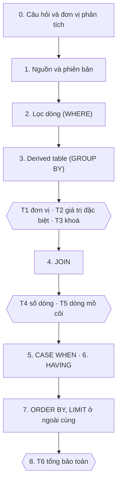
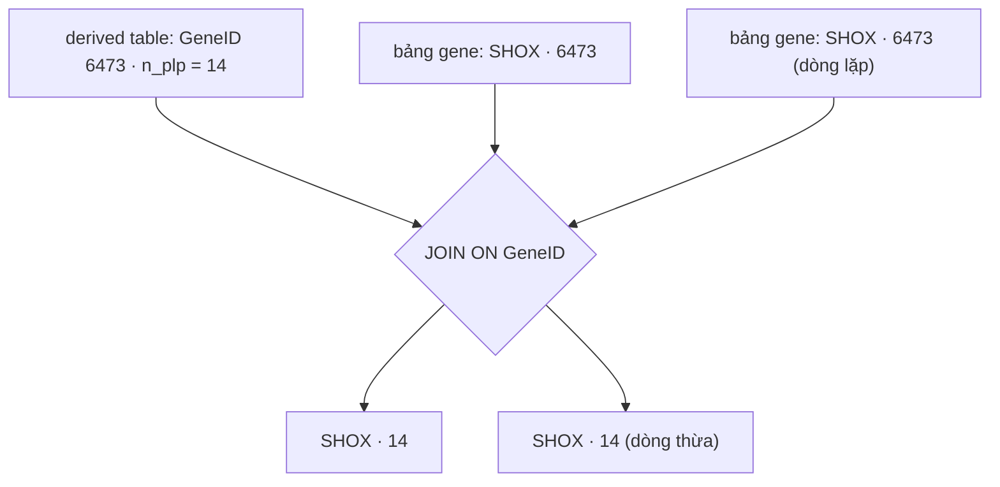

Một truy vấn phân tích nhiều tầng trong SQL, ghép derived table, JOIN, CASE WHEN và GROUP BY, chỉ đáng tin khi mỗi tầng đã qua một phép kiểm thử về số dòng và khoá. Bài này dựng một truy vấn như vậy trên toàn bộ file ClinVar bản tháng 11/2026 để trả lời câu hỏi: gene nào tích luỹ nhiều biến thể gây bệnh đã được xác nhận tốt. Chỉ cần đếm dòng thay vì đếm biến thể và quên lọc bản genome, số "biến thể gây bệnh" tăng gấp đôi: 834.444 dòng so với 408.062 biến thể thật. Bài dành cho người đã viết được từng mệnh đề SQL nhưng chưa ghép chúng thành báo cáo; cuối bài có checklist 8 bước và 6 phép kiểm thử.

<div class="callout callout-note">
<p class="callout-title">Tóm tắt nhanh</p>

- Viết ra đơn vị phân tích trước khi viết truy vấn: một dòng kết quả là gì, một "biến thể" được đếm bằng khoá nào.
- Xây truy vấn từ trong ra ngoài; chạy và kiểm thử từng tầng (số dòng, khoá lặp, dòng mồ côi, tổng bảo toàn) trước khi bọc tầng tiếp theo.
- ORDER BY chỉ bảo đảm thứ tự ở truy vấn ngoài cùng; ORDER BY trong derived table chỉ có nghĩa khi đi kèm LIMIT.
- Ghi ngày, kích thước, checksum của file dữ liệu và phiên bản engine cạnh mọi con số.

</div>

## 1. Derived table và truy vấn nhiều tầng là gì

Derived table (bảng dẫn xuất) là một câu SELECT đặt trong mệnh đề FROM của câu SELECT khác. Truy vấn ngoài coi kết quả của nó như một bảng bình thường: chọn cột, nối với bảng khác, lọc, nhóm. Điều này làm được vì trong mô hình quan hệ, kết quả của một phép truy vấn trên các quan hệ cũng là một quan hệ (Codd, 1970), nên có thể dùng lại làm đầu vào cho phép tiếp theo.

Truy vấn nhiều tầng là cách gọi chung cho câu SQL có ít nhất một tầng như vậy. Một mẫu rất thường gặp trong báo cáo:

```sql
SELECT g.Symbol, d.n_plp
FROM (
    SELECT GeneID, COUNT(DISTINCT VariationID) AS n_plp
    FROM variant_summary
    WHERE Assembly = 'GRCh38' AND ClinSigSimple = 1 AND GeneID <> -1
    GROUP BY GeneID
) AS d
JOIN gene_summary AS g ON g.GeneID = d.GeneID
ORDER BY d.n_plp DESC;
```

Tầng trong gom dữ liệu về một dòng cho mỗi gene. Tầng ngoài gắn tên gene và sắp xếp. Vì mỗi tầng chỉ làm một việc, bạn chạy riêng được tầng trong, rồi mới đặt tầng ngoài lên trên.

### Derived table khác subquery trong WHERE và SELECT thế nào

Subquery trong WHERE (xem thêm [Subquery và CASE WHEN](/blog/subquery-and-case-when/)) thường trả về một giá trị (scalar subquery, ví dụ `WHERE n > (SELECT AVG(n) FROM …)`) hoặc một danh sách để so với `IN`. Subquery trong SELECT trả về một giá trị cho mỗi dòng. Derived table thì trả về cả một bảng, có nhiều cột và nhiều dòng, và các cột của nó được gọi bằng tên ở truy vấn ngoài.

Về hiệu năng, cách viết không quyết định cách chạy. Bộ tối ưu hoá truy vấn (query optimizer) có thể gỡ lồng (unnest) truy vấn con thành phép nối tương đương; Kim (1982) đã mô tả các phép biến đổi này từ đầu những năm 1980. SQLite có quy tắc riêng gọi là query flattening: gộp derived table vào truy vấn ngoài khi thoả một danh sách điều kiện, trong đó có các điều kiện liên quan đến LIMIT và ORDER BY bên trong truy vấn con (SQLite, n.d.-b). Vì vậy cứ chọn cách viết dễ đọc nhất, rồi xem kế hoạch thực thi khi thật sự cần (mục 10).

### Có bắt buộc đặt alias cho derived table không

Tuỳ engine:

| Engine | Derived table không alias | Nguồn |
| --- | --- | --- |
| MySQL 8.4 | Lỗi: mệnh đề `[AS] tbl_name` là bắt buộc vì mọi bảng trong FROM phải có tên | Oracle (n.d.) |
| SQL Server | Bắt buộc: tài liệu gọi đó là "required table_alias" | Microsoft (n.d.-b) |
| Chuẩn SQL | Yêu cầu alias (theo tài liệu PostgreSQL) | PostgreSQL Global Development Group (n.d.) |
| PostgreSQL ≥ 16 | Được bỏ alias từ bản 16 (phát hành 14/09/2023) | PostgreSQL Global Development Group (2023) |
| SQLite 3.37.0 và 3.45.3 | Chạy được (thử ngày 23/11/2026) | thử trực tiếp |

*Bảng 1. Derived table không alias trên từng engine.*

Cách an toàn là luôn đặt alias, kèm `AS`. Alias làm truy vấn dễ đọc (`d.n_plp` cho biết cột đến từ tầng nào), và cùng một file `.sql` chạy được trên mọi engine.

## 2. Quy trình 8 bước, mỗi bước một phép kiểm thử

Danh sách quen thuộc khi viết báo cáo SQL gồm sáu bước: xác định nguồn dữ liệu, JOIN, WHERE, GROUP BY, HAVING, ORDER BY. Thứ tự này gần với thứ tự xử lý logic của câu SELECT (FROM và JOIN, rồi WHERE, GROUP BY, HAVING, SELECT, ORDER BY, cuối cùng LIMIT). Danh sách đó thiếu ba thứ: bước SELECT, nơi tính biểu thức và CASE WHEN; bước LIMIT; và quan trọng nhất, một bước trước tất cả để nói rõ bạn đang đếm cái gì.

Bài đề xuất quy trình 8 bước dưới đây. Bước 0 không viết SQL; bước 8 không thêm mệnh đề mới mà kiểm tra lại toàn bộ.

0. **Câu hỏi và đơn vị phân tích.** Viết câu hỏi thành một câu, rồi nói rõ một dòng kết quả là gì (một gene) và cái được đếm là gì (một biến thể, định nghĩa bằng khoá nào).
1. **Nguồn và phiên bản.** Ghi URL, ngày cập nhật, kích thước file và phiên bản engine.
2. **Lọc dòng (WHERE).** Chỉ giữ dòng thuộc đơn vị phân tích.
3. **Tổng hợp trong derived table (GROUP BY).** Đưa dữ liệu về đúng một dòng cho mỗi khoá.
4. **JOIN.** Gắn thông tin mô tả (tên gene) vào kết quả tổng hợp.
5. **Phân tầng (CASE WHEN trong SELECT).**
6. **Lọc nhóm (HAVING).**
7. **Sắp xếp và giới hạn (ORDER BY, LIMIT) ở truy vấn ngoài cùng.**
8. **Kiểm thử tổng.** Tổng bảo toàn, đối chiếu với một con số độc lập.

Thứ tự 2 → 3 → 4 có chủ ý: tổng hợp trước rồi mới nối. Nối bảng biến thể (hàng triệu dòng) với bảng gene rồi mới GROUP BY cũng cho cùng kết quả nếu khoá sạch, nhưng khi bảng gene có khoá lặp, lỗi nhân dòng xảy ra ở từng biến thể và khó truy hơn nhiều. Tổng hợp trước thì tầng trong đã có đúng một dòng mỗi gene, và mọi thay đổi số dòng sau đó đều do JOIN gây ra.

Mỗi bước có một phép kiểm thử với tiêu chí bằng số, đặt tên T1–T6 ở các mục sau. Lý do phương pháp đến từ các hướng dẫn về nghiên cứu tính toán tái lập: ghi lại cách tạo ra mọi kết quả, tránh thao tác tay trên dữ liệu, lưu phiên bản chính xác của chương trình và dữ liệu (Sandve et al., 2013); giữ dữ liệu gốc nguyên vẹn, chia việc thành các bước nhỏ và kiểm tra từng bước (Wilson et al., 2014, 2017); tổ chức dự án sao cho người khác chạy lại được từ đầu (Noble, 2009).



*Hình 1. Quy trình 8 bước; ô lục giác là phép kiểm thử phải qua trước khi sang bước sau.*

## 3. Một câu hỏi, hai con số

ClinVar là kho dữ liệu công khai của NCBI lưu các biến thể di truyền ở người và cách chúng được phân loại trong quan hệ với bệnh, kèm bằng chứng do phòng xét nghiệm, nhóm nghiên cứu và hội đồng chuyên gia nộp lên (Landrum et al., 2014, 2018). Kho cho tải toàn bộ dữ liệu dưới dạng file tab-delimited (Landrum et al., 2020). Theo bài cập nhật năm 2025, ClinVar chứa hơn 3 triệu biến thể từ hơn 2.800 tổ chức (Landrum et al., 2025).

Câu hỏi của case study: **gene nào tích luỹ nhiều biến thể gây bệnh hoặc có thể gây bệnh (pathogenic/likely pathogenic, P/LP) đã được xác nhận tốt, và các gene phân bố theo mức tích luỹ ra sao?**

Cách viết nhanh nhất là đếm số dòng thoả điều kiện "P/LP" và "thuộc một gene". Cách thứ hai đếm số VariationID khác nhau trên một bản genome. Cả hai đều chạy không lỗi:

| Truy vấn | Kết quả |
| --- | --- |
| `SELECT COUNT(*) FROM variant_summary WHERE ClinSigSimple = 1 AND GeneID <> -1` | 834.444 |
| `SELECT COUNT(DISTINCT VariationID) FROM variant_summary WHERE ClinSigSimple = 1 AND GeneID <> -1 AND Assembly = 'GRCh38'` | 408.062 |

*Bảng 2. Hai truy vấn trên file `variant_summary` bản 16/11/2026.*

Con số đầu gấp 2,04 lần con số sau. Hai truy vấn khác nhau ở cách đếm (`COUNT(*)` hay `COUNT(DISTINCT VariationID)`) và ở điều kiện `Assembly`. Gần hết khoảng chênh đến từ điều kiện sau: `variant_summary` có một dòng cho mỗi bản genome mà biến thể được định vị, và phần lớn biến thể có cả dòng GRCh37 lẫn GRCh38 (National Center for Biotechnology Information [NCBI], 2026a). Không có lỗi cú pháp nào ở đây. Lỗi nằm ở bước 0: chưa nói rõ "một biến thể" là gì.

## 4. Dữ liệu: hai file tab-delimited của ClinVar

### 4.1. Nguồn, phiên bản và giấy phép

Bài dùng hai file trong thư mục `tab_delimited` trên FTP của ClinVar (NCBI, 2026b):

- `variant_summary.txt.gz`: Last-Modified 16/11/2026, 458.480.521 byte, 9.355.006 dòng dữ liệu. SHA-256 của file nén là `dcaceeef53664d137d1166da43685d46e1c5684269fc3217016c1c07607b33ac`; ghi giá trị này để người khác kiểm tra họ có cùng bản.
- `gene_specific_summary.txt`: dòng đầu ghi "dated November 15, 2026", 92.985 dòng dữ liệu.

File được tạo lại hằng tuần và lưu trữ theo tháng (NCBI, 2026a), nên mọi con số trong bài chỉ đúng với bản này. NCBI không đặt hạn chế với việc dùng và phân phối dữ liệu trong các cơ sở dữ liệu phân tử, nhưng lưu ý bên nộp có thể giữ quyền với một phần dữ liệu họ nộp (NCBI, n.d.). Bài chỉ công bố bảng tổng hợp, không đăng lại file gốc.

Engine: SQLite 3.45.3 gọi qua Python. File nén được đọc theo luồng và nạp 11 cột cần dùng vào một bảng SQLite; không có ô nào được sửa tay.

### 4.2. Các cột dùng trong bài

| Cột | Ý nghĩa (diễn đạt lại theo README) |
| --- | --- |
| `AlleleID` | Mã allele trong ClinVar |
| `VariationID` | Mã biến thể; khoá của trang biến thể trên web ClinVar |
| `GeneID` | Mã gene NCBI; bằng −1 khi biến thể chồng lên nhiều gene |
| `GeneSymbol` | Ký hiệu gene |
| `ClinicalSignificance` | Phân loại tổng hợp, dạng chữ |
| `ClinSigSimple` | 1: có ít nhất một bản ghi hiện hành phân loại P/LP; 0: không có; −1: không có dữ liệu |
| `ReviewStatus` | Mức xác nhận của phân loại tổng hợp |
| `Assembly` | Bản genome: GRCh37, GRCh38, NCBI36 hoặc `na` |
| `Symbol`, `GeneID` (bảng gene) | Ký hiệu và mã gene trong `gene_specific_summary` |
| `Alleles_reported_Pathogenic_Likely_pathogenic` | Số allele P/LP do ClinVar tự tổng hợp cho từng gene |

*Bảng 3. Từ điển dữ liệu rút gọn (NCBI, 2026a).*

Hai điểm trong định nghĩa cần đọc kỹ. `ClinSigSimple = 1` là định nghĩa rộng: chỉ cần một bản ghi hiện hành phân loại P/LP, kể cả các nhãn như "low penetrance" hay "likely risk allele", và không xét tiêu chí đánh giá (NCBI, 2026a). Còn `GeneID = −1` là một giá trị đặc biệt mang nghĩa, không phải dữ liệu thiếu.

### 4.3. Đơn vị phân tích: một VariationID trên GRCh38

Trong bản này, mỗi AlleleID ứng với đúng một VariationID: cả hai đều có 4.711.863 giá trị khác nhau. Bài chọn VariationID vì đó là mã người đọc tra được trên web ClinVar. Lịch sử thay đổi trong README cho thấy cách báo cáo đã đổi theo thời gian, ví dụ từ tháng 10/2016 `variant_summary` báo cáo theo AlleleID (NCBI, 2026a). Đó là lý do phải ghi phiên bản file bên cạnh mọi con số.

Đơn vị phân tích đầy đủ: **một biến thể = một VariationID khác nhau, định vị trên GRCh38**. Một dòng kết quả = một GeneID.

### 4.4. Nối bằng GeneID, không bằng ký hiệu gene

Ký hiệu gene thay đổi khi HGNC cập nhật danh pháp, trong khi mã định danh ổn định (Seal et al., 2023). Ký hiệu gene còn dễ bị bảng tính tự đổi thành ngày tháng: Ziemann et al. (2016) thấy lỗi này phổ biến trong file đính kèm của các bài báo khoa học (chi tiết ở bài [làm sạch dữ liệu](/blog/process-data-from-dirty-to-clean/)). Khoá số như GeneID tránh được cả hai vấn đề.

## 5. Bước 1–3: lọc dòng và tổng hợp trong derived table

Tầng trong cùng trả lời câu "mỗi gene có bao nhiêu biến thể P/LP đã được xác nhận tốt":

```sql
-- Bước 2–3: lọc dòng, rồi tổng hợp về một dòng cho mỗi gene
SELECT GeneID, COUNT(DISTINCT VariationID) AS n_plp
FROM variant_summary
WHERE Assembly = 'GRCh38'
  AND ClinSigSimple = 1
  AND GeneID <> -1
  AND ReviewStatus IN ('criteria provided, multiple submitters, no conflicts',
                       'reviewed by expert panel',
                       'practice guideline')
GROUP BY GeneID;
```

Chạy riêng khối này trước khi bọc nó vào truy vấn ngoài. Ba phép kiểm thử đi kèm:

**T1 – đơn vị.** Đếm số dòng và số VariationID khác nhau theo từng `Assembly`:

```sql
SELECT Assembly, COUNT(*) AS n_rows, COUNT(DISTINCT VariationID) AS n_variants
FROM variant_summary
GROUP BY Assembly;
```

| Assembly | Số dòng | Số VariationID khác nhau |
| --- | --- | --- |
| GRCh37 | 4.696.816 | 4.694.326 |
| GRCh38 | 4.643.848 | 4.641.428 |
| `na` | 9.571 | 9.571 |
| NCBI36 | 4.771 | 4.771 |
| Toàn file | 9.355.006 | 4.711.863 |

*Bảng 4. Số dòng và số VariationID khác nhau theo bản genome (ClinVar 16/11/2026).*

Toàn file có gần gấp đôi số dòng so với số biến thể. Ngay trong GRCh38 vẫn còn 2.420 dòng nhiều hơn số VariationID, tức là một số biến thể có hơn một dòng trên cùng bản genome. Vì vậy truy vấn dùng `COUNT(DISTINCT VariationID)` chứ không dùng `COUNT(*)`, kể cả sau khi đã lọc `Assembly`.

**T2 – giá trị đặc biệt.** Tỷ lệ `GeneID = −1` trên GRCh38 là 28.184/4.643.848 dòng (0,6%). Trong nhóm P/LP theo định nghĩa rộng, điều kiện `GeneID <> -1` loại 7.503 VariationID. Đây là quyết định có hệ quả: trong các dòng GRCh38 có `GeneID = −1`, ngoài 11.669 dòng biến thể đơn nucleotide còn có 6.915 dòng copy number gain, 6.361 dòng copy number loss, 1.804 deletion và 848 duplication. Các biến thể cấu trúc lớn rơi khỏi bảng xếp hạng theo gene, và báo cáo phải nói điều đó.

**T3 – khoá.** Kết quả có 3.514 dòng và 3.514 GeneID khác nhau. GROUP BY bảo đảm điều này, nhưng ghi thành phép kiểm thử vẫn có ích: nếu sau này ai đó thêm `GeneSymbol` vào GROUP BY, T3 sẽ báo ngay.

Để thấy bộ lọc review status cắt đi bao nhiêu: định nghĩa rộng (chỉ `ClinSigSimple = 1`) cho 408.062 biến thể trên 5.890 gene; thêm điều kiện `ReviewStatus` còn 108.863 biến thể trên 3.514 gene. Phần lớn biến thể P/LP trong ClinVar chỉ có một bên nộp ("criteria provided, single submitter": 236.540 VariationID).

<div class="callout callout-warning">
<p class="callout-title">Lỗi hay gặp ở tầng trong</p>

- Dùng `COUNT(*)` thay cho `COUNT(DISTINCT VariationID)`: con số phụ thuộc số dòng của mỗi biến thể chứ không phụ thuộc số biến thể.
- Đặt điều kiện trên dòng (`ReviewStatus`, `Assembly`) vào HAVING: SQLite có thể chạy, nhưng điều kiện chỉ xét một dòng đại diện của nhóm, nên kết quả sai mà không báo lỗi.
- Quên rằng `GeneID = -1` là một mã, không phải NULL: `WHERE GeneID IS NOT NULL` không loại được dòng nào.

</div>

## 6. Bước 4: JOIN với bảng gene và bẫy khoá lặp

Tầng trong chỉ có GeneID. Để có tên gene, bạn nối với `gene_specific_summary` (các kiểu JOIN được trình bày ở [JOIN và phép nối nhiều bảng](/blog/join-ket-hop-nhieu-bang/)). Phép kiểm thử quan trọng nhất của bài nằm ở bước này.

**T4 – số dòng (cardinality).** Sau JOIN, số dòng phải bằng số dòng của derived table, vì mỗi gene chỉ được có một tên. Kết quả: 3.514 dòng trước, 3.516 dòng sau. Với định nghĩa rộng: 5.890 trước, 5.893 sau.

Truy ngược nguyên nhân bằng một truy vấn tìm khoá lặp:

```sql
SELECT GeneID, Symbol, COUNT(*) AS n
FROM gene_summary
GROUP BY GeneID
HAVING COUNT(*) > 1;
```

Bảng gene có 92.985 dòng nhưng chỉ 92.972 GeneID khác nhau. Mười hai GeneID xuất hiện nhiều lần, và các dòng lặp giống hệt nhau ở mọi cột:

| Số dòng | Gene | Nhiễm sắc thể của biến thể (GRCh38) |
| --- | --- | --- |
| 3 | IGH | 14 |
| 2 | AKAP17A, ASMT, ASMTL, CD99, CRLF2, CSF2RA, IL3RA, SHOX, SLC25A6 | X và Y |
| 2 | DDI2 | 1 |
| 2 | MYO18A | 17 |

*Bảng 5. GeneID lặp trong `gene_specific_summary.txt` bản 15/11/2026.*

Chín trong mười hai gene có biến thể được định vị trên cả X và Y. Điều đó gợi ý chúng thuộc vùng giả nhiễm sắc thể thường (pseudoautosomal region), nơi một gene có bản sao trên cả hai nhiễm sắc thể giới tính; README không nói nguyên nhân, nên đây chỉ là gợi ý từ dữ liệu. Ba gene còn lại (IGH, DDI2, MYO18A) không theo giải thích đó. Với phân tích, hệ quả mới là điều cần quan tâm. Trong 3.514 gene của định nghĩa hẹp, chỉ CSF2RA (5 biến thể) và SHOX (14) bị nhân đôi, nhưng chừng đó đủ làm lệch mọi phép cộng phía sau (T6, mục 7).



*Hình 2. Một dòng ở bên trái gặp hai dòng cùng khoá ở bên phải cho ra hai dòng kết quả; tổng số biến thể tăng thêm 14.*

Cách sửa: khử trùng bảng gene trước khi nối, bằng một derived table thứ hai `(SELECT DISTINCT GeneID, Symbol FROM gene_summary) AS g`. Chạy lại T4: 3.514 dòng trước và sau. Nếu các dòng lặp khác nhau ở cột nào đó, `DISTINCT` không đủ; khi đó phải tổng hợp bảng gene về một dòng mỗi GeneID và nói rõ quy tắc chọn.

**T5 – dòng mồ côi.** Đếm GeneID trong derived table không tìm thấy trong bảng gene:

```sql
SELECT COUNT(*)
FROM (
    -- derived table ở bước 3, chép nguyên từ mục 5
    SELECT GeneID, COUNT(DISTINCT VariationID) AS n_plp
    FROM variant_summary
    WHERE Assembly = 'GRCh38'
      AND ClinSigSimple = 1
      AND GeneID <> -1
      AND ReviewStatus IN ('criteria provided, multiple submitters, no conflicts',
                           'reviewed by expert panel',
                           'practice guideline')
    GROUP BY GeneID
) AS d
LEFT JOIN gene_summary AS g ON g.GeneID = d.GeneID
WHERE g.GeneID IS NULL;
```

Kết quả là 0 với cả hai định nghĩa, nên INNER JOIN không làm mất gene nào. Nếu khác 0, INNER JOIN sẽ lặng lẽ bỏ những gene đó.

**INNER hay LEFT.** Câu hỏi "mọi gene, kể cả gene không có biến thể P/LP nào" đòi đi từ bảng gene và LEFT JOIN sang derived table, với `COALESCE(d.n_plp, 0)`. Lỗi tương tự xảy ra trong báo cáo kinh doanh: phân tầng khách hàng bằng INNER JOIN với bảng đơn hàng đã lọc "Completed" sẽ loại hẳn khách chưa có đơn hoàn tất, nên tầng thấp nhất trong báo cáo thiếu đúng nhóm khách cần chăm sóc nhất. Các hệ thống tin sinh học dựng trên SQLite, như GEMINI, cũng nối biến thể với chú giải qua khoá và phải chọn khoá ổn định (Paila et al., 2013).

## 7. Bước 5–6: CASE WHEN, ngưỡng và lọc nhóm

Truy vấn hoàn chỉnh:

```sql
SELECT g.Symbol, d.GeneID, d.n_plp,
       CASE
           WHEN d.n_plp >= 100 THEN 'high'
           WHEN d.n_plp >= 20  THEN 'medium'
           ELSE 'low'
       END AS tier
FROM (
    SELECT GeneID, COUNT(DISTINCT VariationID) AS n_plp
    FROM variant_summary
    WHERE Assembly = 'GRCh38'
      AND ClinSigSimple = 1
      AND GeneID <> -1
      AND ReviewStatus IN ('criteria provided, multiple submitters, no conflicts',
                           'reviewed by expert panel',
                           'practice guideline')
    GROUP BY GeneID
) AS d
JOIN (SELECT DISTINCT GeneID, Symbol FROM gene_summary) AS g
  ON g.GeneID = d.GeneID
ORDER BY d.n_plp DESC, g.Symbol;
```

CASE đánh giá các nhánh WHEN theo thứ tự và dừng ở nhánh đúng đầu tiên, nên ngưỡng phải viết từ cao xuống thấp. Đảo thứ tự (`>= 20` trước `>= 100`) thì không gene nào vào được tầng "high".

### 7.1. Ngưỡng là quyết định phân tích

Ngưỡng 100 và 20 là quy ước minh hoạ, không phải ranh giới sinh học. Cách trung thực là báo cáo độ nhạy: chạy lại với vài bộ ngưỡng và xem kết luận nào còn đứng.


*Hình 3. Số gene ở mỗi tầng với ba bộ ngưỡng (trục tung thang log). Dữ liệu: ClinVar 16/11/2026, GRCh38, định nghĩa hẹp.*

| Bộ ngưỡng (high / medium) | high | medium | low |
| --- | --- | --- | --- |
| ≥ 50 / ≥ 10 | 425 gene · 79.096 biến thể | 1.024 · 22.949 | 2.065 · 6.818 |
| ≥ 100 / ≥ 20 | 206 · 63.603 | 737 · 31.485 | 2.571 · 13.775 |
| ≥ 200 / ≥ 50 | 91 · 47.836 | 334 · 31.260 | 3.089 · 29.767 |

*Bảng 6. Số gene và số biến thể mỗi tầng theo ba bộ ngưỡng.*

Số gene ở tầng "high" thay đổi gần năm lần giữa bộ ngưỡng thấp nhất và cao nhất. Điều không đổi là hình dạng phân bố: một số ít gene giữ phần lớn biến thể. Với bộ ngưỡng giữa, 206 gene (5,9% số gene) chứa 63.603 trong 108.863 biến thể (58%). Trung vị chỉ là 7 biến thể mỗi gene, và 705 gene có đúng một biến thể. Một câu kết luận nên dựa trên hình dạng đó, không dựa trên con số 206.

**T6 – tổng bảo toàn.** Cộng số biến thể qua ba tầng phải bằng tổng của derived table: 63.603 + 31.485 + 13.775 = 108.863. Trước khi khử trùng bảng gene, tổng này lệch đúng 19 (5 của CSF2RA và 14 của SHOX).

### 7.2. HAVING và đối chiếu với một con số độc lập

HAVING lọc nhóm sau GROUP BY (xem [GROUP BY và HAVING](/blog/group-by-and-having-tong-hop-du-lieu/)). Muốn bỏ các gene quá ít dữ liệu, thêm `HAVING COUNT(DISTINCT VariationID) >= 5` vào derived table: còn 2.042 gene. Điều kiện trên dòng (bản genome, review status) thuộc WHERE; điều kiện trên kết quả tổng hợp thuộc HAVING.

| Gene | Biến thể P/LP (định nghĩa hẹp) | Cột P/LP của ClinVar |
| --- | --- | --- |
| BRCA2 | 3.778 | 6.030 |
| BRCA1 | 2.941 | 4.745 |
| NF1 | 1.868 | 6.002 |
| ATM | 1.847 | 4.137 |
| TTN | 1.409 | 6.192 |
| LDLR | 1.338 | 2.333 |
| MSH2 | 1.154 | 2.485 |
| MSH6 | 1.150 | 2.412 |
| APC | 1.147 | 2.754 |
| MLH1 | 1.103 | 2.110 |
| FBN1 | 1.086 | 3.860 |
| USH2A | 901 | 2.538 |
| CFTR | 843 | 1.701 |
| PALB2 | 813 | 1.601 |
| PAH | 767 | 932 |

*Bảng 7. Mười lăm gene có nhiều biến thể P/LP đã được xác nhận tốt nhất (ClinVar 16/11/2026).*

Cột bên phải là `Alleles_reported_Pathogenic_Likely_pathogenic` do ClinVar tự tổng hợp. Hai cột không thể bằng nhau, vì cột của ClinVar không lọc review status và dùng định nghĩa riêng. Dùng nó như kiểm tra độ lớn: nếu số của bạn lớn hơn số của ClinVar thì gần như chắc chắn truy vấn đang nhân dòng.

Thứ hạng phụ thuộc định nghĩa. Bỏ điều kiện review status, TTN lên đầu với 6.478 biến thể, NF1 thứ hai (6.108), BRCA2 thứ ba (5.939). Định nghĩa hẹp theo cột chữ (`ClinicalSignificance` chỉ là Pathogenic, Likely pathogenic hoặc Pathogenic/Likely pathogenic) kết hợp review status cho 105.412 biến thể, ít hơn 3.451 so với định nghĩa dùng `ClinSigSimple`.

## 8. Bước 7: ORDER BY, LIMIT và giá trị bằng nhau

Một mẫu "top N" phổ biến đặt ORDER BY và LIMIT bên trong derived table, rồi JOIN để lấy tên. Để khối code ngắn, kết quả tầng trong ở mục 5 được lưu thành bảng tạm `d` trước:

```sql
-- Lưu derived table ở mục 5 thành bảng tạm d
CREATE TEMP TABLE d AS
SELECT GeneID, COUNT(DISTINCT VariationID) AS n_plp
FROM variant_summary
WHERE Assembly = 'GRCh38'
  AND ClinSigSimple = 1
  AND GeneID <> -1
  AND ReviewStatus IN ('criteria provided, multiple submitters, no conflicts',
                       'reviewed by expert panel',
                       'practice guideline')
GROUP BY GeneID;

-- Top 10: ORDER BY và LIMIT nằm bên trong, không có ORDER BY ngoài
SELECT g.Symbol, t.n_plp
FROM (SELECT GeneID, n_plp FROM d ORDER BY n_plp DESC LIMIT 10) AS t
JOIN (SELECT DISTINCT GeneID, Symbol FROM gene_summary) AS g
  ON g.GeneID = t.GeneID;
```

ORDER BY bên trong là cần thiết: nó quyết định LIMIT giữ lại 10 dòng nào. Nhưng nó không quyết định thứ tự in ra sau JOIN. Tài liệu SQLite nói SELECT không có ORDER BY trả dòng theo thứ tự không xác định (SQLite, n.d.-a). Tài liệu SQL Server nói rõ ORDER BY trong derived table chỉ dùng để chọn dòng cho TOP hoặc OFFSET, không bảo đảm thứ tự kết quả (Microsoft, n.d.-a).

| Thứ tự | Không có ORDER BY ngoài, bảng gene đi trước | Có `ORDER BY t.n_plp DESC, g.Symbol` |
| --- | --- | --- |
| 1 | APC 1.147 | BRCA2 3.778 |
| 2 | ATM 1.847 | BRCA1 2.941 |
| 3 | BRCA1 2.941 | NF1 1.868 |
| 4 | BRCA2 3.778 | ATM 1.847 |
| 5 | LDLR 1.338 | TTN 1.409 |
| 6 | MLH1 1.103 | LDLR 1.338 |
| 7 | MSH2 1.154 | MSH2 1.154 |
| 8 | MSH6 1.150 | MSH6 1.150 |
| 9 | NF1 1.868 | APC 1.147 |
| 10 | TTN 1.409 | MLH1 1.103 |

*Bảng 8. Cùng 10 gene, hai thứ tự (SQLite 3.45.3).*

Với truy vấn trên, SQLite tình cờ đặt derived table ở vòng lặp ngoài và kết quả ra đúng thứ tự giảm dần. Chỉ cần đổi thứ tự nối (cột giữa, ép bảng gene đi trước bằng `CROSS JOIN`), kết quả ra theo thứ tự chữ cái. Cùng một truy vấn, cùng dữ liệu, chỉ khác kế hoạch thực thi. Kế hoạch đó có thể đổi khi dữ liệu lớn lên hoặc khi bạn đổi engine. Muốn thứ tự cố định, ORDER BY phải nằm ở truy vấn ngoài cùng.

**Giá trị bằng nhau ở biên LIMIT.** Trong top 15 hiện tại không có hai gene nào cùng số biến thể, nhưng ở phần dưới bảng thì có rất nhiều (705 gene cùng có một biến thể). Khi hai gene bằng nhau ở vị trí thứ N, `LIMIT N` chọn gene nào là tuỳ engine. Hai cách xử lý: thêm khoá phụ để thứ tự xác định (`ORDER BY n_plp DESC, Symbol`), hoặc dùng window function `RANK()` để giữ mọi gene đồng hạng.

## 9. GROUP BY theo khoá, không theo tên

Mẫu phân tầng khách hàng hay gặp `GROUP BY c.full_name`. Hai khách hàng trùng tên sẽ bị gộp làm một, tổng chi tiêu cộng dồn, và có thể nhảy lên tầng cao hơn. Cách đúng là nhóm theo khoá rồi kèm tên để hiển thị: `GROUP BY c.id, c.full_name`.

Phiên bản sinh học của lỗi này là nhóm theo `GeneSymbol` thay vì `GeneID`. Trong bản ClinVar dùng ở đây, không ký hiệu nào trong bảng gene ứng với hơn một GeneID, nên hai cách nhóm cho cùng kết quả. Đó là sự trùng hợp của một bản dữ liệu, không phải bảo đảm: danh pháp gene thay đổi (Seal et al., 2023), và ký hiệu là thứ dễ bị công cụ làm hỏng nhất (Ziemann et al., 2016). Nhóm theo khoá thì truy vấn đúng với cả những bản sau.

## 10. Engine làm gì với truy vấn nhiều tầng

`EXPLAIN QUERY PLAN` cho thấy SQLite xử lý truy vấn hoàn chỉnh ở mục 7 như sau:

| Không có index | Có index `(Assembly, ClinSigSimple, GeneID)` |
| --- | --- |
| CO-ROUTINE d | CO-ROUTINE d |
| SCAN variant_summary | SEARCH variant_summary USING INDEX ix_vs (Assembly=? AND ClinSigSimple=?) |
| USE TEMP B-TREE FOR GROUP BY | — |
| USE TEMP B-TREE FOR count(DISTINCT) | USE TEMP B-TREE FOR count(DISTINCT) |
| MATERIALIZE g · SCAN gene_summary · USE TEMP B-TREE FOR DISTINCT | như bên trái |
| SCAN d · BLOOM FILTER ON g · SEARCH g USING AUTOMATIC COVERING INDEX | như bên trái |
| USE TEMP B-TREE FOR ORDER BY | USE TEMP B-TREE FOR ORDER BY |
| 1,70–1,80 giây mỗi lần (3 lần chạy) | 1,37–1,47 giây |

*Bảng 9. Kế hoạch thực thi trên 9.355.006 dòng, SQLite 3.45.3.*

Derived table `d` chạy như một co-routine, đưa từng dòng lên truy vấn ngoài. Bảng gene đã khử trùng được materialize, rồi SQLite tự dựng một index tạm (automatic covering index) và một bloom filter để tra GeneID. Index trên `(Assembly, ClinSigSimple, GeneID)` cho SQLite tìm thẳng các dòng GRCh38 có `ClinSigSimple = 1` và bỏ được bước sắp xếp cho GROUP BY, nhưng chỉ nhanh hơn khoảng 20%, vì việc đếm DISTINCT vẫn cần một B-tree tạm.

Bộ tối ưu hoá chọn kế hoạch dựa trên ước lượng số dòng ở mỗi bước, và ước lượng này thường là nguồn sai lớn nhất (Leis et al., 2015). Đó cũng là lý do T4 đếm số dòng thật sau JOIN, thay vì đoán.

## 11. Checklist và giới hạn

| Bước | Việc | Kiểm thử |
| --- | --- | --- |
| 0 | Câu hỏi, đơn vị phân tích | Viết ra được "một dòng kết quả là…", "một biến thể là…" |
| 1 | Nguồn, ngày, kích thước, checksum, phiên bản engine | Người khác tải lại được đúng bản |
| 2–3 | WHERE, GROUP BY trong derived table | T1 đơn vị · T2 giá trị đặc biệt · T3 khoá không lặp |
| 4 | JOIN | T4 số dòng không đổi · T5 dòng mồ côi = 0 |
| 5–6 | CASE WHEN, HAVING | Ngưỡng từ cao xuống thấp; chạy lại với ít nhất hai bộ ngưỡng khác |
| 7 | ORDER BY, LIMIT ở ngoài cùng | Có khoá phụ hoặc RANK() cho giá trị bằng nhau |
| 8 | Kiểm thử tổng | T6 tổng bảo toàn; so độ lớn với một con số độc lập |

*Bảng 10. Checklist 8 bước.*

Mỗi phép kiểm thử nên viết thành một truy vấn trả về 0 dòng khi đúng, chạy tự động sau mỗi lần đổi code hoặc dữ liệu. Cùng với file ghi phiên bản, đó là phần lớn những gì các hướng dẫn về nghiên cứu tái lập yêu cầu (Sandve et al., 2013; Wilson et al., 2017).

Case study này có giới hạn. Số biến thể P/LP của một gene trong ClinVar phản ánh gene đó được xét nghiệm và nộp dữ liệu nhiều đến đâu, không đo mức "nguy hiểm" của gene. Phân loại P/LP do bên nộp thực hiện, phần lớn theo khung năm mức của ACMG/AMP (Richards et al., 2015); bài không đánh giá lại phân loại nào và không rút ra kết luận lâm sàng.

Bước tiếp theo của series là viết lại cùng truy vấn bằng CTE (`WITH d AS (…), g AS (…)`), để mỗi tầng có tên và kiểm thử được riêng, rồi dùng window function cho xếp hạng có đồng hạng.

## Câu hỏi thường gặp

**Subquery trong FROM có cần alias không?** MySQL và SQL Server bắt buộc. PostgreSQL từ bản 16 và SQLite (đã thử trên 3.37.0, 3.45.3) chạy được khi bỏ. Cứ đặt alias để truy vấn chạy ở mọi nơi.

**ORDER BY trong subquery có tác dụng không?** Có, khi đi kèm LIMIT để chọn dòng. Không, nếu bạn trông vào nó để sắp thứ tự kết quả cuối cùng.

**Vì sao JOIN làm tăng số dòng?** Vì bảng bên kia có khoá lặp. So số dòng trước và sau JOIN, rồi tìm khoá lặp bằng `GROUP BY khoá HAVING COUNT(*) > 1`.

## Tài liệu tham khảo

Codd, E. F. (1970). A relational model of data for large shared data banks. *Communications of the ACM, 13*(6), 377–387. https://doi.org/10.1145/362384.362685

Kim, W. (1982). On optimizing an SQL-like nested query. *ACM Transactions on Database Systems, 7*(3), 443–469. https://doi.org/10.1145/319732.319745

Landrum, M. J., Chitipiralla, S., Brown, G. R., Chen, C., Gu, B., Hart, J., … Kattman, B. L. (2020). ClinVar: Improvements to accessing data. *Nucleic Acids Research, 48*(D1), D835–D844. https://doi.org/10.1093/nar/gkz972

Landrum, M. J., Chitipiralla, S., Kaur, K., Brown, G., Chen, C., Hart, J., … Kattman, B. L. (2025). ClinVar: Updates to support classifications of both germline and somatic variants. *Nucleic Acids Research, 53*(D1), D1313–D1321. https://doi.org/10.1093/nar/gkae1090

Landrum, M. J., Lee, J. M., Benson, M., Brown, G. R., Chao, C., Chitipiralla, S., … Maglott, D. R. (2018). ClinVar: Improving access to variant interpretations and supporting evidence. *Nucleic Acids Research, 46*(D1), D1062–D1067. https://doi.org/10.1093/nar/gkx1153

Landrum, M. J., Lee, J. M., Riley, G. R., Jang, W., Rubinstein, W. S., Church, D. M., & Maglott, D. R. (2014). ClinVar: Public archive of relationships among sequence variation and human phenotype. *Nucleic Acids Research, 42*(D1), D980–D985. https://doi.org/10.1093/nar/gkt1113

Leis, V., Gubichev, A., Mirchev, A., Boncz, P., Kemper, A., & Neumann, T. (2015). How good are query optimizers, really? *Proceedings of the VLDB Endowment, 9*(3), 204–215. https://doi.org/10.14778/2850583.2850594

Microsoft. (n.d.-a). *ORDER BY clause (Transact-SQL)*. Microsoft Learn. Truy cập 12/11/2026, từ https://learn.microsoft.com/en-us/sql/t-sql/queries/select-order-by-clause-transact-sql

Microsoft. (n.d.-b). *FROM clause plus JOIN, APPLY, PIVOT (Transact-SQL)*. Microsoft Learn. Truy cập 23/11/2026, từ https://learn.microsoft.com/en-us/sql/t-sql/queries/from-transact-sql

National Center for Biotechnology Information. (n.d.). *Policies and disclaimers*. Truy cập 12/11/2026, từ https://www.ncbi.nlm.nih.gov/home/about/policies/

National Center for Biotechnology Information. (2026a). *README file for ftp://ftp.ncbi.nih.gov/pub/clinvar*. Truy cập 23/11/2026, từ https://ftp.ncbi.nlm.nih.gov/pub/clinvar/tab_delimited/README

National Center for Biotechnology Information. (2026b). *ClinVar variant_summary.txt.gz (16/11/2026) và gene_specific_summary.txt (15/11/2026)* [Bộ dữ liệu]. Truy cập 23/11/2026, từ https://ftp.ncbi.nlm.nih.gov/pub/clinvar/tab_delimited/

Noble, W. S. (2009). A quick guide to organizing computational biology projects. *PLoS Computational Biology, 5*(7), e1000424. https://doi.org/10.1371/journal.pcbi.1000424

Oracle. (n.d.). *Derived tables*. MySQL 8.4 Reference Manual. Truy cập 23/11/2026, từ https://dev.mysql.com/doc/refman/8.4/en/derived-tables.html

Paila, U., Chapman, B. A., Kirchner, R., & Quinlan, A. R. (2013). GEMINI: Integrative exploration of genetic variation and genome annotations. *PLoS Computational Biology, 9*(7), e1003153. https://doi.org/10.1371/journal.pcbi.1003153

PostgreSQL Global Development Group. (2023). *E.16. Release 16*. PostgreSQL Documentation. Truy cập 12/11/2026, từ https://www.postgresql.org/docs/release/16.0/

PostgreSQL Global Development Group. (n.d.). *SELECT*. PostgreSQL 18 Documentation. Truy cập 12/11/2026, từ https://www.postgresql.org/docs/current/sql-select.html

Richards, S., Aziz, N., Bale, S., Bick, D., Das, S., Gastier-Foster, J., Grody, W. W., Hegde, M., Lyon, E., Spector, E., Voelkerding, K., & Rehm, H. L. (2015). Standards and guidelines for the interpretation of sequence variants: A joint consensus recommendation of the American College of Medical Genetics and Genomics and the Association for Molecular Pathology. *Genetics in Medicine, 17*(5), 405–424. https://doi.org/10.1038/gim.2015.30

Sandve, G. K., Nekrutenko, A., Taylor, J., & Hovig, E. (2013). Ten simple rules for reproducible computational research. *PLoS Computational Biology, 9*(10), e1003285. https://doi.org/10.1371/journal.pcbi.1003285

Seal, R. L., Braschi, B., Gray, K., Jones, T. E. M., Tweedie, S., Haim-Vilmovsky, L., & Bruford, E. A. (2023). Genenames.org: The HGNC resources in 2023. *Nucleic Acids Research, 51*(D1), D1003–D1009. https://doi.org/10.1093/nar/gkac888

SQLite. (n.d.-a). *SELECT*. Truy cập 12/11/2026, từ https://www.sqlite.org/lang_select.html

SQLite. (n.d.-b). *The SQLite query optimizer overview*. Truy cập 12/11/2026, từ https://www.sqlite.org/optoverview.html

Wilson, G., Aruliah, D. A., Brown, C. T., Chue Hong, N. P., Davis, M., Guy, R. T., Haddock, S. H. D., Huff, K. D., Mitchell, I. M., Plumbley, M. D., Waugh, B., White, E. P., & Wilson, P. (2014). Best practices for scientific computing. *PLoS Biology, 12*(1), e1001745. https://doi.org/10.1371/journal.pbio.1001745

Wilson, G., Bryan, J., Cranston, K., Kitzes, J., Nederbragt, L., & Teal, T. K. (2017). Good enough practices in scientific computing. *PLOS Computational Biology, 13*(6), e1005510. https://doi.org/10.1371/journal.pcbi.1005510

Ziemann, M., Eren, Y., & El-Osta, A. (2016). Gene name errors are widespread in the scientific literature. *Genome Biology, 17*(1), 177. https://doi.org/10.1186/s13059-016-1044-7
