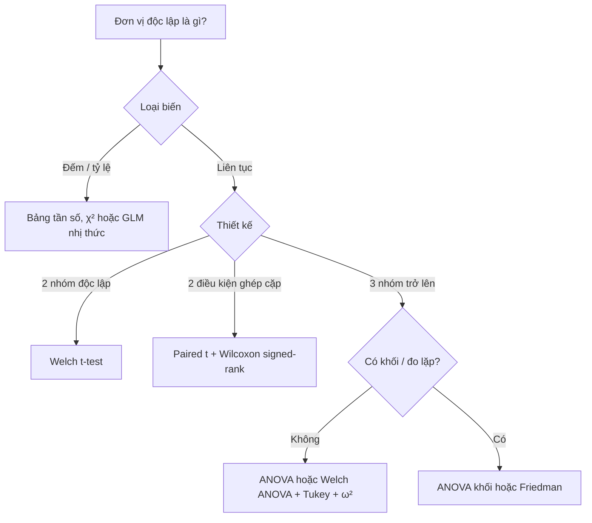

Khi nhóm nhỏ có độ lệch chuẩn gấp đôi nhóm lớn, t-test Student bác bỏ sai khoảng 16% số lần ở mức α = 0,05, quy trình "F-test trước rồi mới chọn t" khoảng 7%, còn Welch t-test giữ được 5%. Bài này đi qua các quyết định chọn kiểm định thường gặp trong thí nghiệm sinh học: hai mẫu độc lập, mẫu ghép cặp, ba nhóm trở lên, bảng tần số χ² và hệ số di truyền tính từ bảng ANOVA. Mỗi quy tắc được đặt cạnh tài liệu phương pháp học và chạy lại trên 14 bộ số liệu luyện tập, kèm code Python và R để bạn tự kiểm tra.

## 1. Mở đầu: bốn quy tắc chọn test và vì sao cần xem lại

Người học thống kê sinh học bằng Excel *Data Analysis ToolPak* thường chọn test theo bốn quy tắc gọn gàng: làm F-test cho phương sai trước rồi mới chọn t-test "equal" hay "unequal variances"; mẫu dưới 30 dùng t, trên 30 dùng z; ba nhóm trở lên thì làm ANOVA, F có ý nghĩa là xong; so sánh giống thì tính hệ số di truyền (heritability, h²) từ bảng ANOVA.

Bốn quy tắc này khớp với các nút bấm có sẵn trong ToolPak, nhưng tài liệu phương pháp học hiện nay khuyến nghị khác ở cả bốn điểm: quy trình hai bước làm méo sai lầm loại I, ngưỡng 30 không cần thiết khi đã có Welch t-test, ANOVA cần đi kèm so sánh hậu kiểm (post hoc) và cỡ hiệu ứng (effect size), còn h² từ ANOVA là một đại lượng cụ thể cần gọi đúng tên.

Bài dùng 14 bộ số liệu luyện tập kiểu giáo trình thống kê sinh học (Bảng 1). Nguồn đo gốc của phần lớn số liệu chưa xác minh được, nên mọi nhận xét sinh học ở đây chỉ để minh hoạ phương pháp. Phần tính toán dùng Python 3 (scipy, pandas) và R.

Phần lớn kết luận "có khác biệt" vẫn đứng vững khi phân tích lại; cái thay đổi là quy trình chọn test, cách báo cáo, và ở vài trường hợp là cả nội dung kết luận.

**Bảng 1.** Các bộ số liệu, phân tích khuyến nghị và điều gì thay đổi

| Bộ số liệu | Cách làm hay gặp | Phân tích khuyến nghị | Kết luận có đổi? |
|---|---|---|---|
| Vaccine: 2 lô × 3 mức phản ứng | χ², "chấp nhận H0 ở 99%" | χ² + p chính xác + tỷ lệ | Không; đổi cách diễn đạt |
| Phân bón × ra hoa (734 cây) | χ², xếp hạng theo số cây | χ² + tỷ lệ + residual | **Có**: xếp hạng theo tỷ lệ |
| Sữa hai đàn bò (169 con) | χ² trên 18 lớp | Welch t trên trung bình | Không; đổi câu hỏi |
| Carboxylesterase 29 vs 27 | F-test → t Student | Welch t | Không |
| IgA, protein huyết thanh 14 vs 11 | F-test → t Student | Welch t | Không; df và p đổi |
| Chlorophyll a/b, C3 vs C4 | F-test → t Student | Welch t | Không |
| Carboxylesterase 35 vs 35 | z-test | Welch t trên đơn vị độc lập | **Có**: n hiệu dụng 10 |
| Tử vong trẻ, hai xã | t-test trên 2 tỷ lệ/xã | Bảng 2×2, Mantel–Haenszel, logistic | **Có**: từ "không kết luận" thành có bằng chứng |
| Số mầm, 22 cặp | Paired t | Paired t + Wilcoxon | Không |
| 4 giống lúa × 5 lặp | ANOVA | ANOVA + Tukey + ω² | **Có**: G1 và G2 cùng nhóm |
| 3 giống ong × 9 tổ | ANOVA | Welch ANOVA + Tukey | **Có**: c và a cùng nhóm |
| Ngô, 4 chế độ phân × 3 lần | ANOVA một nhân tố | ANOVA khối nếu "lần" là khối | Tuỳ thiết kế |
| Chlorophyll a, 3 loài × 3 lá | ANOVA + h² | ANOVA khối; không tính h² | Bỏ h² |
| Cá chết theo nồng độ × thời gian | ANOVA hai nhân tố | GLM nhị thức, mô hình liều–đáp ứng | Đổi hướng phân tích |

## 2. Ngôn ngữ của kiểm định: không "chấp nhận H0"

Bước cuối của quy trình kiểm định thường được viết là "bác bỏ hay chấp nhận H0", và chữ "chấp nhận" gây hiểu nhầm. Tuyên bố của Hiệp hội Thống kê Hoa Kỳ (American Statistical Association, ASA) nêu sáu nguyên tắc, trong đó p-value không đo xác suất giả thuyết là đúng, không đo độ lớn hay tầm quan trọng của hiệu ứng, và kết luận khoa học không nên chỉ dựa vào việc p vượt qua một ngưỡng (Wasserstein & Lazar, 2016). Greenland et al. (2016) liệt kê hàng chục cách hiểu sai phổ biến, trong đó có việc coi kết quả "không có ý nghĩa thống kê" là bằng chứng rằng không có hiệu ứng.

Ví dụ vaccine minh hoạ rõ điều này. Hai lô vaccine thử trên 348 con chuột, ghi nhận phản ứng nhẹ, trung bình hoặc nặng. Lô A có 12/177 con phản ứng nhẹ (6,8%), lô B có 29/171 (17,0%). Kiểm định χ² cho $\chi^2 = 8{,}71$, df = 2. Viết "bác bỏ H0 ở α = 0,05, chấp nhận H0 ở α = 0,01" khiến người đọc hiểu rằng ở mức 99% hai lô "giống nhau", điều số liệu không hề nói.

Cách viết tốt hơn: $\chi^2(2) = 8{,}71$, p = 0,013. Số liệu cho bằng chứng ở mức vừa phải rằng phân bố mức phản ứng khác nhau giữa hai lô; khác biệt chủ yếu nằm ở tỷ lệ phản ứng nhẹ, cao hơn ở lô B (17,0% so với 6,8%; residual chuẩn hoá điều chỉnh ±2,94).

Cũng nên phân biệt **mức ý nghĩa** α = 0,01, thuộc về phép kiểm định, với **độ tin cậy** 99%, thuộc về khoảng tin cậy; câu "khác nhau với độ tin cậy 99%" không có nghĩa là "xác suất 99% có khác biệt". Cách tính và đọc khoảng tin cậy được trình bày ở [bài trước về khoảng tin cậy](/blog/3-dac-trung-thong-ke-cua-mot-mau-va-uoc-luong-tham-so-cua-tong-the/); nền tảng của p-value có ở ghi chú về kiểm định giả thuyết và p-value.

Cuối cùng, thống kê chỉ trả lời câu hỏi mà thiết kế cho phép. So sánh đàn bò thuần với đàn bò lai là so sánh hai nhóm quan sát khác nhau về nhiều thứ cùng lúc; kết luận "khác nhau về bản chất di truyền" vượt quá điều một t-test hay χ² chứng minh được, vì không có thiết kế nào tách di truyền khỏi môi trường.

<div class="callout callout-note">
<p class="callout-title">Mẫu câu báo cáo</p>

"Trung bình nhóm A cao hơn nhóm B 0,12 đơn vị (95% CI 0,08–0,15; Welch t(53,1) = 6,53; p = 2,6 × 10⁻⁸; Cohen's d = 1,73)." Một câu chứa đủ hướng, độ lớn, độ chính xác và bằng chứng.

</div>

## 3. Hai mẫu độc lập: Welch là mặc định, không cần F-test

### 3.1. Welch t-test là gì

t-test Student cho hai mẫu độc lập giả định hai tổng thể có cùng phương sai và gộp hai phương sai mẫu thành một phương sai chung. Welch (1947) tổng quát hoá bài toán cho trường hợp phương sai khác nhau: thống kê t dùng sai số chuẩn tính riêng từng nhóm,

$$t = \frac{\bar x_1 - \bar x_2}{\sqrt{s_1^2/n_1 + s_2^2/n_2}},$$

và bậc tự do được xấp xỉ theo công thức Welch–Satterthwaite:

$$\nu \approx \frac{\left(s_1^2/n_1 + s_2^2/n_2\right)^2}{\dfrac{(s_1^2/n_1)^2}{n_1-1} + \dfrac{(s_2^2/n_2)^2}{n_2-1}}.$$

Bậc tự do thường là số lẻ, nằm giữa $\min(n_1, n_2) - 1$ và $n_1 + n_2 - 2$. Trong Excel, đây chính là công cụ *t-Test: Two-Sample Assuming Unequal Variances*; trong R là mặc định của `t.test()`; trong Python là `scipy.stats.ttest_ind(x, y, equal_var=False)`.

### 3.2. Vì sao không nên làm F-test trước

Quy trình hai bước có vẻ cẩn thận, nhưng quyết định ở bước hai phụ thuộc vào kết quả ngẫu nhiên của bước một, nên xác suất sai lầm loại I của cả quy trình không còn là α danh nghĩa. Zimmerman (2004) chỉ ra rằng kiểm định sơ bộ phương sai rồi chọn test theo kết quả không bảo vệ được sai lầm loại I, và dùng Welch vô điều kiện cho kết quả tốt hơn. Rasch et al. (2011) đặt luôn kết luận vào tiêu đề: kiểm tra trước giả định của t-test hai mẫu "không đáng". Ruxton (2006) cho sinh thái học hành vi và Delacre et al. (2017) cho tâm lý học đều đề nghị dùng Welch làm mặc định.

Một mô phỏng nhỏ cho thấy mức độ vấn đề: hai nhóm sinh từ phân phối chuẩn cùng trung bình (H0 đúng), lặp 20.000 lần, đếm tỷ lệ bác bỏ ở α = 0,05; quy trình tốt phải cho tỷ lệ gần 0,05.

```python
import numpy as np
from scipy import stats

rng = np.random.default_rng(2026)

def type1(n1, n2, sd1, sd2, reps=20000, alpha=0.05):
    """Tỷ lệ bác bỏ sai khi H0 đúng (hai trung bình bằng 0)."""
    hits = np.zeros(3)  # hai bước, Student, Welch
    for _ in range(reps):
        x = rng.normal(0, sd1, n1)
        y = rng.normal(0, sd2, n2)
        F = x.var(ddof=1) / y.var(ddof=1)
        p_F = 2 * min(stats.f.cdf(F, n1 - 1, n2 - 1), stats.f.sf(F, n1 - 1, n2 - 1))
        p_student = stats.ttest_ind(x, y).pvalue
        p_welch = stats.ttest_ind(x, y, equal_var=False).pvalue
        p_twostep = p_student if p_F > 0.05 else p_welch
        hits += [p_twostep < alpha, p_student < alpha, p_welch < alpha]
    return hits / reps

print(type1(10, 30, 2, 1))  # khoảng [0.07, 0.16, 0.05]
```

**Bảng 2.** Tỷ lệ sai lầm loại I mô phỏng (20.000 lần lặp mỗi kịch bản, seed 2026, α = 0,05)

| Kịch bản | Hai bước (F → t) | Student | Welch |
|---|---|---|---|
| n₁ = 10, n₂ = 30, SD₁ = 2, SD₂ = 1 | 0,073 | 0,160 | 0,051 |
| n₁ = 30, n₂ = 10, SD₁ = 2, SD₂ = 1 | 0,040 | 0,008 | 0,050 |
| n₁ = n₂ = 15, SD bằng nhau | 0,048 | 0,048 | 0,047 |
| n₁ = 10, n₂ = 30, SD bằng nhau | 0,053 | 0,050 | 0,051 |


**Hình 1.** Tỷ lệ bác bỏ sai của ba quy trình trong bốn kịch bản mô phỏng. Đường nét đứt là α = 0,05.

Khi nhóm nhỏ có phương sai lớn, Student bác bỏ sai gấp ba lần mức danh nghĩa; F-test "gác cổng" chỉ sửa được một phần, vì với 10 quan sát nó thường không đủ power để phát hiện phương sai khác nhau. Khi nhóm lớn có phương sai lớn, Student lại quá bảo thủ (0,008), nghĩa là mất power. Welch giữ khoảng 0,05 trong cả bốn kịch bản, và khi phương sai thực sự bằng nhau thì gần như không mất gì so với Student. Cái giá của Welch khi giả định thoả là rất nhỏ, còn cái giá của Student khi giả định sai có thể lớn (Delacre et al., 2017).

### 3.3. Chạy lại bằng Welch

**Carboxylesterase ở người tiếp xúc thuốc trừ sâu lân hữu cơ** (29 người so với 27 người đối chứng): Welch t = 6,53, df = 53,1, p = 2,6 × 10⁻⁸. Chênh lệch trung bình là 0,116 (95% CI 0,081–0,152), Cohen's d ≈ 1,73 (tính với độ lệch chuẩn gộp). Student cho t = 6,48, df = 54, gần như trùng vì hai nhóm gần bằng cỡ.

**IgA huyết thanh** (14 người khoẻ so với 11 người viêm gan virus): Welch t = −22,7, df = 16,6, p ≈ 6 × 10⁻¹⁴. Khác biệt lớn tới mức chọn test nào cũng cho cùng kết luận.

**Protein huyết thanh** trên cùng hai nhóm là ví dụ đáng chú ý nhất. Phương sai nhóm bệnh là 133,2, nhóm khoẻ là 34,5, tỷ số khoảng 3,9; F-test cho p = 0,026. Nếu đặt α = 0,01 cho cả bài thì F-test "không bác bỏ" phương sai bằng nhau, và quy trình hai bước chọn Student: t = −5,35, df = 23, p = 2,0 × 10⁻⁵. Welch cho t = −4,97, df = 14,0, p = 2,1 × 10⁻⁴, 95% CI của chênh lệch từ −27,1 đến −10,8 mg/ml. Kết luận giữ nguyên, nhưng tỷ số phương sai gần 4 với n chỉ 11 và 14 là đúng loại tình huống mà mô phỏng cho thấy Student có thể lệch.

**Tỷ lệ chlorophyll a/b ở thực vật C3 và C4** (10 và 13 loài): Welch t = −4,66, df = 19,7, p = 1,6 × 10⁻⁴; 95% CI của chênh lệch từ −1,34 đến −0,51. Không đổi. Bối cảnh sinh lý của hai nhóm có ở ghi chú về quang hợp ở thực vật C3 và C4.

### 3.4. Khi nào vẫn cần phi tham số

Mann–Whitney (Wilcoxon rank-sum) không phải "t-test cho dữ liệu không chuẩn": nó kiểm định một giả thuyết khác, liên quan đến việc một nhóm có xu hướng cho giá trị lớn hơn nhóm kia, không phải hai trung bình bằng nhau (Fagerland, 2012; Ruxton, 2006). Khi hai nhóm có phương sai hay hình dạng phân phối khác nhau, Mann–Whitney có thể bác bỏ dù hai trung bình bằng nhau. Fagerland (2012) cũng lưu ý rằng với mẫu lớn, t-test và khoảng tin cậy cho chênh lệch trung bình vẫn nên dùng kể cả khi dữ liệu lệch. Phi tham số hữu ích khi câu hỏi là về thứ hạng, dữ liệu là thang thứ bậc, hoặc để phân tích độ nhạy. Với ví dụ carboxylesterase, Mann–Whitney cho p = 8,7 × 10⁻⁷, nhất quán với Welch.

### 3.5. Sơ đồ chọn test

Sơ đồ dưới đây thay bốn quy tắc ở mục 1 bằng các câu hỏi về thiết kế và loại dữ liệu.



**Hình 2.** Sơ đồ chọn test dựa trên đơn vị độc lập, loại biến và thiết kế. Không có nhánh "F-test" hay "n > 30".

## 4. "n > 30 thì dùng z" và bài toán có quá ít quan sát

### 4.1. z-test với phương sai mẫu là Welch t với df vô hạn

Công cụ *z-Test: Two Sample for Means* của ToolPak yêu cầu nhập phương sai "đã biết"; trong thực tế người dùng nhập phương sai mẫu. Khi đó thống kê z có đúng cùng công thức với thống kê Welch t ở mục 3.1; khác biệt duy nhất là z so với phân phối chuẩn, tương đương phân phối t với vô hạn bậc tự do. Vì vậy không có lý do để đổi test tại một ngưỡng cỡ mẫu: khi n lớn hai cách gần như trùng nhau, khi n nhỏ z bỏ qua sai số ước lượng phương sai và quá tự tin. Nếu dùng ô "Known Variance" thì nên nhập phương sai mẫu chia cho n − 1 (`VAR.S`), không phải `VAR.P`; với 35 quan sát, hai giá trị là 0,0629 và 0,0611.

Một ví dụ cụ thể: bộ số liệu hoạt độ carboxylesterase 35 quan sát mỗi nhóm cho z = 5,01. So với phân phối chuẩn, p = 5,4 × 10⁻⁷; so với phân phối t của Welch (df = 39,5), p = 1,2 × 10⁻⁵, lớn hơn khoảng 20 lần.

### 4.2. Ba mươi lăm dòng, mười quan sát

Bộ số liệu 35 + 35 này còn một điểm quan trọng hơn. Nhìn kỹ cột đối chứng, 35 giá trị thực chất là một khối 10 giá trị (2,35; 2,48; 2,49; 2,52; 2,49; 2,47; 2,11; 1,64; 2,19; 2,38) lặp lại ba lần rưỡi (Hình 3). Cột thí nghiệm cũng chỉ có 10 giá trị khác nhau, lặp theo từng đoạn. Dù do chép số liệu hay nhân bản để làm ví dụ, nếu dữ liệu thật chỉ có 10 quan sát độc lập mỗi nhóm thì phân tích trên 35 dòng là **giả lặp** (pseudoreplication): coi các quan sát không độc lập như thể độc lập, làm thổi phồng cỡ mẫu và thu hẹp sai số (Hurlbert, 1984).


**Hình 3.** 35 giá trị của nhóm đối chứng theo thứ tự dòng. Mỗi màu là một khối 10 dòng; mẫu hình lặp lại y hệt.

Hậu quả rất rõ. Welch trên 35 dòng mỗi nhóm cho t = 5,01, p = 1,2 × 10⁻⁵. Welch trên 10 dòng đầu, tức 10 quan sát độc lập, cho t = 2,41, df = 9,9, p = 0,037, 95% CI của chênh lệch từ 0,016 đến 0,41. Kết luận vẫn là "có khác biệt" ở α = 0,05, nhưng khoảng tin cậy gần chạm 0. **n là số đơn vị độc lập, không phải số dòng trong bảng**. Ba lần đo trên cùng một cây hay hai giếng của cùng một mẫu không làm tăng n. Kiểm tra trùng lặp trước khi phân tích là một bước của [quy trình làm sạch dữ liệu](/blog/process-data-from-dirty-to-clean/).

### 4.3. Hai quan sát mỗi nhóm: khi t-test không thể trả lời

Một bộ số liệu khác hỏi về tử vong trẻ dưới một tuổi ở hai xã, một xã thuộc vùng bị rải chất diệt cỏ và một xã đối chiếu, trong hai giai đoạn 1971–1975 và 1981–1986. Nếu coi mỗi tỷ lệ tử vong là một "quan sát", mỗi xã chỉ có 2 quan sát. t-test Student cho t = 1,65, df = 2, p = 0,24, và không kết luận được gì.

Kết quả đó gần như đã được định sẵn. Với 2 quan sát mỗi nhóm, power của t-test hai phía ở α = 0,05 để phát hiện một hiệu ứng lớn (d = 1) chỉ khoảng 9,5% (tính từ phân phối t không trung tâm; R: `power.t.test(n = 2, delta = 1)`). Kết quả "không có ý nghĩa" ở đây không mang thông tin.

Vấn đề gốc là chọn sai loại dữ liệu. Số liệu thật là số trẻ chết và số trẻ sống: 92/1.352 và 19/895 ở giai đoạn đầu, 61/1.757 và 20/773 ở giai đoạn sau. Đơn vị độc lập là từng đứa trẻ. Phân tích đúng loại dữ liệu là bảng 2×2 cho mỗi giai đoạn, gộp hai giai đoạn bằng phương pháp Mantel–Haenszel (Mantel & Haenszel, 1959), và hồi quy logistic để kiểm tra xem odds ratio có đồng nhất giữa hai giai đoạn không.

```r
# Số trẻ chết / sống theo xã và giai đoạn
d <- data.frame(
  xa    = c("A", "B", "A", "B"),
  giai  = c("1971-1975", "1971-1975", "1981-1986", "1981-1986"),
  chet  = c(92, 19, 61, 20),
  song  = c(1260, 876, 1696, 753)
)

# Bảng 2x2x2 cho Mantel-Haenszel: hàng = chết/sống, cột = xã, lớp = giai đoạn
tab <- array(c(92, 1260, 19, 876, 61, 1696, 20, 753), dim = c(2, 2, 2))
mantelhaen.test(tab, correct = FALSE)   # OR chung ~ 2.25 (1.57-3.20)

# Hồi quy logistic: tương tác xã x giai đoạn
m0 <- glm(cbind(chet, song) ~ xa + giai, family = binomial, data = d)
m1 <- glm(cbind(chet, song) ~ xa * giai, family = binomial, data = d)
anova(m0, m1, test = "Chisq")           # p ~ 0.013
```

Giai đoạn 1971–1975, odds tử vong ở xã A cao gấp 3,37 lần xã B (95% CI chính xác 2,02–5,89; χ² p ≈ 5 × 10⁻⁷). Giai đoạn 1981–1986, OR = 1,35 (0,80–2,39; p = 0,24). Odds ratio gộp Mantel–Haenszel là 2,25 (95% CI 1,57–3,20; p = 3,7 × 10⁻⁶). Nhưng hồi quy logistic cho thấy tương tác xã × giai đoạn có ý nghĩa (so sánh deviance, p = 0,013): khác biệt giữa hai xã ở giai đoạn sau nhỏ hơn rõ rệt so với giai đoạn đầu. Khi odds ratio không đồng nhất giữa các lớp, một con số gộp không đủ để mô tả số liệu; cần báo cáo riêng từng giai đoạn như Hình 4.


**Hình 4.** Odds ratio tử vong trẻ dưới một tuổi, xã A so với xã B, theo giai đoạn và gộp Mantel–Haenszel. Thanh ngang là khoảng tin cậy 95%; trục hoành theo thang log.

Từ "không kết luận được", phân tích đúng loại dữ liệu cho bằng chứng mạnh về khác biệt ở giai đoạn đầu và khác biệt nhỏ, không rõ ràng ở giai đoạn sau. Giới hạn cần giữ: đây là so sánh hai địa phương (ecological comparison) có thể khác nhau về địa lý, y tế và cách ghi nhận tử vong, nên không cho phép kết luận nhân quả về chất diệt cỏ.

<div class="callout callout-warning">
<p class="callout-title">Khi dữ liệu là số đếm</p>

Nếu bạn có tử số và mẫu số (số chết/tổng, số nảy mầm/số hạt), hãy phân tích chính các số đếm đó bằng bảng tần số hoặc GLM nhị thức. Tính tỷ lệ rồi đưa vào t-test hay ANOVA vứt bỏ thông tin về cỡ mẫu của từng tỷ lệ.

</div>

## 5. Hai mẫu ghép cặp và từ ba mẫu liên hệ trở lên

Khi mỗi quan sát ở điều kiện 1 ghép với đúng một quan sát ở điều kiện 2, phân tích dựa trên hiệu $d_i$ của từng cặp: $t = \bar d / (s_d/\sqrt n)$, df = n − 1. Ghép cặp loại bỏ biến thiên giữa các cặp nên thường mạnh hơn nhiều so với coi hai cột là độc lập.

Ví dụ: 22 cặp mẫu cấy mô trên hai môi trường, đếm số mầm mỗi ống. Trung bình 3,05 và 4,68 mầm; paired t = −6,52, df = 21, p = 1,8 × 10⁻⁶. Hai lưu ý thực hành. Thứ nhất, ToolPak lấy α từ ô *Alpha* trong hộp thoại, mặc định 0,05, và giá trị *t Critical two-tail* in ra phụ thuộc vào ô này. Với df = 21, ngưỡng hai phía là 2,08 ở α = 0,05 và 2,83 ở α = 0,01; nếu bạn định kiểm định ở α = 0,01 mà thấy 2,08 thì ô *Alpha* chưa được đổi. Báo cáo p chính xác thì tránh được hẳn vấn đề. Thứ hai, số mầm là số đếm nhỏ (0–8), nên chạy thêm Wilcoxon signed-rank như một phân tích độ nhạy là hợp lý.

Khi có ba điều kiện trở lên trên cùng các đơn vị, ví dụ ba môi trường nuôi cấy hạt phấn, mỗi môi trường 9 lần lặp, việc làm paired t cho từng cặp (3 phép so sánh) không hiệu chỉnh cho nhiều so sánh và bỏ qua cấu trúc chung. Nếu 9 lần lặp thực sự là 9 khối (cùng một lô hạt phấn được chia cho ba môi trường), hướng đúng là ANOVA khối ngẫu nhiên, hoặc kiểm định Friedman nếu muốn bản phi tham số (Friedman, 1937), sau đó mới so sánh cặp có hiệu chỉnh. Nếu các lần lặp độc lập với nhau thì đó là ba mẫu độc lập, và mục 6 áp dụng.

## 6. ANOVA chưa xong khi F có ý nghĩa

### 6.1. F chỉ nói "có ít nhất một khác biệt"

F có ý nghĩa chỉ cho biết H0 "mọi trung bình bằng nhau" không phù hợp với số liệu, không nói nhóm nào khác nhóm nào. Để trả lời "giống nào nên chọn" cần so sánh từng cặp nhóm với kiểm soát tỷ lệ sai lầm theo họ (family-wise error rate, FWER). Phương pháp phổ biến nhất là Tukey HSD; khi các nhóm không cùng cỡ, mở rộng của Kramer (1956), thường gọi là Tukey–Kramer, là lựa chọn chuẩn. Khi phương sai các nhóm khác nhau rõ, dùng Welch ANOVA (`oneway.test` trong R).

Bên cạnh p, nên báo cáo cỡ hiệu ứng. η² = SS_A / SS_T dễ hiểu (tỷ lệ biến thiên do nhân tố) nhưng thiên lệch dương, nhất là với mẫu nhỏ; ω² ít thiên lệch hơn; với thiết kế nhiều nhân tố, η² riêng phần không so sánh được giữa các thiết kế, và generalized η² hay generalized ω² được đề xuất để giải quyết điều đó (Olejnik & Algina, 2003; Lakens, 2013). Công thức ω² cho ANOVA một nhân tố:

$$\omega^2 = \frac{SS_A - (a-1)\,MS_E}{SS_T + MS_E}.$$

Kruskal–Wallis là bản phi tham số cho từ ba nhóm độc lập trở lên (Kruskal & Wallis, 1952) và dùng tốt như một phân tích độ nhạy.

### 6.2. Bốn giống lúa

Năng suất bốn giống lúa, mỗi giống 5 lần lặp. Code dưới đây làm trọn bộ: ANOVA, η², ω², Tukey HSD, kiểm định Bartlett, và hai hệ số di truyền dùng ở mục 7.

```python
import numpy as np
import pandas as pd
from scipy import stats

rice = pd.DataFrame({
    "giong": np.repeat(["G1", "G2", "G3", "G4"], 5),
    "nang_suat": [8, 7, 6, 6, 8, 9, 10, 7, 9, 8, 5, 5, 4, 3, 6, 5, 4, 5, 5, 6],
})
groups = [g["nang_suat"].to_numpy(float) for _, g in rice.groupby("giong")]
a, m = len(groups), len(groups[0])          # số giống, số lần lặp
N = a * m

F, p = stats.f_oneway(*groups)
grand = rice["nang_suat"].mean()
ss_a = sum(m * (g.mean() - grand) ** 2 for g in groups)
ss_e = sum(((g - g.mean()) ** 2).sum() for g in groups)
ms_a, ms_e = ss_a / (a - 1), ss_e / (N - a)

eta2 = ss_a / (ss_a + ss_e)
omega2 = (ss_a - (a - 1) * ms_e) / (ss_a + ss_e + ms_e)
print(f"F({a-1},{N-a}) = {F:.2f}, p = {p:.1e}, eta2 = {eta2:.2f}, omega2 = {omega2:.2f}")

print(stats.tukey_hsd(*groups))             # so sánh cặp, kiểm soát FWER
print("Bartlett p =", round(stats.bartlett(*groups).pvalue, 3))

s2_g = (ms_a - ms_e) / m                     # chia cho số lần lặp m
H2_plot = s2_g / (s2_g + ms_e)
H2_mean = s2_g / (s2_g + ms_e / m)
print(f"s2_g = {s2_g:.2f}; H2 trên ô = {H2_plot:.2f}; "
      f"H2 trên trung bình giống = {H2_mean:.3f}; 1 - 1/F = {1 - 1/F:.3f}")
```

Kết quả: F(3, 16) = 16,85, p = 3,3 × 10⁻⁵; η² = 0,76, ω² = 0,70. Tukey HSD cho G2 > G3 và G2 > G4 (cả hai p < 0,001), G1 > G3 (p = 0,009) và G1 > G4 (p = 0,030). Nhưng **G2 và G1 không khác nhau có ý nghĩa** (p = 0,098; chênh lệch 1,6, 95% CI từ −0,23 đến 3,43). Câu "G2 có năng suất cao nhất" vì thế cần viết lại: G2 và G1 thuộc cùng nhóm năng suất cao, G3 và G4 thuộc nhóm thấp (Hình 5). Các kiểm tra giả định đều ổn: Bartlett p = 0,81, Welch ANOVA p = 0,0011, Kruskal–Wallis p = 0,002.

### 6.3. Ba giống ong

Sản lượng mật của ba giống ong, mỗi giống 9 tổ: F(2, 24) = 9,75, p = 0,0008; η² = 0,45, ω² = 0,39. Tukey: c > b (p < 0,001), a > b (p = 0,014), nhưng **c và a không khác nhau** (p = 0,46). Phương sai không đồng nhất: giống c có phương sai 0,53, giống a 3,81, gấp hơn bảy lần; Bartlett p = 0,041, còn Fligner–Killeen, ít nhạy với phân phối không chuẩn, cho p = 0,13. Welch ANOVA, không giả định phương sai bằng nhau, cho F = 13,8, p = 0,0005, nên kết luận tổng thể vững.

Diễn giải đúng: giống c ổn định nhất (phương sai nhỏ nhất), nhưng năng suất trung bình không cao hơn giống a một cách có ý nghĩa. Độ ổn định là tiêu chí có giá trị riêng trong chọn giống, nhưng khác với năng suất trung bình.


**Hình 5.** Từng quan sát (chấm xám), trung bình và khoảng tin cậy 95% (xanh) cho bốn giống lúa và ba giống ong. Chữ đỏ là nhóm Tukey: hai nhóm có chung chữ không khác nhau có ý nghĩa ở α = 0,05.

### 6.4. Khi "lần thí nghiệm" là khối

Ví dụ ngô có bốn chế độ phân vi lượng, mỗi chế độ 3 "lần thí nghiệm", chỉ tiêu là mức chống chịu sâu bệnh. ANOVA một nhân tố cho F = 4,21, p = 0,046, sát ngưỡng, và Tukey không tìm thấy cặp nào khác nhau ở α = 0,05. Nhưng nhìn số liệu, cả bốn chế độ đều tăng dần từ lần 1 đến lần 3; nếu "lần" là ba đợt thí nghiệm riêng, mỗi đợt làm đủ bốn chế độ, thì "lần" là một nhân tố khối. ANOVA hai nhân tố không lặp với khối cho F của chế độ phân = 36,9, p = 0,0003, và Tukey tách được bốn trong sáu cặp (ví dụ N3 > N2, p = 0,0003). Hai phân tích trên cùng 12 con số cho hai kết luận khác hẳn; cái quyết định là thiết kế thật của thí nghiệm.

Ví dụ chlorophyll a ở lá thứ 1, 2, 3 của lúa, ngô và bông cũng tương tự: vị trí lá là nhân tố khối. ANOVA một nhân tố cho F = 18,56, p = 0,0027; thêm vị trí lá vào mô hình cho F của loài = 17,8, p = 0,010, còn vị trí lá không có ý nghĩa (F = 0,87). Tukey: bông cao hơn lúa và ngô, lúa và ngô không khác nhau (p = 0,085).

### 6.5. ANOVA hai nhân tố không lặp và dữ liệu không phải liên tục

ANOVA hai nhân tố không lặp (mỗi ô một quan sát) không ước lượng được tương tác, vì phần dư chính là tương tác. Phân tích như vậy ngầm giả định hai nhân tố tác động cộng tính, và giả định đó nên được nói rõ. Nếu một nhân tố là "giờ trong ngày" đo trên cùng lá, các phép đo liên tiếp có tự tương quan, và ít nhất cần nêu như một giới hạn.

Số cá chết trên 100 con theo nồng độ thuốc trừ sâu và thời gian là dữ liệu nhị thức. ANOVA trên phần trăm, kể cả sau biến đổi arcsine, kém hơn hồi quy logistic cả về diễn giải lẫn power (Warton & Hui, 2011). Hướng chuẩn là mô hình liều–đáp ứng ước lượng LC50 theo thời gian, ví dụ bằng gói `drc` trong R (Ritz et al., 2015; Ritz & Streibig, 2005). Một ví dụ thực nghiệm độc tính trên phôi cá có ở ghi chú về độc tính propylene glycol trên phôi cá ngựa vằn.

**Bảng 3.** ANOVA, cỡ hiệu ứng và hậu kiểm cho bốn bộ số liệu

| Bộ số liệu | F (df) | p | η² | ω² | Tukey (cặp không khác nhau đáng chú ý) | Ghi chú giả định |
|---|---|---|---|---|---|---|
| 4 giống lúa | 16,85 (3; 16) | 3,3 × 10⁻⁵ | 0,76 | 0,70 | G1 – G2: p = 0,098 | Bartlett p = 0,81 |
| 3 giống ong | 9,75 (2; 24) | 0,0008 | 0,45 | 0,39 | a – c: p = 0,46 | Bartlett p = 0,041; Welch ANOVA p = 0,0005 |
| Ngô, 4 chế độ phân | 4,21 (3; 8) | 0,046 | 0,61 | 0,45 | Không cặp nào p < 0,05 | Có khối: F = 36,9; p = 0,0003 |
| Chlorophyll, 3 loài | 18,56 (2; 6) | 0,0027 | 0,86 | 0,80 | Lúa – ngô: p = 0,085 | Có khối lá: F = 17,8; p = 0,010 |

## 7. Hệ số di truyền từ ANOVA: đang tính h² nào?

### 7.1. Từ kỳ vọng trung bình bình phương đến thành phần phương sai

Khi các giống trong thí nghiệm được coi là mẫu ngẫu nhiên từ một quần thể kiểu gen, mô hình ANOVA một nhân tố là $x_{ij} = \mu + g_i + e_{ij}$, với $g_i$ có phương sai $\sigma^2_g$ (phương sai kiểu gen) và $e_{ij}$ có phương sai $\sigma^2_e$. Với a giống và m lần lặp mỗi giống, kỳ vọng của hai trung bình bình phương (mean square) là

$$E(MS_A) = \sigma^2_e + m\,\sigma^2_g, \qquad E(MS_E) = \sigma^2_e.$$

Từ đó ước lượng theo phương pháp moment:

$$\hat\sigma^2_e = MS_E, \qquad \hat\sigma^2_g = \frac{MS_A - MS_E}{m}.$$

Mẫu số là **m, số lần lặp**, vì m là hệ số đứng trước $\sigma^2_g$ trong $E(MS_A)$. Nếu F < 1 thì ước lượng âm, thường được đặt bằng 0.

### 7.2. Hai hệ số di truyền khác nhau

Từ hai thành phần phương sai có thể định nghĩa hai hệ số di truyền theo nghĩa rộng (broad-sense heritability, H²). Trên **từng ô thí nghiệm** (một cây, một ô ruộng):

$$H^2_{\text{ô}} = \frac{\sigma^2_g}{\sigma^2_g + \sigma^2_e}.$$

Trên **trung bình giống** (entry mean), tức trung bình của m lần lặp:

$$H^2_{\bar x} = \frac{\sigma^2_g}{\sigma^2_g + \sigma^2_e/m}.$$

Dạng thứ hai là dạng thường dùng trong chọn giống cây trồng, vì quyết định chọn giống dựa trên trung bình nhiều lần lặp (Holland et al., 2002). Piepho và Möhring (2007) mô tả hệ số di truyền như một thước đo độ chính xác của thí nghiệm mà công dụng chính là tính đáp ứng chọn lọc, và lưu ý rằng các công thức quen thuộc ngầm giả định dữ liệu cân bằng.

Thay các ước lượng vào $H^2_{\bar x}$ cho một kết quả đơn giản đáng nhớ. Vì $\hat\sigma^2_g + \hat\sigma^2_e/m = (MS_A - MS_E)/m + MS_E/m = MS_A/m$, nên

$$\hat H^2_{\bar x} = \frac{MS_A - MS_E}{MS_A} = 1 - \frac{1}{F}.$$

Với thiết kế cân bằng, H² trên trung bình giống chỉ phụ thuộc vào F của bảng ANOVA.

<div class="callout callout-warning">
<p class="callout-title">Một bẫy đại số</p>

Nếu chia $MS_A - MS_E$ cho số giống a thay vì số lần lặp m, thành phần $\hat\sigma^2_g$ sẽ sai mỗi khi a ≠ m. Nhưng nếu mẫu số của h² cũng dùng $MS_E/a$, hằng số a triệt tiêu và tỷ số vẫn ra đúng $1 - 1/F$, tức $H^2_{\bar x}$. Con số h² cuối cùng có thể đúng trong khi thành phần phương sai và lời giải thích đi kèm đều sai. Muốn kiểm tra, hãy so h² với 1 − 1/F.

</div>

### 7.3. Áp dụng cho giống lúa và giống ong

**Bảng 4.** Thành phần phương sai và hai hệ số di truyền theo nghĩa rộng

| Bộ số liệu | MS_A | MS_E | m | $\hat\sigma^2_g$ | H² trên ô | H² trên trung bình giống (= 1 − 1/F) |
|---|---|---|---|---|---|---|
| 4 giống lúa | 17,27 | 1,025 | 5 | 3,25 | 0,76 | 0,94 |
| 3 giống ong | 21,51 | 2,207 | 9 | 2,15 | 0,49 | 0,90 |

Với giống ong, H² trên trung bình giống là 0,90: xếp hạng ba giống theo trung bình 9 tổ khá ổn định nếu lặp lại thí nghiệm trong cùng điều kiện. Nhưng H² trên ô chỉ 0,49: khoảng một nửa biến thiên giữa các tổ đơn lẻ là do môi trường và sai số. Báo cáo h² mà không nói trên đơn vị nào thì người đọc không biết đang trả lời câu hỏi nào. Nếu dùng sai mẫu số a = 3 thay vì m = 9, $\hat\sigma^2_g$ sẽ là 6,44 thay vì 2,15, gấp ba lần.

### 7.4. Diễn giải: h² không phải "mức độ do gen quyết định"

Hệ số di truyền là tỷ số phương sai trong **một quần thể, một môi trường, một thời điểm**. Theo Visscher et al. (2008), h² không cho biết một tính trạng "do gen quyết định bao nhiêu phần trăm" ở một cá thể, không bất biến khi đổi quần thể hay môi trường, và h² cao không có nghĩa là môi trường không thể thay đổi tính trạng.

Với các giống thuần, $\sigma^2_g$ là phương sai **giữa các giống**, chứa cả hiệu ứng cộng, trội và át gen; đó là hệ số di truyền theo nghĩa rộng, không phải theo nghĩa hẹp (narrow-sense, h²) dùng để dự đoán đáp ứng chọn lọc ở quần thể giao phối (Holland et al., 2002; Visscher et al., 2008). Thêm một giới hạn: thí nghiệm chỉ ở một địa điểm, một vụ thì phương sai tương tác kiểu gen × môi trường bị gộp vào $\sigma^2_g$, nên H² có xu hướng bị ước lượng cao (Holland et al., 2002). Ví dụ giống ong (một vùng, một vụ) cũng chịu giới hạn này.

Cuối cùng, h² chỉ có nghĩa khi các nhóm là các kiểu gen trong cùng một loài. Ví dụ chlorophyll ở lúa, ngô và bông so sánh **ba loài khác nhau**, và khác biệt giữa loài không phải biến dị di truyền trong một quần thể; với bộ số liệu đó, ANOVA và Tukey là đủ, không nên tính h².

## 8. χ²: tần số kỳ vọng, đúng câu hỏi và đúng đơn vị so sánh

### 8.1. Điều kiện tần số kỳ vọng

Thống kê $\chi^2 = \sum (O - E)^2 / E$ chỉ xấp xỉ tốt phân phối χ² khi tần số kỳ vọng không quá nhỏ. Quy tắc thường dẫn từ Cochran (1954): không ô nào có tần số kỳ vọng nhỏ hơn 1, và không quá 20% số ô có tần số kỳ vọng nhỏ hơn 5. Với bảng 2×2 cỡ mẫu nhỏ, Campbell (2007) đề xuất dùng phiên bản χ² "N − 1" khi mọi tần số kỳ vọng từ 1 trở lên, và kiểm định Fisher–Irwin trong trường hợp còn lại. Khi điều kiện không thoả, p mô phỏng Monte Carlo (`chisq.test(..., simulate.p.value = TRUE)` trong R) là phương án đơn giản. Ví dụ vaccine ở mục 2 có tần số kỳ vọng nhỏ nhất 7,86, thoả điều kiện. Lý thuyết về kiểm định tính độc lập có ở ghi chú về suy luận tính độc lập, và một ứng dụng quen thuộc là kiểm định tỷ lệ phân ly Mendel.

### 8.2. Phân bón và tỷ lệ ra hoa: xếp hạng theo tỷ lệ, không theo số cây

Thí nghiệm bón ba loại phân và một đối chứng ghi số cây ra hoa, không ra hoa và chết; số cây mỗi nghiệm thức là 168, 206, 194 và 166.

```python
import numpy as np
import pandas as pd
from scipy import stats

obs = pd.DataFrame(
    [[157, 189, 170, 132], [8, 12, 17, 28], [3, 5, 7, 6]],
    index=["Ra hoa", "Không ra hoa", "Chết"],
    columns=["Phân A", "Phân B", "Phân C", "Đối chứng"],
)
res = stats.chi2_contingency(obs, correction=False)
E = res.expected_freq
print(f"chi2 = {res.statistic:.2f}, df = {res.dof}, p = {res.pvalue:.4f}")
print(f"Ô có E < 5: {(E < 5).sum()}/{E.size}; E nhỏ nhất = {E.min():.2f}")

# Tỷ lệ theo cột và residual chuẩn hoá điều chỉnh
print((obs / obs.sum()).round(3))
n = obs.to_numpy().sum()
row = obs.sum(axis=1).to_numpy()[:, None] / n
col = obs.sum(axis=0).to_numpy()[None, :] / n
adj = (obs - E) / np.sqrt(E * (1 - row) * (1 - col))
print(adj.round(2))
```

Kết quả: $\chi^2(6) = 21{,}11$, p = 0,0017; 2/12 ô có tần số kỳ vọng dưới 5 (4,75 và 4,81), vẫn trong giới hạn 20%; p Monte Carlo (100.000 lần) là 0,0017, trùng với p tiệm cận.

Phân nào tốt nhất? Phân B có nhiều cây ra hoa nhất (189 cây) nhưng cũng có nhiều cây nhất. Tỷ lệ ra hoa mới so sánh được: **phân A 93,5%**, phân B 91,7%, phân C 87,6%, đối chứng 79,5%.

Residual chuẩn hoá điều chỉnh (adjusted standardized residual) cho biết ô nào đóng góp vào khác biệt; giá trị tuyệt đối lớn hơn khoảng 2 là đáng chú ý. Hình 6 cho thấy khác biệt tập trung ở **đối chứng**: ít cây ra hoa hơn kỳ vọng (−3,99) và nhiều cây không ra hoa hơn kỳ vọng (+4,13). χ² tổng thể chủ yếu cho thấy bón phân tốt hơn không bón; nó không chứng minh A tốt hơn B. Muốn xếp hạng cần so sánh cặp các tỷ lệ có hiệu chỉnh, và chênh lệch 93,5% so với 91,7% trên khoảng 200 cây mỗi nhóm khó phân biệt được.


**Hình 6.** Residual chuẩn hoá điều chỉnh của bảng phân bón × kết quả. Màu đỏ: nhiều hơn kỳ vọng; màu xanh: ít hơn kỳ vọng.

### 8.3. Sữa của hai đàn bò: χ² không phải công cụ cho câu hỏi này

Bộ số liệu thứ ba ghi sản lượng sữa của 97 con bò thuần và 72 con bò lai F1, chia thành 18 lớp cách nhau 10 đơn vị (từ 145 đến 315). Làm χ² trên bảng 2 × 18 cho $\chi^2(17) = 36{,}23$, p = 0,0043, vượt ngưỡng 33,41 ở α = 0,01. Nhưng 24/36 ô có tần số kỳ vọng dưới 5, vi phạm nặng điều kiện ở mục 8.1. p Monte Carlo khoảng 0,0007, nên kết luận "hai phân bố khác nhau" vẫn đứng, nhưng không thể dựa vào p tiệm cận.

Vấn đề lớn hơn là χ² trả lời sai câu hỏi: "đàn nào cho nhiều sữa hơn" là câu hỏi về trung bình, và χ² trên dữ liệu đã chia lớp bỏ đi thứ tự của các lớp. Dùng trị số giữa lớp, trung bình đàn thuần là 217,6, đàn lai là 238,2; Welch t = −4,76, df = 158,7, p = 4 × 10⁻⁶; 95% CI của chênh lệch từ −29,2 đến −12,1. Vì số liệu đã gộp lớp, các con số này là xấp xỉ, nhưng cho đúng thứ cần: hướng và độ lớn của khác biệt.

## 9. Kết luận và checklist chọn test

Phần lớn kết luận "có khác biệt" giữ nguyên khi chuyển sang các phương pháp được khuyến nghị. Thay đổi thực chất nằm ở bốn chỗ: thứ hạng phân bón khi so theo tỷ lệ, kết luận về tử vong trẻ khi phân tích đúng loại dữ liệu, cỡ mẫu hiệu dụng của bộ 35 + 35, và ý nghĩa của h² tính từ ANOVA. Cả bốn không phải lỗi tính toán mà là chuyện chọn đơn vị, chọn câu hỏi và cách diễn giải. Tám câu hỏi dưới đây gói lại các bài học:

1. **Đơn vị độc lập là gì?** Cây, ô ruộng, con vật hay đứa trẻ; không phải số dòng trong bảng.
2. **Biến là đếm, tỷ lệ hay liên tục?** Có tử số và mẫu số thì phân tích số đếm (bảng tần số, GLM nhị thức).
3. **Có ghép cặp hoặc khối không?** Nếu có, mô hình phải phản ánh cấu trúc đó (paired t, ANOVA khối, Friedman).
4. **Hai nhóm độc lập: dùng Welch mặc định**, bỏ F-test và ngưỡng n = 30.
5. **Từ ba nhóm trở lên: ANOVA (hoặc Welch ANOVA) kèm Tukey và ω²**, kiểm tra phương sai bằng đồ thị và Levene hay Fligner.
6. **χ²: kiểm tra tần số kỳ vọng**, xem residual, và so sánh theo tỷ lệ chứ không theo số đếm thô.
7. **Báo cáo p chính xác, khoảng tin cậy và cỡ hiệu ứng.**
8. **Không viết "chấp nhận H0".** Viết "không đủ bằng chứng", kèm power hoặc độ rộng khoảng tin cậy.

**Bảng 5.** Excel ToolPak làm được gì

| Việc cần làm | ToolPak | Thay thế |
|---|---|---|
| Welch t-test | Có: *t-Test: Two-Sample Assuming Unequal Variances* | `t.test()` (R), `ttest_ind(equal_var=False)` |
| Hậu kiểm Tukey / Tukey–Kramer | Không | `TukeyHSD()` (R), `scipy.stats.tukey_hsd` |
| Welch ANOVA | Không | `oneway.test()` (R) |
| Kruskal–Wallis, Friedman, Wilcoxon | Không | `kruskal.test()`, `friedman.test()`, `wilcox.test()` |
| χ² với p Monte Carlo, residual | Không (chỉ có hàm `CHISQ.TEST`) | `chisq.test()` (R) |
| GLM nhị thức, Mantel–Haenszel | Không | `glm()`, `mantelhaen.test()` (R) |

Danh sách công cụ của ToolPak theo trang hỗ trợ của Microsoft (Microsoft, n.d.) gồm ANOVA, F-test, ba loại t-test và z-test, không có công cụ hậu kiểm. Excel vẫn tốt để nhập và mô tả số liệu; phần suy luận vượt quá t-test và ANOVA nên chuyển sang R (làm quen với R) hoặc Python.

Hai chủ đề còn bỏ ngỏ, hồi quy và mô hình tuyến tính tổng quát (GLM), được bàn tiếp ở [bài về tương quan và hồi quy](/blog/tuong-quan-va-hoi-quy/), nơi phân tích tỷ lệ chết của cá theo nồng độ sẽ có đất để làm đầy đủ.

## Tài liệu tham khảo

Campbell, I. (2007). Chi-squared and Fisher–Irwin tests of two-by-two tables with small sample recommendations. *Statistics in Medicine, 26*(19), 3661–3675. https://doi.org/10.1002/sim.2832

Cochran, W. G. (1954). Some methods for strengthening the common χ² tests. *Biometrics, 10*(4), 417–451. https://doi.org/10.2307/3001616

Delacre, M., Lakens, D., & Leys, C. (2017). Why psychologists should by default use Welch's t-test instead of Student's t-test. *International Review of Social Psychology, 30*(1), 92–101. https://doi.org/10.5334/irsp.82

Fagerland, M. W. (2012). t-tests, non-parametric tests, and large studies—a paradox of statistical practice? *BMC Medical Research Methodology, 12*, 78. https://doi.org/10.1186/1471-2288-12-78

Friedman, M. (1937). The use of ranks to avoid the assumption of normality implicit in the analysis of variance. *Journal of the American Statistical Association, 32*(200), 675–701. https://doi.org/10.1080/01621459.1937.10503522

Greenland, S., Senn, S. J., Rothman, K. J., Carlin, J. B., Poole, C., Goodman, S. N., & Altman, D. G. (2016). Statistical tests, P values, confidence intervals, and power: A guide to misinterpretations. *European Journal of Epidemiology, 31*(4), 337–350. https://doi.org/10.1007/s10654-016-0149-3

Holland, J. B., Nyquist, W. E., & Cervantes-Martínez, C. T. (2002). Estimating and interpreting heritability for plant breeding: An update. *Plant Breeding Reviews*, 9–112. https://doi.org/10.1002/9780470650202.ch2

Hurlbert, S. H. (1984). Pseudoreplication and the design of ecological field experiments. *Ecological Monographs, 54*(2), 187–211. https://doi.org/10.2307/1942661

Kramer, C. Y. (1956). Extension of multiple range tests to group means with unequal numbers of replications. *Biometrics, 12*(3), 307–310. https://doi.org/10.2307/3001469

Kruskal, W. H., & Wallis, W. A. (1952). Use of ranks in one-criterion variance analysis. *Journal of the American Statistical Association, 47*(260), 583–621. https://doi.org/10.1080/01621459.1952.10483441

Lakens, D. (2013). Calculating and reporting effect sizes to facilitate cumulative science: A practical primer for t-tests and ANOVAs. *Frontiers in Psychology, 4*, 863. https://doi.org/10.3389/fpsyg.2013.00863

Mantel, N., & Haenszel, W. (1959). Statistical aspects of the analysis of data from retrospective studies of disease. *Journal of the National Cancer Institute, 22*(4), 719–748. https://doi.org/10.1093/jnci/22.4.719

Microsoft. (n.d.). *Use the Analysis ToolPak to perform complex data analysis*. Microsoft Support. https://support.microsoft.com/en-us/office/use-the-analysis-toolpak-to-perform-complex-data-analysis-6c67ccf0-f4a9-487c-8dec-bdb5a2cefab6

Olejnik, S., & Algina, J. (2003). Generalized eta and omega squared statistics: Measures of effect size for some common research designs. *Psychological Methods, 8*(4), 434–447. https://doi.org/10.1037/1082-989X.8.4.434

Piepho, H.-P., & Möhring, J. (2007). Computing heritability and selection response from unbalanced plant breeding trials. *Genetics, 177*(3), 1881–1888. https://doi.org/10.1534/genetics.107.074229

Rasch, D., Kubinger, K. D., & Moder, K. (2011). The two-sample t test: Pre-testing its assumptions does not pay off. *Statistical Papers, 52*(1), 219–231. https://doi.org/10.1007/s00362-009-0224-x

Ritz, C., Baty, F., Streibig, J. C., & Gerhard, D. (2015). Dose-response analysis using R. *PLOS ONE, 10*(12), e0146021. https://doi.org/10.1371/journal.pone.0146021

Ritz, C., & Streibig, J. C. (2005). Bioassay analysis using R. *Journal of Statistical Software, 12*(5). https://doi.org/10.18637/jss.v012.i05

Ruxton, G. D. (2006). The unequal variance t-test is an underused alternative to Student's t-test and the Mann–Whitney U test. *Behavioral Ecology, 17*(4), 688–690. https://doi.org/10.1093/beheco/ark016

Visscher, P. M., Hill, W. G., & Wray, N. R. (2008). Heritability in the genomics era — concepts and misconceptions. *Nature Reviews Genetics, 9*(4), 255–266. https://doi.org/10.1038/nrg2322

Warton, D. I., & Hui, F. K. C. (2011). The arcsine is asinine: The analysis of proportions in ecology. *Ecology, 92*(1), 3–10. https://doi.org/10.1890/10-0340.1

Wasserstein, R. L., & Lazar, N. A. (2016). The ASA statement on p-values: Context, process, and purpose. *The American Statistician, 70*(2), 129–133. https://doi.org/10.1080/00031305.2016.1154108

Welch, B. L. (1947). The generalization of 'Student's' problem when several different population variances are involved. *Biometrika, 34*(1–2), 28–35. https://doi.org/10.1093/biomet/34.1-2.28

Zimmerman, D. W. (2004). A note on preliminary tests of equality of variances. *British Journal of Mathematical and Statistical Psychology, 57*(1), 173–181. https://doi.org/10.1348/000711004849222
